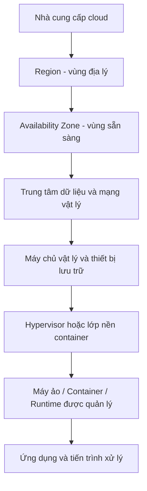
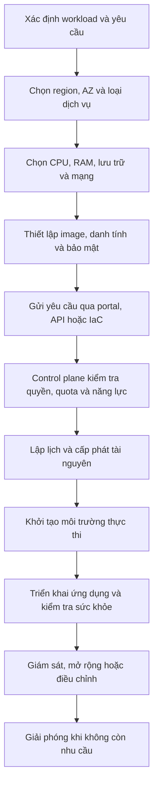
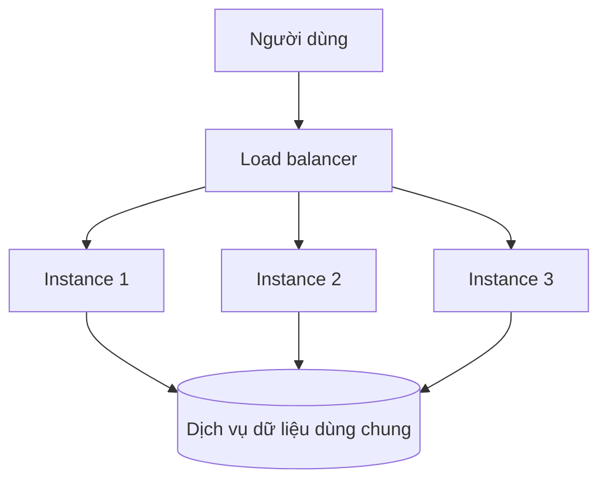

# Cloud compute là gì và tài nguyên tính toán được cung cấp như thế nào

Một ứng dụng cần nơi để thực thi mã, xử lý dữ liệu và trao đổi thông tin qua mạng. Trước đây, tổ chức thường phải mua máy chủ, đặt tại trung tâm dữ liệu, kết nối mạng, cài đặt hệ điều hành rồi tự quản lý công suất. Với **cloud compute (tính toán đám mây)**, tổ chức có thể yêu cầu năng lực tính toán từ nhà cung cấp đám mây qua giao diện quản trị, API hoặc công cụ tự động hóa. Tài nguyên được cấp phát theo cấu hình và thời gian sử dụng, có thể tăng, giảm hoặc giải phóng khi nhu cầu thay đổi.

Cloud compute là nền tảng để chạy website, API, hệ thống xử lý giao dịch, ứng dụng phân tích dữ liệu, tác vụ nền và nhiều loại phần mềm khác. Người dùng lựa chọn tài nguyên như CPU, bộ nhớ, lưu trữ và mạng; nhà cung cấp vận hành hạ tầng vật lý và các lớp dịch vụ bên dưới theo phạm vi của dịch vụ đã chọn.

Sau bài học, bạn có thể:

- Giải thích cloud compute và những đặc điểm làm cho tài nguyên đám mây có thể được yêu cầu theo nhu cầu.
- Mô tả cách tài nguyên được tổ chức từ trung tâm dữ liệu, vùng địa lý đến máy chủ và môi trường thực thi.
- Nhận diện vai trò của CPU, bộ nhớ, lưu trữ, mạng và bộ tăng tốc trong một workload.
- Trình bày quy trình cấp phát, cấu hình, giám sát, mở rộng và giải phóng tài nguyên.
- Đưa ra lựa chọn ban đầu về cấu hình, vị trí triển khai, bảo mật và chi phí cho một ứng dụng.

## 1. Cloud compute là gì?

**Cloud compute là việc sử dụng năng lực xử lý được cung cấp qua mạng như một dịch vụ.** Thay vì trực tiếp mua và vận hành máy chủ vật lý, người dùng yêu cầu một lượng tài nguyên phù hợp với workload. Tùy dịch vụ, đơn vị được cấp có thể là máy ảo, máy chủ vật lý chuyên dụng, container, môi trường chạy ứng dụng hoặc hàm xử lý theo sự kiện.

Nhà cung cấp xây dựng một hạ tầng gồm máy chủ, thiết bị lưu trữ, mạng, hệ thống ảo hóa và phần mềm quản lý. Nhiều khách hàng có thể sử dụng chung một nguồn tài nguyên vật lý thông qua cơ chế phân chia và cách ly. Hệ thống quản lý tiếp nhận yêu cầu, kiểm tra quyền và quota, tìm nơi có đủ năng lực, cấu hình tài nguyên rồi cung cấp điểm truy cập để người dùng triển khai ứng dụng.

Điểm cốt lõi của cloud compute là người dùng có thể tập trung vào nhu cầu của workload và mức dịch vụ cần thiết. Họ vẫn phải chọn cấu hình, thiết lập bảo mật, theo dõi ứng dụng và kiểm soát chi phí; mức độ phải quản lý máy chủ phụ thuộc vào loại dịch vụ được sử dụng.

### Những đặc điểm cơ bản của điện toán đám mây

Cloud compute thường thể hiện năm đặc điểm sau:

1. **Tự phục vụ theo nhu cầu:** người dùng có thể tạo hoặc thay đổi tài nguyên qua portal, API hoặc mã cấu hình mà không phải yêu cầu nhà cung cấp thao tác thủ công cho từng lần cấp phát.
2. **Truy cập qua mạng:** tài nguyên và dịch vụ được truy cập bằng các giao thức mạng tiêu chuẩn từ thiết bị hoặc hệ thống có quyền.
3. **Gộp và chia sẻ tài nguyên:** nhà cung cấp điều phối một nhóm tài nguyên dùng chung cho nhiều khách hàng, đồng thời áp dụng cơ chế cách ly phù hợp.
4. **Co giãn nhanh:** năng lực có thể tăng hoặc giảm theo nhu cầu trong giới hạn kỹ thuật, quota và dung lượng sẵn có.
5. **Đo lường dịch vụ:** mức sử dụng được ghi nhận để giám sát, phân bổ hoặc tính phí, chẳng hạn thời gian chạy, CPU, bộ nhớ, dung lượng lưu trữ, request hay lưu lượng mạng.

Những đặc điểm này giúp đám mây phù hợp với nhu cầu biến động. Một nhóm có thể tạo môi trường thử nghiệm trong thời gian ngắn, tăng số máy khi có chiến dịch bán hàng, rồi giải phóng chúng khi công việc kết thúc.

## 2. Từ trung tâm dữ liệu đến môi trường chạy ứng dụng

Tài nguyên đám mây vẫn chạy trên phần cứng thật. Nhà cung cấp tổ chức phần cứng thành các lớp để có thể cấp phát, cách ly, theo dõi và phục hồi tài nguyên ở quy mô lớn.



### Region và Availability Zone

**Region (vùng địa lý)** là khu vực địa lý nơi nhà cung cấp đặt hạ tầng đám mây. Một region thường có nhiều trung tâm dữ liệu hoặc vùng sẵn sàng. Khi chọn region, cần xem xét vị trí người dùng, độ trễ mạng, yêu cầu lưu trú dữ liệu, dịch vụ có sẵn, khả năng kết nối và giá.

**Availability Zone (AZ, vùng sẵn sàng)** là một miền hạ tầng được thiết kế để giảm ảnh hưởng của một số sự cố cục bộ. Các AZ trong cùng region thường có nguồn điện, làm mát và mạng độc lập ở mức nhất định, đồng thời được kết nối với nhau bằng mạng có độ trễ thấp. Cách định nghĩa và mức độc lập cụ thể khác nhau theo nhà cung cấp.

Chạy nhiều bản sao ứng dụng trong một AZ có thể bảo vệ ứng dụng trước lỗi tiến trình hoặc máy chủ đơn lẻ, nhưng chưa chắc bảo vệ được khi cả AZ gặp sự cố. Với workload quan trọng, có thể phân bố các bản sao qua nhiều AZ, đặt bộ cân bằng tải phía trước và bảo đảm dữ liệu có cơ chế sao chép hoặc phục hồi phù hợp.

### Máy chủ vật lý, hypervisor và máy ảo

Máy chủ vật lý có CPU, RAM, thiết bị lưu trữ và card mạng. **Hypervisor** là lớp phần mềm cho phép tạo và quản lý nhiều máy ảo trên một máy chủ vật lý. Mỗi máy ảo được cấp một tập tài nguyên logic, có hệ điều hành khách và được cách ly với các máy ảo khác theo cơ chế của nền tảng.

Một máy ảo có thể được tạo từ image (ảnh máy) chứa hệ điều hành và cấu hình ban đầu. Người dùng chọn kích thước máy, ổ đĩa, mạng và các thiết lập bảo mật; nền tảng tìm máy chủ phù hợp rồi khởi tạo máy ảo. Việc di chuyển hoặc thay thế máy ảo có thể được nền tảng hỗ trợ, nhưng ứng dụng vẫn cần được thiết kế để chịu được lỗi và gián đoạn.

Container thường chia sẻ kernel của hệ điều hành host và đóng gói ứng dụng cùng phụ thuộc. Một dịch vụ container có thể điều phối container trên một nhóm máy chủ. Với dịch vụ serverless hoặc FaaS, nhà cung cấp quản lý sâu hơn môi trường thực thi và kích hoạt mã khi có request hoặc sự kiện. Các mô hình này là những cách tiêu thụ năng lực tính toán khác nhau; bài học tiếp theo sẽ phân tích riêng ranh giới quản lý của từng mô hình.

### Control plane và data plane

Trong nhiều nền tảng đám mây, có thể phân biệt hai nhóm chức năng:

- **Control plane (mặt phẳng điều khiển):** tiếp nhận thao tác tạo, sửa, xóa tài nguyên; xác thực quyền; kiểm tra quota; lập lịch; lưu cấu hình và điều phối trạng thái mong muốn.
- **Data plane (mặt phẳng dữ liệu):** nơi workload thực sự chạy và xử lý lưu lượng, dữ liệu hoặc request của ứng dụng.

Ví dụ, khi gửi yêu cầu tạo máy ảo, control plane xử lý yêu cầu và điều phối việc cấp phát. Sau khi máy ảo khởi động, ứng dụng chạy trên máy ảo thuộc data plane. Nếu control plane tạm thời không truy cập được, workload đang chạy có thể vẫn tiếp tục hoạt động, tùy kiến trúc dịch vụ; tuy nhiên thao tác quản trị mới có thể bị ảnh hưởng.

## 3. Những tài nguyên cấu thành năng lực tính toán

Một workload không chỉ cần CPU. Hiệu năng và độ ổn định phụ thuộc vào sự cân đối giữa CPU, bộ nhớ, lưu trữ, mạng và đôi khi cả bộ tăng tốc chuyên dụng.

### CPU: năng lực xử lý lệnh

CPU thực thi các lệnh của chương trình. Khi chọn cấu hình, bạn có thể gặp các khái niệm:

- **Core (lõi):** đơn vị xử lý vật lý bên trong CPU.
- **Thread (luồng phần cứng):** luồng thực thi mà CPU có thể lập lịch; một lõi có thể hỗ trợ nhiều luồng phần cứng tùy kiến trúc.
- **vCPU:** đơn vị CPU logic mà nhà cung cấp hiển thị hoặc cấp cho máy ảo và dịch vụ. Một vCPU có thể tương ứng với một luồng phần cứng hoặc cách chia sẻ thời gian xử lý tùy nền tảng; không nên mặc định một vCPU luôn bằng một lõi vật lý.
- **Kiến trúc CPU:** ví dụ x86-64 hoặc ARM64. Ứng dụng, image và thư viện native phải tương thích với kiến trúc được chọn.

Nhiều vCPU giúp workload xử lý song song tốt hơn nếu ứng dụng có thể sử dụng nhiều luồng. Tuy nhiên, tăng vCPU không đảm bảo hiệu năng tăng tuyến tính. Một tiến trình đơn luồng có thể bị giới hạn bởi hiệu năng của một lõi; workload chờ mạng hoặc đĩa có thể không tận dụng hết CPU; giới hạn chia sẻ tài nguyên cũng ảnh hưởng hiệu năng thực tế.

Một số cấu hình có khả năng **burst**: trong điều kiện nhất định, máy được dùng CPU cao hơn mức cơ sở trong một khoảng thời gian, thường dựa trên cơ chế tín dụng hoặc giới hạn của nhà cung cấp. Loại cấu hình này phù hợp với tải thấp phần lớn thời gian nhưng có đợt tăng ngắn. Với tải CPU cao liên tục, cần chọn cấu hình có năng lực ổn định và kiểm tra giới hạn hiệu năng.

### Bộ nhớ RAM: nơi giữ dữ liệu đang được xử lý

RAM lưu dữ liệu và trạng thái mà tiến trình đang sử dụng để CPU truy cập nhanh. Thiếu RAM có thể làm hệ điều hành phải dùng swap, khiến hiệu năng giảm mạnh; trong một số môi trường, tiến trình hoặc container có thể bị kết thúc khi vượt giới hạn bộ nhớ.

Khi ước lượng RAM, hãy tính bộ nhớ của runtime, heap, cache, thread, kết nối, thư viện và phần đệm cho tải đỉnh. Theo dõi mức sử dụng thực tế, bộ nhớ đỉnh và dấu hiệu áp lực bộ nhớ. Chỉ nhìn mức trung bình có thể bỏ sót những đợt tăng đột biến.

RAM khác với lưu trữ lâu dài. Dữ liệu trong RAM thường mất khi máy hoặc tiến trình dừng. Dữ liệu cần giữ qua lần khởi động lại phải được ghi vào hệ thống lưu trữ phù hợp.

### Lưu trữ: giữ hệ điều hành, tệp và dữ liệu

Lưu trữ đám mây có nhiều loại, với đặc tính độ trễ, thông lượng, độ bền và cách truy cập khác nhau.

| Loại lưu trữ | Cách sử dụng thường gặp | Điểm cần cân nhắc |
|---|---|---|
| Block storage | Gắn như ổ đĩa cho máy ảo; lưu hệ điều hành, cơ sở dữ liệu hoặc dữ liệu cần truy cập theo block | Dung lượng, IOPS, thông lượng, độ trễ, snapshot và chính sách sao lưu |
| File storage | Chia sẻ thư mục và tệp qua nhiều máy hoặc workload | Giao thức truy cập, quyền file, độ trễ, thông lượng và số lượng kết nối |
| Object storage | Lưu ảnh, video, bản sao lưu, log, tệp tải lên và dữ liệu phi cấu trúc | API truy cập, vòng đời dữ liệu, lớp lưu trữ, độ trễ lấy dữ liệu và phí request |
| Local/ephemeral storage | Dữ liệu tạm, cache hoặc tệp xử lý trung gian trên máy chủ/instance | Có thể mất khi instance bị thay thế, dừng hoặc di chuyển; không dùng làm nơi duy nhất giữ dữ liệu quan trọng |

Ba chỉ số thường gặp khi đánh giá hiệu năng lưu trữ:

- **Latency (độ trễ):** thời gian từ khi gửi thao tác đọc/ghi đến khi nhận phản hồi.
- **IOPS:** số thao tác vào/ra mỗi giây.
- **Throughput (thông lượng):** lượng dữ liệu đọc/ghi trong một đơn vị thời gian, thường đo bằng MB/s hoặc GB/s.

Workload cơ sở dữ liệu có thể nhạy với độ trễ và IOPS; xử lý video hoặc sao chép tệp lớn có thể cần thông lượng cao. Hãy đo kiểu truy cập thực tế thay vì chỉ chọn ổ đĩa theo dung lượng.

### Mạng: kết nối người dùng và các thành phần

Mạng cho phép ứng dụng nhận request, gọi dịch vụ khác, truy cập dữ liệu và trao đổi giữa các vùng. Một môi trường đám mây thường cung cấp mạng ảo riêng, subnet, route, địa chỉ IP, firewall hoặc security group, DNS, load balancer và các cổng kết nối ra/vào.

Khi đánh giá mạng, cần quan tâm:

- **Băng thông:** lượng dữ liệu tối đa có thể truyền trong một đơn vị thời gian.
- **Độ trễ:** thời gian truyền và phản hồi giữa hai điểm; khoảng cách địa lý và số chặng mạng có thể ảnh hưởng.
- **Thông lượng thực tế:** lượng dữ liệu ứng dụng truyền thành công, chịu ảnh hưởng của giao thức, tắc nghẽn, giới hạn dịch vụ và cấu hình.
- **Ingress và egress:** dữ liệu đi vào và đi ra khỏi một dịch vụ hoặc vùng mạng. Một số nhà cung cấp tính phí một số loại lưu lượng đi ra hoặc lưu lượng liên vùng.
- **Phân đoạn và kiểm soát truy cập:** subnet, route, firewall và security group xác định workload nào được phép giao tiếp với workload nào.

Không nên mở toàn bộ cổng ra Internet chỉ để ứng dụng hoạt động. Hãy chỉ công khai endpoint cần thiết, đặt dịch vụ nội bộ trong mạng riêng và cho phép luồng giao tiếp tối thiểu giữa các thành phần.

### GPU và bộ tăng tốc

Một số workload cần GPU hoặc bộ tăng tốc chuyên dụng để xử lý song song số lượng lớn phép tính. Ví dụ gồm huấn luyện và suy luận mô hình học máy, xử lý ảnh/video, mô phỏng khoa học và tính toán kỹ thuật.

GPU không tự động làm mọi ứng dụng nhanh hơn. Chương trình phải hỗ trợ thư viện và kiến trúc tăng tốc tương ứng; dữ liệu phải được chuyển đến thiết bị; bộ nhớ GPU và khả năng chia sẻ thiết bị cũng là giới hạn cần xem xét. GPU thường có giá cao hơn cấu hình CPU thông thường, nên cần đo mức sử dụng và thời gian hoàn thành công việc để xác định hiệu quả.

## 4. Tài nguyên được cấp phát như thế nào?

Quá trình cấp phát thường bắt đầu bằng một yêu cầu mô tả workload cần chạy và kết thúc khi người dùng nhận được tài nguyên có thể truy cập. Tên bước và mức tự động hóa khác nhau giữa các nhà cung cấp, nhưng quy trình tổng quát như sau:



### Bước 1: xác định yêu cầu của workload

Trước khi chọn cấu hình, hãy hiểu ứng dụng làm gì và cần đáp ứng mức tải nào. Các thông tin hữu ích gồm:

- Loại xử lý: API, website, worker, batch, cơ sở dữ liệu tự quản lý hay tác vụ theo sự kiện.
- Mức tải: request/giây, số người dùng đồng thời, số tác vụ mỗi giờ, kích thước dữ liệu và xu hướng tăng trưởng.
- Đặc tính tài nguyên: CPU-bound, memory-bound, I/O-bound hay network-bound.
- Mục tiêu chất lượng: độ trễ phản hồi, thông lượng, tỷ lệ lỗi và thời gian hoạt động.
- Ràng buộc: hệ điều hành, kiến trúc CPU, thư viện, vị trí dữ liệu, kết nối mạng và yêu cầu bảo mật.

Nếu chưa có số đo, hãy tạo một giả định ban đầu, triển khai thử và thu thập số liệu. Tránh chọn cấu hình chỉ dựa trên cảm giác hoặc sao chép cấu hình của một ứng dụng khác.

### Bước 2: chọn vị trí và phạm vi triển khai

Chọn region gần nhóm người dùng hoặc hệ thống phụ thuộc để giảm độ trễ. Kiểm tra yêu cầu lưu trú dữ liệu, các dịch vụ cần dùng có sẵn trong region đó hay không, khả năng kết nối đến mạng hiện hữu và chi phí liên vùng. Với ứng dụng quan trọng, xác định có cần nhiều AZ hoặc một region dự phòng không.

### Bước 3: chọn kích thước tài nguyên

Chọn số vCPU, RAM, dung lượng và loại lưu trữ, băng thông hoặc cấu hình mạng theo đặc tính workload. Một số nhà cung cấp có nhóm cấu hình tối ưu cho mục đích chung, CPU, bộ nhớ, lưu trữ hoặc GPU. Tên nhóm và tỷ lệ tài nguyên không giống nhau giữa các nền tảng.

Hãy xem xét cả năng lực hiện tại và khoảng dự phòng. Cấu hình quá nhỏ gây nghẽn hoặc lỗi; cấu hình quá lớn làm tăng chi phí và có thể che giấu vấn đề tối ưu trong ứng dụng.

### Bước 4: chọn image và cấu hình khởi tạo

Với máy ảo, image có thể chứa hệ điều hành và phần mềm cơ sở. Người dùng có thể dùng image chuẩn của nhà cung cấp hoặc image đã được tổ chức kiểm tra, vá lỗi và phê duyệt. Cần kiểm tra nguồn gốc image, phiên bản, kiến trúc CPU, bản vá và cách cập nhật.

Thông tin khởi tạo cũng có thể gồm hostname, khóa truy cập, user data hoặc cloud-init, biến môi trường và agent giám sát. Không đưa mật khẩu hay khóa bí mật dạng rõ vào script khởi tạo hoặc metadata có thể bị người không có thẩm quyền đọc.

### Bước 5: cấu hình mạng và quyền

Đặt tài nguyên vào mạng ảo và subnet phù hợp. Xác định endpoint nào cần công khai, cổng nào được phép, cách truy cập quản trị, DNS, định tuyến và kết nối đến dịch vụ dữ liệu. Gắn danh tính hoặc service account với quyền tối thiểu cần thiết.

Một yêu cầu cấp phát thành công không có nghĩa tài nguyên đã sẵn sàng phục vụ người dùng. Cần kiểm tra kết nối, health check, log và khả năng truy cập đến các phụ thuộc như cơ sở dữ liệu, hàng đợi hoặc dịch vụ lưu trữ.

### Bước 6: triển khai, quan sát và điều chỉnh

Sau khi môi trường được tạo, triển khai ứng dụng, chạy kiểm tra sức khỏe và bật giám sát. Các chỉ số ban đầu nên gồm CPU, RAM, dung lượng đĩa, I/O, lưu lượng mạng, độ trễ ứng dụng, số request, tỷ lệ lỗi và số instance đang chạy.

Khi có dữ liệu, điều chỉnh kích thước, giới hạn, số bản sao và chính sách mở rộng. Khi workload kết thúc, xóa hoặc tắt tài nguyên không còn cần thiết, đồng thời giữ lại dữ liệu, log và bản sao lưu theo chính sách của tổ chức.

## 5. Các cách tiêu thụ và thanh toán năng lực tính toán

Nhà cung cấp có thể cung cấp nhiều lựa chọn giá và thời hạn sử dụng. Tên thương mại khác nhau, nhưng thường có các kiểu sau:

| Kiểu sử dụng | Đặc điểm | Phù hợp với |
|---|---|---|
| On-demand (theo nhu cầu) | Tạo tài nguyên khi cần, thanh toán theo đơn vị đo và thời gian sử dụng của dịch vụ | Thử nghiệm, tải biến động, workload chưa dự đoán được |
| Commitment/reserved (cam kết hoặc đặt trước) | Cam kết mức sử dụng hoặc thời hạn để nhận mức giá ưu đãi theo điều kiện nhà cung cấp | Workload nền ổn định, có thể dự báo trong thời gian dài |
| Spot/preemptible (năng lực dư thừa có thể bị thu hồi) | Giá có thể thấp hơn, nhưng tài nguyên có thể bị thu hồi khi nhà cung cấp cần dung lượng | Batch có thể chạy lại, xử lý phân tán chịu được gián đoạn |
| Dedicated/bare metal (máy chủ chuyên dụng) | Cấp máy chủ vật lý hoặc năng lực chuyên dụng theo yêu cầu | Workload cần hiệu năng, cách ly hoặc quyền kiểm soát phần cứng đặc thù |

Không nên đặt workload quan trọng duy nhất trên năng lực có thể bị thu hồi nếu ứng dụng không có cơ chế checkpoint, retry hoặc chuyển tải. Với lựa chọn cam kết, cần dự báo mức dùng và hiểu điều kiện thay đổi, chuyển đổi hoặc chấm dứt cam kết.

### Quota, giới hạn và dung lượng khả dụng

**Quota** là hạn mức mà tài khoản, dự án hoặc vùng được phép sử dụng, ví dụ số vCPU, số địa chỉ IP hoặc số máy ảo. Quota giúp kiểm soát sử dụng và tránh cấp phát vượt mức dự kiến. Khi nhu cầu tăng, nhóm có thể cần gửi yêu cầu nâng quota trước.

Quota được phép không đồng nghĩa với việc mọi cấu hình luôn có sẵn ngay tại thời điểm yêu cầu. Dung lượng của một loại máy hoặc GPU trong một AZ có thể hạn chế. Vì vậy, hệ thống quan trọng nên có phương án thay thế như loại instance tương đương, AZ khác hoặc giới hạn tải an toàn.

## 6. Chọn cấu hình theo đặc tính workload

Một cấu hình tốt cân bằng tài nguyên và mục tiêu dịch vụ. Hãy xác định thành phần nào đang giới hạn hiệu năng trước khi tăng tài nguyên.

| Dấu hiệu quan sát | Nút thắt có thể gặp | Hướng kiểm tra |
|---|---|---|
| CPU thường xuyên gần mức tối đa, hàng đợi request tăng | Thiếu năng lực CPU hoặc mã xử lý chưa hiệu quả | Profiling, tối ưu thuật toán, tăng vCPU hoặc mở rộng ngang |
| RAM tăng liên tục, swap nhiều hoặc tiến trình bị kết thúc | Thiếu bộ nhớ, rò rỉ bộ nhớ hoặc cache quá lớn | Phân tích heap, giới hạn cache, kiểm tra memory leak, tăng RAM nếu cần |
| Độ trễ đọc/ghi cao, I/O queue tăng | Lưu trữ không đáp ứng kiểu truy cập | Kiểm tra IOPS, throughput, latency, kích thước block và mô hình dữ liệu |
| CPU thấp nhưng request chậm, kết nối chờ lâu | Chờ mạng, dịch vụ phụ thuộc hoặc khóa đồng bộ | Đo latency từng chặng, kiểm tra DNS, kết nối, timeout và giới hạn dịch vụ phụ thuộc |
| Lưu lượng mạng chạm giới hạn hoặc truyền dữ liệu chậm | Thiếu băng thông hoặc đường truyền không tối ưu | Đo throughput, packet loss, vị trí vùng và lưu lượng liên vùng |

Các dấu hiệu này là gợi ý chẩn đoán, không phải kết luận tự động. Ví dụ, CPU cao có thể do tải tăng thật hoặc vòng lặp lỗi; RAM cao có thể là cache được dùng hiệu quả hoặc rò rỉ. Cần kết hợp số liệu hạ tầng với metric và trace của ứng dụng.

### Ví dụ cấu hình ở mức khái niệm

Giả sử một API quản lý đơn hàng cần chạy liên tục, phục vụ người dùng tại một khu vực và có tải tăng vào giờ cao điểm. Một bản mô tả yêu cầu ban đầu có thể như sau:

```yaml
workload: order-api
runtime: linux
compute:
  vcpu: 4
  memory: 16 GiB
storage:
  root_volume: 50 GiB
  persistent_data: managed-database
network:
  placement: private-subnet
  ingress: load-balancer
availability:
  zones: 2
scaling:
  minimum_instances: 2
  maximum_instances: 8
  signal: request_rate_and_latency
security:
  identity: workload-service-account
  inbound: allow_only_load_balancer
```

Đây là mô tả minh họa, không phải cấu hình có thể áp dụng trực tiếp cho một nhà cung cấp cụ thể. Các giá trị vCPU, RAM, dung lượng và số instance cần được xác nhận bằng kiểm thử tải. Dữ liệu lâu dài được đặt ở dịch vụ dữ liệu riêng để instance ứng dụng có thể thay thế mà không làm mất đơn hàng.

## 7. Mở rộng năng lực tính toán

Khi lượng request hoặc công việc tăng, ứng dụng cần thêm năng lực. Có hai hướng mở rộng cơ bản.

### Mở rộng theo chiều dọc (vertical scaling)

Tăng tài nguyên cho một instance, ví dụ chuyển từ 2 vCPU/8 GiB RAM lên 4 vCPU/16 GiB RAM. Cách này thường dễ thực hiện với ứng dụng cũ hoặc ứng dụng khó chia nhỏ, nhưng bị giới hạn bởi kích thước máy tối đa, thời gian thay đổi cấu hình và khả năng chịu lỗi của một instance lớn.

### Mở rộng theo chiều ngang (horizontal scaling)

Tăng số instance hoặc bản sao workload để chia tải. Bộ cân bằng tải phân phối request đến các bản sao khỏe mạnh. Cách này có thể tăng thông lượng và giảm phụ thuộc vào một máy, nhưng ứng dụng cần xử lý trạng thái dùng chung và đồng bộ giữa các bản sao.



Ứng dụng mở rộng ngang thường nên giữ trạng thái phiên ở dịch vụ dùng chung hoặc dùng token phù hợp, tránh lưu dữ liệu quan trọng chỉ trong bộ nhớ của một instance. Các tác vụ nền có thể dùng hàng đợi để tách tốc độ tiếp nhận request khỏi tốc độ xử lý.

### Autoscaling

Autoscaling tự điều chỉnh số lượng hoặc kích thước tài nguyên dựa trên tín hiệu và chính sách đã khai báo. Tín hiệu có thể là CPU, RAM, request/giây, độ trễ, số tác vụ trong hàng đợi hoặc lịch dự báo.

Một chính sách autoscaling cần có:

- Mức tối thiểu để duy trì năng lực nền và mức tối đa để giới hạn chi phí.
- Ngưỡng hoặc mục tiêu kích hoạt tăng/giảm tài nguyên.
- Khoảng thời gian quan sát và thời gian chờ giữa các lần thay đổi để tránh dao động liên tục.
- Health check và cơ chế loại instance lỗi khỏi luồng phục vụ.
- Kiểm tra quota, dung lượng vùng và khả năng chịu tải của cơ sở dữ liệu hoặc dịch vụ phụ thuộc.

Autoscaling không thay thế thiết kế ứng dụng tốt. Nếu một cơ sở dữ liệu chỉ chịu được 100 kết nối, việc tự động tăng hàng trăm instance API có thể khiến toàn hệ thống quá tải. Cần đặt giới hạn kết nối, dùng connection pool, cache hoặc hàng đợi khi thích hợp.

## 8. Tính sẵn sàng và khả năng phục hồi

**Tính sẵn sàng** thể hiện khả năng hệ thống cung cấp dịch vụ khi người dùng cần. **Khả năng phục hồi** là khả năng tiếp tục hoặc khôi phục hoạt động sau sự cố. Cấp phát nhiều CPU hơn không tự động làm hệ thống sẵn sàng hơn.

Các biện pháp thường dùng gồm:

1. Chạy nhiều bản sao ứng dụng và phân bố qua các miền lỗi hoặc AZ khi phù hợp.
2. Dùng load balancer và health check để tránh gửi request đến instance không khỏe.
3. Thiết kế ứng dụng không phụ thuộc trạng thái cục bộ của một máy; lưu dữ liệu quan trọng ở dịch vụ lưu trữ bền vững.
4. Sao lưu dữ liệu và kiểm tra khả năng khôi phục định kỳ.
5. Đặt timeout, retry có giới hạn, backoff và circuit breaker để lỗi ở một phụ thuộc không lan rộng.
6. Kiểm thử tình huống mất instance, mất AZ hoặc lỗi dịch vụ phụ thuộc trong phạm vi cho phép.

Hai khái niệm thường dùng khi lập kế hoạch phục hồi:

- **RTO (Recovery Time Objective):** khoảng thời gian mục tiêu để khôi phục dịch vụ sau gián đoạn.
- **RPO (Recovery Point Objective):** lượng dữ liệu tối đa có thể chấp nhận mất, thường thể hiện bằng khoảng thời gian dữ liệu.

RTO và RPO càng nghiêm ngặt thường đòi hỏi thiết kế dự phòng, sao chép dữ liệu và kiểm thử phục hồi kỹ hơn, dẫn đến chi phí cao hơn. Hãy xác định mục tiêu theo mức độ quan trọng của workload.

## 9. Bảo mật khi cấp phát và vận hành compute

Nhà cung cấp bảo vệ trung tâm dữ liệu, phần cứng và các lớp nền tảng thuộc phạm vi dịch vụ. Khách hàng vẫn phải bảo vệ tài khoản, cấu hình tài nguyên, hệ điều hành hoặc image do mình quản lý, ứng dụng và dữ liệu. Ranh giới trách nhiệm thay đổi theo dịch vụ, vì vậy cần xác nhận trong tài liệu của nhà cung cấp.

Những nguyên tắc quan trọng khi triển khai compute:

- **Identity and Access Management (IAM):** cấp quyền tối thiểu theo vai trò; tách quyền tạo tài nguyên, triển khai ứng dụng và truy cập dữ liệu; bật xác thực mạnh cho tài khoản quản trị.
- **Network security:** đặt workload vào subnet phù hợp, giới hạn inbound/outbound, chỉ công khai endpoint cần thiết và dùng kết nối riêng cho thành phần nội bộ.
- **Image và bản vá:** dùng image có nguồn gốc đáng tin cậy, cập nhật hệ điều hành, runtime và thư viện theo lịch; loại bỏ image cũ hoặc không còn được hỗ trợ.
- **Secrets:** lưu mật khẩu, token và khóa trong dịch vụ quản lý bí mật; cấp quyền truy cập theo danh tính workload và luân chuyển khi cần.
- **Encryption:** mã hóa dữ liệu khi truyền và khi lưu trữ theo yêu cầu; quản lý khóa và quyền sử dụng khóa phù hợp.
- **Logging và monitoring:** ghi nhận thao tác quản trị, truy cập và sự kiện bảo mật; không ghi dữ liệu nhạy cảm vào log.
- **Isolation:** tránh chạy workload không tin cậy với quyền đặc biệt; cấu hình cách ly tài nguyên và quyền hệ thống phù hợp.

Một máy ảo vừa tạo với cổng quản trị mở ra toàn Internet và mật khẩu dùng chung có thể bị xâm nhập dù hạ tầng vật lý của nhà cung cấp được bảo vệ tốt. Bảo mật phải được cấu hình ngay từ lúc cấp phát.

## 10. Hiểu chi phí của compute

Chi phí compute thường phụ thuộc vào loại tài nguyên, kích thước, vùng triển khai, thời gian chạy và mô hình giá. Ngoài CPU và RAM, hóa đơn có thể bao gồm lưu trữ, snapshot, IP, load balancer, truyền dữ liệu, log, giám sát, hỗ trợ và các dịch vụ phụ trợ.

Một số nguyên tắc kiểm soát chi phí:

1. **Right-size:** chọn cấu hình dựa trên số đo CPU, RAM, I/O và độ trễ; xem xét hạ cấp nếu tài nguyên thường xuyên nhàn rỗi.
2. **Tắt tài nguyên không dùng:** dừng hoặc xóa môi trường thử nghiệm theo lịch; kiểm tra đĩa, IP và snapshot còn tính phí sau khi máy đã dừng hay không.
3. **Tự động mở rộng có giới hạn:** đặt min/max và cảnh báo chi phí để tránh số lượng instance tăng ngoài dự kiến.
4. **Chọn mô hình giá đúng workload:** cân nhắc cam kết cho tải ổn định; dùng năng lực có thể thu hồi cho batch có thể chạy lại.
5. **Tối ưu dữ liệu và mạng:** chọn lớp lưu trữ theo tần suất truy cập, xóa dữ liệu hết hạn và giảm truyền dữ liệu không cần thiết giữa region.
6. **Gắn nhãn tài nguyên:** dùng tag/label cho ứng dụng, môi trường, nhóm sở hữu và trung tâm chi phí để phân bổ hóa đơn.

Nên so sánh chi phí trên cùng một đơn vị công việc, chẳng hạn chi phí cho 1.000 request thành công hoặc một lần xử lý batch, đồng thời đặt cùng yêu cầu độ trễ và tính sẵn sàng. Máy rẻ hơn nhưng xử lý chậm hơn hoặc cần nhiều người vận hành hơn chưa chắc là lựa chọn kinh tế hơn.

## 11. Ví dụ: cấp phát năng lực cho một API bán hàng

Một cửa hàng trực tuyến chuẩn bị cho chương trình khuyến mại. API nhận yêu cầu xem sản phẩm và tạo đơn; lượng truy cập tăng mạnh trong một số khung giờ.

**Phân tích workload:** nhóm đo request/giây, tỷ lệ đọc/ghi, độ trễ p95, số kết nối đến cơ sở dữ liệu và mức sử dụng CPU/RAM. Kết quả cho thấy API cần nhiều bản sao để phục vụ tải tăng, trong khi dữ liệu đơn hàng cần lưu bền vững.

**Chọn vị trí:** nhóm chọn region gần khách hàng chính, kiểm tra yêu cầu lưu trú dữ liệu và triển khai bản sao qua hai AZ để giảm rủi ro lỗi cục bộ.

**Cấp phát:** nhóm tạo các instance ứng dụng trong subnet riêng, đặt load balancer ở phía trước, chỉ cho phép lưu lượng ứng dụng từ load balancer và cấp danh tính riêng để API truy cập cơ sở dữ liệu. Cấu hình ban đầu được kiểm thử dưới tải đại diện.

**Mở rộng:** chính sách autoscaling tăng số instance khi request rate và độ trễ vượt mục tiêu, với giới hạn tối đa. Nhóm đồng thời theo dõi số kết nối cơ sở dữ liệu để tránh việc API mở rộng nhanh hơn năng lực xử lý dữ liệu.

**Vận hành và chi phí:** dashboard hiển thị CPU, RAM, lỗi, độ trễ, số instance và chi phí theo tag. Sau chương trình, số instance giảm về mức nền; môi trường thử nghiệm được tắt theo lịch.

Ví dụ này cho thấy cấp phát compute là một quyết định tổng thể: cấu hình máy chỉ là một phần, còn region, mạng, quyền truy cập, dữ liệu, khả năng mở rộng và quan sát cũng quyết định ứng dụng có vận hành tốt hay không.

## 12. Những hiểu lầm thường gặp

**“Cloud compute là máy chủ ảo.”** Máy ảo là một cách cung cấp compute. Năng lực tính toán đám mây còn có thể được cung cấp qua máy chủ chuyên dụng, container, nền tảng ứng dụng hoặc hàm serverless.

**“Một vCPU luôn bằng một lõi CPU vật lý.”** vCPU là đơn vị logic do nền tảng cấp. Cách ánh xạ và chia sẻ phụ thuộc kiến trúc phần cứng, loại máy và chính sách của nhà cung cấp.

**“Tăng CPU sẽ giải quyết mọi vấn đề hiệu năng.”** Ứng dụng có thể bị giới hạn bởi RAM, I/O, mạng, khóa đồng bộ hoặc dịch vụ phụ thuộc. Cần tìm nút thắt bằng số liệu trước khi tăng cấu hình.

**“Tắt máy ảo là không còn chi phí.”** Đĩa, snapshot, địa chỉ IP, lưu lượng hoặc một số tài nguyên liên quan vẫn có thể phát sinh phí sau khi máy dừng. Hãy kiểm tra bảng giá và trạng thái từng tài nguyên.

**“Có nhiều instance là đã có high availability.”** Các instance có thể cùng nằm trong một AZ hoặc cùng phụ thuộc vào một dịch vụ dữ liệu đơn lẻ. Cần phân tích miền lỗi và kiểm thử phục hồi.

**“Tài nguyên được cấp phát luôn sẵn có ngay.”** Quota, giới hạn dịch vụ và dung lượng tại một vùng có thể khiến yêu cầu bị từ chối hoặc phải chọn cấu hình khác. Workload quan trọng cần có kế hoạch năng lực và phương án thay thế.

## 13. Quy trình kiểm tra trước khi đưa compute vào sử dụng

Trước khi triển khai môi trường mới, hãy kiểm tra các câu hỏi sau:

- Workload cần xử lý loại công việc nào và mức tải dự kiến là bao nhiêu?
- Đã xác định nút thắt chính có thể nằm ở CPU, RAM, lưu trữ hay mạng chưa?
- Region và AZ đáp ứng độ trễ, lưu trú dữ liệu và tính sẵn sàng chưa?
- Cấu hình tài nguyên có căn cứ đo lường và có khoảng dự phòng hợp lý chưa?
- Image, runtime và kiến trúc CPU có tương thích, được cập nhật và đáng tin cậy không?
- Mạng có phân đoạn hợp lý; cổng công khai và quyền truy cập đã được giới hạn chưa?
- Có metric, log, cảnh báo, health check và quy trình xử lý sự cố chưa?
- Đã xác định quota, giới hạn mở rộng và chi phí khi tải tăng đột biến chưa?
- Dữ liệu có bản sao lưu và quy trình phục hồi được kiểm tra chưa?
- Có lịch rà soát, tắt hoặc giải phóng tài nguyên không còn cần thiết không?

## 14. Tự kiểm tra

1. Cloud compute khác việc tự mua và vận hành máy chủ ở những điểm nào? Những trách nhiệm nào vẫn thuộc về khách hàng?
2. Region và Availability Zone có vai trò gì? Vì sao triển khai nhiều bản sao trong cùng một AZ chưa đủ để bảo vệ trước mọi sự cố?
3. Vì sao không thể mặc định 4 vCPU tương đương chính xác bốn lõi vật lý? Những yếu tố nào còn ảnh hưởng hiệu năng CPU?
4. Khi nào nên dùng block storage, file storage, object storage hoặc local/ephemeral storage?
5. Một API có CPU thấp nhưng độ trễ cao cần kiểm tra những thành phần nào trước khi tăng vCPU?
6. Phân biệt mở rộng theo chiều dọc và chiều ngang. Điều kiện nào giúp ứng dụng mở rộng ngang an toàn?
7. Vì sao cần giới hạn autoscaling và theo dõi năng lực của cơ sở dữ liệu cùng các dịch vụ phụ thuộc?
8. Ngoài thời gian chạy máy ảo, những khoản nào có thể vẫn phát sinh chi phí?

Khi trả lời được các câu hỏi này, bạn đã có nền tảng để hiểu cloud compute như một hệ thống cung cấp tài nguyên có thể điều phối, đo lường và co giãn. Từ đó, có thể tiếp tục tìm hiểu các mô hình thực thi cụ thể và cách chọn mô hình phù hợp cho từng ứng dụng.
