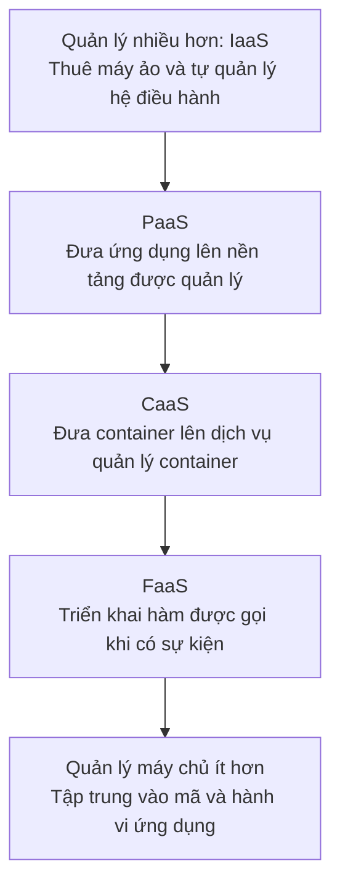
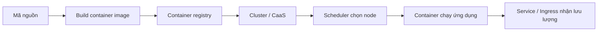
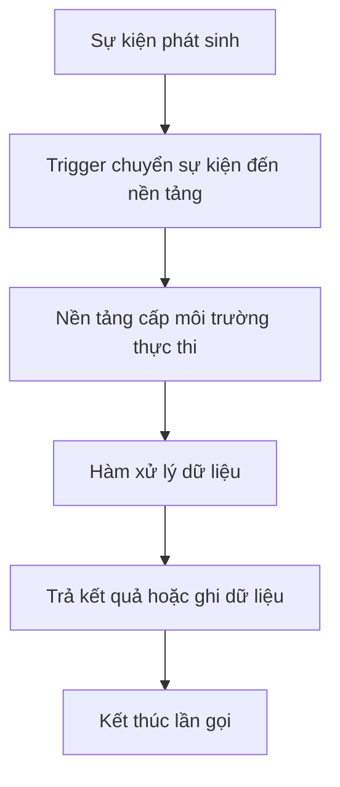

# Phân biệt IaaS, PaaS, CaaS và FaaS trong thực thi ứng dụng

Khi triển khai ứng dụng trên đám mây, nhóm phát triển có thể thuê máy ảo, đưa mã nguồn lên một nền tảng ứng dụng, đóng gói ứng dụng thành container hoặc triển khai từng hàm được kích hoạt bởi sự kiện. Những cách triển khai này tương ứng với bốn mô hình dịch vụ thường gặp: **Infrastructure as a Service (IaaS)**, **Platform as a Service (PaaS)**, **Containers as a Service (CaaS)** và **Function as a Service (FaaS)**.

Các mô hình khác nhau ở mức trừu tượng mà nhà cung cấp quản lý thay cho người dùng. Mức trừu tượng càng cao thì nhóm vận hành càng ít phải quản lý máy chủ và môi trường chạy, nhưng thường phải tuân theo nhiều quy ước của nền tảng hơn. Không có mô hình nào luôn tốt nhất: lựa chọn phù hợp phụ thuộc vào kiến trúc ứng dụng, khả năng vận hành, yêu cầu hiệu năng, tính sẵn sàng, bảo mật và ngân sách.

Sau bài học, bạn có thể:

- Giải thích cách IaaS, PaaS, CaaS và FaaS thực thi một ứng dụng.
- Phân biệt phần việc của nhà cung cấp đám mây và phần việc của đội phát triển.
- Chọn mô hình phù hợp với ứng dụng chạy liên tục, ứng dụng web, hệ thống container hoặc tác vụ theo sự kiện.
- Nhận diện ảnh hưởng của mỗi mô hình đến CPU, bộ nhớ, mạng, bảo mật, khả năng mở rộng, tính sẵn sàng và chi phí.

## 1. Hiểu sự khác nhau qua mức độ quản lý

Một ứng dụng thường cần nhiều lớp để chạy: phần cứng và mạng, máy chủ hoặc máy ảo, hệ điều hành, môi trường chạy, ứng dụng và dữ liệu. Trong trung tâm dữ liệu riêng, tổ chức có thể phải tự quản lý gần như tất cả các lớp. Dịch vụ đám mây cho phép chuyển giao một phần trách nhiệm đó cho nhà cung cấp.

Hãy hình dung mức trừu tượng như một thang đo:

Thứ tự trên chỉ thể hiện xu hướng chung về mức trừu tượng, không phải thứ bậc chất lượng. CaaS và PaaS có thể chồng lấn: một nền tảng PaaS có thể dùng container ở bên dưới, còn một dịch vụ CaaS có thể cung cấp thêm nhiều tính năng cấp ứng dụng. Cần đọc phạm vi quản lý thực tế của từng dịch vụ thay vì chỉ dựa vào tên gọi.

## 2. IaaS – Infrastructure as a Service

**IaaS cung cấp tài nguyên hạ tầng theo nhu cầu**, thường gồm máy ảo, đĩa lưu trữ, mạng ảo, địa chỉ IP và các thành phần bảo mật mạng. Người dùng cài đặt hoặc lựa chọn hệ điều hành, cài runtime, triển khai ứng dụng và tự tổ chức phần lớn hoạt động vận hành bên trong máy ảo.

Ví dụ, để chạy một API trên IaaS, đội phát triển có thể tạo máy ảo Linux, cấu hình mạng và tường lửa, cài Java hoặc Node.js, triển khai ứng dụng, cấu hình reverse proxy, giám sát tiến trình và thiết lập cơ chế cập nhật hệ điều hành.

### Ai quản lý phần nào?

Nhà cung cấp thường chịu trách nhiệm cho trung tâm dữ liệu, máy chủ vật lý, lớp ảo hóa và hạ tầng mạng, lưu trữ nền tảng. Khách hàng chịu trách nhiệm cho hệ điều hành khách, bản vá hệ điều hành, runtime, thư viện, cấu hình ứng dụng, danh tính truy cập, dữ liệu và quy tắc bảo mật ở cấp hệ điều hành/ứng dụng. Ranh giới cụ thể phụ thuộc dịch vụ và cấu hình đã mua.

| Khía cạnh | Đặc điểm của IaaS |
|---|---|
| Đơn vị triển khai | Máy ảo hoặc nhóm máy ảo |
| Quyền kiểm soát | Cao; có thể chọn hệ điều hành, gói phần mềm và cấu hình máy |
| Việc đội phát triển/vận hành đảm nhận | Cài đặt, vá lỗi hệ điều hành, runtime, triển khai, giám sát, sao lưu và mở rộng |
| Mở rộng | Tăng/giảm kích thước máy hoặc số lượng máy; thường cần kết hợp load balancer và autoscaling |
| Phù hợp | Ứng dụng cũ, phần mềm cần quyền hệ điều hành, cấu hình đặc thù hoặc môi trường chạy lâu dài |
| Đánh đổi | Linh hoạt nhưng cần nhiều kỹ năng vận hành và có nguy cơ lãng phí máy nhàn rỗi |

### Ví dụ triển khai

Một hệ thống xử lý đơn hàng cũ cần một phiên bản hệ điều hành và thư viện native cụ thể. Đội vận hành có thể tạo một nhóm máy ảo cùng cấu hình, đặt sau bộ cân bằng tải, cài ứng dụng lên từng máy và quản lý quá trình cập nhật theo từng đợt.

IaaS hợp lý khi quyền kiểm soát máy chủ là yêu cầu thật sự. Nếu ứng dụng chỉ cần nhận HTTP request và truy cập cơ sở dữ liệu, việc tự quản lý cả hệ điều hành có thể tạo thêm công việc mà sản phẩm không cần.

## 3. PaaS – Platform as a Service

**PaaS cung cấp một nền tảng chạy ứng dụng đã được quản lý.** Đội phát triển tập trung vào mã nguồn, cấu hình ứng dụng và dữ liệu; nhà cung cấp quản lý phần lớn máy chủ, hệ điều hành, runtime hoặc quy trình triển khai nền tảng.

Với một dịch vụ web, nhóm có thể đưa mã nguồn hoặc gói build lên nền tảng, khai báo biến môi trường, cấu hình số phiên bản và miền truy cập. Nền tảng tạo môi trường chạy, khởi động ứng dụng, cấp endpoint và có thể hỗ trợ triển khai phiên bản mới, health check, log và tự động mở rộng.

### Trách nhiệm và giới hạn

PaaS giảm đáng kể công việc quản lý máy chủ. Tuy vậy, đội phát triển vẫn phải chịu trách nhiệm về chất lượng mã, xác thực và phân quyền, dữ liệu, quản lý bí mật, cấu hình ứng dụng, phụ thuộc phần mềm và cách xử lý lỗi. Một nền tảng được quản lý không tự động làm cho ứng dụng an toàn hoặc sẵn sàng cao.

| Khía cạnh | Đặc điểm của PaaS |
|---|---|
| Đơn vị triển khai | Ứng dụng, service hoặc gói build |
| Quyền kiểm soát | Tập trung vào ứng dụng; ít quyền với hệ điều hành và máy chủ nền |
| Việc đội phát triển/vận hành đảm nhận | Mã nguồn, cấu hình, dữ liệu, quyền truy cập, quan sát ứng dụng và kiểm soát phát hành |
| Mở rộng | Thường cấu hình số instance hoặc chính sách tự động mở rộng ở cấp ứng dụng |
| Phù hợp | API, website, backend tiêu chuẩn và nhóm muốn giảm công việc quản trị hạ tầng |
| Đánh đổi | Phát triển và vận hành đơn giản hơn, nhưng phụ thuộc runtime, giới hạn và cách triển khai của nền tảng |

### Ví dụ triển khai

Một nhóm xây dựng website thương mại điện tử bằng framework web phổ biến. Nhóm đóng gói ứng dụng theo định dạng mà nền tảng hỗ trợ, khai báo kết nối cơ sở dữ liệu và biến môi trường, rồi triển khai. Khi lưu lượng tăng, nhóm cấu hình thêm instance hoặc bật autoscaling. Nhà cung cấp quản lý máy chủ và nhiều thành phần của môi trường chạy.

Trước khi chọn PaaS, cần kiểm tra phiên bản runtime được hỗ trợ, giới hạn thời gian xử lý request, khả năng truy cập mạng riêng, cơ chế lưu file, giới hạn tài nguyên và cách xuất log. Nếu ứng dụng phụ thuộc thư viện hệ thống hiếm hoặc cần quyền điều khiển sâu, nền tảng có thể không đáp ứng.

## 4. CaaS – Containers as a Service

Trong bài học này, **CaaS có nghĩa là Containers as a Service**: dịch vụ cung cấp môi trường để triển khai, quản lý và mở rộng container. (Trong một số lĩnh vực, chữ viết tắt CaaS có thể mang nghĩa khác; cần xem định nghĩa của nhà cung cấp.)

Container đóng gói ứng dụng cùng các thư viện và thành phần cần thiết vào một image. Image giúp môi trường phát triển, kiểm thử và triển khai nhất quán hơn. Dịch vụ CaaS cung cấp nơi chạy các container và thường tích hợp điều phối, lập lịch, kiểm tra tình trạng, mạng dịch vụ, quản lý cấu hình, lưu trữ và mở rộng. Kubernetes là một hệ sinh thái điều phối container phổ biến; dịch vụ CaaS được quản lý có thể giúp giảm công việc cài đặt và duy trì cụm.

### Cách ứng dụng được thực thi

Đội phát triển xây dựng image, đẩy image lên registry, khai báo cách chạy container và triển khai lên cụm hoặc dịch vụ container. Bộ điều phối tìm tài nguyên phù hợp để chạy container, theo dõi trạng thái và khởi động lại hoặc thay thế instance khi có lỗi theo chính sách đã khai báo.

Nhà cung cấp có thể quản lý control plane, máy chủ hoặc cả hai, tùy loại dịch vụ. Khách hàng thường vẫn chịu trách nhiệm về image, bản vá thư viện trong image, cấu hình workload, quyền service account, network policy, dữ liệu và cách ứng dụng giao tiếp. Nếu khách hàng tự quản lý worker node thì trách nhiệm về hệ điều hành node và dung lượng cụm cũng tăng lên.

| Khía cạnh | Đặc điểm của CaaS |
|---|---|
| Đơn vị triển khai | Container image, pod, task hoặc workload tương đương |
| Quyền kiểm soát | Kiểm soát tốt môi trường đóng gói và cách các thành phần phối hợp; mức quyền cụ thể tùy dịch vụ |
| Việc đội phát triển/vận hành đảm nhận | Build image, cấu hình workload, tài nguyên, mạng, secrets, quan sát và vòng đời triển khai |
| Mở rộng | Tăng số bản sao container, thay đổi tài nguyên hoặc kết hợp autoscaling theo tải |
| Phù hợp | Microservices, nhiều thành phần cần môi trường nhất quán, ứng dụng cần kiểm soát runtime hoặc khả năng di chuyển |
| Đánh đổi | Linh hoạt và có khả năng chuẩn hóa cao, nhưng cần hiểu container, điều phối, mạng và lưu trữ |

### Ví dụ triển khai

Một hệ thống gồm API, worker xử lý nền và dịch vụ tạo báo cáo có thể được đóng gói thành ba image riêng. Mỗi workload có thể dùng số bản sao, giới hạn CPU/bộ nhớ và chính sách mở rộng khác nhau. API nhận lưu lượng HTTP; worker đọc hàng đợi; dịch vụ báo cáo chạy khi có yêu cầu. Các thành phần có thể triển khai độc lập nhưng chia sẻ mạng và hệ thống quan sát của cụm.

Container không đồng nghĩa với máy ảo. Nhiều container thường chia sẻ kernel của máy chủ, trong khi máy ảo có hệ điều hành khách riêng trên lớp ảo hóa. Container giúp đóng gói và triển khai nhanh, nhưng không tự cung cấp ranh giới bảo mật giống một máy ảo hoàn chỉnh. Cần cấu hình quyền, namespace, giới hạn tài nguyên, image tin cậy và cách ly workload phù hợp.

## 5. FaaS – Function as a Service

**FaaS cho phép triển khai các hàm hoặc đơn vị xử lý nhỏ được gọi khi có sự kiện.** Nhà cung cấp quản lý hạ tầng thực thi và tự khởi tạo môi trường cần thiết. Nhóm phát triển viết hàm, khai báo trigger, quyền truy cập và cấu hình tài nguyên hoặc giới hạn thực thi.

Một hàm có thể được gọi khi nhận HTTP request, có thông điệp mới trong hàng đợi, một tệp được tải lên hoặc một lịch chạy đến hạn. Nền tảng tiếp nhận sự kiện, tạo hoặc tái sử dụng môi trường thực thi, gọi hàm và trả kết quả hoặc ghi nhận trạng thái xử lý.

### Vòng đời xử lý theo sự kiện

FaaS thường tự động tăng số lần thực thi khi có nhiều sự kiện và có thể giảm về không khi không có yêu cầu. Cách tính phí thường dựa trên số lần gọi và tài nguyên/thời gian thực thi, nhưng công thức cụ thể phụ thuộc nhà cung cấp. Một số nền tảng có thể giữ môi trường nóng hoặc cung cấp tùy chọn chạy liên tục; vì vậy không nên mặc định mọi lần gọi đều có cùng độ trễ khởi động.

| Khía cạnh | Đặc điểm của FaaS |
|---|---|
| Đơn vị triển khai | Hàm hoặc handler xử lý sự kiện |
| Quyền kiểm soát | Tập trung vào logic hàm, trigger và cấu hình; rất ít quyền với máy chủ nền |
| Việc đội phát triển/vận hành đảm nhận | Mã hàm, tính lặp an toàn, xử lý lỗi, quyền truy cập, giới hạn thực thi và quan sát |
| Mở rộng | Nền tảng thường tự điều chỉnh số môi trường thực thi theo số lần gọi, trong giới hạn quota |
| Phù hợp | Xử lý sự kiện, tác vụ nền ngắn, webhook, xử lý tệp và tích hợp hệ thống |
| Đánh đổi | Giảm vận hành và phù hợp tải gián đoạn, nhưng có giới hạn thời gian, tài nguyên, trạng thái và khả năng kiểm soát môi trường |

### Ví dụ triển khai

Khi khách hàng tải hóa đơn PDF lên kho lưu trữ, sự kiện tải tệp có thể kích hoạt một hàm. Hàm kiểm tra metadata, ghi một bản ghi vào cơ sở dữ liệu và gửi thông điệp sang hàng đợi để một tác vụ khác xử lý. Đội phát triển không cần duy trì một máy chủ luôn chờ sự kiện này.

Hàm nên được thiết kế để có thể được gọi lại an toàn. Trong hệ thống phân tán, sự kiện có thể được gửi lại khi timeout hoặc lỗi mạng; vì thế cần có idempotency key, cơ chế chống xử lý trùng, retry có giới hạn và dead-letter queue khi phù hợp. Nếu tác vụ kéo dài, cần nhiều trạng thái trung gian hoặc cần giữ kết nối liên tục, hãy xem xét worker chạy bằng container hoặc một dịch vụ ứng dụng lâu dài.

## 6. So sánh bốn mô hình

| Tiêu chí | IaaS | PaaS | CaaS | FaaS |
|---|---|---|---|---|
| Đơn vị chính | Máy ảo | Ứng dụng/service | Container/workload | Hàm/handler |
| Mức trừu tượng | Thấp | Cao | Trung bình đến cao | Rất cao |
| Kiểm soát hệ điều hành | Khách hàng thường quản lý OS khách | Nhà cung cấp quản lý phần lớn | Tùy quyền quản lý node; khách hàng quản lý image | Nhà cung cấp quản lý môi trường thực thi |
| Đóng gói | Cài trực tiếp hoặc dùng image máy | Mã nguồn/gói build theo nền tảng | Container image | Mã hàm và cấu hình |
| Kiểu xử lý điển hình | Tiến trình chạy lâu dài | Web/API hoặc ứng dụng chạy lâu dài | Service và worker trong container | Sự kiện hoặc lần gọi ngắn |
| Mở rộng | Máy hoặc nhóm máy | Instance ứng dụng | Số workload/container và tài nguyên | Số lần thực thi |
| Vận hành | Nhiều việc ở cấp máy chủ | Ít việc ở cấp máy chủ | Cần quản lý workload và điều phối | Ít việc ở cấp máy chủ, tập trung vào sự kiện và hàm |
| Điểm cần kiểm tra | Bản vá OS, dung lượng máy, HA | Runtime, quota, giới hạn nền tảng | Cluster, image, network, storage | Timeout, quota, cold start, retry |

Không nên chỉ dùng số lượng lớp mà nhà cung cấp quản lý để quyết định. Hãy đánh giá cả mức kiểm soát cần thiết, năng lực đội ngũ, khả năng quan sát, chi phí tổng thể và mức độ phụ thuộc nền tảng.

## 7. Một ứng dụng có thể chạy theo cả bốn mô hình

Giả sử cần triển khai một API quản lý đơn hàng có chức năng nhận yêu cầu, lưu đơn, xử lý thanh toán và gửi email xác nhận.

**Nếu chọn IaaS:** nhóm tạo máy ảo, cài hệ điều hành và runtime, triển khai API như một tiến trình dịch vụ, cấu hình load balancer, cập nhật bản vá và tự thiết kế mở rộng. Cách này hữu ích khi cần thư viện hệ thống hoặc quyền điều khiển máy chủ đặc biệt.

**Nếu chọn PaaS:** nhóm triển khai API lên nền tảng web được quản lý, cấu hình kết nối cơ sở dữ liệu và biến môi trường. Nền tảng quản lý phần lớn việc cấp máy và khởi động ứng dụng. Nhóm tập trung vào logic đơn hàng, bảo mật API và giám sát hành vi ứng dụng.

**Nếu chọn CaaS:** nhóm đóng gói API và worker thành container image. API và worker chạy như các workload riêng, có thể mở rộng độc lập. Nhóm quản lý cấu hình triển khai, tài nguyên, service discovery, secrets và chính sách mạng; nhà cung cấp quản lý các phần của cụm theo gói dịch vụ.

**Nếu chọn FaaS:** nhóm tách các bước xử lý thành hàm được kích hoạt bởi HTTP hoặc sự kiện. Ví dụ, hàm tiếp nhận tạo đơn, sự kiện đơn hàng mới kích hoạt hàm xử lý thanh toán, và sự kiện thanh toán thành công kích hoạt hàm gửi email. Nhóm cần thiết kế trạng thái và luồng lỗi giữa các lần gọi.

Một hệ thống thực tế có thể kết hợp các mô hình: API chính chạy trên PaaS hoặc CaaS, cơ sở dữ liệu dùng dịch vụ dữ liệu được quản lý, còn xử lý ảnh hoặc gửi thông báo chạy bằng FaaS. Kiến trúc kết hợp cho phép chọn mô hình theo đặc điểm từng thành phần, nhưng cũng làm tăng yêu cầu tích hợp, quan sát và quản lý quyền giữa các dịch vụ.

## 8. Cách chọn mô hình phù hợp

Hãy bắt đầu từ đặc điểm công việc và yêu cầu vận hành, sau đó mới chọn dịch vụ.

| Câu hỏi cần trả lời | Hướng lựa chọn thường phù hợp |
|---|---|
| Ứng dụng cần quyền quản trị hệ điều hành, agent đặc thù hoặc cấu hình kernel? | Ưu tiên xem xét IaaS; kiểm tra khả năng đáp ứng của CaaS nếu workload có thể chạy trong container |
| Ứng dụng web/API tiêu chuẩn, đội muốn tập trung vào tính năng? | PaaS thường là điểm bắt đầu đơn giản |
| Có nhiều service độc lập, cần đóng gói nhất quán và kiểm soát cách triển khai? | CaaS phù hợp khi đội có năng lực vận hành container và điều phối |
| Công việc được kích hoạt bởi sự kiện, tải không đều và mỗi lần xử lý có giới hạn rõ? | FaaS thường phù hợp |
| Tiến trình phải giữ kết nối dài, chạy liên tục hoặc xử lý tác vụ dài? | IaaS, PaaS hoặc CaaS thường phù hợp hơn; cần đối chiếu giới hạn cụ thể của dịch vụ |
| Đội chưa có kinh nghiệm vận hành cụm và không cần quyền điều khiển sâu? | Bắt đầu với PaaS hoặc FaaS có thể giảm độ phức tạp |

Trước khi chốt, hãy thử nghiệm một luồng đại diện và đo thời gian phản hồi, thông lượng, tỷ lệ lỗi, độ trễ khi tăng tải, chi phí theo mức sử dụng và công sức vận hành. Đừng chỉ so sánh giá CPU hoặc giá mỗi lần gọi; hãy tính cả lưu trữ, truyền dữ liệu, log, giám sát, môi trường dự phòng và thời gian của đội ngũ.

## 9. Tài nguyên tính toán, mạng và khả năng mở rộng

Dù chọn mô hình nào, ứng dụng vẫn tiêu thụ CPU, bộ nhớ, lưu trữ và băng thông mạng. Khác biệt nằm ở nơi cấu hình các tài nguyên đó và mức độ kiểm soát mà dịch vụ cung cấp.

### CPU và bộ nhớ

- **IaaS:** chọn loại máy và kích thước máy ảo theo tải. Theo dõi CPU utilization, memory pressure, swap và thời gian chờ I/O. Máy quá nhỏ gây nghẽn; máy quá lớn làm tăng chi phí khi nhàn rỗi.
- **PaaS:** khai báo cấu hình instance hoặc mức tài nguyên theo gói dịch vụ. Kiểm tra giới hạn bộ nhớ, số kết nối, số tiến trình và cách nền tảng tính tài nguyên.
- **CaaS:** khai báo request và limit CPU/bộ nhớ cho từng workload nếu hệ thống điều phối hỗ trợ. Request giúp bộ lập lịch chọn node; limit giới hạn mức sử dụng. Đặt limit quá thấp có thể gây throttling CPU hoặc container bị kết thúc khi vượt bộ nhớ.
- **FaaS:** cấu hình mức bộ nhớ hoặc gói tài nguyên mà nền tảng cung cấp; CPU có thể được phân bổ theo cấu hình đó. Đo thời gian thực thi và bộ nhớ đỉnh để chọn mức phù hợp.

Không nên chọn tài nguyên chỉ bằng cách nhìn mức sử dụng trung bình. Hãy đo tải đỉnh, thời gian xử lý percentile cao (ví dụ p95), mức tăng trưởng và hành vi khi nhiều request đến cùng lúc.

### Mạng và lưu trữ

Ở IaaS, đội vận hành thường cấu hình mạng ảo, subnet, route, firewall và load balancer. Ở PaaS, nền tảng có thể cung cấp endpoint công khai, kết nối mạng riêng hoặc tích hợp mạng ảo theo từng gói. Ở CaaS, cần hiểu service discovery, ingress, network policy và lưu trữ gắn với workload. Ở FaaS, cần xác định trigger, quyền gọi hàm, giới hạn kết nối ra ngoài và cách hàm truy cập dịch vụ riêng.

Container và hàm thường có vòng đời ngắn hoặc có thể được thay thế. Vì vậy, không nên lưu trạng thái quan trọng chỉ trong filesystem tạm của instance. Dữ liệu lâu dài nên đặt trong cơ sở dữ liệu, object storage hoặc dịch vụ lưu trữ phù hợp. Cần tính cả chi phí truyền dữ liệu giữa vùng, giữa dịch vụ và ra Internet.

### Mở rộng và tính sẵn sàng

Mở rộng theo chiều dọc là tăng CPU hoặc bộ nhớ cho một instance. Mở rộng theo chiều ngang là tăng số instance, container hoặc lần thực thi song song. Mở rộng ngang thường giúp tăng khả năng chịu lỗi, nhưng chỉ hiệu quả nếu ứng dụng không phụ thuộc trạng thái cục bộ và các thành phần phía sau cũng chịu được tải tăng thêm.

Tự động mở rộng cần có tín hiệu phù hợp: CPU, bộ nhớ, độ dài hàng đợi, số request đang chờ hoặc độ trễ. Nếu chỉ dựa vào CPU, một worker bị nghẽn do chờ I/O có thể không kích hoạt mở rộng dù hàng đợi đang tăng. Cần đặt giới hạn tối thiểu/tối đa và kiểm tra quota để tránh chi phí hoặc tải tăng ngoài dự kiến.

Tính sẵn sàng cao còn cần nhiều hơn việc bật autoscaling. Hãy xem xét phân bố instance qua nhiều vùng sẵn sàng khi dịch vụ hỗ trợ, health check, cân bằng tải, sao lưu và phục hồi dữ liệu, triển khai cuốn chiếu, kiểm tra khả năng rollback và quy trình xử lý sự cố. Một ứng dụng có nhiều bản sao nhưng cùng phụ thuộc vào một cơ sở dữ liệu đơn lẻ vẫn có thể bị gián đoạn khi cơ sở dữ liệu gặp lỗi.

## 10. Bảo mật và trách nhiệm vận hành

Mô hình dịch vụ thay đổi ranh giới trách nhiệm, nhưng không chuyển toàn bộ trách nhiệm bảo mật sang nhà cung cấp. Cần xác định rõ ai vá nền tảng, ai cập nhật runtime, ai bảo vệ dữ liệu và ai cấu hình danh tính truy cập.

| Lĩnh vực | IaaS | PaaS | CaaS | FaaS |
|---|---|---|---|---|
| Bản vá hệ điều hành nền | Nhà cung cấp | Nhà cung cấp | Tùy phần quản lý node/control plane | Nhà cung cấp |
| Bản vá hệ điều hành khách hoặc node do khách quản lý | Khách hàng | Thường không trực tiếp quản lý | Khách hàng nếu tự quản lý node | Thường không trực tiếp quản lý |
| Thư viện và phụ thuộc ứng dụng | Khách hàng | Khách hàng | Khách hàng chịu trách nhiệm image | Khách hàng chịu trách nhiệm gói hàm/phụ thuộc |
| Danh tính và quyền ứng dụng | Khách hàng | Khách hàng | Khách hàng | Khách hàng |
| Dữ liệu và quyền truy cập dữ liệu | Khách hàng | Khách hàng | Khách hàng | Khách hàng |
| Cấu hình mạng ở cấp ứng dụng | Khách hàng, phối hợp với nhà cung cấp | Tùy khả năng nền tảng | Khách hàng và nền tảng theo ranh giới dịch vụ | Khách hàng và nền tảng theo trigger/kết nối |

Các thực hành nên áp dụng ở mọi mô hình:

1. Dùng quyền tối thiểu cho tài khoản, service account, workload và hàm; tách quyền triển khai khỏi quyền chạy ứng dụng.
2. Lưu secrets trong dịch vụ quản lý bí mật; tránh ghi mật khẩu, token hoặc khóa riêng vào mã nguồn, image hay log.
3. Giới hạn cổng và luồng mạng cần thiết; không công khai endpoint quản trị hoặc cơ sở dữ liệu nếu không có lý do rõ ràng.
4. Cập nhật hệ điều hành, runtime, image và thư viện theo quy trình có kiểm thử.
5. Ghi log có kiểm soát, không để lộ dữ liệu nhạy cảm; thiết lập cảnh báo cho lỗi, độ trễ và mức sử dụng tài nguyên.
6. Kiểm tra sao lưu và khôi phục định kỳ; bản sao lưu chưa từng được khôi phục thử chưa chứng minh được khả năng phục hồi.

## 11. Chi phí và tối ưu vận hành

Chi phí không chỉ là giá tài nguyên tính toán. Tổng chi phí có thể bao gồm máy ảo hoặc instance, thời gian CPU, bộ nhớ, lưu trữ, snapshot, IP, load balancer, request, truyền dữ liệu, log, giám sát, hỗ trợ và công sức vận hành.

- **IaaS:** dễ dự toán theo kích thước máy và thời gian chạy, nhưng máy luôn bật có thể tốn tiền khi tải thấp. Có thể tối ưu bằng rightsizing, lịch tắt môi trường không dùng, autoscaling và lựa chọn loại máy phù hợp.
- **PaaS:** giảm công sức quản trị, nhưng gói instance, giới hạn và phí dịch vụ đi kèm có thể cao hơn tài nguyên thô. Theo dõi mức sử dụng thực tế, số instance tối thiểu và chi phí của các dịch vụ phụ trợ.
- **CaaS:** cần tính chi phí node/cụm, control plane nếu có, lưu trữ, mạng và phần tài nguyên bị giữ chỗ. Nhiều workload nhỏ có thể chia sẻ node hiệu quả, nhưng cấu hình request quá lớn làm giảm mật độ đóng gói; cấu hình quá nhỏ làm tăng nguy cơ tranh chấp tài nguyên.
- **FaaS:** có lợi khi tải gián đoạn vì không nhất thiết phải duy trì máy chủ cho mọi thời điểm. Tuy nhiên, số lần gọi lớn, thời gian chạy dài, mức bộ nhớ cao, retry nhiều hoặc truyền dữ liệu có thể làm chi phí tăng. Cần tối ưu thời gian thực thi và tránh kích hoạt lặp không cần thiết.

Một phép so sánh công bằng nên dùng cùng một kịch bản tải: cùng số request hoặc sự kiện, cùng yêu cầu p95 latency, cùng mức sẵn sàng và cùng thời gian lưu dữ liệu. Đồng thời tính chi phí nhân lực vận hành. Dịch vụ có hóa đơn hạ tầng cao hơn vẫn có thể tiết kiệm tổng chi phí nếu giảm nhiều giờ quản trị và xử lý sự cố.

## 12. Những nhầm lẫn thường gặp

**“CaaS và PaaS là một.”** Hai mô hình có thể dùng cùng công nghệ bên dưới nhưng trao cho người dùng mức kiểm soát khác nhau. PaaS thường tập trung vào việc chạy ứng dụng; CaaS tập trung vào việc chạy và điều phối container. Hãy xem người dùng phải cung cấp image, khai báo workload, quản lý cluster và cấu hình mạng đến mức nào.

**“Container là máy ảo nhỏ.”** Container và máy ảo có cách cô lập khác nhau. Container thường chia sẻ kernel của host; máy ảo có hệ điều hành khách riêng. Cả hai đều có thể là đơn vị triển khai, nhưng đặc tính bảo mật, khởi động, tài nguyên và vận hành không giống nhau.

**“Serverless nghĩa là không có máy chủ.”** Máy chủ vẫn tồn tại; nhà cung cấp quản lý phần lớn hạ tầng thực thi để người dùng không phải trực tiếp vận hành nó. Serverless cũng không có nghĩa ứng dụng tự động an toàn, không giới hạn hoặc luôn rẻ hơn.

**“FaaS luôn là lựa chọn rẻ nhất.”** FaaS có thể hiệu quả với tải gián đoạn và tác vụ ngắn. Với tải ổn định, tần suất cao hoặc tác vụ kéo dài, PaaS, CaaS hay IaaS có thể có chi phí và độ trễ phù hợp hơn.

**“Dùng autoscaling là đã có tính sẵn sàng cao.”** Autoscaling giúp điều chỉnh năng lực khi tải thay đổi. Tính sẵn sàng còn phụ thuộc vào vùng triển khai, phụ thuộc dữ liệu, health check, khả năng phục hồi, triển khai an toàn và quy trình ứng phó sự cố.

## 13. Quy trình ra quyết định thực tế

Khi đánh giá một workload mới, có thể đi theo trình tự sau:

1. **Mô tả kiểu xử lý:** ứng dụng chạy liên tục, phục vụ HTTP, xử lý hàng đợi, hay phản ứng với sự kiện?
2. **Xác định yêu cầu môi trường:** có cần quyền OS, thư viện native, runtime đặc biệt, kết nối mạng riêng hoặc tiến trình chạy dài không?
3. **Đánh giá tải:** tải ổn định hay đột biến, thời gian xử lý, mức song song, nhu cầu CPU/bộ nhớ và dung lượng dữ liệu.
4. **Xác định yêu cầu chất lượng:** độ trễ p95, mục tiêu thời gian hoạt động, RTO/RPO, khả năng mở rộng và mức cô lập bảo mật.
5. **Đánh giá đội ngũ:** ai chịu trách nhiệm cập nhật, giám sát, triển khai, xử lý sự cố và kiểm soát chi phí?
6. **Chạy thử và đo lường:** triển khai một luồng đại diện, tạo tải gần thực tế, kiểm tra lỗi và tính tổng chi phí.
7. **Ghi rõ ranh giới trách nhiệm:** liệt kê các lớp do nhà cung cấp quản lý và các cấu hình đội ngũ phải duy trì.

Quyết định tốt là quyết định có căn cứ đo lường và có thể xem xét lại khi tải, kiến trúc hoặc năng lực đội ngũ thay đổi. Có thể bắt đầu với PaaS cho API tiêu chuẩn, dùng CaaS khi cần quản lý nhiều container, dùng FaaS cho tác vụ theo sự kiện và giữ IaaS cho workload cần quyền kiểm soát hạ tầng sâu. Đây là điểm khởi đầu để đánh giá, không phải quy tắc cứng cho mọi hệ thống.

## 14. Tự kiểm tra

1. Một ứng dụng cần cài agent ở cấp hệ điều hành và tinh chỉnh hệ thống. Mô hình nào đáng xem xét đầu tiên? Vì sao?
2. Một nhóm chỉ muốn triển khai API web theo runtime tiêu chuẩn và không muốn quản lý bản vá máy chủ. PaaS hỗ trợ nhóm ở những điểm nào? Nhóm vẫn phải chịu trách nhiệm về điều gì?
3. Một hệ thống gồm API và nhiều worker cần đóng gói độc lập, mở rộng riêng và giao tiếp qua mạng nội bộ. CaaS mang lại lợi ích gì, đồng thời tạo thêm trách nhiệm nào?
4. Một hàm xử lý ảnh chỉ chạy khi có tệp mới được tải lên. Vì sao FaaS có thể phù hợp? Những vấn đề về retry, xử lý trùng và thời gian thực thi cần được xem xét ra sao?
5. Vì sao không thể kết luận một mô hình rẻ nhất chỉ bằng giá CPU hoặc giá mỗi lần gọi?

Nếu trả lời được các câu hỏi trên bằng cách liên hệ yêu cầu thực tế với mức kiểm soát, trách nhiệm vận hành và chi phí, bạn đã nắm được cơ sở để phân biệt bốn mô hình thực thi ứng dụng trên đám mây.
