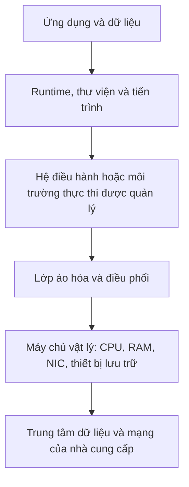
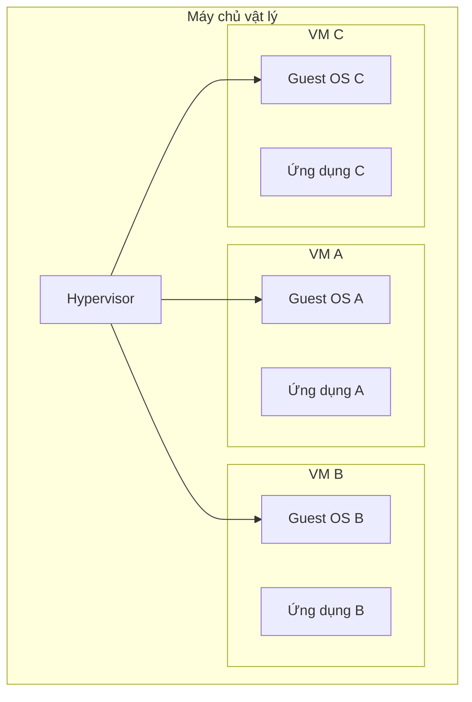
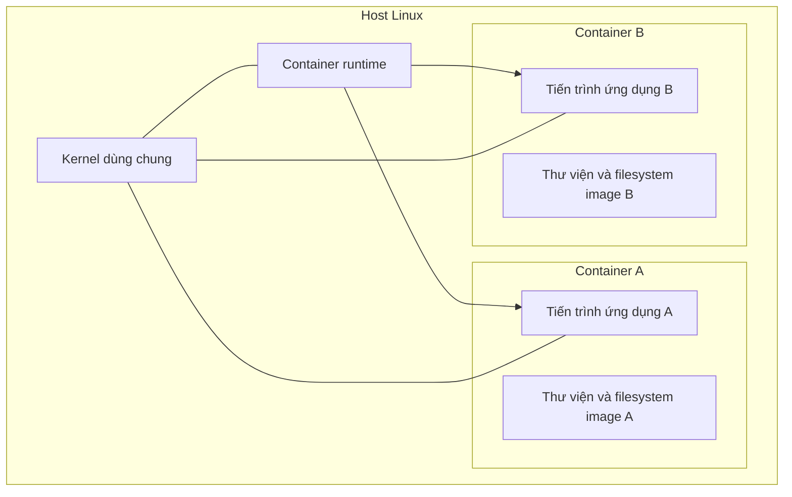
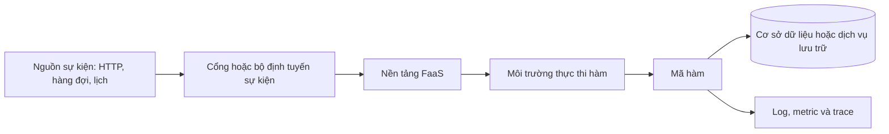
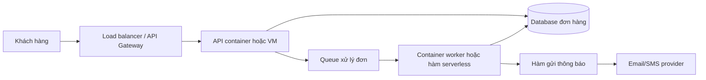

# Máy ảo, container và hàm serverless: mô hình thực thi và giới hạn

Trong **cloud compute**, ứng dụng có thể chạy trên máy ảo (virtual machine – VM), trong container hoặc dưới dạng hàm serverless. Cả ba mô hình đều cung cấp CPU, bộ nhớ, mạng và khả năng lưu trữ, nhưng khác nhau ở lớp hạ tầng mà người vận hành phải quản lý, cách cô lập tiến trình, thời gian khởi động, cơ chế mở rộng và cách tính chi phí.

Không có mô hình nào luôn tốt nhất. VM phù hợp khi cần quyền kiểm soát hệ điều hành và môi trường chạy; container phù hợp khi muốn đóng gói, triển khai và điều phối ứng dụng nhất quán; hàm serverless phù hợp với tác vụ được kích hoạt bởi sự kiện và có thể giao phần lớn việc quản lý máy chủ cho nền tảng. Chọn đúng mô hình là một phần của thiết kế **CLOUD_CORE_SERVICES_COMPUTE**: cần hiểu cách ứng dụng sử dụng CPU, bộ nhớ, mạng và dữ liệu, đồng thời thiết kế triển khai, mở rộng, tính sẵn sàng, bảo mật và chi phí vận hành.

## Mục tiêu học tập

Sau bài này, bạn có thể:

- Mô tả được lớp thực thi và ranh giới cô lập của VM, container và hàm serverless.
- Giải thích được các giới hạn thường gặp về CPU, bộ nhớ, thời gian chạy, lưu trữ, mạng và mức đồng thời.
- So sánh quyền kiểm soát, khả năng di chuyển, cách mở rộng và mô hình chi phí của ba lựa chọn.
- Chọn mô hình triển khai dựa trên đặc điểm tải, yêu cầu vận hành, bảo mật và ngân sách.
- Đề xuất cách cấu hình tài nguyên, triển khai an toàn và theo dõi ứng dụng sau khi đưa lên cloud.

## 1. Cloud compute cung cấp một môi trường thực thi

Một chương trình cần nhiều hơn mã nguồn để hoạt động. Nó cần bộ xử lý để thực hiện lệnh, bộ nhớ để giữ dữ liệu đang xử lý, hệ điều hành hoặc runtime để cung cấp dịch vụ nền, mạng để giao tiếp và nơi lưu dữ liệu lâu dài. Nhà cung cấp cloud tập hợp các tài nguyên vật lý thành những dịch vụ có thể cấp phát theo nhu cầu.

Có thể hình dung ngăn xếp thực thi theo các lớp sau:



VM, container và serverless đặt ranh giới trách nhiệm ở những vị trí khác nhau trong ngăn xếp này:

- Với **VM**, khách hàng thường quản lý cả hệ điều hành khách (guest OS), runtime và ứng dụng. Nhà cung cấp quản lý máy chủ vật lý và lớp ảo hóa.
- Với **container**, khách hàng quản lý image, tiến trình ứng dụng và cấu hình container; nền tảng quản lý host, container runtime và có thể cả bộ điều phối. Container Linux thông thường dùng chung kernel của host.
- Với **hàm serverless**, khách hàng chủ yếu quản lý mã hàm, cấu hình, quyền truy cập và luồng sự kiện. Nền tảng quản lý máy chủ, hệ điều hành, việc cấp phát môi trường thực thi và phần lớn cơ chế mở rộng.

Ranh giới trách nhiệm thực tế tùy dịch vụ. Ví dụ, một dịch vụ container được quản lý hoàn toàn có thể che giấu cả máy worker, trong khi Kubernetes tự quản lý yêu cầu đội vận hành chịu trách nhiệm nhiều hơn. Tên gọi sản phẩm không đủ để xác định trách nhiệm; cần đọc mô hình chia sẻ trách nhiệm và giới hạn dịch vụ của nhà cung cấp.

## 2. Máy ảo (Virtual Machine – VM)

### 2.1. VM hoạt động như thế nào?

VM là một máy tính được mô phỏng bằng phần mềm. Hypervisor phân chia tài nguyên của máy chủ vật lý thành nhiều máy ảo. Mỗi VM có CPU ảo (vCPU), bộ nhớ, thiết bị mạng và đĩa ảo riêng, đồng thời chạy một hệ điều hành khách của chính nó.



Hypervisor điều phối việc sử dụng CPU, bộ nhớ và thiết bị I/O giữa các VM. Trong hạ tầng cloud hiện đại, hypervisor thường chạy trực tiếp trên phần cứng (thường được gọi là type 1). Người dùng cloud không nhất thiết nhìn thấy hoặc quản trị hypervisor; họ tương tác qua API, console hoặc công cụ hạ tầng dưới dạng mã (Infrastructure as Code – IaC).

### 2.2. Thành phần của một VM cloud

| Thành phần | Vai trò và điều cần quyết định |
|---|---|
| Image hệ điều hành | Ảnh khởi tạo chứa hệ điều hành và cấu hình nền. Nên dùng image được duy trì, có bản vá và nguồn gốc rõ ràng. |
| vCPU | Lượng năng lực xử lý được cấp cho VM. Cần xem loại CPU, thế hệ phần cứng, khả năng burst và cam kết hiệu năng của loại máy. |
| RAM | Dung lượng bộ nhớ dành cho hệ điều hành và ứng dụng. Thiếu RAM có thể gây swap, OOM hoặc giảm hiệu năng. |
| Đĩa hệ thống và đĩa dữ liệu | Lưu hệ điều hành, ứng dụng và dữ liệu. Cần chọn dung lượng, loại đĩa, IOPS, thông lượng và chính sách sao lưu. |
| NIC và mạng ảo | Kết nối VM với subnet, route, firewall/security group, load balancer và dịch vụ khác. |
| Metadata và identity | Cung cấp thông tin hoặc danh tính workload. Phải giới hạn quyền và bảo vệ endpoint metadata theo cơ chế của nền tảng. |
| Vùng/zone triển khai | Xác định miền lỗi và độ trễ. Nhiều VM trong cùng một zone không tự tạo thành kiến trúc chịu lỗi liên vùng. |

Khi tạo VM, cần chọn cả cấu hình máy và vị trí mạng. Một VM có CPU, RAM phù hợp nhưng đặt trong subnet sai hoặc không có route cần thiết vẫn không phục vụ được ứng dụng.

### 2.3. Điểm mạnh và giới hạn

VM cung cấp ranh giới ở cấp máy ảo, một hệ điều hành riêng và mức kiểm soát cao. Đây là lựa chọn hợp lý khi ứng dụng cần kernel module, agent hệ thống, cấu hình hệ điều hành đặc thù, phần mềm cũ hoặc môi trường chạy lâu dài. VM cũng hữu ích khi cần chạy nhiều tiến trình có vòng đời và phụ thuộc khác nhau trên cùng một máy.

Đổi lại, người vận hành phải chịu trách nhiệm cho nhiều công việc hơn: cập nhật hệ điều hành, quản lý tài khoản, cấu hình firewall trên máy, cài runtime, giám sát dung lượng đĩa, xoay vòng log, sao lưu và xử lý lỗ hổng. VM thường mất nhiều thời gian khởi động hơn một container đã có image trên máy host, vì hệ điều hành khách phải khởi động và dịch vụ nền phải sẵn sàng.

Một số giới hạn cần hiểu rõ:

- **vCPU không đồng nghĩa với lõi CPU vật lý dành riêng.** Tùy loại máy và chính sách của nhà cung cấp, tài nguyên có thể được chia sẻ hoặc có cơ chế burst. Tải CPU liên tục có thể bị giới hạn khi hết tín dụng burst hoặc khi gặp tranh chấp tài nguyên.
- **RAM có giới hạn cứng theo loại máy.** Khi bộ nhớ cạn, hệ điều hành có thể swap, giết tiến trình hoặc trở nên không phản hồi. Tăng CPU không giải quyết được thiếu RAM.
- **Đĩa có giới hạn hiệu năng.** Dung lượng lớn không tự động đồng nghĩa với IOPS hoặc thông lượng cao. Cần kiểm tra giới hạn theo loại đĩa, kích thước, số lượng đĩa và cấu hình VM.
- **Mạng có giới hạn băng thông và gói tin.** Một số loại máy có thông lượng mạng tối đa, giới hạn số kết nối hoặc hiệu năng phụ thuộc kích thước gói tin.
- **Quota tài khoản và vùng có thể chặn việc cấp phát.** Giới hạn số VM, vCPU, địa chỉ IP hoặc dung lượng đĩa có thể khác nhau giữa vùng và tài khoản.
- **Khả năng sẵn sàng không tự có.** Một VM đơn lẻ vẫn là một điểm lỗi. Cần nhiều instance, health check, load balancer, sao lưu và phương án khôi phục.

VM phù hợp khi cần kiểm soát hệ điều hành hoặc chạy workload ổn định, nhưng cần tính cả chi phí vận hành hệ điều hành và phần công suất có thể nhàn rỗi.

## 3. Container

### 3.1. Container hoạt động như thế nào?

Container đóng gói ứng dụng cùng runtime, thư viện và các phụ thuộc cần thiết thành image. Khi chạy, container tạo ra một hoặc nhiều tiến trình được cô lập bằng các tính năng của kernel. Với container Linux phổ biến, các cơ chế như **namespaces** cung cấp góc nhìn cô lập về tiến trình, mạng, mount và hostname; **cgroups** giới hạn hoặc đo mức sử dụng CPU, bộ nhớ và một số tài nguyên khác.

Container thường không mang theo một kernel riêng. Các container Linux trên cùng host dùng chung kernel Linux của host. Vì vậy container khởi động nhanh và nhẹ hơn VM trong nhiều tình huống, nhưng ranh giới cô lập phụ thuộc đáng kể vào kernel, cấu hình runtime và quyền được cấp cho tiến trình.



Image thường gồm nhiều lớp chỉ đọc. Khi tạo container, runtime bổ sung lớp ghi cho instance đang chạy. Nhờ đó nhiều container có thể dùng chung các lớp image, giúp phân phối ứng dụng nhất quán và tiết kiệm dung lượng. Tuy nhiên, lớp ghi của container thường có vòng đời ngắn; dữ liệu quan trọng phải được ghi vào volume hoặc dịch vụ lưu trữ bền vững.

### 3.2. Từ image đến workload đang chạy

Quy trình điển hình gồm các bước:

1. Viết Dockerfile hoặc cấu hình build tương đương để mô tả image.
2. Build image từ mã nguồn và các phụ thuộc đã khóa phiên bản.
3. Quét lỗ hổng, kiểm tra thành phần và gắn tag hoặc digest bất biến.
4. Đẩy image vào registry có kiểm soát quyền truy cập.
5. Nền tảng kéo image, tạo container, gắn mạng và volume, rồi khởi chạy tiến trình.
6. Health check xác nhận ứng dụng sẵn sàng nhận lưu lượng.
7. Bộ điều phối giám sát trạng thái, khởi tạo instance thay thế hoặc tăng số bản sao theo chính sách.

Ví dụ Dockerfile tối giản cho ứng dụng web Python:

```dockerfile
FROM python:3.12-slim

WORKDIR /app
COPY requirements.txt .
RUN pip install --no-cache-dir -r requirements.txt
COPY . .

RUN useradd --create-home appuser
USER appuser
EXPOSE 8080
CMD ["python", "app.py"]
```

Ví dụ này minh họa cách đóng gói ứng dụng. Khi dùng trong môi trường thật, nên cố định image nền bằng digest, cập nhật bản vá định kỳ, loại bỏ công cụ build không cần thiết khỏi image cuối, không đưa secret vào image và bảo đảm tiến trình chính nhận được tín hiệu dừng để thoát có trật tự.

### 3.3. Giới hạn tài nguyên container

Container có thể bị giới hạn tài nguyên ở runtime hoặc ở lớp điều phối. Ví dụ với Docker:

```bash
docker run --rm \
  --cpus="1.5" \
  --memory="1g" \
  --pids-limit=128 \
  --read-only \
  --tmpfs /tmp:rw,noexec,nosuid,size=64m \
  my-app:1.0
```

Các tùy chọn trên minh họa giới hạn CPU, bộ nhớ, số tiến trình và filesystem ghi. Ứng dụng thực tế có thể cần thêm thư mục ghi tạm hoặc volume; chỉ bật `--read-only` sau khi xác định rõ đường dẫn nào cần ghi.

Trong Kubernetes, `requests` và `limits` có ý nghĩa khác nhau:

- `requests` là lượng tài nguyên scheduler dùng để quyết định có thể đặt Pod lên node nào. Đây cũng là cơ sở quan trọng cho việc lập kế hoạch dung lượng.
- `limits` là ngưỡng tối đa được áp dụng cho container. Vượt giới hạn CPU thường dẫn đến throttling; vượt giới hạn bộ nhớ có thể khiến container bị OOM kill.

Ví dụ cấu hình:

```yaml
apiVersion: v1
kind: Pod
metadata:
  name: web-api
spec:
  containers:
    - name: app
      image: registry.example.com/web-api:1.0
      resources:
        requests:
          cpu: "250m"
          memory: "256Mi"
        limits:
          cpu: "1"
          memory: "512Mi"
```

`250m` CPU tương đương một phần tư CPU theo đơn vị Kubernetes; `1` CPU tương đương một CPU logic theo cách biểu diễn của nền tảng. Giá trị request quá thấp có thể khiến scheduler xếp quá nhiều workload lên một node; request quá cao lại làm lãng phí sức chứa. Limit CPU quá thấp có thể gây throttling và tăng độ trễ. Limit bộ nhớ phải đủ cho đỉnh sử dụng hợp lý, nhưng không nên đặt cao đến mức một container có thể chiếm hết bộ nhớ node.

### 3.4. Điểm mạnh và giới hạn

Container giúp đóng gói ứng dụng nhất quán giữa máy phát triển, môi trường kiểm thử và production. Chúng hỗ trợ triển khai phiên bản mới, rollback, nhân bản workload và điều phối theo cụm. Một nền tảng như Kubernetes có thể quản lý lịch chạy, service discovery, cấu hình, secret, rolling update và tự phục hồi ở cấp Pod.

Những giới hạn quan trọng gồm:

- **Kernel dùng chung.** Lỗi kernel hoặc cấu hình runtime yếu có thể ảnh hưởng nhiều container trên cùng host. Với workload nhiều tenant hoặc yêu cầu cách ly mạnh, cần đánh giá sandbox runtime, microVM hoặc VM riêng.
- **CPU throttling.** Container vẫn có thể bị giới hạn CPU dù node còn tài nguyên, nếu quota của container quá thấp. Cần theo dõi throttling cùng độ trễ và mức sử dụng CPU.
- **OOM kill.** Khi container vượt giới hạn bộ nhớ, kernel có thể kết thúc tiến trình. Cần quan sát working set, heap, cache và mức tăng bộ nhớ theo thời gian.
- **Filesystem ngắn hạn.** Dữ liệu trong lớp ghi của container có thể mất khi container bị thay thế. Không lưu dữ liệu nghiệp vụ duy nhất tại đây.
- **Phụ thuộc kiến trúc và hệ điều hành.** Image phải tương thích với kiến trúc CPU và môi trường kernel/runtime đích. Container Linux không chạy trực tiếp trên kernel Windows theo cùng cách với container Windows.
- **Điều phối có độ phức tạp.** Cluster cần quản lý node, capacity, network policy, storage class, ingress, phiên bản và nâng cấp. Kubernetes giải quyết nhiều vấn đề nhưng cũng tạo thêm bề mặt vận hành.
- **Image và chuỗi cung ứng phần mềm.** Image cũ, thư viện có lỗ hổng, tag bị thay đổi hoặc registry thiếu kiểm soát có thể đưa rủi ro vào production.

Container phù hợp khi đội phát triển cần đóng gói và phát hành ứng dụng thường xuyên, có nhiều dịch vụ hoặc cần điều phối linh hoạt. Lợi ích này đi kèm yêu cầu quản trị image, runtime và cụm chạy.

## 4. Hàm serverless và Function as a Service (FaaS)

### 4.1. Serverless nghĩa là gì?

Serverless không có nghĩa là ứng dụng không chạy trên máy chủ. Máy chủ vẫn tồn tại, nhưng nhà cung cấp chịu trách nhiệm cấp phát và vận hành phần lớn hạ tầng bên dưới. Với mô hình **Function as a Service (FaaS)**, người dùng triển khai một hàm hoặc gói mã. Nền tảng gọi hàm khi nhận sự kiện, yêu cầu HTTP hoặc lệnh gọi trực tiếp.



Nền tảng có thể tạo môi trường thực thi khi có yêu cầu, tái sử dụng môi trường còn nóng cho các lần gọi tiếp theo, và tăng số instance khi số sự kiện tăng. Khi không có yêu cầu, một số dịch vụ có thể giảm về không instance đang hoạt động. Khả năng scale-to-zero, cách giữ môi trường và cách tính phí phụ thuộc dịch vụ cụ thể.

Serverless cũng có thể chỉ một nhóm dịch vụ được quản lý như database, queue, object storage hoặc workflow. Trong bài này, trọng tâm là FaaS vì đây là mô hình thực thi hàm có vòng đời do nền tảng điều khiển.

### 4.2. Vòng đời một lần gọi hàm

Một lần gọi thường trải qua các bước:

1. Nguồn sự kiện phát sinh thông điệp hoặc yêu cầu.
2. Nền tảng xác thực, định tuyến và kiểm tra quota hoặc concurrency.
3. Nền tảng chọn môi trường thực thi đang sẵn sàng hoặc tạo môi trường mới.
4. Runtime nạp mã, khởi tạo dependency và gọi handler.
5. Hàm xử lý dữ liệu, có thể gọi dịch vụ khác qua mạng.
6. Hàm trả kết quả hoặc ghi nhận lỗi; nền tảng và nguồn sự kiện áp dụng chính sách retry, timeout hoặc dead-letter.
7. Môi trường có thể được tái sử dụng trong lần gọi sau hoặc bị thu hồi.

Ví dụ handler Python theo kiểu sự kiện:

```python
def handler(event, context):
    order_id = event["orderId"]

    # Trong ứng dụng thật, kiểm tra idempotency_key trong kho dữ liệu.
    # Nếu sự kiện đã được xử lý, trả kết quả đã lưu thay vì tạo đơn lần nữa.
    result = process_order(order_id)

    return {
        "statusCode": 200,
        "body": {"orderId": order_id, "result": result}
    }
```

Đây là ví dụ minh họa, không phải hợp đồng đầu vào chung cho mọi nhà cung cấp. Tên handler, cấu trúc `event`, đối tượng `context` và định dạng kết quả phụ thuộc runtime và kiểu tích hợp.

### 4.3. Các giới hạn đặc trưng

Serverless giảm việc quản lý máy chủ nhưng áp dụng những giới hạn của nền tảng:

- **Thời gian thực thi tối đa.** Hàm có timeout. Công việc dài hơn cần chia nhỏ, chuyển sang queue/workflow hoặc chạy trên container/VM phù hợp.
- **CPU và bộ nhớ gắn với cấu hình.** Một số nền tảng cấp CPU theo mức RAM; cấu hình RAM vừa ảnh hưởng khả năng xử lý vừa ảnh hưởng chi phí. Cần đo hiệu năng ở từng mức cấu hình.
- **Cold start.** Khi cần tạo môi trường mới, thời gian khởi tạo runtime, nạp package và kết nối phụ thuộc có thể làm tăng độ trễ lần gọi đầu. Runtime nặng, package lớn, VPC/network setup hoặc khởi tạo kết nối đồng bộ có thể làm cold start đáng kể hơn.
- **Concurrency và quota.** Nền tảng có giới hạn số lần gọi đồng thời, số instance, tốc độ tăng tải hoặc quota theo tài khoản/vùng. Vượt ngưỡng có thể bị từ chối hoặc throttling.
- **Kích thước package và payload.** Có giới hạn kích thước mã triển khai, layer, sự kiện đầu vào/đầu ra hoặc dữ liệu đồng bộ. Dữ liệu lớn thường nên đặt trong object storage và truyền tham chiếu.
- **Filesystem tạm thời.** Thư mục tạm có dung lượng giới hạn và không được xem là nơi lưu trữ bền vững. Môi trường có thể bị thu hồi bất cứ lúc nào.
- **Không bảo đảm trạng thái giữa các lần gọi.** Có thể môi trường được tái sử dụng, nhưng không nên dựa vào biến toàn cục hoặc filesystem cục bộ để giữ trạng thái nghiệp vụ. Trạng thái cần nằm trong database, cache hoặc storage phù hợp.
- **Retry và giao nhận sự kiện.** Một số nguồn sự kiện có thể gửi lại khi timeout hoặc lỗi. Một hàm có thể chạy nhiều lần cho cùng một sự kiện; cần thiết kế idempotency và xử lý trùng lặp.
- **Kết nối mạng và dịch vụ phụ thuộc.** Hàm có thể gặp giới hạn socket, thời gian kết nối, DNS, băng thông hoặc số kết nối đồng thời đến database. Tạo kết nối mới ở mọi lần gọi có thể làm cạn connection pool của dịch vụ đích.
- **Ràng buộc runtime và nền tảng.** Phiên bản ngôn ngữ, hệ điều hành, extension, thư viện native và quyền tùy biến hệ thống bị giới hạn theo runtime được hỗ trợ.
- **Chi phí khi tải cao hoặc kéo dài.** Serverless có thể tiết kiệm khi tải thưa và không đều, nhưng số lần gọi lớn, thời gian chạy dài hoặc cấu hình tài nguyên cao có thể khiến chi phí vượt mô hình container/VM chạy liên tục.

Các con số cụ thể như timeout tối đa, RAM tối đa, dung lượng `/tmp`, kích thước payload, concurrency và quota thay đổi theo nhà cung cấp, vùng, runtime và loại tài khoản. Trước khi thiết kế, hãy kiểm tra tài liệu giới hạn hiện hành của đúng dịch vụ và kiểm tra quota thực tế trong tài khoản.

### 4.4. Thiết kế hàm có thể retry an toàn

Giả sử một hàm xử lý thanh toán nhận sự kiện từ queue. Hàm ghi nhận thanh toán thành công nhưng bị timeout trước khi xác nhận thông điệp. Queue có thể gửi lại sự kiện. Nếu hàm thực hiện thu tiền lần nữa, khách hàng có thể bị tính phí trùng.

Để tránh lỗi này:

1. Mỗi sự kiện nghiệp vụ có một khóa idempotency ổn định, chẳng hạn `paymentRequestId`.
2. Hàm kiểm tra khóa trong kho dữ liệu trước khi thực hiện thao tác có tác động.
3. Việc ghi kết quả và đánh dấu khóa đã xử lý cần được thực hiện theo cơ chế giao dịch hoặc điều kiện nguyên tử phù hợp.
4. Nếu sự kiện đã xử lý, trả kết quả đã lưu hoặc xác nhận thông điệp mà không lặp lại tác động.
5. Đặt retry có giới hạn, theo dõi lỗi lặp và chuyển thông điệp không thể xử lý sang dead-letter queue để điều tra.

Không nên xem retry là cơ chế tự sửa mọi lỗi. Retry liên tục với lỗi cấu hình, dữ liệu sai hoặc dịch vụ đích đang quá tải có thể làm sự cố lan rộng. Cần backoff, giới hạn số lần thử và khả năng điều tiết lưu lượng.

## 5. So sánh ba mô hình thực thi

| Tiêu chí | Máy ảo (VM) | Container | Hàm serverless (FaaS) |
|---|---|---|---|
| Đơn vị triển khai | Máy ảo có guest OS | Image và container/Pod | Hàm hoặc gói mã được gọi bởi sự kiện/yêu cầu |
| Hệ điều hành | Người dùng thường quản lý guest OS | Host OS/kernel do nền tảng hoặc đội vận hành quản lý | Nhà cung cấp quản lý môi trường hệ điều hành/runtime |
| Cô lập | Ranh giới VM qua hypervisor | Tiến trình cô lập, thường dùng chung kernel host | Môi trường thực thi do nền tảng quản lý; mức cô lập tùy dịch vụ |
| Thời gian khởi động | Thường dài hơn do khởi động OS | Thường nhanh nếu image có sẵn | Có thể rất nhanh khi môi trường nóng; cold start làm tăng độ trễ |
| Kiểm soát hệ thống | Cao | Trung bình đến cao tùy quyền trên host/runtime | Thấp hơn; bị ràng buộc bởi runtime và dịch vụ |
| Mở rộng | Tăng/giảm số VM hoặc đổi kích thước | Tăng/giảm replica và node | Nền tảng tăng/giảm số lần thực thi theo sự kiện và quota |
| Trạng thái | Có thể giữ trên đĩa VM, nhưng vẫn cần backup | Container nên stateless; dữ liệu bền vững ở volume/dịch vụ ngoài | Hàm nên stateless; lưu trạng thái ở dịch vụ ngoài |
| Công việc vận hành | OS, patch, network, runtime, backup | Image, runtime, cluster, orchestration, storage/network | Mã hàm, quyền, sự kiện, quota, retry, quan sát và dịch vụ phụ thuộc |
| Mô hình chi phí | Thường tính theo thời gian cấp phát và tài nguyên đi kèm | Chi phí node/cụm, workload, storage, network và control plane | Thường theo số lần gọi, thời gian và tài nguyên cấp phát; cộng dịch vụ phụ trợ |
| Phù hợp | Workload dài hạn, legacy, cần OS tùy biến | Microservices, API, worker, triển khai nhất quán | Xử lý sự kiện, tác vụ ngắn, tải không đều, tích hợp dịch vụ |

Các mô tả “nhanh”, “nhẹ” hay “rẻ” chỉ mang tính tương đối. Hiệu năng và tổng chi phí phụ thuộc cấu hình, cách đóng gói, lưu lượng, vùng triển khai, dữ liệu truyền qua mạng, dịch vụ phụ trợ và mức độ tối ưu.

## 6. Chọn và cấu hình tài nguyên compute

Chọn VM, container hay FaaS mới chỉ là quyết định đầu tiên. Sau đó cần xác định lượng CPU, RAM, lưu trữ và năng lực mạng mà ứng dụng thực sự cần.

### 6.1. CPU

CPU ảnh hưởng trực tiếp đến thời gian xử lý và khả năng đáp ứng tải đồng thời. Hãy phân loại workload:

- **CPU-bound:** mã hóa, nén, xử lý ảnh/video, tính toán số hoặc phân tích dữ liệu. Cần đo throughput theo vCPU và kiểm tra khả năng chạy song song.
- **I/O-bound:** chờ database, API, queue hoặc đĩa. Tăng vCPU có thể ít cải thiện nếu thời gian chủ yếu nằm ở chờ I/O.
- **Burst workload:** có đỉnh tải ngắn và thời gian nhàn rỗi dài. Loại VM burstable hoặc FaaS có thể phù hợp, nhưng cần hiểu giới hạn tín dụng và cold start.
- **Steady workload:** tải ổn định, chạy liên tục. VM hoặc container trên node được định cỡ hợp lý có thể có chi phí dự đoán tốt hơn.

Đừng chọn CPU chỉ từ số lượng request trung bình. Hãy benchmark bằng dữ liệu đại diện, quan sát p95/p99 latency, CPU utilization, throttling và throughput ở giờ cao điểm.

### 6.2. Bộ nhớ

RAM chứa heap, stack, cache, buffer, thư viện và dữ liệu đang xử lý. Định cỡ quá thấp gây swap, garbage collection kéo dài, OOM hoặc lỗi cấp phát; định cỡ quá cao làm giảm mật độ workload và tăng chi phí.

Nên theo dõi mức dùng bộ nhớ theo thời gian, mức cao nhất trong tải đỉnh, xu hướng tăng theo số request và phần dự phòng cho tiến trình nền. Với container, phân biệt memory working set với tổng mức sử dụng mà nền tảng tính vào limit. Với FaaS, kiểm tra quan hệ giữa cấu hình RAM, CPU và chi phí.

### 6.3. Lưu trữ

Phân biệt ba loại dữ liệu:

1. **Dữ liệu tạm:** cache cục bộ, file trung gian, scratch space. Có thể dùng filesystem tạm hoặc lớp ghi container nếu chấp nhận mất dữ liệu.
2. **Dữ liệu bền vững gắn với workload:** cần volume hoặc block storage có chính sách backup, snapshot và phục hồi.
3. **Dữ liệu dùng chung hoặc cần mở rộng độc lập:** cân nhắc database, object storage hoặc file service được quản lý.

Đánh giá cả dung lượng, IOPS, thông lượng, độ trễ, độ bền, khả năng chia sẻ và chi phí truy cập. Snapshot không thay thế hoàn toàn backup nếu snapshot cùng chịu ảnh hưởng của lỗi hoặc thao tác xóa ở cùng miền quản trị.

### 6.4. Mạng

Một ứng dụng cloud thường cần giao tiếp theo nhiều hướng: client đến load balancer, ứng dụng đến database, worker đến queue, hoặc dịch vụ đến API bên ngoài. Thiết kế mạng cần xem xét:

- Subnet, route table, NAT hoặc gateway và đường đi đến dịch vụ phụ thuộc.
- Firewall/security group và network policy theo nguyên tắc chỉ mở cổng cần thiết.
- Băng thông, số kết nối đồng thời, giới hạn socket, DNS và độ trễ giữa các zone.
- TLS cho dữ liệu truyền qua mạng và xác thực danh tính giữa các dịch vụ.
- Egress data transfer, NAT gateway hoặc chi phí liên vùng có thể trở thành phần đáng kể của hóa đơn.

Nếu ứng dụng mở nhiều kết nối ngắn đến database, giới hạn connection pool và tái sử dụng kết nối hợp lý. Với FaaS, cần đặc biệt chú ý việc nhiều instance đồng thời có thể tạo ra đợt tăng kết nối đột biến.

## 7. Mở rộng tải và bảo đảm tính sẵn sàng

Mở rộng có hai hướng chính:

- **Scale up/down:** thay đổi kích thước CPU, RAM hoặc năng lực của một instance.
- **Scale out/in:** tăng hoặc giảm số instance/replica để phân phối tải.

Scale up dễ vận hành hơn trong một số hệ thống cũ, nhưng bị giới hạn bởi kích thước máy và vẫn giữ một điểm lỗi nếu chỉ có một instance. Scale out tăng sức chứa và khả năng chịu lỗi, nhưng ứng dụng cần xử lý đồng thời, chia sẻ trạng thái và phân phối lưu lượng đúng cách.

| Mô hình | Cách mở rộng thường gặp | Điều cần kiểm soát |
|---|---|---|
| VM | Auto Scaling Group hoặc nhóm instance; load balancer phân phối request | Thời gian tạo VM, bootstrapping, quota, health check, phân bố qua nhiều zone và dữ liệu phiên |
| Container | Tăng replica Pod/task; autoscaler tăng node khi thiếu chỗ | CPU/RAM request, scheduling, readiness, giới hạn node, thời gian kéo image và khởi động |
| FaaS | Nền tảng tăng số lần thực thi theo sự kiện hoặc request | Concurrency quota, throttling, cold start, retry, giới hạn dịch vụ đích và chi phí khi burst |

### 7.1. Không nhầm lẫn số instance với tính sẵn sàng

Nhiều replica chỉ cải thiện tính sẵn sàng khi chúng không cùng phụ thuộc vào một điểm lỗi duy nhất. Hãy xem xét zone, load balancer, database, queue, DNS, secret store và mạng. Nếu tất cả replica nằm trong một zone hoặc cùng phụ thuộc vào một database đơn lẻ, hệ thống vẫn có thể ngừng hoạt động khi miền lỗi đó gặp sự cố.

Một thiết kế cơ bản nên có:

- Health check phân biệt tiến trình còn sống (liveness) với khả năng nhận traffic (readiness).
- Nhiều instance/replica phân bố qua các miền lỗi phù hợp với yêu cầu.
- Rolling deployment hoặc thay thế dần để giảm gián đoạn khi cập nhật.
- Shutdown có trật tự: ngừng nhận request mới, hoàn tất hoặc hủy tác vụ đang chạy đúng cách, đóng kết nối và flush log.
- Timeout, retry có backoff, circuit breaker hoặc giới hạn concurrency để tránh khuếch đại sự cố.
- Backup, kiểm tra khôi phục và mục tiêu RPO/RTO phù hợp với dữ liệu nghiệp vụ.
- Theo dõi latency, error rate, throughput, saturation và sự kiện scale/throttle.

### 7.2. Stateless và stateful

Ứng dụng **stateless** không phụ thuộc vào bộ nhớ cục bộ của một instance để xử lý request tiếp theo. Session, giỏ hàng, tiến độ tác vụ hoặc dữ liệu nghiệp vụ được lưu trong database, cache hay dịch vụ bên ngoài. Điều này giúp thay thế và nhân bản instance dễ dàng.

Ứng dụng **stateful** giữ trạng thái cục bộ hoặc yêu cầu thứ tự xử lý. Khi triển khai trên VM/container, cần thiết kế volume, replication, backup và cơ chế failover. Khi dùng FaaS, nên chuyển trạng thái ra dịch vụ lưu trữ phù hợp và dùng workflow hoặc queue để quản lý tác vụ nhiều bước.

## 8. Bảo mật theo ranh giới thực thi

Mỗi mô hình có bề mặt quản trị khác nhau, nhưng các nguyên tắc chung vẫn giống nhau: đặc quyền tối thiểu, cập nhật thường xuyên, phân đoạn mạng, quản lý secret an toàn, mã hóa dữ liệu và quan sát hoạt động.

### 8.1. Với VM

- Dùng image nền được duy trì; áp dụng bản vá hệ điều hành và phần mềm định kỳ.
- Tắt dịch vụ, cổng và tài khoản không cần thiết; ưu tiên truy cập quản trị qua kênh được kiểm soát.
- Dùng identity/role gắn với VM để cấp quyền truy cập dịch vụ cloud, tránh lưu access key dài hạn trên đĩa.
- Giới hạn inbound/outbound bằng security group hoặc firewall; không phơi bày cổng quản trị trực tiếp ra Internet nếu không cần.
- Bảo vệ metadata service theo hướng dẫn của nền tảng để giảm nguy cơ tiến trình không tin cậy lấy được credential.
- Mã hóa volume và backup; kiểm soát quyền truy cập snapshot.

### 8.2. Với container

- Chạy tiến trình bằng user không phải root khi có thể; bỏ Linux capabilities không cần thiết.
- Tránh `privileged` và host namespace/host path nếu không có lý do rõ ràng.
- Dùng filesystem read-only, giới hạn CPU/RAM/PID và bật seccomp hoặc cơ chế sandbox phù hợp.
- Quét image, ký image hoặc xác minh nguồn gốc artifact; ưu tiên digest bất biến và registry có kiểm soát.
- Không đưa mật khẩu, token hoặc private key vào image hay biến môi trường được ghi log; dùng secret manager và cơ chế mount/truyền secret phù hợp.
- Tách workload theo namespace, network policy và quyền service account; không cấp quyền cluster-admin cho ứng dụng.

### 8.3. Với hàm serverless

- Tạo role riêng cho từng hàm hoặc nhóm hàm có cùng nhu cầu; chỉ cấp quyền lên đúng tài nguyên cần thiết.
- Xác thực nguồn sự kiện và bảo vệ endpoint HTTP bằng cơ chế xác thực/ủy quyền phù hợp.
- Quản lý secret bằng secret manager hoặc dịch vụ cấu hình bảo mật; tránh ghi payload nhạy cảm vào log.
- Đặt giới hạn concurrency và timeout để giảm nguy cơ chi phí tăng đột biến hoặc làm quá tải dịch vụ phụ thuộc.
- Xử lý dữ liệu đầu vào như dữ liệu không tin cậy; kiểm tra schema, kích thước và quyền sở hữu tài nguyên.
- Theo dõi lần gọi, lỗi, retry và quyền truy cập đến dịch vụ phụ trợ.

Serverless chuyển một phần trách nhiệm bảo vệ hạ tầng sang nhà cung cấp, nhưng khách hàng vẫn chịu trách nhiệm về mã, dữ liệu, danh tính, cấu hình và quyền truy cập. Container cũng không tự động an toàn chỉ vì chạy trong cloud; mức cô lập cần được đánh giá theo threat model và cấu hình thực tế.

## 9. Chi phí và hiệu quả sử dụng

Không nên so sánh giá chỉ bằng giá một giờ VM, giá một lần gọi hàm hoặc giá một node container. Cần so sánh **tổng chi phí sở hữu (TCO)** cho cùng một mức chất lượng dịch vụ.

Các thành phần thường gặp:

- **VM:** thời gian instance tồn tại, loại máy, đĩa, snapshot, IP, load balancer, license, truyền dữ liệu và công vận hành OS.
- **Container:** node/compute, control plane nếu tính phí, registry, storage, load balancer, log/monitoring, network và công vận hành cluster.
- **FaaS:** số lần gọi, thời gian chạy, tài nguyên cấp phát, concurrency hoặc tính năng bổ sung, cùng chi phí queue, API gateway, database, log, NAT và truyền dữ liệu.

Một cách ước lượng ban đầu:

```text
Chi phí VM ≈ giờ chạy × giá cấu hình máy
             + đĩa + snapshot + mạng + dịch vụ phụ trợ

Chi phí container ≈ compute của node/task
                    + cluster/registry/storage/mạng/quan sát

Chi phí FaaS ≈ số lần gọi × chi phí theo thời gian và tài nguyên
               + API/queue/storage/database/log/mạng
```

Đây là mô hình khái niệm; cách tính đơn vị và bậc giá khác nhau giữa các nhà cung cấp. Để so sánh công bằng, hãy dùng cùng dữ liệu tải, cùng vùng, cùng mục tiêu latency và cùng yêu cầu sẵn sàng. Tính cả tải nhàn rỗi, giờ cao điểm, retry, log, egress và chi phí nhân sự vận hành.

Một số xu hướng thường gặp:

- Tải ổn định và sử dụng cao liên tục có thể tận dụng tốt VM hoặc container được định cỡ đúng.
- Tải biến động mạnh, có khoảng nhàn rỗi dài có thể hưởng lợi từ FaaS hoặc autoscaling nhanh.
- Nhiều hàm ngắn nhưng gọi database quá thường xuyên có thể phát sinh chi phí kết nối, NAT hoặc database lớn hơn chi phí thực thi hàm.
- Container có thể tiết kiệm tài nguyên nhờ mật độ triển khai cao, nhưng cluster nhàn rỗi hoặc node dự phòng quá lớn làm mất lợi ích.
- VM có thể có giá đơn vị thấp hơn khi dùng cam kết dài hạn, nhưng cần tính rủi ro công suất dư và trách nhiệm quản trị.

Hãy theo dõi chi phí theo ứng dụng, môi trường, team hoặc dịch vụ bằng tag/label; đặt budget và cảnh báo; định kỳ loại bỏ tài nguyên không dùng, điều chỉnh request/limit và kiểm tra xu hướng tăng chi phí.

## 10. Quy trình chọn mô hình triển khai

Có thể dùng trình tự sau để đưa ra quyết định có căn cứ:

1. **Xác định kiểu workload.** Ứng dụng chạy liên tục, xử lý sự kiện, chạy batch, phục vụ HTTP hay tính toán chuyên sâu? Tải ổn định hay theo đợt?
2. **Đặt yêu cầu hiệu năng.** Xác định throughput, p95/p99 latency, thời gian khởi động chấp nhận được, kích thước dữ liệu và mức đồng thời.
3. **Xác định nhu cầu hệ điều hành.** Có cần kernel module, binary đặc thù, quyền root, agent hoặc cấu hình hệ thống riêng không? Nếu có, VM thường dễ đáp ứng hơn.
4. **Xác định thời gian và trạng thái.** Tác vụ có vượt timeout FaaS không? Có cần filesystem bền vững hoặc tiến trình chạy liên tục không?
5. **Xác định ranh giới bảo mật.** Workload có nhiều tenant, dữ liệu nhạy cảm hoặc yêu cầu cách ly mạnh không? Đánh giá VM, sandbox container và cơ chế cô lập của dịch vụ.
6. **Kiểm tra quota và phụ thuộc.** Đối chiếu CPU/RAM, số instance, concurrency, network, storage, payload, timeout và quota vùng với tải dự kiến.
7. **Ước lượng TCO.** Tính cả compute, lưu trữ, mạng, quan sát, backup, license và nhân lực vận hành.
8. **Thử nghiệm với tải đại diện.** Đo latency, throughput, lỗi, mức sử dụng tài nguyên, thời gian scale và chi phí trước khi chốt.
9. **Thiết kế vận hành.** Xác định triển khai, rollback, backup/restore, cảnh báo, ứng phó sự cố và người chịu trách nhiệm.

### 10.1. Gợi ý theo tình huống

| Tình huống | Lựa chọn khởi đầu có thể phù hợp | Lý do và điều cần kiểm chứng |
|---|---|---|
| Ứng dụng cũ cần phiên bản OS hoặc agent đặc thù | VM | Kiểm soát guest OS và cấu hình hệ thống; cần kế hoạch patch và HA. |
| REST API gồm nhiều dịch vụ cần phát hành độc lập | Container | Image nhất quán, replica và rolling update; cần năng lực vận hành cluster. |
| Xử lý ảnh khi người dùng tải file lên object storage | FaaS hoặc container worker | Sự kiện kích hoạt tự nhiên; kiểm tra thời gian xử lý, kích thước file và timeout. |
| Tác vụ batch chạy nhiều giờ | Container worker hoặc VM | Tránh giới hạn thời gian hàm; cần queue, checkpoint và retry an toàn. |
| Website có lưu lượng đều và cao | VM hoặc container | Có thể tận dụng compute chạy liên tục; benchmark TCO và năng lực scale. |
| Webhook hoặc tác vụ định kỳ có tải thấp, không đều | FaaS | Không cần duy trì máy chủ luôn chạy; kiểm tra cold start và quota. |
| Workload cần kernel tùy biến hoặc thiết bị đặc biệt | VM hoặc dịch vụ chuyên dụng | Container/FaaS thường giới hạn quyền tùy biến host; xác nhận hỗ trợ phần cứng. |

Đây là điểm bắt đầu để thử nghiệm, không phải quy tắc tuyệt đối. Một hệ thống có thể kết hợp nhiều mô hình: VM cho hệ thống cũ, container cho API và FaaS cho tác vụ phản ứng theo sự kiện. Ranh giới dịch vụ nên dựa trên vòng đời, tải và yêu cầu vận hành.

## 11. Ví dụ thiết kế: xử lý đơn hàng

Giả sử một cửa hàng trực tuyến có API nhận đơn, worker xử lý đơn và tác vụ gửi thông báo. Có thể phân chia như sau:



API cần phản hồi nhanh và có thể nhận tải liên tục, vì vậy container hoặc VM là lựa chọn phù hợp để bắt đầu. Queue tách thời gian phản hồi của khách hàng khỏi công việc nền. Worker có thể chạy trong container nếu mỗi đơn cần xử lý lâu hoặc cần thư viện hệ thống đặc thù; FaaS phù hợp nếu mỗi sự kiện xử lý ngắn, có timeout phù hợp và nền tảng hỗ trợ nguồn queue.

Database là nơi lưu trạng thái đơn hàng bền vững. Worker cần idempotency để xử lý an toàn khi queue gửi lại thông điệp. Hàm gửi thông báo có thể chạy theo sự kiện và được phép retry, nhưng cần khóa chống gửi trùng hoặc ghi nhận trạng thái gửi. Cả API, worker và hàm cần identity riêng với quyền tối thiểu. Queue có dead-letter path, log có correlation ID và metric theo dõi thời gian xử lý từ lúc nhận đơn đến lúc hoàn tất.

Khi tải tăng, API tăng replica sau load balancer; worker tăng số consumer theo độ dài queue và tốc độ xử lý; hàm thông báo tăng concurrency trong quota. Cần đặt giới hạn để worker không tạo quá nhiều kết nối database hoặc làm quá tải dịch vụ gửi email. Kiến trúc kết hợp cho phép chọn mô hình theo từng loại công việc thay vì ép mọi thành phần vào cùng một runtime.

## 12. Danh sách kiểm tra trước khi đưa workload lên cloud

**Mô hình và giới hạn**

- [ ] Đã xác định lý do chọn VM, container hoặc FaaS.
- [ ] Đã kiểm tra quota CPU, RAM, đĩa, mạng, instance, concurrency và timeout của dịch vụ đích.
- [ ] Đã benchmark bằng tải đại diện và xác định ngưỡng p95/p99 latency.
- [ ] Đã xác định dữ liệu nào tạm thời, dữ liệu nào cần lưu bền vững.

**Triển khai và khả năng phục hồi**

- [ ] Artifact/image được version hóa và có thể tái tạo.
- [ ] Có health check, rollback và quy trình cập nhật an toàn.
- [ ] Có retry/backoff, timeout và xử lý idempotency cho tác vụ có thể lặp.
- [ ] Có backup và đã thử khôi phục theo mục tiêu RPO/RTO.
- [ ] Có phương án phân bố workload qua các miền lỗi cần thiết.

**Bảo mật và quan sát**

- [ ] Identity của workload có quyền tối thiểu; secret được quản lý tập trung.
- [ ] Network chỉ mở luồng cần thiết; dữ liệu nhạy cảm được mã hóa phù hợp.
- [ ] Image, hệ điều hành và dependency được cập nhật, kiểm tra lỗ hổng.
- [ ] Có log, metric, trace, cảnh báo và correlation ID để điều tra.
- [ ] Có budget, tag chi phí và cảnh báo quota/chi phí bất thường.

## 13. Kết luận

VM, container và hàm serverless là ba cách đặt ranh giới quản lý và thực thi workload trên cloud. VM cung cấp quyền kiểm soát hệ điều hành và ranh giới máy ảo; container đóng gói ứng dụng trong tiến trình cô lập, thường dùng chung kernel host; FaaS để nền tảng quản lý phần lớn vòng đời môi trường thực thi và kích hoạt mã theo sự kiện. Mỗi lựa chọn có giới hạn về tài nguyên, thời gian chạy, mức cô lập, trạng thái, mạng và quota.

Quyết định triển khai nên bắt đầu từ đặc điểm workload và yêu cầu dịch vụ, sau đó được xác nhận bằng benchmark, kiểm tra giới hạn của nhà cung cấp và ước lượng tổng chi phí. Khi đã chọn mô hình, cần cấu hình CPU, RAM, storage và network phù hợp; thiết kế scale, health check, backup, identity và quan sát để ứng dụng vận hành an toàn, sẵn sàng và hiệu quả.

## Thuật ngữ cần nhớ

| Thuật ngữ | Ý nghĩa |
|---|---|
| Hypervisor | Lớp phần mềm tạo và quản lý các máy ảo trên máy chủ vật lý. |
| Guest OS | Hệ điều hành chạy bên trong một VM. |
| vCPU | Đơn vị CPU ảo được cấp cho VM hoặc workload theo mô hình của nền tảng. |
| Container image | Gói bất biến chứa filesystem, ứng dụng và phụ thuộc để khởi tạo container. |
| Container runtime | Thành phần tạo, khởi chạy và quản lý vòng đời container. |
| Namespace | Cơ chế kernel tạo góc nhìn tài nguyên được cô lập cho tiến trình. |
| cgroups | Cơ chế kernel đo lường và giới hạn mức sử dụng tài nguyên của nhóm tiến trình. |
| FaaS | Function as a Service; mô hình chạy hàm theo yêu cầu hoặc sự kiện. |
| Cold start | Độ trễ phát sinh khi nền tảng phải tạo hoặc khởi tạo môi trường thực thi mới. |
| Concurrency | Số lần thực thi hoặc request được xử lý đồng thời. |
| Idempotency | Tính chất một thao tác được lặp lại vẫn tạo ra cùng hiệu ứng nghiệp vụ như thực hiện một lần. |
| Autoscaling | Cơ chế tự động tăng hoặc giảm tài nguyên/instance theo chính sách và tín hiệu tải. |
| TCO | Tổng chi phí sở hữu, gồm tài nguyên, dịch vụ phụ trợ và công vận hành. |
