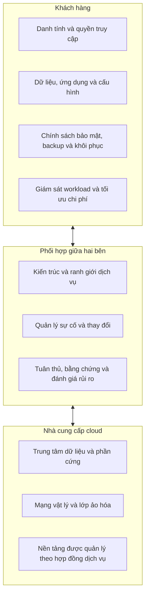
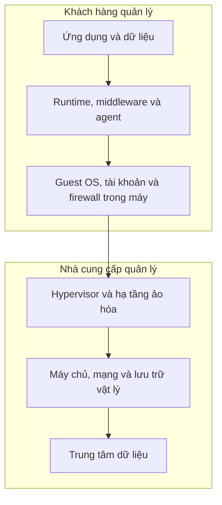
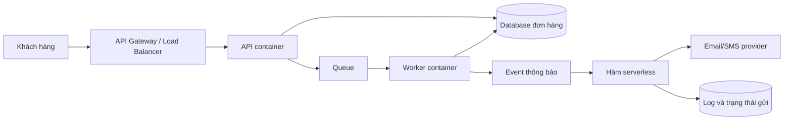

# Trách nhiệm của khách hàng và nhà cung cấp đối với compute

Khi triển khai ứng dụng trên cloud, nhà cung cấp vận hành một phần hạ tầng, còn khách hàng cấu hình và sử dụng phần tài nguyên được cấp. Ranh giới giữa hai bên thay đổi theo mô hình compute: với máy ảo (VM), khách hàng thường quản lý hệ điều hành khách và phần mềm bên trong máy; với nền tảng container được quản lý, nhà cung cấp có thể quản lý control plane và node; với hàm serverless, nhà cung cấp quản lý phần lớn môi trường thực thi. Dù dùng mô hình nào, khách hàng vẫn phải bảo vệ mã nguồn, dữ liệu, danh tính, cấu hình và cách ứng dụng được sử dụng.

Phân định đúng trách nhiệm là nền tảng để thiết kế **CLOUD_CORE_SERVICES_COMPUTE**. Module này giúp người học lựa chọn mô hình tính toán, cấu hình CPU, bộ nhớ và mạng, triển khai ứng dụng, mở rộng tải, bảo đảm tính sẵn sàng và tối ưu chi phí. Những quyết định đó chỉ an toàn và bền vững khi mỗi bên hiểu rõ phần việc của mình, các phần việc phối hợp và bằng chứng cần kiểm tra.

## Mục tiêu học tập

Sau bài này, bạn có thể:

- Giải thích mô hình trách nhiệm chia sẻ (shared responsibility model) trong cloud compute.
- Phân biệt trách nhiệm của nhà cung cấp và khách hàng ở các lớp vật lý, ảo hóa, hệ điều hành, runtime, ứng dụng, dữ liệu và mạng.
- So sánh ranh giới trách nhiệm khi dùng VM, container tự quản lý, container được quản lý và FaaS.
- Xác định ai phải cấu hình IAM, firewall, bản vá, secret, backup, giám sát và khôi phục.
- Đọc SLA và tài liệu dịch vụ để nhận biết phạm vi cam kết, giới hạn và trách nhiệm còn lại.
- Xây dựng ma trận trách nhiệm và checklist vận hành cho một workload cụ thể.

## 1. Mô hình trách nhiệm chia sẻ là gì?

Cloud được xây dựng trên hạ tầng do nhà cung cấp sở hữu hoặc vận hành. Khách hàng thuê tài nguyên và sử dụng dịch vụ thông qua console, API, SDK hoặc công cụ hạ tầng dưới dạng mã. Nhà cung cấp bảo vệ hạ tầng cloud; khách hàng bảo vệ workload, dữ liệu và cấu hình của mình trong cloud. Hai bên phối hợp để dịch vụ hoạt động an toàn và đáp ứng yêu cầu.

Hai khái niệm thường được dùng để mô tả ranh giới này là:

- **Security of the cloud – bảo mật của cloud:** nhà cung cấp chịu trách nhiệm bảo vệ trung tâm dữ liệu, máy chủ vật lý, thiết bị mạng, lớp ảo hóa và những thành phần nền tảng thuộc phạm vi dịch vụ.
- **Security in the cloud – bảo mật trong cloud:** khách hàng chịu trách nhiệm bảo vệ dữ liệu, danh tính, quyền truy cập, cấu hình mạng, hệ điều hành hoặc ứng dụng mà họ quản lý. Phạm vi cụ thể phụ thuộc dịch vụ đã chọn.

Mô hình trách nhiệm chia sẻ không phải một bảng phân chia bất biến cho mọi dịch vụ. Khi nhà cung cấp quản lý nhiều lớp hơn, phần việc vận hành hạ tầng của khách hàng giảm xuống. Tuy nhiên, việc quản lý dữ liệu, quyền truy cập, cấu hình ứng dụng và mục đích sử dụng vẫn thường thuộc về khách hàng.



Ví dụ, nhà cung cấp có thể bảo đảm máy chủ vật lý hoạt động và cung cấp một dịch vụ VM. Nhưng khách hàng vẫn phải cập nhật hệ điều hành bên trong VM, giới hạn cổng truy cập, bảo vệ khóa đăng nhập và cấu hình ứng dụng. Nếu khách hàng mở cổng quản trị ra Internet hoặc để lộ thông tin xác thực, việc nhà cung cấp bảo vệ trung tâm dữ liệu không ngăn được rủi ro đó.

## 2. Phân chia trách nhiệm theo lớp compute

Để phân định trách nhiệm, hãy lần theo đường đi từ phần cứng đến dữ liệu mà ứng dụng xử lý.

| Lớp hoặc hoạt động | Nhà cung cấp cloud | Khách hàng |
|---|---|---|
| Trung tâm dữ liệu | Cơ sở vật chất, nguồn điện, làm mát, kiểm soát ra vào và bảo vệ địa điểm | Chọn vùng/khu vực phù hợp với yêu cầu dữ liệu và độ trễ; đánh giá chứng nhận, điều khoản dịch vụ |
| Phần cứng vật lý | Máy chủ, CPU, RAM, NIC, thiết bị lưu trữ và bảo trì phần cứng | Chọn loại tài nguyên, dung lượng và vùng; theo dõi mức sử dụng được cung cấp |
| Mạng vật lý và kết nối nền | Backbone, thiết bị mạng vật lý và kết nối thuộc hạ tầng cloud | Thiết kế VPC/VNet, subnet, route, firewall, DNS và luồng truy cập trong phạm vi tài khoản |
| Hypervisor và ảo hóa | Vận hành, vá lỗi và bảo vệ lớp ảo hóa do nhà cung cấp quản lý | Chọn loại VM và cấu hình phù hợp; bảo vệ workload chạy trong VM |
| Hệ điều hành khách của VM | Cung cấp image hoặc cơ chế khởi tạo; có thể duy trì một số image do nhà cung cấp phát hành | Cập nhật OS, hardening, tài khoản, dịch vụ, agent, firewall trong guest OS và cấu hình khởi động |
| Host OS và worker node | Quản lý nếu là dịch vụ container được quản lý toàn phần hoặc phạm vi node do nhà cung cấp cam kết | Quản lý nếu tự vận hành node/cluster; với node được quản lý vẫn phải cấu hình workload và kiểm soát phiên bản theo dịch vụ |
| Control plane điều phối container | Vận hành control plane nếu dùng dịch vụ Kubernetes/container được quản lý | Quản lý cấu hình cluster, quyền, namespace, policy và workload; tự vận hành control plane nếu tự dựng cụm |
| Container image và ứng dụng | Cung cấp registry/runtime hoặc công cụ nền theo dịch vụ | Build, kiểm tra, ký, lưu trữ và triển khai image; vá thư viện, mã nguồn và cấu hình ứng dụng |
| Runtime của FaaS | Vận hành máy chủ, hệ điều hành và runtime nền được dịch vụ hỗ trợ | Chọn runtime/phiên bản được hỗ trợ, quản lý dependency, mã hàm, biến cấu hình, quyền và trigger |
| Danh tính và quyền | Cung cấp dịch vụ IAM, cơ chế xác thực và nền tảng quản lý khóa | Tạo principal, role, policy, trust relationship, MFA, vòng đời credential và quyền tối thiểu |
| Dữ liệu | Bảo vệ hạ tầng lưu trữ và thực hiện cam kết dịch vụ về độ bền/khả dụng | Phân loại dữ liệu, kiểm soát truy cập, mã hóa theo yêu cầu, retention, xóa, backup và phục hồi |
| Giám sát và log | Cung cấp metric/log nền tảng, audit API hoặc dịch vụ quan sát nếu có | Bật nguồn log, đặt retention, tạo dashboard/cảnh báo, giám sát ứng dụng và điều tra sự cố |
| Khả năng sẵn sàng | Duy trì thành phần dịch vụ trong phạm vi SLA | Thiết kế HA cho ứng dụng, phân bố workload, health check, failover, backup và kiểm thử khôi phục |
| Chi phí | Công bố bảng giá, cách đo và hóa đơn dịch vụ | Định cỡ tài nguyên, đặt budget, tag, kiểm soát egress, dọn tài nguyên và tối ưu mức sử dụng |

Bảng này là khung định hướng. Hợp đồng, tài liệu dịch vụ, loại triển khai và cấu hình thực tế mới quyết định ranh giới cuối cùng. Ví dụ, nhà cung cấp có thể chịu trách nhiệm vá host OS nhưng khách hàng vẫn phải chọn thời điểm nâng phiên bản node pool, kiểm tra tính tương thích của ứng dụng và xử lý việc restart workload.

### 2.1. Trách nhiệm của nhà cung cấp

Thông thường, nhà cung cấp chịu trách nhiệm cho các hoạt động sau trong phạm vi dịch vụ:

- Bảo vệ trung tâm dữ liệu, thiết bị vật lý, nguồn điện, làm mát và quy trình kiểm soát truy cập vật lý.
- Duy trì máy chủ, thiết bị mạng, lưu trữ vật lý và lớp ảo hóa.
- Vá lỗi và bảo vệ các thành phần nền tảng do nhà cung cấp trực tiếp vận hành.
- Cung cấp cơ chế cô lập tenant và các biện pháp bảo vệ hạ tầng theo thiết kế dịch vụ.
- Vận hành control plane hoặc runtime khi dịch vụ được bán dưới dạng managed service.
- Cung cấp thông tin về giới hạn, trạng thái dịch vụ, SLA, hướng dẫn bảo mật và công cụ cấu hình.
- Thông báo sự cố hoặc thay đổi dịch vụ theo điều khoản và kênh thông báo đã công bố.

Nhà cung cấp không mặc nhiên chịu trách nhiệm sửa lỗi trong mã ứng dụng, khôi phục dữ liệu mà khách hàng chưa backup, sửa firewall khách hàng cấu hình sai hoặc kiểm soát người dùng nội bộ được cấp quyền quá rộng.

### 2.2. Trách nhiệm của khách hàng

Khách hàng thường phải chịu trách nhiệm cho những quyết định và nội dung mà mình đưa lên cloud:

- Chọn dịch vụ, vùng, cấu hình và kiến trúc phù hợp với yêu cầu nghiệp vụ.
- Quản lý danh tính người dùng và workload; áp dụng quyền tối thiểu, MFA và quy trình thu hồi quyền.
- Bảo vệ dữ liệu, secret, khóa mã hóa và thông tin xác thực.
- Cấu hình subnet, route, security group, network policy, endpoint và kết nối đến dịch vụ phụ thuộc.
- Cập nhật guest OS, middleware, runtime, image, dependency và mã ứng dụng trong phần mình quản lý.
- Thiết lập backup, retention, kiểm tra phục hồi, kế hoạch DR và mục tiêu RPO/RTO.
- Giám sát ứng dụng, phát hiện hành vi bất thường, xử lý lỗi và thông báo sự cố theo yêu cầu hợp đồng/pháp luật.
- Theo dõi quota, hiệu năng, SLA, hóa đơn và tối ưu tài nguyên.

### 2.3. Các hoạt động cần phối hợp

Một số việc không thể hoàn thành bởi một bên đơn lẻ. Hai bên cần thống nhất ranh giới kỹ thuật, đầu mối liên hệ và bằng chứng thực hiện:

- Thiết kế kiến trúc có xét đến miền lỗi, vùng, kết nối và phụ thuộc dịch vụ.
- Lập kế hoạch nâng cấp khi nhà cung cấp thay đổi phiên bản nền tảng hoặc ngừng hỗ trợ runtime.
- Điều tra sự cố cần log từ cả control plane và workload.
- Xử lý lỗ hổng liên quan đến lớp nền tảng và cấu hình do khách hàng triển khai.
- Đánh giá tuân thủ, lưu giữ bằng chứng và đáp ứng yêu cầu kiểm toán.
- Kiểm tra kế hoạch khôi phục khi sự cố vượt quá phạm vi một thành phần.

## 3. Ranh giới trách nhiệm theo mô hình triển khai

Điểm khác biệt lớn nhất giữa VM, container và FaaS là số lớp hạ tầng mà khách hàng phải tự vận hành. Cùng một ứng dụng có thể có ranh giới trách nhiệm khác nhau tùy dịch vụ cloud được chọn.

### 3.1. Máy ảo (VM / IaaS)

Với Infrastructure as a Service (IaaS), nhà cung cấp cung cấp tài nguyên máy tính, lưu trữ và mạng ảo. Khách hàng có quyền kiểm soát cao hơn đối với guest OS và phần mềm bên trong VM, do đó cũng có nhiều trách nhiệm vận hành hơn.



**Nhà cung cấp thường chịu trách nhiệm:**

- Bảo vệ trung tâm dữ liệu và máy chủ vật lý.
- Duy trì hypervisor, firmware và hạ tầng mạng/lưu trữ vật lý.
- Cung cấp API để tạo VM, đĩa, NIC, snapshot và các tính năng hạ tầng.
- Duy trì tính sẵn sàng của dịch vụ nền theo phạm vi SLA.

**Khách hàng thường chịu trách nhiệm:**

- Chọn image, loại VM, vCPU, RAM, đĩa, subnet và security group.
- Cập nhật hệ điều hành khách, cài đặt runtime, middleware và ứng dụng.
- Quản lý user, SSH key, chứng thư, endpoint quản trị và firewall trong máy.
- Cấu hình identity/role để VM truy cập dịch vụ cloud; bảo vệ metadata credential.
- Backup dữ liệu, kiểm tra restore và thiết kế nhiều instance/zone nếu cần HA.
- Theo dõi CPU, RAM, disk I/O, network, log và lỗ hổng ở guest OS/ứng dụng.

**Ví dụ:** Một công ty chạy API trên VM Linux. Nhà cung cấp chịu trách nhiệm bảo vệ máy chủ vật lý và hypervisor. Đội của công ty phải vá Linux, cập nhật runtime, cấu hình SSH, chỉ mở cổng HTTPS cần thiết, giới hạn quyền của service account và sao lưu database. Nếu VM bị xâm nhập do mật khẩu SSH yếu hoặc ứng dụng có lỗ hổng, đó thường là vấn đề trong phạm vi khách hàng quản lý.

### 3.2. Container và Kubernetes

Container có thể được chạy trên cluster do khách hàng tự vận hành hoặc trên dịch vụ được quản lý. Vì vậy chỉ nói “dùng container” chưa đủ để kết luận ai chịu trách nhiệm cho node, runtime hay control plane.

**Kubernetes tự quản lý:** khách hàng thường chịu trách nhiệm cài đặt và nâng cấp control plane, node, OS, container runtime, network plugin, storage plugin, RBAC và policy. Nhà cung cấp cloud vẫn quản lý phần hạ tầng vật lý hoặc VM nền nếu cluster chạy trên VM cloud.

**Kubernetes được quản lý:** nhà cung cấp có thể vận hành control plane, API server, etcd và một số thành phần nền. Khách hàng vẫn phải quản lý cấu hình cluster, quyền Kubernetes, namespace, workload, image, secret, network policy và dữ liệu. Trách nhiệm đối với worker node tùy chế độ: node tự quản lý thường thuộc khách hàng; node pool được quản lý có thể được nhà cung cấp hỗ trợ vá hoặc nâng cấp nhưng khách hàng vẫn phải điều phối thay đổi và kiểm tra workload.

**Container platform dạng managed task/service:** nhà cung cấp có thể che giấu máy chủ và scheduler. Khách hàng vẫn chịu trách nhiệm cho image, cấu hình task, CPU/RAM, quyền chạy, cổng mạng, secret, health check và cách ứng dụng lưu dữ liệu.

| Thành phần container | Cluster tự quản lý | Control plane được quản lý | Nền tảng container che giấu node |
|---|---|---|---|
| Máy chủ vật lý/hypervisor | Nhà cung cấp hạ tầng | Nhà cung cấp hạ tầng | Nhà cung cấp dịch vụ |
| OS và node worker | Khách hàng nếu tự dựng trên VM; nhà cung cấp chỉ quản lý host vật lý | Tùy loại node pool; xác minh trách nhiệm patch/nâng cấp | Nhà cung cấp thường quản lý |
| Control plane Kubernetes | Khách hàng | Nhà cung cấp vận hành; khách hàng cấu hình cluster và quyền | Có thể không hiển thị cho khách hàng |
| Container runtime | Khách hàng trên node tự quản lý | Tùy trách nhiệm node pool và hợp đồng dịch vụ | Nhà cung cấp thường quản lý |
| Image, dependency, mã ứng dụng | Khách hàng | Khách hàng | Khách hàng |
| RBAC, namespace, network policy | Khách hàng | Khách hàng cấu hình trong phạm vi API cho phép | Dùng cơ chế IAM/task role hoặc policy mà dịch vụ cung cấp |
| Secret và dữ liệu ứng dụng | Khách hàng | Khách hàng | Khách hàng |

**Ví dụ:** Một nhóm triển khai API bằng Pod trên Kubernetes được quản lý. Nhà cung cấp vận hành control plane. Nhóm phát triển vẫn phải bảo đảm image không chứa secret, cấu hình `requests`/`limits`, đặt readiness probe, giới hạn service account, kiểm tra network policy, cập nhật image và backup dữ liệu trong persistent volume hoặc database. Nếu node pool yêu cầu nâng phiên bản, nhóm cần kiểm tra tính tương thích và khả năng gián đoạn trước khi áp dụng.

### 3.3. Hàm serverless (FaaS)

Với Function as a Service, nhà cung cấp quản lý phần lớn môi trường thực thi: máy chủ, hệ điều hành, runtime nền, việc tạo instance và cơ chế mở rộng. Khách hàng tập trung vào mã hàm, dependency, trigger, identity, dữ liệu và giới hạn dịch vụ.

**Nhà cung cấp thường chịu trách nhiệm:**

- Vận hành phần cứng, hypervisor, host OS và runtime nền theo dịch vụ.
- Cấp phát và thu hồi môi trường thực thi.
- Cung cấp cơ chế định tuyến sự kiện, scale và cách ly thực thi theo thiết kế nền tảng.
- Vá lỗi các thành phần runtime/hạ tầng thuộc phạm vi nhà cung cấp.
- Cung cấp quota, metric nền tảng và thông tin về giới hạn dịch vụ.

**Khách hàng thường chịu trách nhiệm:**

- Viết, kiểm thử, đóng gói và cập nhật mã hàm cùng dependency.
- Chọn phiên bản runtime được hỗ trợ và theo dõi thời điểm hết hỗ trợ.
- Cấu hình trigger, xác thực nguồn sự kiện, timeout, memory và concurrency.
- Cấp quyền tối thiểu cho function role; quản lý secret và dữ liệu đầu vào.
- Thiết kế idempotency, retry, dead-letter queue và xử lý sự kiện trùng lặp.
- Bảo vệ API endpoint, database, object storage và dịch vụ mà hàm gọi đến.
- Theo dõi lỗi, độ trễ, chi phí và giới hạn concurrency.

**Ví dụ:** Một hàm xử lý ảnh được kích hoạt khi người dùng tải file lên object storage. Nhà cung cấp vận hành runtime và mở rộng số instance. Khách hàng phải kiểm tra quyền đọc object, xác thực sự kiện, giới hạn kích thước file, kiểm tra nội dung không tin cậy, đặt timeout và memory, ghi kết quả vào storage phù hợp, đồng thời xử lý retry để không tạo bản ghi trùng.

Serverless giảm việc quản lý máy chủ nhưng không chuyển toàn bộ trách nhiệm bảo mật và vận hành sang nhà cung cấp. Mã hàm có quyền quá rộng hoặc endpoint không xác thực vẫn có thể làm lộ dữ liệu.

## 4. Trách nhiệm bảo mật trong compute

Bảo mật compute là nhiều lớp kiểm soát phối hợp. Một lớp nền tảng an toàn không thể bù cho ứng dụng có lỗ hổng hoặc quyền truy cập quá rộng.

### 4.1. Danh tính và quyền truy cập (IAM)

Nhà cung cấp cung cấp hệ thống IAM, cơ chế xác thực, role và policy. Khách hàng quyết định ai hoặc workload nào được dùng danh tính đó và có thể thực hiện hành động gì.

Khách hàng cần:

- Dùng MFA cho tài khoản con người có quyền quản trị và phân quyền theo vai trò công việc.
- Tách danh tính người dùng khỏi danh tính workload; mỗi VM, container hoặc hàm nên có role riêng theo nhu cầu.
- Cấp quyền tối thiểu theo tài nguyên và hành động cần thiết; tránh dùng tài khoản owner/admin cho ứng dụng.
- Ưu tiên credential ngắn hạn hoặc identity gắn với workload thay cho access key dài hạn được lưu trong file cấu hình.
- Rà soát quyền định kỳ, thu hồi quyền không còn cần và lưu audit log.
- Kiểm tra trust policy để tránh principal bên ngoài hoặc workload không tin cậy giả mạo danh tính.

Ví dụ một API chỉ cần đọc object trong một bucket cụ thể thì role của API nên giới hạn quyền đọc vào bucket/prefix đó. Không cấp quyền quản trị toàn bộ storage chỉ vì đó là cách nhanh nhất để làm ứng dụng chạy được.

### 4.2. Mạng và bề mặt truy cập

Nhà cung cấp bảo vệ mạng vật lý và cung cấp các thành phần mạng ảo. Khách hàng cấu hình cách workload giao tiếp:

- Đặt workload trong subnet phù hợp; phân biệt subnet công khai và subnet riêng.
- Chỉ cho phép inbound/outbound cần thiết qua security group, firewall hoặc network policy.
- Dùng load balancer hoặc API gateway làm điểm vào có kiểm soát; hạn chế truy cập trực tiếp đến node và cổng quản trị.
- Dùng TLS cho kết nối cần bảo vệ; xác thực cả hai đầu khi yêu cầu bảo mật đòi hỏi.
- Kiểm soát DNS, NAT, route, private endpoint và kết nối liên vùng.
- Theo dõi lưu lượng bất thường và chi phí egress.

Một lỗi thường gặp là chỉ kiểm soát cổng vào mà bỏ qua outbound. Nếu workload bị xâm nhập, egress không giới hạn có thể cho phép kẻ tấn công liên lạc với máy chủ điều khiển hoặc lấy dữ liệu ra ngoài.

### 4.3. Hệ điều hành, image và dependency

Trách nhiệm vá lỗi phụ thuộc lớp mà khách hàng quản lý:

- **VM:** khách hàng vá guest OS, kernel trong guest, package, middleware và ứng dụng. Nhà cung cấp vá hypervisor và host hạ tầng.
- **Container:** khách hàng cập nhật base image, thư viện, binary và mã ứng dụng; nhà cung cấp hoặc đội vận hành cluster quản lý host OS/runtime tùy dịch vụ.
- **FaaS:** nhà cung cấp vá runtime nền; khách hàng cập nhật mã, dependency và chuyển sang runtime được hỗ trợ khi có thông báo ngừng hỗ trợ.

Quy trình quản lý lỗ hổng nên gồm kiểm kê tài sản, quét image/package, phân loại mức độ nghiêm trọng, xác định chủ sở hữu, lên lịch vá, kiểm thử tương thích và xác minh sau triển khai. Một image mới được build nhưng workload vẫn chạy digest cũ thì lỗ hổng chưa được khắc phục.

### 4.4. Secret và mã hóa

Khách hàng phải xác định dữ liệu nào nhạy cảm, ai được truy cập và khóa nào bảo vệ dữ liệu. Nhà cung cấp có thể cung cấp KMS, HSM hoặc secret manager, nhưng khách hàng vẫn phải cấu hình policy, vòng đời khóa và quyền sử dụng.

- Không commit secret vào Git, Dockerfile, image, log hoặc artifact build.
- Dùng secret manager hoặc cơ chế quản lý khóa của nền tảng; giới hạn principal được đọc secret.
- Mã hóa dữ liệu khi truyền bằng TLS và khi lưu trữ theo yêu cầu dữ liệu/chính sách.
- Xoay vòng khóa và credential; có quy trình thu hồi khi lộ lọt.
- Hạn chế ghi payload nhạy cảm vào log, trace và hệ thống phân tích.
- Kiểm tra quyền truy cập snapshot, backup, object storage và bản sao dữ liệu.

Mã hóa không thay thế kiểm soát quyền. Người có quyền hợp lệ đọc dữ liệu sau giải mã vẫn có thể truy cập thông tin; do đó IAM, audit và phân loại dữ liệu vẫn cần thiết.

### 4.5. Runtime isolation và multi-tenancy

Nhà cung cấp chịu trách nhiệm thiết kế và vận hành cơ chế cô lập giữa tenant ở hạ tầng do mình quản lý. Khách hàng cần chọn dịch vụ và cấu hình phù hợp với mức rủi ro của workload.

- VM thường tạo ranh giới qua hypervisor và guest OS riêng.
- Container thông thường chia sẻ kernel host; quyền `privileged`, host namespace hoặc mount host có thể làm yếu ranh giới cô lập.
- Một số nền tảng dùng sandbox hoặc microVM để tăng cô lập; cần kiểm tra tài liệu dịch vụ thay vì suy luận từ tên sản phẩm.
- FaaS cô lập môi trường thực thi theo thiết kế nhà cung cấp; khách hàng vẫn phải kiểm tra quyền, dữ liệu và đường gọi giữa các hàm.

Với workload xử lý dữ liệu nhạy cảm hoặc nhiều tenant không tin cậy, cần threat model cụ thể, đánh giá mức cô lập và xác minh các điều khoản bảo mật liên quan.

## 5. Trách nhiệm về tính sẵn sàng, backup và khôi phục

Nhà cung cấp có thể cam kết mức sẵn sàng cho một dịch vụ nền. Điều đó không đồng nghĩa toàn bộ ứng dụng của khách hàng sẽ có cùng mức sẵn sàng. Một ứng dụng có thể ngừng hoạt động vì lỗi code, database hết kết nối, cấu hình DNS sai hoặc credential hết hạn dù compute service vẫn đáp ứng SLA.

### 5.1. Phân biệt SLA và tính sẵn sàng của ứng dụng

SLA (Service Level Agreement) quy định phạm vi dịch vụ, cách đo, mức cam kết, trường hợp loại trừ và biện pháp khắc phục nếu nhà cung cấp không đạt cam kết. Khi đọc SLA, cần xác định:

- Dịch vụ và vùng nào được bao phủ? Cam kết áp dụng cho VM, database, network hay cả tổ hợp?
- Mức sẵn sàng được đo theo tháng, theo vùng hay theo tài nguyên riêng lẻ?
- Có yêu cầu triển khai qua nhiều zone hoặc cấu hình dự phòng để đủ điều kiện không?
- Bảo trì theo kế hoạch, lỗi do cấu hình khách hàng hoặc sự kiện ngoài phạm vi được xử lý thế nào?
- Biện pháp khắc phục là service credit hay một nghĩa vụ khác? Thời hạn yêu cầu ra sao?

SLA không thay thế kiến trúc HA, backup hoặc kế hoạch DR. Service credit cũng không khôi phục dữ liệu hay bù đắp đầy đủ tổn thất nghiệp vụ.

### 5.2. Ai thiết kế HA?

Nhà cung cấp duy trì các thành phần hạ tầng trong phạm vi dịch vụ. Khách hàng phải thiết kế workload sao cho có thể tiếp tục phục vụ khi một instance hoặc miền lỗi gặp sự cố:

- Dùng nhiều VM hoặc replica container khi cần; phân bố qua các zone theo mục tiêu sẵn sàng.
- Cấu hình load balancer, health check, readiness và cơ chế loại instance lỗi khỏi luồng traffic.
- Dùng autoscaling với giới hạn phù hợp; không để một dịch vụ phụ thuộc bị quá tải khi compute scale nhanh.
- Thiết kế database, queue, cache và storage theo mức chịu lỗi tương ứng.
- Dùng timeout, retry có backoff, circuit breaker và idempotency để lỗi không lan rộng.
- Kiểm tra failover và khả năng tiếp tục phục vụ trong điều kiện tải thực tế.

### 5.3. Backup và khôi phục dữ liệu

Nhà cung cấp có thể cung cấp snapshot, backup service, versioning hoặc replication. Khách hàng phải quyết định dữ liệu nào cần bảo vệ, tần suất, thời gian lưu, nơi lưu bản sao và cách kiểm tra phục hồi.

Hai chỉ tiêu quan trọng:

- **RPO (Recovery Point Objective):** lượng dữ liệu tối đa có thể chấp nhận mất, thường được biểu diễn bằng khoảng thời gian giữa các điểm khôi phục.
- **RTO (Recovery Time Objective):** khoảng thời gian mục tiêu để khôi phục dịch vụ sau sự cố.

Ví dụ, nếu hệ thống đặt RPO 15 phút và RTO 2 giờ, quy trình backup/replication và runbook phải có khả năng đáp ứng hai mục tiêu đó trong tình huống đã xác định. Không thể suy ra RPO/RTO chỉ từ việc bật snapshot.

Khách hàng nên:

1. Lập danh mục dữ liệu và phân loại mức độ quan trọng.
2. Chọn backup theo ứng dụng nhất quán, không chỉ theo từng đĩa riêng lẻ.
3. Lưu bản sao ở miền lỗi hoặc tài khoản quản trị phù hợp; bảo vệ backup khỏi xóa nhầm và truy cập trái phép.
4. Xác định retention, mã hóa, quyền restore và quy trình xóa dữ liệu.
5. Thử restore định kỳ, đo thời gian và kiểm tra tính toàn vẹn của dữ liệu.
6. Duy trì runbook, người phụ trách và kênh liên hệ nhà cung cấp khi cần hỗ trợ.

Nhà cung cấp chịu trách nhiệm vận hành dịch vụ backup theo cam kết của sản phẩm. Khách hàng chịu trách nhiệm bật đúng tính năng, chọn chính sách, bảo vệ bản sao và chứng minh có thể khôi phục dữ liệu.

## 6. Triển khai, thay đổi và quản lý vòng đời

Một workload cloud thường trải qua nhiều lần build, deploy, scale, nâng cấp và thay thế. Trách nhiệm cần được xác định ở cả thời điểm tạo mới lẫn khi vận hành.

### 6.1. Hạ tầng dưới dạng mã (IaC)

Khách hàng thường quản lý cấu hình cloud bằng Terraform, CloudFormation, Bicep hoặc công cụ tương tự. IaC giúp mô tả có thể lặp lại các thành phần như VM, network, IAM, cluster, function và policy.

Ví dụ một đoạn Terraform minh họa nguyên tắc không mở cổng quản trị cho mọi địa chỉ:

```hcl
resource "example_security_group" "web" {
  name = "web-service"

  ingress {
    protocol    = "tcp"
    from_port   = 443
    to_port     = 443
    cidr_blocks = ["203.0.113.0/24"]
  }

  egress {
    protocol    = "tcp"
    from_port   = 443
    to_port     = 443
    cidr_blocks = ["0.0.0.0/0"]
  }
}
```

Đây là ví dụ giả định về cấu trúc, không phải resource có thể áp dụng trực tiếp cho một nhà cung cấp cụ thể. Trong môi trường thật, cần dùng provider/resource đúng, bổ sung rule cần thiết cho dịch vụ phụ thuộc và kiểm tra thay đổi trước khi apply.

Khách hàng cần kiểm soát source code IaC, review thay đổi, bảo vệ state file, tránh ghi secret vào state hoặc output, chạy policy check và phát hiện drift. Nhà cung cấp cung cấp API và dịch vụ hạ tầng mà IaC gọi đến; họ không tự xác nhận rằng cấu hình do khách hàng khai báo là an toàn.

### 6.2. Quản lý bản vá và nâng cấp

Trách nhiệm vá lỗi cần gắn với từng thành phần cụ thể:

| Thành phần | Người chịu trách nhiệm chính thường gặp | Hành động |
|---|---|---|
| Firmware, phần cứng, hypervisor | Nhà cung cấp | Bảo trì và vá hạ tầng theo quy trình nội bộ |
| Guest OS trong VM | Khách hàng | Theo dõi bản vá, kiểm thử, triển khai và xác minh |
| Host OS/node tự quản lý | Khách hàng | Vá node, runtime, kernel và lên lịch drain/restart |
| Node pool được quản lý | Chia sẻ theo dịch vụ | Nhà cung cấp cung cấp cơ chế/bản vá; khách hàng chọn cửa sổ nâng cấp, kiểm thử và bảo đảm workload sẵn sàng |
| Control plane managed Kubernetes | Nhà cung cấp vận hành; khách hàng cấu hình và chọn phiên bản theo khả năng dịch vụ | Theo dõi phiên bản, API deprecation, tương thích addon và workload |
| Base image và thư viện ứng dụng | Khách hàng | Build image mới, quét, kiểm thử và rollout |
| Runtime nền FaaS | Nhà cung cấp | Duy trì runtime được cung cấp và thông báo thay đổi |
| Mã hàm và dependency | Khách hàng | Sửa lỗ hổng, nâng dependency, kiểm thử và deploy |

Không nên giả định “managed” có nghĩa là nhà cung cấp tự động cập nhật mọi thứ mà không cần khách hàng hành động. Có dịch vụ yêu cầu khách hàng chủ động chọn phiên bản mới, bật auto-upgrade hoặc di chuyển workload trước ngày ngừng hỗ trợ.

### 6.3. Quản lý thay đổi và rollback

Khách hàng chịu trách nhiệm kiểm soát thay đổi ứng dụng và cấu hình của mình. Một quy trình tốt gồm review, kiểm thử, triển khai theo giai đoạn, health check và rollback. Nhà cung cấp cần công bố thay đổi nền tảng có ảnh hưởng, nhưng khách hàng phải theo dõi thông báo và đánh giá tác động đến workload.

Với thay đổi rủi ro cao, nên:

- Lưu phiên bản artifact và cấu hình có thể tái tạo.
- Kiểm thử tương thích trên staging hoặc môi trường tương đương.
- Triển khai canary hoặc rolling update khi nền tảng hỗ trợ.
- Đặt tiêu chí dừng rollout dựa trên error rate, latency và sức khỏe instance.
- Có phương án rollback ứng dụng, cấu hình và schema dữ liệu.
- Ghi nhận người phê duyệt, thời gian và kết quả thay đổi.

## 7. Trách nhiệm về giám sát và xử lý sự cố

Nhà cung cấp thường giám sát sức khỏe hạ tầng và dịch vụ nền, đồng thời cung cấp status page, metric hoặc audit log. Khách hàng phải giám sát trải nghiệm và hành vi của ứng dụng.

### 7.1. Các tín hiệu khách hàng cần theo dõi

- **Compute:** CPU utilization, memory working set, OOM, throttling, số instance, thời gian khởi động và sự kiện scale.
- **Storage:** dung lượng, IOPS, throughput, latency, lỗi I/O, dung lượng volume và trạng thái backup.
- **Network:** packet loss, latency, số kết nối, lỗi DNS, timeout, throughput và egress.
- **Ứng dụng:** request rate, error rate, p95/p99 latency, queue depth, job duration và dependency failures.
- **Bảo mật:** đăng nhập bất thường, thay đổi IAM, truy cập secret, thay đổi security group, image không đạt policy và hành vi egress lạ.
- **Chi phí:** mức tiêu thụ theo service/tag, tài nguyên idle, data transfer và xu hướng vượt budget.

Một hệ thống quan sát hữu ích kết hợp metric, log, trace và audit event. Log nên có timestamp, request/correlation ID và thông tin đủ để điều tra, đồng thời tránh ghi token, mật khẩu hoặc dữ liệu cá nhân không cần thiết.

### 7.2. Phân loại và phối hợp khi có sự cố

Khi xảy ra sự cố, khách hàng cần xác định tác động đến người dùng, phạm vi workload, thời điểm bắt đầu, thay đổi gần nhất và các dependency liên quan. Sau đó phân biệt lỗi nền tảng với lỗi cấu hình hoặc ứng dụng bằng chứng cứ.

| Dấu hiệu | Hành động ban đầu của khách hàng | Khi nào cần nhà cung cấp |
|---|---|---|
| VM không thể khởi tạo dù quota và cấu hình hợp lệ | Kiểm tra vùng, loại máy, quota, image và sự kiện tài khoản | Có lỗi cấp phát hạ tầng hoặc lỗi dịch vụ vùng được xác nhận |
| CPU VM cao, ứng dụng chậm | Kiểm tra process, profiling, loại máy và giới hạn tài nguyên | Có bằng chứng lỗi host/hypervisor hoặc sự kiện hạ tầng ảnh hưởng instance |
| Pod bị OOM hoặc Pending | Kiểm tra request/limit, node capacity, event và memory profile | Có lỗi control plane/node thuộc phạm vi managed service |
| Hàm bị throttling | Kiểm tra concurrency, quota, tốc độ sự kiện và dependency | Cần xác minh giới hạn dịch vụ hoặc lỗi nền tảng vượt tài liệu công bố |
| API không truy cập được database | Kiểm tra DNS, route, firewall, credential, pool và trạng thái database | Có lỗi kết nối hoặc sự cố dịch vụ phụ trợ thuộc phạm vi nhà cung cấp |
| Nhiều dịch vụ trong một vùng đồng thời lỗi | Kiểm tra status page, health dashboard và thông báo nền tảng | Mở support case với thời điểm, region, request ID và bằng chứng liên quan |

Khi mở support case, cung cấp region, service, resource identifier, timestamp có timezone, request/correlation ID, triệu chứng, mức ảnh hưởng và các bước đã thử. Không gửi secret, private key hoặc dữ liệu nhạy cảm không cần thiết.

Khách hàng vẫn chịu trách nhiệm giảm thiểu tác động đến nghiệp vụ, kích hoạt phương án dự phòng và thông báo cho người dùng theo quy trình nội bộ. Nhà cung cấp điều tra phần nền tảng thuộc phạm vi của họ và cập nhật tiến độ theo kênh hỗ trợ.

## 8. Trách nhiệm về chi phí và hiệu quả compute

Nhà cung cấp công bố cách tính giá, đơn vị đo, quota và hóa đơn. Khách hàng quyết định loại tài nguyên, thời gian chạy, quy mô, lưu lượng và cách tổ chức workload; vì vậy phần lớn cơ hội tối ưu chi phí nằm ở phía khách hàng.

Khách hàng cần:

- Định cỡ vCPU, RAM và storage theo số liệu đo, tránh chọn dư quá nhiều hoặc thiếu gây sự cố.
- Dùng autoscaling với min/max và ngưỡng hợp lý; kiểm tra scale-in để tránh xóa instance đang có việc.
- Tắt hoặc xóa tài nguyên không còn dùng, kể cả disk, snapshot, IP, load balancer và môi trường thử nghiệm.
- Theo dõi egress, NAT, truyền dữ liệu liên vùng và chi phí log/monitoring.
- Gắn tag/label theo ứng dụng, môi trường, team hoặc cost center để phân bổ chi phí.
- Đặt budget, cảnh báo và quy trình xử lý khi mức tiêu thụ tăng bất thường.
- Đánh giá tổng chi phí sở hữu gồm compute, network, storage, backup, license và công vận hành.

Nhà cung cấp có trách nhiệm công bố giá và cách đo minh bạch theo điều khoản dịch vụ, nhưng không tự động biết cấu hình nào là tối ưu cho ứng dụng của khách hàng. Một dịch vụ serverless có thể rẻ khi tải thưa nhưng đắt khi số lần gọi và thời gian thực thi tăng cao; VM có thể có chi phí ổn định khi tải liên tục nhưng tốn tiền nếu để nhàn rỗi. Cần đo trên workload thực tế.

## 9. Tuân thủ, quyền sở hữu dữ liệu và bằng chứng

Nhà cung cấp có thể duy trì chứng nhận, báo cáo kiểm toán và kiểm soát bảo mật cho hạ tầng của mình. Khách hàng phải xác định nghĩa vụ tuân thủ áp dụng cho dữ liệu và quy trình nghiệp vụ, sau đó cấu hình dịch vụ theo yêu cầu đó.

Khi đánh giá một dịch vụ compute, hãy kiểm tra:

- Vùng lưu trữ và xử lý dữ liệu có đáp ứng yêu cầu về địa điểm dữ liệu không?
- Dịch vụ có chứng nhận hoặc báo cáo kiểm toán cần thiết không, và phạm vi báo cáo bao phủ thành phần nào?
- Ai có thể truy cập dữ liệu, metadata, log và backup? Có audit trail không?
- Thời gian lưu trữ, xóa dữ liệu, xử lý bản sao và hỗ trợ yêu cầu pháp lý được quy định ra sao?
- Có cơ chế mã hóa, quản lý khóa, phân quyền và kiểm soát truy cập của nhân viên nhà cung cấp không?
- Khi kết thúc hợp đồng, dữ liệu được xuất, xóa và xác nhận xóa như thế nào?

Chứng nhận của nhà cung cấp không tự động làm cho workload của khách hàng tuân thủ. Khách hàng cần giữ bằng chứng cấu hình, quyền truy cập, backup, kiểm tra khôi phục, xử lý sự cố và đào tạo nhân sự theo yêu cầu của tổ chức.

## 10. Cách xác định ranh giới trách nhiệm cho một workload

Có thể dùng quy trình sau trước khi triển khai hoặc khi chuyển từ VM sang container/serverless.

1. **Mô tả workload.** Xác định ứng dụng, dữ liệu, người dùng, luồng mạng, dependency, mức độ quan trọng và yêu cầu hiệu năng.
2. **Chọn dịch vụ cụ thể.** Phân biệt VM tự quản lý, container platform, Kubernetes managed, task service hay FaaS. Tên mô hình tổng quát chưa đủ để xác định trách nhiệm.
3. **Đọc tài liệu dịch vụ.** Tìm shared responsibility, security guide, service limits, patching, backup, SLA, support plan và lifecycle/deprecation.
4. **Lập danh sách lớp.** Ghi rõ ai sở hữu phần vật lý, hypervisor, OS, node, control plane, runtime, image, code, identity, network, data và monitoring.
5. **Gán người chịu trách nhiệm.** Mỗi hoạt động cần một chủ sở hữu phía khách hàng, kể cả khi nhà cung cấp thực hiện thao tác nền. Ghi rõ việc nào cần support của nhà cung cấp.
6. **Đặt kiểm soát và bằng chứng.** Xác định policy, log, alert, bản ghi backup, kết quả restore, báo cáo scan và audit trail chứng minh việc kiểm soát.
7. **Kiểm tra tình huống lỗi.** Thử giả lập mất instance, lỗi zone, hết quota, lộ secret, image có lỗ hổng và khôi phục dữ liệu.
8. **Rà soát định kỳ.** Cập nhật ma trận khi đổi dịch vụ, đổi phiên bản, thay đổi hợp đồng hoặc khi nhà cung cấp chuyển ranh giới quản lý.

### 10.1. Mẫu ma trận trách nhiệm

Mẫu sau có thể được điều chỉnh theo tổ chức. “A” là người chịu trách nhiệm cuối cùng cho kết quả; “R” là người thực hiện; “C” là bên cần tham vấn; “I” là bên cần được thông báo. Với mỗi hàng, nên có một A rõ ràng.

| Hoạt động | Chủ sở hữu khách hàng (A/R) | Nhà cung cấp (R/C) | Bằng chứng cần lưu |
|---|---|---|---|
| Chọn dịch vụ và vùng | Kiến trúc sư/owner workload | Cung cấp tài liệu và giới hạn | ADR, đánh giá dịch vụ, vùng và quota |
| Bảo vệ trung tâm dữ liệu và hypervisor | C/I | A/R | Báo cáo kiểm toán, chứng nhận, tài liệu bảo mật |
| Cấu hình VPC/subnet/firewall | Network owner | C | IaC, rule review, flow log |
| Vá guest OS VM | Compute/OS owner | Cung cấp image/hướng dẫn | Patch report, trạng thái agent, biên bản kiểm thử |
| Vá host/node managed | Theo dõi và phối hợp | R theo hợp đồng; khách hàng duyệt/điều phối nếu cần | Lịch nâng cấp, phiên bản node, kết quả rollout |
| Bảo vệ image và mã ứng dụng | Development/security owner | Cung cấp registry/runtime nền nếu có | SBOM, scan report, digest, release record |
| IAM và secret | IAM/application owner | Cung cấp IAM/KMS/secret service | Policy review, access log, rotation record |
| Backup và kiểm thử restore | Data owner | Vận hành tính năng backup theo dịch vụ | Backup policy, restore test, RPO/RTO |
| Giám sát ứng dụng và phản ứng sự cố | SRE/operations owner | Giám sát nền tảng và hỗ trợ phần dịch vụ | Dashboard, alert, incident timeline, support case |
| Quản lý chi phí | Service owner/FinOps | Giá, usage metering và hóa đơn | Budget, cost report, tag coverage, action log |

Ma trận cần chỉ rõ tên vai trò hoặc nhóm thực tế trong tổ chức, kênh liên hệ, thời hạn phản hồi và đường escalation. Không để một hoạt động quan trọng ở trạng thái “mọi người cùng chịu trách nhiệm” mà không có người chịu trách nhiệm cuối cùng.

## 11. Ví dụ thực tế: triển khai API xử lý đơn hàng

Một cửa hàng trực tuyến có API nhận đơn, worker xử lý thanh toán và hàm gửi thông báo. Hệ thống dùng container cho API, queue cho công việc nền và FaaS cho thông báo. Database và object storage lưu dữ liệu bền vững.



Ma trận trách nhiệm thực tế có thể như sau:

| Hạng mục | Nhà cung cấp | Đội vận hành/phát triển của cửa hàng |
|---|---|---|
| Máy chủ vật lý, mạng nền, hypervisor | Vận hành và bảo vệ | Chọn vùng và cấu hình tài nguyên cloud |
| Control plane container managed | Vận hành theo dịch vụ | Cấu hình cluster, namespace, RBAC, policy và version tương thích |
| Worker node | Theo phạm vi node pool | Chọn chính sách nâng cấp, kiểm thử workload, theo dõi capacity |
| API/worker image | Cung cấp nền tảng registry/runtime nếu có | Build, scan, ký, cập nhật image và rollout |
| Hàm serverless | Vận hành runtime và scale nền | Cập nhật mã/dependency, trigger, timeout, concurrency và role |
| IAM và secret | Cung cấp IAM/KMS/secret manager | Tạo role riêng cho API, worker, hàm; xoay secret và rà soát quyền |
| Database và object storage | Bảo vệ hạ tầng dịch vụ; cung cấp tính năng backup/replication | Thiết lập quyền, retention, mã hóa, backup và kiểm tra restore |
| Queue và retry | Vận hành dịch vụ queue | Chọn visibility/retention, retry, dead-letter và idempotency |
| Tính sẵn sàng toàn ứng dụng | SLA từng dịch vụ nền | Phân bố replica, health check, failover và diễn tập DR |
| Chi phí | Cung cấp usage và hóa đơn | Định cỡ, autoscaling, egress, budget và tối ưu truy vấn/kết nối |

Nếu API bị lỗi do image chứa dependency có lỗ hổng, đội phát triển phải cập nhật image. Nếu control plane managed bị sự cố, đội vận hành thu thập request ID và thông tin vùng để mở support case, đồng thời kích hoạt phương án giảm tác động. Nếu queue gửi lại một thông điệp, worker phải dùng idempotency key để không thu tiền hai lần. Nếu hàm thông báo có concurrency tăng đột biến, đội vận hành cần kiểm tra quota và giới hạn kết nối đến dịch vụ email.

Ví dụ này cho thấy một hệ thống có thể dùng nhiều mô hình compute cùng lúc. Trách nhiệm phải được phân định theo từng dịch vụ và từng lớp, không thể gán một nhãn chung cho toàn bộ hệ thống.

## 12. Những hiểu lầm thường gặp

**“Đã chuyển lên cloud thì nhà cung cấp chịu trách nhiệm bảo mật toàn bộ.”**

Không đúng. Nhà cung cấp bảo vệ hạ tầng thuộc phạm vi của họ. Khách hàng vẫn phải quản lý dữ liệu, danh tính, ứng dụng và cấu hình tài nguyên.

**“Dùng managed service thì không cần vận hành.”**

Managed service giảm một số việc quản lý hạ tầng, nhưng khách hàng vẫn phải cấu hình quyền, dữ liệu, mạng, backup, giám sát, quota, phiên bản và dependency.

**“SLA của VM bằng SLA của ứng dụng.”**

Không đúng. SLA thường áp dụng cho dịch vụ và điều kiện được định nghĩa. Ứng dụng còn phụ thuộc code, database, DNS, network, cấu hình và kiến trúc nhiều thành phần.

**“Nhà cung cấp backup rồi nên không cần kiểm tra restore.”**

Backup chỉ hữu ích khi có thể khôi phục dữ liệu đúng thời gian và đúng trạng thái. Khách hàng phải chọn chính sách, bảo vệ bản sao và thử phục hồi.

**“Container an toàn hơn VM trong mọi trường hợp.”**

Không thể kết luận như vậy. Mức cô lập phụ thuộc kernel, runtime, cấu hình và threat model. Container dùng chung kernel host trong mô hình phổ biến; VM tạo ranh giới ở lớp ảo hóa.

**“Serverless không cần quản lý phiên bản hoặc dependency.”**

Khách hàng vẫn phải cập nhật mã và dependency, theo dõi runtime hết hỗ trợ, cấu hình quyền và xử lý sự kiện. Nhà cung cấp quản lý runtime nền theo phạm vi dịch vụ.

**“Chứng nhận của cloud provider chứng minh ứng dụng của tôi tuân thủ.”**

Chứng nhận chỉ bao phủ phạm vi kiểm soát được đánh giá. Khách hàng cần chứng minh cách cấu hình, vận hành và sử dụng dịch vụ phù hợp với nghĩa vụ của mình.

## 13. Checklist trước khi đưa compute workload vào production

**Phạm vi và quyền sở hữu**

- [ ] Đã xác định dịch vụ cụ thể và đọc mô hình trách nhiệm của dịch vụ đó.
- [ ] Đã lập ma trận ai chịu trách nhiệm cho OS, node, control plane, runtime, image, code, identity, network và data.
- [ ] Mỗi hoạt động quan trọng có owner phía khách hàng và đầu mối hỗ trợ nhà cung cấp.
- [ ] Đã ghi nhận quota, giới hạn, SLA, support plan và lịch vòng đời phiên bản.

**Bảo mật**

- [ ] Workload có identity riêng và quyền tối thiểu.
- [ ] MFA, secret manager, rotation và audit log được cấu hình phù hợp.
- [ ] Network chỉ mở luồng cần thiết; inbound và outbound đều được xem xét.
- [ ] Guest OS, image, dependency và mã ứng dụng có quy trình vá lỗi.
- [ ] Dữ liệu và backup được phân loại, mã hóa, giới hạn truy cập và đặt retention.

**Tính sẵn sàng và khôi phục**

- [ ] Kiến trúc đáp ứng yêu cầu phân bố miền lỗi và health check.
- [ ] Có timeout, retry, backoff và idempotency cho tác vụ có thể lặp.
- [ ] Backup có chính sách rõ ràng; restore đã được kiểm thử.
- [ ] RPO/RTO và runbook được thống nhất với chủ sở hữu nghiệp vụ.
- [ ] Có quy trình phối hợp với nhà cung cấp khi lỗi nền tảng.

**Quan sát và chi phí**

- [ ] Có metric, log, trace, alert và audit event cần thiết.
- [ ] Có dashboard sức khỏe ứng dụng và dependency.
- [ ] Có tag/label, budget, cảnh báo chi phí và người xử lý.
- [ ] CPU, RAM, storage, network và autoscaling được định cỡ dựa trên dữ liệu đo.
- [ ] Có lịch rà soát quyền, bản vá, quota, chi phí và trách nhiệm khi dịch vụ thay đổi.

## 14. Kết luận

Mô hình trách nhiệm chia sẻ phân định phần việc giữa nhà cung cấp cloud và khách hàng theo từng lớp compute. Nhà cung cấp thường bảo vệ trung tâm dữ liệu, phần cứng, mạng nền, hypervisor và những thành phần managed mà họ trực tiếp vận hành. Khách hàng thường quản lý danh tính, dữ liệu, cấu hình mạng, ứng dụng, dependency, guest OS hoặc workload trong phạm vi quyền kiểm soát của mình.

VM trao cho khách hàng nhiều quyền kiểm soát guest OS và kéo theo nhiều trách nhiệm vận hành. Container và Kubernetes thay đổi ranh giới tùy việc node/control plane do ai quản lý. FaaS chuyển phần lớn trách nhiệm máy chủ và runtime nền sang nhà cung cấp, trong khi khách hàng vẫn quản lý mã, trigger, quyền, dữ liệu và cách xử lý lỗi. Vì vậy, phải xác định ranh giới theo dịch vụ cụ thể và xác minh bằng tài liệu, SLA, ma trận trách nhiệm và kiểm thử vận hành.

Một workload compute an toàn và hiệu quả cần có chủ sở hữu rõ ràng cho từng hoạt động, kiểm soát IAM và mạng, quy trình vá lỗi, backup/restore, giám sát, xử lý sự cố và quản lý chi phí. Khi dịch vụ hoặc kiến trúc thay đổi, ma trận trách nhiệm cũng cần được rà soát lại.

## Thuật ngữ cần nhớ

| Thuật ngữ | Ý nghĩa |
|---|---|
| Shared responsibility model | Mô hình phân chia trách nhiệm bảo mật và vận hành giữa nhà cung cấp cloud và khách hàng. |
| Security of the cloud | Trách nhiệm bảo vệ hạ tầng cloud do nhà cung cấp vận hành. |
| Security in the cloud | Trách nhiệm bảo vệ workload, dữ liệu và cấu hình của khách hàng trong cloud. |
| IaaS | Infrastructure as a Service; dịch vụ hạ tầng như VM, mạng và lưu trữ ảo. |
| Managed service | Dịch vụ mà nhà cung cấp vận hành một phần hoặc phần lớn lớp nền tảng theo hợp đồng. |
| IAM | Identity and Access Management; quản lý danh tính và quyền truy cập. |
| SLA | Service Level Agreement; thỏa thuận mức dịch vụ và phạm vi cam kết. |
| RPO | Recovery Point Objective; mức mất dữ liệu tối đa có thể chấp nhận. |
| RTO | Recovery Time Objective; thời gian mục tiêu để khôi phục dịch vụ. |
| IaC | Infrastructure as Code; quản lý cấu hình hạ tầng bằng mã. |
| Control plane | Thành phần quản lý, cấu hình và điều phối tài nguyên/workload. |
| Data plane | Thành phần trực tiếp xử lý lưu lượng hoặc thực thi workload. |
| Least privilege | Nguyên tắc chỉ cấp quyền tối thiểu cần thiết để thực hiện công việc. |
| Drift | Trạng thái cấu hình thực tế lệch khỏi cấu hình được quản lý hoặc khai báo. |
| Idempotency | Tính chất thao tác lặp lại không tạo thêm hiệu ứng nghiệp vụ ngoài dự kiến. |
