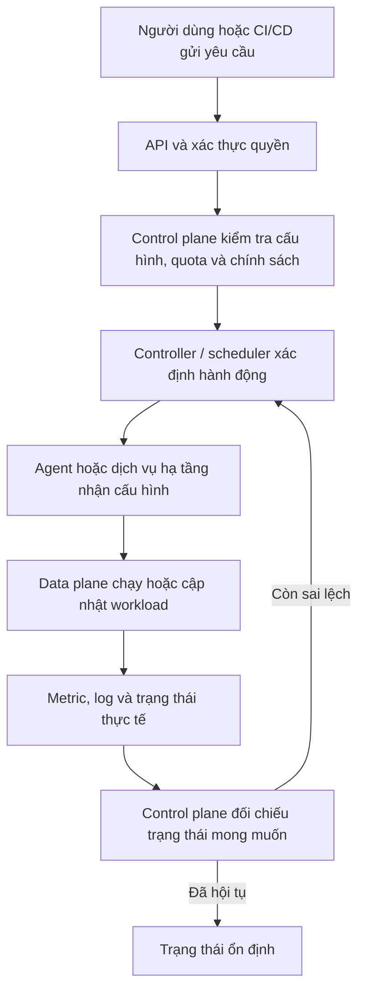

# Phân biệt control plane và data plane trong dịch vụ compute

## Bối cảnh: hai mặt của một dịch vụ compute

Trong cloud compute, người dùng thường thao tác với một API hoặc giao diện quản trị để tạo máy ảo, triển khai container, cấu hình hàm serverless, đặt giới hạn CPU và bộ nhớ, mở rộng số lượng bản sao hoặc thiết lập mạng. Sau khi cấu hình được chấp nhận, ứng dụng thực sự chạy trên máy chủ, xử lý yêu cầu và trao đổi dữ liệu qua mạng.

Hai nhóm hoạt động này thuộc hai mặt khác nhau của hệ thống:

- **Control plane (mặt phẳng điều khiển)** tiếp nhận ý định của người vận hành, kiểm tra quyền và cấu hình, quyết định tài nguyên cần có, điều phối việc tạo hoặc thay đổi tài nguyên, rồi theo dõi trạng thái mong muốn.
- **Data plane (mặt phẳng dữ liệu)** cung cấp năng lực thực thi thực tế: chạy máy ảo, container hoặc hàm; cấp CPU và bộ nhớ cho workload; xử lý gói tin và yêu cầu ứng dụng; đọc ghi dữ liệu theo cấu hình đã được áp dụng.

Có thể hình dung control plane trả lời câu hỏi **“hệ thống cần được cấu hình và điều phối như thế nào?”**, còn data plane trả lời câu hỏi **“workload và lưu lượng đang được xử lý ở đâu, bằng cách nào?”**. Đây là cách phân biệt theo trách nhiệm. Hai mặt có thể được triển khai trên nhiều thành phần và nhiều máy khác nhau; chúng không nhất thiết là hai máy chủ hay hai mạng vật lý tách biệt.

Trong module **CLOUD_CORE_SERVICES_COMPUTE**, việc hiểu hai mặt phẳng này giúp kết nối các chủ đề về máy ảo, container và serverless với lựa chọn CPU, bộ nhớ, mạng, cấu hình bảo mật, triển khai ứng dụng, mở rộng tải, tính sẵn sàng và tối ưu chi phí vận hành.

## 1. Control plane là gì?

Control plane là tập hợp API, dịch vụ quản lý và bộ điều phối dùng để thay đổi hoặc duy trì cấu hình của nền tảng compute. Người dùng, hệ thống CI/CD hoặc một dịch vụ tự động hóa gửi yêu cầu đến control plane. Control plane xác thực danh tính, kiểm tra quyền, kiểm tra tính hợp lệ của cấu hình, ghi nhận trạng thái mong muốn và điều phối các thành phần hạ tầng để đưa hệ thống đến trạng thái đó.

Các nhiệm vụ phổ biến gồm:

1. **Tiếp nhận yêu cầu quản trị:** tạo, sửa, khởi động, dừng hoặc xóa máy ảo; triển khai phiên bản container; tạo hàm serverless; cấu hình bộ cân bằng tải hoặc nhóm tự động mở rộng.
2. **Xác thực và áp dụng chính sách:** kiểm tra IAM, vai trò, phạm vi truy cập, quota, chính sách mạng và các ràng buộc bảo mật.
3. **Lập kế hoạch và phân bổ:** chọn loại instance, vùng khả dụng, host hoặc node phù hợp; quyết định vị trí đặt workload dựa trên tài nguyên và các ràng buộc.
4. **Điều phối vòng đời:** phối hợp tạo tài nguyên, cập nhật cấu hình, thay thế instance lỗi, triển khai theo từng đợt và thu hồi tài nguyên không còn cần thiết.
5. **Duy trì trạng thái mong muốn:** so sánh trạng thái thực tế với cấu hình đã khai báo, sau đó thực hiện hành động sửa sai khi cần.
6. **Cung cấp thông tin quản trị:** trả về trạng thái triển khai, sự kiện, cảnh báo, thông tin kiểm toán và dữ liệu phục vụ quyết định mở rộng.

Ví dụ, khi yêu cầu tạo một máy ảo, control plane có thể kiểm tra quyền của người gọi, xác nhận image và loại máy hợp lệ, kiểm tra quota, chọn vùng và host có đủ tài nguyên, yêu cầu hệ thống lưu trữ tạo volume, gắn card mạng, rồi khởi tạo máy ảo. Người dùng tương tác với một yêu cầu quản trị thống nhất dù bên dưới có nhiều thành phần phối hợp.

Control plane thường có giao diện quản lý như REST API, CLI, SDK hoặc console. Các giao diện đó là cách gửi yêu cầu; bản thân giao diện không phải toàn bộ control plane. Phần cốt lõi còn bao gồm logic xác thực, bộ lập lịch, bộ điều khiển, kho lưu trạng thái và các dịch vụ quản lý hạ tầng.

## 2. Data plane là gì?

Data plane là phần trực tiếp phục vụ việc thực thi workload hoặc chuyển tiếp và xử lý lưu lượng. Trong dịch vụ compute, data plane thường bao gồm các máy chủ vật lý, hypervisor, worker node, container runtime, môi trường chạy hàm, thành phần mạng và các cơ chế thực thi cấu hình bảo mật.

Các nhiệm vụ phổ biến gồm:

- Cấp phát và sử dụng CPU, RAM, bộ nhớ đệm và thiết bị tăng tốc theo cấu hình của workload.
- Chạy hệ điều hành và ứng dụng bên trong máy ảo.
- Chạy pod, container và tiến trình ứng dụng trên worker node.
- Khởi chạy mã hàm serverless khi có sự kiện hoặc yêu cầu gọi hàm.
- Nhận, xử lý và chuyển tiếp gói tin theo bảng định tuyến, chính sách mạng và cấu hình đã được phân phối.
- Thực thi các quy tắc lọc lưu lượng, cô lập workload và giới hạn tài nguyên tại nơi workload thực sự chạy.
- Phát sinh số liệu như CPU utilization, mức sử dụng bộ nhớ, độ trễ, thông lượng, lỗi ứng dụng và lưu lượng mạng.

Ví dụ, sau khi máy ảo được tạo thành công, ứng dụng bên trong máy ảo xử lý HTTP request, tiêu thụ CPU, cấp phát bộ nhớ và gửi dữ liệu qua mạng. Các hoạt động đó diễn ra trên data plane. Control plane có thể tiếp tục quan sát trạng thái và thay đổi cấu hình, nhưng không trực tiếp xử lý từng HTTP request của ứng dụng.

Data plane không chỉ có nghĩa là “nơi chứa dữ liệu”. Trong ngữ cảnh hạ tầng, từ *data* nhấn mạnh đường thực thi hoặc đường xử lý lưu lượng. Một gói tin được chuyển tiếp qua mạng, một container xử lý yêu cầu hoặc một hàm chạy mã đều là hoạt động của data plane, kể cả khi dữ liệu đó không được lưu lâu dài.

## 3. So sánh trách nhiệm của hai mặt phẳng

| Khía cạnh | Control plane | Data plane |
|---|---|---|
| Mục tiêu | Quản lý cấu hình và điều phối tài nguyên | Thực thi workload và xử lý lưu lượng |
| Đầu vào điển hình | API tạo tài nguyên, manifest, chính sách, cấu hình mở rộng | Request ứng dụng, sự kiện, tiến trình, gói tin |
| Hoạt động | Xác thực, lập lịch, cập nhật trạng thái, điều phối vòng đời | Chạy mã, cấp CPU/RAM, xử lý request, chuyển tiếp packet |
| Thành phần ví dụ | API server, scheduler, controller, dịch vụ quản lý, kho trạng thái | VM host, hypervisor, worker node, runtime, datapath mạng |
| Đơn vị quan sát | Trạng thái tài nguyên, tiến trình triển khai, sự kiện quản trị | Độ trễ, thông lượng, CPU, RAM, lỗi và lưu lượng thực tế |
| Sự cố điển hình | Không tạo hoặc thay đổi được tài nguyên, điều phối chậm | Ứng dụng không chạy, request lỗi hoặc lưu lượng bị gián đoạn |
| Câu hỏi vận hành | “Cấu hình mong muốn có được áp dụng không?” | “Ứng dụng có đang phục vụ tốt không?” |

Ranh giới giữa hai mặt phẳng là ranh giới trách nhiệm, không phải ranh giới tuyệt đối của từng sản phẩm. Một dịch vụ cloud có thể đặt nhiều chức năng trong cùng một cụm hệ thống, hoặc chia chúng thành các dịch vụ phân tán. Khi đọc tài liệu của nhà cung cấp, cần xem chức năng cụ thể đang được nói đến thay vì chỉ dựa vào tên sản phẩm.

## 4. Hai mặt phẳng trong các mô hình compute

### 4.1. Máy ảo (virtual machine)

Với máy ảo, control plane cung cấp API hoặc console để người dùng chọn image, loại instance, CPU, RAM, vùng triển khai, subnet, security group, ổ đĩa và chính sách tự động mở rộng. Bộ điều phối kiểm tra quota và quyền, tìm vị trí có đủ năng lực, rồi yêu cầu các dịch vụ hạ tầng tạo máy ảo và gắn tài nguyên liên quan.

Data plane là nơi hypervisor và máy chủ vật lý cung cấp tài nguyên cho máy ảo. Hệ điều hành khách khởi động, ứng dụng chạy, CPU được sử dụng, bộ nhớ được cấp phát, ổ đĩa được đọc ghi và card mạng xử lý lưu lượng. Người dùng quan tâm đến hiệu năng ứng dụng chủ yếu đang quan sát kết quả từ data plane.

Ví dụ luồng tạo VM:

1. Người vận hành gửi yêu cầu tạo VM với 4 vCPU, 8 GiB RAM, một image và một subnet.
2. Control plane xác thực quyền, kiểm tra quota và xác nhận cấu hình.
3. Bộ lập lịch chọn host có đủ CPU, RAM và khả năng đáp ứng các ràng buộc placement.
4. Các thành phần hạ tầng tạo volume, cổng mạng và VM; cấu hình mạng, firewall được phân phối đến điểm thực thi.
5. VM khởi động trên data plane và ứng dụng bắt đầu xử lý yêu cầu.

Việc chọn cấu hình 4 vCPU và 8 GiB RAM là quyết định quản trị ở control plane. Việc ứng dụng thực tế tiêu thụ bao nhiêu CPU và RAM là hành vi của data plane. Nếu ứng dụng chậm, tăng số vCPU qua API là một thay đổi ở control plane; kiểm tra CPU throttling hoặc mức sử dụng CPU bên trong VM là quan sát data plane.

### 4.2. Container và Kubernetes

Trong Kubernetes, control plane nhận các đối tượng khai báo qua API server. Scheduler chọn node cho pod chưa được gán node; controller theo dõi trạng thái và tạo hoặc thay thế đối tượng để đưa cụm về trạng thái mong muốn. Với một cụm được quản lý, nhà cung cấp cloud có thể vận hành control plane thay cho khách hàng.

Data plane nằm chủ yếu trên worker node. Kubelet nhận chỉ thị dành cho node, container runtime tải image và chạy container, còn thành phần mạng của node chuyển tiếp lưu lượng giữa pod và các điểm đích khác. Ứng dụng trong pod xử lý request trên các node đó.

Ví dụ manifest sau khai báo mong muốn có ba bản sao của một ứng dụng:

```yaml
apiVersion: apps/v1
kind: Deployment
metadata:
  name: web-api
spec:
  replicas: 3
  selector:
    matchLabels:
      app: web-api
  template:
    metadata:
      labels:
        app: web-api
    spec:
      containers:
        - name: api
          image: example.invalid/web-api:v1
          resources:
            requests:
              cpu: "500m"
              memory: "512Mi"
            limits:
              cpu: "1"
              memory: "1Gi"
          ports:
            - containerPort: 8080
```

Khi chạy `kubectl apply -f deployment.yaml`, lệnh gửi cấu hình đến API server của control plane. Deployment controller nhận thấy trạng thái mong muốn là ba replica và phối hợp tạo ReplicaSet, Pod. Scheduler chọn node; kubelet và container runtime trên worker node thực thi việc chạy container. Ba bản sao ứng dụng xử lý request trên data plane.

Manifest chỉ mô tả ý định. Việc khai báo `replicas: 3` không tự chứng minh rằng ba pod đã sẵn sàng. Cần kiểm tra trạng thái rollout và đồng thời kiểm tra sức khỏe ứng dụng, độ trễ, lỗi và tài nguyên trên worker node. Trạng thái đối tượng Kubernetes là góc nhìn quản trị; khả năng phục vụ thực tế là góc nhìn data plane.

### 4.3. Serverless và Function as a Service

Với serverless, người dùng thường không quản lý trực tiếp máy chủ. Control plane tiếp nhận gói triển khai, cấu hình runtime, biến môi trường, quyền truy cập, trigger, giới hạn đồng thời, phiên bản và chính sách mở rộng. Nền tảng quyết định khi nào cần chuẩn bị hoặc thu hồi môi trường thực thi.

Data plane nhận sự kiện hoặc lời gọi hàm, cấp môi trường chạy khi cần, thực thi mã, truy cập dịch vụ phụ trợ và trả kết quả. Người dùng nhìn thấy thời gian phản hồi, số lần gọi, lỗi, mức đồng thời và chi phí theo mức sử dụng.

Ví dụ: một hàm xử lý ảnh được cấu hình để chạy khi có object mới trong bucket. Việc đăng ký trigger, cấp quyền đọc object và đặt giới hạn concurrency thuộc control plane. Khi ảnh được tải lên, sự kiện kích hoạt hàm, mã xử lý ảnh tiêu thụ CPU và bộ nhớ, sau đó ghi ảnh kết quả; đó là hoạt động của data plane.

Serverless che giấu nhiều chi tiết máy chủ, nhưng không loại bỏ sự phân biệt hai mặt phẳng. Khi cấu hình trigger sai, control plane có thể là nơi cần kiểm tra. Khi hàm được gọi nhưng xử lý chậm hoặc hết bộ nhớ, cần xem log và metric của lần thực thi trên data plane.

## 5. Luồng phối hợp giữa control plane và data plane

Một thay đổi compute thường đi qua chu trình sau:



Điểm quan trọng là control plane thường làm việc theo **trạng thái mong muốn** (*desired state*). Người vận hành khai báo kết quả cần đạt, chẳng hạn ba replica, một loại instance hoặc một chính sách mở rộng. Controller liên tục hoặc định kỳ quan sát trạng thái thực tế (*observed state*) và thực hiện hành động để giảm sai lệch. Vì vậy, một yêu cầu API được chấp nhận chưa chắc đồng nghĩa tài nguyên đã sẵn sàng; quá trình điều phối có thể cần thời gian và có thể thất bại ở một bước sau đó.

Sự phối hợp cũng diễn ra theo chiều ngược lại. Data plane tạo metric, log, health signal và sự kiện. Control plane hoặc hệ thống quản lý dựa trên các tín hiệu đó để thay thế instance lỗi, tăng số replica, cập nhật trạng thái hiển thị hoặc cảnh báo người vận hành. Trong nhiều kiến trúc, hệ thống giám sát và hệ thống điều phối là các dịch vụ riêng, nhưng chúng cùng tham gia vào vòng phản hồi vận hành.

## 6. Điều gì xảy ra khi một mặt phẳng gặp sự cố?

### 6.1. Control plane gặp sự cố

Nếu API quản trị hoặc bộ điều phối không khả dụng, người dùng có thể không tạo, sửa, xóa hoặc mở rộng tài nguyên được. Các pipeline triển khai có thể bị kẹt; autoscaler hoặc controller có thể không cập nhật được trạng thái. Tuy vậy, workload đang chạy trên data plane thường vẫn tiếp tục phục vụ trong một khoảng thời gian nếu nó không cần một thao tác trực tiếp từ control plane để xử lý từng request.

Đây là một đặc tính kiến trúc thường gặp, không phải cam kết áp dụng cho mọi dịch vụ. Một số data plane phụ thuộc vào control plane để lấy cấu hình mới, xác thực, cấp token, nhận sự kiện hoặc khởi tạo phiên thực thi. Khi phụ thuộc đó bị gián đoạn, một phần hoạt động dữ liệu cũng có thể bị ảnh hưởng. Cần đọc mô hình phụ thuộc và cam kết của dịch vụ cụ thể.

Các dấu hiệu thường thấy:

- API quản trị trả lỗi hoặc timeout, nhưng ứng dụng hiện hữu vẫn phản hồi.
- Không thể triển khai phiên bản mới hoặc tăng số instance.
- Trạng thái tài nguyên trên console chậm cập nhật hoặc không đồng nhất.
- Controller không thể kết nối đến API hoặc không thực hiện được hành động điều phối.

Hướng xử lý là kiểm tra trạng thái dịch vụ quản lý của nhà cung cấp, quyền và quota, lỗi API, hàng đợi điều phối và các phụ thuộc cần thiết. Nếu workload hiện hữu vẫn khỏe, tránh thực hiện thay đổi liên tục có thể làm tình hình khó kiểm soát hơn; chuẩn bị phương án vận hành theo quy trình sự cố của nền tảng.

### 6.2. Data plane gặp sự cố

Nếu worker node, host, runtime, datapath mạng hoặc chính workload gặp sự cố, ứng dụng có thể mất khả năng phục vụ dù API quản trị vẫn hoạt động. Control plane có thể hiển thị node không khỏe, pod lỗi hoặc VM bị dừng, và có thể điều phối thay thế nếu còn đủ năng lực dự phòng.

Các dấu hiệu thường thấy:

- API tạo hoặc truy vấn tài nguyên vẫn hoạt động nhưng ứng dụng trả lỗi.
- CPU bị bão hòa, bộ nhớ thiếu, tiến trình bị OOM kill hoặc container liên tục khởi động lại.
- Độ trễ tăng, mất gói, kết nối timeout hoặc một vùng triển khai không truy cập được.
- Health check thất bại trên một số instance hoặc replica.

Hướng xử lý là xác định phạm vi ảnh hưởng, kiểm tra metric và log tại nơi workload chạy, xem sức khỏe host/node, kiểm tra mạng và phụ thuộc ứng dụng. Có thể chuyển lưu lượng, thay thế instance hoặc phân tán workload sang vùng khác nếu kiến trúc và dung lượng cho phép.

### 6.3. Bảng chẩn đoán nhanh

| Hiện tượng | Nơi cần kiểm tra trước | Câu hỏi chẩn đoán |
|---|---|---|
| Không tạo được VM hoặc cluster | Control plane | API, IAM, quota, scheduler hoặc dịch vụ quản lý có lỗi không? |
| Triển khai được nhưng pod không được lập lịch | Cả hai mặt phẳng | Control plane có tìm được node phù hợp không; worker node còn CPU/RAM và trạng thái khỏe không? |
| VM hoặc pod đang chạy nhưng ứng dụng timeout | Data plane | Ứng dụng, host, runtime, route, firewall và health check có hoạt động không? |
| Autoscaling không tăng replica | Cả hai mặt phẳng | Metric có được thu thập không; controller có quyền và node có đủ dung lượng không? |
| Console báo trạng thái cũ nhưng ứng dụng vẫn chạy | Control plane và đường telemetry | API trạng thái, agent báo cáo và luồng metric có bị trễ không? |

Không nên kết luận chỉ từ một tín hiệu. Ví dụ, pod ở trạng thái `Running` cho biết container đã được khởi chạy theo góc nhìn của Kubernetes; điều đó không bảo đảm endpoint ứng dụng đang khỏe hoặc có thể phục vụ lưu lượng.

## 7. Liên hệ với CPU, bộ nhớ, mạng và bảo mật

Phân biệt hai mặt phẳng giúp xác định nơi đưa ra quyết định và nơi kiểm chứng kết quả cho từng loại tài nguyên.

| Tài nguyên | Quyết định ở control plane | Hoạt động hoặc bằng chứng ở data plane |
|---|---|---|
| CPU | Chọn instance type, đặt CPU request/limit, cấu hình autoscaling | CPU thực tế được sử dụng, mức bão hòa, throttling và thời gian xử lý |
| Bộ nhớ | Chọn dung lượng RAM, đặt memory request/limit, cấu hình runtime | Heap, working set, cache, page fault, OOM và mức sử dụng thực tế |
| Mạng | Tạo VPC/subnet, route, security group, policy và load balancer | Chuyển tiếp packet, kết nối, thông lượng, mất gói và độ trễ |
| Lưu trữ | Chọn volume, loại đĩa, kích thước và chính sách gắn kết | IOPS, throughput, latency và thao tác đọc ghi của workload |
| Bảo mật | IAM, policy, cấu hình firewall, secret và quy tắc triển khai | Cô lập tiến trình, thực thi luật lọc, mã hóa và kiểm soát truy cập tại runtime |

Một cấu hình hợp lệ ở control plane vẫn có thể tạo ra hiệu năng kém trên data plane. Chẳng hạn, request CPU quá thấp có thể khiến workload khó được lập lịch đúng kỳ vọng; limit quá thấp có thể gây throttling; memory limit không phù hợp có thể dẫn đến OOM. Tương tự, route và firewall được khai báo đúng cú pháp chưa đủ để chứng minh đường truyền từ ứng dụng đến dịch vụ đích đang hoạt động. Cần kiểm chứng bằng metric, log, health check và phép thử kết nối từ đúng vị trí của workload.

Về bảo mật, control plane thường là mục tiêu có giá trị cao vì người có quyền quản trị có thể tạo, thay đổi hoặc xóa nhiều tài nguyên. Cần bảo vệ API quản trị bằng IAM tối thiểu quyền, xác thực mạnh, phân tách vai trò, kiểm toán thay đổi và giới hạn truy cập. Data plane cần được bảo vệ bằng cô lập workload, phân đoạn mạng, quy tắc lọc lưu lượng, quản lý secret, cập nhật hệ điều hành/runtime và giám sát hành vi khi chạy. Một cấu hình quản trị an toàn không thay thế cho bảo mật ở nơi ứng dụng thực thi; ngược lại, hardening máy chủ không bù được một tài khoản quản trị bị lộ.

## 8. Tác động đến khả năng sẵn sàng và mở rộng

Khả năng sẵn sàng của dịch vụ phụ thuộc vào cả hai mặt phẳng. Control plane cần có cơ chế dự phòng cho API, kho trạng thái, scheduler và controller để người vận hành có thể quản lý hệ thống khi một thành phần lỗi. Data plane cần phân tán workload, có đủ năng lực dự phòng, health check, cơ chế thay thế instance và đường mạng phù hợp để tiếp tục phục vụ khi một node hoặc vùng gặp sự cố.

Khi mở rộng tải, control plane nhận tín hiệu hoặc chính sách mở rộng rồi quyết định tăng số lượng VM, pod hoặc môi trường chạy hàm. Data plane nhận workload mới và xử lý request. Nếu control plane phản ứng chậm, tài nguyên mới có thể đến muộn so với đỉnh tải. Nếu data plane thiếu CPU, RAM, kết nối hoặc dung lượng mạng, tăng số bản sao có thể không giải quyết được nút thắt, thậm chí làm tăng áp lực lên cơ sở dữ liệu hoặc dịch vụ phụ trợ.

Khi thiết kế autoscaling, cần xem xét cả hai phía:

- Chọn metric phản ánh đúng nút thắt, ví dụ CPU, độ dài hàng đợi, concurrency hoặc độ trễ.
- Đặt ngưỡng, thời gian ổn định và tốc độ scale phù hợp để tránh dao động tăng giảm liên tục.
- Bảo đảm quota và năng lực dự phòng đủ để control plane có thể cấp thêm tài nguyên.
- Kiểm tra thời gian khởi động VM, tải image, khởi tạo container hoặc cold start của hàm.
- Xác nhận data plane mới đã vượt qua health check trước khi nhận lưu lượng.
- Đánh giá giới hạn của dịch vụ phụ trợ để việc mở rộng compute không chuyển sự cố sang cơ sở dữ liệu, cache hoặc mạng.

## 9. Tác động đến chi phí vận hành

Chi phí compute phát sinh chủ yếu từ tài nguyên thực thi và các dịch vụ đi kèm: vCPU, RAM, thời gian chạy, lưu trữ, truyền dữ liệu, cân bằng tải và giám sát. Đây là phần gắn chặt với mức sử dụng data plane. Tuy nhiên, control plane ảnh hưởng trực tiếp đến hiệu quả chi phí thông qua lựa chọn instance, quota, lịch chạy, chính sách tự động mở rộng, cấu hình request/limit và việc thu hồi tài nguyên nhàn rỗi.

Một số ví dụ:

- Chọn VM quá lớn làm tăng chi phí dù CPU và RAM thực tế ít được sử dụng.
- Đặt quá nhiều replica tối thiểu giúp có dự phòng nhưng làm tăng chi phí khi tải thấp.
- Cấu hình autoscaling thiếu ngưỡng scale-in có thể khiến tài nguyên tiếp tục chạy sau đợt tải cao.
- Đặt memory limit quá thấp có thể làm ứng dụng khởi động lại, gây lãng phí tài nguyên và ảnh hưởng trải nghiệm.
- Mở rộng compute mà không giới hạn concurrency có thể tăng chi phí hoặc gây quá tải dịch vụ phụ trợ.

Vì vậy, tối ưu chi phí cần một vòng phản hồi: control plane đặt chính sách và cấu hình; data plane cung cấp số liệu sử dụng và hiệu năng; người vận hành điều chỉnh cấu hình dựa trên dữ liệu thực tế. Không nên giảm CPU hoặc RAM chỉ dựa trên mức trung bình nếu workload có đỉnh tải ngắn, yêu cầu độ trễ nghiêm ngặt hoặc cần dự phòng cho sự cố.

## 10. Quy trình thực hành để xác định đúng mặt phẳng

Khi triển khai hoặc xử lý sự cố một dịch vụ compute, có thể dùng trình tự sau:

1. **Xác định mục tiêu:** đang tạo tài nguyên, thay đổi cấu hình, triển khai phiên bản, xử lý request hay khắc phục lỗi ứng dụng?
2. **Tìm điểm tiếp nhận yêu cầu:** API, console, CLI, manifest, pipeline hoặc trigger nào khởi tạo thay đổi? Đây thường là đường vào control plane.
3. **Kiểm tra trạng thái quản trị:** quyền, quota, cấu hình, trạng thái triển khai, lịch sử sự kiện, kết quả lập lịch và trạng thái controller.
4. **Kiểm tra nơi thực thi:** VM, worker node, container, function runtime, CPU, RAM, disk, network và log ứng dụng.
5. **Đối chiếu mong muốn với thực tế:** tài nguyên đã được tạo chưa, workload đã sẵn sàng chưa, lưu lượng đã đến đúng đích chưa và hiệu năng có đạt yêu cầu không?
6. **Thay đổi có kiểm soát:** sửa cấu hình ở control plane khi cần; xác minh tác động trên data plane sau khi thay đổi được áp dụng.
7. **Ghi nhận và theo dõi:** lưu lại nguyên nhân, hành động, kết quả và metric để phát hiện sớm tình trạng tái diễn.

Một cách tự kiểm tra hữu ích là đặt hai câu hỏi cho mỗi thao tác:

- “Tôi đang yêu cầu nền tảng thay đổi điều gì?” — xác định phần control plane.
- “Tôi cần quan sát bằng chứng nào để biết workload thực sự hoạt động?” — xác định phần data plane.

Ví dụ, khi triển khai phiên bản mới, trạng thái rollout thành công là bằng chứng từ control plane rằng các đối tượng triển khai đã hội tụ theo cấu hình. Để kết luận dịch vụ đã hoạt động tốt, vẫn cần kiểm tra health check, request thành công, độ trễ và lỗi trên data plane.

## 11. Những nhầm lẫn thường gặp

**Cho rằng control plane là console quản trị.** Console chỉ là một giao diện. API, bộ lập lịch, controller, kho trạng thái và logic chính sách cũng thuộc control plane.

**Cho rằng data plane chỉ là nơi lưu dữ liệu.** Trong compute, data plane là nơi chạy workload và xử lý lưu lượng. CPU thực thi mã, container xử lý request và datapath chuyển tiếp packet đều là hoạt động data plane.

**Cho rằng control plane lỗi thì mọi ứng dụng dừng ngay.** Nhiều workload hiện hữu có thể tiếp tục chạy khi API quản trị gián đoạn, nhưng khả năng triển khai, sửa cấu hình, tự phục hồi hoặc mở rộng có thể suy giảm. Mức độ ảnh hưởng phụ thuộc vào thiết kế và các phụ thuộc của dịch vụ.

**Cho rằng control plane báo thành công nghĩa là ứng dụng khỏe.** Một tài nguyên có thể được tạo thành công nhưng ứng dụng vẫn lỗi do cấu hình, thiếu tài nguyên, lỗi runtime, mạng hoặc dịch vụ phụ trợ.

**Cho rằng hai mặt phẳng luôn tách biệt vật lý.** Chúng có thể dùng chung hạ tầng hoặc được phân phối qua nhiều dịch vụ. Điều cần nhận diện là chức năng quản trị/điều phối và chức năng thực thi/xử lý.

**Cho rằng mở rộng control plane đồng nghĩa mở rộng data plane.** Tăng năng lực API hoặc scheduler không tự làm tăng CPU/RAM cho ứng dụng. Cần cấu hình mở rộng tài nguyên thực thi và xác minh workload mới đã sẵn sàng.

## Kết luận

Control plane quản lý ý định, chính sách và vòng đời tài nguyên; data plane thực thi workload và xử lý lưu lượng thực tế. Với máy ảo, container và serverless, hai mặt phẳng phối hợp để biến cấu hình quản trị thành năng lực compute có thể sử dụng. Khi triển khai, mở rộng, bảo mật, xử lý sự cố hoặc tối ưu chi phí, hãy kiểm tra cả trạng thái quản trị lẫn bằng chứng tại nơi workload chạy. Cách nhìn này giúp xác định đúng nguyên nhân, lựa chọn hành động phù hợp và đánh giá dịch vụ dựa trên kết quả thực tế.
