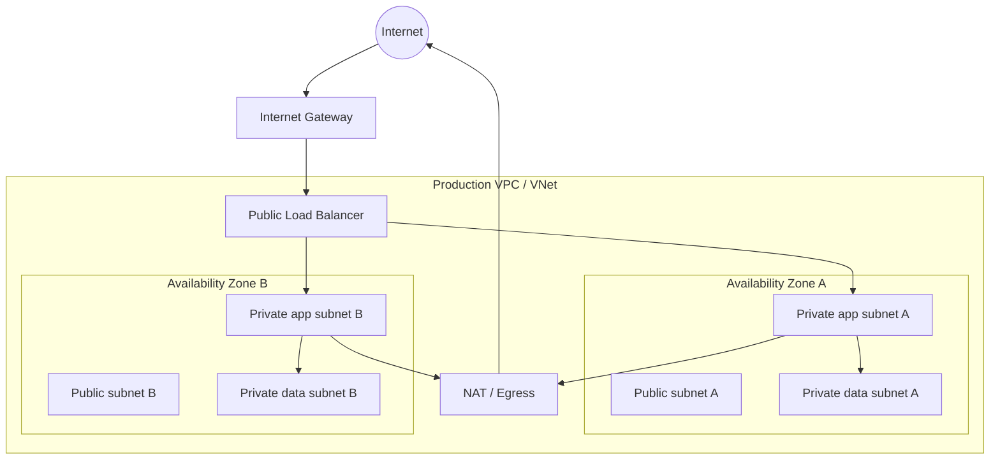

# VPC hoặc VNet, subnet và vị trí đặt giao diện mạng của máy

Máy ảo trên đám mây không kết nối trực tiếp vào một mạng vật lý do người vận hành tự quản lý. Máy thường được đặt trong một mạng ảo riêng của tài khoản hoặc dự án, sau đó kết nối vào subnet và nhận địa chỉ IP thông qua một hoặc nhiều giao diện mạng ảo (network interface). Cách thiết kế mạng này quyết định máy có thể giao tiếp với thành phần nào, đi ra Internet theo đường nào, được phân đoạn bảo mật ra sao và có thể đặt ở vùng sẵn sàng nào.

Trong các nền tảng đám mây, mạng riêng ảo thường được gọi là **VPC (Virtual Private Cloud)** hoặc **VNet (Virtual Network)**. Tên gọi và một số quy tắc triển khai khác nhau giữa nhà cung cấp, nhưng các khái niệm nền tảng tương tự: không gian địa chỉ IP, subnet, route, giao diện mạng, chính sách lọc lưu lượng và kết nối tới các mạng khác.

## 1. VPC và VNet là gì?

VPC hoặc VNet là ranh giới mạng logic do người dùng cấu hình trong môi trường cloud. Nó cung cấp một không gian địa chỉ IP riêng và các cơ chế để kiểm soát cách tài nguyên giao tiếp. Máy ảo, load balancer, dịch vụ dữ liệu và các tài nguyên được hỗ trợ có thể kết nối vào mạng này theo quy tắc của nền tảng.

Mạng ảo thường cho phép người vận hành:

- Chọn một hoặc nhiều dải địa chỉ IPv4 và có thể thêm IPv6.
- Chia mạng thành các subnet theo tầng ứng dụng, môi trường hoặc vùng sẵn sàng.
- Xác định đường đi bằng route table và gateway.
- Kiểm soát lưu lượng bằng security group, network security group, network ACL hoặc firewall.
- Kết nối với mạng tại chỗ (on-premises), VPC/VNet khác hoặc mạng của đối tác qua VPN, kết nối riêng hay peering.
- Cấu hình DNS, DHCP và các dịch vụ mạng liên quan.

VPC/VNet tạo ranh giới logic, nhưng không có nghĩa mọi tài nguyên bên trong tự động được phép giao tiếp với nhau. Route phải tồn tại, chính sách bảo mật phải cho phép và dịch vụ đích phải lắng nghe trên địa chỉ/cổng phù hợp.

| Khái niệm | Vai trò |
|---|---|
| VPC / VNet | Không gian mạng ảo và ranh giới kết nối cấp cao |
| CIDR | Mô tả dải địa chỉ IP được cấp cho mạng hoặc subnet |
| Subnet | Phân đoạn một phần không gian địa chỉ để đặt tài nguyên |
| Route table | Quyết định next hop cho lưu lượng tới từng đích |
| Gateway | Kết nối mạng ảo với Internet, mạng riêng hoặc dịch vụ trung gian |
| Network interface (NIC) | Giao diện mạng gắn với máy ảo hoặc tài nguyên khác |
| Security group / NSG / ACL | Quy định lưu lượng được phép hoặc bị chặn |

Không nên coi VPC và VNet là hai sản phẩm có hành vi hoàn toàn giống nhau. Ví dụ, phạm vi vùng địa lý, cách gắn subnet với availability zone, giới hạn NIC và cơ chế route có thể khác nhau. Khi thiết kế thực tế, hãy kiểm tra tài liệu của nhà cung cấp cho đúng loại tài nguyên và vùng triển khai.

## 2. Lập kế hoạch không gian địa chỉ IP

Thiết kế địa chỉ nên được thực hiện trước khi tạo VPC/VNet. Nếu chọn dải quá nhỏ, hệ thống có thể hết địa chỉ khi mở rộng. Nếu chọn dải chồng lấn với mạng văn phòng, data center hoặc VPC/VNet khác, việc kết nối qua peering hay VPN có thể gặp vấn đề định tuyến.

### IPv4 và CIDR

CIDR (Classless Inter-Domain Routing) biểu diễn một mạng bằng địa chỉ gốc và độ dài prefix. Ví dụ `10.20.0.0/16` có 16 bit đầu làm phần mạng, còn 16 bit cuối dùng để đánh địa chỉ host. Tổng số địa chỉ trong dải là:

\[
\text{Số địa chỉ} = 2^{(32 - \text{prefix})}
\]

Một vài kích thước thường gặp:

| CIDR | Tổng số địa chỉ IPv4 | Ví dụ phạm vi |
|---|---:|---|
| `/16` | 65.536 | `10.20.0.0` – `10.20.255.255` |
| `/20` | 4.096 | `10.20.0.0` – `10.20.15.255` |
| `/24` | 256 | `10.20.1.0` – `10.20.1.255` |
| `/26` | 64 | `10.20.2.0` – `10.20.2.63` |
| `/28` | 16 | `10.20.3.0` – `10.20.3.15` |

Đây là tổng số địa chỉ theo toán học. Số địa chỉ có thể gán cho tài nguyên thực tế nhỏ hơn do nền tảng dành trước một số địa chỉ cho gateway, DNS hoặc mục đích nội bộ. Số lượng bị giữ lại và subnet nhỏ nhất được phép khác nhau theo nhà cung cấp; phải tra cứu trước khi tính capacity.

Các dải IPv4 riêng thường dùng trong mạng nội bộ theo RFC 1918 gồm:

- `10.0.0.0/8`
- `172.16.0.0/12`
- `192.168.0.0/16`

Không gian địa chỉ riêng không được định tuyến trực tiếp trên Internet công cộng. Tuy nhiên, hai mạng riêng vẫn có thể bị xung đột nếu dùng cùng dải địa chỉ và cần kết nối với nhau.

### Cách phân bổ dải địa chỉ

Giả sử một hệ thống cần môi trường production, staging và development. Có thể cấp mỗi môi trường một dải riêng, sau đó chia thành subnet cho từng tầng và vùng sẵn sàng. Ví dụ minh họa:

| Mạng | Dải tổng | Phân đoạn ví dụ |
|---|---|---|
| Production | `10.20.0.0/16` | Web `10.20.0.0/20`, App `10.20.16.0/20`, Data `10.20.32.0/20` |
| Staging | `10.30.0.0/16` | Web `10.30.0.0/20`, App `10.30.16.0/20`, Data `10.30.32.0/20` |
| Development | `10.40.0.0/16` | Web `10.40.0.0/20`, App `10.40.16.0/20`, Data `10.40.32.0/20` |

Các dải trên chỉ là ví dụ; cần kiểm tra không gian địa chỉ đang sử dụng trong tổ chức trước khi chọn. Nên để dành một phần dải cho subnet mới, dịch vụ dùng chung, kết nối hybrid và tăng trưởng. Ghi lại dải đã cấp trong IP address management (IPAM) hoặc tài liệu hạ tầng để tránh hai nhóm tự cấp trùng.

Khi tính số địa chỉ, đừng chỉ dựa vào số máy ảo hiện tại. Hãy tính cả NIC phụ, địa chỉ private bổ sung, load balancer, endpoint dịch vụ, node mở rộng, địa chỉ dự phòng và nhu cầu triển khai blue-green. Nếu một subnet phải phục vụ hàng trăm instance autoscaling, cần có đủ địa chỉ cho mức mở rộng đỉnh và khoảng trống trong thời gian thay thế máy.

### IPv6

IPv6 có không gian địa chỉ lớn hơn và thường được cấp theo prefix riêng của nền tảng. Nếu workload cần truy cập IPv6, hãy lập kế hoạch đồng bộ cho VPC/VNet, subnet, NIC, route, security policy, DNS và dịch vụ đích. Có địa chỉ IPv6 trên NIC chưa đảm bảo kết nối hoạt động; route và rule cho IPv6 cần được cấu hình tương ứng. Không giả định chính sách IPv4 tự động áp dụng cho IPv6.

## 3. Chia subnet theo chức năng và vùng triển khai

Subnet là một phần của dải địa chỉ VPC/VNet. Tài nguyên kết nối vào subnet sẽ nhận địa chỉ từ dải đó theo cơ chế của nền tảng. Việc chia subnet giúp phân đoạn địa chỉ, áp dụng route và chính sách bảo mật theo từng nhóm workload.

Một cách phân chia phổ biến là theo tầng:

- **Public hoặc edge subnet:** đặt tài nguyên cần nhận lưu lượng từ Internet, chẳng hạn public load balancer, reverse proxy hoặc bastion nếu kiến trúc còn sử dụng.
- **Private application subnet:** đặt máy ảo chạy API, backend, worker và dịch vụ nội bộ.
- **Private data subnet:** đặt database, cache hoặc hệ thống lưu trữ có yêu cầu truy cập chặt chẽ.
- **Management subnet:** dành cho công cụ quản trị hoặc dịch vụ vận hành nếu cần phân vùng riêng.

Tên “public subnet” thường là cách gọi theo khả năng định tuyến, không phải thuộc tính bảo đảm máy trong subnet tự có IP công khai. Trong nhiều nền tảng, subnet được coi là public khi route table có đường đi tới Internet gateway. Để một máy nhận kết nối Internet trực tiếp, máy còn cần địa chỉ public phù hợp và rule cho phép lưu lượng. Ngược lại, một máy có public IP nhưng route hoặc firewall không cho phép vẫn không thể truy cập như mong muốn.

### Public và private subnet

| Đặc điểm | Public subnet | Private subnet |
|---|---|---|
| Route ra Internet | Thường có route tới Internet gateway | Không có route inbound trực tiếp từ Internet gateway |
| IP công khai trên workload | Có thể có nếu cần | Thường không gán trực tiếp |
| Outbound Internet | Qua Internet gateway theo chính sách | Có thể qua NAT gateway, proxy hoặc egress firewall |
| Inbound từ Internet | Chỉ khi có public endpoint và rule cho phép | Thường đi qua load balancer, VPN, bastion hoặc kết nối riêng |
| Workload phù hợp | Load balancer công khai, edge proxy | API nội bộ, worker, database, cache |

NAT gateway thường cho phép tài nguyên private khởi tạo kết nối ra ngoài bằng địa chỉ nguồn được NAT, trong khi không cung cấp đường kết nối mới từ Internet vào workload. NAT không thay thế security policy và không tự bảo vệ lưu lượng giữa các subnet. Chi phí NAT, giới hạn throughput và khả năng dự phòng theo vùng cần được tính trong thiết kế.

### Phân bố subnet theo availability zone

Để tăng tính sẵn sàng, workload thường được phân bố qua nhiều availability zone (AZ) hoặc fault domain. Subnet có thể được gắn với một AZ cụ thể hoặc có phạm vi khác tùy nền tảng. Ví dụ, trên một số dịch vụ, subnet là tài nguyên theo AZ; ở nền tảng khác, subnet có thể trải trong phạm vi vùng và NIC được đặt vào một vùng cụ thể.

Với kiến trúc nhiều AZ, cần:

1. Cấp các subnet tương ứng cho từng tầng ở mỗi AZ theo mô hình của nhà cung cấp.
2. Đảm bảo mỗi subnet có đủ địa chỉ cho số instance dự kiến trong AZ.
3. Cấu hình route và security policy nhất quán hoặc có chủ đích khác nhau giữa các AZ.
4. Bảo đảm load balancer, NAT, database và dịch vụ phụ thuộc có thiết kế chịu lỗi phù hợp.
5. Kiểm tra chi phí và độ trễ khi lưu lượng đi giữa các AZ.

Chỉ tạo subnet ở nhiều AZ không tự làm ứng dụng có tính sẵn sàng cao. Ứng dụng cần nhiều instance, dữ liệu cần replication hoặc cơ chế phục hồi, và đường đi mạng cần tiếp tục hoạt động khi một AZ gặp sự cố.

## 4. Route table và đường đi của lưu lượng

Route table chứa các quy tắc chọn next hop cho gói tin dựa trên địa chỉ đích. Mỗi subnet thường được liên kết với một route table hoặc sử dụng route mặc định theo cơ chế của nền tảng.

Một route có thể gồm:

- **Destination:** dải CIDR đích, ví dụ `0.0.0.0/0` cho mọi đích IPv4 hoặc `10.50.0.0/16` cho một mạng riêng.
- **Target/next hop:** nơi chuyển tiếp, ví dụ local route, Internet gateway, NAT gateway, VPN gateway, transit gateway hoặc network virtual appliance.

Ví dụ route table minh họa:

| Destination | Next hop | Ý nghĩa |
|---|---|---|
| `10.20.0.0/16` | Local | Giao tiếp trong VPC/VNet theo route nội bộ |
| `0.0.0.0/0` | NAT gateway | Đưa outbound IPv4 từ subnet private qua NAT |
| `10.100.0.0/16` | VPN gateway | Gửi lưu lượng tới mạng on-premises |
| `10.60.0.0/16` | Peering connection | Gửi lưu lượng tới mạng ảo đã peering |

Các đích và loại target trong bảng là ví dụ khái niệm; khả năng hỗ trợ và cách khai báo khác nhau theo cloud. Route cụ thể hơn thường được ưu tiên theo nguyên tắc longest prefix match. Ví dụ, route tới `10.100.0.0/16` được ưu tiên hơn route mặc định `0.0.0.0/0` cho đích nằm trong dải đó.

Để chẩn đoán một kết nối, kiểm tra cả hai chiều. Gói request có thể đi được nhưng response không có route quay về hoặc bị firewall chặn. Với kết nối hybrid, cần kiểm tra route ở cả VPC/VNet lẫn router on-premises, chính sách VPN, quảng bá route và khả năng có CIDR chồng lấn.

## 5. Giao diện mạng ảo (NIC) của máy ảo

NIC là giao diện mạng logic được gắn vào máy ảo. Nó kết nối máy với một subnet và cung cấp thông tin mạng như địa chỉ IP, địa chỉ MAC, security policy và một số thuộc tính mạng khác. Máy ảo thường có một NIC chính; một số loại instance hỗ trợ thêm NIC phụ.

Một NIC có thể có các thuộc tính như:

- VPC/VNet và subnet mà NIC thuộc về.
- Địa chỉ IPv4 private chính và các địa chỉ private bổ sung nếu nền tảng hỗ trợ.
- Địa chỉ IPv6 nếu đã bật và được cấp.
- Public IP được liên kết trực tiếp hoặc thông qua cơ chế NAT/load balancer.
- Security group hoặc network security group gắn với NIC hay tài nguyên liên quan.
- MAC address, DNS settings, IP forwarding và trạng thái attachment.

NIC thường có vòng đời độc lập với máy ảo ở một số nền tảng, cho phép tạo trước, gắn vào máy, tháo ra hoặc chuyển sang máy khác trong giới hạn hỗ trợ. Tuy nhiên, NIC có thể bị ràng buộc bởi vùng, AZ, kích thước instance, loại hệ điều hành hoặc trạng thái máy. Không giả định NIC có thể di chuyển tự do giữa mọi máy hay mọi subnet.

### NIC chính và NIC phụ

NIC chính thường được tạo hoặc gắn trong quá trình tạo máy và cung cấp đường mạng mặc định. NIC phụ có thể dùng cho một mạng hoặc nhóm lưu lượng khác, ví dụ tách mạng quản trị khỏi mạng ứng dụng hoặc kết nối tới một hệ thống chuyên biệt.

Ví dụ minh họa:

| Máy ảo | NIC | Subnet | Vai trò |
|---|---|---|---|
| `app-vm-01` | `nic-app-01` (primary) | `app-private-a` | Request từ load balancer và outbound tới dịch vụ nội bộ |
| `app-vm-01` | `nic-admin-01` (secondary) | `management-a` | Kênh quản trị qua mạng nội bộ |
| `db-vm-01` | `nic-db-01` (primary) | `data-private-a` | Lưu lượng database từ application tier |

Một máy có nhiều NIC không tự động tăng băng thông hoặc tạo high availability. Nó làm tăng độ phức tạp về route, firewall, DNS và vận hành. Nếu dùng nhiều NIC, cần xác định rõ lưu lượng nào đi qua giao diện nào, route mặc định nằm ở đâu và hệ điều hành xử lý gói trả lời như thế nào.

Trên Linux, nhiều NIC có thể tạo ra vấn đề asymmetric routing: request đến NIC phụ nhưng response lại đi ra NIC chính do route mặc định. Trong môi trường nhiều mạng, có thể cần policy-based routing, source-based routing hoặc cấu hình route cụ thể. Kiểm tra `ip address`, `ip route`, `ip rule` và bảng định tuyến của hệ điều hành sau khi gắn NIC.

Một số nền tảng yêu cầu bật IP forwarding hoặc tắt source/destination check khi máy ảo làm router, NAT instance hay firewall appliance. Chỉ bật các tính năng này khi kiến trúc thực sự cần chuyển tiếp gói tin thay mặt cho tài nguyên khác và đã cấu hình firewall, route cùng kiểm soát nguồn đích phù hợp.

## 6. Chọn vị trí NIC và subnet cho workload

Vị trí của NIC cần phù hợp với chức năng máy, vùng triển khai và đường đi lưu lượng. Khi tạo máy ảo, lựa chọn NIC hoặc subnet thường ảnh hưởng tới địa chỉ IP, route table, security policy, khả năng kết nối và đôi khi cả AZ mà máy được đặt.

Trước khi tạo máy, xác định:

1. **Mục đích của máy:** public endpoint, application server, worker, database hay management host.
2. **VPC/VNet:** máy thuộc mạng của môi trường nào và có cần kết nối hybrid hay peering không.
3. **Subnet:** subnet có đủ địa chỉ, đúng tầng, đúng route và đúng vùng/AZ không.
4. **NIC:** cần một hay nhiều giao diện; NIC nào là primary; có cần địa chỉ private phụ hoặc IPv6 không.
5. **Public exposure:** máy có cần public IP không, hay chỉ nhận traffic qua load balancer hoặc VPN.
6. **Security policy:** nguồn nào được phép truy cập, cổng nào cần mở và lưu lượng outbound nào được phép.
7. **DNS:** tên máy hoặc dịch vụ được phân giải nội bộ hay công khai như thế nào.
8. **Capacity và giới hạn:** loại instance hỗ trợ bao nhiêu NIC/IP, throughput và packet rate tối đa.

Đặt máy gần các dịch vụ mà nó giao tiếp thường xuyên có thể giảm độ trễ và chi phí truyền dữ liệu liên vùng. Tuy nhiên, vị trí địa lý không nên là yếu tố duy nhất: yêu cầu dự phòng, chính sách dữ liệu, khả năng phục hồi và giới hạn của dịch vụ cũng ảnh hưởng tới lựa chọn.

### Gắn NIC trong quá trình tạo máy

Một quy trình tạo máy thường gồm các lựa chọn mạng theo thứ tự:

1. Chọn VPC/VNet.
2. Chọn subnet theo workload và AZ hoặc fault domain.
3. Tạo hoặc chọn NIC chính.
4. Cấp private IP tự động hoặc chỉ định địa chỉ đã được dành trước.
5. Liên kết security group/NSG phù hợp.
6. Chỉ liên kết public IP nếu kiến trúc yêu cầu.
7. Tạo máy ảo với NIC đã chọn và xác minh cấu hình sau khi provision.

Tên trường trong console, CLI hoặc API khác nhau giữa nhà cung cấp. Có nền tảng cho chọn subnet trực tiếp trong lệnh tạo VM; nền tảng khác yêu cầu tạo NIC trước rồi truyền ID NIC vào cấu hình máy. Cần kiểm tra hợp đồng API để biết NIC được tạo tự động hay phải quản lý riêng.

## 7. Security group, NSG và network ACL

VPC/VNet cung cấp các lớp kiểm soát lưu lượng. Một số nền tảng dùng security group có trạng thái (stateful) gắn với NIC hoặc instance; nền tảng khác dùng NSG ở subnet/NIC và network ACL ở cấp subnet. Tên gọi và thứ tự đánh giá rule có thể khác nhau.

**Security group hoặc NSG** thường xác định rule inbound và outbound theo protocol, port, nguồn hoặc đích. Với rule stateful, khi một kết nối được cho phép, lưu lượng phản hồi của kết nối đó thường được cho phép tự động. **Network ACL** ở một số nền tảng là lớp lọc stateless, cần rule cho cả chiều đi và chiều về.

Ví dụ chính sách tối thiểu cho hệ thống web ba tầng:

| Đích | Nguồn được phép | Cổng | Mục đích |
|---|---|---:|---|
| Load balancer public | Internet theo yêu cầu dịch vụ | 443/TCP | HTTPS từ client |
| Application subnet | Security group của load balancer | 8080/TCP | Lưu lượng từ load balancer tới API |
| Database subnet | Security group của application | 5432/TCP | Kết nối PostgreSQL nội bộ |
| Management interface | Dải mạng quản trị hoặc hệ thống truy cập riêng | 22/TCP hoặc 3389/TCP | SSH/RDP quản trị có kiểm soát |

Các cổng trong bảng chỉ là ví dụ. Chỉ mở đúng protocol và port ứng dụng sử dụng. Ưu tiên tham chiếu security group của nguồn khi nền tảng hỗ trợ thay vì dùng dải IP quá rộng. Tránh mở SSH/RDP từ `0.0.0.0/0` hoặc `::/0`; dùng VPN, bastion được bảo vệ hoặc dịch vụ quản trị riêng.

Chính sách outbound cũng cần được xem xét. Nếu máy private chỉ cần truy cập repository cập nhật hoặc một số API, có thể giới hạn đích qua egress firewall hoặc proxy. Mở outbound toàn bộ Internet làm giảm khả năng kiểm soát dữ liệu đi ra và có thể tăng rủi ro khi ứng dụng bị xâm nhập.

## 8. DNS và phân giải tên trong mạng ảo

Địa chỉ IP giúp định tuyến nhưng ứng dụng thường giao tiếp bằng hostname. VPC/VNet có thể tích hợp DNS resolver, private DNS zone hoặc dịch vụ DNS do tổ chức quản lý. Cần xác định tên nào được phân giải nội bộ, tên nào công khai và cách đồng bộ record khi máy được tạo hoặc thay thế.

Một số nguyên tắc:

- Dùng DNS nội bộ cho dịch vụ chỉ phục vụ trong mạng riêng.
- Không phụ thuộc vào IP động được cấp ngẫu nhiên nếu ứng dụng có thể dùng tên dịch vụ hoặc service discovery.
- Kiểm tra DNS search domain, resolver, TTL và cache trong guest OS.
- Khi dùng private DNS zone giữa nhiều VPC/VNet, xác định rõ cơ chế liên kết zone, forwarding và quyền truy vấn.
- Đảm bảo hostname không bị trùng giữa môi trường hoặc mạng được kết nối.

Địa chỉ IP private của NIC có thể thay đổi khi máy bị thay thế hoặc NIC được tạo lại. Nếu workload cần địa chỉ ổn định, dùng cơ chế static private IP được quản lý hoặc DNS/service discovery có cập nhật tự động theo vòng đời máy.

## 9. Kết nối VPC/VNet với mạng khác

Workload có thể cần truy cập hệ thống tại data center, VPC/VNet khác hoặc dịch vụ đối tác. Các cách kết nối phổ biến gồm:

- **VPC/VNet peering:** kết nối trực tiếp giữa hai mạng ảo theo phạm vi và giới hạn của nền tảng.
- **Site-to-site VPN:** tạo tunnel mã hóa qua Internet giữa cloud và mạng tại chỗ hoặc mạng khác.
- **Dedicated private connection:** kết nối riêng qua nhà cung cấp viễn thông hoặc dịch vụ kết nối chuyên dụng.
- **Transit gateway hoặc hub network:** kết nối nhiều mạng qua một điểm trung chuyển để quản lý route tập trung.
- **Network virtual appliance:** chuyển lưu lượng qua firewall, router hoặc thiết bị kiểm tra mạng do người dùng quản lý.

Peering thường không tự cung cấp transitive routing. Nếu A peering với B và B peering với C, không nên giả định A có thể đi qua B tới C nếu nền tảng không hỗ trợ hoặc chưa có kiến trúc trung chuyển phù hợp. Cần thiết kế route và gateway rõ ràng.

Trước khi kết nối hai mạng, kiểm tra CIDR có chồng lấn không. Nếu hai bên cùng dùng `10.0.0.0/16`, router không thể phân biệt địa chỉ đích thuộc mạng nào theo cách thông thường. Có thể cần đánh lại địa chỉ, dùng NAT hoặc một kiến trúc trung gian phù hợp.

## 10. Ví dụ kiến trúc VPC/VNet cho workload web

Giả sử triển khai một ứng dụng web gồm load balancer, hai máy API và một cụm database. Hệ thống chạy ở hai AZ để tăng khả năng chịu lỗi. Một cách bố trí khái niệm:

Sơ đồ mô tả ý tưởng phân tầng; cách triển khai load balancer, NAT và database multi-AZ cụ thể phụ thuộc nhà cung cấp. Có thể tổ chức như sau:

| Thành phần | Vị trí | NIC / địa chỉ | Quy tắc truy cập chính |
|---|---|---|---|
| Load balancer | Public subnet ở các AZ | Public frontend hoặc địa chỉ do dịch vụ quản lý | Nhận HTTPS từ client |
| API VM A | Private app subnet A | NIC chính với private IP | Chỉ nhận cổng ứng dụng từ load balancer |
| API VM B | Private app subnet B | NIC chính với private IP | Chỉ nhận cổng ứng dụng từ load balancer |
| Database | Private data subnet theo thiết kế HA | Private IP hoặc endpoint dịch vụ | Chỉ nhận cổng database từ app tier |
| Egress NAT | Public subnet hoặc dịch vụ NAT quản lý | Địa chỉ nguồn NAT | Cho app subnet truy cập outbound được phép |

API VM không cần public IP nếu chỉ nhận request từ load balancer. Database không cần route inbound từ Internet. Khi API cần tải bản vá hoặc gọi dịch vụ bên ngoài, lưu lượng outbound đi qua NAT hoặc proxy được kiểm soát. Nếu một AZ gặp sự cố, load balancer có thể chuyển traffic tới API ở AZ còn lại, với điều kiện capacity, route, database và dependency còn đáp ứng.

## 11. Những lỗi thiết kế mạng thường gặp

- **CIDR chồng lấn:** peering hoặc VPN không định tuyến đúng. Lập kế hoạch IP toàn tổ chức trước khi tạo mạng.
- **Subnet quá nhỏ:** autoscaling hoặc triển khai thay thế không còn địa chỉ. Dự báo peak capacity và giữ phần dự phòng.
- **Coi public subnet đồng nghĩa mọi máy đều public:** subnet chỉ cung cấp đường đi; public IP và rule của workload vẫn quyết định khả năng truy cập.
- **Đặt database trong subnet có đường inbound Internet:** tăng bề mặt tấn công. Đặt data tier trong subnet riêng và chỉ mở từ nguồn ứng dụng cần thiết.
- **Thiếu route chiều về:** request đi được nhưng response không quay lại. Kiểm tra route hai chiều và firewall stateful/stateless.
- **Gắn nhiều NIC nhưng không cấu hình route:** lưu lượng đi sai giao diện hoặc asymmetric routing. Xác định route policy trong guest OS.
- **Dùng peering như transit router:** mạng trung gian không tự chuyển tiếp giữa mọi kết nối. Thiết kế hub/transit gateway khi cần.
- **Chỉ cấu hình IPv4:** ứng dụng có IPv6 nhưng security rule hoặc route IPv6 thiếu. Kiểm tra riêng cả hai giao thức.
- **Mở rule quá rộng:** tăng nguy cơ truy cập trái phép. Áp dụng least privilege theo nguồn, đích, protocol và port.
- **Bỏ qua chi phí liên vùng và NAT:** thiết kế hoạt động nhưng hóa đơn cao. Ước lượng lưu lượng và vị trí dịch vụ trước khi triển khai.

## 12. Checklist trước khi gắn máy ảo vào mạng

- [ ] VPC/VNet có dải CIDR không chồng lấn với mạng hiện hữu và mạng cần kết nối.
- [ ] Kế hoạch subnet đủ địa chỉ cho tải hiện tại, autoscaling và thay thế máy.
- [ ] Subnet thuộc đúng môi trường, tầng workload và AZ/fault domain.
- [ ] Route table có đường đi cần thiết và không tạo đường truy cập ngoài ý muốn.
- [ ] Public/private exposure phù hợp; máy không cần public IP thì không gán trực tiếp.
- [ ] NIC chính/phụ, private IP, IPv6 và giới hạn instance đã được xác nhận.
- [ ] Security group, NSG hoặc ACL chỉ cho phép lưu lượng cần thiết.
- [ ] DNS nội bộ và phân giải tên hoạt động theo thiết kế.
- [ ] NAT, VPN, peering hoặc transit gateway có route và capacity phù hợp.
- [ ] Nếu có nhiều NIC, route trong guest OS và IP forwarding được cấu hình đúng.
- [ ] Kết nối hai chiều được kiểm tra từ nguồn thực tế tới endpoint.
- [ ] Có giám sát flow log, network metric và cảnh báo cho lỗi kết nối.

Thiết kế VPC/VNet, subnet và NIC là nền móng cho mọi workload chạy trên máy ảo. Khi không gian địa chỉ được quy hoạch, subnet phản ánh đúng ranh giới chức năng, route có thể giải thích được và NIC được đặt đúng mạng với quyền truy cập tối thiểu, ứng dụng sẽ có đường kết nối rõ ràng, dễ mở rộng và dễ xử lý sự cố hơn.
