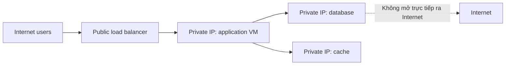
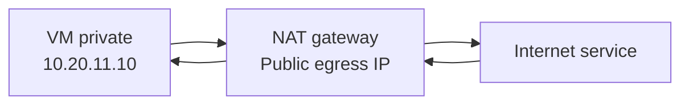
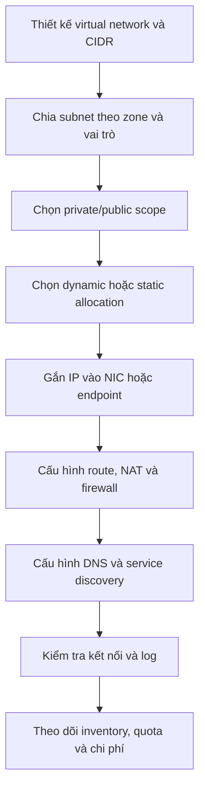
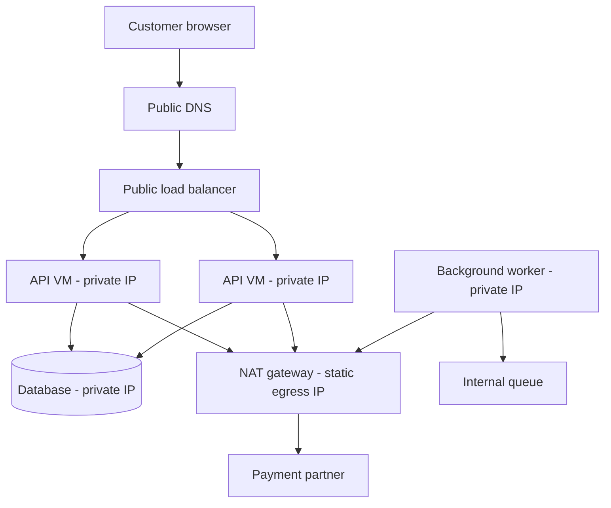

# Địa chỉ IP riêng, IP công cộng và địa chỉ tĩnh

Mỗi workload cần một cách định danh để giao tiếp trên mạng. Trong môi trường cloud, máy ảo, container, load balancer và các dịch vụ mạng có thể được gán địa chỉ IP riêng, IP công cộng hoặc cả hai. Địa chỉ có thể được cấp động khi tài nguyên khởi tạo, hoặc được giữ cố định để các hệ thống khác truy cập ổn định.

Hiểu đúng các loại địa chỉ giúp thiết kế kết nối an toàn, tránh xung đột mạng, cấu hình DNS chính xác và kiểm soát chi phí. Cần phân biệt hai khái niệm độc lập: **phạm vi truy cập** (private hay public) và **vòng đời cấp phát** (dynamic hay static). Một địa chỉ riêng có thể tĩnh hoặc động; một địa chỉ công cộng cũng có thể tĩnh hoặc động.

Sau bài học, bạn có thể:

- Phân biệt địa chỉ IP riêng, IP công cộng và các loại địa chỉ đặc biệt của IPv4/IPv6.
- Giải thích cách cloud cấp phát địa chỉ động và địa chỉ tĩnh cho workload.
- Hiểu vai trò của subnet, route, NAT, DNS và load balancer trong kết nối.
- Chọn kiểu địa chỉ phù hợp cho máy ảo, dịch vụ nội bộ và endpoint công khai.
- Cấu hình và kiểm tra IP an toàn, tránh xung đột, truy cập ngoài ý muốn và chi phí không cần thiết.

## 1. Địa chỉ IP định danh thiết bị như thế nào?

Địa chỉ IP (Internet Protocol address) là địa chỉ logic được dùng để định tuyến gói tin giữa các giao diện mạng. Một máy ảo có thể có nhiều giao diện mạng (NIC), mỗi giao diện có một hoặc nhiều địa chỉ IP. Một giao diện cũng có thể nhận địa chỉ IPv4 và IPv6 đồng thời.

Địa chỉ IP không nhất thiết định danh vĩnh viễn một máy. Địa chỉ động có thể thay đổi khi tài nguyên được tạo lại hoặc khi hợp đồng cấp phát hết hạn. Địa chỉ tĩnh được giữ theo vòng đời của một tài nguyên địa chỉ hoặc cấu hình mạng, nhưng vẫn có thể được giải phóng, chuyển sang tài nguyên khác hoặc thay đổi khi quản trị viên thực hiện thao tác.

Trong cloud, địa chỉ IP thường được quản lý trong một mạng ảo (virtual network/VPC/VNet) và các subnet. Control plane của nhà cung cấp cấp địa chỉ, gắn địa chỉ vào NIC hoặc endpoint và cấu hình định tuyến trong hạ tầng. Hệ điều hành bên trong VM nhìn thấy địa chỉ được gán cho giao diện mạng, thường thông qua DHCP hoặc cơ chế cấu hình của nền tảng.

## 2. IPv4 và IPv6

### IPv4

IPv4 dùng địa chỉ 32 bit, thường viết thành bốn số thập phân cách nhau bằng dấu chấm, ví dụ `192.0.2.10`. Không gian địa chỉ IPv4 có giới hạn, vì vậy cloud thường sử dụng địa chỉ riêng bên trong mạng ảo và dùng NAT hoặc địa chỉ công cộng ở biên mạng khi cần kết nối Internet.

Ba dải IPv4 riêng được dành cho mạng nội bộ theo RFC 1918:

| Dải địa chỉ | CIDR | Số địa chỉ |
|---|---|---:|
| `10.0.0.0` đến `10.255.255.255` | `10.0.0.0/8` | 16.777.216 |
| `172.16.0.0` đến `172.31.255.255` | `172.16.0.0/12` | 1.048.576 |
| `192.168.0.0` đến `192.168.255.255` | `192.168.0.0/16` | 65.536 |

Các địa chỉ này không được định tuyến trực tiếp trên Internet công cộng. Hai tổ chức có thể cùng dùng `10.0.0.0/8` trong mạng riêng của họ, nhưng khi kết nối VPN hoặc peering, dải địa chỉ bị trùng sẽ gây khó khăn cho định tuyến.

Một số dải IPv4 đặc biệt khác:

- `127.0.0.0/8`: loopback, dùng để máy giao tiếp với chính nó; địa chỉ quen thuộc là `127.0.0.1`.
- `169.254.0.0/16`: link-local, thường dùng cho giao tiếp trên liên kết cục bộ hoặc một số cơ chế metadata/network bootstrap; không phải dải IP private có thể định tuyến tùy ý giữa subnet.
- `0.0.0.0`: địa chỉ unspecified; trong một số ngữ cảnh socket, `0.0.0.0` biểu thị lắng nghe trên mọi giao diện IPv4 của máy.
- `255.255.255.255`: địa chỉ broadcast giới hạn trong một mạng cục bộ.

Không gán tùy tiện các địa chỉ đặc biệt này cho endpoint dịch vụ.

### IPv6

IPv6 dùng địa chỉ 128 bit, viết theo nhóm hệ thập lục phân, ví dụ `2001:db8:1200::10`. Không gian địa chỉ lớn hơn nhiều so với IPv4 và hỗ trợ cấp phát theo prefix cho mạng hoặc giao diện.

Các loại IPv6 thường gặp:

- **Global Unicast Address (GUA):** thường thuộc dải `2000::/3`, có thể định tuyến toàn cầu nếu được công bố và cấu hình định tuyến phù hợp. Một địa chỉ GUA trên NIC không tự động đồng nghĩa firewall cho phép Internet truy cập.
- **Unique Local Address (ULA):** thuộc `fc00::/7`, dùng cho phạm vi nội bộ tương tự private IPv4. ULA không được định tuyến trên Internet công cộng.
- **Link-local:** thuộc `fe80::/10`, dùng trên một liên kết mạng cục bộ; router không chuyển tiếp loại địa chỉ này.
- **Loopback:** `::1`, dùng để máy giao tiếp với chính nó.
- **Unspecified:** `::`, biểu thị địa chỉ chưa xác định trong một số thao tác cấu hình.

IPv6 thường không cần NAT để tiết kiệm địa chỉ theo cách IPv4 private cần NAT. Tuy nhiên, vẫn phải dùng firewall, route và chính sách truy cập để bảo vệ workload. Không nên cho rằng IPv6 an toàn hơn chỉ vì địa chỉ khó đoán hoặc không dùng NAT.

### CIDR và subnet

CIDR (Classless Inter-Domain Routing) biểu diễn một mạng bằng địa chỉ nền và độ dài prefix. Ví dụ, `10.20.0.0/24` có 256 địa chỉ IPv4 tổng cộng; trong mạng IPv4 truyền thống, một số địa chỉ được dành cho network và broadcast, còn cloud provider có thể giữ thêm địa chỉ cho mục đích nền tảng.

Ví dụ một mạng ảo được chia thành các subnet:

```text
Virtual network: 10.20.0.0/16
  Public subnet A:  10.20.1.0/24  -> load balancer / ingress
  Private subnet A: 10.20.11.0/24 -> application instances
  Private subnet B: 10.20.21.0/24 -> database / internal services
```

Đây là ví dụ minh họa. Số địa chỉ có thể dùng thực tế phụ thuộc cách nhà cung cấp dành trước địa chỉ trong mỗi subnet.

Khi thiết kế CIDR, hãy dành đủ không gian cho tăng trưởng, subnet nhiều AZ, endpoint dịch vụ, địa chỉ IPv6 và kết nối với mạng on-premises. Tránh dùng các dải đã tồn tại trong VPN, chi nhánh hoặc mạng đối tác. Hai mạng có CIDR chồng lấn có thể không định tuyến trực tiếp được khi kết nối.

## 3. Địa chỉ IP riêng (private IP)

Địa chỉ IP riêng được dùng để giao tiếp trong phạm vi mạng riêng hoặc các mạng có kết nối được kiểm soát. Trong cloud, VM thường nhận private IP từ subnet của virtual network. Các máy trong cùng mạng hoặc mạng được kết nối qua peering/VPN/Direct Connect/ExpressRoute có thể trao đổi bằng private IP nếu route và firewall cho phép.

### Đặc điểm

- Không được định tuyến trực tiếp trên Internet công cộng đối với private IPv4 RFC 1918 và IPv6 ULA.
- Thường được dùng cho backend, database, cache, worker và giao tiếp nội bộ.
- Có thể cấp động từ subnet hoặc đặt tĩnh/reservation theo cơ chế của nền tảng.
- Có thể truy cập từ mạng khác nếu có VPN, peering, private link hoặc tuyến kết nối phù hợp.
- Không tự động bảo đảm riêng tư; cần security group, firewall, route và IAM phù hợp.

### Khi nào nên dùng private IP?

Private IP phù hợp cho các thành phần không cần endpoint trực tiếp trên Internet. Ví dụ, API backend có thể nhận lưu lượng từ load balancer trong subnet công khai, sau đó gọi database bằng private IP. Database chỉ cho phép cổng cần thiết từ security group của API.



Private IP giúp giảm bề mặt công khai, nhưng không thay thế phân đoạn mạng. Nếu tất cả VM trong một VPC được phép kết nối mọi cổng với nhau, một máy bị xâm nhập có thể dò tìm các máy khác. Hãy giới hạn luồng giao tiếp theo vai trò.

### Private IP động và tĩnh

**Private IP động** thường được cấp từ subnet khi NIC hoặc VM khởi tạo. Nó có thể được giữ qua một số thao tác stop/start, nhưng có thể thay đổi khi NIC hoặc instance bị xóa và tạo lại. Quy tắc giữ địa chỉ phụ thuộc nền tảng.

**Private IP tĩnh** được gắn hoặc reservation cho một NIC hay endpoint để địa chỉ không thay đổi trong vòng đời cấu hình đó. Nó hữu ích khi một hệ thống nội bộ cần allowlist địa chỉ, cấu hình DNS nội bộ hoặc kết nối đến thiết bị không hỗ trợ discovery.

Không nên dùng private IP tĩnh cho mọi máy chỉ vì muốn kết nối ổn định. DNS nội bộ, service discovery hoặc load balancer thường phù hợp hơn cho dịch vụ có thể thay đổi instance.

## 4. Địa chỉ IP công cộng (public IP)

Public IP là địa chỉ có thể được định tuyến trên Internet công cộng. Trong cloud, địa chỉ này có thể được gắn trực tiếp vào NIC, được ánh xạ qua NAT hoặc thuộc về một dịch vụ công khai như load balancer, NAT gateway hay public endpoint.

Có public IP không có nghĩa dịch vụ tự động mở cổng cho mọi người. Khả năng truy cập còn phụ thuộc route, security group, network ACL, firewall hệ điều hành, listener và chính sách xác thực. Ngược lại, một dịch vụ có thể được truy cập từ Internet qua load balancer mà máy backend không cần public IP.

### Public IPv4 và public IPv6

Public IPv4 thường khan hiếm và có thể tính phí theo địa chỉ hoặc trạng thái sử dụng. Một địa chỉ public IPv4 có thể được ánh xạ đến private IPv4 bằng NAT hoặc cơ chế của nhà cung cấp.

Với IPv6, một NIC có thể nhận GUA và giao tiếp Internet mà không cần NAT địa chỉ. Vì vậy, firewall inbound và outbound cần được cấu hình rõ ràng. Không nên chỉ kiểm soát IPv4 rồi quên tạo chính sách tương đương cho IPv6.

### Khi nào workload cần public IP?

Một số trường hợp có thể cần public IP trực tiếp:

- Bastion hoặc máy quản trị có kiểm soát, nếu không dùng giải pháp truy cập riêng được quản lý.
- Endpoint phục vụ giao thức đặc thù không đi qua load balancer hoặc proxy phù hợp.
- Thiết bị hoặc workload cần địa chỉ nguồn ổn định để đối tác allowlist.
- Máy thử nghiệm cần truy cập Internet trực tiếp trong môi trường được giới hạn.

Với website hoặc API production, thường nên đặt public IP ở load balancer, ingress hoặc API gateway. Backend và database chỉ dùng private IP. Cách này tập trung TLS, WAF, rate limiting, logging và chính sách truy cập ở một điểm vào.

## 5. Địa chỉ động và địa chỉ tĩnh

Động/tĩnh mô tả cách địa chỉ được cấp phát và duy trì, không mô tả địa chỉ đó là private hay public.

| Thuộc tính | Dynamic IP | Static IP |
|---|---|---|
| Cấp phát | Tự động từ pool hoặc DHCP/prefix | Được reservation hoặc cấu hình cố định |
| Khả năng thay đổi | Có thể thay đổi khi lease, NIC hoặc tài nguyên thay đổi | Ổn định trong thời gian reservation/cấu hình còn hiệu lực |
| Vận hành | Ít phải quản lý từng địa chỉ | Cần quản lý inventory và tránh cấp trùng |
| Phù hợp | Máy có thể thay thế, autoscaling, workload nội bộ dùng service discovery | Endpoint cần allowlist, DNS ổn định hoặc hệ thống phụ thuộc địa chỉ cố định |
| Rủi ro | Tham chiếu bằng IP cũ có thể hỏng sau khi địa chỉ đổi | Địa chỉ bị giữ không dùng vẫn có thể phát sinh phí hoặc gây nhầm lẫn |

### Dynamic private IP

Đây là lựa chọn phổ biến cho VM và container. Hệ thống cấp một địa chỉ từ subnet khi giao diện được tạo. Khi instance được thay thế, instance mới có thể nhận địa chỉ khác. Ứng dụng nên dùng DNS nội bộ, service discovery hoặc load balancer để tìm dịch vụ.

### Static private IP

Địa chỉ được giữ cho NIC hoặc endpoint nội bộ. Hữu ích khi đối tác trong mạng riêng chỉ cho phép một địa chỉ, hoặc khi một thiết bị cũ không hỗ trợ DNS/service discovery. Cần quản lý reservation và giải phóng khi tài nguyên không còn dùng.

### Dynamic public IP

Địa chỉ công cộng được cấp từ pool và có thể thay đổi theo vòng đời instance hoặc network interface. Một số nền tảng có thể giữ địa chỉ khi stop/start, nền tảng khác giải phóng địa chỉ khi deallocate. Không dựa vào một giả định chung; hãy kiểm tra hành vi cụ thể của dịch vụ.

Dynamic public IP thường không phù hợp làm endpoint cố định cho DNS lâu dài hoặc allowlist đối tác. Nếu địa chỉ thay đổi, DNS cache và hệ thống bên ngoài có thể tiếp tục dùng địa chỉ cũ.

### Static public IP

Địa chỉ công cộng được reservation độc lập hoặc gắn với một endpoint cụ thể. Một số nhà cung cấp gọi đây là Elastic IP, reserved IP hoặc static public IP. Địa chỉ có thể được chuyển giữa các instance hoặc endpoint trong cùng phạm vi hỗ trợ, giúp giữ nguyên endpoint khi thay thế máy.

Static public IP phù hợp khi đối tác cần allowlist, DNS cần địa chỉ ổn định hoặc một endpoint phải duy trì qua các lần thay máy. Tuy nhiên, địa chỉ reservation không tự làm dịch vụ có tính sẵn sàng cao. Nếu IP chỉ trỏ đến một VM đơn lẻ, VM đó vẫn có thể là điểm lỗi duy nhất.

## 6. NAT: cho phép kết nối mà không công khai private IP

NAT (Network Address Translation) thay đổi thông tin địa chỉ IP, và thường cả cổng, khi gói tin đi qua một thiết bị hoặc dịch vụ biên. Trong cloud, NAT thường được dùng để workload có private IP khởi tạo kết nối ra Internet mà không cần public IP riêng trên từng VM.

### SNAT và NAT gateway

Với Source NAT (SNAT), địa chỉ nguồn private được thay bằng địa chỉ của NAT gateway hoặc địa chỉ công cộng dùng chung khi gói tin đi ra. Khi phản hồi quay về, NAT duy trì trạng thái để chuyển tiếp về đúng máy nguồn.



NAT gateway thường là dịch vụ được quản lý và có thể phục vụ nhiều máy trong subnet riêng. Nó giúp tập trung egress IP để đối tác allowlist và giảm nhu cầu gán public IP cho từng VM. Tuy nhiên, NAT không thay thế firewall hay chính sách egress; cần giới hạn workload được phép kết nối ra đâu.

### DNAT và port forwarding

Destination NAT (DNAT) thay đổi địa chỉ đích để chuyển lưu lượng đến một địa chỉ nội bộ. Một số dịch vụ public endpoint hoặc port forwarding dùng cơ chế ánh xạ này. Trong kiến trúc production, load balancer hoặc ingress thường phù hợp hơn cho HTTP/HTTPS vì cung cấp health check, TLS termination và phân phối tải.

### NAT không phải là firewall

NAT thay đổi địa chỉ và duy trì ánh xạ luồng. Firewall/security group quyết định luồng nào được phép. Một kết nối outbound đã được NAT không có nghĩa mọi kết nối inbound đều bị chặn theo cùng một cách ở mọi nền tảng; cần hiểu stateful behavior và cấu hình firewall thực tế.

## 7. DNS và địa chỉ IP ổn định

Người dùng thường truy cập dịch vụ bằng tên miền thay vì ghi nhớ IP. DNS ánh xạ tên như `api.example.com` tới một hoặc nhiều địa chỉ hoặc endpoint.

Các record thường gặp:

- **A:** ánh xạ hostname đến IPv4.
- **AAAA:** ánh xạ hostname đến IPv6.
- **CNAME:** tạo bí danh trỏ đến hostname khác.
- **PTR:** ánh xạ ngược từ địa chỉ IP đến tên miền, thường dùng trong reverse DNS.

Nếu public IP thay đổi, record DNS cần được cập nhật. TTL (Time to Live) quy định khoảng thời gian resolver có thể cache câu trả lời. TTL thấp giúp thay đổi có hiệu lực nhanh hơn nhưng làm tăng truy vấn DNS; TTL cao giảm truy vấn nhưng quá trình chuyển đổi có thể chậm do cache.

Đối với dịch vụ nội bộ, dùng private DNS zone hoặc service discovery để ánh xạ tên dịch vụ đến private IP/load balancer. Không nên nhúng private IP của một instance vào mã ứng dụng nếu instance có thể bị thay thế.

Static IP cũng không phải giải pháp duy nhất để giữ endpoint ổn định. DNS trỏ đến load balancer hoặc managed service thường giúp backend thay đổi mà người dùng không cần biết. Nếu cần IP tĩnh ở phía công khai, có thể reservation IP tại load balancer hoặc endpoint được hỗ trợ.

## 8. Chọn loại địa chỉ cho từng workload

| Workload | Cách dùng địa chỉ thường phù hợp | Lý do |
|---|---|---|
| Web/API công khai | Public IP hoặc hostname tại load balancer/API gateway; backend dùng private IP | Tập trung điểm vào, TLS, WAF, health check và phân phối tải |
| Database | Private IP, thường dùng endpoint/DNS ổn định | Không cần truy cập trực tiếp từ Internet; giới hạn nguồn truy cập |
| Cache và message broker nội bộ | Private IP và DNS/service discovery | Chỉ các workload được phép mới kết nối |
| VM quản trị | Private IP qua VPN/bastion/managed session; hạn chế public IP | Giảm bề mặt tấn công và kiểm soát truy cập quản trị |
| Autoscaling group | Private IP động, phía trước là load balancer hoặc service discovery | Instance thay thế không cần giữ nguyên địa chỉ |
| Egress tới đối tác allowlist | Private IP phía workload, NAT gateway với public egress IP tĩnh | Đối tác chỉ cần allowlist một hoặc vài địa chỉ nguồn |
| Thiết bị/đối tác cần endpoint cố định | Static public IP hoặc private IP tùy đường kết nối | Duy trì địa chỉ được cấu hình ở hệ thống đối tác |
| Kết nối giữa các mạng riêng | Private IPv4/IPv6 không chồng lấn, route qua VPN/peering | Truyền dữ liệu qua mạng riêng có kiểm soát |

### Câu hỏi để ra quyết định

1. Workload có cần nhận kết nối trực tiếp từ Internet không?
2. Có thể đặt điểm vào ở load balancer hoặc API gateway không?
3. Địa chỉ có cần ổn định qua stop/start, thay instance hoặc triển khai lại không?
4. Hệ thống phụ thuộc có thể dùng DNS/service discovery thay cho IP cố định không?
5. Đối tác có yêu cầu allowlist IP nguồn hoặc đích không?
6. Dải CIDR có bị trùng với mạng on-premises, VPN hoặc mạng đối tác không?
7. Chi phí public IPv4, NAT gateway, dữ liệu egress và IP reservation là bao nhiêu?
8. Cả IPv4 và IPv6 đã có route, firewall và monitoring tương ứng chưa?

## 9. Cấp phát và quản lý IP trong cloud

### Quy trình cấp phát điển hình



1. **Thiết kế CIDR:** xác định phạm vi địa chỉ cho VPC/VNet, subnet, kết nối VPN và mạng khác.
2. **Chia subnet:** tách public-facing component, application, data và management theo yêu cầu bảo mật.
3. **Chọn scope:** quyết định NIC cần private IP, public IP hay cả hai; với IPv6, quyết định prefix và route tương ứng.
4. **Chọn vòng đời:** dùng dynamic allocation cho instance có thể thay thế; reservation/static cho endpoint có yêu cầu ổn định.
5. **Gắn địa chỉ:** cấp địa chỉ cho NIC, load balancer, NAT gateway hoặc endpoint theo dịch vụ.
6. **Cấu hình định tuyến và lọc:** kiểm tra route table, NAT, security group, network ACL và firewall hệ điều hành.
7. **Cấu hình DNS:** tạo hoặc cập nhật A/AAAA/CNAME/PTR khi cần; đặt TTL theo kế hoạch chuyển đổi.
8. **Kiểm thử:** xác minh kết nối trong mạng, qua VPN, ra Internet và từ Internet vào đúng endpoint được phép.
9. **Quản trị:** cập nhật IPAM/inventory, tag owner và theo dõi địa chỉ không sử dụng.

### IPAM và quản lý không gian địa chỉ

IP Address Management (IPAM) là cách quản lý tập trung các dải CIDR và địa chỉ đã cấp. IPAM giúp tránh trùng lặp, ghi nhận chủ sở hữu, theo dõi dung lượng subnet và hỗ trợ lập kế hoạch khi kết nối nhiều mạng.

Inventory IP nên lưu:

- Địa chỉ hoặc prefix và loại IPv4/IPv6.
- Private/public scope và subnet/region/zone.
- Resource ID, NIC hoặc endpoint đang sở hữu.
- Dynamic/static/reserved và thời điểm cấp phát.
- Owner, application, environment, mục đích và thời hạn.
- DNS record, firewall/allowlist liên quan và trạng thái sử dụng.

Không quản lý IP chỉ bằng một bảng tính không có chủ sở hữu hoặc lịch sử cập nhật. Với môi trường lớn, dùng IPAM của nhà cung cấp hoặc hệ thống quản lý có API và audit trail.

## 10. Bảo mật khi dùng private và public IP

### Giảm endpoint công khai

- Chỉ gán public IP cho thành phần thực sự cần nhận hoặc khởi tạo kết nối công khai theo kiến trúc.
- Đặt backend và database trong subnet riêng; dùng load balancer hoặc gateway làm điểm vào.
- Không mở cổng quản trị như SSH/RDP cho toàn Internet. Dùng VPN, bastion có kiểm soát hoặc managed session.
- Giới hạn inbound theo source CIDR, security group reference hoặc identity-aware access khi nền tảng hỗ trợ.
- Giới hạn outbound theo đích và giao thức cần thiết; theo dõi egress bất thường.

### Kiểm soát IPv4 và IPv6 đồng thời

Một lỗi phổ biến là firewall IPv4 đã giới hạn nhưng IPv6 GUA vẫn nhận kết nối ngoài ý muốn. Kiểm tra listener, route, security group, network ACL và firewall host cho cả hai giao thức. Nếu không dùng IPv6, tắt hoặc không cấp route theo chính sách được phê duyệt; không để cấu hình nửa vời.

### IP không thay thế danh tính

Địa chỉ IP có thể thay đổi hoặc được tái sử dụng. Không dùng IP làm bằng chứng duy nhất về danh tính người dùng hoặc workload. Kết hợp TLS, IAM, workload identity, xác thực ứng dụng và phân quyền. Allowlist IP có thể là một lớp kiểm soát bổ sung, nhưng không thay thế xác thực.

### Chú ý khi giải phóng public IP

Khi một public IP tĩnh được giải phóng, nó có thể trở lại pool và được cấp cho khách hàng khác. Trước khi bỏ IP khỏi DNS hoặc đối tác, hãy cập nhật record, allowlist và cấu hình phụ thuộc. Không giả định địa chỉ đã giải phóng có thể lấy lại sau này.

## 11. Chi phí và vận hành địa chỉ IP

Địa chỉ IP có thể tạo ra chi phí trực tiếp và gián tiếp:

- Public IPv4 có thể bị tính phí theo giờ hoặc theo trạng thái sử dụng tùy nhà cung cấp.
- Static/reserved IP không gắn với tài nguyên hoặc không được sử dụng có thể phát sinh phí.
- NAT gateway thường tính phí theo thời gian hoạt động và lượng dữ liệu xử lý.
- Lưu lượng egress ra Internet hoặc liên vùng có thể phát sinh phí.
- Load balancer, firewall, public endpoint và dịch vụ DNS có bảng giá riêng.
- Địa chỉ IP khan hiếm làm tăng chi phí cơ hội khi giữ reservation không cần thiết.

Khi tối ưu, hãy:

1. Rà soát public IP không gắn với endpoint đang hoạt động.
2. Giải phóng reservation không còn owner sau khi xác minh phụ thuộc.
3. Dùng private IP cho giao tiếp nội bộ.
4. Dùng NAT egress tập trung khi nhiều workload cần ra Internet và đối tác cần allowlist IP nguồn, đồng thời tính chi phí NAT và lưu lượng.
5. Tránh định tuyến dữ liệu qua NAT hoặc region khác nếu không cần thiết.
6. Gắn tag và cảnh báo cho IP reservation, NAT gateway và load balancer.

Không nên thay một NAT gateway bằng public IP trên từng máy chỉ vì chi phí NAT nhìn thấy cao hơn. Cần tính rủi ro bảo mật, số lượng endpoint, lưu lượng, vận hành firewall và chi phí xử lý sự cố.

## 12. Ví dụ: thiết kế địa chỉ cho ứng dụng bán hàng

Một ứng dụng bán hàng có website công khai, API, worker nền và database. API cần gọi một đối tác thanh toán có yêu cầu allowlist IP nguồn.

**Thiết kế mạng:** tạo virtual network với các subnet riêng cho ingress, application và data. Load balancer có endpoint public; API và worker chỉ có private IP; database chỉ cho phép kết nối từ nhóm bảo mật của API.

**Lưu lượng vào:** DNS `shop.example.com` trỏ đến load balancer. Người dùng không truy cập trực tiếp private IP của API. Load balancer kiểm tra health và phân phối request đến các instance khỏe mạnh.

**Lưu lượng ra:** API gọi đối tác thanh toán qua NAT gateway. NAT sử dụng một public egress IP tĩnh được đăng ký với đối tác. API không cần gán public IP riêng.

**Thay instance:** khi autoscaling thay một VM, private IP có thể thay đổi. Load balancer/service discovery cập nhật backend; DNS công khai không cần thay đổi. Egress IP của NAT vẫn giữ ổn định để đối tác tiếp tục allowlist.

**Bảo mật:** database không có public IP; inbound chỉ cho phép từ API trên cổng database. SSH/RDP chỉ qua kênh quản trị riêng. Firewall có chính sách tương ứng cho IPv4 và IPv6 nếu dual-stack được bật.



Kiến trúc này tách địa chỉ nhận traffic công khai khỏi địa chỉ của backend, đồng thời giữ IP nguồn ổn định khi kết nối đến đối tác. Khi mở rộng hoặc thay instance, nhóm không phải cập nhật allowlist của đối tác cho từng máy.

## 13. Chẩn đoán sự cố địa chỉ IP

Khi workload không kết nối được, hãy kiểm tra theo từng lớp thay vì chỉ ping địa chỉ đích.

### Kiểm tra địa chỉ trên máy

Linux:

```bash
# Liệt kê địa chỉ và trạng thái giao diện
ip addr show

# Xem bảng định tuyến
ip route

# Xem route dự kiến đến một địa chỉ đích
ip route get 203.0.113.20
```

Windows PowerShell:

```powershell
# Liệt kê địa chỉ IP trên các giao diện
Get-NetIPAddress

# Xem cấu hình IP và gateway
ipconfig /all

# Xem bảng định tuyến
route print
```

### Kiểm tra DNS và đường đi

```bash
# Tra cứu IPv4/IPv6
dig A api.example.com
dig AAAA api.example.com

# Kiểm tra kết nối TCP đến cổng dịch vụ
nc -vz api.example.com 443

# Xem đường đi ở mức mạng nếu công cụ và quyền cho phép
traceroute api.example.com
```

Các công cụ có thể không được cài sẵn hoặc bị giới hạn bởi network policy. ICMP/ping bị chặn không đồng nghĩa dịch vụ TCP/HTTPS không hoạt động.

### Ma trận chẩn đoán

| Triệu chứng | Nguyên nhân có thể | Kiểm tra |
|---|---|---|
| VM không nhận được private IP | NIC/subnet/DHCP hoặc quota có vấn đề | Trạng thái NIC, subnet, IP pool, event cấp phát |
| Hai mạng không kết nối được | CIDR chồng lấn hoặc thiếu route | CIDR hai phía, route table, VPN/peering |
| Máy có private IP nhưng không ra Internet | Thiếu NAT/default route hoặc firewall egress | Route `0.0.0.0/0`/`::/0`, NAT, security policy |
| Public endpoint không truy cập được | IP chưa gắn, route sai, listener/firewall chặn | IP association, route, security group, host firewall, service listener |
| Endpoint đổi sau khi restart | Địa chỉ dynamic được cấp lại | Allocation mode, NIC lifecycle, DNS TTL |
| Đối tác từ chối kết nối | Egress IP khác allowlist hoặc route đi qua NAT khác | Public source IP quan sát được, NAT route, allowlist |
| IPv4 hoạt động nhưng IPv6 lỗi hoặc ngược lại | DNS AAAA, route hoặc firewall hai giao thức không đồng nhất | `dig A/AAAA`, IPv6 route, security policy, listener |
| DNS vẫn trỏ IP cũ | Cache chưa hết TTL hoặc record chưa cập nhật | Authoritative DNS, resolver cache, TTL và record cũ |

## 14. Những sai lầm thường gặp

**Cho rằng private IP đồng nghĩa không thể truy cập từ mạng khác.** VPN, peering hoặc kết nối riêng có thể định tuyến private IP. Cần kiểm soát route và firewall.

**Cho rằng public IP đồng nghĩa cổng dịch vụ mở.** Public IP chỉ tạo khả năng định tuyến; firewall, route, listener và chính sách ứng dụng vẫn quyết định truy cập.

**Nhầm static với public.** Static mô tả tính ổn định của việc cấp phát. Private IP cũng có thể static và public IP cũng có thể dynamic.

**Gắn public IP cho mọi VM để dễ quản trị.** Điều này làm tăng số endpoint có thể bị dò quét. Ưu tiên kênh quản trị riêng hoặc bastion/managed session.

**Dùng IP động làm địa chỉ allowlist lâu dài.** Địa chỉ có thể đổi sau khi instance bị thay thế hoặc deallocate. Dùng static egress IP hoặc cơ chế kết nối riêng theo yêu cầu.

**Nghĩ NAT thay thế firewall.** NAT không phải cơ chế phân quyền đầy đủ. Cần cấu hình security group, network ACL và firewall host.

**Chỉ cấu hình IPv4.** IPv6 có thể tạo đường truy cập khác nếu GUA và route được cấp. Bảo vệ cả hai giao thức.

**Không giải phóng IP tĩnh đã bỏ không.** Reservation không còn dùng có thể vẫn phát sinh phí và làm cạn pool địa chỉ.

## 15. Checklist thiết kế và vận hành IP

- [ ] CIDR của virtual network không chồng lấn với mạng on-premises, VPN và đối tác.
- [ ] Subnet được chia theo vai trò, môi trường và miền lỗi phù hợp.
- [ ] Mỗi workload chỉ có public IP khi thật sự cần.
- [ ] Backend, database và thành phần nội bộ dùng private IP hoặc endpoint riêng.
- [ ] Đã xác định địa chỉ dynamic hay static theo yêu cầu vòng đời.
- [ ] DNS và TTL phù hợp với cách thay thế instance hoặc endpoint.
- [ ] NAT egress và public source IP đáp ứng yêu cầu allowlist nếu có.
- [ ] Route, security group, network ACL và firewall host được kiểm tra.
- [ ] IPv4 và IPv6 có chính sách tương đương nếu dual-stack.
- [ ] IPAM/inventory ghi owner, resource ID, scope và trạng thái reservation.
- [ ] Public IP và NAT không dùng được rà soát để giải phóng theo phê duyệt.
- [ ] Có metric, flow log hoặc log mạng để hỗ trợ điều tra sự cố.

## 16. Tự kiểm tra

1. Private IP và public IP khác nhau ở phạm vi định tuyến như thế nào?
2. Vì sao static/dynamic là một trục phân loại độc lập với private/public? Hãy nêu bốn tổ hợp có thể có.
3. Ba dải IPv4 RFC 1918 là gì? Vì sao cần tránh CIDR chồng lấn khi kết nối VPN hoặc peering?
4. IPv6 GUA có đồng nghĩa mọi người trên Internet truy cập được workload không? Những lớp kiểm soát nào vẫn cần thiết?
5. NAT gateway giúp workload private truy cập Internet hoặc đối tác như thế nào? Vì sao NAT không thay thế firewall?
6. Khi nào nên dùng static public IP ở load balancer hoặc NAT gateway thay vì gán public IP cho từng VM?
7. Vì sao DNS và TTL cần được xem xét khi thay đổi IP?
8. Một VM không truy cập được đối tác dù private IP và route nội bộ hoạt động. Bạn sẽ kiểm tra egress IP, NAT và allowlist ra sao?

Địa chỉ IP là một phần của thiết kế kết nối và bảo mật workload. Khi phân biệt đúng private/public với dynamic/static, thiết kế CIDR không chồng lấn, dùng DNS và NAT phù hợp, đồng thời kiểm soát firewall cho cả IPv4 lẫn IPv6, hệ thống có thể duy trì endpoint ổn định mà vẫn hạn chế bề mặt truy cập và chi phí mạng.
