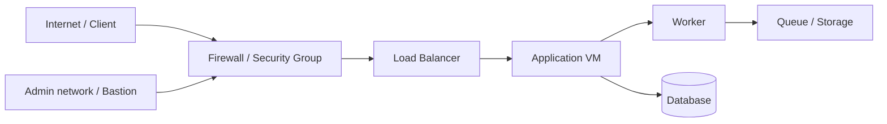
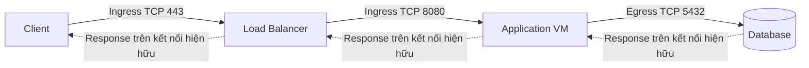
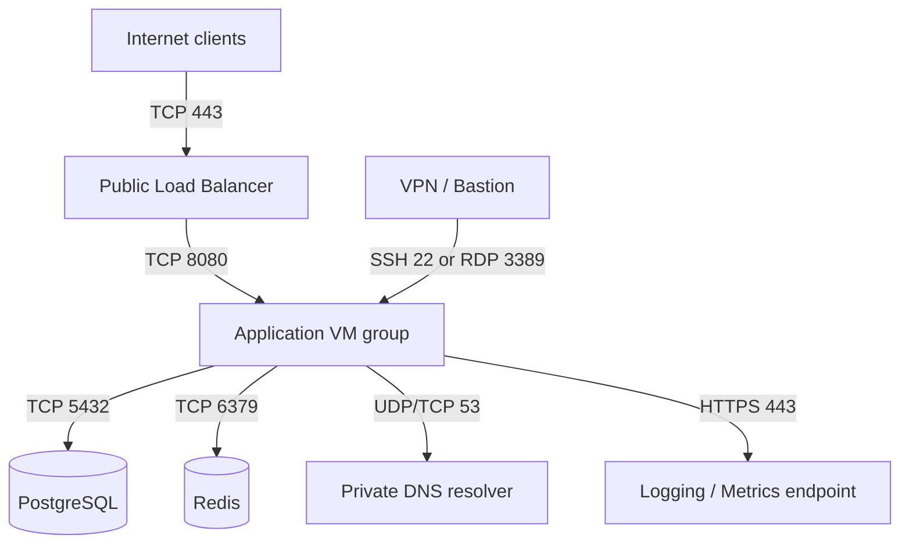
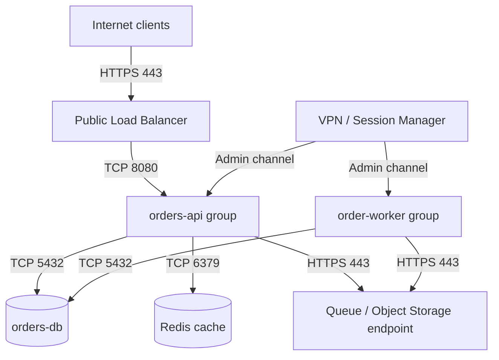

# Firewall, security group và quy tắc truy cập compute

Một máy ảo, container hoặc hàm serverless chỉ nên giao tiếp với những nguồn và đích thực sự cần thiết. Firewall và security group giúp kiểm soát luồng mạng bằng các quy tắc về nguồn, đích, giao thức, cổng và hướng kết nối. Khi thiết kế đúng, chúng giới hạn bề mặt tấn công, phân tách các workload và giảm khả năng một thành phần bị xâm nhập có thể di chuyển sang hệ thống khác.

Trong module **CLOUD_CORE_SERVICES_COMPUTE**, quy tắc truy cập mạng gắn với cách cấp phát compute, subnet, load balancer, danh tính workload, lưu trữ và dịch vụ phụ thuộc. Một ứng dụng có thể cần nhận HTTPS từ người dùng, nhận traffic nội bộ từ load balancer, truy cập database, gửi log và lấy bản vá. Mỗi luồng cần được xác định rõ chủ thể, đích, giao thức, cổng và lý do nghiệp vụ. Không nên mở rộng quyền mạng chỉ để khắc phục một lỗi kết nối chưa được chẩn đoán.

## Mục tiêu học tập

Sau bài này, bạn có thể:

- Phân biệt firewall, security group, network ACL và host firewall.
- Giải thích khác biệt giữa quy tắc stateful và stateless, ingress và egress.
- Thiết kế quy tắc truy cập theo nguyên tắc mặc định từ chối và đặc quyền tối thiểu.
- Phân đoạn mạng giữa load balancer, application, worker, database và dịch vụ quản trị.
- Xử lý các luồng TCP, UDP, DNS, ICMP, IPv4, IPv6 và cổng phản hồi.
- Áp dụng quy tắc cho VM, container và workload serverless.
- Ghi log, kiểm thử, rà soát và quản lý firewall rule bằng IaC.
- Chẩn đoán lỗi kết nối mà vẫn giữ được ranh giới bảo mật.

## 1. Vì sao compute cần firewall?

Một workload cloud thường có nhiều giao diện và luồng giao tiếp. VM có thể nhận kết nối từ load balancer, truy cập database, tải package từ repository và gửi metric đến hệ thống giám sát. Container có thể gọi API nội bộ, queue hoặc dịch vụ lưu trữ. Hàm serverless có thể nhận sự kiện từ queue và gọi database hoặc API bên ngoài.

Nếu mọi cổng đều mở, một lỗi ứng dụng hoặc một thông tin xác thực bị lộ có thể tạo đường truy cập đến các thành phần không liên quan. Firewall giúp giới hạn luồng mạng ở các điểm kiểm soát như biên VPC/VNet, subnet, network interface, node, host hoặc workload.



Sơ đồ minh họa các luồng cần kiểm soát:

- Người dùng truy cập điểm vào công khai của ứng dụng.
- Load balancer chuyển traffic đến cổng ứng dụng trên VM.
- Application truy cập database bằng cổng dịch vụ cụ thể.
- Worker nhận hoặc gửi message đến queue và lưu kết quả.
- Nhân viên vận hành truy cập quản trị qua kênh riêng được xác thực.

Không phải mọi thành phần đều cần kết nối trực tiếp với nhau. Ví dụ, người dùng Internet không cần truy cập trực tiếp database; worker không cần nhận kết nối SSH từ Internet; database không cần mở cổng quản trị cho toàn bộ subnet.

## 2. Firewall, security group và các lớp kiểm soát

Các thuật ngữ có thể khác nhau giữa nhà cung cấp, nhưng có thể phân biệt theo phạm vi áp dụng và cách quản lý.

### 2.1. Firewall

Firewall là cơ chế kiểm soát lưu lượng mạng dựa trên tập quy tắc. Firewall có thể nằm ở nhiều vị trí:

- **Network/perimeter firewall:** kiểm soát traffic đi vào, đi ra hoặc đi giữa các mạng.
- **Cloud-native firewall:** dịch vụ của nhà cung cấp dùng để kiểm soát lưu lượng giữa VPC/VNet, subnet hoặc workload.
- **Host firewall:** chạy trên hệ điều hành VM, ví dụ `nftables`, `iptables`, Windows Defender Firewall.
- **Application firewall/WAF:** hiểu giao thức ứng dụng như HTTP và có thể kiểm tra URL, header, payload hoặc mẫu tấn công ở lớp ứng dụng.

Firewall mạng thường xử lý địa chỉ IP, protocol, port, state và đôi khi cả danh tính hoặc thuộc tính ứng dụng. WAF có phạm vi khác: nó bổ sung kiểm soát HTTP/HTTPS, không thay thế security group hoặc host firewall.

### 2.2. Security group

Security group là nhóm quy tắc được gắn với một hoặc nhiều tài nguyên compute hoặc giao diện mạng. Nó thường hoạt động như một firewall ảo cho VM, NIC, load balancer hoặc endpoint dịch vụ.

Đặc điểm phổ biến của security group:

- Quy tắc xác định traffic được phép theo protocol, port, nguồn hoặc đích.
- Nhiều nền tảng coi security group là **stateful**: khi một kết nối được phép khởi tạo, traffic phản hồi của kết nối đó được cho phép tự động.
- Có thể tham chiếu security group khác làm nguồn hoặc đích thay vì phải ghi cứng dải CIDR.
- Một tài nguyên có thể gắn nhiều security group tùy nền tảng; hiệu lực thường là hợp của các quy tắc cho phép.
- Security group thường không có quy tắc từ chối cụ thể cho từng nguồn; traffic không khớp quy tắc cho phép sẽ bị từ chối ngầm. Cần kiểm tra ngữ nghĩa của nhà cung cấp.

Security group giúp gắn chính sách với vai trò workload. Ví dụ, nhóm `app-sg` chỉ cho phép cổng 8080 từ `load-balancer-sg`; nhóm `db-sg` chỉ cho phép cổng database từ `app-sg`.

### 2.3. Network ACL và subnet firewall

Network ACL (NACL) hoặc subnet-level firewall kiểm soát traffic ở phạm vi subnet. Một số nền tảng áp dụng quy tắc có thứ tự ưu tiên và hỗ trợ allow/deny cụ thể. Với NACL kiểu AWS, quy tắc là stateless: phải cho phép cả chiều đi và chiều về, bao gồm cổng tạm thời của client khi cần.

NACL hữu ích để tạo lớp bảo vệ rộng cho subnet, nhưng không thay thế security group. Quy tắc subnet quá chặt có thể chặn traffic hợp lệ trước khi đến security group; quy tắc quá rộng làm giảm giá trị phân đoạn mạng.

### 2.4. Host firewall

Host firewall chạy bên trong hệ điều hành của VM. Nó có thể kiểm soát process, interface, địa chỉ, protocol và port theo khả năng của hệ điều hành. Lớp này hữu ích để bảo vệ VM ngay cả khi một quy tắc cloud network bị mở nhầm.

Đổi lại, host firewall cần được quản lý theo image, cấu hình hệ điều hành và quy trình patch. Nếu cấu hình sai, có thể khóa chính đường quản trị hoặc làm ứng dụng không nhận được traffic từ load balancer.

### 2.5. So sánh các lớp

| Cơ chế | Phạm vi | Đặc điểm | Trách nhiệm thường gặp |
|---|---|---|---|
| Network/perimeter firewall | Giữa mạng hoặc biên mạng | Có thể kiểm tra nhiều lớp và áp dụng chính sách tập trung | Đội network/security và nhà cung cấp dịch vụ theo mô hình triển khai |
| Security group | NIC, VM hoặc tài nguyên cloud | Thường stateful, quy tắc gắn với workload | Khách hàng cấu hình; nhà cung cấp vận hành control plane |
| Network ACL/subnet firewall | Subnet | Có thể stateless, có thứ tự rule tùy nền tảng | Khách hàng cấu hình trong mạng ảo |
| Host firewall | Hệ điều hành VM | Kiểm soát gần tiến trình và interface | Khách hàng quản lý guest OS |
| WAF | HTTP/HTTPS application traffic | Hiểu request và mẫu tấn công lớp ứng dụng | Khách hàng cấu hình policy; nhà cung cấp vận hành nền tảng managed nếu có |

Các lớp có thể bổ sung cho nhau. Hãy xác định rõ lớp nào là điểm kiểm soát chính cho từng luồng và tránh tạo các quy tắc trùng lặp khó vận hành.

## 3. Ingress, egress và chiều của kết nối

Firewall thường phân biệt hai hướng:

- **Ingress:** traffic đi vào workload hoặc giao diện được bảo vệ.
- **Egress:** traffic đi ra khỏi workload hoặc giao diện được bảo vệ.

Ví dụ, khi người dùng truy cập website:

1. Client khởi tạo TCP connection đến địa chỉ công khai của load balancer trên cổng 443.
2. Load balancer chuyển tiếp kết nối hoặc request đến VM ứng dụng trên cổng 8080.
3. VM ứng dụng khởi tạo kết nối mới đến database trên cổng 5432.
4. Database gửi phản hồi về VM ứng dụng trên kết nối đã được thiết lập.



Với security group stateful, response traffic của kết nối được cho phép thường không cần rule inbound riêng cho cổng phản hồi. Với ACL stateless, phải cho phép cả hai chiều theo đúng địa chỉ và port. Không nên mở toàn bộ dải cổng chỉ vì chưa hiểu cổng nguồn tạm thời hoạt động như thế nào.

### 3.1. Cổng dịch vụ và cổng tạm thời

Server thường lắng nghe trên cổng dịch vụ cố định, ví dụ HTTPS 443 hoặc PostgreSQL 5432. Client thường dùng một cổng nguồn tạm thời (ephemeral port) do hệ điều hành chọn. Khi server phản hồi, gói tin quay về địa chỉ client và cổng nguồn tạm thời đó.

Với firewall stateless, quy tắc chiều về cần tính đến dải ephemeral port của hệ điều hành/client và chính sách thực tế. Dải cổng khác nhau theo hệ điều hành và cấu hình; không nên mặc định một dải chung cho mọi nền tảng. Với firewall stateful, bảng theo dõi kết nối thường xử lý response traffic.

### 3.2. Ingress và egress cần có chủ sở hữu

Một rule ingress thường trả lời: ai được phép gọi workload này và gọi dịch vụ nào? Một rule egress trả lời: workload được phép kết nối đến đâu và để làm gì?

Egress thường bị bỏ qua vì nhiều môi trường mặc định cho phép mọi outbound. Điều này tạo rủi ro nếu workload bị xâm nhập: tiến trình độc hại có thể gọi máy chủ điều khiển, tải payload hoặc gửi dữ liệu ra ngoài. Egress policy nên được thiết kế cùng dependency map, DNS, proxy, NAT và private endpoint.

## 4. Các trường của một firewall rule

Một rule mạng thường bao gồm các thuộc tính:

| Trường | Ý nghĩa | Ví dụ |
|---|---|---|
| Direction | Hướng traffic | Ingress hoặc egress |
| Action | Hành động | Allow hoặc deny; có thể ngầm định tùy nền tảng |
| Protocol | Giao thức | TCP, UDP, ICMP, ICMPv6 hoặc protocol number |
| Source | Nguồn của traffic | CIDR, security group, tag, service account hoặc prefix list |
| Destination | Đích của traffic | CIDR, security group, subnet hoặc endpoint |
| Port/range | Cổng hoặc dải cổng | TCP 443, TCP 8080, UDP 53 |
| Priority/order | Thứ tự đánh giá | Số priority hoặc vị trí rule |
| Target/scope | Đối tượng áp dụng | VM, NIC, subnet, network tag, workload identity |
| Description | Lý do và chủ sở hữu | `app-to-orders-db` |
| Logging | Có ghi nhận match hay không | Flow log, firewall log hoặc rule hit counter |

Không phải nền tảng nào cũng có đủ các trường hoặc cùng cách đánh giá. Một số firewall xử lý rule theo thứ tự ưu tiên; một số security group hợp các rule allow; một số dịch vụ có implied rule hoặc default policy. Trước khi thiết kế, phải xác minh ngữ nghĩa cụ thể của dịch vụ đang dùng.

### 4.1. CIDR và phạm vi nguồn

CIDR biểu diễn một dải địa chỉ IP. Ví dụ:

- `10.20.10.0/24`: một subnet IPv4 có 256 địa chỉ theo kích thước block.
- `10.20.0.0/16`: dải lớn hơn, bao phủ nhiều subnet.
- `0.0.0.0/0`: mọi địa chỉ IPv4.
- `::/0`: mọi địa chỉ IPv6.
- `203.0.113.10/32`: một địa chỉ IPv4 duy nhất; dải `203.0.113.0/24` trong tài liệu là địa chỉ dành cho ví dụ.

CIDR rộng làm tăng số nguồn có thể kết nối. Nếu chỉ load balancer được phép gọi application, tham chiếu security group của load balancer thường rõ và ít phụ thuộc địa chỉ IP hơn so với cho phép toàn subnet. Nếu nền tảng không hỗ trợ tham chiếu nhóm, dùng CIDR nhỏ nhất phù hợp và quản lý danh sách đó bằng mã.

### 4.2. Protocol và port

Chỉ mở protocol và port cần thiết. Một số ví dụ phổ biến:

| Dịch vụ | Protocol/port thường gặp | Ghi chú |
|---|---|---|
| HTTPS | TCP 443 | Client đến endpoint TLS; có thể kết thúc TLS tại load balancer hoặc ứng dụng |
| HTTP | TCP 80 | Thường dùng để redirect sang HTTPS hoặc phục vụ nội bộ có kiểm soát |
| SSH | TCP 22 | Chỉ từ mạng quản trị/bastion được phê duyệt |
| RDP | TCP 3389 | Chỉ từ mạng quản trị; không mở trực tiếp ra Internet |
| DNS | UDP 53 và TCP 53 | UDP thường dùng truy vấn; TCP cần cho một số phản hồi/truyền zone và trường hợp khác |
| NTP | UDP 123 | Đồng bộ thời gian đến nguồn được phép |
| PostgreSQL | TCP 5432 | Chỉ application/worker cần thiết được truy cập |
| MySQL | TCP 3306 | Giới hạn theo workload và mạng riêng |
| Redis | TCP 6379 | Không công khai trực tiếp; cần auth/TLS theo cấu hình dịch vụ |
| ICMP/ICMPv6 | Theo loại message | Có thể cần cho chẩn đoán, path MTU hoặc hoạt động mạng; không đồng nghĩa mở mọi traffic |

Port chỉ là một phần của chính sách. Cho phép TCP 443 không thay thế TLS, xác thực người dùng, kiểm tra request hoặc WAF.

## 5. Nguyên tắc thiết kế rule an toàn

### 5.1. Default deny và least privilege

Mô hình an toàn thường bắt đầu bằng từ chối traffic không được cho phép rõ ràng. Sau đó chỉ thêm các rule cần thiết cho luồng ứng dụng.

Với mỗi rule, hãy trả lời:

1. Workload nguồn nào cần kết nối?
2. Workload đích nào cần nhận kết nối?
3. Protocol và port nào được sử dụng?
4. Luồng phục vụ chức năng gì?
5. Ai sở hữu và phê duyệt rule?
6. Rule có thời hạn hoặc cần được rà soát lại không?

Tránh rule kiểu “allow all traffic” hoặc mở toàn bộ subnet chỉ để một ứng dụng truy cập database. Nếu chưa biết port cần thiết, hãy quan sát flow log, tài liệu ứng dụng và cấu hình listener trước khi mở.

### 5.2. Phân đoạn theo vai trò workload

Thay vì đặt tất cả VM trong một security group lớn, phân nhóm theo vai trò:

- `lb-sg`: nhận HTTPS từ client và gọi application.
- `app-sg`: nhận traffic từ load balancer và gọi database/cache/queue cần thiết.
- `worker-sg`: nhận job từ queue và gọi dịch vụ xử lý.
- `db-sg`: chỉ nhận kết nối từ application/worker được phê duyệt.
- `admin-sg`: chỉ cho phép truy cập quản trị từ VPN hoặc bastion.
- `monitoring-sg`: nhận metric/log từ workload nếu agent cần kết nối inbound.

Phân đoạn này giới hạn đường đi ngang (lateral movement). Nếu một VM application bị xâm nhập, kẻ tấn công không tự động có đường mạng đến mọi database, control plane hoặc máy quản trị.

### 5.3. Tránh phụ thuộc vào IP động khi có thể

VM autoscaling, container và serverless có thể thay đổi địa chỉ IP. Rule gắn cứng từng IP dễ lỗi khi instance được thay thế. Ưu tiên:

- Security group reference hoặc workload group theo dịch vụ.
- Prefix list hoặc managed service tag do nền tảng cung cấp.
- Private endpoint/service endpoint cho dịch vụ cloud.
- DNS service discovery kết hợp policy mạng phù hợp.
- IaC cập nhật tập CIDR khi thay đổi là không tránh khỏi.

DNS giúp tìm địa chỉ dịch vụ nhưng không tự thay thế firewall rule. Firewall cần kiểm soát luồng thực tế và có thể phải xử lý IP đã phân giải, prefix hoặc identity theo khả năng nền tảng.

### 5.4. Kiểm soát egress

Một workload có thể cần outbound đến:

- Database hoặc cache nội bộ.
- Queue, object storage và API cloud qua private endpoint.
- DNS resolver, NTP và hệ thống quản trị cấu hình.
- Repository cập nhật package hoặc registry image.
- Hệ thống log, metric, trace và cảnh báo.
- API bên ngoài đã được phê duyệt.

Nên liệt kê dependency trước khi siết egress. Nếu ứng dụng cần gọi nhiều API bên ngoài, có thể định tuyến qua egress proxy hoặc NAT gateway có logging và policy. Với dịch vụ cloud, private endpoint có thể giúp tránh đi qua Internet công cộng, nhưng cần kiểm tra DNS, route và security policy cho endpoint.

## 6. Ví dụ thiết kế luồng truy cập cho ứng dụng ba lớp

Giả sử hệ thống có load balancer công khai, nhóm VM application và database trong subnet riêng.



Bảng rule khái niệm:

| Đối tượng được bảo vệ | Hướng | Nguồn/đích được phép | Protocol/port | Lý do |
|---|---|---|---|---|
| Load balancer | Ingress | Client Internet hoặc dải client được duyệt | TCP 443 | Nhận HTTPS |
| Load balancer | Egress | Nhóm application | TCP 8080 | Chuyển request đến ứng dụng |
| Application | Ingress | Security group của load balancer | TCP 8080 | Chỉ nhận traffic từ điểm vào được quản lý |
| Application | Ingress quản trị | VPN/bastion group | TCP 22 hoặc 3389 | Quản trị có kiểm soát, nếu thật sự cần |
| Application | Egress | Database group | TCP 5432 | Truy cập dữ liệu nghiệp vụ |
| Application | Egress | Cache group | TCP 6379 | Truy cập cache |
| Database | Ingress | Application group | TCP 5432 | Nhận truy vấn từ ứng dụng |
| Cache | Ingress | Application group | TCP 6379 | Nhận truy cập cache |

Các rule response của kết nối được security group stateful xử lý theo state table. Nếu có subnet ACL stateless, cần thêm rule chiều về cho đúng dải cổng nguồn và đích. Không mở SSH/RDP từ `0.0.0.0/0` hoặc `::/0`.

### 6.1. Luồng quản trị

Không nên dùng cùng đường truy cập public cho người dùng và quản trị hệ thống. Có thể dùng VPN, bastion host, session manager hoặc cơ chế truy cập zero-trust do tổ chức phê duyệt. Luồng quản trị nên có:

- Xác thực mạnh, MFA và danh tính cá nhân.
- Quyền truy cập theo thời hạn hoặc theo phiên.
- Audit log ghi người truy cập, thời điểm và tài nguyên.
- Giới hạn nguồn mạng và cổng quản trị.
- Cơ chế thu hồi quyền và điều tra khi credential bị lộ.

Nếu nền tảng hỗ trợ quản trị không cần mở inbound SSH/RDP, hãy cân nhắc sử dụng kênh quản lý được xác thực qua control plane. Dù dùng phương thức nào, quyền IAM và audit vẫn phải được cấu hình.

## 7. Security group stateful và firewall stateless

Hiểu stateful/stateless giúp tránh mở rule thừa và xử lý lỗi kết nối đúng cách.

### 7.1. Stateful

Firewall stateful theo dõi trạng thái kết nối. Khi một kết nối được phép khởi tạo, các gói phản hồi thuộc kết nối đó thường được phép tự động mà không cần tạo rule inbound ngược lại cho từng cổng tạm thời.

Ví dụ, application VM khởi tạo TCP connection đến database trên cổng 5432. Security group của application cho phép egress đến database; security group của database cho phép ingress từ application trên cổng 5432. Gói phản hồi từ database về cổng nguồn tạm thời của application được connection tracking cho phép.

### 7.2. Stateless

Firewall stateless đánh giá từng gói theo rule hiện tại mà không tự suy ra traffic phản hồi thuộc kết nối đã được cho phép. Vì vậy cần rule cho cả chiều đi và chiều về.

Ví dụ với subnet ACL stateless:

- Inbound đến server: TCP 5432 từ subnet application.
- Outbound từ server: TCP đến dải ephemeral port của client application để trả lời.
- Inbound đến client: TCP từ cổng 5432 của database về dải ephemeral port của client.
- Outbound từ client: TCP đến cổng 5432 của database.

Các dải port cần dựa trên hệ điều hành và cách kết nối thực tế. Dùng rule quá rộng có thể làm mất ý nghĩa của ACL; dùng rule quá hẹp có thể gây lỗi ngắt quãng khó chẩn đoán.

### 7.3. Không nhầm security group với NACL

Trong một số nền tảng, security group là stateful và NACL là stateless; nhưng thuật ngữ và hành vi khác nhau giữa nhà cung cấp. Hãy đọc tài liệu đúng dịch vụ. Không suy luận rằng mọi đối tượng có tên “firewall” đều dùng cùng một mô hình state tracking.

## 8. Quy tắc cho VM, container và serverless

### 8.1. Máy ảo

Với VM, có thể kết hợp security group ở cloud với host firewall trong guest OS.

- Security group giới hạn luồng ở network interface hoặc VM.
- Host firewall giới hạn thêm ở hệ điều hành và có thể phân biệt interface/process theo khả năng nền tảng.
- Workload identity xác định quyền truy cập dịch vụ cloud; nó không thay thế firewall.
- SSH/RDP nên đi qua mạng quản trị hoặc dịch vụ session management.
- VM trong autoscaling group nên nhận cùng policy từ launch template/IaC để instance mới không có cấu hình yếu hơn instance cũ.

Ví dụ host firewall Linux với `nftables` cần được xây dựng theo interface và quy tắc cụ thể của máy. Một policy tổng quát thường có input mặc định drop, cho phép loopback, established/related, SSH chỉ từ subnet quản trị và cổng ứng dụng chỉ từ dải load balancer. Trước khi áp dụng trên VM từ xa, cần bảo đảm có console hoặc phương án khôi phục nếu rule chặn nhầm kết nối quản trị.

### 8.2. Container và Kubernetes

Container chạy trên node và có thể chia sẻ network namespace hoặc dùng network plugin để tạo địa chỉ mạng riêng. Cần phân biệt:

- Security group của node hoặc NIC bảo vệ traffic ở mức VM/node.
- Security group cho Pod hoặc workload identity-aware policy chỉ có ở một số nền tảng/plugin.
- Kubernetes NetworkPolicy thường kiểm soát traffic giữa Pod/namespace ở lớp network plugin; hiệu lực phụ thuộc CNI có hỗ trợ enforcement.
- Ingress controller/load balancer kiểm soát traffic vào service; policy Pod không tự thay thế bảo vệ endpoint public.
- Egress policy có thể giới hạn Pod gọi đến database, DNS, metadata endpoint hoặc Internet.

Ví dụ NetworkPolicy khái niệm cho phép Pod API nhận traffic từ namespace ingress và chỉ egress đến database cùng DNS:

```yaml
apiVersion: networking.k8s.io/v1
kind: NetworkPolicy
metadata:
  name: api-traffic-policy
  namespace: production
spec:
  podSelector:
    matchLabels:
      app: orders-api
  policyTypes:
    - Ingress
    - Egress
  ingress:
    - from:
        - namespaceSelector:
            matchLabels:
              purpose: ingress
      ports:
        - protocol: TCP
          port: 8080
  egress:
    - to:
        - podSelector:
            matchLabels:
              app: orders-db-proxy
      ports:
        - protocol: TCP
          port: 5432
    - to:
        - namespaceSelector:
            matchLabels:
              kubernetes.io/metadata.name: kube-system
      ports:
        - protocol: UDP
          port: 53
        - protocol: TCP
          port: 53
```

Đây là ví dụ minh họa. Selector, namespace label, cách DNS được triển khai và khả năng thực thi policy phụ thuộc cluster/CNI. Khi áp dụng thật, cần kiểm tra NetworkPolicy có hiệu lực, xác định Pod DNS thực tế và bổ sung luồng cần thiết như metrics, logging hoặc dịch vụ bên ngoài. Khi một Pod được chọn bởi policy ingress/egress, các luồng không được cho phép có thể bị chặn theo semantics của Kubernetes NetworkPolicy và plugin.

### 8.3. Serverless/FaaS

Hàm serverless có thể chạy trong mạng do nhà cung cấp quản lý hoặc được gắn vào VPC/VNet/subnet. Quy tắc cần xét:

- Nguồn sự kiện gọi hàm có được xác thực và giới hạn không?
- Hàm có cần truy cập tài nguyên private như database hay không?
- Security group hoặc network policy của hàm có cho phép đúng endpoint/port không?
- Egress đến Internet có cần NAT, proxy hoặc private endpoint không?
- Nhiều execution environment đồng thời có tạo số lượng connection lớn đến database không?
- DNS và route trong subnet có cho phép hàm tìm thấy dependency không?

FaaS không đồng nghĩa mọi hàm đều có IP public hoặc được truy cập từ Internet. Cách gắn mạng và địa chỉ nguồn phụ thuộc dịch vụ. Không dùng IP tĩnh giả định để viết rule nếu nền tảng cung cấp security group, subnet hoặc private endpoint phù hợp hơn.

## 9. DNS, ICMP, IPv6 và các luồng nền

Firewall rule không chỉ phục vụ cổng ứng dụng. Một số luồng nền cần được tính đến khi thiết kế policy.

### 9.1. DNS

Workload thường cần phân giải tên dịch vụ qua DNS. DNS truyền thống dùng UDP 53 cho phần lớn truy vấn và có thể dùng TCP 53 trong một số tình huống như phản hồi lớn hoặc zone transfer. DNS-over-HTTPS/TLS dùng cổng và đích khác tùy resolver.

Nếu egress policy chặn DNS, ứng dụng có thể không kết nối được dependency dù port database/API đã mở. Chỉ cho phép workload truy vấn resolver được chỉ định; không mặc định mở DNS đến mọi nơi nếu tổ chức có resolver riêng.

### 9.2. ICMP và ICMPv6

ICMP có thể cần cho ping, thông báo lỗi mạng, Path MTU Discovery và chẩn đoán. Chặn toàn bộ ICMP có thể làm một số kết nối hoạt động không ổn định, đặc biệt khi gói tin bị phân mảnh hoặc MTU giữa các đường khác nhau.

Không nhất thiết cho phép mọi loại ICMP từ mọi nguồn. Hãy chọn message type/code phù hợp, giới hạn nguồn nếu có thể và tuân theo hướng dẫn của nền tảng. ICMPv6 có vai trò thiết yếu hơn trong IPv6, vì vậy không nên sao chép nguyên xi policy IPv4 sang IPv6.

### 9.3. IPv6

Khi workload có địa chỉ IPv6, phải rà soát cả rule IPv4 lẫn IPv6. Một security group chỉ chặn `0.0.0.0/0` nhưng không có rule tương ứng cho `::/0` có thể để lộ endpoint qua IPv6. Ngược lại, nếu không sử dụng IPv6, hãy xác định cách tắt hoặc kiểm soát địa chỉ và route IPv6 theo policy của nền tảng.

Kiểm tra DNS có bản ghi AAAA, route IPv6, security group IPv6, firewall host và load balancer. Không cho rằng việc kiểm thử bằng IPv4 chứng minh endpoint đã được bảo vệ trên cả hai giao thức.

### 9.4. Luồng quản trị và telemetry

Ngoài traffic nghiệp vụ, workload có thể cần NTP, log, metric, trace, agent quản lý, cập nhật package và truy cập secret manager. Lập dependency inventory để xác định endpoint và port. Nếu dùng private endpoint, kiểm tra route, DNS private zone và policy endpoint.

## 10. Áp dụng trên các nền tảng cloud

Các nhà cung cấp có khái niệm tương tự nhưng tên gọi, scope và semantics không hoàn toàn giống nhau.

| Nền tảng | Cơ chế thường gặp | Điểm cần chú ý |
|---|---|---|
| AWS | Security Groups, Network ACLs, AWS Network Firewall, host firewall | Security Group stateful; NACL stateless và đánh giá theo rule number; SG có thể tham chiếu SG khác trong các trường hợp được hỗ trợ |
| Microsoft Azure | Network Security Groups (NSG), Azure Firewall, Application Security Groups, host firewall | NSG áp dụng ở subnet hoặc NIC; rule có priority; Application Security Group giúp nhóm NIC theo vai trò |
| Google Cloud | VPC firewall rules, hierarchical firewall policies, Cloud NGFW và host firewall | VPC firewall rule có priority, target theo tag hoặc service account; cần hiểu implied rules và policy hierarchy |
| Kubernetes | NetworkPolicy, CNI policy, service mesh policy và cloud security group | NetworkPolicy chỉ được thực thi nếu CNI hỗ trợ; policy mạng không thay thế IAM hoặc xác thực ứng dụng |

Tên và khả năng dịch vụ có thể thay đổi theo phiên bản, region và loại triển khai. Hãy xác minh tài liệu của nền tảng trước khi chuyển rule từ cloud này sang cloud khác.

### 10.1. AWS Security Groups và Network ACLs

Trong AWS, security group gắn với network interface của tài nguyên được hỗ trợ và là stateful. Inbound rule xác định nguồn được phép vào; outbound rule xác định đích được phép kết nối. Security group chỉ có allow rule; traffic không khớp rule cho phép sẽ bị từ chối ngầm.

Network ACL gắn ở subnet và stateless. NACL có rule number, action allow/deny và phải xét cả chiều vào/ra. Khi dùng NACL, cần tính ephemeral port của client để traffic phản hồi không bị chặn.

### 10.2. Azure NSG

Azure NSG có thể được liên kết với subnet hoặc network interface và có tính stateful: traffic phản hồi của kết nối được cho phép được xử lý theo trạng thái kết nối. Rule có priority, direction, protocol, source/destination, port range và action. Khi có nhiều rule, thứ tự ưu tiên ảnh hưởng kết quả; các rule mặc định của nền tảng cũng tham gia đánh giá. Application Security Group có thể giúp viết rule theo nhóm workload thay vì CIDR thủ công.

### 10.3. Google Cloud VPC firewall

Google Cloud VPC firewall rules áp dụng theo VPC và target, có thể chọn VM bằng network tag hoặc service account tùy loại rule. Firewall VPC có tính stateful đối với traffic phản hồi của kết nối được cho phép. Priority và các rule implied/default cần được tính đến. Firewall policy phân cấp có thể áp dụng ở cấp tổ chức/folder/project tùy cấu hình.

Không nên giả định thứ tự hoặc cách hợp rule của một nhà cung cấp giống nhà cung cấp khác. Khi migrate IaC, cần chuyển ý nghĩa policy, không chỉ sao chép số port và CIDR.

## 11. Mô tả firewall rule bằng IaC

Firewall rule cần được quản lý như mã để có thể review, truy vết và phát hiện drift. Một rule nên có tên dễ hiểu, mô tả mục đích, owner, nguồn, đích, port và môi trường.

### 11.1. Ví dụ policy dạng khai báo

Ví dụ YAML trung lập nhà cung cấp:

```yaml
network_policy:
  name: orders-production
  default_ingress: deny
  default_egress: deny
  rules:
    - name: public-https-to-load-balancer
      direction: ingress
      source: 0.0.0.0/0
      destination: orders-public-lb
      protocol: tcp
      ports: [443]
      purpose: accept-public-https
      owner: platform-network

    - name: load-balancer-to-api
      direction: ingress
      source: orders-lb-group
      destination: orders-api-group
      protocol: tcp
      ports: [8080]
      purpose: application-traffic
      owner: orders-service

    - name: api-to-database
      direction: egress
      source: orders-api-group
      destination: orders-db-group
      protocol: tcp
      ports: [5432]
      purpose: database-queries
      owner: orders-service
```

Đây là mô hình dữ liệu để thảo luận, không phải schema có thể áp dụng trực tiếp cho một cloud provider. Trong production cần thể hiện cả IPv6 nếu sử dụng, rule response nếu firewall stateless, DNS/telemetry/management dependency và cách xử lý rule priority.

### 11.2. Quy ước quản lý rule

- Đặt tên theo `source-to-destination-purpose` hoặc quy ước dễ tìm kiếm.
- Mỗi rule có description, owner, ticket/change reference và môi trường.
- CIDR được khai báo tập trung, tránh lặp chuỗi địa chỉ trong nhiều file.
- Tách rule dùng chung và rule riêng cho workload.
- Có validation để từ chối `0.0.0.0/0` hoặc `::/0` cho cổng quản trị.
- Review thay đổi mở rộng port, source hoặc destination.
- Dùng IaC để xóa rule hết nhu cầu; không để rule tạm tồn tại vô thời hạn.
- Kiểm tra drift giữa mã và cloud control plane.

### 11.3. Thay đổi rule an toàn

Khi thêm rule cho một luồng mới:

1. Xác nhận ứng dụng thực sự cần luồng và xác định protocol/port.
2. Xác định đúng source/destination workload, tránh dùng CIDR rộng khi có identity/group reference.
3. Thêm rule vào môi trường thử nghiệm và kiểm tra kết nối.
4. Quan sát flow log hoặc rule hit để xác nhận traffic.
5. Review security impact và chi phí nếu cần firewall/NAT/egress service.
6. Triển khai production theo change window hoặc quy trình phê duyệt.
7. Theo dõi lỗi và giữ phương án rollback rule.

Không nên mở rule tạm trên production để “thử xem có chạy không” nếu chưa có giới hạn thời gian, người phê duyệt và ghi nhận thay đổi. Một rule thử nghiệm dễ bị quên và trở thành lỗ hổng lâu dài.

## 12. Logging, giám sát và kiểm thử rule

Firewall chỉ có ích khi đội vận hành biết rule nào đang cho phép hoặc chặn traffic và có thể điều tra khi ứng dụng lỗi.

### 12.1. Flow log và firewall log

Flow log thường ghi metadata về luồng mạng như source/destination IP, port, protocol, thời điểm, interface và trạng thái accept/reject tùy nền tảng. Firewall log có thể ghi rule ID, action, policy và thông tin sâu hơn.

Log nên được gửi đến hệ thống tập trung, có retention và quyền truy cập phù hợp. Cần lưu ý log mạng có thể tiết lộ địa chỉ nội bộ, mô hình dịch vụ và hành vi người dùng. Không phải mọi nền tảng đều ghi log từng gói hoặc mọi rule match; kiểm tra phạm vi thu thập và chi phí lưu trữ.

### 12.2. Các chỉ số cần theo dõi

- Số lượng kết nối accept/reject theo source, destination, port và workload.
- Tỷ lệ kết nối bị từ chối tăng đột biến sau thay đổi rule.
- Connection count, conntrack table usage và giới hạn thiết bị nếu có.
- Packet drop, retransmission, timeout và lỗi DNS.
- Lưu lượng egress bất thường hoặc kết nối đến endpoint chưa được phê duyệt.
- Rule không có hit trong thời gian dài hoặc rule quá rộng.
- Thay đổi security group, NSG, NACL, route và firewall policy từ audit log.

Không xóa rule chỉ vì không có hit trong một cửa sổ ngắn. Job định kỳ hoặc luồng phục hồi thảm họa có thể chỉ chạy vài lần mỗi tháng. Xác nhận owner và chu kỳ nghiệp vụ trước khi loại bỏ.

### 12.3. Kiểm thử kết nối

Các công cụ sau giúp kiểm tra từ nguồn đến đích:

```bash
# Kiểm tra TCP đến một port cụ thể
nc -vz 10.20.30.15 5432

# Kiểm tra route đến đích
traceroute 10.20.30.15

# Kiểm tra phân giải DNS
dig orders-db.internal.example

# Kiểm tra HTTPS và TLS
curl -v https://orders.example.com/health
```

Trên Windows có thể dùng `Test-NetConnection`, `Resolve-DnsName` và công cụ tương đương. `ping` không phải phép thử duy nhất: ICMP có thể bị chặn trong khi TCP vẫn hoạt động, hoặc ngược lại. Kiểm tra phải chạy từ đúng nguồn mạng, đúng subnet/VM/container và đúng danh tính nếu policy phụ thuộc identity.

### 12.4. Kiểm thử policy trước production

Nên có các test case:

- Client hợp lệ truy cập được endpoint công khai cần thiết.
- Client không được phép không thể truy cập cổng nội bộ.
- Application gọi được database đúng port.
- Workload không thể gọi database hoặc service không liên quan.
- SSH/RDP chỉ truy cập được từ mạng quản trị được phê duyệt.
- IPv4 và IPv6 có policy nhất quán.
- DNS, NTP, logging và secret manager vẫn hoạt động.
- Container/Pod không thể kết nối sang namespace hoặc workload bị cấm.
- Egress đến Internet bị giới hạn theo thiết kế.

Kiểm thử cả luồng được phép và luồng bị từ chối. Nếu chỉ kiểm tra luồng allow, policy có thể vô tình mở rộng hơn yêu cầu.

## 13. Chẩn đoán sự cố kết nối

Khi một ứng dụng không kết nối được dịch vụ phụ thuộc, không nên lập tức mở toàn bộ traffic. Hãy đi theo đường đi của gói tin và kiểm tra từng lớp.

### 13.1. Quy trình chẩn đoán

1. **Xác nhận endpoint:** hostname, IP, port, protocol và DNS record có đúng không?
2. **Xác nhận nguồn:** request phát ra từ VM, container, Pod hay function nào? Địa chỉ nguồn sau NAT là gì?
3. **Kiểm tra route:** subnet, route table, NAT, peering, VPN hoặc private endpoint có đường đi không?
4. **Kiểm tra rule nguồn:** egress security group, host firewall hoặc network policy có cho phép không?
5. **Kiểm tra rule đích:** ingress security group, NACL, firewall hoặc host firewall có cho phép không?
6. **Kiểm tra stateful/stateless:** response path và ephemeral port đã được cho phép chưa?
7. **Kiểm tra service:** tiến trình có lắng nghe đúng interface/port không? TLS/auth có thành công không?
8. **Đối chiếu log:** flow log, firewall log, audit log và ứng dụng ghi nhận gì?
9. **Thử từ cùng network context:** chạy test từ workload hoặc một máy chẩn đoán có policy tương đương.
10. **Sửa đúng rule và kiểm thử lại:** ghi change reference, owner và thời hạn nếu là ngoại lệ tạm thời.

### 13.2. Một số triệu chứng phổ biến

| Triệu chứng | Nguyên nhân có thể | Cách kiểm tra |
|---|---|---|
| DNS lookup thất bại | Egress DNS bị chặn, resolver sai hoặc private zone không liên kết | `dig`, resolver config, flow log UDP/TCP 53 |
| TCP timeout | Route sai, firewall drop, NACL thiếu chiều về hoặc đích không phản hồi | Route table, flow log, ephemeral port, listener |
| Connection refused | Đích có thể đến được nhưng không có service lắng nghe hoặc host firewall reject | Process/listener, service status, host firewall |
| Một chiều hoạt động, chiều kia lỗi | NACL stateless hoặc route bất đối xứng | Kiểm tra cả hai chiều, ephemeral port và route |
| VM mới trong autoscaling không kết nối được | Launch template thiếu security group/route/identity hoặc bootstrap khác | So sánh NIC, SG, subnet, route và image giữa instance |
| Pod không gọi được service khác | NetworkPolicy selector sai, CNI không enforce hoặc DNS policy thiếu | Pod labels, namespace labels, CNI và flow log |
| Function không kết nối database private | Subnet, SG, route, DNS hoặc quota network interface | VPC attachment, route, endpoint và function logs |
| Kết nối bị ngắt ngẫu nhiên | Conntrack exhaustion, NAT port exhaustion, idle timeout hoặc rule/route không nhất quán | Connection count, NAT metrics, timeout và packet trace |

## 14. Bảo mật nâng cao: microsegmentation và identity-aware access

Firewall dựa trên IP/port hữu ích nhưng chưa đủ để xác định một workload có đáng tin hay không. IP có thể thay đổi, subnet có thể chứa nhiều ứng dụng và một máy bị xâm nhập vẫn có địa chỉ hợp lệ.

### 14.1. Microsegmentation

Microsegmentation chia mạng thành các vùng nhỏ theo ứng dụng, môi trường hoặc workload role. Thay vì cho phép mọi VM trong subnet gọi nhau, policy chỉ cho phép các luồng cụ thể như API đến database hoặc worker đến queue.

Lợi ích:

- Giảm lateral movement khi một workload bị xâm nhập.
- Giới hạn phạm vi của credential bị lộ.
- Làm rõ dependency giữa dịch vụ.
- Hỗ trợ kiểm toán và phân loại dữ liệu.

Microsegmentation cần inventory và automation tốt. Nếu mỗi thay đổi ứng dụng phải mở ticket thủ công cho nhiều rule nhỏ, vận hành có thể trở nên chậm. Hãy quản lý policy theo service identity và IaC, có quy trình yêu cầu/duyệt rõ.

### 14.2. Kết hợp mạng với danh tính

Security group xác định luồng mạng được phép; IAM/workload identity xác định hành động được phép trên dịch vụ cloud; xác thực ứng dụng xác định client nào được phép dùng API. Ba lớp này bổ sung cho nhau.

Ví dụ, application VM có thể được phép kết nối TCP 5432 đến database. Nhưng database vẫn cần xác thực user, giới hạn quyền SQL và mã hóa kết nối. Firewall cho phép kết nối không có nghĩa người gọi được phép đọc mọi bảng.

Với service-to-service communication, có thể kết hợp mTLS, service mesh authorization, workload identity và network policy. Network policy giới hạn đường đi; mTLS xác minh danh tính workload ở tầng kết nối; authorization policy quyết định API/action được phép.

### 14.3. Bảo vệ metadata endpoint

Một số VM cung cấp metadata service để lấy thông tin instance hoặc credential tạm thời. Nếu ứng dụng có SSRF hoặc container không tin cậy có thể truy cập metadata endpoint, credential có thể bị lộ.

Biện pháp gồm:

- Bật cơ chế bảo vệ metadata theo hướng dẫn của nhà cung cấp, ví dụ yêu cầu token hoặc hop limit phù hợp.
- Hạn chế workload không tin cậy truy cập metadata endpoint.
- Không cấp role rộng cho VM chỉ vì một tiến trình cần một quyền nhỏ.
- Dùng identity riêng cho workload và theo dõi truy cập metadata.
- Bảo vệ ứng dụng khỏi SSRF bằng kiểm tra URL/địa chỉ đích và danh sách đích được phép.

## 15. Quản lý ngoại lệ và rà soát rule định kỳ

Không phải mọi luồng mạng đều có thể được mô tả hoàn hảo ngay từ đầu. Có thể cần ngoại lệ tạm thời cho điều tra hoặc di chuyển hệ thống. Ngoại lệ phải có phạm vi và thời hạn.

Một ngoại lệ nên ghi nhận:

- Lý do nghiệp vụ và hệ thống liên quan.
- Nguồn, đích, protocol, port và môi trường.
- Người yêu cầu, người phê duyệt và owner chịu trách nhiệm.
- Thời điểm bắt đầu, ngày hết hạn và điều kiện thu hồi.
- Rủi ro, biện pháp bù trừ và cách giám sát.
- Ticket/change ID và bằng chứng kiểm thử.

Rà soát định kỳ để:

- Xóa rule không còn owner hoặc workload đã ngừng hoạt động.
- Thu hẹp CIDR và port quá rộng.
- Kiểm tra rule IPv6 song song với IPv4.
- Xác minh cổng quản trị không bị mở ra Internet.
- Kiểm tra egress bất thường và luồng không còn được phê duyệt.
- Đối chiếu policy với IaC để phát hiện drift.
- Đảm bảo thay đổi subnet, instance group, cluster hoặc serverless không làm mất kiểm soát mạng.

Không xóa rule chỉ dựa trên số hit thấp nếu chưa kiểm tra job định kỳ, DR, backup hoặc tác vụ vận hành ít xảy ra.

## 16. Ví dụ thực tế: phân đoạn mạng cho dịch vụ đặt hàng

Một cửa hàng trực tuyến triển khai API trên nhóm VM, worker xử lý đơn, PostgreSQL và Redis trong mạng riêng. Người dùng truy cập qua load balancer công khai. Nhân viên vận hành dùng VPN và session management.



Chính sách mong muốn:

1. Load balancer nhận TCP 443 từ client. Cổng 80 chỉ mở nếu dùng để redirect hoặc đáp ứng yêu cầu cụ thể.
2. API chỉ nhận TCP 8080 từ security group của load balancer.
3. Worker không nhận traffic từ Internet; chỉ có kênh quản trị được kiểm soát.
4. Database chỉ nhận TCP 5432 từ API và worker group.
5. Redis chỉ nhận TCP 6379 từ API nếu API là consumer duy nhất.
6. API và worker chỉ egress đến database, cache, queue/storage, DNS, logging và endpoint cần thiết.
7. Không mở SSH/RDP công khai; quản trị qua VPN/session manager với IAM/MFA.
8. Flow log và audit log được bật để điều tra và rà soát.

Nếu API bị xâm nhập, kẻ tấn công không thể kết nối tùy ý đến mọi VM trong subnet. Tuy nhiên, nếu API có quyền database quá rộng hoặc secret bị lộ, firewall không ngăn được việc lạm dụng các quyền hợp lệ. Vì vậy cần kết hợp network policy, IAM, xác thực database và phân quyền ở tầng ứng dụng.

## 17. Checklist firewall cho production

**Thiết kế luồng**

- [ ] Đã vẽ luồng client, load balancer, application, worker, database và dịch vụ phụ thuộc.
- [ ] Mỗi luồng có source, destination, protocol, port và owner.
- [ ] Ingress và egress đều được rà soát.
- [ ] Đã phân biệt rule stateful và stateless; response/ephemeral port được xử lý đúng.
- [ ] IPv4 và IPv6 được kiểm tra nhất quán.

**Bảo mật**

- [ ] Mặc định từ chối traffic không cần thiết.
- [ ] Không mở cổng quản trị ra Internet.
- [ ] Database/cache chỉ nhận traffic từ workload cần thiết.
- [ ] Egress được giới hạn theo dependency và endpoint được phê duyệt.
- [ ] Security group, NACL, host firewall và NetworkPolicy có ranh giới rõ.
- [ ] Workload identity và xác thực ứng dụng được cấu hình độc lập với firewall.

**Vận hành**

- [ ] Rule có tên, mô tả, owner và change reference.
- [ ] Firewall/flow log và audit log được thu thập theo yêu cầu.
- [ ] Có test case cho cả kết nối được phép và bị từ chối.
- [ ] Có quy trình thay đổi, phê duyệt và rollback rule.
- [ ] Ngoại lệ có thời hạn và được rà soát.
- [ ] IaC là nguồn quản lý chính và drift được phát hiện.

## 18. Kết luận

Firewall và security group giới hạn các luồng mạng mà workload compute được phép sử dụng. Security group thường bảo vệ VM hoặc NIC bằng quy tắc stateful; subnet ACL có thể stateless; host firewall bổ sung kiểm soát trong hệ điều hành; NetworkPolicy phân đoạn traffic Pod khi CNI hỗ trợ. Cần hiểu phạm vi và ngữ nghĩa của từng lớp trước khi kết hợp chúng.

Thiết kế rule nên bắt đầu từ luồng nghiệp vụ, áp dụng default deny và least privilege, phân đoạn theo vai trò, kiểm soát cả ingress lẫn egress và xử lý đúng response traffic. DNS, IPv6, cổng tạm thời, quản trị, telemetry và dịch vụ phụ trợ đều cần được tính đến. Quản lý rule bằng IaC, ghi log, kiểm thử cả allow lẫn deny và rà soát định kỳ giúp mạng cloud vừa an toàn vừa vận hành ổn định.

## Thuật ngữ cần nhớ

| Thuật ngữ | Ý nghĩa |
|---|---|
| Firewall | Cơ chế kiểm soát lưu lượng mạng theo tập quy tắc. |
| Security group | Nhóm quy tắc firewall gắn với VM, NIC hoặc tài nguyên cloud. |
| Network ACL | Danh sách kiểm soát lưu lượng ở phạm vi subnet; có thể stateless. |
| Host firewall | Firewall chạy bên trong hệ điều hành máy chủ. |
| WAF | Web Application Firewall; kiểm soát request ở lớp ứng dụng web. |
| Ingress | Traffic đi vào workload hoặc giao diện được bảo vệ. |
| Egress | Traffic đi ra từ workload hoặc giao diện được bảo vệ. |
| Stateful | Firewall theo dõi trạng thái kết nối và xử lý traffic phản hồi theo state. |
| Stateless | Firewall đánh giá từng gói theo rule mà không tự theo dõi trạng thái kết nối. |
| CIDR | Cách biểu diễn một dải địa chỉ IP bằng địa chỉ mạng và prefix length. |
| Ephemeral port | Cổng nguồn tạm thời do client/hệ điều hành chọn cho kết nối. |
| Default deny | Mặc định từ chối traffic nếu không có quy tắc cho phép. |
| Least privilege | Chỉ cấp quyền mạng tối thiểu cần thiết cho workload. |
| Microsegmentation | Phân đoạn mạng thành các vùng nhỏ theo ứng dụng hoặc vai trò workload. |
| NetworkPolicy | Đối tượng Kubernetes mô tả policy ingress/egress cho Pod, cần CNI hỗ trợ enforcement. |
| Flow log | Bản ghi metadata về luồng mạng được chấp nhận hoặc từ chối. |
