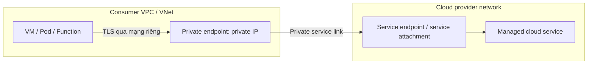
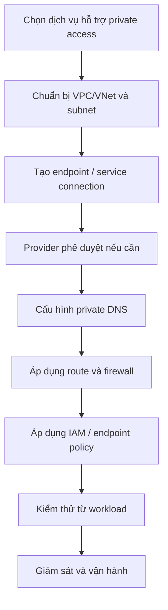
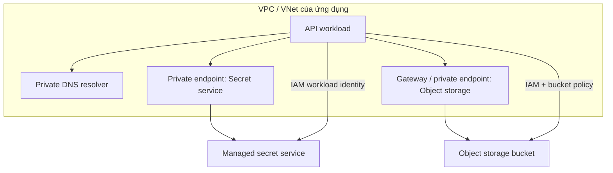

# Kết nối riêng từ workload đến dịch vụ cloud

## Bối cảnh: workload cần gọi dịch vụ mà không đi qua Internet công cộng

Một ứng dụng chạy trên VM, container hoặc môi trường serverless thường cần gọi các dịch vụ cloud như object storage, database, secret manager, message queue, logging, registry hoặc API nội bộ. Nếu mọi kết nối đều đi qua endpoint công khai, lưu lượng có thể phải rời mạng riêng, phụ thuộc đường Internet/NAT và mở rộng bề mặt truy cập. Trong nhiều hệ thống, nhóm vận hành muốn workload gọi dịch vụ bằng địa chỉ riêng, đi qua mạng backbone của nhà cung cấp và được kiểm soát bằng chính sách mạng cùng danh tính.

**Kết nối riêng (private connectivity)** cho phép workload truy cập một dịch vụ qua đường mạng riêng hoặc endpoint có địa chỉ riêng trong phạm vi mạng cloud. Cách triển khai cụ thể tùy nhà cung cấp và loại dịch vụ: có thể là private endpoint/interface endpoint, gateway endpoint, service endpoint, private service connection hoặc kết nối đến load balancer nội bộ.

Điểm cần hiểu là “private” mô tả đường truy cập và phạm vi mạng. Nó không tự động chứng minh rằng ứng dụng đã được xác thực, dữ liệu đã được mã hóa hay dịch vụ đã cấp quyền. Thiết kế an toàn vẫn cần DNS đúng, định tuyến đúng, firewall phù hợp, TLS và IAM/authorization.

Trong module **CLOUD_CORE_SERVICES_COMPUTE**, kết nối riêng giúp VM, container và serverless truy cập các dịch vụ phụ trợ ổn định, giới hạn egress, giảm phụ thuộc vào Internet công cộng và hỗ trợ phân đoạn mạng cho workload.

## 1. Endpoint công khai và endpoint riêng

Endpoint là địa chỉ mà client dùng để kết nối đến một dịch vụ, thường gồm hostname, port và giao thức. Một dịch vụ cloud có thể cung cấp endpoint công khai, endpoint riêng hoặc cả hai.

| Thuộc tính | Endpoint công khai | Endpoint riêng |
|---|---|---|
| Địa chỉ đích | Thường phân giải thành IP công khai | Thường phân giải thành IP riêng hoặc đi qua route riêng do nền tảng cung cấp |
| Đường đi | Có thể qua Internet, NAT hoặc backbone của nhà cung cấp tùy dịch vụ | Đi trong mạng riêng/backbone của nhà cung cấp theo thiết kế endpoint |
| Phạm vi truy cập | Có thể truy cập từ Internet nếu dịch vụ và policy cho phép | Thường giới hạn trong VPC/VNet, project, account hoặc mạng được kết nối |
| Kiểm soát | IAM, firewall/service policy, WAF và giới hạn mạng | IAM kết hợp endpoint policy, route, security group/firewall và DNS |
| Use case | API công khai, client bên ngoài, tích hợp Internet | Workload nội bộ gọi storage, database, secret hoặc API private |

Endpoint công khai không nhất thiết đồng nghĩa mọi packet đều đi qua Internet công cộng; một số dịch vụ dùng backbone riêng sau điểm vào. Ngược lại, việc dùng IP riêng cũng không tự tạo ra mã hóa end-to-end. Cần đọc mô hình kết nối và cam kết của dịch vụ đang dùng.

### 1.1. Lợi ích thường gặp

- Giảm hoặc loại bỏ nhu cầu cho workload truy cập Internet công cộng để gọi dịch vụ được hỗ trợ private access.
- Giảm phạm vi địa chỉ đích và giới hạn luồng egress qua các điểm kiểm soát mạng.
- Giữ lưu lượng trong mạng của nhà cung cấp cloud hoặc kết nối riêng giữa các mạng được phê duyệt.
- Hạn chế việc mở public endpoint của dịch vụ cho toàn Internet.
- Có thể giảm phụ thuộc vào NAT gateway và chi phí truyền dữ liệu qua các đường đi công khai, tùy mô hình tính phí.
- Hỗ trợ phân tách môi trường và kết nối dịch vụ giữa các account/project/VPC mà không cần công khai dịch vụ.

Private connectivity không đảm bảo tự động giảm chi phí hoặc độ trễ. Endpoint có thể có phí theo giờ, theo dữ liệu hoặc theo request; hiệu năng còn phụ thuộc vùng, tải, DNS, số kết nối và giới hạn dịch vụ.

## 2. Các mô hình kết nối riêng phổ biến

Tên gọi và cách triển khai khác nhau giữa các nhà cung cấp. Hãy nhận diện loại endpoint theo cách nó tạo địa chỉ, route và điểm kiểm soát.

### 2.1. Interface endpoint / private endpoint

Interface endpoint thường tạo một hoặc nhiều giao diện mạng ảo có địa chỉ IP riêng trong subnet của mạng khách hàng. Workload kết nối đến IP riêng đó; nền tảng chuyển lưu lượng qua liên kết riêng đến dịch vụ được cung cấp. Trong một số nền tảng, cơ chế này được gọi là PrivateLink, Private Endpoint hoặc tên tương đương.

Mô hình khái niệm:



Ứng dụng thường tiếp tục dùng hostname của dịch vụ. DNS riêng có thể ánh xạ hostname đó đến địa chỉ IP của interface endpoint, vì vậy mã ứng dụng ít phải thay đổi. Cần tạo endpoint trong các subnet/zone phù hợp, cấu hình security group hoặc firewall cho endpoint và cho phép workload kết nối đến port dịch vụ.

Interface endpoint thường hữu ích cho dịch vụ API có hỗ trợ private link, truy cập chéo account/project hoặc kết nối đến dịch vụ do đối tác cung cấp. Một endpoint có thể có phí và giới hạn riêng; cần kiểm tra số endpoint, subnet, vùng và lưu lượng được hỗ trợ.

### 2.2. Gateway endpoint

Gateway endpoint thường tích hợp với route table của mạng khách hàng. Thay vì tạo một giao diện mạng có IP riêng trong subnet, nền tảng thêm một tuyến đích đến dịch vụ được hỗ trợ, thường dùng prefix list hoặc route target đặc biệt. Mô hình này phổ biến với một số dịch vụ object storage hoặc key-value database của nhà cung cấp.

Workload gửi request đến hostname dịch vụ; DNS có thể trả về địa chỉ dịch vụ công khai, nhưng route table chọn tuyến gateway endpoint để lưu lượng đi theo đường nội bộ của nền tảng. Cách hoạt động và danh sách dịch vụ hỗ trợ là đặc thù nhà cung cấp.

Gateway endpoint thường không có cùng đặc tính với interface endpoint: không nhất thiết có ENI/IP riêng, không dùng cùng security group endpoint và có thể chỉ áp dụng cho các dịch vụ cụ thể. Cần kiểm tra route table nào được gắn endpoint và policy nào giới hạn bucket/resource được truy cập.

### 2.3. Service endpoint

Một số cloud dùng thuật ngữ **service endpoint** cho cơ chế cho phép VNet/VPC truy cập dịch vụ cloud qua backbone của nhà cung cấp và áp dụng quyền ở cấp mạng nguồn. Trong một số thiết kế, client vẫn kết nối đến địa chỉ công khai của dịch vụ; dịch vụ nhận diện subnet/VNet được phép. Vì vậy, service endpoint không nhất thiết tạo private IP trong subnet.

Không nên dùng lẫn thuật ngữ service endpoint với private endpoint. Khi đọc tài liệu, cần xác minh:

- Hostname phân giải thành IP riêng hay IP công khai?
- Có tạo NIC/ENI trong subnet hay thay đổi route table?
- Dịch vụ nhận diện nguồn bằng subnet/VNet, endpoint ID hay private link connection?
- Public network access của dịch vụ có còn bật không?
- Có thể kết nối chéo VPC/account/region hay chỉ trong một phạm vi nhất định?

### 2.4. Private service connection và load balancer nội bộ

Nếu dịch vụ do nhóm của tổ chức vận hành, có thể công bố dịch vụ qua internal load balancer hoặc service attachment/private service connection. Consumer tạo kết nối đến endpoint riêng được nhà cung cấp ánh xạ về dịch vụ phía provider. Mô hình này phù hợp khi nhiều VPC hoặc account cần gọi API nội bộ mà không peering toàn bộ mạng.

Với dịch vụ chạy trong cùng VPC/VNet, workload cũng có thể gọi internal load balancer hoặc địa chỉ private của dịch vụ. Đây là kết nối nội bộ, nhưng vẫn cần DNS, route, firewall, TLS, xác thực và health check.

### 2.5. Peering, transit network và VPN/Interconnect

VPC/VNet peering, transit gateway/hub, VPN site-to-site hoặc kết nối dedicated circuit có thể nối workload với mạng chứa dịch vụ. Các mô hình này cung cấp kết nối mạng giữa các CIDR hoặc mạng riêng, sau đó workload truy cập private IP của dịch vụ.

Peering và transit network hữu ích khi cần kết nối nhiều dịch vụ nội bộ hoặc hệ thống on-premises. Tuy nhiên, kết nối mạng rộng có thể làm tăng phạm vi truy cập. Nếu mục tiêu chỉ là cho consumer gọi một dịch vụ cụ thể, private endpoint/service connection thường giúp giới hạn phạm vi tốt hơn việc mở route đến toàn bộ mạng provider.

## 3. Luồng thiết lập kết nối riêng

Một kết nối riêng cần được cấu hình đồng bộ ở phía consumer, phía dịch vụ và DNS. Luồng tổng quát:

1. **Xác định dịch vụ đích:** xác nhận dịch vụ có hỗ trợ private access, region, account/project, protocol, port và loại endpoint.
2. **Chuẩn bị mạng consumer:** chọn VPC/VNet, subnet, CIDR, route table, security group/firewall và DNS resolver.
3. **Tạo endpoint hoặc kết nối:** tạo interface/gateway endpoint, private service connection hoặc bật service endpoint theo mô hình của nhà cung cấp.
4. **Phê duyệt phía provider nếu cần:** một số private service connection yêu cầu chủ dịch vụ chấp thuận consumer hoặc chia sẻ service attachment.
5. **Cấu hình DNS:** bật private DNS hoặc tạo private hosted zone/record để hostname dịch vụ phân giải qua đường riêng.
6. **Cấu hình quyền dịch vụ:** giới hạn IAM, resource policy, endpoint policy hoặc ACL để chỉ workload/endpoint được phép gọi.
7. **Kiểm tra đường đi:** xác minh DNS, route, firewall, TLS và quyền truy cập từ đúng workload.
8. **Bật giám sát:** theo dõi trạng thái endpoint, kết nối, lỗi, latency, lưu lượng và chi phí.



Thứ tự thực tế có thể khác vì một số dịch vụ tự tạo DNS record hoặc route khi endpoint được tạo. Dù vậy, phải kiểm tra kết quả cuối cùng ở cả tầng mạng, DNS và quyền.

## 4. DNS là thành phần quyết định đường đi

Ứng dụng thường kết nối bằng hostname, ví dụ `storage.example-cloud.com`, thay vì IP. DNS quyết định hostname đó được ánh xạ đến endpoint công khai hay endpoint riêng. Một private endpoint đã tồn tại nhưng DNS vẫn trả IP công khai có thể khiến workload tiếp tục đi theo đường công khai.

### 4.1. Private DNS và split-horizon DNS

Private DNS cho phép một hostname được phân giải khác nhau tùy nơi truy vấn. Trong mạng consumer, hostname dịch vụ có thể trả về private IP của endpoint; bên ngoài mạng, cùng hostname có thể trả về địa chỉ công khai hoặc không phân giải được.

Đây thường được gọi là split-horizon DNS. Một số nhà cung cấp có tùy chọn private DNS tự động khi tạo endpoint; nền tảng sẽ liên kết private hosted zone hoặc record nội bộ với VPC/VNet. Nếu tự quản lý DNS, cần đảm bảo zone được liên kết đúng mạng và không ghi đè các record cần thiết khác.

### 4.2. Resolver và DNS forwarding

Nếu workload nằm trong mạng có DNS tùy chỉnh, truy vấn có thể đi đến DNS resolver nội bộ trước khi đến private zone. Cần cấu hình forwarding rule hoặc conditional forwarder cho domain dịch vụ. Với môi trường hybrid, DNS on-premises có thể cần forward đến inbound resolver trong cloud; chiều ngược lại, cloud resolver có thể forward domain nội bộ về DNS on-premises.

Kiểm tra DNS từ đúng nơi chạy ứng dụng, không chỉ từ laptop quản trị. Với Kubernetes, DNS query thường đi qua CoreDNS hoặc DNS service của cluster; cấu hình cache, stub domain và forwarding có thể ảnh hưởng kết quả.

Ví dụ kiểm tra trên Linux:

```bash
dig +short storage.example-cloud.com
getent hosts storage.example-cloud.com
```

Trên Windows:

```powershell
Resolve-DnsName storage.example-cloud.com
```

So sánh kết quả với private IP/endpoint mà nhà cung cấp cấp. Nếu hostname trả IP công khai, kiểm tra private DNS setting, zone association, resolver forwarding và cache DNS. Không nên sửa bằng cách hardcode IP vào ứng dụng vì endpoint IP có thể thay đổi khi thay thế hoặc mở rộng.

### 4.3. TLS, SNI và chứng thư

Ngay cả khi DNS trỏ đến private IP, ứng dụng nên tiếp tục dùng hostname chính thức của dịch vụ để TLS xác minh đúng certificate và gửi đúng SNI. Không truy cập bằng IP trực tiếp nếu chứng thư không chứa IP đó. Private connectivity không thay thế TLS; mã hóa ở tầng ứng dụng vẫn cần thiết để bảo vệ dữ liệu và xác thực endpoint.

Nếu dùng private DNS với hostname tùy chỉnh, cần đảm bảo certificate của dịch vụ hợp lệ cho hostname đó hoặc cấu hình TLS theo hướng dẫn của provider. Tránh tắt xác minh certificate để xử lý lỗi DNS/TLS vì điều đó làm mất khả năng xác thực máy chủ.

## 5. Định tuyến và firewall

DNS xác định địa chỉ đích, nhưng route table quyết định packet đi theo đường nào. Với interface endpoint, route đến private IP thường được xử lý như lưu lượng nội bộ trong VPC/VNet. Với gateway endpoint, route table có thể chứa tuyến đặc biệt đến prefix của dịch vụ. Với peering/transit, cần route đến CIDR phía dịch vụ và route chiều về tương ứng.

Các điểm cần kiểm tra:

- Subnet của workload có route đến subnet/endpoint hoặc route target tương ứng không?
- Route table có bị route rộng hơn hoặc route ưu tiên khác ghi đè không?
- Security group/firewall của workload có cho phép egress đến port đích không?
- Security group/firewall của endpoint hoặc dịch vụ có cho phép ingress từ nguồn hợp lệ không?
- Network ACL, firewall appliance hoặc policy egress có chặn luồng không?
- Đường về có hợp lệ và đối xứng theo yêu cầu của dịch vụ không?
- Có NAT/SNAT hoặc proxy làm thay đổi địa chỉ nguồn mà policy đang dựa vào không?

Ví dụ, một API private lắng nghe HTTPS trên TCP/443. Workload cần được phép gửi egress TCP/443 đến endpoint; security group của endpoint cần cho phép ingress TCP/443 từ security group hoặc CIDR nguồn được phê duyệt. Quy tắc chính xác phụ thuộc nền tảng và mô hình security group stateful/stateless.

Không nên mở toàn bộ egress chỉ để làm kết nối hoạt động. Hãy xác định hostname, IP range/prefix list, port và dịch vụ đích rồi tạo rule tối thiểu. Với dịch vụ dùng IP động hoặc nhiều vùng, ưu tiên cơ chế policy theo service/endpoint ID nếu nền tảng hỗ trợ thay vì duy trì danh sách IP thủ công.

## 6. Quyền mạng và quyền dịch vụ là hai lớp khác nhau

Kết nối TCP thành công chỉ cho biết đường mạng có thể thiết lập. Dịch vụ vẫn có thể từ chối request vì IAM, resource policy, endpoint policy, database user, token hoặc ACL.

| Lớp | Câu hỏi | Ví dụ kiểm soát |
|---|---|---|
| Network reachability | Workload có đến được endpoint không? | Route, security group, firewall, NACL, private endpoint |
| Transport security | Kết nối có xác thực và mã hóa đúng không? | TLS, certificate validation, SNI, mTLS nếu cần |
| Workload identity | Dịch vụ nhận diện ai đang gọi? | Instance role, managed identity, service account, workload identity |
| Service authorization | Danh tính đó được làm gì? | IAM policy, bucket policy, endpoint policy, database grants |
| Data authorization | Có được đọc/ghi đúng tài nguyên và đối tượng không? | Resource ARN, bucket/prefix, schema/table, tenant ACL |

Ví dụ, VM có thể kết nối riêng đến object storage nhưng vẫn nhận `AccessDenied` vì instance role thiếu quyền đọc bucket. Ngược lại, IAM có thể cho phép đọc bucket nhưng request timeout do route hoặc firewall chặn. Cần phân loại lỗi theo lớp trước khi thay đổi policy.

Endpoint policy (nếu dịch vụ hỗ trợ) có thể giới hạn dịch vụ hoặc tài nguyên mà request qua endpoint được phép truy cập. Nó thường là lớp bổ sung, không thay thế IAM và resource policy. Quy tắc đánh giá policy có thể khác nhau theo nhà cung cấp; cần kiểm tra thứ tự áp dụng và phạm vi của từng policy.

## 7. Kết nối riêng theo loại workload

Mỗi mô hình compute có cách gắn vào mạng khác nhau. Khi thiết kế endpoint, cần biết địa chỉ nguồn thực tế mà dịch vụ nhìn thấy và DNS resolver mà ứng dụng sử dụng.

### 7.1. VM

VM trong VPC/VNet thường sử dụng route table của subnet và security group gắn với NIC. Với interface endpoint, workload kết nối đến private IP của endpoint; với gateway endpoint, route table đưa lưu lượng đến service prefix qua gateway target. Ứng dụng có thể sử dụng SDK/API bình thường nếu DNS và identity được cấu hình đúng.

Nếu VM có nhiều NIC, nhiều subnet hoặc default route qua firewall appliance, cần kiểm tra interface/route được chọn. Đường ra có thể khác đường về nếu policy routing, NAT hoặc firewall trung gian can thiệp. Với workload cần kết nối private-only, có thể tắt public IP và chỉ cho phép quản trị qua VPN, bastion hoặc session manager.

### 7.2. Container và Kubernetes

Container thường dùng network namespace của node hoặc mạng pod do CNI cung cấp. Private endpoint có thể được truy cập từ pod qua route của VPC/VNet, nhưng địa chỉ nguồn mà endpoint nhìn thấy phụ thuộc CNI, SNAT và chế độ network của cluster.

Các điểm cần xác minh:

- Pod dùng DNS của cluster; CoreDNS có forward truy vấn private zone đến resolver phù hợp không?
- Pod có thể route đến private IP endpoint hoặc service prefix không?
- NetworkPolicy có cho phép egress từ namespace/pod đến đích và port cần thiết không?
- Security group của node hoặc pod (nếu CNI hỗ trợ) có rule phù hợp không?
- SNAT có làm endpoint nhìn thấy IP node thay vì IP pod không?
- Autoscaling node có tạo node trong subnet đã có route, DNS và endpoint access tương ứng không?

Ví dụ NetworkPolicy giới hạn pod trong namespace `orders` chỉ được egress HTTPS đến CIDR endpoint riêng và DNS của cluster:

```yaml
apiVersion: networking.k8s.io/v1
kind: NetworkPolicy
metadata:
  name: allow-private-service-egress
  namespace: orders
spec:
  podSelector:
    matchLabels:
      app: orders-api
  policyTypes:
    - Egress
  egress:
    - to:
        - ipBlock:
            cidr: 10.40.12.0/24
      ports:
        - protocol: TCP
          port: 443
    - to:
        - namespaceSelector:
            matchLabels:
              kubernetes.io/metadata.name: kube-system
          podSelector:
            matchLabels:
              k8s-app: kube-dns
      ports:
        - protocol: UDP
          port: 53
        - protocol: TCP
          port: 53
```

CIDR và label trong ví dụ cần thay bằng endpoint subnet và label DNS thực tế. NetworkPolicy chỉ có hiệu lực khi CNI hỗ trợ thực thi policy; nó cũng không thay thế security group, route hoặc IAM. Nếu endpoint IP thay đổi, quản lý CIDR tĩnh trong policy có thể tạo gánh nặng; cân nhắc cơ chế policy theo danh tính/endpoint hoặc egress gateway nếu nền tảng hỗ trợ.

### 7.3. Serverless

Một số dịch vụ function/serverless cho phép gắn workload vào VPC/VNet hoặc cấu hình private network integration. Khi đó function có thể truy cập private endpoint, database nội bộ hoặc dịch vụ trong subnet. Cách triển khai có thể dùng network interface do nền tảng quản lý, connector hoặc egress attachment.

Trước khi bật private integration, cần kiểm tra:

- Runtime có hỗ trợ truy cập VPC/VNet và loại endpoint cần dùng không?
- Subnet có đủ địa chỉ IP cho mức concurrency và scale dự kiến không?
- DNS riêng có được runtime sử dụng không?
- Egress Internet có còn hoạt động không, hay cần NAT/proxy riêng cho các API công khai?
- Security group, route, endpoint policy và IAM role có được áp dụng đúng không?
- Giới hạn concurrency, connection pool và số network interface có ảnh hưởng khả năng mở rộng không?

Việc gắn function vào mạng riêng có thể thay đổi đường egress và yêu cầu cấu hình NAT cho những đích công khai. Không nên giả định bật VPC integration đồng nghĩa function chỉ còn truy cập private, hoặc mọi traffic tự động đi qua private endpoint. Hãy kiểm tra route và DNS cho từng đích.

### 7.4. Workload trên nhiều VPC/account/project

Nếu nhiều mạng consumer cần gọi một dịch vụ, có thể tạo endpoint trong từng mạng hoặc chia sẻ kết nối theo mô hình được provider hỗ trợ. Dùng private service connection có thể tránh phải mở route giữa toàn bộ CIDR consumer và provider. Với peering/transit, cần kiểm tra giới hạn transitive routing, CIDR overlap, route propagation và phạm vi DNS.

Khi kết nối cross-account/project, thường cần hai phía phối hợp: provider chia sẻ hoặc cho phép principal consumer; consumer tạo endpoint; provider chấp thuận kết nối nếu có bước approval. Nên xác minh danh tính consumer bằng account/project ID hoặc principal cụ thể, tránh chấp thuận endpoint chỉ dựa trên tên hiển thị.

## 8. Tính sẵn sàng và khả năng mở rộng

Private endpoint cũng là một thành phần hạ tầng có thể gặp lỗi hoặc chạm quota. Thiết kế production cần xem xét endpoint availability, số zone, capacity, DNS và khả năng scale cùng workload.

### 8.1. Phân tán endpoint theo miền lỗi

Nếu dịch vụ hỗ trợ endpoint theo nhiều availability zone, nên triển khai hoặc bật endpoint ở các zone mà workload chạy. Điều này giúp giảm phụ thuộc vào một zone và có thể tránh lưu lượng cross-zone không cần thiết. Tuy nhiên, không phải loại endpoint nào cũng có một NIC trong từng zone; hãy xác minh mô hình HA của nhà cung cấp.

Provider service cũng cần có nhiều backend/zone và health check phù hợp. Consumer endpoint khỏe không đảm bảo backend service đang khỏe; cần giám sát cả trạng thái kết nối và health của dịch vụ đích.

### 8.2. Quota, IP và capacity

Endpoint có thể tiêu thụ địa chỉ IP trong subnet, số endpoint theo account/region, connection limit hoặc băng thông theo service. Khi node autoscaler hoặc serverless concurrency tăng, subnet phải còn đủ IP cho workload và network interface. Hết IP có thể khiến pod/function/endpoint mới không khởi tạo được dù CPU/RAM còn.

Capacity planning cần tính đến:

- Số endpoint và số subnet/zone cần tạo.
- Địa chỉ IP cho endpoint ENI, node, pod và serverless integration.
- Giới hạn connection, request rate, throughput và quota của dịch vụ.
- Số consumer VPC/account và mức tăng trưởng tương lai.
- Năng lực dự phòng khi một zone hoặc endpoint path không khả dụng.

### 8.3. Failover và DNS

Nếu endpoint hoặc zone gặp sự cố, cách failover phụ thuộc dịch vụ. Có thể cần endpoint ở zone khác, DNS failover, route thay thế hoặc chuyển workload. DNS cache và connection pool có thể giữ địa chỉ cũ sau thay đổi; ứng dụng cần retry có backoff và tái tạo connection khi nhận lỗi phù hợp.

Không nên cấu hình nhiều endpoint cùng hostname mà không hiểu cách DNS trả nhiều record và cách client chọn địa chỉ. Kiểm thử failover từ đúng subnet và runtime, đo thời gian hội tụ DNS, thời gian phục hồi kết nối và ảnh hưởng đến request đang chạy.

## 9. Hiệu năng và chi phí

Private path không mặc nhiên nhanh hơn hoặc rẻ hơn public path. Kết quả phụ thuộc vị trí workload và service, endpoint type, số lần gọi, lượng dữ liệu, cross-zone/cross-region traffic, NAT và phí endpoint.

### 9.1. Độ trễ và throughput

Đặt workload và dịch vụ trong cùng region, ưu tiên cùng zone khi phù hợp với HA và chính sách chi phí. Nếu endpoint nằm khác zone, lưu lượng có thể phát sinh latency và phí cross-zone. Một số private link path có giới hạn throughput hoặc connection; cần benchmark với request size và concurrency gần tải thật.

Giữ connection pool hợp lý và tái sử dụng kết nối TLS thay vì mở kết nối mới cho mọi request. Theo dõi DNS lookup, TCP connect, TLS handshake, thời gian xử lý dịch vụ và truyền dữ liệu để xác định đúng phần gây chậm.

### 9.2. Chi phí

Các thành phần có thể phát sinh phí gồm endpoint theo giờ, dữ liệu đi qua endpoint, cross-zone/cross-region transfer, NAT gateway, firewall appliance, private DNS resolver và phí sử dụng dịch vụ đích. Cấu trúc giá khác nhau giữa nhà cung cấp và từng loại endpoint.

So sánh tổng chi phí theo lưu lượng thực tế. Với workload gọi object storage nhiều, gateway endpoint có thể có mô hình phí khác interface endpoint. Với workload ít request, phí endpoint cố định có thể chiếm tỷ trọng lớn. Đừng chỉ so giá NAT với giá endpoint mà bỏ qua egress, cross-zone và chi phí quản lý.

### 9.3. Quan sát hiệu năng

Theo dõi các chỉ số:

- Trạng thái endpoint và số lần endpoint chuyển sang unhealthy.
- DNS resolution latency, tỷ lệ trả private/public IP và lỗi NXDOMAIN.
- TCP connect timeout, TLS handshake failure và connection reset.
- Request rate, throughput, latency p50/p95/p99 và lỗi từ dịch vụ.
- Connection count, rejected/throttled request và quota utilization.
- NAT bytes, endpoint bytes, cross-zone traffic và chi phí theo tag/service.

Kết hợp flow logs, DNS query logs, endpoint metrics và application logs. Log mạng có thể cho biết source/destination/port bị từ chối, trong khi log ứng dụng cho biết request bị lỗi xác thực hay timeout.

## 10. Xử lý sự cố kết nối riêng

Khi workload không gọi được dịch vụ, hãy đi theo đường từ tên miền đến quyền ứng dụng. Không nên thay đổi đồng thời DNS, firewall và IAM vì sẽ khó xác định nguyên nhân.

| Triệu chứng | Nguyên nhân có thể | Kiểm tra đầu tiên |
|---|---|---|
| Hostname phân giải thành IP công khai | Private DNS chưa bật, zone chưa liên kết hoặc resolver forward sai | `dig`, `Resolve-DnsName`, private zone association và DNS cache |
| `NXDOMAIN` hoặc không tìm thấy host | Thiếu record, sai domain, forwarding rule hoặc private zone không được nhìn thấy | Resolver, zone link, CoreDNS và conditional forwarder |
| DNS trả private IP nhưng TCP timeout | Route, security group, NACL, firewall hoặc endpoint chưa sẵn sàng | Route table, flow logs, endpoint status và port |
| TCP kết nối được nhưng TLS lỗi | Hostname/SNI không khớp, certificate chain hoặc trust store sai | Certificate SAN, SNI, thời gian hệ thống và CA bundle |
| TLS thành công nhưng HTTP 403/AccessDenied | IAM, endpoint policy, resource policy hoặc ACL từ chối | Workload identity, policy evaluation và tài nguyên đích |
| Chỉ một subnet/zone bị lỗi | Endpoint thiếu ở zone, route table khác hoặc subnet hết IP | Endpoint per-zone, route association và IP utilization |
| VM hoạt động nhưng pod không kết nối | NetworkPolicy, CNI, CoreDNS, SNAT hoặc node security group | Test từ pod, DNS trong pod, CNI policy và flow logs |
| Function không truy cập được cả private lẫn public service | VPC integration, route egress, NAT hoặc subnet IP/capacity | Connector/ENI status, route, NAT và concurrency |
| Kết nối lúc được lúc không | DNS cache, endpoint failover, connection limit hoặc backend không ổn định | DNS TTL, connection pool, retry, endpoint metrics và service health |

### 10.1. Quy trình chẩn đoán từng lớp

1. **Xác nhận đúng workload:** chạy kiểm tra từ VM, pod hoặc function thực tế đang gặp lỗi; ghi lại subnet, zone, IP nguồn và thời điểm.
2. **Kiểm tra DNS:** truy vấn hostname bằng resolver mà workload sử dụng; xác nhận record và IP có đúng endpoint riêng không.
3. **Kiểm tra endpoint:** trạng thái endpoint, approval, subnet/zone, IP và dịch vụ đích đã sẵn sàng chưa?
4. **Kiểm tra route:** xác nhận route table của subnet, route đến endpoint/service prefix và đường về.
5. **Kiểm tra firewall:** xem security group, NACL, NetworkPolicy, host firewall và firewall appliance.
6. **Kiểm tra transport:** kiểm tra TCP port, TLS handshake, certificate và SNI.
7. **Kiểm tra danh tính/quyền:** xác định principal thực tế của workload và đánh giá IAM, endpoint/resource policy hoặc ACL.
8. **Kiểm tra dịch vụ:** xem health, quota, throttling, connection limit, request log và backend status.
9. **Kiểm tra sau sửa:** chạy lại từ đúng workload, xác nhận private path, thử cả thao tác được phép và bị từ chối, rồi theo dõi metric.

Các lệnh kiểm tra cơ bản:

```bash
# DNS: hostname có trả private IP mong đợi không?
dig +short service.internal.example

# TCP: port dịch vụ có thể thiết lập kết nối không?
nc -vz service.internal.example 443

# TLS/HTTP: xác minh certificate và hostname
curl -v https://service.internal.example/health
```

Các lệnh chỉ là bước chẩn đoán. Nếu endpoint yêu cầu token hoặc IAM signing, request HTTP có thể trả 401/403 dù DNS, TCP và TLS đều hoạt động bình thường.

## 11. Nguyên tắc thiết kế bảo mật

Kết nối riêng nên là một phần của mô hình zero-trust: xác minh danh tính và quyền cho từng request, giới hạn phạm vi mạng, ghi lại hoạt động và không dựa hoàn toàn vào vị trí IP.

- **Private by default:** tắt public network access khi dịch vụ và quy trình quản trị cho phép; nếu cần public access, giới hạn nguồn và dùng policy rõ ràng.
- **Least privilege:** workload chỉ được gọi đúng API và tài nguyên cần thiết; endpoint policy và resource policy giới hạn thêm phạm vi nếu có.
- **TLS end-to-end:** tiếp tục xác minh certificate và hostname; dùng mTLS khi mô hình dịch vụ yêu cầu xác thực hai chiều.
- **Tách môi trường:** dev, staging và prod dùng endpoint, DNS zone, identity và policy riêng khi cần cô lập.
- **Kiểm soát DNS:** bảo vệ quyền sửa private zone/record; thay đổi DNS có thể chuyển hướng lưu lượng đến một endpoint khác.
- **Giới hạn egress:** chỉ cho phép workload gọi các service cần thiết; kiểm tra cả đường Internet qua NAT/proxy.
- **Audit:** ghi lại thay đổi endpoint, approval, route, DNS, IAM và truy cập dịch vụ.
- **Bảo vệ metadata:** không cho workload không tin cậy truy cập metadata service hoặc thông tin xác thực của workload khác.

Private endpoint giảm khả năng tiếp cận từ Internet nhưng không ngăn một workload đã bị xâm nhập gọi dịch vụ nội bộ nếu identity của nó có quyền. Vì vậy, network isolation và authorization phải được thiết kế cùng nhau.

## 12. Ví dụ kiến trúc: ứng dụng private gọi object storage và secret manager

Giả sử một dịch vụ API chạy trên các VM hoặc pod trong subnet private. Ứng dụng cần đọc cấu hình bí mật và tải file từ object storage. Một kiến trúc tham khảo:



Luồng hoạt động:

1. Workload khởi động và lấy danh tính từ instance role hoặc workload identity.
2. DNS resolver phân giải hostname secret service và object storage theo cấu hình private.
3. Request đến endpoint riêng qua route của VPC/VNet.
4. TLS xác minh hostname/certificate; dịch vụ nhận diện principal của workload.
5. IAM và resource/endpoint policy kiểm tra workload có được đọc secret hoặc object cụ thể không.
6. Application log và flow/DNS log ghi lại kết quả để phục vụ giám sát.

Nếu ứng dụng cần gọi API công khai khác, cần thiết kế đường egress riêng qua NAT/proxy hoặc gateway được phê duyệt. Không nên cho rằng private endpoint đến hai dịch vụ đồng nghĩa mọi lưu lượng của workload đều private.

## 13. Checklist triển khai kết nối riêng

Trước khi đưa private connectivity vào production, hãy xác minh:

- [ ] Dịch vụ đích hỗ trợ loại private access cần dùng trong region và account/project tương ứng.
- [ ] Endpoint được tạo trong đúng VPC/VNet, subnet và zone; provider approval đã hoàn tất nếu cần.
- [ ] CIDR không bị overlap với mạng consumer/provider hoặc mạng on-premises liên quan.
- [ ] Route table và đường về đúng; không có route/NAT/firewall ngoài dự kiến.
- [ ] Private DNS zone liên kết đúng mạng; workload phân giải hostname thành endpoint mong đợi.
- [ ] TLS sử dụng hostname và certificate hợp lệ; không tắt certificate verification.
- [ ] Security group, NACL, firewall và NetworkPolicy chỉ mở port/nguồn cần thiết.
- [ ] Workload identity và IAM/resource/endpoint policy cấp đúng quyền tối thiểu.
- [ ] Public network access được giới hạn theo chính sách; endpoint riêng không bị hiểu nhầm là đã thay thế authorization.
- [ ] Subnet còn đủ IP; endpoint, service và connection quota đủ cho tải dự kiến.
- [ ] Có endpoint/đường dự phòng theo yêu cầu HA; đã thử nghiệm failover và DNS cache.
- [ ] Có metric, flow log, DNS log, alert và phân bổ chi phí cho endpoint.
- [ ] Đã kiểm thử từ VM, pod hoặc function thực tế, bao gồm request hợp lệ và request phải bị từ chối.

## 14. Những nhầm lẫn thường gặp

**Private endpoint có nghĩa dịch vụ không còn public endpoint.** Endpoint riêng có thể cùng tồn tại với public endpoint. Cần cấu hình public network access và resource policy nếu muốn hạn chế truy cập công khai.

**Service endpoint và private endpoint là một.** Một số service endpoint vẫn dùng địa chỉ công khai nhưng đi qua backbone và xác định nguồn bằng subnet/VNet; private endpoint thường tạo địa chỉ riêng hoặc kết nối private link. Cần đọc đúng mô hình của provider.

**Có private IP là không cần TLS.** Private IP chỉ mô tả địa chỉ/đường đi. TLS vẫn cần để mã hóa và xác thực dịch vụ.

**DNS phân giải được nghĩa là kết nối mạng hoạt động.** DNS chỉ trả lời hostname ánh xạ đến địa chỉ nào. Route, firewall, TCP, TLS và quyền dịch vụ vẫn có thể lỗi.

**TCP kết nối thành công nghĩa là đã có quyền truy cập dữ liệu.** IAM, endpoint policy, resource policy và ACL vẫn có thể từ chối request.

**Gắn workload vào VPC bảo đảm mọi dịch vụ được gọi qua private path.** Mỗi hostname cần được phân giải và định tuyến đúng; đích công khai vẫn có thể đi qua NAT/Internet.

**Peering luôn là cách tốt nhất để kết nối dịch vụ.** Peering/transit mở kết nối ở cấp mạng rộng hơn; private service connection có thể giới hạn phạm vi vào một dịch vụ cụ thể.

**Private path luôn nhanh và rẻ hơn.** Phí endpoint, cross-zone, throughput và NAT có thể làm tổng chi phí cao hơn. Cần benchmark và tính tổng chi phí theo lưu lượng.

## Kết luận

Kết nối riêng cho phép VM, container và serverless truy cập dịch vụ cloud qua endpoint hoặc đường mạng không cần dựa vào Internet công cộng. Các mô hình interface/private endpoint, gateway endpoint, service endpoint, private service connection và peering/transit có cách tạo địa chỉ, route và phạm vi truy cập khác nhau. Để kết nối hoạt động an toàn, cần cấu hình đồng bộ DNS, route, firewall, TLS, workload identity và policy dịch vụ. Hãy kiểm thử từ đúng workload, thiết kế endpoint theo miền lỗi, theo dõi hiệu năng/chi phí và xác minh quyền truy cập ở từng lớp trước khi đưa vào production.
