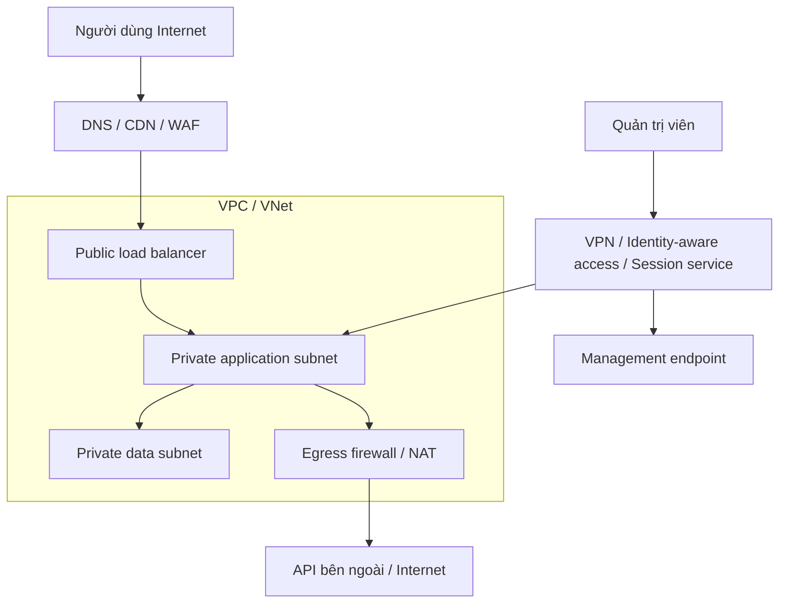
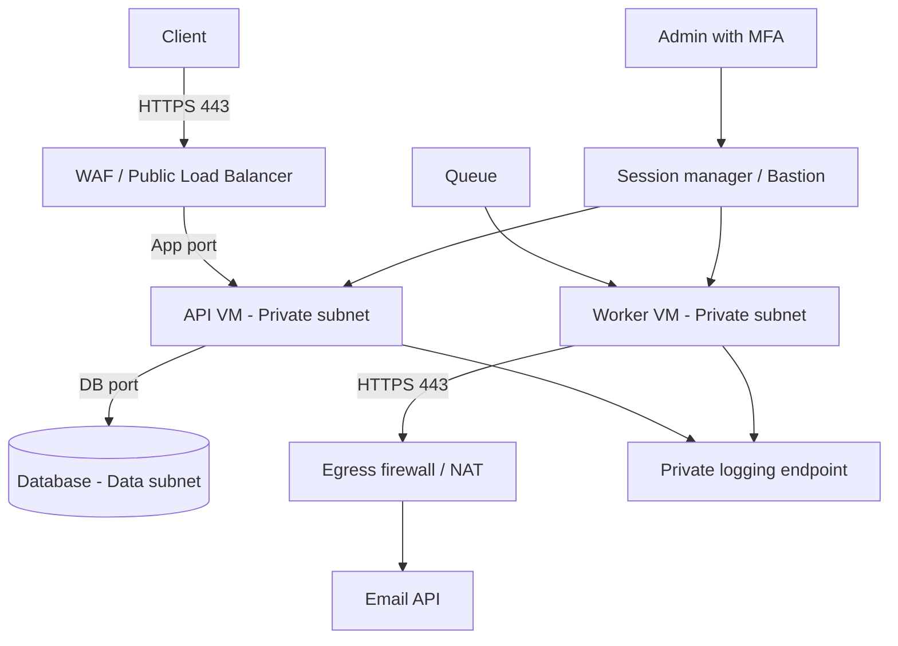

# Thiết kế luồng ingress, egress và truy cập quản trị

Một workload trên cloud cần nhận request từ người dùng, gọi các dịch vụ phụ thuộc và cho phép đội vận hành quản trị máy khi cần. Ba loại luồng này có mục tiêu và mức độ tin cậy khác nhau. Nếu mở rộng mạng quá mức, workload có thể bị truy cập trái phép hoặc dữ liệu bị đưa ra ngoài không kiểm soát. Nếu siết chính sách mà không hiểu đường đi của request, ứng dụng có thể mất kết nối tới database, API bên ngoài hoặc hệ thống giám sát.

Thiết kế mạng cho compute cần xác định rõ **ingress** (lưu lượng đi vào workload), **egress** (lưu lượng đi ra từ workload) và **management access** (truy cập quản trị). Sau đó, kết hợp subnet, route table, security group/firewall, load balancer, NAT, private endpoint và cơ chế truy cập có danh tính. Mục tiêu là chỉ cho phép đúng nguồn, đúng đích, đúng giao thức và đúng người dùng, đồng thời có log để điều tra khi xảy ra sự cố.

## 1. Ba luồng mạng cần thiết kế riêng

### Ingress: lưu lượng đi vào workload

Ingress là lưu lượng từ client, hệ thống upstream hoặc thành phần khác đi tới ứng dụng. Ví dụ: trình duyệt gửi HTTPS tới website, API gateway chuyển request tới service hoặc một hệ thống nội bộ gọi worker qua mạng riêng.

Các câu hỏi cần trả lời:

- Ai được phép kết nối: Internet, mạng doanh nghiệp, dịch vụ nội bộ hay một workload cụ thể?
- Điểm nhận request là load balancer, API gateway, reverse proxy hay trực tiếp VM?
- Giao thức và cổng nào được phép: HTTPS/443, HTTP nội bộ, TCP hoặc UDP?
- TLS kết thúc ở đâu và đoạn nào cần mã hóa tiếp?
- Có cần WAF, rate limiting, DDoS protection hoặc xác thực ở lớp ứng dụng không?

### Egress: lưu lượng đi ra từ workload

Egress là lưu lượng workload khởi tạo tới đích khác. Ví dụ: gọi API bên thứ ba, tải package, gửi log, truy cập object storage, truy vấn database hoặc gọi dịch vụ cloud.

Các câu hỏi cần trả lời:

- Workload cần kết nối tới những dịch vụ nào và qua cổng nào?
- Đích nằm trong cùng VPC/VNet, mạng doanh nghiệp, dịch vụ cloud hay Internet?
- Có thể dùng private endpoint để tránh đi qua Internet không?
- Egress có cần qua NAT gateway, firewall hoặc proxy để kiểm soát tập trung không?
- Có cần allowlist tên miền, IP, service tag hoặc endpoint cụ thể không?
- Dữ liệu nào được phép rời khỏi môi trường và cách ghi nhận lưu lượng ra sao?

### Management access: truy cập quản trị

Management access là luồng dành cho quản trị viên, SRE hoặc công cụ vận hành để truy cập VM, hệ điều hành, agent và dịch vụ quản trị. Ví dụ: SSH/RDP, session manager, remote command, serial console hoặc giao diện quản trị nội bộ.

Luồng quản trị cần kiểm soát bằng danh tính, MFA, quyền tối thiểu, thời hạn truy cập và audit log. Không nên coi quyền truy cập mạng là bằng chứng người dùng được phép quản trị máy.

| Luồng | Nguồn thường gặp | Đích | Kiểm soát chính |
|---|---|---|---|
| Ingress | Người dùng, API client, upstream service | Load balancer hoặc ứng dụng | WAF, TLS, xác thực ứng dụng, security group/firewall |
| Egress | VM, container, function | Database, API, cloud service, Internet | Route, egress firewall, NAT/proxy, private endpoint, DNS |
| Management | Quản trị viên, CI/CD, hệ thống vận hành | Bastion, session service, management interface | IAM/RBAC, MFA, VPN/IAP, session audit, quyền tạm thời |

## 2. Xây dựng vùng mạng và đường đi của traffic

Trong một kiến trúc VPC/VNet phổ biến, workload được đặt trong subnet riêng. Subnet thường được chia theo vùng sẵn sàng và vai trò, ví dụ public subnet cho load balancer/NAT, private application subnet cho VM hoặc node, và data subnet cho database.

Tên “public” hay “private” chủ yếu mô tả khả năng định tuyến và truy cập Internet theo cấu hình của nền tảng. Một subnet không tự trở nên an toàn chỉ vì tên là private. Cần kiểm tra route table, địa chỉ public, security rule, firewall và khả năng truy cập qua peering/VPN.



Sơ đồ mô tả một cách bố trí tham khảo. Trong thực tế, load balancer có thể nằm ở nhiều subnet/AZ, firewall có thể là dịch vụ tập trung, và management session có thể không cần mở đường SSH/RDP trực tiếp tới VM.

### 2.1. Public subnet và private subnet

Public subnet thường có route tới Internet gateway hoặc cơ chế public ingress tương đương. Tài nguyên đặt trong subnet này vẫn cần kiểm soát inbound và outbound. Chỉ nên đặt tài nguyên thực sự cần endpoint công khai, chẳng hạn load balancer hoặc NAT gateway, tùy kiến trúc.

Private subnet không có đường nhận kết nối trực tiếp từ Internet thông qua public IP/Internet gateway theo mô hình thông thường. Workload trong đó có thể đi ra ngoài qua NAT gateway, egress firewall, proxy hoặc private endpoint. Đường quản trị có thể đi qua VPN, bastion, session manager hoặc mạng kết nối riêng.

### 2.2. Route table và next hop

Route table quyết định gói tin được gửi tới đâu dựa trên địa chỉ đích. Một route có thể trỏ tới local network, Internet gateway, NAT gateway, virtual appliance/firewall, VPN gateway, transit hub hoặc private endpoint tùy nền tảng.

Khi kiểm tra kết nối, hãy lần theo cả đường đi và đường về. Route một chiều đúng nhưng route chiều ngược thiếu có thể tạo kết nối timeout. Với kết nối qua firewall stateful, cần xác minh cả chính sách và trạng thái phiên. Với peering hoặc transit network, cần kiểm tra route propagation, CIDR overlap và giới hạn kết nối xuyên vùng.

## 3. Thiết kế ingress an toàn

Một mô hình thường dùng cho ứng dụng web là đưa điểm nhận request ra load balancer hoặc API gateway, còn VM/container chạy trong private subnet. Load balancer chuyển request tới backend theo health check và chính sách routing.

### 3.1. Load balancer lớp 4 và lớp 7

| Loại | Hoạt động | Phù hợp với |
|---|---|---|
| L4 (TCP/UDP) | Chuyển tiếp theo địa chỉ IP, port và giao thức vận chuyển | TCP service, UDP service, lưu lượng cần giữ giao thức đầu cuối |
| L7 (HTTP/HTTPS) | Hiểu HTTP host, path, header và một số thuộc tính ứng dụng | Website, REST API, routing theo hostname/path, TLS termination |

Load balancer cần có health check phù hợp. Health check nên xác minh ứng dụng thực sự sẵn sàng nhận traffic, không chỉ xác nhận process còn chạy. Tránh health endpoint phụ thuộc quá nhiều dịch vụ bên ngoài khiến toàn bộ backend bị đánh dấu unhealthy khi một dependency không thiết yếu tạm thời lỗi.

### 3.2. TLS và bảo vệ request

TLS có thể kết thúc tại CDN, WAF, API gateway hoặc load balancer. Nếu dữ liệu nhạy cảm đi tiếp qua mạng nội bộ, cần cân nhắc mã hóa đoạn load balancer tới backend bằng TLS/mTLS. Quản lý chứng thư gồm cấp phát, gia hạn, xoay vòng, thu hồi và bảo vệ private key.

WAF có thể lọc một số mẫu request độc hại ở lớp HTTP; DDoS protection giúp giảm tác động của lưu lượng tấn công quy mô lớn; rate limiting và quota hạn chế lạm dụng API. Những lớp này bổ sung cho xác thực, phân quyền và kiểm tra đầu vào của ứng dụng.

### 3.3. Chỉ mở cổng cần thiết

Nếu load balancer là điểm vào duy nhất, security rule của backend nên chỉ cho phép traffic từ security group, subnet hoặc danh tính mạng của load balancer trên port ứng dụng. Không cần mở port backend cho toàn Internet.

Ví dụ ma trận ingress cho một API:

| Thành phần | Nguồn được phép | Đích/cổng | Lý do |
|---|---|---|---|
| Public load balancer | Internet hoặc CDN/WAF theo kiến trúc | TCP 443 | Nhận HTTPS từ client |
| Application VM | Security group của load balancer | TCP 8080 | Nhận request đã qua điểm vào |
| Database | Security group của application VM | TCP 5432 | Chỉ API được kết nối PostgreSQL |
| Management endpoint | VPN/IAP/session service được kiểm soát | SSH/RDP hoặc agent channel cần thiết | Truy cập vận hành có xác thực |

Port trong bảng chỉ là ví dụ. Cần thay bằng port thực tế và giới hạn nguồn theo security group, service identity hoặc CIDR chính xác.

## 4. Thiết kế egress và kiểm soát kết nối ra ngoài

Egress mặc định quá rộng khiến máy bị xâm nhập có thể tải payload, gửi dữ liệu ra ngoài hoặc gọi dịch vụ không được phép. Chính sách egress nên bắt đầu từ danh sách dependency thực tế của workload.

### 4.1. NAT gateway

NAT gateway cho phép tài nguyên private subnet khởi tạo kết nối ra ngoài mà không cần public IP trực tiếp cho từng VM. Với mô hình NAT thông thường, kết nối được khởi tạo từ bên trong; NAT không tự tạo khả năng nhận kết nối mới từ Internet vào VM.

NAT gateway không phải firewall ứng dụng. Nó chủ yếu thực hiện dịch địa chỉ và hỗ trợ đường đi ra. Nếu cần lọc đích, kiểm tra giao thức hoặc ghi log chi tiết, hãy kết hợp egress firewall, proxy hoặc dịch vụ kiểm soát phù hợp.

### 4.2. Egress firewall và proxy

Egress firewall có thể kiểm soát nguồn, đích, giao thức, port và một số thuộc tính ứng dụng. Proxy HTTP(S) có thể cung cấp allowlist theo hostname, xác thực workload, log request và chính sách nội dung. Cần hiểu giới hạn của TLS inspection và tuân thủ yêu cầu quyền riêng tư, chứng thư và ứng dụng.

Allowlist theo IP có thể khó duy trì với dịch vụ SaaS có IP thay đổi. Allowlist theo hostname cần kiểm soát DNS, SNI, proxy và khả năng bypass. Không nên chỉ cho phép domain ở tầng ứng dụng nhưng để workload tự do mở kết nối trực tiếp ra Internet qua đường khác.

### 4.3. Private endpoint và service endpoint

Private endpoint cho phép workload truy cập dịch vụ cloud qua địa chỉ riêng trong mạng ảo hoặc kết nối riêng được nền tảng cung cấp. Điều này có thể giảm việc đi qua Internet public và giúp giới hạn đường truy cập dịch vụ.

Private endpoint vẫn cần DNS, route, security rule và chính sách quyền ở dịch vụ đích. Việc có private IP không tự động cấp quyền đọc bucket, database hoặc secret. Cần kết hợp IAM/RBAC, resource policy và network policy.

### 4.4. IPv6 cần chính sách riêng

Một chính sách egress chỉ kiểm tra IPv4 có thể bỏ sót đường IPv6. Nếu subnet hoặc VM có IPv6, hãy xác định route, firewall rule, public reachability và DNS AAAA. Kiểm thử cả IPv4 lẫn IPv6 để tránh tình trạng traffic đi ra ngoài qua giao thức chưa được kiểm soát.

## 5. Truy cập quản trị an toàn

Truy cập quản trị thường có quyền cao: shell trên VM, quyền chạy lệnh, xem log, đọc file cấu hình hoặc truy cập secret. Do đó, cần thiết kế một đường quản trị riêng và có thể kiểm toán.

### 5.1. VPN hoặc mạng riêng

VPN site-to-site kết nối mạng cloud với mạng doanh nghiệp; client VPN cho phép người dùng kết nối từ thiết bị được quản lý. VPN cung cấp đường mạng riêng nhưng không tự quyết định người dùng được phép đăng nhập VM nào. Cần kết hợp IAM, MFA, nhóm quyền và security rule giới hạn nguồn.

### 5.2. Bastion host hoặc jump host

Bastion là máy trung gian được harden để quản trị viên kết nối vào các máy private. Bastion cần được vá thường xuyên, giới hạn nguồn vào, bật MFA/SSO nếu có thể, ghi log phiên và hạn chế lưu credential. Không nên dùng một bastion chung với quyền không giới hạn cho mọi người.

Nếu phải dùng SSH/RDP qua bastion:

- Chỉ mở port quản trị từ dải IP VPN hoặc thiết bị quản trị được phê duyệt.
- Chỉ cho bastion kết nối tới nhóm VM và port cần thiết.
- Dùng SSH certificate hoặc credential ngắn hạn khi nền tảng hỗ trợ.
- Hạn chế agent forwarding, port forwarding và sao chép file nếu không cần.
- Ghi nhận người dùng, thời gian, máy đích và kết quả phiên.
- Có quy trình cập nhật, backup cấu hình và thay thế bastion.

### 5.3. Session manager và identity-aware access

Một số cloud cung cấp dịch vụ quản trị qua agent/control plane, ví dụ AWS Systems Manager Session Manager, Azure Bastion hoặc cơ chế Azure Arc/VM access phù hợp, Google Cloud IAP TCP forwarding và OS Login. Những dịch vụ này có thể giảm nhu cầu public IP hoặc mở inbound SSH/RDP trực tiếp.

Ưu tiên cơ chế dùng danh tính người dùng và workload, MFA, quyền theo tài nguyên và log phiên. Kiểm tra yêu cầu agent, outbound endpoint, IAM permission và cách lưu transcript. Một session manager vẫn cần kiểm soát ai được mở phiên, chạy lệnh và truy cập file.

### 5.4. Quản trị không đồng nghĩa với truy cập ứng dụng

Không nên dùng cùng một rule mạng cho cả người dùng ứng dụng và quản trị viên. Request của khách hàng nên đi qua load balancer/API gateway; truy cập shell nên đi qua management plane. Tách hai đường này giúp giới hạn quyền, dễ audit và tránh để cổng quản trị lộ ra cùng bề mặt Internet của ứng dụng.

## 6. Security group, network ACL và firewall

Cloud thường có nhiều lớp lọc mạng. Cần hiểu trạng thái kết nối và thứ tự áp dụng để tránh rule xung đột.

| Cơ chế | Phạm vi thường gặp | Đặc điểm |
|---|---|---|
| Security group / NIC firewall | Gắn với VM, NIC hoặc workload | Thường stateful: lưu trạng thái kết nối và cho phép traffic phản hồi của phiên đã được chấp nhận |
| Network ACL | Áp dụng ở subnet | Thường stateless: cần rule cho cả chiều đi và chiều về, bao gồm ephemeral ports khi phù hợp |
| Host firewall | Bên trong hệ điều hành | Kiểm soát traffic tới tiến trình/port trên máy, hữu ích như lớp phòng thủ bổ sung |
| Cloud/network firewall | Tại ranh giới mạng hoặc điểm egress/ingress tập trung | Có thể lọc L3/L4/L7, kiểm tra threat, ghi log và áp dụng chính sách tập trung tùy dịch vụ |
| Kubernetes NetworkPolicy | Ở mức Pod/namespace khi CNI hỗ trợ | Kiểm soát luồng giữa Pod và namespace; cần xác minh plugin mạng có thực thi policy |

Security group stateful thường cho phép response traffic của một kết nối đã được cho phép mà không cần rule inbound đối xứng. Network ACL stateless cần rule cho cả hai hướng. Hành vi cụ thể và thứ tự rule phụ thuộc nền tảng; hãy kiểm tra tài liệu và kiểm thử trên môi trường thực tế.

### Nguyên tắc viết rule

- Dùng nguồn/đích cụ thể thay vì `0.0.0.0/0` hoặc `::/0` nếu không cần công khai.
- Chỉ mở protocol và port ứng dụng thực sự sử dụng.
- Dùng tham chiếu security group hoặc service identity khi nền tảng hỗ trợ, thay vì phụ thuộc CIDR thay đổi.
- Gắn mô tả, owner và lý do cho rule.
- Xóa rule hết nhu cầu và định kỳ rà soát rule không còn được sử dụng.
- Tránh tạo rule chồng lấn khiến không rõ chính sách hiệu lực.
- Kiểm tra cả IPv4, IPv6, traffic east-west và đường quản trị.

## 7. DNS, service discovery và phân giải tên

Ứng dụng nên sử dụng DNS hoặc service discovery để tìm dịch vụ thay vì hardcode IP. DNS nội bộ có thể trả về địa chỉ private endpoint hoặc load balancer nội bộ. Khi dùng private DNS zone, cần liên kết zone với đúng VPC/VNet và kiểm tra resolver từ từng subnet.

Các lỗi thường gặp:

- Private DNS zone chưa được liên kết với mạng của workload.
- Split-horizon DNS trả về địa chỉ khác nhau giữa mạng nội bộ và Internet.
- DNS resolver không thể chuyển tiếp truy vấn tới zone của mạng được peering.
- TTL quá dài khiến ứng dụng tiếp tục dùng IP cũ sau khi endpoint thay đổi.
- DNS egress bị chặn hoặc workload không được phép dùng resolver đã cấu hình.

Không nên mở toàn bộ outbound chỉ để giải quyết lỗi DNS. Hãy xác định resolver, giao thức DNS (UDP/TCP 53 hoặc DNS-over-TLS/HTTPS theo thiết kế), route và rule cụ thể.

## 8. Kết nối giữa các workload và mạng doanh nghiệp

Workload có thể cần giao tiếp với VM khác, cluster container, database managed hoặc hệ thống on-premises. Các cơ chế kết nối phổ biến gồm:

- VPC/VNet peering cho kết nối mạng riêng giữa các mạng theo giới hạn của nền tảng.
- Transit gateway, virtual WAN hoặc hub-and-spoke để kết nối nhiều mạng tập trung.
- Site-to-site VPN cho kết nối qua Internet được mã hóa.
- Dedicated private connectivity như Direct Connect hoặc ExpressRoute khi cần kết nối riêng, ổn định và thông lượng cao.
- Private endpoint/service attachment để cung cấp dịch vụ nội bộ mà không mở toàn bộ mạng.

Khi thiết kế, cần kiểm tra CIDR không trùng lặp, route hai chiều, DNS, MTU, throughput, latency, giới hạn số kết nối và khả năng failover. Kết nối riêng không thay thế firewall; vẫn cần kiểm soát nguồn/đích và xác thực ở lớp ứng dụng.

## 9. Phân tách mạng theo môi trường và tầng ứng dụng

Không nên đặt mọi workload trong cùng subnet và dùng một rule chung. Có thể tách theo môi trường và vai trò:

| Vùng | Tài nguyên | Chính sách điển hình |
|---|---|---|
| Edge/public | CDN origin, public load balancer, WAF | Nhận traffic từ Internet hoặc edge network; không chứa dữ liệu nghiệp vụ |
| Application | VM, container node, application service | Chỉ nhận từ load balancer hoặc service được cho phép; egress theo dependency |
| Data | Database, cache, queue endpoint | Chỉ nhận từ application identity/network; hạn chế outbound |
| Management | Bastion, session endpoint, admin tooling | Chỉ truy cập từ VPN/IAP hoặc danh tính vận hành được duyệt |
| Shared services | DNS resolver, logging, monitoring, package mirror | Cung cấp dịch vụ dùng chung qua endpoint và port xác định |

Tách subnet là một lớp tổ chức và định tuyến. Để cô lập hiệu quả, cần kết hợp security group, network ACL, firewall, IAM và NetworkPolicy. Nếu một workload có thể truy cập mọi subnet chỉ vì route tồn tại, việc chia subnet riêng chưa tạo ra ranh giới bảo mật thực chất.

## 10. Ví dụ kiến trúc cho ứng dụng web ba tầng

Giả sử một ứng dụng gồm web/API, database và một worker nền. Người dùng Internet truy cập API; API đọc/ghi database; worker gọi dịch vụ email bên ngoài; quản trị viên cần truy cập VM để xử lý sự cố.

Một chính sách luồng có thể là:

| Nguồn | Đích | Cho phép | Ghi chú |
|---|---|---|---|
| Internet | WAF/public load balancer | HTTPS 443 | Chỉ endpoint công khai |
| WAF/load balancer | API VM | TCP 8080 | Chỉ nguồn từ load balancer |
| API VM | Database | TCP 5432 | Chỉ security group của API |
| Worker VM | Email provider | HTTPS 443 | Qua NAT/firewall/proxy và allowlist nếu khả thi |
| API/worker VM | Logging/monitoring endpoint | HTTPS hoặc port agent cần thiết | Private endpoint hoặc shared service |
| Admin identity | Session manager/bastion | Kênh quản trị được nền tảng hỗ trợ | MFA, quyền ngắn hạn và audit |
| Bastion/session service | VM quản trị | SSH 22 hoặc RDP 3389 nếu dùng | Chỉ từ management path |
| Internet | API VM/database/SSH trực tiếp | Deny | Không công khai backend hoặc cổng quản trị |



Thiết kế này cho phép người dùng chỉ tiếp cận điểm vào công khai. API và worker nằm trong private subnet, database chỉ nhận kết nối từ API, egress của worker đi qua điểm kiểm soát và quản trị viên dùng một management path riêng.

## 11. Logging, giám sát và điều tra luồng mạng

Chính sách mạng cần có telemetry để xác định kết nối nào được phép, bị từ chối và đi qua thành phần nào.

Các nguồn log hữu ích:

- **VPC/VNet flow logs:** metadata về source/destination IP, port, protocol, action và thời gian; khả năng ghi nhận phụ thuộc nền tảng.
- **Firewall logs:** rule được áp dụng, đích kết nối, threat detection và hành động.
- **Load balancer access logs:** client, host/path, status code, backend, latency và TLS metadata theo dịch vụ.
- **WAF/API gateway logs:** request bị chặn, rate limit, rule match và danh tính ứng dụng nếu có.
- **Host logs:** firewall, SSH/RDP, agent, hệ điều hành và tiến trình mở kết nối.
- **DNS logs:** truy vấn tên miền và kết quả phân giải, hữu ích khi điều tra egress bất thường.
- **Identity/session audit:** ai mở phiên quản trị, vào máy nào, lúc nào và thao tác nào được ghi lại.

Nên đồng bộ thời gian giữa VM, firewall, load balancer và hệ thống log. Chuẩn hóa trường correlation ID, workload ID, environment và zone để nối các sự kiện. Cần đặt retention phù hợp và kiểm soát quyền đọc log vì log có thể chứa địa chỉ nội bộ hoặc dữ liệu nhạy cảm.

### Chỉ số và cảnh báo

- Tỷ lệ request bị từ chối ở WAF/load balancer tăng bất thường.
- Kết nối egress tới IP/hostname chưa được phê duyệt.
- Số lần SSH/RDP thất bại hoặc mở session ngoài khung vận hành.
- Lưu lượng outbound tăng đột biến hoặc truyền dữ liệu lớn bất thường.
- Backend health check fail hoặc latency giữa các tầng tăng.
- DNS query tới domain mới/hiếm gặp hoặc resolver lỗi.
- Rule firewall bị thay đổi ngoài pipeline được phê duyệt.

## 12. Kiểm thử đường mạng trước khi phát hành

Trước khi đưa workload vào production, hãy kiểm tra cả luồng hợp lệ và luồng cần bị chặn.

1. Từ Internet, xác minh chỉ endpoint công khai cần thiết phản hồi.
2. Từ Internet, thử kết nối trực tiếp tới private VM, database và port quản trị; các kết nối này phải bị chặn.
3. Từ load balancer, xác minh có thể kết nối backend trên port ứng dụng.
4. Từ API, xác minh chỉ database và dependency cần thiết có thể truy cập.
5. Từ worker, xác minh egress tới dịch vụ được phê duyệt hoạt động và đích không được phép bị chặn.
6. Kiểm tra DNS private/public và phân giải tên từ từng subnet.
7. Kiểm tra IPv4 và IPv6 nếu cả hai được bật.
8. Mở một phiên quản trị bằng danh tính được cấp quyền; xác minh người không có quyền không mở được phiên.
9. Kiểm tra log ở firewall, flow log, load balancer và audit session.
10. Mô phỏng thay đổi route hoặc firewall trong môi trường kiểm thử để xác minh cảnh báo và quy trình rollback.

Các công cụ như `curl`, `nc`, `traceroute`/`tracepath`, `dig` và `ss` có thể giúp kiểm tra từ guest OS. Kết quả của một lệnh kết nối thành công không chứng minh toàn bộ chính sách an toàn; cần kiểm tra cả control plane và log của các lớp mạng.

Ví dụ lệnh kiểm tra cơ bản trên Linux:

```bash
# Kiểm tra phân giải DNS
dig api.internal.example

# Kiểm tra HTTPS tới endpoint được phép
curl -I --connect-timeout 3 https://api.example.com/health

# Kiểm tra TCP port cụ thể
nc -vz database.internal.example 5432

# Xem route được chọn tới một đích
ip route get 10.20.30.40

# Xem socket đang lắng nghe
ss -lntup
```

Chỉ chạy kiểm tra trên hệ thống mà bạn được phép quản trị. Dùng endpoint và port thực tế của môi trường; không quét dải mạng ngoài phạm vi được phê duyệt.

## 13. Các lỗi thiết kế thường gặp

**Đặt VM ứng dụng trực tiếp trong public subnet và mở nhiều port.** Bề mặt tấn công tăng và khó kiểm soát nguồn truy cập. Hãy đặt backend trong private subnet và nhận traffic qua load balancer hoặc gateway.

**Cho phép egress toàn bộ Internet.** Máy bị xâm nhập có thể gọi nhiều đích tùy ý. Hãy lập inventory dependency, dùng NAT kết hợp firewall/proxy và private endpoint khi phù hợp.

**Dùng NAT gateway như firewall.** NAT không thay thế lọc ứng dụng hoặc allowlist đích. Cần thêm firewall/proxy nếu yêu cầu kiểm soát egress.

**Mở SSH/RDP từ mọi địa chỉ.** Cổng quản trị công khai dễ bị dò quét và tấn công credential. Dùng VPN, bastion hoặc session manager với MFA và audit.

**Chỉ tạo private subnet mà không kiểm soát east-west.** Workload có thể vẫn kết nối ngang tới nhiều dịch vụ. Dùng security group, firewall và NetworkPolicy theo dependency.

**Quên rule chiều về ở ACL stateless.** Kết nối có thể timeout dù rule outbound đã mở. Kiểm tra ephemeral port và cả hai chiều.

**Bỏ qua IPv6 hoặc DNS.** Traffic có thể đi qua đường chưa được kiểm soát hoặc phân giải sai endpoint. Kiểm tra route, firewall và DNS cho cả giao thức đang bật.

**Coi VPN hoặc private endpoint là quyền truy cập.** Đường mạng riêng không thay thế IAM và xác thực ứng dụng. Luôn kiểm tra danh tính và quyền ở lớp dịch vụ.

**Không lưu log hoặc không đồng bộ thời gian.** Sự cố mạng khó truy vết. Bật flow/firewall/LB/session logs và chuẩn hóa timestamp, correlation ID.

## 14. Checklist thiết kế ingress, egress và quản trị

- [ ] Đã lập sơ đồ nguồn, đích, giao thức, port và mục đích cho từng luồng.
- [ ] Public ingress đi qua load balancer, gateway hoặc edge control phù hợp.
- [ ] Backend và data tier không có public access ngoài yêu cầu đã phê duyệt.
- [ ] TLS được cấu hình đúng và chứng thư có quy trình gia hạn/thu hồi.
- [ ] Security group, ACL và host firewall chỉ mở port cần thiết.
- [ ] Egress được giới hạn theo dependency, dùng NAT/firewall/proxy hoặc private endpoint phù hợp.
- [ ] Đã đánh giá cả IPv4 và IPv6 nếu được bật.
- [ ] DNS private zone, resolver và route hoạt động từ đúng subnet.
- [ ] Truy cập quản trị dùng IAM/RBAC, MFA và quyền ngắn hạn.
- [ ] SSH/RDP không mở trực tiếp ra Internet; bastion/session manager được harden và audit.
- [ ] Container/Pod có NetworkPolicy nếu CNI hỗ trợ và workload cần cô lập.
- [ ] Đã bật flow logs, firewall logs, load balancer logs và audit session.
- [ ] Đã kiểm thử luồng được phép và luồng phải bị chặn.
- [ ] Có owner, mô tả, review định kỳ và quy trình gỡ bỏ rule cũ.
- [ ] Có phương án rollback khi thay route, firewall hoặc cấu hình DNS.

## 15. Kết luận

Thiết kế mạng cho workload cần tách rõ ingress, egress và management access. Ingress nên đi qua điểm vào được bảo vệ như load balancer, API gateway hoặc WAF; egress cần được giới hạn theo dependency và ưu tiên private endpoint khi phù hợp; truy cập quản trị nên dựa trên danh tính, MFA, quyền tối thiểu và phiên làm việc có audit.

Subnet và route table xác định đường đi, còn security group, network ACL, host firewall, cloud firewall và NetworkPolicy quyết định luồng nào được phép. Kết hợp các lớp này với DNS đúng, logging đầy đủ và kiểm thử cả kết nối hợp lệ lẫn kết nối bị cấm giúp workload vận hành ổn định, giảm bề mặt tấn công và dễ điều tra khi có sự cố.
