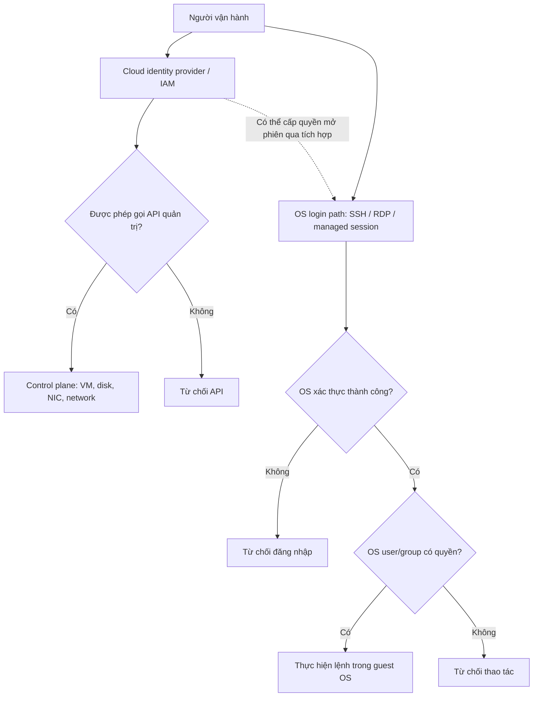
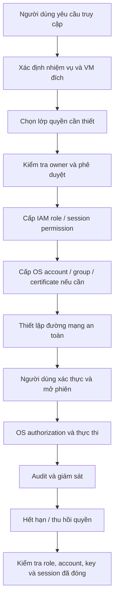

# Phân biệt quyền quản trị tài nguyên với quyền đăng nhập hệ điều hành

Một máy ảo trên cloud có ít nhất hai lớp truy cập cần được quản lý riêng. Lớp thứ nhất quyết định ai được tạo, xem, thay đổi hoặc xóa tài nguyên cloud như VM, đĩa, NIC và security group. Lớp thứ hai quyết định ai được đăng nhập vào hệ điều hành khách để chạy lệnh, đọc tệp, cài phần mềm hoặc thay đổi cấu hình bên trong máy.

Hai lớp này có thể được tích hợp trong một số dịch vụ, nhưng chúng không tự động đồng nhất. Một người có quyền khởi động hoặc xóa VM qua API chưa chắc có tài khoản SSH/RDP trong hệ điều hành. Ngược lại, người có quyền đăng nhập Linux với sudo có thể kiểm soát hệ điều hành và dữ liệu trên máy nhưng không nhất thiết được phép thay đổi cấu hình mạng hoặc xóa tài nguyên cloud.

Phân biệt rõ hai loại quyền giúp áp dụng nguyên tắc đặc quyền tối thiểu, tách nhiệm vụ giữa đội cloud và đội hệ điều hành, giới hạn phạm vi ảnh hưởng khi tài khoản bị lộ và điều tra được ai đã thực hiện hành động ở lớp nào.

Sau bài học, bạn có thể:

- Phân biệt control-plane IAM với tài khoản và quyền đăng nhập trong guest operating system.
- Giải thích authentication và authorization ở từng lớp.
- Thiết kế quyền quản trị VM và quyền OS theo vai trò, nhiệm vụ và thời hạn.
- Nhận diện trường hợp IAM được tích hợp để cấp quyền SSH/RDP và các giới hạn của tích hợp đó.
- Thiết lập quy trình truy cập quản trị có kiểm soát, audit và thu hồi quyền.

## 1. Hai lớp truy cập của một máy ảo

### Quyền quản trị tài nguyên cloud (control plane)

Control plane là lớp API và dịch vụ quản lý tài nguyên của nhà cung cấp. Người dùng có thể thao tác qua portal, CLI, SDK, API hoặc công cụ Infrastructure as Code (IaC). Danh tính thường là người dùng, nhóm, service principal, workload identity hoặc service account được quản lý bởi hệ thống IAM của cloud.

Quyền ở lớp này có thể bao gồm:

- Xem danh sách VM và trạng thái tài nguyên.
- Tạo, khởi động, dừng, restart, resize hoặc xóa VM.
- Tạo và gắn disk, NIC, public IP hoặc security group.
- Thay đổi subnet, route, firewall rule và cấu hình load balancer.
- Tạo snapshot, image hoặc backup policy.
- Gán role, service account hoặc identity cho VM.
- Truy vấn log quản trị, metric và thông tin billing.

IAM quyết định một principal được thực hiện hành động nào trên loại tài nguyên nào, trong phạm vi nào và theo điều kiện gì. Ví dụ, một kỹ sư có thể được phép restart VM trong dự án staging nhưng không được xóa VM production hoặc thay đổi IAM policy.

### Quyền đăng nhập hệ điều hành khách (guest OS)

Guest OS là hệ điều hành chạy bên trong VM, chẳng hạn Linux hoặc Windows Server. Quyền truy cập được thực thi bởi cơ chế xác thực và phân quyền của hệ điều hành, thư mục người dùng hoặc dịch vụ truy cập từ xa.

Ví dụ quyền ở lớp OS:

- Đăng nhập Linux bằng SSH, console hoặc công cụ quản trị từ xa.
- Đăng nhập Windows bằng RDP, console hoặc giải pháp remote management.
- Đọc, sửa hoặc xóa tệp trong filesystem.
- Cài package, cập nhật bản vá và quản lý service.
- Xem log hệ điều hành và tiến trình.
- Thêm hoặc khóa tài khoản người dùng, thay đổi nhóm và quyền file.
- Dùng `sudo`, `su`, nhóm Administrators hoặc cơ chế elevation để thực hiện thao tác đặc quyền.

OS có thể xác thực bằng tài khoản cục bộ, tài khoản domain/Active Directory, LDAP, certificate, SSH public key, Kerberos hoặc một cơ chế tích hợp với danh tính cloud. Quyền cuối cùng vẫn được áp dụng bên trong hệ điều hành, ví dụ qua user/group, ACL, sudoers hoặc Windows security policy.

## 2. So sánh IAM cloud và quyền OS

| Tiêu chí | Quyền quản trị tài nguyên cloud | Quyền đăng nhập hệ điều hành |
|---|---|---|
| Phạm vi | Tài nguyên và API của nhà cung cấp | Máy cụ thể và tài nguyên bên trong guest OS |
| Danh tính | Cloud IAM user/group/role, service principal, workload identity | OS user/group, domain account, SSH key, certificate hoặc identity tích hợp |
| Điểm thực thi | Control plane của cloud | SSH/RDP, console, PAM, OS authentication và authorization |
| Hành động | Create/start/stop/delete VM, attach disk, sửa NIC/firewall, gán role | Chạy lệnh, sửa file, cài phần mềm, quản lý process, thay đổi cấu hình OS |
| Ví dụ quyền cao | VM administrator hoặc project owner | root trên Linux hoặc local/domain Administrator trên Windows |
| Phạm vi audit | Audit log của API và thao tác quản trị cloud | Linux auth log, sudo log, Windows Security Event Log và log công cụ truy cập |
| Thu hồi quyền | Gỡ role/policy hoặc vô hiệu hóa principal ở IAM | Khóa account/key/certificate, gỡ group membership hoặc thu hồi quyền trong OS/PAM |
| Rủi ro điển hình | Xóa tài nguyên, mở public access, cấp quyền quá rộng | Đọc dữ liệu, cài mã độc, lấy credential trên máy, thay đổi hệ điều hành |

Hai lớp có thể kết nối với nhau nhưng cần xác định chính xác luồng tích hợp. Ví dụ, cloud IAM có thể cho phép một người dùng gọi dịch vụ OS Login hoặc Instance Connect để tạo phiên SSH; sau đó hệ điều hành vẫn áp dụng user/group và quyền lệnh tương ứng. Việc được phép mở phiên không tự động đồng nghĩa với quyền root.

## 3. Authentication và authorization

Hai khái niệm này xuất hiện ở cả control plane và guest OS:

- **Authentication (xác thực):** xác minh danh tính đang yêu cầu truy cập. Ví dụ, cloud IAM xác minh người dùng qua SSO/MFA; SSH xác minh private key; Windows domain xác minh thông tin đăng nhập Kerberos.
- **Authorization (phân quyền):** quyết định danh tính đã xác thực được phép làm gì. Ví dụ, IAM policy cho phép restart VM; Linux sudoers cho phép chạy `systemctl restart nginx`; Windows group policy cho phép một nhóm quản trị dịch vụ.

Một phiên truy cập có thể xác thực thành công nhưng vẫn bị từ chối khi không có quyền phù hợp. Ví dụ, người dùng đăng nhập được vào portal cloud nhưng không có quyền `compute.instances.delete`; hoặc SSH xác thực đúng key nhưng tài khoản không được phép đọc `/etc/shadow`.



Sơ đồ thể hiện hai quyết định phân quyền độc lập. Nếu có tích hợp IAM-to-OS, IAM có thể kiểm soát ai được bắt đầu phiên, còn OS vẫn kiểm soát quyền bên trong phiên.

## 4. Ví dụ: quyền cloud không đồng nghĩa quyền SSH

Giả sử một tổ chức có ba vai trò:

| Vai trò | Quyền cloud | Quyền OS |
|---|---|---|
| Cloud operator | Xem VM, start/stop/restart trong phạm vi dự án; không sửa IAM hoặc xóa production | Không có SSH/RDP mặc định |
| OS administrator | Có thể xem metadata và yêu cầu phiên truy cập theo quy trình; không tạo hoặc xóa VM | Được đăng nhập vào máy được giao; có quyền sudo/Windows admin theo phạm vi |
| Application developer | Xem trạng thái môi trường dev và log ứng dụng; không thay đổi network hoặc IAM | Truy cập tài khoản ứng dụng hoặc shell giới hạn trong dev; không có root mặc định |

Cloud operator có thể restart VM mà không cần biết mật khẩu root. OS administrator có thể vá kernel hoặc sửa cấu hình service mà không có quyền xóa đĩa trên cloud. Developer có thể xem log ứng dụng nhưng không đọc file chứa credential hệ thống.

Sự tách biệt này giảm rủi ro từ một tài khoản bị chiếm quyền. Nếu một developer chỉ có quyền đọc log ứng dụng, tài khoản đó không nên đồng thời có quyền xóa VM, gán IAM role hoặc đăng nhập root vào production.

## 5. Các đường truy cập OS phổ biến

### SSH trên Linux

SSH thường xác thực người dùng bằng public key, certificate, password hoặc tích hợp danh tính. Với key-based authentication, máy chủ lưu public key được phép trong cấu hình tài khoản; người dùng giữ private key. Private key không nên được chép vào image hoặc chia sẻ giữa nhiều người.

Quyền sau khi SSH thành công phụ thuộc vào user/group, quyền file, cấu hình SSH daemon và chính sách sudo. Ví dụ, tài khoản `appops` có thể được phép xem log và restart một service cụ thể mà không có quyền shell root toàn diện.

Các kiểm tra quản trị Linux thường gặp:

```bash
# Xem user hiện tại
whoami

# Xem nhóm của user
id

# Kiểm tra quyền sudo được cấp
sudo -l

# Kiểm tra trạng thái SSH daemon
sudo systemctl status sshd
```

Tên service SSH có thể là `ssh` hoặc `sshd` tùy bản phân phối. Không đưa private key hoặc mật khẩu vào command line, script, ticket hay log.

### RDP trên Windows

RDP cung cấp phiên đăng nhập từ xa vào Windows. Người dùng có thể xác thực bằng tài khoản cục bộ hoặc domain; quyền tương ứng phụ thuộc nhóm Remote Desktop Users, Administrators, Group Policy và chính sách truy cập từ xa.

Được phép kết nối RDP không đồng nghĩa có quyền quản trị Windows. Một tài khoản có thể đăng nhập để chạy ứng dụng hoặc xem log nhưng không được cài driver, thay đổi firewall hay quản lý tài khoản khác.

Các nguyên tắc thường dùng:

- Hạn chế nguồn mạng được phép truy cập cổng RDP.
- Ưu tiên VPN, bastion hoặc giải pháp managed session thay vì mở RDP trực tiếp ra Internet.
- Dùng MFA và kiểm soát thiết bị/phiên nếu nền tảng hỗ trợ.
- Ghi nhận đăng nhập thành công/thất bại và hành động elevation.
- Tránh dùng tài khoản Administrator chung cho nhiều người.

### Managed session và console của nhà cung cấp

Một số nền tảng cung cấp dịch vụ quản trị phiên mà không cần mở SSH/RDP công khai. Người dùng xác thực với cloud IAM, dịch vụ tạo phiên kết nối đến agent trên VM qua kênh được quản lý. Một số dịch vụ hỗ trợ terminal, port forwarding hoặc remote desktop.

Đây vẫn là một luồng truy cập OS. Cần kiểm tra:

- Principal nào được phép bắt đầu phiên và trên VM nào.
- Agent cần chạy và có quyền gì.
- Session có được ghi log hoặc ghi hình không.
- Lệnh trong phiên được thực thi dưới user nào.
- Có yêu cầu phê duyệt, thời hạn hoặc MFA không.
- Khi IAM role bị thu hồi, phiên đang mở có bị kết thúc ngay hay không.

Console serial hoặc console recovery có thể hoạt động ở mức thấp hơn SSH/RDP và có thể cho quyền rất mạnh. Quyền truy cập console cần được giới hạn chặt chẽ và audit riêng.

## 6. Tích hợp IAM với đăng nhập hệ điều hành

Một số dịch vụ cloud hỗ trợ đăng nhập VM bằng danh tính quản lý tập trung. Ví dụ về mô hình tích hợp:

- IAM kiểm tra người dùng có quyền mở phiên đến một VM cụ thể.
- Dịch vụ cấp certificate hoặc thông tin xác thực ngắn hạn.
- Agent hoặc thành phần OS nhận yêu cầu và ánh xạ danh tính vào tài khoản OS.
- OS áp dụng group, sudo policy hoặc quyền đăng nhập tương ứng.
- Phiên được ghi audit theo người dùng và tài nguyên đích.

Tích hợp giúp giảm việc quản lý SSH key hoặc password cục bộ, nhưng không loại bỏ trách nhiệm quản lý quyền bên trong OS. Nếu một role cloud cho phép mở phiên dưới tài khoản quản trị, nó có thể tương đương quyền truy cập rất mạnh dù không có private key cố định.

### Ví dụ theo nền tảng

Tên dịch vụ và tính năng thay đổi theo phiên bản, region và cấu hình tài khoản. Các ví dụ sau minh họa mô hình, không phải khẳng định mọi tài khoản đều bật sẵn:

| Nền tảng | Ví dụ tích hợp | Lớp IAM kiểm soát | Lớp OS tiếp tục kiểm soát |
|---|---|---|---|
| AWS | Systems Manager Session Manager hoặc EC2 Instance Connect | Quyền gọi API/session và phạm vi instance | User, shell, sudo, file permission và cấu hình agent |
| Microsoft Azure | Azure Bastion hoặc VM login qua Microsoft Entra ID trong cấu hình được hỗ trợ | Quyền Azure resource và quyền bắt đầu phiên | Linux user/group hoặc Windows logon right và privilege |
| Google Cloud | OS Login và IAP TCP forwarding trong cấu hình phù hợp | IAM role cho OS Login/IAP và phạm vi project/instance | Linux account, nhóm POSIX và quyền sudo được cấu hình |

Không nên chỉ nhìn tên role để suy đoán quyền thực tế. Hãy đọc policy, điều kiện, phạm vi tài nguyên và mapping sang OS user/group. Một role tên “VM Viewer” có thể chỉ đọc metadata; một role “OS Admin Login” có thể cho phép đăng nhập với quyền rất cao.

## 7. Áp dụng nguyên tắc đặc quyền tối thiểu

Nguyên tắc đặc quyền tối thiểu (least privilege) yêu cầu mỗi danh tính chỉ có quyền cần thiết để hoàn thành nhiệm vụ, trong phạm vi và thời gian phù hợp.

### Ở lớp cloud IAM

- Cấp quyền theo project, subscription, account, resource group hoặc tag phù hợp.
- Tách quyền xem, vận hành, thay đổi cấu hình, xóa tài nguyên và quản trị IAM.
- Hạn chế quyền `Owner`, `Administrator` hoặc quyền wildcard trên toàn tài khoản.
- Dùng role cho workload thay vì access key dài hạn nhúng trong VM.
- Yêu cầu MFA hoặc phê duyệt cho hành động nhạy cảm.
- Dùng policy condition theo môi trường, thời gian, mạng nguồn hoặc tag khi nền tảng hỗ trợ.

### Ở lớp hệ điều hành

- Mỗi người có tài khoản riêng; tránh tài khoản dùng chung.
- Tắt hoặc khóa tài khoản mặc định không cần thiết.
- SSH key/certificate riêng theo người hoặc workload; có thời hạn và quy trình thu hồi.
- Dùng sudoers hoặc Windows group để cấp quyền elevation theo tác vụ.
- Không cấp root/Administrator liên tục nếu chỉ cần quyền đọc log hoặc restart một service.
- Hạn chế truy cập file cấu hình, secret, private key và dữ liệu không liên quan.
- Thu hồi account, key, certificate và group membership khi người dùng đổi vai trò hoặc rời tổ chức.

### Truy cập đặc quyền theo thời gian (JIT)

Just-in-Time access cấp quyền quản trị trong khoảng thời gian ngắn khi có yêu cầu hợp lệ. Ví dụ, kỹ sư gửi yêu cầu truy cập production trong 30 phút, nêu ticket và mục đích; người có thẩm quyền phê duyệt; hệ thống cấp role hoặc session tạm thời; sau thời hạn, quyền tự hết hiệu lực.

JIT giảm quyền tồn tại thường trực nhưng cần có quy trình xử lý khi phiên kéo dài, sự cố khẩn cấp và quyền bị cấp nhầm. Cần ghi nhận người yêu cầu, người phê duyệt, VM đích, thời gian, lệnh hoặc hoạt động quan trọng và kết quả thu hồi.

## 8. Tách nhiệm vụ giữa đội cloud và đội OS

Separation of duties (tách nhiệm vụ) giúp tránh một cá nhân có toàn bộ quyền tạo hạ tầng, thay đổi bảo mật và thao tác dữ liệu production mà không có kiểm soát độc lập.

Ví dụ ma trận trách nhiệm:

| Nhiệm vụ | Cloud platform team | OS/platform operations | Application team | Security team |
|---|---|---|---|---|
| Tạo VM, subnet, disk | Thực hiện theo IaC và policy | Cung cấp yêu cầu hệ điều hành | Cung cấp yêu cầu workload | Rà soát policy quan trọng |
| Quản lý IAM cloud | Quản lý role và policy nền | Yêu cầu quyền theo nhiệm vụ | Yêu cầu workload identity | Phê duyệt hoặc kiểm tra quyền nhạy cảm |
| Quản lý tài khoản OS | Cung cấp tích hợp danh tính nếu có | Quản lý user/group và baseline | Quản lý tài khoản ứng dụng trong phạm vi | Đặt tiêu chuẩn và audit |
| Vá hệ điều hành | Cung cấp image và hạ tầng | Lập lịch, triển khai và xác minh | Kiểm thử tương thích | Theo dõi rủi ro và ngoại lệ |
| Đăng nhập production | Quản lý đường truy cập và IAM | Truy cập theo JIT/ticket | Chỉ khi có nhu cầu và được duyệt | Theo dõi, điều tra và kiểm tra audit |
| Thu hồi quyền | Gỡ role cloud | Khóa OS account/key/group | Thu hồi quyền ứng dụng | Xác minh hoàn tất theo chính sách |

Ranh giới cụ thể tùy mô hình vận hành. Điều quan trọng là mỗi nhiệm vụ có owner rõ ràng và có bằng chứng cho việc cấp, sử dụng và thu hồi quyền.

## 9. Kiểm soát đường mạng không đồng nghĩa với phân quyền

Security group hoặc firewall quyết định nguồn mạng nào có thể kết nối đến cổng SSH/RDP. Chúng không xác minh người đăng nhập có quyền làm gì bên trong máy.

Ví dụ, chỉ cho phép TCP/22 từ subnet quản trị giúp giới hạn nơi có thể mở kết nối SSH. Nhưng nếu private key dùng chung bị lộ, mọi người giữ key đó trong subnet được phép có thể đăng nhập. Cần kết hợp network control với xác thực cá nhân và phân quyền OS.

Tương tự, VPN hoặc bastion chỉ tạo đường truy cập được kiểm soát. Người dùng vẫn cần danh tính riêng, quyền OS phù hợp và audit. Không nên xem việc ẩn VM sau private subnet là đủ để bảo vệ tài khoản quản trị.

## 10. Audit và điều tra theo từng lớp

Để biết ai đã làm gì, cần thu thập log ở cả control plane và guest OS.

### Audit control plane

Ghi nhận các sự kiện như:

- Ai tạo, start, stop, restart, resize hoặc xóa VM.
- Ai gắn/detach disk, đổi NIC, IP, route hoặc security group.
- Ai gán role, thay policy hoặc tạo credential.
- Ai tạo session truy cập OS hoặc mở console, nếu dịch vụ có ghi nhận.
- API nào được gọi, thời điểm, principal, resource ID và kết quả.

### Audit guest OS

Ghi nhận:

- Đăng nhập thành công/thất bại, logout và session source.
- Sử dụng sudo hoặc elevation trên Windows.
- Thay đổi tài khoản, nhóm, SSH key, certificate và quyền file.
- Cài package, thay service, sửa firewall hoặc cấu hình bảo mật.
- Truy cập và thay đổi dữ liệu quan trọng theo yêu cầu kiểm toán.

Ví dụ, trên Linux có thể xem log xác thực qua journal hoặc tệp auth log tùy bản phân phối; lệnh sudo nên được ghi lại theo cấu hình. Trên Windows, Security Event Log có thể ghi các sự kiện logon, account management và privilege use tùy audit policy.

### Liên kết sự kiện

Để điều tra một thay đổi, đối chiếu principal cloud, VM resource ID, OS username, session ID, thời gian và ticket. Đồng bộ thời gian hệ thống bằng dịch vụ thời gian đáng tin cậy. Không ghi private key, password, token hoặc nội dung bí mật vào log.

## 11. Quy trình cấp quyền truy cập máy



Một quy trình thực tế có thể gồm:

1. **Nêu mục đích:** người dùng ghi nhiệm vụ, VM hoặc nhóm máy cần truy cập, môi trường, thời gian và ticket liên quan.
2. **Chọn loại quyền:** chỉ xem metadata, start/stop VM, đăng nhập OS, chạy lệnh đặc quyền hay truy cập dữ liệu.
3. **Xác nhận owner:** chủ sở hữu hệ thống kiểm tra nhu cầu và ảnh hưởng.
4. **Cấp quyền cloud:** gán role tối thiểu trong phạm vi resource/project cần thiết.
5. **Cấp quyền OS:** tạo hoặc ánh xạ account, group, SSH certificate hoặc RDP access phù hợp.
6. **Thiết lập kết nối:** dùng VPN, bastion, managed session hoặc private network; giới hạn nguồn và cổng.
7. **Theo dõi phiên:** ghi log xác thực, lệnh đặc quyền và thao tác quản trị quan trọng.
8. **Thu hồi:** đóng session, hết hạn JIT, gỡ role, khóa account hoặc thu hồi key/certificate.
9. **Xác minh:** kiểm tra không còn quyền dư và lưu bằng chứng hoàn tất.

## 12. Ví dụ cấu hình quyền theo vai trò

### Ma trận quyền minh họa

Giả sử môi trường có hai VM production: một API và một database. Các quyền được chia như sau:

```yaml
roles:
  cloud_operator:
    cloud_actions:
      - vm.read
      - vm.start
      - vm.stop
      - vm.restart
    os_access: none_by_default

  os_operator:
    cloud_actions:
      - vm.read
      - session.start
    os_access:
      linux: named_user_with_limited_sudo
      windows: approved_remote_desktop_group

  application_developer:
    cloud_actions:
      - application_logs.read
      - vm.metadata.read
    os_access:
      environment: development
      privilege: no_root_or_local_admin

  security_auditor:
    cloud_actions:
      - audit_logs.read
      - iam_policy.read
    os_access: approved_read_only_audit_path
```

Đây là mô hình khái niệm, không phải policy syntax của nhà cung cấp. Tên action và quyền thực tế phải được ánh xạ sang IAM service tương ứng. Không cấp `vm.delete`, `iam.policy.write` hoặc OS root chỉ vì một vai trò cần restart service.

### Ví dụ Linux sudoers

Một tài khoản vận hành có thể được phép restart một service cụ thể mà không có toàn quyền root:

```sudoers
# Ví dụ minh họa; xác minh đường dẫn lệnh và chính sách trước khi dùng
%app-ops ALL=(root) /usr/bin/systemctl restart order-api
%app-ops ALL=(root) /usr/bin/systemctl status order-api
```

Quy tắc sudoers cần kiểm tra kỹ đường dẫn lệnh, đối số và khả năng lệnh gọi chương trình khác. Cấp quyền chạy một binary với quyền root vẫn có thể mở rộng thành quyền root nếu binary hỗ trợ shell hoặc ghi tệp tùy ý.

### Ví dụ Windows

Một nhóm hỗ trợ ứng dụng có thể được cấp quyền đăng nhập từ xa và quyền quản lý service được giới hạn bằng Group Policy, service ACL hoặc giải pháp quản trị endpoint. Không nên thêm toàn bộ nhóm vào Local Administrators nếu chỉ cần xem log và restart một service.

## 13. Thu hồi và rà soát quyền

Quyền truy cập phải được rà soát khi người dùng đổi nhóm, chuyển dự án, rời tổ chức, khi VM được thay thế hoặc khi một credential bị nghi ngờ lộ.

Checklist thu hồi:

- Gỡ IAM role, group membership và policy binding không còn cần.
- Thu hồi session permission, JIT grant và phiên đang mở nếu có thể.
- Khóa OS account hoặc gỡ user khỏi nhóm được phép đăng nhập.
- Thu hồi SSH certificate/key, RDP credential, token và certificate liên quan.
- Xoay vòng secrets nếu chúng có thể đã được truy cập từ máy.
- Kiểm tra automation hoặc pipeline không tự cấp lại quyền cũ.
- Rà soát audit log cho hoạt động bất thường trong thời gian quyền còn hiệu lực.
- Lưu bằng chứng người phê duyệt, thời điểm và kết quả thu hồi.

Rà soát định kỳ cần tìm các quyền lâu ngày không sử dụng, role quá rộng, tài khoản không có owner, key không có ngày hết hạn và tài khoản dịch vụ được cấp quyền tương tác không cần thiết.

## 14. Những sai lầm thường gặp

**Cho rằng có quyền quản trị VM là tự động SSH được.** IAM quản lý tài nguyên cloud; OS vẫn cần cơ chế đăng nhập và quyền phù hợp, trừ khi có tích hợp cụ thể được cấu hình.

**Cho rằng có SSH root là có quyền xóa VM.** Quyền root nằm trong guest OS. Xóa VM là hành động control plane và cần quyền cloud API riêng.

**Dùng một tài khoản OS chung cho cả đội.** Khó xác định ai thực hiện lệnh và thu hồi quyền của một cá nhân. Dùng danh tính riêng và audit theo người dùng.

**Cấp quyền Owner để giải quyết lỗi đăng nhập.** Lỗi SSH/RDP có thể do OS account, key, firewall hoặc agent. Cấp quyền cloud rộng không sửa được nguyên nhân bên trong OS và làm tăng rủi ro.

**Mở cổng SSH/RDP ra toàn Internet.** Firewall chỉ là một lớp kiểm soát. Dùng private path, bastion hoặc managed session và xác thực mạnh.

**Coi managed session là không cần quản lý OS.** Người dùng vẫn có thể thực hiện lệnh bên trong guest. Cần phân quyền user, sudo, group và ghi audit.

**Quên thu hồi quyền ở một lớp.** Gỡ IAM role nhưng để lại local account hoặc SSH key vẫn có thể cho phép truy cập qua đường khác. Quy trình offboarding phải kiểm tra cả hai lớp.

## 15. Checklist thiết kế quyền truy cập máy

- [ ] Đã phân loại hành động thuộc control plane hay guest OS.
- [ ] Mỗi người và workload dùng danh tính riêng, có owner.
- [ ] IAM role chỉ cho phép hành động và phạm vi tài nguyên cần thiết.
- [ ] Quyền xóa VM, thay network và sửa IAM được tách khỏi quyền vận hành thường ngày.
- [ ] OS account/group được quản lý tập trung hoặc có quy trình vòng đời rõ.
- [ ] SSH key/certificate riêng, có rotation và thu hồi; không dùng private key chung.
- [ ] RDP/SSH không mở công khai ngoài nhu cầu; đường truy cập được giới hạn.
- [ ] Quyền root/Administrator được cấp theo JIT hoặc tác vụ cụ thể khi có thể.
- [ ] Tích hợp IAM-to-OS được kiểm tra cả quyền mở phiên lẫn quyền bên trong phiên.
- [ ] Audit log control plane và OS được bật, đồng bộ thời gian và bảo vệ.
- [ ] Quy trình offboarding thu hồi role, account, key, certificate và session ở cả hai lớp.
- [ ] Có lịch rà soát quyền dư và tài khoản không còn owner.

## 16. Tự kiểm tra

1. Một kỹ sư có quyền `vm.start` trong cloud IAM nhưng không có tài khoản Linux. Người đó có thể SSH vào máy không? Vì sao?
2. Một quản trị viên có quyền root trong Linux nhưng không có cloud IAM role. Người đó có thể xóa VM qua cloud API không?
3. Phân biệt authentication và authorization ở control plane và guest OS.
4. Khi dùng managed session tích hợp IAM, vì sao vẫn cần quản lý user/group và sudo trong hệ điều hành?
5. Một developer cần đọc log production trong 20 phút. Hãy đề xuất quyền cloud, quyền OS và thời hạn phù hợp.
6. Vì sao security group chỉ cho phép TCP/22 từ subnet quản trị vẫn chưa đủ để bảo vệ SSH?
7. Khi một nhân viên rời tổ chức, cần kiểm tra và thu hồi những loại quyền nào ở cả hai lớp?
8. Những loại log nào giúp liên kết hành động thay đổi VM với lệnh được thực hiện bên trong guest OS?

Quản trị máy an toàn đòi hỏi kiểm soát riêng quyền trên tài nguyên cloud và quyền bên trong hệ điều hành. Khi IAM được giới hạn theo hành động, OS account được giới hạn theo nhiệm vụ, đường truy cập được bảo vệ và log được liên kết, tổ chức có thể vận hành VM với trách nhiệm rõ ràng và phạm vi ảnh hưởng nhỏ hơn khi xảy ra sự cố.
