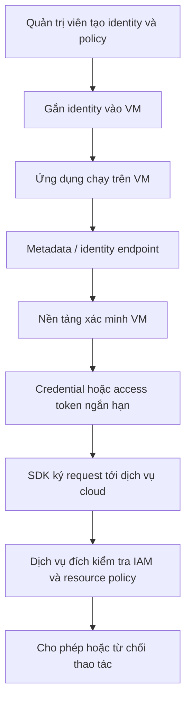
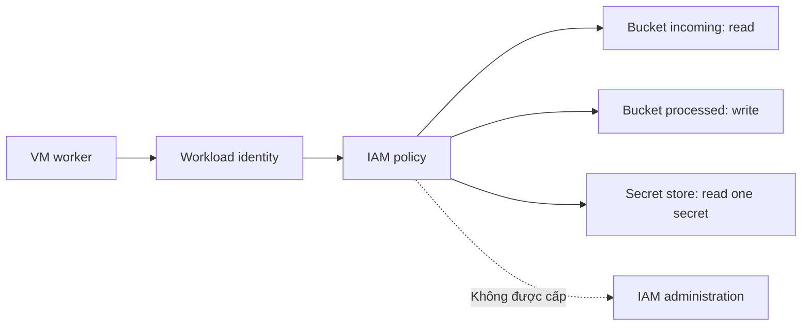

# Service account, managed identity và instance role cho workload

## Mục tiêu học tập

Sau bài học, bạn có thể:

- Giải thích vì sao máy ảo (VM) và ứng dụng chạy trên VM cần danh tính riêng để gọi dịch vụ cloud.
- Phân biệt service account, managed identity, IAM role và instance profile.
- Mô tả cách VM nhận thông tin xác thực tạm thời từ metadata service và cách SDK sử dụng thông tin đó.
- Thiết kế quyền truy cập theo nguyên tắc đặc quyền tối thiểu, tách quyền quản trị danh tính khỏi quyền sử dụng danh tính.
- Áp dụng mô hình tương ứng trên AWS, Azure và Google Cloud.
- Xử lý các vấn đề thường gặp về token, quyền IAM, metadata service, vòng đời VM và audit.

## 1. Vì sao workload cần danh tính riêng?

Một VM thường phải gọi nhiều dịch vụ khác ngoài chính máy đó: đọc object trong storage, ghi log, lấy secret, truy vấn cơ sở dữ liệu, gửi thông điệp vào queue hoặc gọi API nội bộ. Các dịch vụ này cần xác định **ai đang gọi** và **được phép làm gì** trước khi trả dữ liệu hoặc thực hiện thao tác.

Nếu ứng dụng dùng tài khoản cá nhân của quản trị viên hoặc lưu access key dài hạn trong file cấu hình, quyền của ứng dụng sẽ phụ thuộc vào bí mật có thể bị sao chép, thất lạc hoặc tiếp tục tồn tại sau khi người dùng rời tổ chức. Một image VM được nhân bản cũng có thể mang theo cùng một khóa, khiến nhiều máy cùng sử dụng một danh tính khó kiểm soát.

Workload identity (danh tính workload) giải quyết vấn đề bằng cách cấp danh tính cho ứng dụng hoặc tài nguyên compute. VM có thể chứng minh danh tính với nền tảng cloud và nhận thông tin xác thực ngắn hạn. Hệ thống IAM sau đó đối chiếu danh tính với policy để quyết định thao tác nào được phép.

Ví dụ, một VM xử lý hóa đơn có thể cần:

- Đọc tệp đầu vào từ một bucket cụ thể.
- Ghi kết quả vào một bucket khác.
- Đọc một secret kết nối database.
- Gửi thông báo hoàn tất vào một queue.

VM đó không cần quyền quản trị toàn bộ storage, database hoặc project. Danh tính riêng cho workload giúp giới hạn quyền đúng với nhiệm vụ và có thể thu hồi khi máy không còn được sử dụng.

### Các khái niệm cần phân biệt

- **Authentication (xác thực):** xác minh danh tính của workload. Ví dụ, nền tảng xác nhận VM đang chạy với role hoặc service account nào.
- **Authorization (ủy quyền):** quyết định danh tính đó được phép thực hiện hành động nào trên tài nguyên nào.
- **Principal:** danh tính được policy tham chiếu, chẳng hạn user, group, service account, managed identity hoặc assumed role session.
- **Credential (thông tin xác thực):** dữ liệu dùng để chứng minh danh tính, như access token, chứng thư hoặc cặp khóa. Credential có thể ngắn hạn hoặc dài hạn.
- **Role (vai trò IAM):** tập quyền hoặc đối tượng có thể được gán/assume để cấp quyền. Ý nghĩa cụ thể tùy nền tảng.
- **Workload identity:** danh tính được dùng bởi ứng dụng, tiến trình, VM, container hoặc workload tự động.

Danh tính và quyền là hai phần riêng biệt. Gắn một role vào VM giúp VM có danh tính hoặc ngữ cảnh quyền, nhưng quyền thực tế còn phụ thuộc policy, scope, điều kiện và các giới hạn của dịch vụ đích.

## 2. Service account, managed identity và instance role

Các nhà cung cấp dùng tên gọi khác nhau cho cùng một mục tiêu: cho phép workload truy cập dịch vụ bằng danh tính được nền tảng quản lý.

| Khái niệm | Cách hiểu | Ví dụ điển hình |
|---|---|---|
| Service account | Danh tính dành cho ứng dụng hoặc dịch vụ, có thể được cấp quyền truy cập tài nguyên | Google Cloud service account; service account trong các nền tảng khác |
| Managed identity | Danh tính do cloud quản lý vòng đời và credential, được gắn với tài nguyên | Azure managed identity |
| IAM role cho VM | Vai trò IAM được gắn hoặc ủy quyền cho VM để VM nhận credential tạm thời | AWS IAM role cho EC2 |
| Instance profile | Đối tượng AWS dùng để chuyển IAM role cho EC2 instance | EC2 instance profile |
| Workload identity federation | Cơ chế trao đổi bằng chứng danh tính từ một môi trường khác lấy credential của cloud | Workload chạy ngoài cloud hoặc trên nền tảng Kubernetes |

Không nên coi các tên này là hoàn toàn tương đương về mặt triển khai. Ví dụ, AWS IAM role là đối tượng xác định quyền và quan hệ tin cậy; instance profile là cơ chế gắn role vào EC2. Azure managed identity là một danh tính do nền tảng quản lý, còn quyền truy cập được cấp thông qua Azure RBAC hoặc cơ chế tương ứng. Google Cloud service account là principal mà VM có thể sử dụng khi được gắn service account đó.

### 2.1. Service account

Service account là danh tính dành cho workload thay vì con người. Một service account có thể được sử dụng bởi một ứng dụng, một nhóm VM hoặc một dịch vụ tự động. Quyền của nó thường được cấp bằng policy hoặc role binding.

Một service account được thiết kế tốt nên có:

- Tên thể hiện ứng dụng, môi trường và mục đích.
- Chủ sở hữu chịu trách nhiệm vận hành.
- Danh sách tài nguyên và hành động được phép.
- Phạm vi sử dụng rõ ràng, chẳng hạn chỉ một workload hoặc một nhóm máy.
- Quy trình tạo, thay đổi, thu hồi và kiểm tra quyền.
- Audit log để truy vết hoạt động.

Không nên dùng một service account có quyền rộng cho tất cả workload trong project. Khi nhiều ứng dụng dùng chung một principal, log khó xác định ứng dụng nào thực hiện thao tác và việc thu hồi quyền cho một ứng dụng có thể làm hỏng các ứng dụng khác.

### 2.2. Managed identity

Managed identity là danh tính được nền tảng cloud tạo và quản lý. Nền tảng xử lý việc cấp credential, làm mới và gắn danh tính với tài nguyên theo cơ chế của dịch vụ.

Trong Azure có hai loại phổ biến:

- **System-assigned managed identity:** được tạo cùng một tài nguyên Azure và gắn với vòng đời của tài nguyên đó. Khi tài nguyên bị xóa, danh tính tương ứng cũng được loại bỏ theo vòng đời hệ thống.
- **User-assigned managed identity:** là một tài nguyên danh tính độc lập. Có thể gắn nó vào nhiều tài nguyên được hỗ trợ và quản lý vòng đời riêng với VM.

System-assigned phù hợp khi danh tính chỉ phục vụ một VM hoặc một tài nguyên cụ thể. User-assigned phù hợp khi cần giữ danh tính qua quá trình thay VM hoặc chia sẻ một danh tính có kiểm soát giữa một số workload. Tuy nhiên, gắn cùng danh tính vào nhiều VM làm tăng phạm vi ảnh hưởng nếu một máy bị xâm nhập; chỉ dùng khi các máy thực sự cần cùng quyền.

Managed identity không có nghĩa VM được cấp quyền truy cập mọi dịch vụ. Sau khi tạo danh tính, quản trị viên vẫn phải cấp role phù hợp tại scope cần thiết, ví dụ một resource group, một storage account hoặc một vault cụ thể.

### 2.3. Instance role và instance profile

Trên AWS, ứng dụng chạy trên EC2 có thể sử dụng IAM role được gắn với instance. EC2 nhận credential tạm thời thông qua Instance Metadata Service (IMDS), sau đó AWS SDK sử dụng credential này để ký request.

IAM role có hai phần quan trọng:

- **Trust policy:** xác định principal nào được phép assume role. Với role dành cho EC2, trust relationship cho phép dịch vụ EC2 đảm nhận role theo điều kiện phù hợp.
- **Permissions policy:** xác định các hành động role được phép thực hiện trên tài nguyên nào.

Instance profile là đối tượng chứa role để gắn vào EC2 instance. Trong console, người vận hành thường chọn role khi tạo máy; nền tảng xử lý việc gắn instance profile tương ứng.

Một role có thể được sử dụng bởi nhiều EC2 instance nếu được cấu hình như vậy. Vì thế, quyền của role cần phù hợp với toàn bộ tập máy được gắn role. Nếu hai ứng dụng có nhu cầu khác nhau, nên dùng các role riêng.

## 3. Luồng cấp credential cho VM

Mô hình tổng quát gồm bốn bước:

1. Quản trị viên tạo hoặc chọn danh tính workload và gắn danh tính đó vào VM.
2. VM hoặc ứng dụng yêu cầu credential từ metadata service hay cơ chế identity endpoint do nền tảng cung cấp.
3. Nền tảng xác minh VM và trả về credential ngắn hạn hoặc token có audience phù hợp.
4. SDK dùng credential để gọi API. Dịch vụ đích kiểm tra token/chữ ký, IAM policy, điều kiện và quyền trên tài nguyên.

Sơ đồ khái niệm:



Ứng dụng không cần tự tạo một access key dài hạn. SDK có thể dùng credential provider chain hoặc default credential mechanism để tự tìm danh tính gắn với VM và làm mới token khi cần.

### 3.1. Metadata service là gì?

Metadata service là endpoint nội bộ do nền tảng ảo hóa cung cấp cho VM. Nó có thể trả về thông tin về instance, network, project, cấu hình khởi động và thông tin xác thực tạm thời theo danh tính đã gắn.

Một số đặc điểm:

- Endpoint chỉ có thể truy cập từ môi trường VM theo cơ chế mạng/ảo hóa của nhà cung cấp.
- Credential thường có thời hạn và được làm mới.
- Quyền được cấp phụ thuộc role hoặc service account gắn với VM.
- Endpoint và giao thức khác nhau giữa AWS, Azure và Google Cloud.
- Metadata service là một bề mặt bảo mật quan trọng vì ứng dụng có thể lấy credential từ đó.

Không đưa nội dung credential hoặc token vào log, exception, trang debug, telemetry hay output của pipeline. Không gửi token tới trình duyệt hoặc client không đáng tin cậy.

### 3.2. Credential ngắn hạn

Credential ngắn hạn có thời gian sống giới hạn. Ứng dụng lấy credential mới khi credential hiện tại sắp hết hạn hoặc SDK tự làm mới theo cơ chế hỗ trợ.

Lợi ích:

- Giảm thời gian sử dụng được nếu credential bị lộ.
- Không cần phân phối và lưu giữ access key dài hạn trên từng VM.
- Có thể thu hồi hoặc thay đổi quyền ở phía IAM.
- Hỗ trợ audit theo danh tính workload và session.

Credential ngắn hạn vẫn cần được bảo vệ. Kẻ tấn công có quyền chạy mã trên VM có thể cố truy cập metadata service và sử dụng credential còn hiệu lực. Vì vậy, phải bảo vệ ứng dụng khỏi SSRF, hạn chế quyền hệ điều hành, kiểm soát truy cập metadata và tránh cấp role quá rộng.

## 4. Triển khai trên AWS, Azure và Google Cloud

### 4.1. AWS EC2: IAM role và instance profile

Trên AWS, một EC2 instance có thể nhận IAM role thông qua instance profile. Ứng dụng lấy credential tạm thời từ IMDS và AWS SDK dùng credential đó khi gọi dịch vụ.

Quy trình tham khảo:

1. Tạo IAM role dành cho workload EC2.
2. Cấu hình trust policy để cho phép EC2 assume role.
3. Gắn permissions policy với đúng hành động và tài nguyên cần thiết.
4. Tạo hoặc sử dụng instance profile chứa role đó.
5. Gắn instance profile vào EC2 khi tạo máy hoặc cập nhật cấu hình instance theo khả năng dịch vụ.
6. Kiểm tra SDK nhận đúng role và ứng dụng chỉ truy cập được tài nguyên đã cấp quyền.
7. Bật audit và theo dõi các lần assume role, thao tác API và lỗi AccessDenied.

**IMDSv2** bổ sung quy trình lấy token phiên metadata trước khi đọc các endpoint cần bảo vệ. Nên yêu cầu IMDSv2 theo cấu hình bảo mật phù hợp, hạn chế hop limit theo kiến trúc mạng và kiểm tra ứng dụng tương thích trước khi áp dụng rộng rãi.

Ví dụ Python với AWS SDK:

```python
import boto3

# SDK tự tìm credential từ instance role khi ứng dụng chạy trên EC2.
s3 = boto3.client("s3")

# Chỉ thực hiện được nếu role cho phép hành động trên bucket/object này.
response = s3.list_objects_v2(
    Bucket="example-private-bucket",
    Prefix="incoming/"
)
```

Đoạn mã không chứa access key. Trong môi trường phát triển ngoài EC2, SDK có thể lấy credential từ profile hoặc nguồn khác theo credential provider chain. Hãy tránh đóng gói credential cá nhân vào image dùng cho production.

### 4.2. Azure VM: system-assigned và user-assigned managed identity

Azure VM có thể bật system-assigned managed identity hoặc gắn user-assigned managed identity. Sau đó, quản trị viên cấp Azure RBAC role cho identity tại scope cần truy cập.

Quy trình tham khảo:

1. Bật system-assigned identity trên VM hoặc tạo user-assigned identity.
2. Gắn identity vào VM nếu dùng loại user-assigned.
3. Tạo role assignment tại scope nhỏ nhất có thể, chẳng hạn một vault hoặc storage resource.
4. Dùng Azure Identity SDK để lấy token cho resource/audience tương ứng.
5. Gọi SDK dịch vụ bằng token do identity cung cấp.
6. Kiểm tra role assignment, token audience và log hoạt động tại dịch vụ đích.

Ví dụ Python dùng Azure Identity:

```python
from azure.identity import DefaultAzureCredential
from azure.storage.blob import BlobServiceClient

# Trên Azure VM, credential chain có thể sử dụng managed identity.
credential = DefaultAzureCredential()

service = BlobServiceClient(
    account_url="https://exampleaccount.blob.core.windows.net",
    credential=credential
)

# Identity phải có quyền phù hợp trên storage account/container.
container = service.get_container_client("incoming")
for item in container.list_blobs():
    print(item.name)
```

Trong production, có thể chọn ManagedIdentityCredential trực tiếp khi muốn ràng buộc ứng dụng với managed identity. Nếu VM gắn nhiều user-assigned identity, cần chỉ định đúng client ID hoặc cấu hình lựa chọn identity rõ ràng theo SDK đang dùng. Không giả định credential chain luôn chọn đúng identity nếu có nhiều nguồn credential cùng tồn tại.

### 4.3. Google Cloud VM: service account gắn với instance

Trên Google Compute Engine, VM có thể được gắn một service account. Ứng dụng lấy access token từ metadata server và sử dụng token đó để gọi API Google Cloud. IAM role được cấp cho service account tại project hoặc tài nguyên cần truy cập.

Quy trình tham khảo:

1. Tạo service account riêng cho workload.
2. Gán IAM role cần thiết tại scope nhỏ nhất.
3. Khi tạo VM, gắn service account vào instance.
4. Cấu hình access scopes phù hợp. Trong thiết kế hiện đại, thường dùng scope rộng tương thích API như cloud-platform rồi kiểm soát quyền thực tế bằng IAM role tối thiểu.
5. Dùng Application Default Credentials (ADC) hoặc thư viện client để lấy token tự động.
6. Kiểm tra log và quyền truy cập trên dịch vụ đích.

Ví dụ Python:

```python
import google.auth
from google.cloud import storage

# ADC trên Compute Engine có thể lấy credential từ service account
# được gắn vào VM thông qua metadata server.
credentials, project_id = google.auth.default()

client = storage.Client(
    project=project_id,
    credentials=credentials
)

# Service account cần quyền liệt kê object ở bucket này.
for blob in client.list_blobs("example-private-bucket"):
    print(blob.name)
```

Access scopes và IAM role là hai lớp cần hiểu riêng. Scope có thể giới hạn phạm vi OAuth token mà VM nhận; IAM policy xác định service account được phép làm gì trên tài nguyên. Một role đúng nhưng token không có scope cần thiết vẫn có thể dẫn đến lỗi; ngược lại, scope rộng không tự cấp quyền IAM.

### So sánh nhanh

| Tiêu chí | AWS EC2 | Azure VM | Google Compute Engine |
|---|---|---|---|
| Danh tính gắn với VM | IAM role qua instance profile | Managed identity | Service account |
| Credential | Credential tạm thời từ IMDS | Access token từ managed identity endpoint | OAuth access token từ metadata server |
| Cấp quyền | IAM permissions policy và resource policy | Azure RBAC role assignment và resource policy | IAM role binding và resource policy |
| Bảo vệ metadata | Ưu tiên IMDSv2 và cấu hình metadata options | Metadata endpoint yêu cầu header theo giao thức; bảo vệ ứng dụng khỏi SSRF | Metadata endpoint yêu cầu header Metadata-Flavor; bảo vệ ứng dụng khỏi SSRF |
| Vòng đời danh tính | Role có thể tồn tại độc lập với EC2; gắn/tháo instance profile | System-assigned theo tài nguyên; user-assigned có vòng đời độc lập | Service account thường tồn tại độc lập với VM và có thể gắn vào nhiều VM |
| Điều cần chú ý | Trust policy, instance profile, IMDSv2 | Loại identity, client ID, scope của role assignment | IAM binding, service account và access scopes |

Tên API, endpoint, giới hạn và hành vi credential phụ thuộc phiên bản SDK và loại tài nguyên. Hãy kiểm tra tài liệu của dịch vụ đang triển khai trước khi thay đổi cấu hình production.

## 5. Thiết kế quyền theo nguyên tắc đặc quyền tối thiểu

Nguyên tắc đặc quyền tối thiểu (least privilege) yêu cầu workload chỉ có quyền cần thiết để hoàn thành nhiệm vụ. Khi thiết kế, hãy xác định đủ bốn thành phần:

\[
\text{Quyền} = \text{Principal} + \text{Action} + \text{Resource} + \text{Condition}
\]

- **Principal:** service account, managed identity hoặc role session nào được phép.
- **Action:** thao tác nào được phép, ví dụ đọc object, ghi log hoặc lấy secret.
- **Resource:** tài nguyên cụ thể nào được truy cập.
- **Condition:** điều kiện bổ sung như môi trường, tag, network, encryption context hoặc thời gian nếu nền tảng hỗ trợ.

Ví dụ, workload nhập dữ liệu chỉ cần quyền đọc prefix incoming trong một bucket và ghi vào prefix processed. Không cần quyền xóa bucket, sửa IAM policy hoặc liệt kê mọi tài nguyên trong project.

### 5.1. Tách danh tính theo workload và môi trường

Nên tách danh tính theo ứng dụng, mục đích và môi trường:

| Workload | Danh tính gợi ý | Quyền chính |
|---|---|---|
| API production | Identity riêng cho API | Đọc secret cần thiết, ghi log, truy cập database theo quyền |
| Worker xử lý tệp | Identity riêng cho worker | Đọc vùng incoming, ghi vùng processed |
| Backup agent | Identity riêng cho backup | Tạo và đọc backup theo chính sách |
| VM development | Identity dành cho development | Chỉ truy cập dữ liệu thử nghiệm |
| Monitoring agent | Identity dành cho monitoring | Đọc metric và gửi telemetry |

Không dùng chung identity production với development. Một môi trường thử nghiệm bị xâm nhập không nên có đường truy cập tới dữ liệu production chỉ vì hai môi trường dùng cùng service account.

### 5.2. Tách quyền quản lý danh tính và quyền sử dụng danh tính

Một số vai trò cần được tách riêng:

- **Identity administrator:** tạo, gắn, tháo hoặc xóa danh tính; quản lý trust relationship.
- **Policy administrator:** quản lý quyền và điều kiện truy cập.
- **Workload operator:** triển khai VM hoặc cập nhật ứng dụng trong phạm vi được cho phép.
- **Security auditor:** đọc policy, log và lịch sử thay đổi.
- **Workload identity:** thực hiện các hành động runtime đã được cấp.

Người có quyền tạo VM và gắn role có thể gián tiếp trao quyền của role đó cho workload. Vì vậy, quyền gắn role/identity vào VM là quyền nhạy cảm và cần được quản lý chặt. Một operator không nên được phép gắn bất kỳ role quản trị nào chỉ vì họ có quyền tạo instance.

### 5.3. Kiểm tra quyền kế thừa và quyền ở tài nguyên đích

Một thao tác có thể được quyết định bởi nhiều policy:

- Identity policy hoặc role permissions.
- Resource-based policy trên bucket, queue, key hoặc secret.
- Organization policy hoặc permission boundary.
- Deny rule, condition hoặc network restriction.
- Scope/role assignment ở cấp tổ chức, project, resource group hoặc tài nguyên.

Cấp một role mới không bảo đảm thao tác thành công nếu một policy khác đang từ chối. Ngược lại, quyền kế thừa từ project hoặc subscription có thể rộng hơn dự kiến. Hãy kiểm tra cả quyền được cấp trực tiếp và quyền được kế thừa.

## 6. Bảo vệ metadata service và credential

Metadata service là một đường cấp credential quan trọng. Nếu ứng dụng có lỗ hổng Server-Side Request Forgery (SSRF), kẻ tấn công có thể tìm cách khiến máy chủ gửi request tới endpoint nội bộ. Nếu metadata endpoint trả credential cho request đó, quyền của VM có thể bị lạm dụng.

### Các biện pháp bảo vệ

- Bật chế độ bảo vệ metadata phù hợp của nền tảng, chẳng hạn yêu cầu IMDSv2 trên EC2.
- Không cho phép input không tin cậy điều khiển URL mà backend sẽ truy cập.
- Dùng allowlist hostname/protocol và chặn truy cập tới địa chỉ/link-local nhạy cảm trong các chức năng fetch URL.
- Không chuyển tiếp header hoặc response metadata sang client.
- Hạn chế quyền truy cập hệ thống và tiến trình trên VM.
- Không cấp role rộng cho máy chạy ứng dụng có xử lý URL hoặc nội dung không tin cậy.
- Tách workload nhạy cảm sang VM hoặc identity riêng.
- Theo dõi request metadata bất thường và thao tác API không phù hợp với hành vi ứng dụng.
- Không log access token, refresh token hoặc secret trả về từ identity endpoint.

IMDSv2 giảm một số kiểu truy cập metadata ngoài ý muốn bằng cơ chế session token, nhưng không thay thế việc sửa lỗ hổng SSRF hoặc giới hạn quyền của role. Nếu mã độc đã chạy với quyền đủ cao trong VM, nó có thể sử dụng credential mà workload được phép lấy.

### Phân biệt metadata và secret store

Metadata service không phải nơi lưu secret tùy ý. Metadata thường cung cấp thông tin instance và credential do nền tảng cấp. Secret store như Key Vault, Secrets Manager hoặc Secret Manager lưu bí mật ứng dụng theo chính sách riêng.

Luồng phù hợp là:

1. VM dùng workload identity để xác thực với secret store.
2. IAM kiểm tra VM có quyền đọc secret cụ thể hay không.
3. Secret store trả secret cho workload được phép.
4. Ứng dụng giữ secret trong bộ nhớ ở thời gian cần thiết và tránh ghi ra log.

Không lưu secret ứng dụng vào metadata tùy chỉnh nếu có dịch vụ quản lý secret phù hợp. Metadata tùy chỉnh có thể bị nhiều tiến trình hoặc người có quyền đọc metadata truy cập.

## 7. Vòng đời danh tính cùng vòng đời VM

Danh tính workload cần được quản lý từ lúc tạo VM đến khi máy bị thay thế hoặc xóa.

### 7.1. Khi tạo VM

- Chọn identity phù hợp với mục đích và môi trường.
- Gắn đúng identity trong cấu hình tạo máy.
- Cấp quyền tối thiểu trước khi workload bắt đầu chạy.
- Xác nhận token được cấp cho đúng principal.
- Kiểm thử một thao tác được phép và một thao tác phải bị từ chối.

Nếu tạo VM từ image đã chuẩn hóa, image chỉ nên chứa ứng dụng và cấu hình không nhạy cảm. Identity nên được gắn ở thời điểm triển khai để các bản VM clone không chia sẻ credential dài hạn được đóng gói sẵn.

### 7.2. Khi thay role hoặc policy

Thay đổi policy có thể có độ trễ lan truyền. Token đã cấp có thể còn hiệu lực đến khi hết hạn, tùy nền tảng và dịch vụ. Khi giảm quyền khẩn cấp, cần xem xét cả credential/session hiện tại, cache của SDK và resource policy.

Sau khi thay đổi:

1. Kiểm tra role assignment hoặc policy đã được lưu.
2. Xác nhận scope và principal đúng.
3. Chờ thời gian lan truyền theo nền tảng.
4. Thử lại bằng một request mới.
5. Kiểm tra audit log để xác nhận principal và quyết định authorization.

Không giả định thay policy có hiệu lực tức thời trên mọi dịch vụ. Nếu cần thu hồi khẩn cấp, dùng cơ chế revoke session/credential hoặc disable identity theo khả năng nền tảng và đánh giá tác động.

### 7.3. Khi clone hoặc thay VM

Khi tạo VM mới từ image, cần xác định danh tính nào sẽ được gắn:

- VM mới có identity riêng hay dùng lại identity của nhóm?
- System-assigned identity có được tạo mới cho tài nguyên mới không?
- User-assigned identity hoặc service account nào được phép gắn vào?
- Role cũ có còn được cấp cho VM đã xóa không?
- Log có phân biệt được instance cũ và mới không?

Không sao chép file credential từ VM cũ sang VM mới. Hãy để nền tảng cấp credential cho danh tính đã gắn. Khi thay máy, tháo identity hoặc thu hồi quyền của tài nguyên cũ theo quy trình để tránh principal không còn sử dụng vẫn tồn tại.

### 7.4. Khi xóa VM

Trước khi xóa:

- Xác nhận workload đã được chuyển sang máy mới.
- Tháo identity dùng chung nếu máy không còn cần.
- Thu hồi role assignment không còn mục đích.
- Kiểm tra user-assigned identity hoặc service account có đang được VM khác sử dụng không.
- Giữ audit log theo thời hạn lưu giữ.
- Xóa system-assigned identity theo vòng đời tài nguyên nếu nền tảng thực hiện tự động.

Xóa VM không phải lúc nào cũng xóa danh tính độc lập hoặc quyền đã cấp. Cần kiểm tra riêng identity và policy để tránh quyền tồn tại lâu hơn workload.

## 8. Ví dụ kiến trúc: worker đọc tệp và ghi kết quả

Một hệ thống xử lý dữ liệu có nhóm VM worker. Mỗi worker đọc tệp từ vùng incoming, xử lý và ghi kết quả vào vùng processed. Worker cũng cần đọc một secret để kết nối dịch vụ nội bộ.

Thiết kế tham khảo:

- Tạo identity riêng cho worker production.
- Chỉ cấp quyền đọc object trong vùng incoming.
- Chỉ cấp quyền ghi object trong vùng processed.
- Cấp quyền đọc một secret cụ thể.
- Không cấp quyền xóa bucket, sửa policy hoặc quản trị KMS.
- Gắn identity vào VM bằng cơ chế managed identity/instance role/service account của cloud.
- Dùng SDK mặc định để lấy credential tạm thời.
- Ghi log request ID, principal và kết quả xử lý, không ghi token hoặc secret.
- Dùng identity khác cho worker development với bucket và secret thử nghiệm.
- Khi worker bị thay thế, tạo VM mới với identity được chỉ định và thu hồi quyền của máy cũ nếu identity không còn cần.

Sơ đồ quyền:



Thiết kế này giúp giảm quyền của worker và tách nhiệm vụ xử lý dữ liệu khỏi nhiệm vụ quản trị hạ tầng. Nếu worker bị xâm nhập, phạm vi thao tác bị giới hạn theo policy đã cấp.

## 9. Kiểm tra và xác minh danh tính workload

Không chỉ kiểm tra VM có identity được gắn hay không. Cần xác minh ứng dụng thực sự nhận đúng principal và quyền hoạt động như mong đợi.

### Checklist xác minh

1. Xem identity/role/service account được gắn vào VM.
2. Kiểm tra trust relationship hoặc trạng thái managed identity.
3. Xác minh SDK đang dùng nguồn credential mong đợi, không lấy nhầm credential từ file hoặc biến môi trường.
4. Kiểm tra token có audience/resource phù hợp với API đích.
5. Gọi một thao tác được phép trên tài nguyên thử nghiệm.
6. Gọi một thao tác không được phép để xác nhận least privilege.
7. Xem audit log để xác nhận principal, action, resource và kết quả.
8. Kiểm tra credential được làm mới sau khi hết hạn mà ứng dụng không cần restart ngoài dự kiến.
9. Xác nhận không có token hoặc secret trong log.

### Ví dụ kiểm tra bằng SDK

Với ứng dụng Python, mỗi nhà cung cấp có thư viện riêng để lấy credential mặc định. Có thể bật log chẩn đoán của SDK ở môi trường thử nghiệm để xem nguồn credential, nhưng cần bảo đảm log không in access token hoặc nội dung bí mật.

Không dùng lệnh debug in toàn bộ environment hoặc metadata response trong production. Biến môi trường có thể chứa credential tạm thời, connection string hoặc secret do một thành phần khác cung cấp.

## 10. Xử lý sự cố thường gặp

| Triệu chứng | Nguyên nhân có thể | Hướng kiểm tra |
|---|---|---|
| VM gọi API bị AccessDenied/403 | Identity chưa có quyền, sai scope hoặc policy đích từ chối | Xác nhận principal, action, resource, condition và resource policy |
| SDK không tìm thấy credential | Chưa gắn identity, metadata endpoint không truy cập được hoặc SDK dùng sai credential chain | Kiểm tra cấu hình VM, identity endpoint và nguồn credential của SDK |
| Token hết hạn và ứng dụng lỗi | SDK không làm mới token, cache credential sai hoặc thời gian hệ thống lệch | Cập nhật SDK, kiểm tra refresh flow và đồng bộ thời gian |
| VM mới không truy cập được dịch vụ như VM cũ | Identity chưa được gắn hoặc role assignment không được tạo lại | So sánh identity và policy của hai VM |
| Managed identity có mặt nhưng Azure Storage từ chối | Chưa có role assignment phù hợp hoặc scope sai | Kiểm tra role, scope, data-plane permission và propagation |
| EC2 không nhận được role credential | Instance profile chưa gắn, trust policy sai hoặc metadata bị cấu hình chặn | Kiểm tra instance profile, trust policy và metadata options |
| GCE lấy được token nhưng API từ chối | IAM role thiếu hoặc access scope không phù hợp | Kiểm tra service account, IAM binding và OAuth scopes |
| Ứng dụng lấy được credential không mong muốn | Credential file/environment/profile được ưu tiên trước identity của VM | Kiểm tra credential chain và loại bỏ nguồn credential không cần |
| Token bị lộ trong log | Debug hoặc exception ghi nội dung response/header | Xóa hoặc hạn chế log nhạy cảm, xoay/revoke credential theo quy trình và sửa logging |

### Quy trình chẩn đoán

1. Xác định ứng dụng đang chạy trên VM nào và identity dự kiến là gì.
2. Kiểm tra identity đã gắn vào VM và còn hoạt động không.
3. Xác định SDK lấy credential từ metadata, file, environment hay nguồn khác.
4. Kiểm tra token audience/resource và thời hạn nếu có thể xem metadata an toàn.
5. Đọc lỗi authorization để tìm action, resource và principal bị từ chối.
6. Kiểm tra identity policy, trust policy, resource policy, role assignment và condition.
7. Kiểm tra metadata options, firewall nội bộ, proxy và cấu hình SSRF protection.
8. Thử lại bằng credential provider chuẩn của SDK và kiểm tra audit log.
9. Sau khi sửa, xác minh cả thao tác được phép và thao tác bị từ chối.

Nếu credential đã bị lộ, coi đó là sự cố bảo mật. Xác định phạm vi và thời hạn token, thu hồi session hoặc quyền theo khả năng nền tảng, sửa nguồn rò rỉ và kiểm tra audit log. Không chỉ xóa dòng log mà bỏ qua việc đánh giá token đã bị truy cập hay chưa.

## 11. Những nhầm lẫn thường gặp

- **Gắn identity nghĩa là đã có mọi quyền.** Identity chỉ xác định principal; quyền cần được cấp riêng qua IAM hoặc resource policy.
- **Managed identity là secret được lưu trên VM.** Nền tảng cấp credential thông qua cơ chế identity; ứng dụng không cần nhúng secret dài hạn.
- **Service account chỉ dùng cho con người đăng nhập.** Service account chủ yếu dành cho ứng dụng và workload.
- **IAM role và instance profile là một đối tượng trên AWS.** Role định nghĩa trust và quyền; instance profile là cơ chế gắn role vào EC2.
- **Credential ngắn hạn không thể bị đánh cắp.** Credential vẫn có thể bị lạm dụng trong thời gian hiệu lực nếu tiến trình hoặc VM bị xâm nhập.
- **Dùng chung identity giúp đơn giản hóa quản trị mà không có rủi ro.** Chia sẻ identity làm tăng phạm vi ảnh hưởng và giảm khả năng quy trách nhiệm.
- **Thêm quyền Owner hoặc Administrator sẽ sửa được lỗi 403.** Cần xác định chính xác action/resource bị từ chối và cấp quyền tối thiểu.
- **Xóa VM sẽ xóa mọi identity và role assignment.** Danh tính độc lập và quyền đã cấp có thể tồn tại sau khi VM bị xóa.
- **Metadata endpoint chỉ chứa thông tin vô hại.** Metadata có thể cung cấp credential workload; cần bảo vệ endpoint khỏi truy cập không mong muốn.
- **Access scope rộng đồng nghĩa service account có quyền rộng trên Google Cloud.** IAM policy vẫn quyết định quyền thực tế; scope và IAM là hai lớp cần xem cùng nhau.

## 12. Tự kiểm tra

**Tình huống 1:** Một VM cần đọc object từ một bucket. Quản trị viên gắn service account vào VM nhưng API vẫn trả về 403. Cần kiểm tra gì?

**Gợi ý:** Xác nhận service account đúng đã gắn, sau đó kiểm tra IAM role binding, scope, resource policy và điều kiện truy cập của bucket. Gắn identity không tự cấp quyền đọc object.

**Tình huống 2:** Một nhóm VM xử lý dữ liệu và nhóm VM backup đang dùng chung một identity có quyền đọc/ghi/xóa trên toàn bộ storage. Có nên giữ cấu hình này?

**Gợi ý:** Nên tách identity theo nhiệm vụ. Worker chỉ cần đọc vùng đầu vào và ghi vùng kết quả; backup agent cần quyền backup/restore theo phạm vi riêng. Điều này giảm phạm vi ảnh hưởng khi một workload bị xâm nhập.

**Tình huống 3:** Một ứng dụng backend có chức năng tải URL do người dùng nhập. Vì sao cần bảo vệ metadata service?

**Gợi ý:** Lỗ hổng SSRF có thể khiến backend gửi request tới endpoint metadata nội bộ và lấy credential của VM. Cần kiểm soát URL, chặn truy cập endpoint nhạy cảm, bảo vệ metadata và giới hạn quyền identity.

**Tình huống 4:** VM Azure dùng user-assigned managed identity bị xóa, nhưng một VM khác vẫn cần danh tính đó. Có cần tạo lại identity không?

**Gợi ý:** User-assigned identity có vòng đời độc lập với từng VM. Chỉ cần giữ identity còn tồn tại và kiểm tra nó vẫn được gắn với VM cần dùng, cùng role assignment phù hợp.

**Tình huống 5:** Một VM EC2 đã được gắn IAM role nhưng SDK vẫn dùng access key trong file cấu hình. Kết quả có thể là gì?

**Gợi ý:** Credential provider chain có thể ưu tiên nguồn credential khác trước instance role. Hãy kiểm tra thứ tự provider, loại bỏ key dài hạn không cần thiết và xác nhận SDK đang sử dụng role credential.

**Tình huống 6:** Sau khi thay VM từ image chuẩn, ứng dụng không còn truy cập secret. Những phần nào cần so sánh giữa VM cũ và mới?

**Gợi ý:** Kiểm tra identity được gắn, role assignment, trust relationship, scope, token audience và quyền đọc secret. Image không nên là nơi lưu credential; VM mới cần được gắn identity trong bước triển khai.

## Kết luận

Service account, managed identity và instance role giúp VM xác thực với dịch vụ cloud bằng danh tính dành cho workload. Nền tảng cấp credential tạm thời qua metadata hoặc identity endpoint; IAM và resource policy quyết định quyền thực tế. Hãy tách identity theo workload và môi trường, cấp quyền tối thiểu, bảo vệ metadata service, tránh lưu access key dài hạn và quản lý danh tính xuyên suốt vòng đời VM. Việc kiểm tra phải xác nhận cả principal, token, quyền trên tài nguyên và audit log để bảo đảm workload hoạt động đúng phạm vi được phép.
