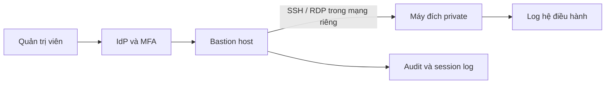
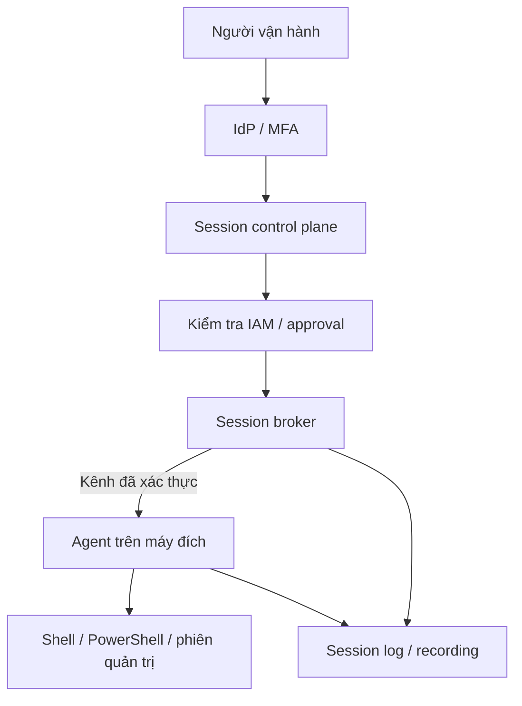

# Truy cập qua bastion, proxy hoặc dịch vụ quản trị phiên

## 1. Vì sao cần một đường truy cập quản trị có kiểm soát?

Máy ảo và máy chủ cloud thường chứa ứng dụng, dữ liệu và thông tin xác thực quan trọng. Quản trị viên cần truy cập để cài đặt, điều tra sự cố, cập nhật hệ điều hành hoặc khôi phục dịch vụ. Nếu mở SSH hoặc RDP trực tiếp ra Internet cho mọi máy, mỗi máy trở thành một điểm tiếp xúc cần bảo vệ. Khóa SSH, mật khẩu, cấu hình firewall và bản vá trên nhiều máy cũng khó quản lý đồng nhất.

Một kiến trúc truy cập quản trị tốt tạo ra một đường vào có kiểm soát. Người vận hành xác thực bằng danh tính cá nhân, vượt qua chính sách xác minh bổ sung, được cấp quyền trong phạm vi và thời gian cần thiết, rồi kết nối đến máy đích qua bastion, proxy hoặc dịch vụ quản trị phiên. Hệ thống ghi nhận ai truy cập, vào máy nào, khi nào và thông qua cơ chế nào.

Ba mô hình có vai trò khác nhau:

- **Bastion host (jump host):** máy trung gian được bảo vệ chặt chẽ, nhận kết nối quản trị rồi chuyển tiếp đến máy trong mạng riêng.
- **Proxy quản trị:** thành phần trung gian chuyển tiếp hoặc kiểm soát luồng truy cập, có thể tích hợp xác thực danh tính, chính sách và định tuyến đến máy đích.
- **Dịch vụ quản trị phiên (session management service):** dịch vụ do nền tảng hoặc tổ chức vận hành cung cấp để mở phiên shell, PowerShell, RDP hoặc tunnel mà không cần người dùng kết nối trực tiếp vào cổng quản trị của máy đích.

Không có mô hình nào tự động an toàn chỉ nhờ tên gọi. Bastion bị cấu hình yếu có thể trở thành điểm xâm nhập tập trung. Proxy chỉ chuyển tiếp TCP có thể không biết người dùng đang chạy lệnh gì. Dịch vụ quản trị phiên vẫn cần danh tính, quyền tối thiểu, agent hoặc endpoint, ghi log và quy trình xử lý khi dịch vụ không khả dụng.

Trong phạm vi **danh tính và truy cập máy**, bài học này giúp người học:

- Phân biệt bastion, proxy quản trị và dịch vụ quản trị phiên.
- Thiết kế luồng truy cập từ danh tính người vận hành đến máy đích trong mạng riêng.
- Kết hợp MFA, RBAC, quyền truy cập đúng thời điểm và thông tin xác thực ngắn hạn.
- Giới hạn SSH/RDP, quản lý khóa, kiểm soát chuyển tiếp cổng và ghi nhật ký phiên.
- Vận hành đường truy cập có tính sẵn sàng, khả năng kiểm toán và quy trình khẩn cấp.
- Chọn mô hình phù hợp với VM, máy chủ Windows/Linux và workload trên cloud.

## 2. Các thành phần trong một phiên quản trị

### 2.1. Danh tính người vận hành

Mỗi quản trị viên cần sử dụng một danh tính riêng gắn với hệ thống định danh của tổ chức. Danh tính có thể được quản lý qua identity provider (IdP), thư mục doanh nghiệp hoặc nền tảng IAM. Không nên dùng chung một tài khoản `admin` cho cả nhóm vì khi đó khó xác định ai thực hiện thao tác và khó thu hồi quyền của một cá nhân.

Trước khi cấp phiên, hệ thống nên xác minh:

- Người dùng đã đăng nhập bằng tài khoản cá nhân.
- MFA hoặc phương thức xác minh mạnh đã được hoàn tất theo chính sách.
- Thiết bị hoặc phiên đăng nhập đáp ứng điều kiện truy cập nếu tổ chức có kiểm tra posture.
- Người dùng thuộc nhóm hoặc vai trò được phép truy cập môi trường, máy và loại thao tác tương ứng.
- Quyền truy cập còn hiệu lực và chưa bị thu hồi.

### 2.2. Broker, bastion hoặc proxy

Đây là thành phần trung gian nhận yêu cầu truy cập và đưa người dùng đến máy đích. Tùy mô hình, nó có thể xác thực người dùng, kiểm tra quyền, cấp thông tin xác thực, ghi phiên hoặc chỉ chuyển tiếp kết nối mạng.

Phải phân biệt proxy ở tầng mạng với proxy hiểu danh tính. Một TCP proxy có thể chuyển tiếp kết nối đến cổng SSH mà không biết người dùng bên trong phiên SSH là ai. Một access proxy có tích hợp IdP có thể kiểm tra danh tính trước khi cho phép mở tunnel, nhưng việc ghi lại lệnh bên trong phiên còn phụ thuộc cách nó xử lý giao thức và hệ điều hành đích.

### 2.3. Máy đích và danh tính trên máy

Máy đích cần xác thực người dùng hoặc chứng thư, áp dụng quyền hệ điều hành và ghi lại hoạt động. Với Linux, quyền thường được kiểm soát qua tài khoản, nhóm, `sudo`, SSH authorized keys hoặc SSH certificate. Với Windows, quyền có thể dựa trên tài khoản miền, nhóm cục bộ, Remote Desktop Users, quyền đăng nhập từ xa và chính sách quản trị.

Quyền vào máy không đồng nghĩa với quyền quản trị toàn máy. Một kỹ sư có thể chỉ cần đọc log hoặc khởi động lại một dịch vụ. Hãy cấp tài khoản và quyền phù hợp với nhiệm vụ thay vì mặc định mọi người đều có quyền root hoặc local administrator.

### 2.4. Control plane và data plane

Control plane quyết định ai được phép mở phiên, đến máy nào, trong thời gian nào và theo chính sách nào. Data plane là đường truyền thực tế của phiên quản trị, chẳng hạn kết nối SSH/RDP qua bastion, tunnel qua proxy hoặc kênh phiên do dịch vụ quản trị duy trì.

Tách hai mặt phẳng giúp thiết kế rõ ràng: IAM và workflow phê duyệt quyết định quyền; mạng và gateway chuyển tiếp phiên; hệ điều hành đích quyết định người dùng được làm gì sau khi đăng nhập. Nếu chỉ kiểm soát ở một lớp, các đường truy cập khác có thể bỏ qua chính sách.

## 3. Bastion host (jump host)

### 3.1. Cách hoạt động

Bastion là máy chủ trung gian được đặt tại vùng mạng có thể nhận kết nối từ người vận hành. Các máy ứng dụng hoặc database nằm trong subnet riêng chỉ cho phép SSH/RDP từ bastion hoặc từ đường quản trị được chỉ định.

Luồng kết nối điển hình:



Người vận hành xác thực vào bastion, sau đó mở kết nối đến máy đích. Bastion có thể đóng vai trò jump host với hai phiên SSH riêng, hoặc làm điểm chuyển tiếp TCP để giao thức đầu cuối tiếp tục xác thực trực tiếp với máy đích. Hai cách có khác biệt về nơi lưu khóa, nơi kết thúc phiên và khả năng ghi nhận hoạt động.

### 3.2. Ưu điểm

- Tập trung điểm vào mạng quản trị, giảm số máy phải mở cổng SSH/RDP ra ngoài.
- Có thể áp dụng MFA, kiểm tra danh tính và chính sách truy cập ở một nơi.
- Dễ giới hạn nguồn kết nối đến máy đích: chỉ cho phép từ subnet hoặc security group của bastion.
- Có thể ghi log đăng nhập, kết nối và hoạt động trên bastion.
- Phù hợp với môi trường cần kết nối SSH/RDP truyền thống hoặc công cụ quản trị hiện có.

### 3.3. Rủi ro và giới hạn

Bastion là tài sản có giá trị cao. Nếu bị chiếm quyền, kẻ tấn công có thể có đường tiếp cận nhiều máy nội bộ. Vì vậy, bastion cần được hardening, vá lỗi, giám sát và giới hạn phần mềm cài đặt. Không dùng bastion làm máy làm việc chung, máy tải tệp tùy ý hoặc nơi lưu private key của nhiều người.

Bastion cũng có thể trở thành điểm lỗi đơn hoặc nút thắt kết nối. Nếu chỉ có một máy, bảo trì hoặc lỗi host có thể chặn toàn bộ hoạt động quản trị. Cần có nhiều instance, phân vùng theo môi trường hoặc cơ chế khôi phục khi bastion không hoạt động.

Khả năng audit phụ thuộc cách kết thúc phiên. Nếu bastion chỉ chuyển tiếp TCP, nó có thể biết ai mở tunnel và đến địa chỉ nào nhưng không nhất thiết ghi được từng lệnh SSH hoặc nội dung RDP. Muốn audit lệnh cần kết hợp log trên máy đích, session recording hoặc cơ chế kiểm soát ở lớp ứng dụng.

### 3.4. Hardening bastion

Các biện pháp cơ bản:

1. Dùng image tối thiểu, chỉ cài công cụ quản trị cần thiết.
2. Không lưu dữ liệu ứng dụng hoặc secret dùng chung trên bastion.
3. Cập nhật hệ điều hành, SSH/RDP server và agent theo lịch.
4. Tắt đăng nhập root trực tiếp và tắt xác thực bằng mật khẩu nếu chính sách dùng SSH key/certificate.
5. Giới hạn nguồn truy cập bằng VPN, private access gateway hoặc dải IP quản trị được phê duyệt.
6. Chỉ cho phép bastion kết nối đến các subnet/cổng cần thiết; tránh quyền truy cập toàn mạng.
7. Dùng danh tính cá nhân, MFA ở lớp truy cập và quyền hệ điều hành tối thiểu.
8. Gửi log ra hệ thống tập trung, nơi người dùng trên bastion không thể tự sửa hoặc xóa.
9. Giám sát đăng nhập thất bại, phiên kéo dài bất thường, kết nối đến đích lạ và thay đổi cấu hình.
10. Có quy trình thay thế bastion từ image chuẩn khi nghi ngờ bị xâm nhập.

## 4. Proxy quản trị và SSH ProxyJump

### 4.1. Proxy chuyển tiếp kết nối

Proxy có thể hoạt động ở nhiều lớp:

- **L4/TCP proxy:** chuyển tiếp luồng TCP đến máy đích. Nó thường không hiểu đầy đủ danh tính hoặc lệnh bên trong SSH/RDP.
- **SSH jump/proxy:** dùng SSH để tạo đường đi qua một máy trung gian. Máy đích vẫn có thể xác thực người dùng bằng key hoặc certificate riêng.
- **Identity-aware access proxy:** kiểm tra danh tính, MFA, nhóm, thiết bị và chính sách trước khi mở kết nối hoặc tunnel.
- **Protocol gateway:** kết thúc hoặc trung gian giao thức như RDP/SSH, có thể cung cấp session recording, kiểm soát clipboard hoặc chuyển tệp tùy sản phẩm.

Không nên gọi tất cả các loại này là một cơ chế bảo mật giống nhau. Proxy chỉ chuyển tiếp gói tin không thay thế xác thực ở máy đích; identity-aware proxy không tự động cấp quyền quản trị hệ điều hành nếu quyền đó chưa được cấu hình.

### 4.2. Kết nối SSH qua ProxyJump

OpenSSH hỗ trợ `ProxyJump` (`-J`) để kết nối đến máy đích qua một jump host. Ví dụ:

```bash
ssh -J access-user@bastion.example.net ops-user@10.20.1.15
```

Có thể lưu cấu hình trong `~/.ssh/config`:

```sshconfig
Host bastion-prod
    HostName bastion.example.net
    User access-user
    IdentityFile ~/.ssh/id_ed25519
    IdentitiesOnly yes

Host app-private-01
    HostName 10.20.1.15
    User ops-user
    ProxyJump bastion-prod
    IdentityFile ~/.ssh/id_ed25519
    IdentitiesOnly yes
```

Sau đó kết nối bằng:

```bash
ssh app-private-01
```

Ví dụ sử dụng một key để minh họa; môi trường doanh nghiệp nên cân nhắc SSH certificate ngắn hạn hoặc cơ chế cấp credential tập trung. Giữ private key trên thiết bị của người dùng hoặc trong agent được kiểm soát. Không sao chép private key cá nhân lên bastion để tiện kết nối.

Với `ProxyJump`, SSH client tạo đường chuyển tiếp qua bastion; việc xác thực với máy đích vẫn diễn ra theo cấu hình của máy đích. Bastion không mặc nhiên nhìn thấy nội dung phiên SSH đầu cuối. Cần ghi log ở máy đích hoặc dùng giải pháp session recording phù hợp nếu cần kiểm toán lệnh.

### 4.3. SSH agent forwarding và rủi ro

`ssh-agent` forwarding cho phép máy trung gian yêu cầu agent trên máy người dùng ký thao tác xác thực tiếp theo. Cơ chế này tránh phải chép private key lên bastion, nhưng một bastion bị chiếm quyền có thể lợi dụng socket agent đang được forward để yêu cầu ký xác thực trong thời gian phiên còn mở.

Chỉ bật agent forwarding khi có nhu cầu rõ ràng, giới hạn thời gian và phạm vi; ưu tiên ProxyJump hoặc certificate ngắn hạn khi phù hợp. Không dùng `ForwardAgent yes` mặc định cho mọi host. Nếu buộc phải dùng, hãy kiểm tra cấu hình `AllowAgentForwarding` và chính sách ở cả client lẫn server.

### 4.4. Proxy và port forwarding

SSH local, remote hoặc dynamic port forwarding có thể tạo tunnel đến dịch vụ nội bộ. Đây là công cụ hữu ích để truy cập dashboard, database hoặc endpoint quản trị qua đường đã xác thực. Tuy nhiên, tunnel có thể trở thành đường vòng vượt qua phân đoạn mạng hoặc chính sách truy cập ở lớp ứng dụng.

Chỉ cấp quyền forwarding khi nhiệm vụ cần đến; giới hạn host/cổng đích ở bastion hoặc proxy nếu có thể. Theo dõi phiên tunnel, thời gian mở, lưu lượng và đích kết nối. Không cho phép người dùng tạo tunnel tùy ý đến toàn bộ mạng private.

## 5. Dịch vụ quản trị phiên (Session Manager)

### 5.1. Mô hình hoạt động

Dịch vụ quản trị phiên cung cấp một lớp điều khiển để người dùng yêu cầu mở phiên đến máy đích. Thay vì mở cổng SSH/RDP inbound từ Internet hoặc mạng quản trị đến từng máy, máy đích có thể chạy agent hoặc thiết lập kênh kết nối outbound đến control plane của dịch vụ. Người dùng xác thực với dịch vụ, dịch vụ kiểm tra IAM và chính sách, sau đó thiết lập phiên shell, PowerShell, tunnel hoặc thao tác quản trị được hỗ trợ.

Luồng khái quát:



Chi tiết triển khai tùy dịch vụ. Có nền tảng dùng agent trên máy, có nền tảng dùng gateway hoặc kênh quản trị tích hợp sẵn. Một số dịch vụ cần endpoint mạng riêng để agent kết nối; số khác yêu cầu egress HTTPS đến control plane. Cần đọc kiến trúc và giới hạn của sản phẩm cụ thể.

### 5.2. Lợi ích

- Có thể không cần public IP hoặc inbound SSH/RDP trên máy đích.
- Tập trung xác thực, phân quyền, phê duyệt và thời hạn phiên.
- Dùng danh tính IAM/workload hoặc agent thay vì phân phối khóa dài hạn cho mọi máy.
- Có thể ghi metadata phiên, transcript hoặc session recording vào hệ thống log tập trung.
- Hỗ trợ truy cập từ console, CLI hoặc API tùy nền tảng.
- Có thể quản lý port forwarding và phiên shell theo chính sách.

### 5.3. Dependency và giới hạn

Dịch vụ quản trị phiên không loại bỏ dependency. Máy đích có thể cần agent đang hoạt động, danh tính máy hợp lệ, endpoint mạng, DNS, chứng thư và quyền truy cập control plane. Nếu agent bị dừng hoặc egress bị chặn, máy có thể không nhận được yêu cầu mở phiên.

Một số dịch vụ không ghi được toàn bộ nội dung phiên nếu người dùng dùng tunnel hoặc giao thức không được hỗ trợ. Một số kiểu session recording không ghi lại lệnh đã thực hiện trong ứng dụng bên trong tunnel. Cần xác minh chính xác khả năng audit thay vì mặc định mọi phiên đều được ghi đầy đủ.

Khi chọn dịch vụ, kiểm tra:

- Hệ điều hành và loại máy được hỗ trợ.
- Agent, phiên bản và cách cập nhật.
- Endpoint, DNS, proxy và yêu cầu egress.
- Các kiểu phiên: shell, PowerShell, RDP, port forwarding, file transfer.
- Cơ chế IAM, MFA, phê duyệt và quyền theo tag/nhóm máy.
- Cách ghi transcript, video/session recording, metadata và audit log.
- Nơi lưu log, mã hóa, retention, quyền đọc và khả năng xuất dữ liệu.
- Quota, giới hạn số phiên, timeout, idle session và availability.
- Cơ chế truy cập khẩn cấp khi control plane hoặc agent gặp sự cố.

## 6. So sánh bastion, proxy và dịch vụ quản trị phiên

| Tiêu chí | Bastion host | Proxy quản trị | Dịch vụ quản trị phiên |
|---|---|---|---|
| Vai trò chính | Máy trung gian để vào mạng riêng | Chuyển tiếp/kiểm soát kết nối theo chính sách | Điều phối phiên quản trị qua control plane |
| Cổng inbound trên máy đích | Chỉ cho phép từ bastion hoặc subnet quản trị | Chỉ cho phép từ proxy/gateway tùy kiến trúc | Thường có thể đóng inbound SSH/RDP nếu agent/kênh dịch vụ hỗ trợ |
| Xác thực người dùng | Tại bastion và máy đích | Có thể tại proxy và máy đích | Thường tập trung qua IdP/IAM và chính sách dịch vụ |
| Ghi nội dung phiên | Cần công cụ bổ sung hoặc log ở máy đích | Phụ thuộc proxy có kết thúc/hiểu giao thức hay chỉ tunnel | Có thể có transcript/recording, tùy kiểu phiên và sản phẩm |
| Vận hành | Phải vá, harden, scale và giám sát máy bastion | Quản lý gateway, policy, certificate và capacity | Quản lý agent/endpoint, IAM, log và availability dịch vụ |
| Phù hợp | Môi trường cần jump host truyền thống | Cần định tuyến hoặc chính sách truy cập tập trung | Muốn quản trị máy private không mở inbound port |
| Rủi ro chính | Bastion bị chiếm quyền thành bàn đạp | Proxy bị lạm dụng làm đường tunnel | Mất khả năng truy cập khi agent/control plane lỗi; quyền IAM quá rộng |

Có thể kết hợp các mô hình. Ví dụ, identity-aware proxy có thể kiểm tra người dùng trước khi mở phiên đến bastion; dịch vụ session manager có thể là đường quản trị chính và bastion được giữ cho tình huống tương thích hoặc khẩn cấp. Khi kết hợp, cần tránh tạo nhiều đường truy cập không được kiểm soát.

## 7. Thiết kế xác thực và phân quyền

### 7.1. MFA và xác thực mạnh

Yêu cầu MFA cho thao tác quản trị, đặc biệt với production, quyền root/administrator và hành động thay đổi mạng hoặc dữ liệu. Ưu tiên phương thức chống phishing khi tổ chức hỗ trợ. MFA ở cổng truy cập không thay thế xác thực máy đích; cả hai lớp cần được cấu hình đúng.

Không dùng chung tài khoản hoặc mật khẩu. Tài khoản khẩn cấp cần được quản lý riêng, lưu giữ an toàn, có cảnh báo khi sử dụng và được kiểm tra định kỳ.

### 7.2. RBAC và quyền tối thiểu

Role-based access control (RBAC) ánh xạ vai trò công việc sang quyền. Ví dụ:

| Vai trò | Quyền có thể cấp | Quyền không nên mặc định cấp |
|---|---|---|
| Developer | Truy cập máy dev/test, đọc log và restart service được chỉ định | Truy cập production hoặc root trên mọi máy |
| On-call operator | Mở phiên production trong thời gian trực, xem metric, restart service theo runbook | Thay đổi IAM, firewall hoặc xóa dữ liệu |
| System administrator | Quản trị OS theo nhóm máy phụ trách | Quyền quản trị mọi cloud account nếu không cần |
| Security auditor | Đọc metadata phiên, audit log và cấu hình chính sách | Thực thi lệnh thay đổi trên máy đích |
| Break-glass operator | Quyền khẩn cấp có thời hạn và phê duyệt | Sử dụng thường xuyên hoặc không có cảnh báo |

Quyền nên được giới hạn theo môi trường, nhóm máy, tag, project hoặc account. Tránh cấp quyền `*` trên mọi tài nguyên khi chỉ cần truy cập một nhóm instance.

### 7.3. Just-in-time access

Just-in-time (JIT) access cấp quyền trong một khoảng thời gian ngắn thay vì giữ quyền quản trị thường trực. Người dùng yêu cầu truy cập, nêu lý do, hệ thống kiểm tra điều kiện hoặc yêu cầu phê duyệt, sau đó cấp quyền có thời hạn. Hết thời gian, quyền được thu hồi tự động.

Một quy trình JIT nên ghi lại người yêu cầu, người phê duyệt, máy đích, vai trò, lý do, thời điểm bắt đầu/kết thúc và mã ticket nếu có. Với sự cố khẩn cấp, có thể dùng luồng phê duyệt rút gọn nhưng phải có audit và hậu kiểm.

### 7.4. SSH key và certificate ngắn hạn

SSH public key có thể được quản lý trong authorized keys hoặc qua hệ thống cấp phát tập trung. Khóa dài hạn dễ bị quên thu hồi khi nhân viên đổi vai trò hoặc thiết bị bị mất. SSH certificate do CA nội bộ ký có thể có thời hạn ngắn, principal và constraint rõ ràng, giảm nhu cầu phân phối key tĩnh trên từng máy.

Một chính sách certificate cần xác định:

- CA nào được máy đích tin cậy.
- Principal nào được phép đăng nhập và ánh xạ đến tài khoản OS nào.
- Thời hạn certificate và quy trình cấp lại.
- Có cho phép port forwarding, agent forwarding hoặc PTY không.
- Cách thu hồi hoặc vô hiệu hóa khi người dùng rời tổ chức.
- Cách ghi nhận danh tính cá nhân trong log máy đích.

Không chia sẻ private key. Bảo vệ key bằng passphrase hoặc hardware-backed authenticator khi phù hợp. Không lưu khóa bí mật trong image, script bootstrap hoặc kho mã nguồn.

### 7.5. Quyền trong hệ điều hành

Sau khi đăng nhập, quyền cần tiếp tục được giới hạn. Trên Linux, dùng `sudoers` để cho phép lệnh cụ thể khi có thể; hạn chế shell root và ghi log lệnh đặc quyền. Trên Windows, dùng nhóm quản trị phù hợp, Just Enough Administration (JEA) hoặc cơ chế phân quyền tương đương nếu có.

Không nên dùng một tài khoản OS chung cho nhiều người chỉ vì cổng truy cập đã xác thực danh tính. Nếu buộc phải dùng tài khoản dịch vụ hoặc tài khoản kỹ thuật, cần cơ chế liên kết từng phiên với danh tính con người đã yêu cầu phiên và ghi nhận người phê duyệt.

## 8. Kiểm soát mạng cho đường quản trị

### 8.1. Đóng bề mặt truy cập không cần thiết

Máy đích trong subnet private không nên có public IP chỉ để quản trị. Security group/firewall nên chỉ cho phép cổng SSH (22), RDP (3389) hoặc cổng quản trị khác từ nguồn quản trị được chỉ định. Nếu dùng session manager qua kênh outbound, có thể đóng inbound SSH/RDP sau khi xác minh mọi thao tác quản trị cần thiết đều đi qua dịch vụ đó.

Không cho phép `0.0.0.0/0` hoặc `::/0` vào cổng quản trị. Nếu phải mở tạm thời, giới hạn nguồn, thời hạn, ticket và cảnh báo; tự động thu hồi sau khi hết nhu cầu.

### 8.2. Phân đoạn theo môi trường

Tách đường truy cập dev, staging và production. Một bastion của môi trường dev không nên tự động có route đến production. Dùng security group, subnet, route, firewall policy và quyền IAM để giới hạn đích. Có thể tách bastion theo môi trường hoặc theo mức độ nhạy cảm.

### 8.3. DNS, routing và endpoint

Đường truy cập cần phân giải tên máy đích và định tuyến đúng mạng. Với session manager, agent có thể cần truy cập endpoint điều khiển, logging hoặc secret manager. Với bastion, cần route từ bastion đến subnet đích và chiều phản hồi hợp lệ.

Kiểm tra DNS private zone, VPC/VNet peering, transit gateway, VPN hoặc kết nối hybrid. Một kết nối đã xác thực nhưng không có route hoặc DNS phù hợp vẫn không thể tạo phiên.

### 8.4. RDP và giao thức quản trị khác

Với Windows, hạn chế RDP vào từ nguồn tin cậy, bật Network Level Authentication khi phù hợp, dùng TLS/certificate theo chính sách và giới hạn quyền Remote Desktop. Tắt clipboard, drive redirection, printer redirection hoặc copy/paste nếu không cần vì chúng có thể tạo đường đưa dữ liệu ra/vào phiên.

Với giao thức quản trị khác, áp dụng nguyên tắc tương tự: xác thực mạnh, mã hóa, giới hạn nguồn, ghi log, timeout và không mở cổng rộng hơn phạm vi công việc.

## 9. Ghi nhật ký, session recording và kiểm toán

### 9.1. Những gì cần ghi nhận

Một hệ thống audit tốt nên có đủ thông tin để trả lời:

- Ai yêu cầu phiên và danh tính đã được xác minh bằng cách nào?
- Ai phê duyệt và lý do truy cập là gì?
- Phiên đi đến máy nào, môi trường nào và bằng giao thức gì?
- Phiên bắt đầu, kết thúc lúc nào; thời lượng bao lâu?
- Có sử dụng port forwarding, file transfer hoặc nâng quyền không?
- Phiên có bị ngắt, timeout hoặc kết thúc bởi chính sách không?
- Những lệnh hoặc thao tác nào được ghi nhận theo khả năng của hệ thống?

Nên kết hợp log của IdP/IAM, gateway/session manager, bastion, SSH/RDP server, hệ điều hành và hệ thống quản lý ticket. Đồng bộ thời gian giữa các máy để có thể đối chiếu sự kiện.

### 9.2. Metadata, transcript và recording

**Session metadata** thường ghi người dùng, máy đích, thời điểm, trạng thái và thông tin kết nối. **Transcript** có thể ghi nội dung terminal hoặc lệnh/đầu ra. **Session recording** có thể lưu hình ảnh hoặc luồng thao tác của phiên đồ họa. Khả năng phụ thuộc sản phẩm và loại giao thức.

Không phải mọi kết nối đều có thể ghi lại đầy đủ. TCP tunnel hoặc SSH ProxyJump có thể chỉ để lại metadata kết nối ở gateway; nội dung phiên cần log tại máy đích hoặc một cơ chế kết thúc phiên có khả năng ghi. Với RDP, recording có thể lưu hình ảnh nhưng không nhất thiết hiểu ngữ nghĩa từng lệnh.

### 9.3. Bảo vệ log

Log quản trị có giá trị kiểm toán và có thể chứa dữ liệu nhạy cảm. Gửi log ra kho tập trung với quyền ghi riêng, hạn chế quyền sửa/xóa, mã hóa khi lưu và khi truyền, đặt retention theo yêu cầu và giám sát thao tác truy cập log.

Không ghi secret, token hoặc nội dung nhạy cảm không cần thiết vào transcript. Nếu recording có thể chứa dữ liệu cá nhân hoặc thông tin khách hàng, cần thông báo và áp dụng chính sách truy cập, lưu trữ và retention phù hợp.

### 9.4. Giới hạn của audit

Log đăng nhập thành công chỉ chứng minh một phiên đã được mở; nó không chứng minh mọi hành động trong phiên là hợp lệ. Transcript cũng có thể thiếu lệnh chạy qua shell script, công cụ đồ họa hoặc tunnel. Cần kết hợp audit ở hệ điều hành, log ứng dụng, file integrity monitoring và quy trình thay đổi để có bức tranh đầy đủ hơn.

## 10. Vận hành và tính sẵn sàng

### 10.1. Availability của bastion và proxy

Nếu mọi quản trị viên phụ thuộc vào một bastion, lỗi bastion có thể ngăn xử lý sự cố trên toàn hệ thống. Có thể triển khai nhiều bastion trong các vùng khả dụng khác nhau, đặt sau gateway hoặc DNS nội bộ và quản lý bằng image chuẩn. Không chia sẻ state cục bộ giữa bastion nếu không cần; cấu hình nên được tái tạo từ IaC và log gửi ra ngoài.

Proxy quản trị cần được giám sát CPU, memory, số phiên, connection rate, certificate expiry và lỗi xác thực. Đặt quota để một người dùng hoặc một phiên không chiếm toàn bộ tài nguyên.

### 10.2. Agent và control plane

Dịch vụ quản trị phiên có thể phụ thuộc vào agent, endpoint và control plane. Theo dõi agent online, phiên bản, heartbeat, trạng thái kết nối, lỗi cấp credential và độ trễ mở phiên. Cập nhật agent theo ring hoặc nhóm canary để tránh một lần nâng cấp làm mất khả năng truy cập toàn bộ fleet.

Đảm bảo máy private có đường đến endpoint cần thiết qua NAT hoặc private endpoint. Không mở egress rộng toàn Internet nếu chỉ cần một số endpoint quản trị; dùng allowlist hoặc private connectivity khi nền tảng hỗ trợ.

### 10.3. Quản lý vòng đời phiên

Đặt idle timeout, maximum session duration và thời gian gia hạn phù hợp. Khi người dùng rời máy, token bị thu hồi hoặc quyền JIT hết hạn, phiên cần kết thúc theo chính sách. Cảnh báo phiên kéo dài bất thường, đăng nhập ngoài giờ hoặc truy cập vào nhóm máy nhạy cảm.

Không kết thúc phiên đột ngột nếu có thể làm hỏng tác vụ quản trị đang ghi dữ liệu. Với các thao tác dài, yêu cầu người vận hành dùng công cụ job hoặc automation có log thay vì giữ một shell không giám sát trong nhiều giờ.

### 10.4. Break-glass access

Break-glass là đường truy cập khẩn cấp dùng khi cơ chế bình thường không khả dụng. Nó có thể là tài khoản khẩn cấp, bastion độc lập hoặc phương thức truy cập qua control plane dự phòng. Quy trình cần:

- Xác định rõ điều kiện được phép kích hoạt.
- Giữ thông tin xác thực trong vault hoặc cơ chế bảo vệ tương đương.
- Yêu cầu phê duyệt kép nếu tình huống cho phép.
- Bật cảnh báo ngay khi tài khoản hoặc đường khẩn cấp được sử dụng.
- Ghi lại người dùng, lý do, máy đích và thời lượng.
- Thu hồi/rotate credential sau khi kết thúc và thực hiện hậu kiểm.
- Diễn tập định kỳ để xác minh đường khẩn cấp thực sự hoạt động.

Break-glass không nên trở thành lối đi hằng ngày để né quy trình MFA, JIT hoặc audit.

## 11. Quy trình thiết kế và triển khai

### Bước 1: Phân loại nhu cầu truy cập

Liệt kê nhóm người dùng, hệ điều hành, môi trường, giao thức, loại thao tác và tần suất truy cập. Phân biệt truy cập tương tác của con người với automation của hệ thống. Automation nên dùng workload identity/API phù hợp thay vì đăng nhập bằng tài khoản cá nhân.

### Bước 2: Chọn mô hình trung gian

Chọn bastion nếu cần jump host tương thích với SSH/RDP truyền thống; proxy nếu cần kiểm soát đường kết nối hoặc tích hợp chính sách ở gateway; session manager nếu muốn quản lý phiên tập trung và hạn chế inbound port trên máy đích. Xác minh khả năng audit, hệ điều hành, network dependency và quota.

### Bước 3: Thiết kế danh tính và quyền

Tích hợp IdP, MFA, nhóm RBAC, JIT và approval. Cấp danh tính riêng cho từng người; ánh xạ quyền ở gateway và hệ điều hành. Dùng SSH certificate hoặc credential ngắn hạn khi phù hợp.

### Bước 4: Thiết kế mạng

Đặt máy đích trong subnet private nếu có thể. Giới hạn SSH/RDP theo nguồn; cấu hình route, DNS, endpoint và egress cần thiết. Kiểm tra không có đường truy cập phụ không được kiểm soát.

### Bước 5: Bật audit và giám sát

Gửi log xác thực, session metadata, transcript/recording và log hệ điều hành về kho tập trung. Bảo vệ quyền sửa/xóa, đồng bộ thời gian và đặt cảnh báo cho sự kiện quan trọng.

### Bước 6: Kiểm thử vận hành

Thử truy cập hợp lệ, truy cập bị từ chối, quyền hết hạn, thu hồi người dùng, agent offline, bastion lỗi, tunnel bị cấm và phiên timeout. Kiểm tra log có thể liên kết danh tính con người với thao tác trên máy đích.

### Bước 7: Chuẩn bị khôi phục

Tạo runbook thay bastion, cập nhật agent, khôi phục endpoint, dùng break-glass và rotate credential. Diễn tập định kỳ trong môi trường kiểm thử trước khi áp dụng production.

## 12. Ví dụ kiến trúc

### Ví dụ 1: Quản trị Linux private qua bastion

Một nhóm vận hành cần SSH đến các VM trong subnet private. Bastion nằm trong subnet quản trị, chỉ nhận kết nối từ VPN hoặc dải IP thiết bị quản trị được phê duyệt. Security group của VM chỉ cho phép SSH từ security group của bastion.

**Thiết kế:** người dùng đăng nhập qua IdP/MFA, dùng SSH certificate ngắn hạn và ProxyJump. Máy đích ánh xạ principal đến tài khoản cá nhân hoặc vai trò OS. Bastion không lưu private key người dùng. Log xác thực được gửi đến hệ thống tập trung; log lệnh đặc quyền được thu trên máy đích.

**Điểm cần xác minh:** bastion không có route đến subnet ngoài phạm vi; agent forwarding bị tắt nếu không cần; certificate hết hạn đúng hạn; máy đích chỉ chấp nhận nguồn từ bastion; log có thể liên kết phiên với người dùng.

### Ví dụ 2: Quản trị fleet VM qua dịch vụ session manager

Một fleet VM Linux/Windows nằm hoàn toàn trong private subnet. Tổ chức muốn đóng inbound SSH/RDP và quản lý phiên qua IAM.

**Thiết kế:** cài agent được hỗ trợ trên image chuẩn; gán workload identity cho máy; mở egress hoặc private endpoint đến dịch vụ quản trị và logging; cấu hình role người dùng theo tag/môi trường; yêu cầu MFA và JIT cho production. Session metadata và transcript được gửi đến kho log tập trung.

**Điểm cần xác minh:** agent online trên mọi máy; endpoint phân giải được; quyền người dùng giới hạn theo nhóm máy; session recording hỗ trợ loại phiên cần thiết; có đường break-glass nếu control plane không khả dụng.

### Ví dụ 3: Truy cập RDP đến máy Windows qua gateway

Một nhóm hỗ trợ cần RDP vào máy Windows private để xử lý sự cố ứng dụng. Máy không có public IP và chỉ nhận RDP từ gateway.

**Thiết kế:** người dùng xác thực qua IdP/MFA, gateway kiểm tra quyền và chuyển tiếp RDP đến máy đích. Bật Network Level Authentication, dùng certificate/TLS theo chính sách, giới hạn nhóm Remote Desktop Users và tắt clipboard/drive redirection nếu không cần. Ghi session metadata hoặc recording theo yêu cầu kiểm toán.

**Điểm cần xác minh:** gateway không cho truy cập sang môi trường khác; timeout và connection drain phù hợp; log có thời gian đồng bộ; recording không lưu dữ liệu nhạy cảm ngoài chính sách.

## 13. Những sai lầm thường gặp

- **Coi bastion là biện pháp bảo mật đầy đủ:** bastion vẫn cần hardening, patching, MFA, quyền tối thiểu và giám sát.
- **Mở SSH/RDP từ mọi địa chỉ:** làm tăng bề mặt tấn công và rủi ro dò quét mật khẩu/khóa.
- **Dùng chung tài khoản quản trị:** làm mất khả năng quy trách nhiệm và thu hồi quyền cá nhân.
- **Sao chép private key lên bastion:** tăng nguy cơ lộ khóa khi máy trung gian bị chiếm quyền.
- **Bật agent forwarding mặc định:** có thể cho bastion bị xâm nhập sử dụng agent trong thời gian phiên còn mở.
- **Nhầm TCP proxy với session recording:** proxy chuyển tiếp không nhất thiết thấy nội dung SSH/RDP.
- **Cho phép port forwarding tùy ý:** có thể tạo đường vòng vào dịch vụ nội bộ ngoài phạm vi nhiệm vụ.
- **Cấp quyền production thường trực:** làm tăng tác động khi tài khoản hoặc thiết bị bị xâm nhập.
- **Chỉ log ở gateway:** bỏ sót hoạt động bên trong phiên hoặc lệnh được chạy qua tunnel.
- **Không bảo vệ kho log:** người có quyền trên bastion có thể xóa dấu vết nếu log chỉ lưu cục bộ.
- **Không kiểm tra agent và endpoint:** session manager có thể không truy cập được máy private dù IAM đã đúng.
- **Không có break-glass được diễn tập:** tổ chức có thể mất khả năng quản trị đúng lúc control plane gặp sự cố.

## 14. Checklist trước khi đưa đường truy cập quản trị vào production

- [ ] Mỗi người vận hành dùng danh tính cá nhân và MFA.
- [ ] Vai trò RBAC giới hạn theo môi trường, nhóm máy và nhiệm vụ.
- [ ] Quyền production được cấp JIT hoặc có thời hạn khi phù hợp.
- [ ] Đã chọn rõ bastion, proxy hay session manager và hiểu giới hạn audit của mô hình.
- [ ] Máy đích không mở SSH/RDP công khai; nguồn truy cập được giới hạn.
- [ ] Bastion/proxy được harden, vá lỗi, giám sát và có phương án HA.
- [ ] Private key không được sao chép lên máy trung gian; credential có vòng đời rõ ràng.
- [ ] Agent forwarding và port forwarding bị giới hạn theo nhu cầu.
- [ ] Quyền hệ điều hành sau khi đăng nhập tuân theo least privilege.
- [ ] Agent, DNS, endpoint, route và egress của session manager đã được kiểm tra.
- [ ] Log xác thực, metadata, transcript/recording và log hệ điều hành được gửi tập trung.
- [ ] Kho log được mã hóa, giới hạn quyền sửa/xóa và có retention phù hợp.
- [ ] Idle timeout, maximum session duration và thu hồi quyền được kiểm thử.
- [ ] Đã thử truy cập bị từ chối, agent offline, bastion lỗi và quyền hết hạn.
- [ ] Break-glass có cảnh báo, hậu kiểm, rotate credential và được diễn tập.

## 15. Kết luận

Bastion, proxy và dịch vụ quản trị phiên tạo ra những cách khác nhau để đưa người vận hành đến máy trong mạng riêng. Bastion cung cấp máy trung gian cho SSH/RDP truyền thống; proxy kiểm soát hoặc chuyển tiếp đường kết nối; session manager điều phối phiên qua control plane và có thể giảm nhu cầu mở inbound port trên máy đích.

Kiến trúc an toàn cần liên kết danh tính cá nhân, MFA, RBAC, quyền JIT, credential ngắn hạn, phân đoạn mạng và quyền hệ điều hành. Audit phải kết hợp log ở IdP, gateway, máy đích và hệ thống tập trung; không mặc định proxy nào cũng ghi được nội dung phiên. Cuối cùng, cần kiểm thử availability, agent, endpoint, timeout và break-glass để người vận hành có thể truy cập đúng máy, đúng quyền và đúng thời điểm mà vẫn giữ được khả năng kiểm toán.
