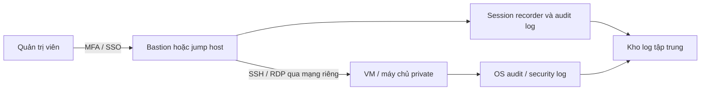
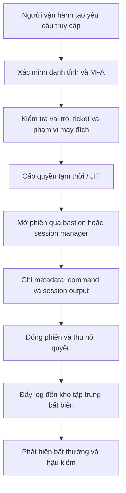
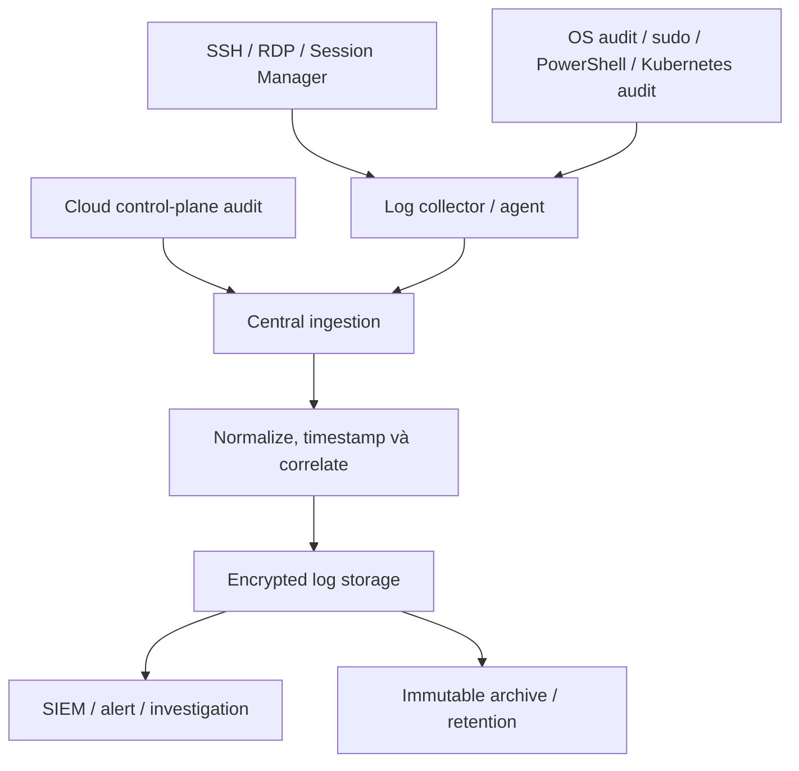
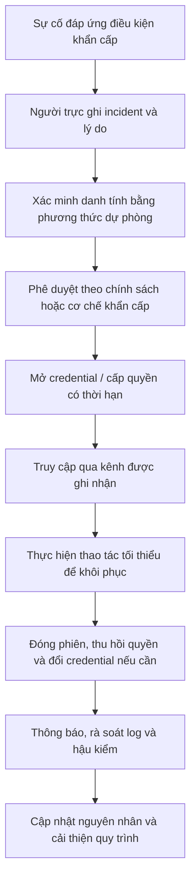

# Ghi nhật ký phiên quản trị và cơ chế truy cập khẩn cấp

## Bối cảnh: biết ai đã truy cập máy, đã làm gì và vì sao

Máy ảo, node Kubernetes, máy chủ cơ sở dữ liệu và các workload compute cần được quản trị trong suốt vòng đời. Kỹ sư có thể đăng nhập SSH vào Linux, dùng RDP với Windows, mở shell qua dịch vụ quản lý phiên, chạy lệnh từ bastion hoặc thay đổi cấu hình thông qua API cloud. Khi có sự cố, tổ chức cần trả lời được: ai đã truy cập, truy cập máy nào, vào thời điểm nào, qua phương thức nào, đã thực hiện thao tác gì và ai đã phê duyệt quyền đó.

**Ghi nhật ký phiên quản trị (administrative session logging)** thu thập thông tin về phiên truy cập và hoạt động quản trị để phục vụ vận hành, điều tra sự cố và kiểm toán. **Cơ chế truy cập khẩn cấp (break-glass access)** cung cấp một con đường truy cập được kiểm soát khi quy trình xác thực hoặc hệ thống quản trị thông thường không khả dụng, hoặc khi sự cố nghiêm trọng đòi hỏi quyền xử lý đặc biệt.

Hai cơ chế này phải được thiết kế cùng nhau. Quyền khẩn cấp cần đủ để khôi phục dịch vụ, nhưng mỗi lần sử dụng phải được ghi nhận, cảnh báo, giới hạn thời gian và hậu kiểm. Nhật ký cần đủ tin cậy để xác định hành động, nhưng cũng phải bảo vệ dữ liệu nhạy cảm và quyền riêng tư của người vận hành.

Trong module **CLOUD_CORE_SERVICES_COMPUTE**, chủ đề này áp dụng cho VM, host, container node và hệ thống quản lý hạ tầng; giúp bảo vệ quyền truy cập máy, tăng khả năng truy vết và duy trì hoạt động khi đường truy cập thông thường gặp sự cố.

## 1. Phân biệt các loại nhật ký quản trị

Không có một loại log duy nhất phản ánh đầy đủ mọi hoạt động. Cần kết hợp nhật ký xác thực, nhật ký phiên, nhật ký hệ điều hành và nhật ký control plane.

| Loại nhật ký | Nội dung thường ghi | Câu hỏi có thể trả lời |
|---|---|---|
| Authentication log | Đăng nhập thành công/thất bại, principal, phương thức MFA, nguồn truy cập | Ai đã xác thực và có lần đăng nhập bất thường nào? |
| Session metadata | Người dùng, máy đích, thời gian bắt đầu/kết thúc, session ID, client/IP, lý do truy cập | Ai mở phiên đến máy nào và trong khoảng thời gian nào? |
| Session recording | Nội dung terminal hoặc hoạt động phiên được ghi theo khả năng của công cụ | Trong phiên được ghi, người vận hành đã nhập hoặc nhìn thấy gì? |
| Command/process audit | Lệnh, tiến trình, user, parent process, thời điểm và kết quả ở mức hệ điều hành | Lệnh hoặc tiến trình nào đã chạy trên máy? |
| OS/security logs | Thay đổi tài khoản, quyền, service, package, firewall, file và sự kiện bảo mật | Hệ điều hành đã thay đổi điều gì? |
| Cloud control-plane audit | Tạo/xóa VM, thay đổi IAM, security group, volume, network và cấu hình dịch vụ | Ai đã thay đổi tài nguyên cloud thông qua API/console? |
| Application/database audit | Truy cập dữ liệu, thay đổi schema, thao tác quản trị ứng dụng | Phiên quản trị đã tác động đến dữ liệu hoặc ứng dụng ra sao? |

Ví dụ, một kỹ sư đăng nhập qua SSH rồi sửa security group bằng API cloud. SSH session log có thể ghi hoạt động terminal; cloud audit log ghi API call và principal đã thực hiện thay đổi; OS log có thể ghi tiến trình hoặc thay đổi cục bộ. Ghép các nguồn bằng danh tính, thời gian, session ID và request ID giúp dựng lại chuỗi sự kiện.

### 1.1. Session recording không thay thế audit log

Ghi màn hình hoặc terminal có thể cho thấy hoạt động trong phiên, nhưng không nhất thiết ghi được mọi thay đổi. Lệnh chạy nền sau khi phiên kết thúc, thao tác qua một API khác, truy cập trực tiếp qua mạng ngoài bastion hoặc hành động của agent có thể nằm ngoài bản ghi phiên.

Ngược lại, audit log thường ghi sự kiện và metadata nhưng không lưu toàn bộ nội dung terminal. Vì vậy, hệ thống cần nhiều lớp telemetry và xác định rõ nguồn nào là bằng chứng cho loại hành động nào.

### 1.2. Phạm vi ghi nhận cần được công bố

Session recording có thể thu thập lệnh, output, nội dung terminal hoặc màn hình. Những nội dung này đôi khi chứa token, dữ liệu khách hàng, thông tin cá nhân hoặc bí mật vô tình được hiển thị. Tổ chức cần quy định mục đích, phạm vi, người được xem, thời hạn lưu giữ và cách xử lý dữ liệu nhạy cảm. Người vận hành cần được thông báo theo chính sách nội bộ và quy định áp dụng.

## 2. Các mô hình truy cập quản trị

### 2.1. Truy cập trực tiếp bằng SSH hoặc RDP

SSH thường được dùng để quản trị Linux; RDP được dùng cho Windows. Truy cập trực tiếp từ máy cá nhân đến VM có thể đơn giản, nhưng nếu mở cổng quản trị rộng trên mạng, bề mặt tấn công và khó khăn trong việc tập trung kiểm soát sẽ tăng.

Nếu vẫn dùng kết nối trực tiếp, cần giới hạn nguồn mạng, yêu cầu MFA ở lớp truy cập phù hợp, dùng tài khoản cá nhân, khóa hoặc chứng thư ngắn hạn, tắt xác thực mật khẩu nếu phù hợp và ghi nhận log trên máy đích. Không dùng chung một tài khoản quản trị cho nhiều người vì sẽ khó quy trách nhiệm.

### 2.2. Bastion host hoặc jump server

Bastion là máy trung gian được bảo vệ, đặt tại vùng mạng quản trị. Kỹ sư xác thực vào bastion trước rồi kết nối từ đó đến VM private. Mô hình này gom điểm vào quản trị và giúp áp dụng kiểm soát mạng, MFA, logging và session recording tập trung.



Bastion cần được vá lỗi, harden, giám sát và triển khai dự phòng. Nếu mọi kết nối đều đi qua một bastion đơn lẻ, nó có thể trở thành điểm lỗi hoặc nút thắt. Cần cân nhắc nhiều instance, nhiều zone và cơ chế scale phù hợp.

Bastion không tự động bảo đảm mọi hoạt động đều được ghi. Nếu người dùng có thể mở tunnel tùy ý, sao chép dữ liệu qua SCP hoặc chuyển tiếp RDP, bản ghi terminal có thể không thể hiện nội dung bên trong kênh được mã hóa. Cần thiết kế policy và log ở các lớp khác để kiểm soát những luồng đó.

### 2.3. Session manager hoặc truy cập không cần inbound port

Một dịch vụ quản lý phiên có thể cho phép kỹ sư mở shell hoặc phiên quản trị thông qua control plane/agent, mà không cần public IP hay mở inbound SSH/RDP đến VM. Agent trên máy tạo kết nối outbound đến dịch vụ quản lý; người dùng xác thực bằng SSO/MFA và được cấp quyền theo IAM.

Mô hình này thường hỗ trợ ghi metadata, lệnh hoặc terminal output về kho log tập trung. Ví dụ các nền tảng có dịch vụ session manager, serial console hoặc browser-based shell. Khả năng ghi nhận, giao thức hỗ trợ, yêu cầu agent và giới hạn phiên phụ thuộc nhà cung cấp.

Lợi ích thường gặp là giảm cổng inbound, tập trung xác thực và dễ tích hợp audit. Cần kiểm tra agent có hoạt động, VM có egress đến control endpoint, DNS và IAM policy đúng hay không. Nếu agent hoặc control plane không khả dụng, cần phương án khôi phục được kiểm thử trước.

### 2.4. Identity-aware access proxy

Proxy truy cập dựa trên danh tính có thể xác thực người dùng trước khi cho phép kết nối đến máy hoặc ứng dụng nội bộ. Quyết định truy cập có thể dựa trên nhóm, vai trò, thiết bị, trạng thái MFA, vị trí hoặc thời hạn cấp quyền. Mô hình này hữu ích khi tổ chức có nhiều môi trường và không muốn phụ thuộc vào VPN mở rộng toàn mạng.

Proxy nên phát hành kết nối theo danh tính cá nhân và ghi session metadata. Với giao thức SSH/RDP, cần xác minh proxy có hỗ trợ ghi phiên hoặc tích hợp với recorder. Việc proxy cho phép kết nối không thay thế quyền ở hệ điều hành và ứng dụng.

## 3. Vòng đời của một phiên quản trị có kiểm soát

Một phiên quản trị nên bắt đầu từ yêu cầu có mục đích, được xác thực và cấp quyền có thời hạn; kết thúc bằng việc thu hồi quyền tạm thời và lưu lại bằng chứng.



### 3.1. Xác định ai, máy nào và vì sao

Trước khi cấp phiên, hệ thống cần biết danh tính cá nhân hoặc danh tính workload, nhóm/role, môi trường, máy đích, lý do truy cập, ticket hoặc incident liên quan và thời hạn. Với quyền cao, yêu cầu nên có phê duyệt của người khác theo nguyên tắc four-eyes.

Không dùng tên tài khoản chung như `admin`, `rootuser` hoặc `operator` cho nhiều người nếu không có cơ chế liên kết rõ phiên với danh tính cá nhân. Tài khoản hệ thống có thể vẫn tồn tại, nhưng quyền sử dụng cần được trung gian hóa và audit theo người yêu cầu.

### 3.2. Cấp quyền just-in-time

Just-in-time (JIT) access cấp quyền khi có nhu cầu và tự động hết hạn sau khoảng thời gian xác định. Thay vì duy trì quyền quản trị rộng thường trực, người dùng yêu cầu role hoặc nhóm tạm thời cho đúng máy, môi trường và nhiệm vụ.

Một quy trình JIT có thể gồm:

1. Người vận hành chọn tài nguyên và quyền cần thiết.
2. Hệ thống kiểm tra MFA, thiết bị, ticket và điều kiện policy.
3. Người có thẩm quyền phê duyệt nếu quyền vượt mức thông thường.
4. Quyền được cấp với thời hạn ngắn, ví dụ 30 hoặc 60 phút theo chính sách.
5. Phiên được mở qua kênh quản trị có ghi nhận.
6. Khi hết hạn hoặc phiên đóng, quyền tạm thời được thu hồi.

Thời hạn cần đủ cho nhiệm vụ nhưng không kéo dài không cần thiết. Gia hạn phải được ghi nhận và có thể cần phê duyệt lại. JIT không chỉ áp dụng cho IAM cloud; có thể dùng cho nhóm sudo, local administrator, SSH certificate hoặc quyền database.

### 3.3. Ghi nhận phiên từ đầu đến cuối

Metadata tối thiểu nên có:

- Session ID duy nhất và correlation/request ID nếu có.
- Principal cá nhân, nhóm, role và phương thức xác thực.
- Tên/ID máy đích, account/project, environment, region/zone.
- Thời điểm bắt đầu, kết thúc, thời lượng và lý do/ticket.
- Bastion, session manager hoặc proxy đã sử dụng.
- IP nguồn, thiết bị hoặc thông tin client theo chính sách.
- Kết quả xác thực, phê duyệt, quyền JIT và thời điểm thu hồi.
- Trạng thái recording, lỗi ghi log hoặc khoảng thời gian mất telemetry.

Session recording có thể lưu terminal input/output, lệnh, hoặc video màn hình tùy công cụ. Cần ghi rõ loại dữ liệu được ghi và trạng thái recording. Nếu phiên không được ghi vì lỗi recorder, sự kiện đó phải được cảnh báo; không nên âm thầm cho phép quyền nhạy cảm tiếp tục mà không có quyết định policy rõ ràng.

### 3.4. Kết thúc phiên và thu hồi quyền

Khi kết thúc, hệ thống nên đóng session, chấm dứt tunnel/process liên quan, thu hồi chứng thư hoặc role tạm thời, vô hiệu hóa token ngắn hạn nếu có thể và ghi nhận thời điểm kết thúc. Chỉ đóng cửa sổ terminal không bảo đảm mọi process hoặc tunnel nền đã kết thúc.

Với quyền sudo hoặc local administrator, cần kiểm tra group membership tạm thời đã được gỡ. Với SSH certificate, thời hạn certificate ngắn và kiểm soát CA giúp hạn chế quyền tồn tại sau phiên. Với cloud IAM, cần xác minh session token và quyền role hết hạn theo chính sách của nền tảng.

## 4. Ghi nhật ký lệnh và hoạt động trên máy

### 4.1. SSH và Linux

Linux thường ghi sự kiện xác thực qua `journald`, `auth.log`, `secure` hoặc hệ thống audit tùy bản phân phối. `sudo` có thể ghi lại người dùng, lệnh và kết quả xác thực. Linux Audit Framework (`auditd`) có thể theo dõi các sự kiện hệ thống như thay đổi tài khoản, quyền, file nhạy cảm và một số syscall.

Ví dụ kiểm tra log đăng nhập và sudo trên hệ thống dùng systemd:

```bash
# Xem sự kiện SSH/sshd gần đây
sudo journalctl -u sshd --since "1 hour ago"

# Tìm các sự kiện sudo trong journal
sudo journalctl _COMM=sudo --since "1 hour ago"

# Xem các phiên đăng nhập hiện tại
who
last -a | head
```

Tên service và vị trí log có thể khác nhau giữa các bản phân phối. `journalctl` chỉ đọc các sự kiện đã được ghi; nó không tự tạo session recording đầy đủ. Muốn ghi terminal input/output, cần công cụ như session manager, bastion recorder hoặc giải pháp PAM chuyên dụng.

SSH nên dùng tài khoản cá nhân, key/certificate được quản lý, MFA ở lớp truy cập và cấu hình `sudo` có log. Có thể dùng SSH CA để phát hành certificate ngắn hạn thay vì phân phối public key dài hạn đến mọi máy. Tắt đăng nhập root trực tiếp và password authentication nếu phù hợp với quy trình khôi phục.

### 4.2. RDP và Windows

Windows có thể ghi sự kiện đăng nhập, đăng xuất, xác thực, sử dụng quyền đặc biệt và thay đổi policy trong Windows Security Event Log. PowerShell logging có thể ghi script block và module activity; Windows Event Forwarding hoặc agent có thể chuyển log về hệ thống tập trung.

Những sự kiện thường cần theo dõi gồm:

- Đăng nhập thành công/thất bại và loại logon.
- Kết nối Remote Desktop, session ID, disconnect và logoff.
- Thay đổi nhóm local Administrators hoặc quyền đặc biệt.
- Tạo/xóa tài khoản, thay đổi mật khẩu và policy.
- PowerShell script block, process creation và hoạt động của công cụ quản trị.
- Thay đổi firewall, service, scheduled task và cấu hình bảo mật.

RDP nên được đặt sau VPN, bastion hoặc gateway truy cập có danh tính; tránh mở TCP/3389 trực tiếp ra Internet. Bật Network Level Authentication, TLS và chính sách khóa tài khoản phù hợp. Với phiên cần ghi hình, sử dụng giải pháp hỗ trợ RDP session recording; Windows Event Log một mình không lưu lại toàn bộ màn hình hay thao tác chuột.

### 4.3. Container và Kubernetes node

Quản trị node/container cần kết hợp audit log của Kubernetes API, log của node OS và log runtime. Kubernetes audit policy có thể ghi ai gọi API, verb, resource, namespace, response code và thời điểm. Điều này giúp truy vết thao tác `exec`, `port-forward`, sửa Secret, thay đổi RBAC hoặc tạo privileged pod nếu policy ghi đủ mức cần thiết.

Không nên chỉ dựa vào audit API để kết luận điều gì đã xảy ra bên trong container. Lệnh thực thi trong container, process, file access và network activity có thể cần runtime security agent, node audit hoặc log ứng dụng. Truy cập shell vào container nên bị giới hạn và được ghi nhận bằng danh tính người yêu cầu, pod/container đích, namespace và lý do.

### 4.4. Lệnh chạy tự động và automation identity

Không phải mọi hành động quản trị đều do con người nhập trực tiếp. Pipeline, configuration management agent, patch manager và automation account có thể thay đổi máy. Nhật ký cần phân biệt human principal với service principal, lưu pipeline/run ID, commit hoặc change request, danh tính khởi chạy và danh tính thực thi.

Không dùng một credential chung cho nhiều automation. Mỗi service identity nên có quyền tối thiểu, vòng đời rõ ràng và log riêng. Khi pipeline chạy lệnh trên VM, nên liên kết command/session record với deployment ID hoặc job ID để đối chiếu với thay đổi ứng dụng.

## 5. Tập trung, bảo vệ và lưu giữ audit log

Log chỉ hữu ích khi được thu thập đầy đủ, có thể truy vấn và đáng tin cậy. Nếu log chỉ nằm trên máy đang được quản trị, người có quyền cao trên máy có thể xóa hoặc sửa dấu vết. Vì vậy, log quan trọng cần được chuyển sớm đến hệ thống tập trung có quyền quản lý độc lập với máy nguồn.

### 5.1. Kiến trúc thu thập log



Các nguồn có thể đẩy log trực tiếp hoặc qua agent/collector. Nên chuẩn hóa timestamp, timezone, hostname, resource ID, principal, session ID và event type để liên kết các sự kiện. Đồng bộ thời gian bằng NTP hoặc dịch vụ time synchronization đáng tin cậy; sai lệch đồng hồ làm khó dựng lại trình tự sự kiện.

### 5.2. Bảo vệ tính toàn vẹn

Để hạn chế việc sửa hoặc xóa log:

- Gửi log ra khỏi máy nguồn càng sớm càng tốt; không chỉ lưu ở local disk.
- Dùng tài khoản ghi log chỉ có quyền append/write vào đúng đích; người vận hành máy không có quyền xóa log tập trung.
- Mã hóa khi truyền và khi lưu; quản lý key tách biệt với quyền truy cập máy.
- Bật versioning, retention lock hoặc immutable/WORM storage khi yêu cầu kiểm toán cần tính chống sửa đổi.
- Ghi audit cho chính hệ thống log: ai truy vấn, export, thay đổi retention hoặc xóa dữ liệu.
- Giám sát agent mất kết nối, queue đầy, ingest delay và khoảng trống log.
- Kiểm tra checksum/signature hoặc cơ chế integrity của nền tảng nếu có.

Không phải mọi log đều cần lưu bất biến vô thời hạn. Chính sách retention nên dựa trên yêu cầu pháp lý, bảo mật, điều tra và chi phí; log hết hạn cần được xóa theo quy trình có kiểm soát.

### 5.3. Bảo vệ dữ liệu nhạy cảm và quyền xem log

Session recording có thể chứa command line, output, file path, dữ liệu người dùng hoặc secret vô tình được in ra. Cần giới hạn người có quyền xem recording, che hoặc loại bỏ dữ liệu nhạy cảm khi công cụ hỗ trợ, và tránh ghi những trường không cần thiết. Khi điều tra, người xem nên truy cập theo ticket hoặc vai trò, có audit và thời hạn.

Không nên ghi password, token hoặc private key vào command line vì chúng có thể xuất hiện trong shell history, process list, audit log hoặc session recording. Dùng secret manager, file descriptor, workload identity hoặc cơ chế nhập bí mật được bảo vệ. Nếu secret bị lộ trong recording, cần xử lý như một sự cố lộ credential: thu hồi, rotation và giới hạn quyền truy cập bản ghi liên quan.

### 5.4. Retention và khả năng truy vấn

Chính sách có thể chia thành các lớp:

- Log vận hành ngắn hạn để gỡ lỗi và xử lý sự cố thường ngày.
- Audit log quản trị lưu theo thời hạn kiểm toán và điều tra.
- Session recording nhạy cảm có quyền truy cập hạn chế và thời hạn rõ ràng.
- Bản lưu trữ dài hạn được mã hóa, bất biến khi cần và có quy trình truy xuất.

Thời hạn cụ thể cần theo chính sách tổ chức và quy định áp dụng. Nên lập chỉ mục theo principal, resource ID, session ID, ticket, thời gian và loại sự kiện. Khả năng tìm kiếm phải được kiểm tra định kỳ; log có tồn tại nhưng không thể truy vấn kịp thời cũng làm giảm giá trị điều tra.

## 6. Cơ chế truy cập khẩn cấp (break-glass)

Break-glass là quy trình cho phép một số người được ủy quyền truy cập đặc biệt khi con đường thông thường không hoạt động hoặc không đủ để khôi phục dịch vụ. Ví dụ: hệ thống SSO bị gián đoạn, MFA provider gặp sự cố, control plane quản trị thông thường không truy cập được hoặc một incident nghiêm trọng cần thao tác ngoài vai trò hằng ngày.

Break-glass không nên là tài khoản quản trị rộng được dùng thường xuyên. Nó là quyền ngoại lệ có mục đích, điều kiện kích hoạt, thời hạn, giám sát và hậu kiểm cụ thể.

### 6.1. Khi nào được sử dụng?

Chính sách cần nêu các tình huống hợp lệ, ví dụ:

- SSO hoặc identity provider chính không khả dụng và hoạt động khôi phục bị chặn.
- Hệ thống MFA/approval bị lỗi trong khi có sự cố nghiêm trọng đang ảnh hưởng dịch vụ.
- Cấu hình IAM hoặc network bị khóa nhầm khiến nhóm vận hành không thể khôi phục quyền thông thường.
- Cần truy cập console/serial hoặc tài khoản hệ điều hành đặc quyền để khôi phục VM/host.
- Cần cô lập hoặc khôi phục hệ thống khi tài khoản quản trị thông thường có dấu hiệu bị xâm nhập.

Không dùng break-glass để né phê duyệt, xử lý công việc thường ngày hoặc tránh ghi log. Nếu có thể sử dụng con đường thông thường trong thời gian đáp ứng mục tiêu sự cố, hãy dùng quy trình thông thường.

### 6.2. Thiết kế tài khoản và bí mật khẩn cấp

Tùy kiến trúc, break-glass có thể là tài khoản cloud emergency, tài khoản quản trị cục bộ, credential console độc lập hoặc cơ chế truy cập ngoại tuyến. Cần:

- Giữ số lượng tài khoản tối thiểu và gắn với người chịu trách nhiệm cụ thể.
- Lưu credential trong vault hoặc phương tiện ngoại tuyến được bảo vệ, có kiểm soát hai người khi lấy ra nếu phù hợp.
- Dùng MFA mạnh, ưu tiên hardware security key hoặc phương thức độc lập với hệ thống đang gặp sự cố.
- Bảo vệ tài khoản bằng policy riêng, cảnh báo mỗi lần sử dụng và không dùng chung thường xuyên.
- Có quy trình xoay vòng credential sau khi sử dụng hoặc khi nghi ngờ bị lộ.
- Kiểm tra tài khoản vẫn hoạt động và quyền đủ dùng, nhưng không duy trì quyền rộng ngoài phạm vi cần thiết.

Nếu emergency identity phụ thuộc hoàn toàn vào cùng một identity provider, cùng một thiết bị MFA hoặc cùng một vault có thể bị ảnh hưởng bởi sự cố, nó không phải đường dự phòng thực sự. Cần thiết kế failure domain độc lập nhưng vẫn có bảo vệ tương đương.

### 6.3. Cấp quyền khẩn cấp có giới hạn

Ngay cả khi dùng tài khoản đặc biệt, nên giới hạn quyền theo tài nguyên, phạm vi và thời gian. Nếu nền tảng hỗ trợ, hãy cấp role tạm thời hoặc mở khóa tài khoản trong một khoảng thời gian xác định; sau đó tự động thu hồi hoặc khóa lại. Nếu bắt buộc dùng credential tĩnh, cần quy trình lấy/trả, đổi credential và xác minh sau sự kiện.

Break-glass cần có alert độc lập. Không chỉ gửi cảnh báo qua hệ thống đang gặp sự cố; nên thông báo đến kênh trực, SIEM hoặc người chịu trách nhiệm qua một đường liên lạc dự phòng.

### 6.4. Quy trình break-glass



Trong tình huống khẩn cấp, phê duyệt trước có thể không khả thi. Chính sách có thể cho phép một người trực kích hoạt, nhưng phải ghi rõ lý do, gửi cảnh báo ngay và yêu cầu người thứ hai hậu kiểm trong thời hạn xác định. Không được bỏ qua audit chỉ vì sự cố nghiêm trọng.

### 6.5. Việc bắt buộc sau khi dùng break-glass

Ngay sau khi khôi phục:

1. Đóng mọi phiên và tunnel còn mở; xác minh không còn process quản trị chạy ngoài dự kiến.
2. Thu hồi role, token, certificate hoặc membership tạm thời.
3. Đổi credential khẩn cấp nếu đã được sử dụng hoặc có khả năng bị lộ; kiểm tra vault và người đã truy cập bí mật.
4. Xác minh cấu hình IAM, firewall, tài khoản local và service đã trở về trạng thái được phê duyệt.
5. Lưu session recording, cloud audit, OS audit, ticket và timeline sự cố vào hồ sơ incident.
6. Người độc lập rà soát các lệnh và thay đổi, xác nhận mục đích, phạm vi và tác động.
7. Ghi nhận nguyên nhân khiến phải dùng break-glass và tạo hành động loại bỏ nguyên nhân gốc.

Nếu phát hiện hoạt động ngoài phạm vi, cần chuyển sang quy trình ứng phó sự cố bảo mật, bảo toàn bằng chứng và thu hồi danh tính/credential có liên quan.

## 7. Ví dụ policy và cấu hình kiểm soát

Ví dụ dưới đây là chính sách khái niệm để minh họa các điều kiện. Tên trường không phải schema của một sản phẩm cụ thể.

```yaml
administrative_access:
  allowed_paths:
    - session_manager
    - hardened_bastion
  require_mfa: true
  require_personal_identity: true
  require_ticket: true
  just_in_time:
    enabled: true
    max_duration_minutes: 60
  session_recording:
    enabled: true
    central_destination: security-audit-store
    alert_if_recording_unavailable: true
  break_glass:
    enabled: true
    require_incident_id: true
    notify_security_on_use: true
    max_duration_minutes: 30
    post_use_review_required: true
```

Trong production, policy cần xác định rõ ai được phê duyệt, tài nguyên nào thuộc phạm vi, loại phiên nào phải ghi, cách xử lý khi recorder lỗi và cách thu hồi quyền. Cấu hình `enabled: true` không có ý nghĩa nếu network vẫn cho phép SSH/RDP đi vòng ngoài kênh kiểm soát.

### 7.1. Ngăn đường truy cập vòng ngoài

Nếu muốn mọi phiên quản trị đi qua bastion hoặc session manager, cần kiểm tra security group/firewall của VM chỉ nhận kết nối từ các điểm vào được phê duyệt. Cần kiểm tra cả IPv4, IPv6, VPN, peering, transit, subnet phụ và đường truy cập console. Một rule cũ mở SSH/RDP từ mọi địa chỉ có thể vô hiệu hóa thiết kế session recording.

Với Kubernetes, hạn chế quyền `pods/exec`, `nodes/proxy`, port-forward và quyền tạo privileged workload. Với Windows, kiểm tra RDP listener và firewall. Với Linux, kiểm tra `sshd_config`, sudoers, tài khoản local và SSH authorized keys. Mọi ngoại lệ cần có owner, lý do và thời hạn.

### 7.2. Tách nhiệm vụ quản trị và kiểm toán

Người có quyền root hoặc local administrator có thể tác động đến log trên máy nguồn. Vì vậy, quyền quản trị máy không nên đồng thời có quyền xóa hoặc sửa log tập trung. Người quản lý log cũng không nên có quyền thay đổi máy production nếu không cần.

Tách vai trò giúp giảm khả năng một người vừa thực hiện thay đổi vừa xóa dấu vết. Với sự cố khẩn cấp, người sử dụng break-glass có thể có quyền cao trên máy, nhưng log được gửi đến một hệ thống khác có quyền quản trị độc lập và alert đến nhóm bảo mật.

## 8. Phát hiện và cảnh báo hoạt động bất thường

Audit log có giá trị hơn khi được dùng để phát hiện hành vi bất thường, không chỉ lưu trữ để xem lại sau sự cố. Một số tín hiệu nên theo dõi:

- Đăng nhập ngoài giờ, từ vị trí hoặc thiết bị không thường dùng, đặc biệt với quyền cao.
- Nhiều lần xác thực thất bại, MFA fatigue hoặc đăng nhập thành công sau chuỗi thất bại.
- Sử dụng tài khoản root/Administrator hoặc thêm người dùng vào nhóm đặc quyền.
- Phiên quản trị đến máy production mà không có ticket/change record.
- Session recording bị tắt, agent mất kết nối hoặc log ingestion bị gián đoạn.
- Truy cập break-glass, đọc credential từ vault hoặc thay đổi policy của emergency account.
- Mở SSH/RDP từ Internet, thay đổi route/firewall hoặc tạo key dài hạn.
- Dùng `exec`, port-forward hoặc privileged container ngoài quy trình.
- Xóa log, thay đổi retention, tắt audit policy hoặc thay đổi thời gian hệ thống.
- Một automation identity thực hiện hành động ngoài pipeline hoặc lịch đã đăng ký.

Alert cần có ngữ cảnh để người trực đánh giá: principal, resource, session ID, nguồn, ticket, mức quyền và thay đổi liên quan. Tránh tạo quá nhiều cảnh báo không có khả năng hành động; nên ưu tiên sự kiện có rủi ro cao và điều chỉnh ngưỡng theo hành vi bình thường.

## 9. Kiểm thử và diễn tập truy cập khẩn cấp

Một tài khoản break-glass chưa từng được thử có thể không hoạt động khi cần: credential hết hạn, MFA device không còn, vault không truy cập được, route bị chặn hoặc quyền không đủ. Cần diễn tập định kỳ trong môi trường an toàn.

Nội dung kiểm thử nên bao gồm:

1. **Kiểm tra đăng nhập:** xác minh phương thức dự phòng hoạt động và người được ủy quyền có thể lấy credential đúng quy trình.
2. **Kiểm tra phạm vi quyền:** xác nhận có thể thực hiện thao tác phục hồi cần thiết nhưng không có quyền thừa ngoài chính sách.
3. **Kiểm tra ghi log:** xác minh session metadata, recording, cloud audit và OS audit được gửi đến kho tập trung.
4. **Kiểm tra cảnh báo:** xác nhận nhóm trực và bảo mật nhận được thông báo ngay khi break-glass được kích hoạt.
5. **Kiểm tra thu hồi:** xác minh role/token/certificate bị thu hồi và credential được đổi khi cần.
6. **Kiểm tra failure mode:** mô phỏng SSO hoặc recorder không khả dụng trong môi trường thử nghiệm và xác minh quy trình xử lý.
7. **Kiểm tra khôi phục:** đánh giá thời gian truy cập và khả năng hoàn thành tác vụ trong mục tiêu RTO.

Diễn tập nên có biên bản gồm ngày thử, người tham gia, tài nguyên, kết quả, lỗi phát hiện và người chịu trách nhiệm khắc phục. Không thử credential khẩn cấp bằng cách đăng nhập tùy tiện vào production; sử dụng quy trình đã được phê duyệt và môi trường kiểm thử phù hợp.

## 10. Runbook xử lý sự cố truy cập quản trị

Khi người vận hành không truy cập được máy, trước tiên xác định lỗi thuộc danh tính, mạng, agent hay hệ điều hành. Không chuyển ngay sang break-glass nếu vẫn còn phương thức thông thường an toàn và có thể khôi phục trong thời gian cho phép.

| Triệu chứng | Kiểm tra | Hướng xử lý |
|---|---|---|
| SSO/MFA không hoạt động | Identity provider, MFA service, thời gian hệ thống và trạng thái thiết bị | Dùng phương thức khôi phục danh tính đã được phê duyệt; chỉ dùng break-glass khi đủ điều kiện |
| Bastion không truy cập được | Health, capacity, DNS, route, firewall và chứng thư | Chuyển sang bastion dự phòng hoặc session manager đã kiểm thử |
| Session manager không kết nối | Agent, egress, DNS, endpoint service và IAM | Khôi phục agent/đường mạng; dùng console dự phòng theo policy nếu sự cố nghiêm trọng |
| SSH/RDP timeout | IP, route, firewall, listener và host health | Phân biệt lỗi mạng với lỗi guest; tránh mở cổng công khai tạm thời không kiểm soát |
| Đăng nhập được nhưng không có recording | Recorder, collector, log destination và policy | Chặn quyền nhạy cảm hoặc áp dụng ngoại lệ khẩn cấp có alert và hậu kiểm theo policy |
| Break-glass credential không dùng được | Vault, MFA dự phòng, account lock, credential rotation | Dùng phương án dự phòng thứ hai; khôi phục và cập nhật kho credential |
| Log không đến SIEM | Agent, queue, network, ingestion endpoint và quota | Bảo toàn log local tạm thời, khôi phục chuyển tiếp và ghi nhận khoảng trống telemetry |

Quy trình tổng quát:

1. Ghi incident ID, mức độ ảnh hưởng, máy đích và mục tiêu thao tác.
2. Xác định đường truy cập thông thường nào còn hoạt động và kiểm tra nguyên nhân lỗi.
3. Chọn phương thức dự phòng đã được kiểm thử; xác thực danh tính bằng yếu tố độc lập nếu có thể.
4. Nếu cần break-glass, ghi lý do, thời điểm, người kích hoạt và người phê duyệt hoặc hậu kiểm.
5. Dùng quyền tối thiểu để khôi phục; ghi lại các lệnh và thay đổi quan trọng.
6. Đóng phiên, thu hồi quyền và xoay vòng credential theo policy.
7. Rà soát audit log, session recording, thay đổi cấu hình và các dấu hiệu bất thường.
8. Cập nhật runbook, xử lý nguyên nhân gốc và diễn tập lại sau khi khắc phục.

## 11. Checklist triển khai

### Trước khi mở quyền quản trị

- [ ] Mỗi người dùng có danh tính cá nhân; MFA và nhóm/role được cấu hình đúng.
- [ ] Đường truy cập được phê duyệt: bastion, session manager hoặc identity-aware proxy.
- [ ] SSH/RDP không mở rộng ra Internet ngoài chính sách; firewall chỉ cho phép nguồn cần thiết.
- [ ] Quyền quản trị được cấp theo JIT, đúng máy, đúng môi trường và có thời hạn.
- [ ] Ticket hoặc lý do truy cập được liên kết với session metadata.
- [ ] Session recording và OS/cloud audit được bật theo phạm vi đã công bố.
- [ ] Log được chuyển về kho tập trung, mã hóa và bảo vệ khỏi sửa/xóa trái phép.
- [ ] Có cảnh báo khi recording hoặc log ingestion bị gián đoạn.

### Trước khi công bố break-glass

- [ ] Tình huống kích hoạt và người được phép sử dụng được quy định rõ.
- [ ] Credential được bảo vệ độc lập với hệ thống xác thực chính có thể gặp sự cố.
- [ ] MFA dự phòng, vault và người giữ trách nhiệm đã được kiểm tra.
- [ ] Quyền và thời hạn đủ cho thao tác khôi phục, có giới hạn phạm vi.
- [ ] Mỗi lần sử dụng đều phát cảnh báo đến nhóm trực và bảo mật.
- [ ] Có quy trình đóng phiên, thu hồi quyền, xoay vòng credential và hậu kiểm.
- [ ] Đã diễn tập quy trình, bao gồm tình huống SSO hoặc log collector không khả dụng.

## 12. Những nhầm lẫn thường gặp

**Có authentication log nghĩa là đã ghi được toàn bộ phiên.** Authentication log thường chỉ ghi sự kiện đăng nhập. Muốn biết hoạt động trong phiên cần session recording, command/process audit và log ở các lớp liên quan.

**Bastion tự động ghi lại mọi thao tác trên máy đích.** Bastion chỉ ghi được những hoạt động đi qua và được recorder hỗ trợ. Kết nối vòng ngoài, tunnel hoặc API khác có thể nằm ngoài bản ghi.

**Session recording thay thế cloud audit và OS audit.** Recording không nhất thiết ghi API call, tiến trình nền hoặc thay đổi do agent thực hiện. Cần kết hợp nhiều nguồn log.

**Người có quyền root có thể tự quản lý log của chính mình.** Người quản trị máy có thể tác động log local. Bản ghi quan trọng cần được gửi đến kho tập trung với quyền quản trị độc lập.

**Break-glass là tài khoản admin luôn bật để tiện xử lý.** Quyền khẩn cấp phải chỉ dùng khi có điều kiện, có cảnh báo, giới hạn thời gian và hậu kiểm. Quyền rộng thường trực làm tăng rủi ro bị lạm dụng.

**MFA của tài khoản khẩn cấp có thể phụ thuộc cùng hệ thống MFA chính.** Nếu hệ thống chính gặp sự cố, yếu tố xác thực đó cũng có thể không dùng được. Phương án dự phòng cần độc lập về failure domain và được bảo vệ tương đương.

**Dùng break-glass thì có thể bỏ qua log.** Truy cập khẩn cấp càng cần được ghi nhận và rà soát vì thường có quyền cao và xảy ra trong thời điểm rủi ro.

**Lưu log lâu nhất có thể luôn tốt hơn.** Session recording có thể chứa dữ liệu nhạy cảm. Cần retention theo mục đích, giới hạn người xem, bảo vệ dữ liệu và xóa theo chính sách.

## Kết luận

Ghi nhật ký phiên quản trị cần kết hợp authentication log, session metadata/recording, OS audit và cloud control-plane audit để tạo được dấu vết xuyên suốt từ người dùng đến tài nguyên. Bastion, session manager và identity-aware proxy giúp tập trung điểm truy cập; JIT giảm quyền thường trực; kho log tập trung và bất biến bảo vệ bằng chứng. Break-glass cung cấp lối truy cập dự phòng khi quy trình thông thường thất bại, nhưng phải có điều kiện kích hoạt, xác thực độc lập, giới hạn thời gian, cảnh báo, thu hồi quyền và hậu kiểm. Kiểm thử định kỳ cả đường truy cập bình thường lẫn khẩn cấp giúp tổ chức vừa khôi phục compute khi có sự cố, vừa duy trì khả năng truy vết và trách nhiệm giải trình.
