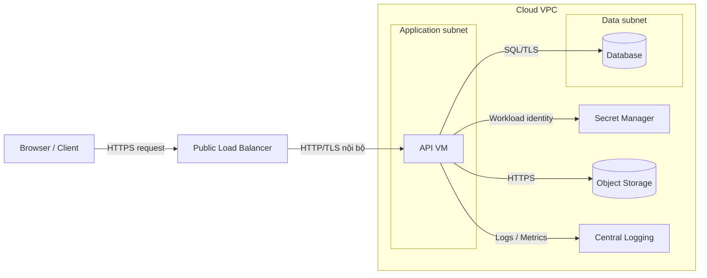
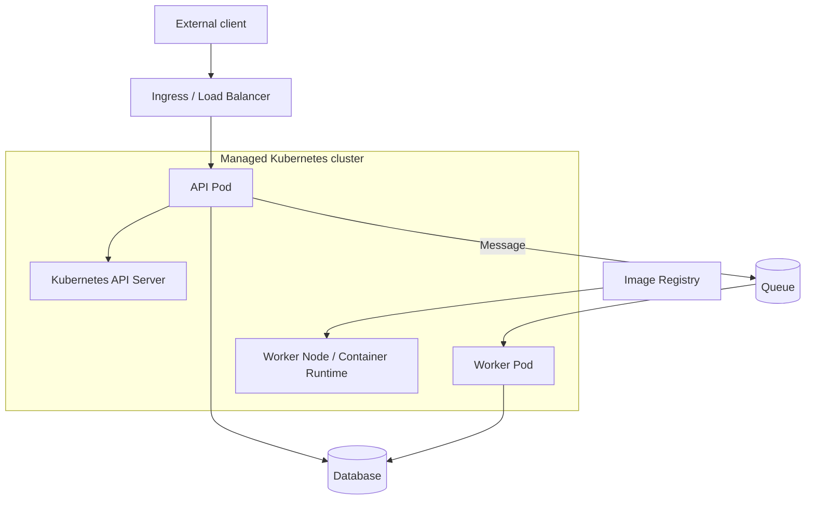
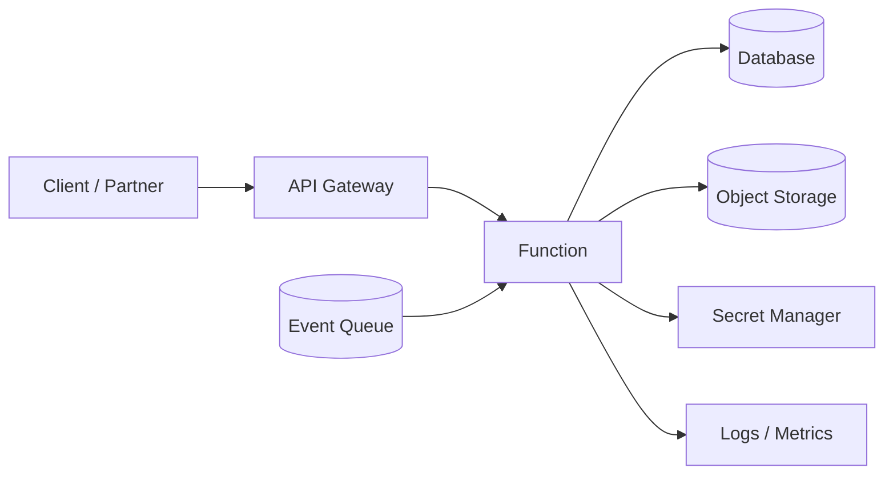
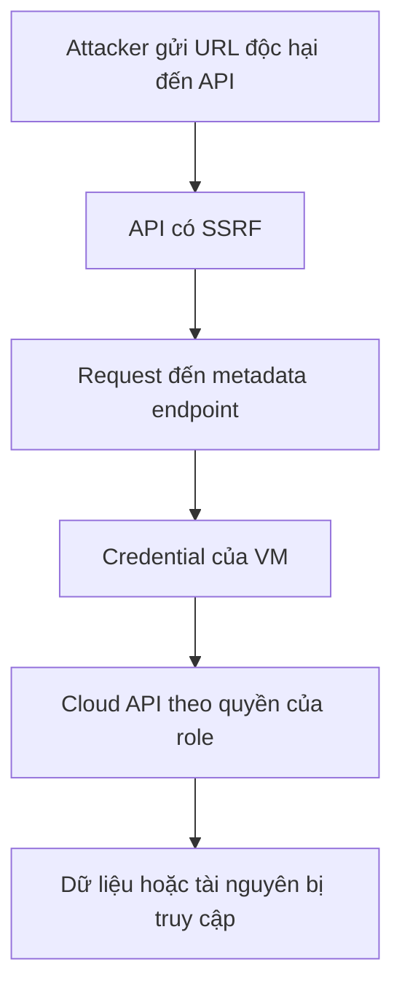
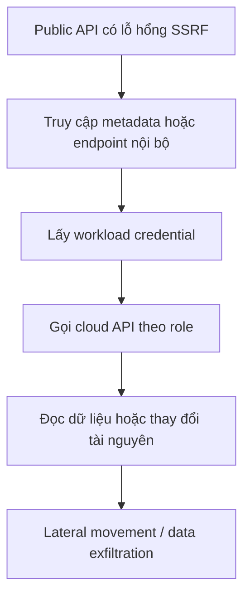
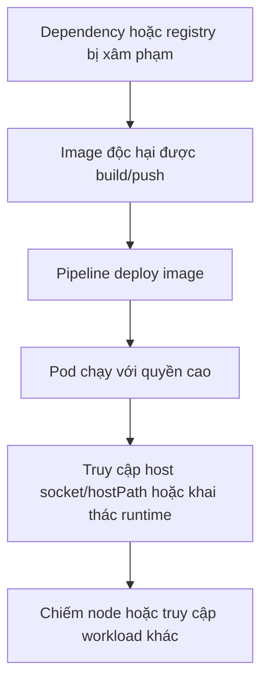
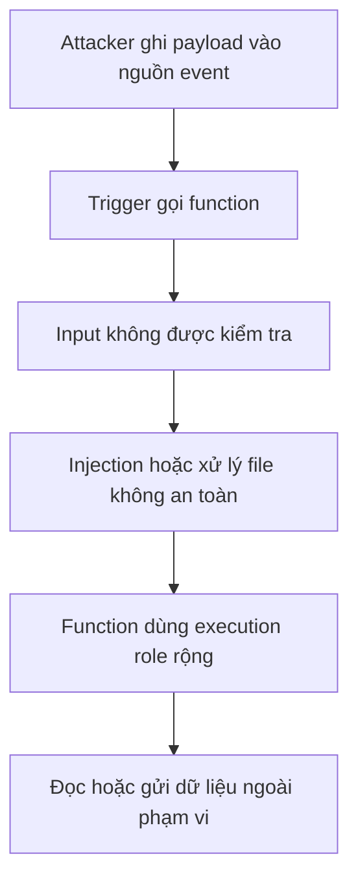

# Threat modeling cho máy ảo, container và hàm serverless

Threat modeling là cách phân tích có cấu trúc để hiểu một workload cần bảo vệ điều gì, ai có thể tấn công, các đường tấn công đi qua đâu và kiểm soát nào cần được thiết kế trước khi hệ thống đưa vào vận hành. Với cloud compute, cùng một ứng dụng có thể chạy trên máy ảo (VM), container hoặc hàm serverless (FaaS), nhưng mỗi mô hình có ranh giới tin cậy, bề mặt tấn công và trách nhiệm vận hành khác nhau.

Trong module **CLOUD_CORE_SERVICES_COMPUTE**, việc lựa chọn CPU, bộ nhớ, mạng, image, runtime, danh tính và cách triển khai đều ảnh hưởng đến bảo mật. Threat modeling kết nối các quyết định đó thành một mô hình rủi ro có thể thảo luận và kiểm chứng. Thay vì chỉ liệt kê lỗ hổng, nhóm phát triển và vận hành mô tả tài sản, luồng dữ liệu, trust boundary, mối đe dọa, biện pháp giảm thiểu và bằng chứng xác nhận kiểm soát hoạt động.

## Mục tiêu học tập

Sau bài này, bạn có thể:

- Giải thích mục đích, phạm vi và thời điểm thực hiện threat modeling cho workload compute.
- Xác định tài sản, threat actor, trust boundary, entry point và luồng dữ liệu.
- Dùng STRIDE để phân loại mối đe dọa đối với VM, container và FaaS.
- Nhận diện các đường tấn công liên quan đến metadata service, image supply chain, control plane, event trigger, secret và mạng.
- Đánh giá rủi ro theo khả năng xảy ra, tác động và mức độ phơi bày.
- Chọn biện pháp phòng ngừa, phát hiện, ứng phó và phục hồi phù hợp với từng mô hình compute.
- Xây dựng threat model có thể kiểm tra lại trong thiết kế, CI/CD và vận hành production.

## 1. Threat modeling là gì?

Threat modeling là quá trình mô tả hệ thống từ góc nhìn bảo mật, đặt câu hỏi về những điều có thể xảy ra sai và xác định cách giảm thiểu rủi ro. Một threat model hữu ích không chỉ có danh sách CVE hay checklist cấu hình. Nó liên kết một mối đe dọa với tài sản bị ảnh hưởng, đường tấn công khả thi, điều kiện cần thiết, kiểm soát hiện có, rủi ro còn lại và người chịu trách nhiệm.

Ví dụ, với một VM chạy API:

- **Tài sản:** dữ liệu đơn hàng, credential của workload, image triển khai và quyền truy cập database.
- **Entry point:** HTTPS từ Internet, kênh quản trị và metadata endpoint.
- **Mối đe dọa:** kẻ tấn công khai thác SSRF trong API để truy cập metadata service và lấy credential.
- **Tác động:** credential có thể bị dùng để đọc object hoặc truy cập dịch vụ cloud.
- **Kiểm soát:** bảo vệ metadata service, giới hạn egress, dùng role tối thiểu, kiểm tra URL đích và giám sát truy cập credential.
- **Bằng chứng:** cấu hình metadata, policy IAM, kiểm thử SSRF, flow log và audit event.

Threat modeling thường được thực hiện sớm trong thiết kế, sau đó cập nhật khi kiến trúc, dữ liệu, runtime hoặc luồng mạng thay đổi. Nó không phải hoạt động chỉ làm một lần trước ngày phát hành.

### 1.1. Threat, vulnerability, attack và risk

| Khái niệm | Ý nghĩa | Ví dụ trong compute |
|---|---|---|
| Threat | Tình huống hoặc tác nhân có thể gây hại cho hệ thống | Kẻ tấn công tìm cách chiếm quyền VM |
| Vulnerability | Điểm yếu có thể bị khai thác | Package cũ có lỗ hổng thực thi mã từ xa |
| Attack | Hành động khai thác điểm yếu | Gửi request độc hại đến API dễ bị RCE |
| Attack path | Chuỗi bước nối entry point đến tài sản hoặc quyền có giá trị | API → SSRF → metadata → workload credential → object storage |
| Risk | Khả năng và tác động của sự kiện gây hại trong bối cảnh cụ thể | Lộ dữ liệu do role VM có quyền đọc toàn bộ bucket |
| Control | Biện pháp giảm khả năng xảy ra hoặc giảm tác động | IAM least privilege, egress policy, patching và audit |
| Residual risk | Rủi ro còn lại sau khi áp dụng kiểm soát | SSRF vẫn có thể truy cập một số endpoint nội bộ được phép |

Một CVE có điểm nghiêm trọng cao không tự động đồng nghĩa workload có rủi ro cao nhất. Cần xem dịch vụ có phơi bày điểm yếu không, điều kiện khai thác có khả thi không, quyền của tiến trình ra sao và dữ liệu nào có thể bị ảnh hưởng.

### 1.2. Giá trị của threat modeling

- Phát hiện rủi ro trước khi hạ tầng và ứng dụng trở nên khó thay đổi.
- Giúp kiến trúc sư, developer, platform engineer và security team dùng chung mô hình hệ thống.
- Làm rõ trách nhiệm giữa khách hàng và nhà cung cấp cloud.
- Ưu tiên biện pháp bảo vệ theo tác động thực tế thay vì thêm kiểm soát tràn lan.
- Tạo yêu cầu kiểm thử có thể đưa vào CI/CD và quy trình vận hành.
- Giải thích vì sao private subnet, workload identity hoặc image signing là cần thiết.

## 2. Phạm vi và ranh giới cần mô hình hóa

Một workload compute thường không chỉ gồm tiến trình ứng dụng. Nó còn có image, guest OS hoặc runtime, network interface, identity, secret, storage, log, control plane, pipeline triển khai và các dịch vụ phụ thuộc.

### 2.1. Xác định phạm vi hệ thống

Trước khi vẽ sơ đồ, hãy trả lời:

1. Ứng dụng hoặc workload nào đang được phân tích?
2. Môi trường nào nằm trong phạm vi: development, staging, production hay cả ba?
3. Dữ liệu nào được xử lý và mức độ nhạy cảm của dữ liệu?
4. Người dùng, hệ thống nội bộ và dịch vụ bên ngoài nào tương tác với workload?
5. Compute chạy trên VM, container, Kubernetes, FaaS hay kết hợp nhiều mô hình?
6. Thành phần nào do nhà cung cấp quản lý và thành phần nào do đội ngũ quản lý?
7. Hệ thống phụ thuộc nào có thể làm thay đổi rủi ro, như database, queue, object storage, DNS, CI/CD và secret manager?

Ghi rõ phần nằm ngoài phạm vi và lý do. Ví dụ, nhà cung cấp cloud có thể chịu trách nhiệm vận hành hypervisor; threat model của khách hàng vẫn cần ghi nhận hypervisor là trust boundary và tham chiếu bằng chứng bảo mật dịch vụ, dù nhóm ứng dụng không trực tiếp cấu hình lớp này.

### 2.2. Tài sản cần bảo vệ

| Nhóm tài sản | Ví dụ | Mối quan tâm bảo mật |
|---|---|---|
| Dữ liệu nghiệp vụ | Đơn hàng, hồ sơ người dùng, tệp tải lên | Bảo mật, toàn vẹn, retention và xóa dữ liệu |
| Credential và secret | Access token, API key, private key, DB password | Lộ lọt, sử dụng sai mục đích, vòng đời và thu hồi |
| Danh tính và quyền | VM role, service account, function execution role, Kubernetes service account | Chiếm quyền, leo thang đặc quyền, trust policy quá rộng |
| Compute artifact | VM image, container image, function package, dependency | Mã độc, dependency bị cài cắm, build bị can thiệp |
| Runtime và cấu hình | Guest OS, container runtime, function runtime, environment variable | Lỗ hổng, cấu hình yếu, phiên bản hết hỗ trợ |
| Network và endpoint | VPC/VNet, subnet, security group, API endpoint, private endpoint | Truy cập trái phép, lateral movement, rò rỉ dữ liệu |
| Control plane | Cloud API, Kubernetes API, deployment controller | Chiếm quyền quản trị và thay đổi workload |
| Log và bằng chứng | Audit log, flow log, trace, image scan report | Bị sửa/xóa, lộ dữ liệu nhạy cảm, thiếu khả năng điều tra |
| Tính sẵn sàng | API, worker, queue consumer, inference service | DoS, cạn tài nguyên, lỗi phụ thuộc và gián đoạn |
| Pipeline triển khai | Source repository, build runner, artifact registry, IaC state | Supply-chain compromise và triển khai trái phép |

### 2.3. Threat actor và năng lực

Những nhóm tác nhân có thể liên quan đến workload:

- Người dùng Internet không xác thực hoặc người dùng hợp lệ có hành vi lạm dụng.
- Kẻ tấn công bên ngoài khai thác lỗ hổng ứng dụng, endpoint hoặc dependency.
- Malware hoặc tiến trình đã chiếm được một VM/container/function.
- Tài khoản nội bộ bị lộ hoặc nhân sự có quyền vượt quá nhu cầu.
- Nhà cung cấp dependency, image, package hoặc công cụ build bị xâm phạm.
- Workload khác trong cùng mạng hoặc cùng cluster nhưng không đáng tin cậy.
- Tác nhân gây gián đoạn có chủ đích hoặc vô tình, như gửi tải lớn, tạo event bất thường hoặc cấu hình sai.

Mô tả năng lực liên quan: có thể gửi request Internet, có credential người dùng, chạy container trong namespace riêng, truy cập repository hoặc có quyền sửa IaC. Không cần đưa ra giả định phi thực tế như mọi tác nhân đều có quyền root trên hypervisor.

### 2.4. Trust boundary

Trust boundary là ranh giới nơi dữ liệu, lệnh hoặc danh tính đi từ miền tin cậy này sang miền khác. Khi dữ liệu đi qua ranh giới, cần xác định cơ chế xác thực, phân quyền, kiểm tra đầu vào, mã hóa và ghi log.

Các ranh giới thường gặp:

- Internet đến public load balancer/API gateway.
- Load balancer đến VM hoặc container.
- Container/workload đến node và Kubernetes control plane.
- VM/container/function đến metadata service.
- Workload identity đến IAM/API cloud.
- Ứng dụng đến database, queue và object storage.
- Build pipeline đến artifact registry và cloud deployment API.
- Tenant hoặc namespace này đến tenant/namespace khác.
- Dịch vụ managed do nhà cung cấp vận hành đến cấu hình do khách hàng quản lý.

Không nên coi subnet private là ranh giới tin cậy tuyệt đối. Một workload trong private subnet vẫn có thể bị xâm nhập qua dependency, credential, đường quản trị hoặc luồng nội bộ.

## 3. Mô hình hóa luồng dữ liệu và kiến trúc

Sơ đồ luồng dữ liệu (Data Flow Diagram – DFD) giúp nhìn thấy thành phần, kết nối, kho dữ liệu và ranh giới tin cậy. Sơ đồ cần đủ chi tiết để xác định dữ liệu đi đâu, ai khởi tạo kết nối và quyền nào được sử dụng.

### 3.1. Các thành phần của DFD

| Thành phần | Ý nghĩa | Ví dụ |
|---|---|---|
| External entity | Tác nhân bên ngoài hệ thống | Browser, đối tác API, hệ thống thanh toán |
| Process | Tiến trình hoặc workload xử lý dữ liệu | VM API, container worker, FaaS function |
| Data store | Nơi lưu dữ liệu | Database, object storage, queue, cache |
| Data flow | Luồng dữ liệu hoặc request | HTTPS, event, SQL, message |
| Trust boundary | Ranh giới giữa các miền tin cậy | Internet/VPC, tenant, cluster, cloud account |

### 3.2. DFD ví dụ cho ứng dụng VM



Trong sơ đồ cần ghi thêm trust boundary giữa Internet và cloud, giữa application subnet và data subnet, cũng như ranh giới IAM khi VM gọi secret manager/object storage. Dữ liệu trong request, log và database có thể có độ nhạy cảm khác nhau.

### 3.3. DFD ví dụ cho container/Kubernetes



Sơ đồ gợi ý các câu hỏi: ai có quyền gọi Kubernetes API, Pod nào được phép đọc secret, image được kéo từ registry nào, node có cho workload truy cập metadata endpoint không và NetworkPolicy có được CNI thực thi không?

### 3.4. DFD ví dụ cho FaaS



Với FaaS, cần thể hiện nguồn kích hoạt function, execution role, quyền truy cập dịch vụ đích, retry/dead-letter, concurrency và nơi log được lưu. Một event đến từ queue và một HTTP request có thể có trust level khác nhau dù cùng gọi một function.

## 4. Phương pháp STRIDE

STRIDE là cách phân loại mối đe dọa theo sáu nhóm. Nó giúp nhóm không bỏ sót loại rủi ro khi phân tích từng thành phần và luồng dữ liệu.

| Nhóm | Ý nghĩa | Ví dụ với compute |
|---|---|---|
| Spoofing | Giả mạo danh tính | Giả mạo service account hoặc event source để gọi function |
| Tampering | Sửa đổi dữ liệu/cấu hình trái phép | Thay VM image, container image, IaC state hoặc payload queue |
| Repudiation | Phủ nhận hành động do thiếu bằng chứng | Không có audit log chứng minh ai thay security group hoặc deploy image |
| Information Disclosure | Tiết lộ thông tin | Lộ secret qua metadata endpoint, log, snapshot hoặc object storage |
| Denial of Service | Làm suy giảm hoặc ngừng dịch vụ | Tạo request/event quá tải, cạn CPU/RAM/concurrency hoặc connection pool |
| Elevation of Privilege | Leo thang đặc quyền | Container breakout, role quá rộng hoặc chiếm pipeline có quyền admin |

### 4.1. Spoofing – giả mạo

Kẻ tấn công có thể giả mạo user, service, event hoặc nguồn mạng để được hệ thống tin cậy. Cần kiểm tra xác thực và nguồn gốc dữ liệu ở mọi trust boundary.

Ví dụ:

- API nhận `X-User-ID` từ client và tin giá trị đó mà không xác minh token.
- Function được trigger từ queue nhưng không xác minh quyền publish của producer.
- Pod dùng service account mặc định có quyền lớn và bị workload khác lợi dụng.
- Pipeline nhận artifact từ registry không được kiểm soát.

### 4.2. Tampering – sửa đổi trái phép

Kẻ tấn công có thể thay image, package, startup script, biến môi trường, policy mạng hoặc dữ liệu lưu trữ. Kiểm soát gồm ký artifact, pin digest, review IaC, bảo vệ registry, kiểm tra integrity và phân quyền ghi/xóa.

### 4.3. Repudiation – phủ nhận hành động

Nếu thiếu audit log, một thay đổi quyền hoặc thao tác truy cập dữ liệu khó quy về danh tính cụ thể. Cần bật log cho cloud API, Kubernetes API, IAM, deployment, secret access và hệ thống ứng dụng; bảo vệ log khỏi sửa/xóa và đồng bộ thời gian.

### 4.4. Information Disclosure – lộ thông tin

Các đường lộ dữ liệu thường gặp gồm bucket public, database port mở, snapshot chia sẻ sai, secret trong image, metadata credential, log chứa token và backup không mã hóa. Kiểm soát cần kết hợp network, IAM, encryption, data classification và logging hygiene.

### 4.5. Denial of Service – từ chối dịch vụ

Compute có giới hạn hữu hạn: vCPU, RAM, disk I/O, network, connection, GPU memory, function concurrency và quota. Kẻ tấn công có thể khai thác endpoint tốn tài nguyên hoặc kích hoạt lượng event lớn. Biện pháp gồm rate limit, quota, autoscaling có giới hạn, timeout, queue backpressure, circuit breaker và cảnh báo chi phí.

### 4.6. Elevation of Privilege – leo thang đặc quyền

Một tiến trình ban đầu có quyền thấp có thể tìm cách đạt quyền cao hơn trong VM, container, cluster hoặc cloud account. Rủi ro thường đến từ kernel/runtime lỗ hổng, privileged container, mount socket host, IAM role quá rộng, secret chia sẻ hoặc pipeline có quyền triển khai không giới hạn.

## 5. Quy trình threat modeling

Một quy trình thực tế cần đủ nhẹ để áp dụng cho từng thay đổi nhưng đủ sâu cho workload có dữ liệu nhạy cảm hoặc quyền lớn.

1. **Xác định mục tiêu và phạm vi.** Ghi tên workload, chủ sở hữu, môi trường, loại compute, dữ liệu, yêu cầu bảo mật và các thành phần trong/ngoài phạm vi.
2. **Liệt kê tài sản và mức độ quan trọng.** Ghi dữ liệu, identity, secret, artifact, compute resource, endpoint, log và pipeline; xác định owner và yêu cầu bảo vệ.
3. **Vẽ DFD và trust boundary.** Ghi external entity, process, data store, flow, protocol, port, identity và loại dữ liệu trên các luồng quan trọng.
4. **Liệt kê entry point và threat actor.** Xem xét public API, SSH/RDP, Kubernetes API, container registry, function trigger, metadata endpoint, CI runner và cloud management API.
5. **Phân tích STRIDE và attack path.** Đặt câu hỏi theo sáu nhóm cho từng process, store và flow; nối các bước có thể dẫn từ entry point đến tài sản có giá trị.
6. **Ghi kiểm soát hiện có và đề xuất.** Chia kiểm soát thành phòng ngừa, phát hiện, ứng phó và phục hồi; ghi owner và nơi cấu hình.
7. **Đánh giá rủi ro còn lại và ưu tiên.** Ước lượng khả năng xảy ra, tác động, mức phơi bày và khả năng phục hồi.
8. **Chuyển thành công việc có thể kiểm chứng.** Mỗi biện pháp cần owner, deadline, tiêu chí hoàn thành và bằng chứng.
9. **Cập nhật khi hệ thống thay đổi.** Rà soát khi thêm endpoint, đổi compute, trust policy, service account, database, egress, image base, trigger hoặc managed service.

## 6. Đánh giá và ưu tiên rủi ro

Threat model cần phân biệt rủi ro vốn có (inherent risk) và rủi ro còn lại (residual risk) sau kiểm soát. Có thể dùng ma trận định tính hoặc thang điểm nội bộ. Không có một công thức duy nhất phù hợp cho mọi tổ chức.

### 6.1. Ví dụ thang điểm

Một cách đơn giản là chấm khả năng xảy ra (Likelihood) và tác động (Impact) từ 1 đến 5:

```text
Risk score = Likelihood × Impact
```

| Điểm | Khả năng xảy ra | Tác động |
|---:|---|---|
| 1 | Rất khó xảy ra trong bối cảnh hiện tại | Ảnh hưởng nhỏ, dễ khôi phục |
| 2 | Ít khả năng, cần nhiều điều kiện | Ảnh hưởng giới hạn một thành phần |
| 3 | Có thể xảy ra, có đường khai thác hợp lý | Ảnh hưởng một workload hoặc nhóm người dùng |
| 4 | Khả năng cao hoặc đã có dấu hiệu tương tự | Ảnh hưởng dữ liệu/dịch vụ quan trọng |
| 5 | Dễ tiếp cận hoặc đang bị khai thác | Lộ dữ liệu nghiêm trọng, chiếm quyền rộng hoặc ngừng dịch vụ trọng yếu |

Ví dụ phân loại minh họa: 1–4 thấp, 5–9 trung bình, 10–16 cao, 17–25 nghiêm trọng. Tổ chức cần định nghĩa ngưỡng, cách xử lý và người có quyền chấp nhận rủi ro. Điểm số không thay thế đánh giá chuyên môn; một đường tấn công ít khả năng nhưng có thể gây mất dữ liệu không thể phục hồi vẫn cần được xem xét nghiêm túc.

### 6.2. Yếu tố ảnh hưởng đến likelihood

- Endpoint có public hay chỉ truy cập nội bộ?
- Có xác thực mạnh và giới hạn tốc độ không?
- Lỗ hổng có exploit công khai hoặc điều kiện khai thác đơn giản không?
- Có thể truy cập từ tenant/workload khác không?
- Credential có ngắn hạn và giới hạn quyền không?
- Image, dependency và runtime có được cập nhật không?
- Kiểm soát mạng và policy có thực sự được thực thi không?

### 6.3. Yếu tố ảnh hưởng đến impact

- Loại dữ liệu và số lượng bản ghi có thể bị truy cập.
- Quyền của workload identity và phạm vi tài nguyên cloud.
- Khả năng di chuyển ngang sang workload khác.
- Tác động đến tính sẵn sàng, doanh thu hoặc an toàn nghiệp vụ.
- Khả năng phát hiện, cô lập và khôi phục.
- Nghĩa vụ pháp lý, hợp đồng và uy tín nếu xảy ra sự cố.

## 7. Threat model cho máy ảo (VM)

VM cung cấp guest OS riêng và ranh giới ảo hóa do nhà cung cấp vận hành. Khách hàng thường quản lý guest OS, runtime, ứng dụng, identity, firewall trong máy và dữ liệu. Threat model cần xét cả bề mặt Internet lẫn các kênh quản trị và metadata.

### 7.1. Tài sản và entry point của VM

- Dữ liệu trên volume, snapshot và filesystem.
- Workload identity hoặc instance profile.
- SSH key, RDP credential, certificate và secret.
- Guest OS, kernel, package, agent và ứng dụng.
- Network interface, security group, route và public IP.
- Startup script, machine image và launch template.
- Log, crash dump và memory dump.

Entry point có thể gồm HTTPS, SSH/RDP, agent quản trị, metadata endpoint, service port nội bộ, cloud API và pipeline có quyền thay image hoặc security group.

### 7.2. Các mối đe dọa thường gặp

| STRIDE | Mối đe dọa VM | Biện pháp chính |
|---|---|---|
| Spoofing | Kẻ tấn công dùng SSH key/credential bị lộ hoặc giả mạo client API | MFA, certificate, short-lived credential, xác thực ứng dụng |
| Tampering | Thay startup script, image, package hoặc file cấu hình | Image bất biến, ký/kiểm tra artifact, file integrity, change review |
| Repudiation | Không biết ai đăng nhập hoặc thay firewall/role | OS audit, cloud audit log, session recording theo policy |
| Information Disclosure | SSRF lấy metadata credential, snapshot public, log chứa secret | Metadata hardening, IAM least privilege, encryption, log redaction |
| Denial of Service | CPU/RAM/disk/network cạn do request hoặc process độc hại | Rate limit, quota, monitoring, resource limit, autoscaling có giới hạn |
| Elevation of Privilege | Kernel/package lỗ hổng, sudo sai hoặc role quá rộng | Patch, hardening, least privilege, workload identity riêng |

### 7.3. Metadata service và SSRF

Một số nền tảng cung cấp metadata endpoint cho VM lấy thông tin instance và credential tạm thời. Nếu API có lỗi Server-Side Request Forgery (SSRF), kẻ tấn công có thể khiến server gửi request đến địa chỉ nội bộ, bao gồm metadata endpoint nếu không được bảo vệ.



Biện pháp:

- Bật cơ chế metadata bảo vệ theo hướng dẫn nhà cung cấp, ví dụ yêu cầu token phiên hoặc giới hạn hop.
- Chặn ứng dụng truy cập các dải địa chỉ metadata và endpoint nội bộ không cần thiết.
- Kiểm tra URL sau DNS resolution, chặn redirect đến địa chỉ private/link-local và xử lý DNS rebinding.
- Dùng workload role chỉ có quyền trên đúng bucket, queue hoặc API cần thiết.
- Không dùng credential dài hạn trong file cấu hình hoặc image.
- Giám sát truy cập metadata và hành động cloud API bất thường.

Chặn metadata bằng firewall không phải biện pháp duy nhất; một số agent nền tảng cần metadata để hoạt động. Phải xác minh dependency và dùng cơ chế bảo vệ chính thức thay vì chặn mù.

### 7.4. Hardening VM

- Chọn image tối thiểu, có nguồn gốc và quy trình cập nhật rõ.
- Tắt service, port và package không cần.
- Vá OS/kernel/runtime theo lịch và theo mức độ lỗ hổng.
- Dùng tài khoản riêng cho ứng dụng; tránh chạy service bằng root nếu không cần.
- Hạn chế SSH/RDP qua VPN, bastion hoặc session manager; không mở quản trị trực tiếp ra Internet.
- Gắn workload identity riêng, quyền tối thiểu và credential ngắn hạn.
- Mã hóa disk/snapshot, giới hạn quyền chia sẻ và đặt retention.
- Bật audit log, endpoint protection hoặc agent giám sát theo yêu cầu tổ chức.
- Kiểm tra security group, host firewall, route và egress.

## 8. Threat model cho container và Kubernetes

Container đóng gói ứng dụng cùng dependency và thường chia sẻ kernel của host. Kubernetes bổ sung control plane, API server, scheduler, node, service account, admission controller và network plugin. Bề mặt tấn công vì vậy trải từ image đến cluster control plane.

### 8.1. Tài sản và trust boundary

- Container image, registry, build artifact và dependency.
- Host OS, kernel, container runtime và node credential.
- Kubernetes API server, etcd, control plane và cluster configuration.
- Namespace, Pod, service account, RBAC và secret.
- Persistent volume, CSI driver và dữ liệu trong Pod.
- NetworkPolicy, ingress controller, service mesh và cloud IAM role.
- CI/CD runner và deployment credential.

Trust boundary gồm registry → node, control plane → worker, namespace → namespace, Pod → host, Pod → cloud metadata/API và cluster → dịch vụ ngoài.

### 8.2. Các mối đe dọa container

| STRIDE | Mối đe dọa container/Kubernetes | Biện pháp chính |
|---|---|---|
| Spoofing | Pod giả mạo workload khác hoặc dùng service account không đúng | Service account riêng, workload identity, mTLS và authorization |
| Tampering | Image bị thay, tag bị ghi đè, ConfigMap/Secret bị sửa | Digest pinning, ký image, registry access control, admission policy |
| Repudiation | Thiếu audit về kubectl, deployment và thay đổi RBAC | Kubernetes audit log, GitOps history, cloud audit |
| Information Disclosure | Secret mount quá rộng, Pod đọc metadata, volume public | Secret scoping, metadata protection, encryption và network policy |
| Denial of Service | Pod tiêu thụ hết CPU/RAM, fork bomb, request flood | Requests/limits, quota, rate limit, autoscaling bound và node isolation |
| Elevation of Privilege | Privileged Pod, hostPath, container escape, RBAC cluster-admin | Non-root, seccomp, AppArmor/SELinux, admission control, least privilege |

### 8.3. Rủi ro image supply chain

Image có thể chứa package dễ bị khai thác, mã độc, secret hoặc binary không rõ nguồn gốc. Nếu registry bị xâm phạm hoặc tag có thể bị ghi đè, deployment có thể kéo một image khác với image đã review.

Kiểm soát:

- Dùng base image tối thiểu từ registry được duyệt.
- Quét lỗ hổng và secret trong build pipeline.
- Tạo Software Bill of Materials (SBOM) để biết thành phần bên trong image.
- Pin image theo digest thay vì chỉ dùng tag có thể thay đổi.
- Ký image và xác minh chữ ký ở admission/deployment nếu nền tảng hỗ trợ.
- Giới hạn quyền push/pull và tách registry production khỏi môi trường thử nghiệm.
- Rebuild image khi base image hoặc dependency cần cập nhật.

Quét image không chứng minh image an toàn tuyệt đối. Cần kết hợp provenance, review source, kiểm tra runtime và giám sát hành vi sau triển khai.

### 8.4. Container escape và quyền quá mức

Container không phải ranh giới bảo mật tuyệt đối. Các cấu hình làm tăng rủi ro gồm:

- Chạy container với `privileged: true`.
- Chạy process bằng root mà không có nhu cầu.
- Mount `/var/run/docker.sock` hoặc socket runtime vào container.
- Mount host filesystem bằng `hostPath` quá rộng.
- Dùng host network, host PID hoặc host IPC không cần thiết.
- Thêm Linux capability vượt quá yêu cầu.
- Tắt seccomp hoặc cơ chế bảo vệ tương đương.

Nếu một container bị chiếm quyền và có quyền truy cập host, kẻ tấn công có thể tìm cách thoát khỏi container, đọc dữ liệu workload khác hoặc kiểm soát node. Hãy giảm capability, dùng read-only root filesystem khi phù hợp, đặt seccomp profile, tránh privileged mode và tách workload có mức tin cậy khác nhau.

### 8.5. Kubernetes RBAC và Secret

Kubernetes service account xác định danh tính của Pod khi gọi API server. RBAC policy quyết định API action được phép. Không nên gắn quyền `cluster-admin` cho service account ứng dụng chỉ để tránh lỗi permission.

Thực hành tốt:

- Tạo service account riêng cho từng workload hoặc nhóm chức năng.
- Tắt tự động mount token nếu Pod không cần gọi Kubernetes API.
- Chỉ cấp verb/resource/namespace cần thiết.
- Bảo vệ secret ở etcd bằng encryption at rest theo cấu hình cluster.
- Hạn chế ai có quyền đọc secret và audit mọi truy cập nhạy cảm.
- Dùng external secret manager khi phù hợp; xoay vòng và thu hồi credential.
- Tránh đưa secret vào image, environment manifest công khai hoặc log.

### 8.6. NetworkPolicy và lateral movement

Nếu không có network segmentation, Pod trong cluster có thể giao tiếp rộng hơn nhu cầu. NetworkPolicy hoặc policy của CNI giúp giới hạn ingress/egress theo Pod, namespace và port. Cần xác nhận CNI thực thi policy và có rule cần thiết cho DNS, metrics, logging, service discovery và dependency.

NetworkPolicy không thay thế RBAC, xác thực ứng dụng hoặc service mesh authorization. Một Pod được phép kết nối TCP đến database vẫn cần credential và quyền SQL phù hợp.

## 9. Threat model cho hàm serverless (FaaS)

FaaS giảm việc quản lý máy chủ nhưng tạo ra các điểm cần phân tích riêng: event source, execution role, package/dependency, concurrency, timeout, retry và kết nối đến dịch vụ dữ liệu. Nhà cung cấp thường quản lý host và runtime nền; khách hàng vẫn quản lý mã, quyền, dữ liệu và cấu hình function.

### 9.1. Tài sản và entry point

- Source code, package, layer và dependency.
- Execution role và secret được function sử dụng.
- Event trigger: HTTP, queue, object storage, stream hoặc scheduler.
- Input event, output và dữ liệu được ghi vào dịch vụ phụ thuộc.
- Concurrency quota, timeout, memory và cấu hình retry.
- Log, trace và event dead-letter.
- API gateway, function URL hoặc endpoint gọi function.

### 9.2. Mối đe dọa thường gặp

| STRIDE | Mối đe dọa FaaS | Biện pháp chính |
|---|---|---|
| Spoofing | Event giả mạo hoặc nguồn trigger không được xác thực | Kiểm soát quyền invoke/publish, xác thực request và kiểm tra event source |
| Tampering | Package/layer bị thay hoặc event payload bị sửa | Artifact signing, digest/version pinning, schema validation |
| Repudiation | Không truy vết được function invocation và principal gọi | Invocation log, request ID, audit log và correlation ID |
| Information Disclosure | Function role đọc dữ liệu quá rộng hoặc log ghi payload nhạy cảm | Least privilege, secret manager, redaction và data access audit |
| Denial of Service | Event flood, concurrency cạn hoặc chi phí tăng đột biến | Throttle, reserved concurrency, quota, rate limit và budget alert |
| Elevation of Privilege | Execution role quá rộng hoặc dependency bị chiếm | Role riêng, dependency scan, short-lived credential và kiểm soát deploy |

### 9.3. Event source và input validation

Event không mặc nhiên đáng tin chỉ vì đến từ queue hoặc storage do cloud cung cấp. Cần xác minh ai có quyền publish, invoke hoặc ghi object; kiểm tra schema, kích thước, định dạng và nội dung. Với HTTP trigger, xác thực client, giới hạn request size, rate limit và chống replay nếu nghiệp vụ cần.

Với object storage trigger, kiểm tra bucket/prefix, quyền ghi, loại file và nội dung file. Không tin MIME type do client khai báo. Với queue/stream, xử lý message lặp, message độc hại và thứ tự không bảo đảm.

### 9.4. Execution role và quyền tối thiểu

Mỗi function nên có role riêng theo nhiệm vụ. Một hàm resize ảnh có thể cần đọc object từ một prefix và ghi vào prefix khác; không cần quyền quản trị bucket hoặc truy cập database đơn hàng.

- Giới hạn resource ARN/ID và action cần thiết.
- Tách role cho function xử lý dữ liệu nhạy cảm và function thông báo.
- Không nhúng access key dài hạn vào environment variable.
- Lấy secret từ secret manager và giới hạn quyền đọc.
- Rà soát trust policy và principal được phép invoke.
- Audit các hành động cloud API phát sinh từ execution role.

### 9.5. Concurrency, retry và chi phí

Function có thể scale nhanh theo event, tạo tải đột biến lên database hoặc API phụ thuộc. Nếu retry không có giới hạn, một lỗi tạm thời có thể tạo vòng lặp gọi lại và tăng chi phí. Cần đặt concurrency, timeout, retry policy, backoff, dead-letter queue và circuit breaker phù hợp.

Thiết kế handler idempotent để một event được giao lại không tạo side effect trùng. Theo dõi invocation count, throttling, duration, error rate, concurrent execution và cost. Đặt budget/alert để phát hiện event flood hoặc credential bị lạm dụng.

## 10. Các attack path xuyên mô hình compute

Một cuộc tấn công thường đi qua nhiều thành phần. Xem xét đường tấn công giúp phát hiện rủi ro mà việc kiểm tra từng resource riêng lẻ có thể bỏ sót.

### 10.1. Từ ứng dụng đến cloud credential



Kiểm soát nhiều lớp: sửa SSRF, bảo vệ metadata, giới hạn egress, workload identity riêng, quyền IAM tối thiểu, audit log và phát hiện hành vi truy cập dữ liệu bất thường.

### 10.2. Từ container image đến node/cluster



Kiểm soát: bảo vệ source/registry/runner, SBOM và image signing, admission policy, non-root, capability tối thiểu, sandbox, network segmentation và giám sát runtime.

### 10.3. Từ event độc hại đến rò rỉ dữ liệu FaaS



Kiểm soát: giới hạn producer, validate schema và file, sandbox parser, role riêng, egress restriction, secret manager và audit data access.

## 11. Biện pháp kiểm soát theo vòng đời

Threat model nên ánh xạ từng mối đe dọa sang kiểm soát ở các giai đoạn thiết kế, build, deploy và vận hành.

### 11.1. Design

- Xác định trust boundary, data classification và luồng mạng.
- Thiết kế IAM/workload identity theo least privilege.
- Phân đoạn mạng và giới hạn egress.
- Chọn managed service phù hợp với rủi ro và năng lực vận hành.
- Xác định encryption, backup, retention và audit requirements.
- Thiết kế timeout, quota, rate limit và graceful degradation.

### 11.2. Build và supply chain

- Review source code và dependency.
- Quét secret, dependency và container image.
- Pin dependency/version và base image.
- Tạo SBOM, provenance và ký artifact khi quy trình hỗ trợ.
- Bảo vệ build runner, repository, registry và pipeline token.
- Tách quyền build khỏi quyền deploy production.

### 11.3. Deploy

- Dùng IaC có review và policy check.
- Dùng credential ngắn hạn/federation cho pipeline.
- Xác minh image/artifact trước khi triển khai.
- Kiểm tra network rule, role, secret reference và metadata protection.
- Đặt resource limit, quota, timeout và autoscaling bound.
- Có phê duyệt cho thay đổi có tác động cao và kế hoạch rollback.

### 11.4. Runtime

- Thu thập application, OS, container, function, network và cloud audit log.
- Giám sát hành vi bất thường, process, network egress, IAM API và data access.
- Vá OS/runtime/dependency theo ranh giới trách nhiệm.
- Xoay vòng secret, thu hồi credential và rà soát quyền.
- Cảnh báo OOM, throttling, concurrency, quota, egress và chi phí.
- Diễn tập cô lập workload, thay image, rotate credential và khôi phục dữ liệu.

### 11.5. Decommission

- Thu hồi workload identity, key, certificate và token.
- Gỡ endpoint, security group, route và quyền không còn cần.
- Lưu hoặc xóa dữ liệu theo retention và policy.
- Xóa image, snapshot, volume và artifact theo quy trình.
- Giữ audit log cần thiết và ghi nhận việc kết thúc workload.

## 12. Shared responsibility trong threat model

Nhà cung cấp cloud thường bảo vệ trung tâm dữ liệu, phần cứng, mạng vật lý, hypervisor và thành phần nền của managed service. Khách hàng thường bảo vệ dữ liệu, danh tính, cấu hình mạng, ứng dụng, image và workload trong phạm vi quyền kiểm soát. Ranh giới thay đổi theo dịch vụ cụ thể.

| Lớp | VM/IaaS | Container/Kubernetes managed | FaaS |
|---|---|---|---|
| Trung tâm dữ liệu/phần cứng | Nhà cung cấp | Nhà cung cấp | Nhà cung cấp |
| Hypervisor/host nền | Nhà cung cấp | Nhà cung cấp | Nhà cung cấp |
| Guest OS/node | Khách hàng quản lý guest OS | Tùy node pool và dịch vụ; xác minh trách nhiệm patch | Nhà cung cấp quản lý host OS nền |
| Control plane | API hạ tầng do provider vận hành; khách hàng bảo vệ account/IAM | Provider quản lý control plane nếu managed; khách hàng cấu hình cluster/RBAC/workload | Provider quản lý control plane/runtime service |
| Image và ứng dụng | Khách hàng | Khách hàng | Khách hàng quản lý package/code |
| Identity và quyền | Khách hàng cấu hình IAM/role | Khách hàng cấu hình IAM/RBAC/service account | Khách hàng cấu hình execution role và invoke permission |
| Network | Khách hàng cấu hình VPC/SG/host firewall | Khách hàng cấu hình VPC, ingress, NetworkPolicy theo dịch vụ | Khách hàng cấu hình trigger, VPC attachment và egress theo dịch vụ |
| Dữ liệu, secret và backup | Khách hàng | Khách hàng | Khách hàng |
| Runtime nền | Khách hàng cập nhật guest runtime | Chia sẻ tùy node/managed service | Nhà cung cấp vận hành runtime nền; khách hàng cập nhật code/dependency |

Khi ghi threat model, mỗi mối đe dọa cần có owner xử lý. Ví dụ, lỗ hổng hypervisor thuộc quy trình bảo mật của nhà cung cấp; cấu hình role VM quá rộng thuộc khách hàng. Managed service giảm việc vận hành host nhưng không tự sửa quyền truy cập dữ liệu hoặc logic ứng dụng.

## 13. Threat model thực hành: dịch vụ xử lý đơn hàng

Một ứng dụng thương mại điện tử gồm API, worker xử lý đơn, database, queue, object storage và function gửi thông báo. API chạy trên VM hoặc container; worker có thể chạy container; function xử lý sự kiện gửi email/SMS.

### 13.1. Tài sản và yêu cầu

| Tài sản | Yêu cầu bảo vệ |
|---|---|
| Thông tin khách hàng và đơn hàng | Confidentiality, integrity, retention và access audit |
| Trạng thái thanh toán | Integrity, idempotency và traceability |
| API/worker identity | Least privilege, rotation và audit |
| Image và function package | Provenance, integrity, vulnerability management |
| Queue event | Xác thực producer, schema validation, replay protection khi cần |
| Log/trace | Không chứa secret hoặc dữ liệu nhạy cảm không cần thiết |
| Availability | SLO, backpressure, retry có giới hạn và phục hồi |

### 13.2. Attack surface

- Public HTTPS endpoint của API.
- Kênh quản trị VM/cluster.
- Queue producer và consumer.
- Object storage upload và event trigger.
- Function invoke permission.
- Cloud IAM, Kubernetes API và deployment pipeline.
- Database, cache và secret manager.

### 13.3. Danh sách mối đe dọa ưu tiên

| ID | Mối đe dọa | Tác động | Kiểm soát đề xuất | Bằng chứng kiểm tra |
|---|---|---|---|---|
| T-01 | SSRF từ API đến metadata service | Lộ workload credential và truy cập cloud API | Metadata hardening, URL allowlist, egress restriction, role tối thiểu | SSRF test, metadata config, IAM policy, audit log |
| T-02 | Container image chứa dependency độc hại | Thực thi mã trong Pod, có thể lan sang node nếu quyền cao | Trusted registry, scan, SBOM, signing, admission policy | Build attestation, scan report, admission test |
| T-03 | Worker role có quyền đọc toàn bộ storage | Lộ dữ liệu ngoài phạm vi đơn hàng | Role riêng, giới hạn bucket/prefix/action | IAM policy test và access audit |
| T-04 | Event giả mạo hoặc message bị phát lại | Xử lý đơn trùng hoặc gửi thông báo sai | Producer permission, schema validation, idempotency key | Event authorization test, duplicate delivery test |
| T-05 | Function concurrency tăng đột biến | Cạn quota/DB connection, chi phí tăng | Reserved concurrency, queue backpressure, budget alert | Load test, throttle metric, cost alert test |
| T-06 | Secret xuất hiện trong log | Credential bị lộ qua hệ thống quan sát | Redaction, secret manager, log access control | Automated secret scan và log review |
| T-07 | Public database hoặc security group quá rộng | Truy cập trái phép và rò rỉ dữ liệu | Private subnet, SG reference, network policy | Network reachability test, rule audit |
| T-08 | Pipeline bị chiếm quyền deploy image | Triển khai mã trái phép production | Protected branch, short-lived identity, approval, artifact signing | Audit trail và negative deployment test |

### 13.4. Ưu tiên xử lý

Giả sử T-01 có thể dẫn đến credential cloud và dữ liệu khách hàng; T-07 phơi database ra mạng rộng; T-06 có thể làm lộ token trong log. Nhóm cần đánh giá likelihood dựa trên mức phơi bày, lỗ hổng hiện có và quyền workload. T-01/T-07 có thể được ưu tiên cao nếu endpoint public và database có dữ liệu nhạy cảm. T-06 cũng cần xử lý sớm nếu log được chia sẻ rộng hoặc token còn hiệu lực dài.

Không nên gán điểm số chỉ dựa vào tên mối đe dọa. Ghi rõ giả định, kiểm soát hiện có và bằng chứng. Nếu chưa xác minh được policy, coi kiểm soát đó là chưa được chứng minh.

### 13.5. Kế hoạch hành động

1. Tách workload identity cho API, worker và function.
2. Thu hẹp quyền database/storage theo chức năng.
3. Kiểm tra metadata protection và SSRF defense của API.
4. Pin image theo digest, scan và xác minh provenance.
5. Giới hạn producer/consumer queue, thêm idempotency và dead-letter policy.
6. Đặt concurrency, timeout, retry và budget cho function.
7. Bật audit log cho IAM, deployment, secret access và data access.
8. Kiểm tra network path để database chỉ nhận traffic từ workload được phép.
9. Thêm test bảo mật vào CI/CD và kiểm tra lại sau triển khai.

## 14. Mẫu threat model có thể tái sử dụng

Mẫu sau có thể dùng trong design review hoặc pull request. Mỗi threat nên có một dòng riêng và liên kết đến bằng chứng hoặc công việc khắc phục.

| Trường | Nội dung cần ghi |
|---|---|
| Workload / owner | Tên dịch vụ, team chịu trách nhiệm |
| Environment | Dev, staging, production, account/project/region |
| Compute model | VM, container/Kubernetes, FaaS hoặc kết hợp |
| Data classification | Loại dữ liệu và mức nhạy cảm |
| Trust boundaries | Internet, VPC, node, namespace, IAM, managed service |
| Entry points | API, SSH/RDP, trigger, registry, metadata, control plane |
| Threat actor | Nhóm tác nhân và năng lực liên quan |
| Threat / attack path | STRIDE category, điều kiện và chuỗi khai thác |
| Impact | Confidentiality, integrity, availability, business impact |
| Existing controls | Kiểm soát đang có và nơi cấu hình |
| Evidence | Test, policy, log, scan report, audit record |
| Likelihood / impact | Điểm hoặc mức định tính kèm lý do |
| Residual risk | Rủi ro sau kiểm soát và giả định còn lại |
| Mitigation owner | Người/nhóm chịu trách nhiệm và deadline |
| Status / review date | Trạng thái xử lý và thời điểm rà soát tiếp theo |

### 14.1. Ví dụ một bản ghi

```yaml
id: THREAT-VM-001
workload: orders-api
environment: production
compute: vm
asset: workload-identity-credential
entry_point: public-api
stride: information-disclosure
threat: SSRF có thể truy cập metadata endpoint
attack_path:
  - attacker gửi URL do mình kiểm soát
  - API truy xuất URL mà không giới hạn đích
  - request đến metadata endpoint
  - credential được dùng để gọi cloud API
impact: truy cập dữ liệu ngoài phạm vi API
controls:
  - metadata token protection
  - URL allowlist và chặn địa chỉ link-local
  - workload role theo least privilege
  - audit cloud API
evidence:
  - SSRF negative test
  - IAM policy review
  - metadata configuration check
owner: orders-platform-team
status: planned
```

Đây là bản ghi minh họa. Schema thực tế có thể khác theo công cụ quản lý rủi ro của tổ chức. Không lưu credential, dữ liệu cá nhân hoặc thông tin khai thác nhạy cảm vào threat model nếu người đọc không cần thiết phải biết.

## 15. Kiểm thử và xác minh kiểm soát

Threat model chỉ có giá trị khi kiểm soát được kiểm chứng. Mỗi mối đe dọa quan trọng cần có ít nhất một cách xác minh phù hợp.

### 15.1. Kiểm tra ở cấp mã và build

- Static analysis và dependency scanning.
- Secret scanning trên source, image và artifact.
- Container image scan, SBOM và chữ ký artifact.
- Unit/integration test cho authorization và input validation.
- IaC scanning cho public exposure, encryption, IAM và network policy.
- Kiểm tra policy/admission để chặn image hoặc cấu hình không đạt.

### 15.2. Kiểm tra ở cấp triển khai

- Xác minh VM image, metadata settings, role và security group.
- Xác minh container chạy non-root, không privileged và có resource limit.
- Xác minh Kubernetes RBAC, service account, NetworkPolicy và admission policy.
- Xác minh function trigger permission, execution role, timeout và concurrency.
- Xác minh secret không xuất hiện trong environment/log/artifact ngoài thiết kế.
- Kiểm tra database/object storage chỉ nhận truy cập từ workload cần thiết.

### 15.3. Kiểm tra runtime và phản ứng

- Theo dõi bất thường về process, network egress, IAM API và data access.
- Kiểm thử cảnh báo khi có đăng nhập quản trị, thay security group hoặc thay image.
- Diễn tập thu hồi credential, cô lập VM/Pod/function và triển khai artifact sạch.
- Kiểm tra backup/restore và khả năng phục hồi sau xóa hoặc mã hóa dữ liệu.
- Thử rate limit, quota, timeout và backpressure trong môi trường kiểm thử.

Kiểm thử phải nằm trong phạm vi được phê duyệt và không gây tác động ngoài dự kiến đến production. Các phép thử khai thác hoặc stress test cần có kế hoạch, giới hạn và người chịu trách nhiệm.

## 16. Những sai lầm thường gặp khi threat modeling

| Sai lầm | Vì sao không hiệu quả | Cách cải thiện |
|---|---|---|
| Chỉ liệt kê CVE | Không thể hiện đường khai thác và tác động đến workload | Gắn lỗ hổng với entry point, identity, asset và attack path |
| Chỉ vẽ sơ đồ mạng | Bỏ qua dữ liệu, control plane, pipeline và trust boundary | Vẽ data flow và ghi identity/secret trên luồng |
| Coi private subnet là an toàn tuyệt đối | Workload nội bộ vẫn có thể bị chiếm và di chuyển ngang | Phân đoạn, least privilege, egress control và runtime detection |
| Coi managed service tự lo mọi bảo mật | Khách hàng vẫn quản lý dữ liệu, quyền và cấu hình | Ghi rõ shared responsibility theo từng dịch vụ |
| Dùng một threat model cho mọi môi trường | Production có dữ liệu/quyền/tải khác dev | Tách theo environment và mức độ quan trọng |
| Chỉ đánh giá khả năng xảy ra | Có thể bỏ qua tác động nghiêm trọng | Xem likelihood, impact và khả năng phục hồi |
| Không ghi giả định | Người review không biết kết luận dựa trên điều kiện nào | Ghi giả định, nguồn xác minh và mức tin cậy |
| Không có owner cho mitigation | Mối đe dọa được ghi nhận nhưng không được xử lý | Gán owner, deadline, trạng thái và bằng chứng |
| Threat model không được cập nhật | Kiến trúc và attack surface đã thay đổi | Rà soát theo change trigger và định kỳ |
| Chỉ dựa vào công cụ scan | Công cụ không hiểu đầy đủ nghiệp vụ và trust boundary | Kết hợp review kiến trúc, kiểm thử và giám sát |

## 17. Checklist threat modeling cho production

**Phạm vi và tài sản**

- [ ] Đã xác định workload, owner, environment và compute model.
- [ ] Đã phân loại dữ liệu, secret, identity, artifact và log.
- [ ] Đã xác định threat actor và năng lực liên quan.
- [ ] Đã vẽ data flow, entry point và trust boundary.

**Phân tích mối đe dọa**

- [ ] Đã xem xét đủ sáu nhóm STRIDE.
- [ ] Đã mô tả attack path từ entry point đến tài sản quan trọng.
- [ ] Đã xem xét metadata, image supply chain, control plane, event trigger và CI/CD.
- [ ] Đã đánh giá khả năng xảy ra, tác động và giả định.
- [ ] Đã xác định rủi ro còn lại và người có quyền chấp nhận.

**Kiểm soát**

- [ ] IAM/workload identity theo least privilege.
- [ ] Network segmentation và egress policy phù hợp.
- [ ] Image/runtime/dependency có quy trình cập nhật và xác minh nguồn gốc.
- [ ] Secret được quản lý, mã hóa, xoay vòng và audit.
- [ ] Resource limit, quota, timeout, rate limit và autoscaling bound được cấu hình.
- [ ] Logging, alerting, incident response và recovery đã được thiết kế.

**Xác minh và duy trì**

- [ ] Có test hoặc bằng chứng cho kiểm soát quan trọng.
- [ ] IaC, CI/CD và admission policy kiểm tra cấu hình liên quan.
- [ ] Có owner và deadline cho từng mitigation.
- [ ] Threat model được cập nhật khi thay đổi kiến trúc hoặc dịch vụ.
- [ ] Có kế hoạch diễn tập cô lập, thu hồi credential và phục hồi workload.

## 18. Kết luận

Threat modeling giúp nhóm hiểu tài sản, trust boundary, entry point và đường tấn công của workload trước khi sự cố xảy ra. STRIDE cung cấp cách phân loại có hệ thống; DFD giúp nhìn thấy luồng dữ liệu; đánh giá rủi ro giúp ưu tiên kiểm soát theo khả năng xảy ra và tác động.

VM cần chú ý guest OS, quản trị, metadata và workload identity. Container/Kubernetes cần bảo vệ image supply chain, node, control plane, RBAC, secret và network policy. FaaS cần kiểm soát event source, execution role, input, dependency, concurrency và retry. Dù mô hình compute khác nhau, nguyên tắc chung vẫn là quyền tối thiểu, phân đoạn, kiểm tra đầu vào, artifact đáng tin, quan sát và khả năng ứng phó.

Một threat model hoàn chỉnh phải chuyển thành công việc có owner và bằng chứng kiểm tra. Khi workload, dữ liệu, runtime hoặc luồng mạng thay đổi, hãy cập nhật mô hình và xác minh lại các kiểm soát có liên quan.

## Thuật ngữ cần nhớ

| Thuật ngữ | Ý nghĩa |
|---|---|
| Threat modeling | Quá trình phân tích có cấu trúc về tài sản, mối đe dọa, attack path và kiểm soát. |
| Threat actor | Cá nhân hoặc nhóm có khả năng thực hiện hành động gây hại. |
| Trust boundary | Ranh giới giữa các miền tin cậy nơi dữ liệu/danh tính đi qua. |
| Data Flow Diagram (DFD) | Sơ đồ biểu diễn process, data store, external entity và luồng dữ liệu. |
| STRIDE | Phân loại threat thành Spoofing, Tampering, Repudiation, Information Disclosure, Denial of Service và Elevation of Privilege. |
| Attack surface | Các điểm mà tác nhân có thể tương tác hoặc tìm cách xâm nhập hệ thống. |
| Attack path | Chuỗi bước có thể dẫn từ entry point đến tài sản hoặc quyền có giá trị. |
| SSRF | Server-Side Request Forgery; lỗi khiến server gửi request đến đích do người dùng tác động. |
| Workload identity | Danh tính được gán cho VM, container hoặc function để truy cập dịch vụ. |
| Least privilege | Chỉ cấp quyền tối thiểu cần thiết cho nhiệm vụ. |
| SBOM | Software Bill of Materials; danh mục thành phần phần mềm trong artifact. |
| Residual risk | Rủi ro còn lại sau khi áp dụng kiểm soát. |
| Microsegmentation | Phân đoạn mạng thành vùng nhỏ theo workload hoặc vai trò. |
| Admission policy | Chính sách kiểm tra/chặn workload hoặc cấu hình trước khi được chấp nhận vào cluster. |
| Idempotency | Tính chất xử lý lặp lại mà không tạo thêm side effect ngoài dự kiến. |
