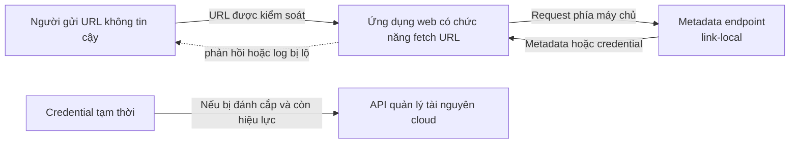

# Bảo vệ metadata endpoint trước SSRF và đánh cắp thông tin xác thực

Máy ảo và workload cloud thường cần lấy thông tin từ metadata service để biết instance ID, vùng triển khai, cấu hình mạng, user data hoặc thông tin xác thực tạm thời gắn với danh tính của máy. Metadata service thường được cung cấp qua một địa chỉ link-local chỉ có thể truy cập từ môi trường chạy workload. Chính đặc điểm này khiến endpoint trở thành mục tiêu hấp dẫn khi ứng dụng có lỗ hổng Server-Side Request Forgery (SSRF).

Nếu kẻ tấn công điều khiển được URL mà máy chủ gửi request tới, họ có thể tìm cách khiến ứng dụng gọi metadata endpoint thay cho địa chỉ do người dùng cung cấp. Trong một số cấu hình, phản hồi có thể chứa thông tin định danh hoặc credential tạm thời. Nếu credential có quyền quá rộng, kẻ tấn công có thể sử dụng chúng để đọc dữ liệu, thay đổi tài nguyên hoặc di chuyển sang workload khác.

Bảo vệ metadata endpoint vì vậy cần nhiều lớp: kiểm soát URL ở ứng dụng, hạn chế kết nối mạng tới địa chỉ nhạy cảm, bật cơ chế bảo vệ metadata của nhà cung cấp, dùng workload identity với quyền tối thiểu và giám sát việc sử dụng credential. Chỉ bật một header hoặc chặn một URL trong mã nguồn chưa đủ để xử lý toàn bộ rủi ro SSRF.

## 1. Metadata service và vai trò trong cloud

Metadata service là endpoint do nền tảng cloud cung cấp để instance hoặc workload truy vấn thông tin liên quan đến môi trường đang chạy. Endpoint thường nằm trên địa chỉ link-local, ví dụ `169.254.169.254` trong IPv4. Vì địa chỉ này không được định tuyến như một địa chỉ Internet thông thường, ứng dụng trong VM có thể truy cập mà máy khách bên ngoài không thể gọi trực tiếp theo cùng cách.

Thông tin metadata có thể bao gồm:

- Instance ID, loại máy, vùng, zone, project hoặc account.
- Private IP, network interface, subnet và thông tin định tuyến.
- Image ID, phiên bản nền tảng và dữ liệu nhận diện instance.
- User data hoặc startup script được cung cấp khi khởi tạo máy.
- Thông tin xác thực tạm thời gắn với instance role, managed identity hoặc service account.

Metadata service giúp tự động hóa cấu hình và cấp danh tính cho workload mà không cần nhúng access key dài hạn vào image. Tuy nhiên, mọi dữ liệu trả về từ metadata endpoint cần được xem là nhạy cảm theo đúng loại dữ liệu. User data có thể chứa cấu hình hoặc bí mật nếu người triển khai sử dụng sai cách; credential tạm thời có thể cấp quyền truy cập cloud trong thời hạn hiệu lực.

### Metadata không đồng nghĩa với credential

Một số đường dẫn metadata chỉ trả về thông tin mô tả instance. Những đường dẫn khác có thể cung cấp token hoặc credential của danh tính gắn với workload. Không nên giả định toàn bộ metadata đều bí mật như nhau, nhưng cũng không nên cho phép ứng dụng web tùy ý đọc hoặc trả nội dung metadata cho người dùng.

Thiết kế an toàn là chỉ để thành phần thực sự cần metadata truy cập endpoint đó. Ứng dụng nên sử dụng SDK hoặc credential provider chính thức của nền tảng để lấy danh tính tạm thời, thay vì tự xây dựng URL và xử lý credential thủ công khi không cần thiết.

## 2. SSRF là gì và vì sao metadata endpoint dễ bị nhắm tới?

SSRF xảy ra khi ứng dụng phía máy chủ gửi request tới một địa chỉ do người dùng kiểm soát toàn bộ hoặc một phần. Tính năng hợp lệ như tải ảnh từ URL, kiểm tra webhook, xem trước liên kết, nhập dữ liệu từ API hoặc chuyển tiếp request có thể trở thành điểm SSRF nếu ứng dụng không giới hạn đích đến.

Ví dụ, một dịch vụ có endpoint nhận tham số `url` để tải nội dung từ xa. Người dùng bình thường cung cấp URL của ảnh công khai. Nếu máy chủ không kiểm tra đích đến, kẻ tấn công có thể thử cung cấp địa chỉ nội bộ hoặc link-local. Request được gửi từ bên trong VM, nơi metadata endpoint có thể truy cập được.



Sơ đồ mô tả một chuỗi rủi ro có thể xảy ra, không phải mọi SSRF đều đọc được metadata hoặc lấy được credential. Khả năng khai thác phụ thuộc vào cơ chế bảo vệ metadata, cách ứng dụng tạo request, quyền mạng, loại endpoint và quyền của danh tính workload.

### Các bước thường gặp trong một cuộc tấn công

1. Kẻ tấn công tìm được tính năng khiến backend truy cập URL do người dùng cung cấp.
2. Họ thử các địa chỉ nội bộ, loopback hoặc link-local thay cho URL Internet.
3. Nếu request tới metadata endpoint được chấp nhận, họ tìm cách đọc các trường nhạy cảm hoặc đường dẫn cấp credential.
4. Nếu phản hồi được trả về, ghi vào log dễ truy cập hoặc được sử dụng tiếp trong ứng dụng, thông tin có thể bị lộ.
5. Credential bị lộ có thể được dùng để gọi cloud API trong phạm vi quyền và thời gian còn hiệu lực.

Một số SSRF chỉ là blind SSRF: kẻ tấn công không đọc trực tiếp được phản hồi nhưng vẫn khiến backend gửi request. Blind SSRF vẫn có thể gây tác động như gọi dịch vụ nội bộ, kích hoạt hành động hoặc làm lộ thông tin qua side channel. Vì vậy, không có phản hồi hiển thị không đồng nghĩa request là an toàn.

## 3. Credential lấy từ metadata có thể gây ra điều gì?

Credential gắn với instance role hoặc service account thường là credential ngắn hạn. Chúng giúp workload gọi API mà không cần lưu access key tĩnh. Tuy nhiên, nếu bị lấy cắp trong thời gian còn hiệu lực, credential có thể được sử dụng từ môi trường khác cho đến khi hết hạn hoặc bị thu hồi theo cơ chế của nhà cung cấp.

Mức độ tác động phụ thuộc vào quyền được gán cho danh tính workload:

- Nếu chỉ có quyền đọc một nhóm object cụ thể, kẻ tấn công có thể đọc dữ liệu trong phạm vi đó.
- Nếu có quyền ghi hoặc xóa, dữ liệu hoặc tài nguyên có thể bị thay đổi.
- Nếu có quyền quản lý IAM hoặc cấp credential, nguy cơ có thể lan rộng sang các danh tính khác.
- Nếu danh tính có quyền truy cập nhiều tài khoản, project hoặc môi trường, phạm vi ảnh hưởng có thể lớn hơn workload ban đầu.

Không nên cấp quyền quản trị toàn bộ tài khoản cho một VM chỉ vì ứng dụng cần đọc một bucket hoặc ghi log. Hãy tạo role riêng cho từng workload, chỉ cấp action và resource cần thiết, giới hạn điều kiện theo môi trường khi nền tảng hỗ trợ và thường xuyên rà soát quyền.

### Metadata và user data

User data thường được dùng để truyền script hoặc cấu hình khởi tạo. Nó không phải kho bí mật. User data có thể được đọc từ metadata hoặc qua giao diện quản trị tùy nền tảng và quyền truy cập. Không đưa password, private key, token dài hạn hoặc nội dung secret vào user data. Thay vào đó, dùng secret manager hoặc workload identity để lấy bí mật lúc chạy với quyền và thời hạn phù hợp.

## 4. Các cơ chế bảo vệ metadata của nhà cung cấp

Các nền tảng cloud có thể cung cấp nhiều cơ chế khác nhau để giảm khả năng SSRF truy cập metadata. Tên gọi và chi tiết kỹ thuật thay đổi theo dịch vụ; cần xác minh cấu hình của đúng loại instance và phiên bản nền tảng.

### AWS EC2 Instance Metadata Service

AWS EC2 IMDS có hai chế độ truy cập thường được nhắc tới:

- **IMDSv1:** request metadata theo cách đơn giản, không cần lấy session token trước.
- **IMDSv2:** client phải gửi request `PUT` để lấy token phiên, sau đó gửi token trong header khi đọc metadata. Token có thời hạn và có thể giới hạn thời gian sử dụng.

Với IMDSv2, việc yêu cầu token làm giảm khả năng khai thác một số kiểu SSRF chỉ cho phép gửi request GET đơn giản hoặc không kiểm soát header. Tuy nhiên, nếu SSRF cho phép backend gửi PUT và header tùy ý, IMDSv2 không tự động loại bỏ rủi ro. Cần kết hợp với kiểm soát URL, egress và quyền IAM.

Một cấu hình liên quan khác là metadata response hop limit. Giá trị này ảnh hưởng khả năng response đi qua thêm network hop, đặc biệt trong một số kiến trúc container. Giá trị thấp có thể giảm khả năng container nhận phản hồi metadata trực tiếp, nhưng cần kiểm thử với network namespace, CNI và cách triển khai thực tế trước khi áp dụng rộng.

### Azure Instance Metadata Service

Azure IMDS được truy cập qua địa chỉ link-local và yêu cầu header `Metadata: true` trong request metadata. Yêu cầu header này giúp ngăn một số request vô tình hoặc SSRF đơn giản, nhưng không phải biện pháp duy nhất. Nếu ứng dụng cho phép kẻ tấn công kiểm soát header, rủi ro vẫn cần được xử lý ở lớp ứng dụng và mạng.

Managed identity cho phép workload nhận token để gọi dịch vụ được cấp quyền mà không lưu secret dài hạn. Cần gán quyền tối thiểu cho managed identity và giới hạn workload nào có thể truy cập endpoint hoặc identity đó.

### Google Cloud metadata server

Google Cloud cung cấp metadata server cho VM và workload phù hợp. Request metadata thường dùng header `Metadata-Flavor: Google`. Workload identity và service account có thể cung cấp danh tính cho ứng dụng; quyền của service account cần được giới hạn theo nhu cầu.

Header bắt buộc không thay thế kiểm tra SSRF. Ứng dụng cần chặn truy cập tới metadata endpoint từ chức năng fetch URL không tin cậy, đồng thời giới hạn quyền của service account.

### So sánh khái quát

| Nền tảng | Cơ chế thường gặp | Lợi ích | Giới hạn cần nhớ |
|---|---|---|---|
| AWS EC2 | IMDSv2 session token; cấu hình endpoint và hop limit | Yêu cầu token làm khó một số SSRF đơn giản | SSRF có thể hỗ trợ PUT/header; IAM role quá rộng vẫn nguy hiểm |
| Microsoft Azure | Header `Metadata: true`; Managed Identity | Request cần header đặc biệt; tránh lưu secret dài hạn | Ứng dụng có thể cho phép header tùy ý; cần kiểm soát network và identity |
| Google Cloud | Header `Metadata-Flavor: Google`; service account / workload identity | Request cần header đặc biệt; tích hợp danh tính workload | Header không phải ranh giới bảo mật duy nhất; cần quyền tối thiểu |

Các chi tiết như endpoint path, phiên bản API, yêu cầu token, cấu hình bắt buộc và khả năng áp dụng cho container thay đổi theo dịch vụ. Hãy dùng tài liệu chính thức cho môi trường triển khai và kiểm tra cấu hình thực tế bằng công cụ quản trị của provider.

## 5. Phòng chống SSRF ở lớp ứng dụng

Lớp ứng dụng là nơi cần kiểm soát sớm nhất vì nó quyết định request có được gửi đi hay không. Mọi chức năng fetch URL, webhook, import, proxy hoặc preview đều cần được xem xét.

### Ưu tiên allowlist thay vì blocklist

Nếu ứng dụng chỉ cần gọi một số dịch vụ đã biết, hãy cho phép hostname, scheme và port cụ thể. Allowlist thường an toàn hơn blocklist vì danh sách địa chỉ nội bộ cần chặn rất rộng và có thể bị bỏ sót khi xuất hiện IPv6, biểu diễn IP khác, DNS alias hoặc dải địa chỉ mới.

Ví dụ, nếu dịch vụ chỉ tải ảnh từ `images.example.net`, hãy giới hạn scheme HTTPS, hostname đó và port 443. Nếu cần nhiều nhà cung cấp, khai báo danh sách endpoint được phê duyệt theo cấu hình có kiểm soát.

### Kiểm tra URL theo nhiều lớp

Trước khi gửi request, cần:

1. Chỉ chấp nhận scheme cần thiết, thường là HTTPS; từ chối `file:`, `ftp:`, `gopher:`, `dict:` và scheme không hỗ trợ.
2. Phân tích URL bằng thư viện chuẩn, không dùng regex đơn giản để tách hostname.
3. Từ chối userinfo trong URL, port không được phép và hostname không nằm trong allowlist.
4. Phân giải DNS và kiểm tra tất cả địa chỉ trả về; chặn loopback, private, link-local, multicast, unspecified và các dải reserved theo chính sách.
5. Bảo đảm địa chỉ được kiểm tra chính là địa chỉ mà kết nối thực tế sử dụng, giảm nguy cơ DNS rebinding hoặc time-of-check/time-of-use.
6. Tắt redirect tự động hoặc kiểm tra lại toàn bộ đích đến sau mỗi redirect.
7. Đặt timeout, giới hạn kích thước phản hồi, số lần redirect và tổng thời gian tải.
8. Không chuyển tiếp header nhạy cảm, cookie hoặc credential của người dùng sang host khác.

Kiểm tra hostname ban đầu là chưa đủ. Một hostname hợp lệ có thể resolve tới IP nội bộ; một redirect từ host được phép có thể dẫn tới địa chỉ link-local; DNS có thể trả các địa chỉ khác nhau giữa bước kiểm tra và bước kết nối. Nên dùng HTTP client hoặc egress proxy có khả năng pin địa chỉ đã xác minh và kiểm tra redirect từng bước.

### Ví dụ logic kiểm tra URL

Đoạn mã dưới đây minh họa cấu trúc kiểm tra ở mức khái niệm. Trong ứng dụng thực tế, cần dùng thư viện URL và HTTP client đã được kiểm thử, xử lý IPv4/IPv6 đầy đủ, pin kết quả DNS cho kết nối và kiểm tra từng redirect. Không coi đoạn mã minh họa là thư viện chống SSRF hoàn chỉnh.

```python
from urllib.parse import urlsplit

ALLOWED_HOSTS = {"images.example.net"}

def validate_fetch_target(raw_url: str) -> str:
    parsed = urlsplit(raw_url)

    if parsed.scheme != "https":
        raise ValueError("Only HTTPS is allowed")

    if parsed.username or parsed.password:
        raise ValueError("URL userinfo is not allowed")

    if parsed.port not in (None, 443):
        raise ValueError("Unexpected port")

    hostname = (parsed.hostname or "").rstrip(".").lower()
    if hostname not in ALLOWED_HOSTS:
        raise ValueError("Destination is not allowlisted")

    return hostname
```

Đoạn mã chỉ kiểm tra cú pháp và allowlist hostname. Để hoàn thiện, lớp kết nối phải kiểm tra DNS A/AAAA, từ chối IP không công khai theo policy, kết nối tới đúng IP đã xác minh, kiểm tra TLS với hostname dự kiến và xác minh lại đích đến sau redirect. Nếu không thể bảo đảm các điều kiện này, nên dùng egress proxy chuyên trách thay vì tự xây dựng logic networking trong từng ứng dụng.

### Không trả nội dung metadata cho client

Ngay cả khi backend cần gọi một dịch vụ nội bộ, không nên phản hồi nguyên văn body, header hoặc lỗi mạng cho người dùng. Response có thể chứa token, internal hostname, địa chỉ mạng hoặc thông tin cấu hình. Trả lỗi chung cho client; log nội bộ cần loại bỏ hoặc che dữ liệu nhạy cảm.

## 6. Phòng thủ ở lớp mạng và hệ điều hành

Kiểm soát ở lớp mạng giảm khả năng một lỗi ứng dụng tiếp cận endpoint nhạy cảm. Đây là lớp phòng thủ bổ sung, không thay thế xác thực URL và quyền tối thiểu.

### Egress filtering

Chính sách outbound nên giới hạn workload chỉ kết nối tới dịch vụ cần thiết. Có thể dùng firewall host, security group egress, network policy, subnet route hoặc egress proxy để chặn các dải địa chỉ không được phép, đặc biệt là link-local metadata endpoint đối với workload không cần truy cập.

Nếu ứng dụng cần metadata để lấy identity, hãy cấp đường truy cập có kiểm soát cho đúng thành phần. Với workload không cần metadata, chặn đường tới endpoint ở lớp mạng có thể giảm đáng kể tác động của SSRF.

### Chú ý proxy và biến môi trường

Một số ứng dụng dùng HTTP proxy để kiểm soát outbound. Cần kiểm tra `HTTP_PROXY`, `HTTPS_PROXY` và `NO_PROXY` vì cấu hình bypass có thể khiến request tới link-local đi thẳng thay vì qua proxy. Không thêm metadata endpoint vào danh sách bypass một cách tùy tiện; hãy hiểu chính xác luồng request của runtime và SDK.

Proxy phải từ chối các địa chỉ nội bộ và link-local theo policy, kiểm tra DNS/redirect và không cho phép client tự chọn proxy khác. Nếu proxy chỉ kiểm tra hostname ban đầu nhưng không kiểm tra IP cuối hoặc redirect, SSRF vẫn có thể đi vòng.

### Firewall host và routing

Có thể dùng firewall của hệ điều hành để giới hạn tiến trình hoặc user nào được phép truy cập metadata endpoint, tùy khả năng của OS và kiến trúc mạng. Tuy nhiên, luật dựa trên UID hoặc cgroup cần được kiểm thử vì ứng dụng có thể chạy qua helper process, sidecar hoặc namespace khác.

Không nên chặn một dải link-local rộng mà không kiểm tra các dịch vụ nền tảng khác có sử dụng nó hay không. Một số dịch vụ cloud dùng link-local cho metadata, DNS resolver, time synchronization hoặc agent. Xác định endpoint và dependency cụ thể trước khi triển khai rule.

## 7. Bảo vệ metadata trong container và Kubernetes

Container thường chia sẻ kernel của host nhưng có network namespace riêng. Tùy CNI, routing, host networking và chính sách mạng, container có thể truy cập metadata endpoint của node. Nếu một ứng dụng trong Pod bị SSRF, kẻ tấn công có thể thử tiếp cận metadata của VM host hoặc danh tính được gắn cho node.

### Rủi ro thường gặp

- Pod có thể truy cập metadata endpoint của node qua route link-local.
- Pod dùng `hostNetwork` có thể có đường mạng gần với host hơn.
- Node role có quyền rộng khiến credential bị lộ có phạm vi lớn.
- Nhiều workload không liên quan cùng dùng một node identity.
- Sidecar hoặc proxy có quyền truy cập metadata và vô tình chuyển tiếp request.
- Network policy chỉ kiểm soát một phần traffic, trong khi đường tới link-local có thể phụ thuộc CNI và cấu hình node.

### Biện pháp giảm thiểu

1. Dùng workload identity hoặc service account identity riêng cho Pod nếu nền tảng hỗ trợ.
2. Giảm quyền node role xuống mức tối thiểu cần cho hoạt động của node; không dùng node role thay cho quyền ứng dụng.
3. Chặn Pod không cần metadata truy cập endpoint của node bằng network policy, host firewall hoặc cơ chế do cloud/CNI cung cấp.
4. Hạn chế `hostNetwork`, privileged container, host PID và host mount cho workload thực sự cần.
5. Dùng namespace và service account riêng; không chia sẻ identity giữa workload có mức tin cậy khác nhau.
6. Kiểm tra sidecar, service mesh và egress gateway để tránh vô tình cho phép truy cập link-local.
7. Kiểm thử từ Pod thường, Pod đặc quyền và Pod hostNetwork để xác minh chính sách thực tế.

Với Kubernetes, network policy tiêu chuẩn thường kiểm soát traffic Pod theo cách triển khai của CNI; không giả định mọi CNI xử lý link-local hoặc host network giống nhau. Cần kiểm tra tài liệu và thử nghiệm trên cluster thực tế.

### Credential và workload identity

Workload identity cho phép Pod hoặc workload nhận credential ngắn hạn gắn với service account hoặc identity riêng. Cách này giảm nhu cầu dùng node role chung hoặc lưu access key trong Secret. Tuy nhiên, ứng dụng vẫn phải bảo vệ token được cấp; SSRF hoặc lỗi thực thi mã có thể lợi dụng quyền mà workload đang có.

Hãy gắn identity riêng theo ứng dụng, môi trường và mục đích. Ví dụ, worker xử lý ảnh chỉ cần đọc object đầu vào và ghi object kết quả vào một prefix cụ thể; nó không cần quyền quản trị bucket hoặc tạo IAM role.

## 8. Thiết kế danh tính workload và quyền tối thiểu

Metadata endpoint thường là một trong các cách workload nhận credential. Để giảm tác động khi credential bị lộ, cần thiết kế quyền ngay từ đầu.

### Một danh tính cho một vai trò workload

Không nên gắn cùng một role đặc quyền cho mọi VM trong tài khoản. Tạo role theo ứng dụng hoặc nhóm chức năng, giới hạn resource ARN/project/resource cụ thể và action cần thiết. Tách quyền đọc dữ liệu, ghi dữ liệu, triển khai hạ tầng và quản trị bảo mật.

### Credential ngắn hạn

Ưu tiên credential có thời hạn ngắn được cấp tự động qua instance role, managed identity hoặc workload identity. Tránh lưu access key dài hạn trong image, user data, file cấu hình, environment variable lâu dài hoặc repository.

Credential ngắn hạn giảm cửa sổ khai thác nhưng không xóa bỏ rủi ro: nếu bị đánh cắp, nó vẫn có thể bị dùng cho tới khi hết hạn hoặc bị thu hồi. Vì vậy cần theo dõi hoạt động API và có quy trình revoke/rotate khi nghi ngờ lộ lọt.

### Điều kiện bổ sung cho quyền truy cập

Khi nền tảng hỗ trợ, có thể giới hạn quyền theo resource, region, network condition, session tag, source identity hoặc audience của token. Những điều kiện này giúp giảm khả năng dùng credential ngoài mục đích dự kiến. Phải kiểm tra khả năng tương thích của SDK và dịch vụ trước khi áp dụng policy phức tạp.

### Không để ứng dụng làm lộ credential

- Không trả token hoặc credential trong HTTP response.
- Không ghi header Authorization, session token hoặc nội dung secret vào log.
- Không đưa metadata response vào exception message hiển thị cho client.
- Không lưu credential trong cache dùng chung nếu không có kiểm soát tenant và TTL.
- Không truyền credential của cloud vào URL query string.
- Giới hạn quyền đọc file cấu hình và process environment trên host/container.

## 9. Kiểm thử và xác minh phòng thủ

Kiểm thử SSRF nên thực hiện trong môi trường được phép, với endpoint giả lập hoặc tài nguyên thử nghiệm. Mục tiêu là xác minh ứng dụng không thể truy cập đích nội bộ ngoài allowlist và không để lộ metadata/credential trong response hoặc log.

### Ma trận kiểm thử

| Trường hợp | Kết quả mong đợi |
|---|---|
| URL HTTPS tới hostname allowlist hợp lệ | Được xử lý theo giới hạn kích thước và timeout |
| URL dùng scheme không được phép | Bị từ chối trước khi gửi request |
| URL tới loopback hoặc private IP | Bị từ chối ở lớp ứng dụng hoặc egress |
| URL tới địa chỉ link-local metadata | Bị chặn; không trả nội dung metadata |
| Hostname allowlist resolve tới IP nội bộ | Bị từ chối sau bước DNS validation |
| Hostname hợp lệ redirect tới IP nội bộ | Redirect bị chặn sau khi kiểm tra lại đích |
| DNS thay đổi giữa kiểm tra và kết nối | Kết nối vẫn bị giới hạn vào địa chỉ đã xác minh hoặc bị từ chối |
| URL có userinfo hoặc port lạ | Bị từ chối |
| Response quá lớn hoặc chậm | Bị dừng theo giới hạn thời gian và kích thước |
| Ứng dụng chạy trong Pod không cần metadata | Không truy cập được metadata endpoint của node |
| Workload identity của ứng dụng | Chỉ có quyền cần thiết trên resource mục tiêu |

Không cần truy xuất credential thật để chứng minh endpoint bị chặn. Dùng mock endpoint hoặc kiểm tra policy network trong môi trường thử nghiệm; không lưu token vào test output.

### Kiểm tra cấu hình metadata

Trong quá trình kiểm tra hạ tầng, xác minh:

- Metadata endpoint có được bật hay không và workload nào thực sự cần nó.
- Cơ chế phiên bản/token bắt buộc đã được bật theo khuyến nghị provider chưa.
- Hop limit hoặc giới hạn network path có phù hợp với VM và container không.
- Node role, managed identity hoặc service account có quyền tối thiểu không.
- Security group, firewall, route, proxy và network policy có giới hạn egress phù hợp không.
- User data và startup script có chứa secret hay không.
- Audit log có ghi nhận việc sử dụng identity và thay đổi quyền không.

## 10. Giám sát và phát hiện hành vi bất thường

Phát hiện sớm giúp giảm thời gian credential bị lạm dụng. Nên kết hợp log ứng dụng, network telemetry, cloud audit log và thông tin identity.

### Dấu hiệu cần chú ý

- Ứng dụng có chức năng fetch URL tạo request tới link-local, loopback hoặc dải private không thuộc thiết kế.
- Một workload gọi metadata endpoint với tần suất bất thường hoặc từ tiến trình không cần metadata.
- Credential của instance role được dùng từ IP, vùng hoặc user agent không phù hợp với hành vi bình thường.
- Một workload chỉ cần đọc dữ liệu lại gọi API liệt kê IAM, tạo role hoặc sửa policy.
- Có đột biến request tới object storage, secret manager hoặc control plane sau một cảnh báo SSRF.
- User data hoặc cấu hình bootstrap chứa token, access key hoặc password.

### Log và dữ liệu cần thu thập

- Request ID, user ID, route và tham số URL đã được che dữ liệu nhạy cảm.
- Hostname đích đã chuẩn hóa, IP sau DNS resolution và kết quả policy check.
- Process/container identity thực hiện request nếu có thể thu thập.
- Cloud audit event gồm principal, action, resource, source IP và thời điểm.
- Cảnh báo egress tới metadata endpoint từ workload không nằm trong allowlist.
- Lịch sử thay đổi role, policy, service account và network rule.

Không ghi raw URL có thể chứa token trong query string, nội dung metadata, Authorization header hoặc credential. Log cần đủ thông tin điều tra nhưng không trở thành nguồn rò rỉ mới.

## 11. Ứng phó khi nghi ngờ metadata hoặc credential bị lộ

Khi phát hiện SSRF có thể truy cập metadata hoặc nghi ngờ credential bị đánh cắp, cần xử lý đồng thời đường khai thác và quyền bị lộ.

1. **Giới hạn truy cập:** tạm thời vô hiệu hóa chức năng fetch URL bị ảnh hưởng, chặn egress tới endpoint nhạy cảm cho workload không cần metadata hoặc cô lập workload theo quy trình incident.
2. **Đánh giá identity:** xác định role, managed identity hoặc service account gắn với VM/Pod và toàn bộ quyền của nó.
3. **Thu hồi hoặc thay credential:** revoke session/token nếu provider hỗ trợ; nếu không, vô hiệu hóa hoặc thay identity/policy theo quy trình an toàn và chờ credential cũ hết hiệu lực.
4. **Điều tra hoạt động:** truy vấn cloud audit log để tìm API call bất thường, resource bị đọc/ghi, thay đổi IAM và hoạt động từ nguồn lạ.
5. **Bảo vệ dữ liệu:** đánh giá object, database, secret và log có thể đã bị truy cập; lưu bằng chứng và thực hiện quy trình thông báo phù hợp.
6. **Sửa nguyên nhân:** khắc phục SSRF ở ứng dụng, bổ sung allowlist/egress filtering và kiểm tra redirect/DNS.
7. **Giảm quyền:** thu hẹp role và tách identity nếu workload có quyền vượt nhu cầu.
8. **Xác minh sau khắc phục:** chạy lại ma trận SSRF, xác minh credential cũ không còn dùng được và theo dõi hoạt động bất thường.

Không chỉ rotate secret rồi đóng incident. Nếu SSRF còn tồn tại, credential mới có thể tiếp tục bị lấy cắp. Cần xử lý cả điểm vào, đường mạng và quyền của workload.

## 12. Ví dụ kiến trúc phòng thủ

Giả sử một dịch vụ web chạy trên VM có chức năng tải ảnh từ URL do người dùng nhập. Dịch vụ cũng cần đọc object từ bucket để xử lý ảnh.

Một thiết kế phù hợp có thể gồm:

- Ứng dụng chỉ tải ảnh từ danh sách domain đã phê duyệt; chỉ dùng HTTPS và port 443.
- Egress proxy kiểm tra DNS, chặn địa chỉ private/link-local và kiểm tra từng redirect.
- Firewall/route chặn truy cập metadata endpoint từ tiến trình tải ảnh nếu kiến trúc cho phép tách thành phần.
- Thành phần xử lý ảnh nhận identity riêng chỉ có quyền đọc object đầu vào và ghi kết quả vào prefix được chỉ định.
- Metadata endpoint dùng cơ chế bảo vệ mạnh nhất được provider hỗ trợ; user data không chứa secret.
- Cloud audit log và network telemetry cảnh báo request tới metadata từ đường xử lý URL.
- Log ứng dụng che URL nhạy cảm và không ghi response body của metadata.

Nếu ứng dụng và worker cần quyền khác nhau, tách chúng thành workload riêng với identity và network policy riêng. Điều này giới hạn phạm vi ảnh hưởng nếu một thành phần bị khai thác.

## 13. Những sai lầm thường gặp

- **Chỉ chặn chuỗi `169.254.169.254`.** Kẻ tấn công có thể dùng biểu diễn IP khác, IPv6, hostname, DNS hoặc redirect. Cần parse URL, xác minh IP sau DNS và kiểm tra mọi bước kết nối.
- **Chỉ yêu cầu header metadata đặc biệt.** SSRF có thể cho phép điều khiển header; header là lớp giảm thiểu, không thay thế allowlist và egress control.
- **Chỉ chặn metadata trong frontend.** Request SSRF được gửi từ backend; kiểm tra ở trình duyệt không bảo vệ endpoint nội bộ.
- **Cho rằng credential ngắn hạn không nguy hiểm.** Credential còn hiệu lực vẫn có thể bị dùng để truy cập tài nguyên theo quyền được cấp.
- **Dùng một role rộng cho mọi VM/Pod.** Một workload bị xâm nhập có thể làm lộ quyền của nhiều ứng dụng.
- **Đưa secret vào user data.** User data có thể được đọc qua metadata hoặc control plane và có thể được lưu trong log hay image workflow.
- **Tắt metadata mà không kiểm tra dependency.** Agent hoặc bootstrap có thể cần metadata; cần xác định workload nào thực sự phụ thuộc trước khi chặn.
- **Tin rằng network policy giống nhau ở mọi CNI.** Đường link-local, host network và traffic node có thể được xử lý khác nhau; cần thử nghiệm trên nền tảng thực tế.
- **Chỉ kiểm tra response body.** Blind SSRF vẫn có thể kích hoạt request nội bộ hoặc gây tác động gián tiếp.

## 14. Checklist triển khai

**Metadata service và identity:**

- [ ] Đã xác định workload nào cần metadata và endpoint nào được phép truy cập.
- [ ] Đã bật cơ chế bảo vệ metadata phù hợp với provider.
- [ ] Đã gán identity riêng và quyền tối thiểu cho từng workload.
- [ ] Đã dùng credential ngắn hạn thay cho access key dài hạn.
- [ ] User data, image và startup script không chứa secret.

**Ứng dụng và mạng:**

- [ ] URL fetch dùng allowlist hostname, scheme và port.
- [ ] Đã kiểm tra DNS A/AAAA, IP private/link-local và DNS rebinding.
- [ ] Redirect được tắt hoặc xác minh lại từng đích đến.
- [ ] Có timeout, giới hạn response size và số redirect.
- [ ] Egress filtering hoặc proxy chặn đường truy cập không cần thiết.
- [ ] Log và response không làm lộ metadata hoặc credential.

**Container và vận hành:**

- [ ] Pod không cần metadata bị chặn truy cập endpoint của node.
- [ ] Đã hạn chế hostNetwork và quyền đặc biệt của container.
- [ ] Đã kiểm thử network policy theo CNI thực tế.
- [ ] Có audit log cho việc sử dụng identity và thay đổi quyền.
- [ ] Có quy trình thu hồi credential và ứng phó SSRF.
- [ ] Đã chạy lại ma trận kiểm thử sau khi thay đổi ứng dụng hoặc hạ tầng.

## Kết luận

Metadata service hỗ trợ workload nhận thông tin môi trường và credential tạm thời mà không cần nhúng khóa dài hạn. Tuy nhiên, SSRF có thể biến backend thành đường truy cập endpoint nội bộ và làm lộ danh tính cloud. Hãy bảo vệ bằng nhiều lớp: kiểm tra URL và DNS, allowlist, kiểm tra redirect, egress filtering, cơ chế metadata token/header của provider, workload identity riêng, quyền tối thiểu và giám sát audit. Khi nghi ngờ credential bị lộ, cần chặn đường SSRF, thu hồi hoặc thay credential, điều tra cloud API và xác minh sau khắc phục. Thiết kế như vậy giúp giảm khả năng metadata endpoint trở thành điểm khởi đầu cho việc chiếm quyền tài nguyên cloud.
