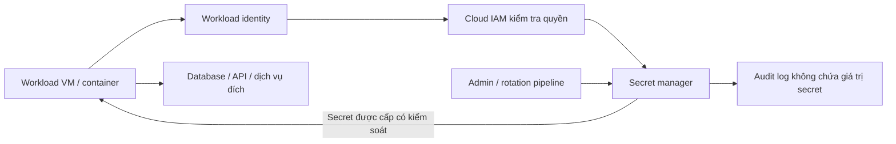
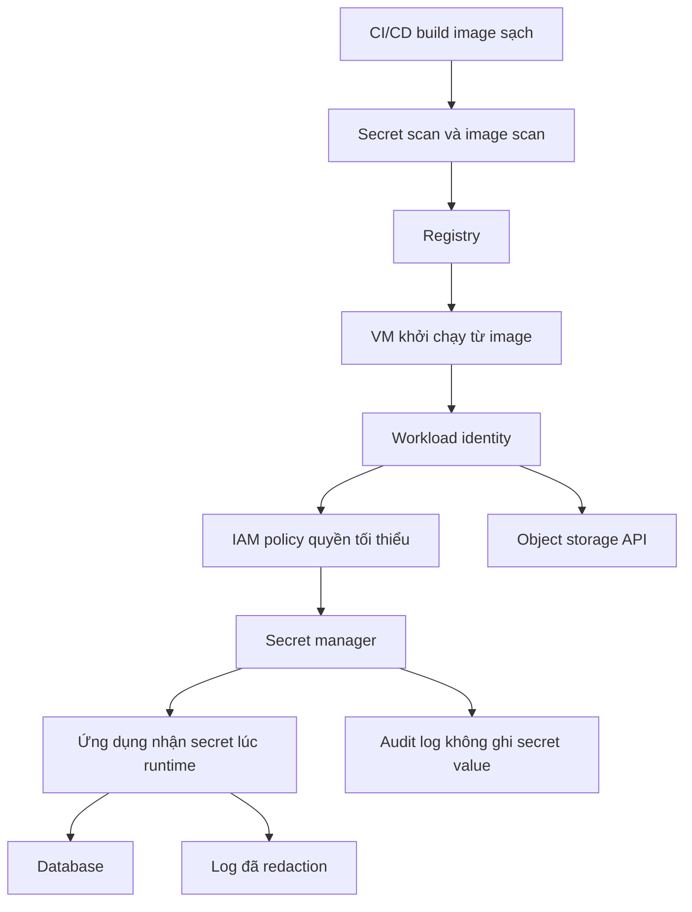

# Ngăn đưa khóa truy cập và secret vào image, script hoặc log

Máy ảo, container và workload serverless thường cần thông tin xác thực để truy cập database, object storage, API hoặc dịch vụ cloud. Nếu khóa truy cập, mật khẩu, token hay private key bị đóng gói vào machine image, container image, startup script hoặc log, thông tin đó có thể tồn tại lâu hơn dự kiến và bị sao chép sang nhiều môi trường. Một image được chia sẻ, snapshot được tạo, log được chuyển tới hệ thống tập trung hoặc bản build được tải xuống đều có thể làm secret lan rộng.

Nguyên tắc quan trọng là **không lưu secret trong artifact hoặc dữ liệu vận hành lâu dài**. Hãy cấp danh tính cho workload, lấy secret từ hệ thống quản lý bí mật khi chạy, chỉ cấp quyền tối thiểu và giới hạn thời gian sử dụng. Đồng thời, thiết kế pipeline để phát hiện secret trước khi phát hành và bảo đảm log không vô tình ghi lại credential.

## 1. Secret là gì và vì sao phải bảo vệ?

Secret là dữ liệu mà người hoặc workload có thể dùng để chứng minh danh tính hoặc được cấp quyền truy cập tài nguyên. Ví dụ:

- API key và access key của cloud.
- Mật khẩu database, cache, message broker hoặc tài khoản dịch vụ.
- Access token, refresh token và session cookie.
- SSH private key, TLS private key và client certificate có khóa riêng.
- Signing key, webhook signing secret và encryption key.
- Credential của registry, package repository, CI/CD hoặc hệ thống giám sát.

Một số dữ liệu như hostname, instance ID hoặc tên service không nhất thiết là secret. Tuy vậy, chúng có thể là thông tin nội bộ và vẫn cần kiểm soát theo chính sách. Phân loại đúng giúp tập trung bảo vệ những dữ liệu thực sự có khả năng cấp quyền.

Secret bị lộ có thể cho phép kẻ tấn công:

- Đọc, sửa hoặc xóa dữ liệu trong cloud account.
- Truy cập database hoặc dịch vụ nội bộ.
- Tạo tài nguyên, chạy compute và phát sinh chi phí trái phép.
- Giả mạo dịch vụ, ký dữ liệu hoặc giải mã dữ liệu.
- Duy trì quyền truy cập sau khi VM hoặc container ban đầu đã bị xóa.
- Truy cập chéo môi trường nếu cùng một credential được tái sử dụng.

Rủi ro tăng mạnh khi một secret có thời hạn dài, quyền rộng, được dùng chung hoặc xuất hiện trong artifact có thể tải xuống. Vì vậy, cần kiểm soát cả nơi secret được tạo, nơi được lưu, cách workload nhận và cách thu hồi.

## 2. Các vị trí secret thường bị rò rỉ

| Vị trí | Cách secret có thể xuất hiện | Hậu quả |
|---|---|---|
| Machine image hoặc snapshot | File cấu hình, shell history, credential cache, file `.env`, private key | Mọi VM tạo từ image có thể kế thừa secret |
| Container image | Dockerfile, build argument, environment trong layer, file được copy vào image | Secret tồn tại trong layer/history và registry |
| Startup script/user data/cloud-init | Mật khẩu hoặc token viết trực tiếp trong script | Có thể bị đọc qua metadata, control plane, log hoặc bản lưu cấu hình |
| Infrastructure as Code | Secret viết literal trong Terraform, template, state hoặc plan | Lộ qua repository, state backend, artifact hoặc review |
| CI/CD pipeline | Secret in ra console, command line, debug trace hoặc artifact | Người có quyền xem log/build có thể lấy credential |
| Application log | Authorization header, request body, connection string, exception | Secret bị sao chép vào hệ thống log và backup |
| Crash dump/diagnostic | Bộ nhớ tiến trình hoặc biến môi trường bị ghi ra file | Secret tồn tại trong dump và hệ thống hỗ trợ |
| Shell history/process list | Token truyền trong command argument hoặc lệnh tương tác | Người dùng khác hoặc agent có thể đọc được |
| Backup và support bundle | File cấu hình, log hoặc dump được đóng gói | Secret tiếp tục tồn tại sau khi nguồn đã được sửa |

Không chỉ cần kiểm tra mã nguồn. Secret có thể được thêm vào sau khi build, phát sinh trong runtime hoặc xuất hiện trong bản sao lưu và công cụ chẩn đoán.

## 3. Threat model: secret có thể bị ai đọc?

Khi thiết kế, hãy xác định những danh tính và hệ thống nào có thể đọc từng vị trí chứa secret:

- Người có quyền pull image hoặc tải snapshot.
- Người có quyền đọc repository, pipeline log, artifact hoặc IaC state.
- Tiến trình khác chạy cùng VM, container hoặc node.
- Quản trị viên có quyền truy cập filesystem, process memory hoặc debug endpoint.
- Người có thể khai thác SSRF, command injection, path traversal hoặc lỗ hổng ứng dụng.
- Agent giám sát, crash reporter, support tool hoặc hệ thống log nhận dữ liệu từ workload.
- Tài khoản cloud có quyền đọc secret manager hoặc giải mã dữ liệu.

Không nên giả định rằng secret an toàn chỉ vì repository là private hoặc image registry cần đăng nhập. Quyền truy cập nội bộ có thể rộng, tài khoản có thể bị xâm nhập và artifact có thể được chia sẻ ra ngoài phạm vi dự kiến.

Hãy lập bản đồ secret theo ba thuộc tính: **chủ sở hữu**, **workload được phép sử dụng** và **thời hạn/điều kiện thu hồi**. Mỗi secret cần có mục đích rõ ràng và không nên được dùng chung cho những workload không liên quan.

## 4. Ưu tiên workload identity thay cho khóa dài hạn

Khi workload cần gọi API cloud, phương án ưu tiên là gắn danh tính workload do nền tảng quản lý thay vì lưu access key tĩnh trong image hoặc file cấu hình.

Ví dụ theo nền tảng:

| Nền tảng | Cơ chế danh tính cho compute | Cách ứng dụng sử dụng |
|---|---|---|
| AWS | IAM role gắn với EC2 instance profile; với container có thể dùng cơ chế danh tính riêng cho task/Pod | AWS SDK credential provider lấy credential tạm thời và tự refresh |
| Azure | Managed identity gắn với VM hoặc dịch vụ compute | Azure Identity SDK yêu cầu token cho resource/scope cần thiết |
| Google Cloud | Service account gắn với VM hoặc workload identity tương ứng | Google Cloud client library lấy access token ngắn hạn |

Credential tạm thời giúp giảm việc lưu khóa dài hạn và cho phép thu hồi quyền tại control plane. Tuy nhiên, nếu workload bị xâm nhập, kẻ tấn công có thể sử dụng credential trong phạm vi quyền được cấp. Do đó, identity vẫn cần quyền tối thiểu, giới hạn audience/resource và giám sát hành vi.

### 4.1. Cấp quyền tối thiểu

Một workload chỉ đọc file từ một bucket không cần quyền quản trị toàn bộ storage account. Một API chỉ đọc một secret không cần quyền liệt kê hoặc sửa tất cả secret trong project.

Thiết kế quyền theo nguyên tắc:

- Tạo role riêng theo ứng dụng hoặc nhóm chức năng.
- Chỉ cấp action và resource cần thiết.
- Tách quyền production khỏi development/test.
- Tránh gắn role quyền rộng cho mọi VM trong cùng subnet hoặc node pool.
- Dùng điều kiện về resource, tag, audience hoặc thời gian khi nền tảng hỗ trợ.
- Rà soát quyền định kỳ và gỡ quyền khi workload ngừng hoạt động.

### 4.2. Không dùng một credential cho nhiều workload

Nếu nhiều ứng dụng dùng chung một API key, khi một ứng dụng bị xâm nhập sẽ khó xác định phạm vi ảnh hưởng và khó thu hồi riêng quyền của nó. Tạo danh tính riêng giúp audit chính xác, giới hạn quyền và xoay vòng độc lập.

## 5. Dùng secret manager để cấp secret lúc runtime

Secret manager là dịch vụ lưu trữ và phân phối secret có kiểm soát truy cập. Ví dụ gồm AWS Secrets Manager/Systems Manager Parameter Store SecureString, Azure Key Vault và Google Cloud Secret Manager. Các giải pháp tự quản lý cũng có thể được dùng nếu có kiểm soát tương đương.

Một quy trình thường gặp:

1. Quản trị viên hoặc pipeline được ủy quyền tạo secret trong secret manager.
2. Workload nhận danh tính riêng từ nền tảng.
3. Ứng dụng dùng SDK hoặc agent được hỗ trợ để yêu cầu đúng secret.
4. Secret manager xác thực danh tính và kiểm tra policy.
5. Ứng dụng nhận secret qua kênh bảo vệ và sử dụng trong bộ nhớ hoặc cơ chế được thiết kế.
6. Hệ thống ghi audit event về việc truy cập mà không ghi giá trị secret.
7. Secret được xoay vòng hoặc thu hồi theo chính sách.



Ứng dụng nên lấy secret khi khởi động hoặc ngay trước khi cần dùng, tùy yêu cầu về rotation và availability. Nếu cache secret trong bộ nhớ, cần xác định TTL và cách refresh. Không cache vô thời hạn nếu secret có thể bị xoay vòng hoặc thu hồi.

### 5.1. Secret manager không thay thế IAM

Secret manager vẫn cần policy xác định ai được đọc, ghi, xóa và xoay vòng. Tách vai trò quản trị secret khỏi workload đọc secret. Một workload thường chỉ cần `Get` một secret cụ thể; không cần quyền tạo hoặc xóa secret.

### 5.2. Xử lý khi secret manager tạm thời không khả dụng

Đây là dependency quan trọng của ứng dụng. Cần quyết định:

- Có thể tiếp tục chạy với secret đã cache còn hiệu lực hay phải dừng?
- Startup có retry với backoff và timeout hữu hạn không?
- Có cảnh báo khi refresh thất bại hoặc secret gần hết hạn không?
- Ứng dụng có thể tiếp tục phục vụ request hiện tại khi secret backend tạm lỗi không?
- Có phương án phục hồi khi IAM, DNS hoặc private endpoint của secret manager gặp sự cố không?

Không nên ghi secret vào file tạm lâu dài chỉ để tránh gọi secret manager. Nếu cần cache, giới hạn quyền đọc file, thời gian tồn tại và quy trình xóa; ưu tiên bộ nhớ hoặc cơ chế secret volume được nền tảng quản lý.

## 6. Không đưa secret vào machine image

Machine image thường được dùng để tạo nhiều VM và có thể được copy giữa region, account hoặc subscription. Bất kỳ secret nào trong image đều có nguy cơ được nhân bản theo số máy được tạo.

Trước khi tạo image chuẩn:

- Xóa file `.env`, file cấu hình chứa mật khẩu, private key và token.
- Xóa shell history, cache đăng nhập, credential helper và file tạm.
- Xóa cloud CLI profile có access key hoặc refresh token.
- Không để SSH private key của quản trị viên trong image.
- Không lưu database password trong systemd unit hoặc script cài đặt.
- Làm sạch package manager credential và repository token.
- Xóa dữ liệu nhạy cảm khỏi `/tmp`, thư mục home, log và crash dump.
- Kiểm tra snapshot hoặc image trung gian trước khi phát hành.

Một image chuẩn chỉ nên chứa phần mềm, cấu hình không bí mật và agent cần thiết. Khi VM khởi động, nó nhận danh tính workload rồi lấy secret từ nguồn được kiểm soát.

### 6.1. Cloud-init và user data

Cloud-init hoặc startup script thường được dùng để cấu hình VM lúc boot. User data có thể được lưu trong metadata service, control plane, deployment template hoặc log tùy nền tảng. Vì vậy, không đặt mật khẩu hoặc token trực tiếp trong user data.

Ví dụ không an toàn:

```yaml
# Không làm theo: mật khẩu được ghi trực tiếp trong user data
# và có thể bị lưu trong metadata, template hoặc log.
write_files:
  - path: /etc/myapp/database.conf
    content: |
      password: "example-password"
```

Thay vào đó, startup script nên thiết lập agent hoặc cấu hình ứng dụng để lấy secret bằng workload identity. Nếu dùng template, chỉ truyền tên/định danh secret và cấu hình không nhạy cảm; không truyền giá trị bí mật.

### 6.2. Snapshot và image trung gian

Snapshot của VM có thể chứa dữ liệu trong filesystem, swap, cache hoặc file đã xóa nhưng còn phục hồi được ở cấp block. Trước khi tạo snapshot dùng làm image, cần dừng tiến trình phù hợp, làm sạch credential, xử lý swap và xác minh không còn dữ liệu nhạy cảm. Việc xóa file thông thường không bảo đảm nội dung đã biến mất khỏi mọi block hoặc snapshot cũ.

## 7. Không đưa secret vào container image hoặc build layer

Container image thường được lưu trong registry và có thể được nhiều môi trường pull. Dockerfile, build argument, environment variable và file copy vào image đều có thể làm secret xuất hiện trong layer hoặc metadata.

Ví dụ không an toàn:

```dockerfile
# Không làm theo: secret bị ghi vào layer của image.
FROM alpine:3.20
ARG PACKAGE_TOKEN
RUN echo "$PACKAGE_TOKEN" > /root/.package-token
RUN install-my-dependencies
```

Ngay cả khi xóa file ở layer sau, dữ liệu ở layer trước vẫn có thể tồn tại trong image history hoặc registry. `ARG` và `ENV` cũng không phải cơ chế lưu secret an toàn.

Với Docker BuildKit, có thể mount secret tạm thời trong bước build để công cụ dùng mà không lưu giá trị vào layer cuối:

```dockerfile
# syntax=docker/dockerfile:1.7
FROM alpine:3.20
RUN --mount=type=secret,id=package_token \
    PACKAGE_TOKEN="$(cat /run/secrets/package_token)" \
    install-my-dependencies
```

Truyền secret cho bước build từ môi trường tin cậy:

```bash
DOCKER_BUILDKIT=1 docker build \
  --secret id=package_token,src=/secure/path/package-token \
  -t example/app:1.0 .
```

Ví dụ dùng cú pháp minh họa; cần bảo đảm file nguồn được cấp quyền tối thiểu và không nằm trong build context. BuildKit secret mount tránh lưu secret vào layer như `ARG`/`ENV`, nhưng lệnh build vẫn có thể làm lộ secret nếu script in ra stdout/stderr, ghi vào file khác hoặc gửi tới dịch vụ không tin cậy. Cần kiểm tra log và hành vi của công cụ cài package.

### 7.1. `.dockerignore` và build context

Thêm file nhạy cảm vào `.dockerignore` để tránh gửi chúng vào build context:

```text
.env
.env.*
*.pem
*.key
credentials/
secrets/
.git/
```

Danh sách cần điều chỉnh theo cấu trúc dự án. `.dockerignore` là lớp giảm rủi ro, không thay thế secret scanning và review Dockerfile. Không commit secret vào repository với giả định rằng `.dockerignore` sẽ che giấu nó sau đó.

### 7.2. Runtime secret trong container

Container nên nhận secret lúc chạy qua secret manager, workload identity hoặc secret volume do orchestrator quản lý. Không bake secret vào image và tránh đặt credential trong command-line argument. Nếu dùng environment variable, hãy hiểu rằng biến môi trường có thể xuất hiện trong process inspection, crash dump hoặc diagnostic tùy hệ điều hành và quyền người đọc.

Kubernetes Secret giúp phân phối dữ liệu nhạy cảm tới Pod, nhưng mặc định không tự động giải quyết mọi yêu cầu bảo mật. Cần bật encryption at rest cho datastore theo cấu hình cluster, giới hạn RBAC, dùng external secret provider khi phù hợp và không cấp quyền đọc toàn bộ Secret cho mọi namespace hoặc service account.

## 8. Bảo vệ secret trong Infrastructure as Code

Terraform, CloudFormation, Bicep và các công cụ IaC giúp quản lý hạ tầng có thể lặp lại, nhưng file cấu hình, plan và state có thể chứa giá trị nhạy cảm.

Các nguyên tắc:

- Không viết secret literal trong file `.tf`, YAML, JSON hoặc template được commit.
- Dùng workload identity của pipeline để truy cập secret manager.
- Tránh truyền secret qua command-line argument hoặc biến được in trong debug log.
- Bảo vệ state backend bằng encryption, IAM, versioning và audit.
- Hạn chế quyền đọc state; người có quyền đọc state có thể đọc nhiều giá trị nhạy cảm.
- Dùng thuộc tính `sensitive` để hạn chế hiển thị trong output, nhưng không coi nó là mã hóa hoặc xóa secret khỏi state.
- Không đính kèm plan/state vào ticket hoặc artifact công khai.
- Tách quyền triển khai hạ tầng khỏi quyền đọc secret production nếu không cần thiết.

Ví dụ Terraform tham chiếu secret từ hệ thống quản lý bí mật cần được thiết kế sao cho pipeline có danh tính phù hợp. Cần nhớ rằng nếu Terraform đọc secret thành giá trị trong state, việc đánh dấu `sensitive` không tự loại bỏ dữ liệu đó khỏi state. Với secret runtime của ứng dụng, thường tốt hơn để workload tự lấy secret khi chạy thay vì đưa giá trị qua IaC.

## 9. Không ghi secret vào log, trace hoặc metric

Log giúp vận hành và điều tra, nhưng có thể trở thành kho lưu trữ credential nếu ứng dụng ghi toàn bộ request hoặc cấu hình. Một secret được log có thể được sao chép qua agent, queue, SIEM, backup, export và hệ thống phân tích.

Những trường không nên ghi:

- `Authorization`, `Proxy-Authorization`, cookie và session token.
- Password, connection string có mật khẩu và API key.
- Private key, certificate material và signing secret.
- Request body chứa thông tin xác thực hoặc dữ liệu nhạy cảm không cần thiết.
- Response từ secret manager có chứa giá trị secret.
- Environment dump, process arguments hoặc toàn bộ cấu hình khi lỗi.

### 9.1. Redaction và allowlist

Nên thiết kế log theo allowlist: chỉ ghi trường cần cho vận hành, thay vì ghi toàn bộ object rồi cố gắng loại bỏ secret. Nếu phải log request/response, áp dụng redaction tại nhiều lớp:

- Middleware HTTP lọc header và trường body nhạy cảm.
- Logger có bộ lọc tên trường như `password`, `token`, `secret`, `api_key`.
- Reverse proxy/API gateway không ghi authorization header hoặc cookie.
- Agent log không thu thập file cấu hình và đường dẫn secret.
- Trace/telemetry không đưa credential vào span attribute hoặc baggage.

Redaction theo tên trường có thể bỏ sót secret được đặt tên tùy ý hoặc mã hóa trong chuỗi. Vì vậy, ưu tiên không đưa secret vào đối tượng log ngay từ đầu.

### 9.2. Ví dụ logging an toàn

Không log toàn bộ request:

```python
# Không an toàn
logger.info("request=%s", request.headers)
```

Chỉ ghi trường cần thiết:

```python
logger.info(
    "request_received method=%s path=%s request_id=%s",
    request.method,
    request.url.path,
    request_id,
)
```

Không log giá trị secret khi xử lý lỗi lấy credential:

```python
try:
    credential = secret_provider.get("payments/database")
except SecretProviderError as exc:
    logger.error("cannot_load_database_credential error_type=%s", type(exc).__name__)
    raise
```

Trong ví dụ, log chỉ lưu loại lỗi. Cần bảo đảm thông điệp exception của thư viện không chứa secret; nếu có, hãy chuẩn hóa hoặc loại bỏ phần nhạy cảm trước khi ghi.

## 10. Quản lý secret trong CI/CD

Pipeline build và deploy thường có quyền truy cập source code, registry, cloud API và môi trường production. Vì vậy, pipeline là một mục tiêu có giá trị cao.

Các biện pháp cần áp dụng:

- Dùng federated identity/OIDC hoặc credential ngắn hạn thay cho access key cố định khi nền tảng hỗ trợ.
- Chỉ cấp secret cho job và stage thực sự cần.
- Tách secret production khỏi pull request từ fork hoặc nhánh không tin cậy.
- Tắt shell tracing/debug khi xử lý dữ liệu nhạy cảm.
- Không truyền secret dưới dạng argument có thể xuất hiện trong process list.
- Mask giá trị trong log, nhưng không dựa hoàn toàn vào masking vì biến thể/encoding có thể vượt qua bộ lọc.
- Không lưu secret vào artifact, cache, workspace hoặc file được upload.
- Dùng runner riêng hoặc môi trường cô lập cho job có quyền production.
- Ghi audit về danh tính pipeline, secret được truy cập và deployment được thực hiện.
- Thu hồi credential của runner hoặc job sau khi có dấu hiệu xâm nhập.

### 10.1. Secret scanning trong pipeline

Có thể tích hợp secret scanner vào các giai đoạn:

1. Pre-commit hook trên máy phát triển.
2. Pull request để phát hiện secret mới trong diff.
3. Quét toàn bộ repository và lịch sử Git khi cần điều tra.
4. Quét filesystem, container image và artifact trước khi phát hành.
5. Quét IaC, build log và cấu hình triển khai theo chính sách.

Scanner có thể tạo false positive hoặc bỏ sót secret tùy định dạng. Cần có quy trình xác minh, quản lý allowlist có lý do và kiểm tra lại khi công cụ được nâng cấp. Nếu phát hiện secret thật đã commit, xóa dòng khỏi phiên bản mới là chưa đủ; cần thu hồi/rotate secret và đánh giá lịch sử, fork, cache, clone và artifact đã tạo.

## 11. Xoay vòng và thu hồi secret

Secret cần có vòng đời rõ ràng: tạo, cấp phát, sử dụng, xoay vòng, thu hồi và xóa. Không nên chờ tới khi có sự cố mới tìm cách đổi credential.

Một chính sách rotation cần xác định:

- Chủ sở hữu và workload được phép dùng secret.
- Thời hạn tối đa hoặc điều kiện kích hoạt rotation.
- Cách cập nhật secret ở dịch vụ đích và secret manager.
- Cách workload nhận giá trị mới mà không gây gián đoạn.
- Thời gian cho phép credential cũ và mới cùng tồn tại nếu cần chuyển đổi.
- Cách xác minh ứng dụng đã dùng credential mới.
- Quy trình thu hồi khẩn cấp và điều tra các lần truy cập trước đó.

### 11.1. Rotation không gián đoạn

Với một số dịch vụ, có thể tạo credential mới trước, cập nhật secret manager, cho workload refresh và xác minh kết nối, rồi thu hồi credential cũ. Với database, có thể cần hai tài khoản hoặc giai đoạn chuyển đổi để tránh downtime. Quy trình cụ thể phụ thuộc hệ thống đích và khả năng hỗ trợ nhiều credential.

Ứng dụng nên xử lý refresh token hoặc secret có thời hạn, không giả định credential luôn tồn tại trong suốt vòng đời tiến trình. Cần có metric/cảnh báo khi refresh thất bại, secret sắp hết hạn hoặc xác thực tới dependency bị từ chối.

### 11.2. Khi secret bị lộ

1. Xác định loại secret, chủ sở hữu, resource và quyền mà secret cấp.
2. Thu hồi hoặc vô hiệu hóa credential bị lộ càng sớm càng tốt.
3. Tạo credential thay thế và cập nhật secret manager/workload.
4. Kiểm tra audit log để xác định hoạt động bất thường.
5. Xác định mọi nơi secret có thể đã bị sao chép: repository, image, layer, snapshot, log, artifact, cache và backup.
6. Xóa hoặc hạn chế truy cập bản sao theo chính sách; lưu bằng chứng phục vụ điều tra khi cần.
7. Xác minh workload dùng credential mới và credential cũ không còn hiệu lực.
8. Bổ sung kiểm soát để ngăn nguyên nhân lặp lại.

Nếu secret nằm trong image đã phát hành, cần tạo image mới đã làm sạch và thu hồi quyền truy cập image cũ khi phù hợp. Xóa file khỏi image mới không làm biến mất secret khỏi layer hoặc bản image cũ đã được push.

## 12. Phát hiện secret trong image, filesystem và log

Kiểm tra secret nên bao gồm nhiều lớp, vì mỗi công cụ chỉ nhìn thấy một phần bề mặt.

| Phạm vi | Cách kiểm tra | Lưu ý |
|---|---|---|
| Source code và Git | Secret scanner, pre-commit, repository scan | Cần xem cả lịch sử commit và fork nếu đã lộ |
| Container image | Quét layer, filesystem và metadata | Secret có thể còn trong layer đã xóa ở layer sau |
| Machine image/snapshot | Mount hoặc phân tích image trong môi trường cô lập; kiểm tra file, history, cache và package config | Cần tránh boot image không tin cậy trên mạng production |
| CI/CD log | Scanner log, kiểm tra header/body và debug output | Masking không bảo đảm loại bỏ mọi dạng secret |
| Runtime filesystem | Inventory file quyền hạn, process environment và diagnostic dump | Không thu thập dữ liệu nhạy cảm vượt nhu cầu |
| Cloud audit | Theo dõi secret access, IAM change và API call bất thường | Liên kết danh tính, thời gian và workload |

Nên kết hợp kiểm tra tự động với quy trình review. Khi scanner phát hiện chuỗi giống credential, xác minh bằng metadata của secret manager hoặc chủ sở hữu; không thử dùng credential đó để xác thực tùy tiện vì có thể gây thay đổi hoặc tạo thêm rủi ro.

## 13. Phân quyền filesystem và tiến trình

Nếu workload phải đọc secret từ file, hãy giới hạn quyền truy cập ở mức cần thiết:

- Tạo file với owner là user chạy ứng dụng và mode tối thiểu, thường không cho user khác đọc.
- Không đặt file secret trong thư mục web root, thư mục source hoặc thư mục được đóng gói vào image.
- Không đưa secret vào command-line argument.
- Hạn chế quyền đọc `/proc`, core dump và diagnostic endpoint theo mô hình hệ điều hành.
- Xóa file tạm sau khi sử dụng và giới hạn thời gian tồn tại.
- Bảo đảm log rotation, backup agent và support bundle không thu thập file secret.

Biến môi trường tiện cho cấu hình nhưng không phải kho secret chuyên dụng. Tùy hệ điều hành và quyền, giá trị có thể bị đọc qua process inspection, crash dump, debug endpoint hoặc log cấu hình. Nếu dùng environment variable, chỉ inject vào đúng tiến trình, giới hạn quyền trên host và tránh dump môi trường.

Với systemd, có thể dùng cơ chế credential được hỗ trợ bởi phiên bản hệ thống để chuyển secret cho service với quyền truy cập hạn chế. Cần kiểm tra cách credential được lưu trong runtime và tránh ghi giá trị vào unit file hoặc command line.

## 14. Ví dụ kiến trúc an toàn cho API trên VM

Giả sử một API chạy trên VM cần truy cập PostgreSQL và object storage. Cách triển khai có thể như sau:

1. VM được gắn IAM role, managed identity hoặc service account riêng.
2. Role chỉ cho phép đọc secret database cụ thể và ghi object vào một bucket/prefix được chỉ định.
3. Image chứa ứng dụng, runtime và agent; không chứa database password hoặc cloud access key.
4. Khi khởi động, ứng dụng dùng SDK lấy credential tạm thời từ workload identity.
5. Ứng dụng dùng credential đó để yêu cầu database secret từ secret manager.
6. Secret được giữ trong bộ nhớ trong thời gian cần thiết; log chỉ ghi trạng thái kết nối và mã lỗi đã chuẩn hóa.
7. Kết nối object storage dùng workload identity trực tiếp nếu dịch vụ hỗ trợ, không cần API key riêng.
8. Pipeline quét repository, image, IaC và log; image chỉ được phát hành khi kiểm tra đạt chính sách.
9. Secret manager ghi audit event, hệ thống giám sát cảnh báo khi workload truy cập secret ngoài phạm vi dự kiến.
10. Khi nhân sự hoặc workload không còn cần quyền, role được thu hồi và secret được rotation nếu có khả năng đã bị truy cập.



Kiến trúc này giảm số nơi secret tồn tại và giúp thu hồi quyền từ control plane. Nó vẫn cần bảo vệ VM, ứng dụng và danh tính workload, vì tiến trình đã bị xâm nhập có thể sử dụng quyền mà workload đang có.

## 15. Những lỗi thường gặp

**Đặt API key trong Dockerfile hoặc machine image.** Secret có thể tồn tại trong layer, image history hoặc snapshot và được nhân bản sang nhiều máy. Hãy lấy secret lúc runtime.

**Dùng build argument hoặc environment để truyền secret khi build.** Các giá trị này có thể bị lưu trong metadata hoặc layer. Dùng secret mount của build tool và kiểm tra log/build context.

**Đưa mật khẩu vào cloud-init/user data.** Dữ liệu khởi tạo có thể được lưu hoặc đọc qua metadata/control plane. Chỉ truyền tham chiếu secret và dùng workload identity.

**Đánh dấu Terraform output là sensitive rồi cho rằng state không chứa secret.** Thuộc tính này chủ yếu che output; state vẫn có thể chứa giá trị. Bảo vệ state và tránh đưa secret runtime qua IaC.

**Log toàn bộ request hoặc exception.** Authorization header, cookie và connection string có thể bị ghi lại. Dùng allowlist và redaction ở nhiều lớp.

**Dùng access key dài hạn cho mọi VM.** Khóa khó xoay vòng và có thể bị sao chép. Dùng workload identity và credential ngắn hạn.

**Chỉ xóa secret khỏi commit mới.** Secret vẫn còn trong Git history, fork, image, log và backup. Phải thu hồi credential và đánh giá toàn bộ nơi đã sao chép.

**Dùng chung secret cho nhiều ứng dụng.** Khó giới hạn quyền và xác định nguồn rò rỉ. Tạo danh tính và secret riêng theo workload.

**Không kiểm thử rotation.** Credential mới có thể không được workload nhận hoặc credential cũ không bị thu hồi. Kiểm thử toàn bộ quy trình trước khi áp dụng rộng.

## 16. Checklist bảo vệ secret cho workload compute

- [ ] Đã lập danh mục secret, chủ sở hữu, workload sử dụng và quyền được cấp.
- [ ] Workload dùng identity/credential tạm thời thay cho khóa dài hạn khi nền tảng hỗ trợ.
- [ ] IAM/RBAC chỉ cấp quyền tối thiểu tới resource cần thiết.
- [ ] Secret được lưu trong secret manager hoặc hệ thống chuyên dụng có kiểm soát tương đương.
- [ ] Machine image và snapshot không chứa `.env`, private key, cloud profile hoặc credential cache.
- [ ] Cloud-init/user data chỉ chứa cấu hình không bí mật và tham chiếu secret khi cần.
- [ ] Dockerfile không dùng `ARG`/`ENV` để đóng gói secret; build secret dùng cơ chế mount an toàn.
- [ ] `.dockerignore` loại file nhạy cảm khỏi build context.
- [ ] IaC repository, state, plan và artifact được bảo vệ; `sensitive` không bị hiểu nhầm là mã hóa.
- [ ] CI/CD dùng identity ngắn hạn, giới hạn secret theo job và không in secret ra log.
- [ ] Application log, trace, metric và crash report đã loại bỏ token, password và private key.
- [ ] File secret runtime có owner, permission và thời hạn tồn tại phù hợp.
- [ ] Secret scanning chạy trên source, image, artifact và log theo chính sách.
- [ ] Có lịch rotation, quy trình refresh và thu hồi khẩn cấp.
- [ ] Đã kiểm thử tình huống secret bị lộ và xác minh credential cũ bị vô hiệu hóa.
- [ ] Audit log ghi nhận truy cập secret mà không ghi giá trị secret.

## 17. Kết luận

Khóa truy cập và secret không nên được lưu trong machine image, container image, startup script, IaC repository hoặc log. Những vị trí này thường được sao chép, lưu trữ và chia sẻ rộng hơn vòng đời của workload. Hãy ưu tiên workload identity và credential ngắn hạn, lưu secret trong secret manager, cấp quyền tối thiểu và chỉ phân phối tới tiến trình cần dùng.

Bảo vệ secret cần thực hiện xuyên suốt vòng đời: kiểm tra trước khi build, tránh đóng gói trong image, lấy secret lúc runtime, redaction log, quét source và artifact, rotation định kỳ và thu hồi khi có sự cố. Kết hợp các biện pháp này giúp giảm phạm vi ảnh hưởng khi một VM hoặc ứng dụng bị xâm nhập và hỗ trợ vận hành compute an toàn hơn.
