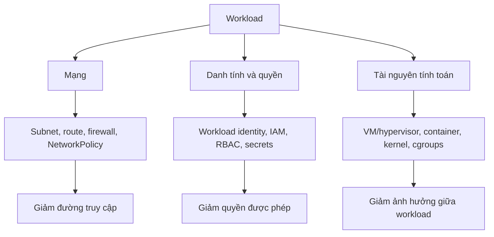
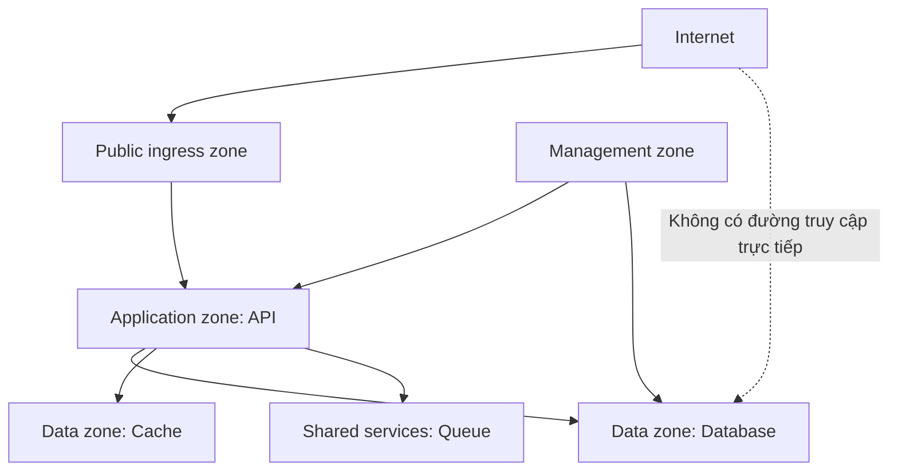
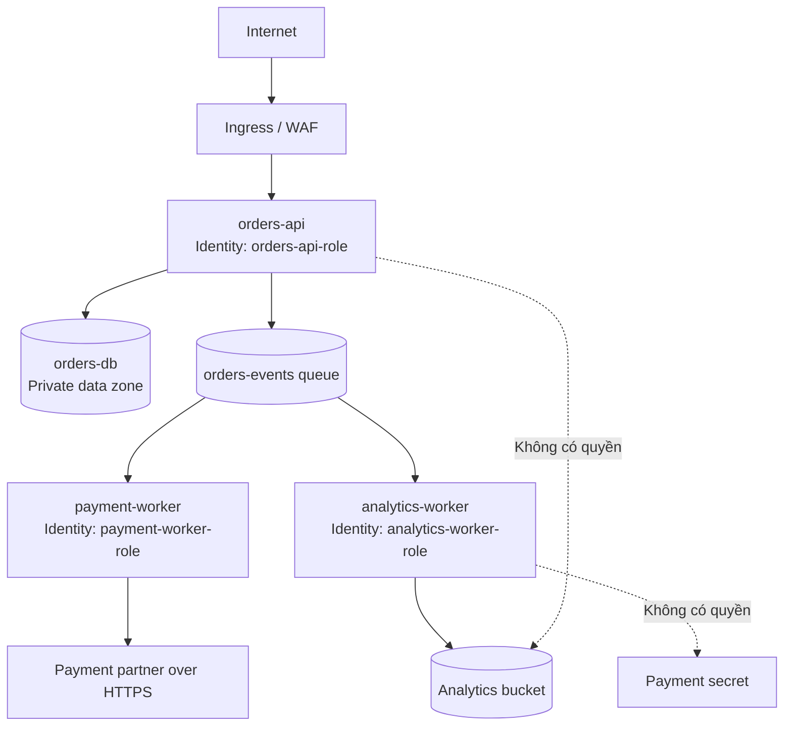
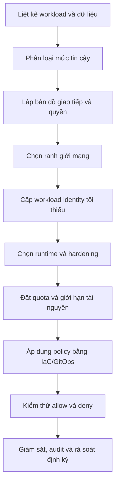

# Cô lập workload bằng mạng, danh tính và ranh giới tài nguyên

Trong một môi trường cloud, nhiều workload có thể chạy trong cùng tài khoản, mạng ảo, cụm container hoặc nhóm máy chủ. Nếu các workload được phép giao tiếp tự do, dùng chung danh tính hoặc chia sẻ tài nguyên mà không có giới hạn, một lỗi cấu hình hay một workload bị xâm nhập có thể lan sang các thành phần khác.

**Cô lập workload (workload isolation)** là việc thiết kế các ranh giới để mỗi ứng dụng, dịch vụ hoặc tenant chỉ truy cập được tài nguyên và giao tiếp cần thiết cho nhiệm vụ của nó. Ranh giới cần được áp dụng đồng thời ở ba lớp: **mạng**, **danh tính và quyền**, và **tài nguyên tính toán**. Cô lập ở một lớp không thay thế hai lớp còn lại.

Sau bài học, bạn có thể:

- Giải thích vì sao cần cô lập workload trong môi trường nhiều ứng dụng và nhiều tenant.
- Thiết kế phân đoạn mạng, kiểm soát ingress/egress và giới hạn giao tiếp giữa các dịch vụ.
- Cấp danh tính riêng cho từng workload và áp dụng quyền tối thiểu.
- Phân biệt ranh giới cô lập của máy ảo, container và các môi trường chạy được sandbox.
- Giới hạn CPU, bộ nhớ, tiến trình, quyền kernel và quyền truy cập dữ liệu.
- Kiểm thử ranh giới cô lập và xử lý khi phát hiện truy cập vượt phạm vi.

## 1. Mục tiêu và mô hình đe dọa

Một workload có thể là máy ảo, container, nhóm container, hàm serverless hoặc ứng dụng chạy trên nền tảng được quản lý. Workload có thể bị lỗi do cấu hình sai, bị khai thác lỗ hổng, dùng thư viện độc hại hoặc bị lộ credential. Nếu quyền của workload quá rộng, kẻ tấn công có thể dùng nó làm điểm bắt đầu để di chuyển ngang (lateral movement) sang dịch vụ khác.

Các tình huống cần ngăn chặn gồm:

- Một API công khai bị khai thác rồi truy cập trái phép vào database nội bộ.
- Một container bị xâm nhập đọc secret hoặc filesystem của container khác.
- Một workload bị chiếm quyền dùng instance identity để đọc object storage hoặc thay đổi tài nguyên ngoài nhiệm vụ.
- Một tenant gây cạn CPU, RAM, PID hoặc băng thông làm ảnh hưởng workload khác.
- Một tiến trình chạy với quyền root hoặc privileged có thể tác động lên host kernel.
- Một workload bị xâm nhập mở kết nối ra Internet hoặc máy chủ điều khiển bên ngoài.
- Một cấu hình mạng dùng chung vô tình cho phép mọi subnet giao tiếp với nhau.

Mục tiêu cô lập là giảm **phạm vi ảnh hưởng (blast radius)**. Khi một thành phần gặp sự cố, quyền và đường giao tiếp của nó phải đủ hẹp để hạn chế thiệt hại.

### Nguyên tắc thiết kế

1. **Default deny:** mặc định từ chối giao tiếp và quyền truy cập, sau đó chỉ mở những gì có lý do.
2. **Least privilege:** mỗi workload chỉ có quyền và tài nguyên cần thiết.
3. **Identity over location:** xác thực danh tính workload, không chỉ dựa vào địa chỉ IP hoặc vị trí mạng.
4. **Defense in depth:** kết hợp nhiều lớp kiểm soát độc lập.
5. **Separate trust zones:** tách môi trường production, staging, development và các vùng dữ liệu có mức nhạy cảm khác nhau.
6. **Explicit ownership:** mỗi policy, service account, network segment và tài nguyên có chủ sở hữu.
7. **Continuous verification:** kiểm thử và giám sát ranh giới sau mỗi thay đổi.

## 2. Ba lớp cô lập chính



| Lớp | Câu hỏi cần trả lời | Kiểm soát tiêu biểu |
|---|---|---|
| Mạng | Workload nào được kết nối đến workload nào, qua cổng và giao thức nào? | VPC/VNet, subnet, route, security group, firewall, NetworkPolicy, private endpoint, egress control |
| Danh tính và quyền | Workload là ai và được phép thực hiện hành động nào? | IAM role, service account, workload identity, RBAC, secret manager, token ngắn hạn |
| Tài nguyên tính toán | Workload có thể ảnh hưởng host hoặc workload khác đến mức nào? | Hypervisor, container namespace, cgroups, seccomp, SELinux/AppArmor, capability, resource quota, sandbox |

Ví dụ, database có thể nằm trong private subnet, chỉ nhận kết nối từ security group của API, và chỉ cho workload API một danh tính có quyền truy cập đúng database. Đồng thời database chạy trên môi trường có giới hạn tài nguyên và được quản lý bản vá. Nếu chỉ đặt database trong private subnet nhưng cấp cho API quyền quản trị toàn bộ cloud account, ranh giới vẫn chưa đủ.

## 3. Cô lập bằng phân đoạn mạng

Phân đoạn mạng (network segmentation) chia hạ tầng thành các vùng có mức tin cậy và mục đích khác nhau. Các vùng không được giao tiếp tự do; luồng giữa chúng phải đi qua chính sách kiểm soát.

### Chia vùng theo vai trò và mức độ tin cậy

Một kiến trúc ứng dụng có thể chia thành:

- **Public ingress zone:** load balancer, API gateway hoặc reverse proxy nhận kết nối từ Internet.
- **Application zone:** API, web backend và worker chỉ nhận kết nối từ thành phần cần thiết.
- **Data zone:** database, cache và hệ thống lưu trữ chỉ nhận kết nối từ workload được phép.
- **Management zone:** bastion, managed session endpoint, hệ thống quản trị và monitoring agent.
- **Shared services zone:** DNS nội bộ, registry, logging, secrets và dịch vụ dùng chung.

Không nhất thiết phải tạo một subnet riêng cho từng microservice. Có thể dùng subnet theo nhóm tin cậy, sau đó áp dụng security group, firewall hoặc NetworkPolicy để kiểm soát chi tiết hơn. Số lượng vùng cần cân bằng giữa mức cô lập và độ phức tạp vận hành.



### Ingress và egress

- **Ingress** là lưu lượng đi vào workload hoặc vùng mạng.
- **Egress** là lưu lượng workload khởi tạo đi ra ngoài vùng hoặc đến đích khác.

Kiểm soát ingress ngăn nguồn không được phép truy cập dịch vụ. Kiểm soát egress hạn chế workload gọi đến endpoint không cần thiết, tải mã độc hoặc gửi dữ liệu ra ngoài.

Ví dụ, API có thể nhận TCP/443 từ load balancer, gọi database qua TCP/5432 và gọi một payment endpoint qua HTTPS. API không cần quyền truy cập SSH đến mọi VM hoặc kết nối tùy ý đến toàn bộ Internet.

### Security group, network ACL và firewall

Các nền tảng cloud thường cung cấp một hoặc nhiều cơ chế lọc mạng:

| Cơ chế | Phạm vi thường gặp | Đặc điểm cần hiểu |
|---|---|---|
| Security group / network security group | NIC, instance hoặc nhóm tài nguyên | Thường là stateful; response traffic của kết nối được cho phép có thể tự động được chấp nhận, tùy nền tảng |
| Network ACL | Subnet hoặc ranh giới mạng | Có thể là stateless; cần cho phép cả chiều đi và chiều về, bao gồm ephemeral ports |
| Host firewall | Hệ điều hành của VM | Bổ sung kiểm soát tại guest OS; cần quản lý đồng bộ với firewall cloud |
| Kubernetes NetworkPolicy | Pod hoặc namespace | Cần CNI hỗ trợ; policy chọn Pod và giới hạn ingress/egress theo selector, namespace, IP block hoặc port |
| Service mesh policy | Giao tiếp service-to-service | Có thể bổ sung xác thực workload và chính sách ở tầng ứng dụng; không thay thế hoàn toàn network segmentation |

Tên gọi, trạng thái stateful/stateless và thứ tự đánh giá rule khác nhau theo nhà cung cấp. Hãy xác minh semantics của nền tảng thay vì suy luận từ tên sản phẩm.

### Default-deny và allow-list

Một cách triển khai an toàn là tạo chính sách từ chối mặc định cho ingress và egress trong phạm vi phù hợp, rồi mở các luồng cần thiết. Trước khi bật default-deny ở production, cần lập bản đồ dependency để tránh chặn DNS, logging, monitoring, secret manager, time sync hoặc cập nhật bảo mật.

Luồng cho phép nên ghi rõ:

- Nguồn và đích (CIDR, security group, namespace, service identity hoặc endpoint).
- Giao thức và cổng.
- Mục đích nghiệp vụ.
- Chủ sở hữu và người phê duyệt.
- Ngày xem xét hoặc điều kiện hết hạn.

Không dùng rule `allow all` để khắc phục sự cố kết nối rồi quên thu hẹp lại. Nếu cần chẩn đoán tạm thời, ghi nhận thay đổi, giới hạn phạm vi và đặt thời điểm gỡ bỏ.

## 4. Cô lập mạng cho container và Kubernetes

Container thường dùng chung network stack của host hoặc một lớp mạng ảo do runtime/orchestrator quản lý. Kubernetes cung cấp Pod network và Service abstraction; các Pod có thể giao tiếp với nhau theo cấu hình CNI và policy.

### Namespace và NetworkPolicy

Namespace Kubernetes giúp nhóm tài nguyên theo môi trường hoặc đội ngũ. Namespace không tự động tạo ranh giới mạng. Muốn kiểm soát Pod nào được kết nối đến Pod nào, cần dùng NetworkPolicy với CNI hỗ trợ enforcement.

Ví dụ policy default-deny ingress và egress trong một namespace:

```yaml
apiVersion: networking.k8s.io/v1
kind: NetworkPolicy
metadata:
  name: default-deny-all
  namespace: orders
spec:
  podSelector: {}
  policyTypes:
    - Ingress
    - Egress
```

Sau đó tạo rule allow cụ thể cho API đến database và DNS. Ví dụ sau chỉ minh họa cấu trúc; cần điều chỉnh label, namespace, port và DNS endpoint theo cụm thực tế:

```yaml
apiVersion: networking.k8s.io/v1
kind: NetworkPolicy
metadata:
  name: allow-api-to-orders-db
  namespace: orders
spec:
  podSelector:
    matchLabels:
      app: orders-api
  policyTypes:
    - Egress
  egress:
    - to:
        - podSelector:
            matchLabels:
              app: orders-db
      ports:
        - protocol: TCP
          port: 5432
```

Policy này minh họa giới hạn egress từ Pod API đến Pod database trên TCP/5432 trong cùng namespace. Để database chỉ nhận kết nối từ API, cần policy ingress tương ứng ở Pod database. Cũng cần rule DNS và các dependency cần thiết; nếu default-deny egress được bật mà thiếu DNS, ứng dụng có thể không phân giải tên dịch vụ.

### Kiểm tra phạm vi thực tế

- Xác nhận CNI hỗ trợ NetworkPolicy và policy đã được thực thi.
- Kiểm tra Pod selector và namespace selector có khớp workload thực tế.
- Kiểm tra traffic giữa namespace, node và external IP.
- Kiểm tra IPv4/IPv6 nếu cụm dual-stack.
- Xác nhận DNS, metrics, logging, registry và secret retrieval vẫn hoạt động.
- Kiểm thử cả luồng được phép và luồng phải bị chặn.

Không coi Kubernetes namespace là security boundary mạnh ngang một cloud account hoặc VM boundary. Với workload có mức tin cậy khác biệt lớn, cân nhắc cluster riêng, node pool riêng hoặc sandbox/runtime isolation.

## 5. Cô lập bằng danh tính workload

Mạng trả lời “có đường kết nối hay không”; danh tính và quyền trả lời “khi kết nối, workload được làm gì”. Workload cần danh tính riêng thay vì chia sẻ một credential dùng cho cả hệ thống.

### Một danh tính cho mỗi workload hoặc vai trò

Ví dụ:

- `orders-api` chỉ được đọc secret kết nối database và ghi vào queue đơn hàng.
- `invoice-worker` chỉ được đọc queue hóa đơn và ghi file vào bucket hóa đơn.
- `reporting-job` chỉ được đọc dữ liệu đã tổng hợp và ghi báo cáo vào vùng lưu trữ riêng.

Không nên dùng một instance role có quyền quản trị toàn bộ storage, database và network cho tất cả workload. Khi một thành phần bị xâm nhập, danh tính riêng giúp giới hạn tài nguyên có thể bị truy cập.

### Dùng credential ngắn hạn

Ưu tiên workload identity, instance role, service account federation hoặc cơ chế cấp token tạm thời. Tránh nhúng access key dài hạn vào image, biến môi trường cố định hoặc file cấu hình.

Credential ngắn hạn giảm thời gian sử dụng nếu bị lộ, nhưng vẫn cần giới hạn scope và audience, kiểm soát refresh, bảo vệ metadata endpoint và audit hoạt động. Token có thời hạn ngắn nhưng quyền quá rộng vẫn tạo rủi ro trong thời gian còn hiệu lực.

### Quyền tối thiểu ở IAM và RBAC

- Chỉ cấp action cần thiết trên resource cụ thể.
- Tách quyền đọc, ghi, xóa và quản trị policy.
- Dùng role theo môi trường và workload; tránh dùng role production trong staging.
- Giới hạn Kubernetes service account và RBAC theo namespace/resource.
- Không mount service account token vào Pod nếu workload không cần gọi Kubernetes API.
- Thu hồi role, binding và token khi workload bị xóa hoặc thay đổi mục đích.

Ví dụ mô tả quyền ở mức khái niệm:

```yaml
workload_identity:
  name: orders-api
  permissions:
    - action: secrets.read
      resource: secret/orders/database
    - action: queue.send
      resource: queue/orders-created
  denied_by_default: true
  credential:
    type: short_lived_federated_token
```

Đây không phải policy syntax của một cloud provider cụ thể. Hãy ánh xạ sang IAM service thực tế và kiểm tra policy bằng công cụ của nền tảng.

## 6. Bảo vệ đường truy cập metadata và secrets

VM hoặc container có thể nhận credential thông qua metadata service, workload identity endpoint hoặc agent. Nếu workload không được tin cậy có thể truy cập metadata của host hoặc VM, nó có thể lấy credential của instance role.

Các biện pháp thường dùng:

- Dùng cơ chế metadata bảo vệ chống SSRF theo khuyến nghị của nhà cung cấp, chẳng hạn yêu cầu phiên bản metadata token/session phù hợp.
- Giới hạn quyền của instance role; không gán role quản trị rộng cho máy chạy nhiều workload không cùng mức tin cậy.
- Với container, dùng workload identity riêng thay vì để mọi Pod thừa hưởng credential của node.
- Chặn hoặc giới hạn truy cập từ Pod đến metadata endpoint của node nếu không cần.
- Không lưu secret trong image, source code, log hoặc volume dùng chung không kiểm soát.
- Lấy secret từ secret manager theo danh tính workload và chỉ cấp secret đúng môi trường.
- Xoay vòng secret và audit truy cập; tránh để một workload đọc toàn bộ secret của namespace hoặc account.

Một container bị khai thác có thể dùng SSRF để gọi metadata endpoint nếu đường truy cập không được bảo vệ. Cần kết hợp kiểm soát metadata, egress policy, identity scope và vá lỗi ứng dụng.

## 7. Cô lập tài nguyên tính toán

Network và IAM hạn chế đường truy cập, nhưng workload vẫn có thể ảnh hưởng workload khác qua CPU, RAM, kernel, filesystem hoặc thiết bị dùng chung. Cần hiểu ranh giới isolation của môi trường thực thi.

### Máy ảo và hypervisor

Máy ảo có hệ điều hành khách riêng. Hypervisor phân chia CPU, bộ nhớ và thiết bị ảo giữa các VM, đồng thời cung cấp ranh giới cách ly ở lớp ảo hóa. Đây thường là ranh giới mạnh hơn container thông thường vì mỗi VM có kernel riêng.

Tuy nhiên, VM vẫn chia sẻ phần cứng và lớp hypervisor của host. Lỗ hổng hypervisor, cấu hình thiết bị passthrough, quyền quản trị cloud hoặc credential dùng chung vẫn có thể làm suy yếu ranh giới. Với workload có yêu cầu cách ly cao, cân nhắc dedicated host, confidential computing hoặc dịch vụ chuyên dụng theo mô hình đe dọa và hỗ trợ của nhà cung cấp.

### Container và kernel dùng chung

Container thường cô lập tiến trình bằng các cơ chế kernel như:

- **Namespaces:** tách góc nhìn về process ID, network, mount, user, IPC và hostname.
- **cgroups:** giới hạn và theo dõi CPU, memory, I/O và số lượng tài nguyên tiến trình.
- **Linux capabilities:** chia nhỏ quyền root thành các capability; container không cần giữ toàn bộ quyền đặc biệt.
- **seccomp:** giới hạn các system call mà tiến trình được phép gọi.
- **SELinux/AppArmor:** áp dụng chính sách mandatory access control cho tiến trình và tài nguyên.
- **Read-only filesystem:** giảm khả năng thay đổi hệ thống tệp gốc.

Vì container chia sẻ kernel host, một lỗ hổng kernel hoặc cấu hình privileged có thể làm ranh giới bị phá vỡ. Không nên chạy workload không tin cậy với `privileged: true`, host PID/network namespace hoặc mount host filesystem nếu không có lý do và kiểm soát đặc biệt.

### Sandbox và runtime tăng cường cô lập

Một số môi trường dùng microVM, sandboxed container hoặc runtime có lớp kernel/virtualization bổ sung. Chúng có thể tăng ranh giới giữa workload nhưng thường có trade-off về thời gian khởi động, tương thích, hiệu năng và vận hành. Chọn theo mức độ tin cậy, yêu cầu latency, loại syscall và khả năng hỗ trợ của nền tảng.

### So sánh các ranh giới

| Môi trường | Ranh giới chính | Ưu điểm | Điều cần lưu ý |
|---|---|---|---|
| VM | Hypervisor và guest OS riêng | Kernel riêng, phù hợp workload cần kiểm soát OS hoặc mức cô lập mạnh hơn | Tốn tài nguyên hơn; vẫn phụ thuộc hypervisor và cloud control plane |
| Container thông thường | Kernel host, namespace và cgroups | Nhẹ, khởi động nhanh, mật độ cao | Chia sẻ kernel; cần hardening và tránh privileged workload |
| Sandboxed container/microVM | Lớp sandbox hoặc VM nhẹ giữa workload và host | Tăng cô lập cho workload ít tin cậy | Có thể hạn chế tương thích hoặc tăng overhead |
| Serverless function | Runtime và sandbox do nền tảng quản lý | Giảm quyền quản trị hạ tầng của khách hàng | Vẫn cần IAM, network policy, secret isolation và kiểm soát event trigger |

Không có mô hình nào tự động bảo đảm an toàn. Cần xem chính xác cách nhà cung cấp triển khai, ranh giới trách nhiệm và tùy chọn bảo mật.

## 8. Giới hạn CPU, RAM, tiến trình và lưu trữ

Resource isolation giúp một workload không chiếm toàn bộ tài nguyên của node hoặc host.

### CPU và bộ nhớ

- Đặt CPU request để scheduler biết mức tài nguyên workload cần.
- Đặt CPU limit khi cần ngăn workload chiếm quá nhiều CPU; hiểu hành vi throttling.
- Đặt memory request dựa trên working set để scheduler bố trí node phù hợp.
- Đặt memory limit có khoảng dự phòng; vượt limit có thể dẫn đến OOM kill.
- Dùng quota theo namespace hoặc project để giới hạn tổng tài nguyên một nhóm có thể yêu cầu.

Ví dụ cấu hình container:

```yaml
resources:
  requests:
    cpu: "500m"
    memory: "512Mi"
  limits:
    cpu: "1"
    memory: "1Gi"
```

`500m` tương đương nửa CPU logic theo cách biểu diễn Kubernetes; đây là ví dụ minh họa, không phải sizing khuyến nghị cho mọi ứng dụng. Cần đo tải, p95/p99 latency và working set để chọn giá trị.

### Giới hạn tiến trình và file descriptor

Một workload có thể tạo quá nhiều process, thread hoặc file descriptor làm cạn tài nguyên node. Có thể giới hạn PID qua runtime/cgroup, đặt ulimit phù hợp và theo dõi số tiến trình, thread, socket và descriptor.

Không đặt giới hạn quá thấp khiến ứng dụng hợp lệ không thể mở connection hoặc tạo worker. Cần đo mức sử dụng và kiểm thử khi tải đỉnh.

### Ephemeral storage và I/O

Container có thể ghi vào writable layer hoặc ephemeral volume. Nếu không giới hạn, log hoặc file tạm tăng không kiểm soát và làm đầy đĩa node. Đặt quota, log rotation, giới hạn ephemeral storage và chính sách dọn dữ liệu. Với dữ liệu lâu dài, dùng persistent storage có quyền truy cập và encryption phù hợp.

## 9. Hardening container và Pod

Một Pod an toàn nên chạy với quyền tối thiểu và filesystem cần thiết. Ví dụ cấu hình Kubernetes ở mức minh họa:

```yaml
apiVersion: v1
kind: Pod
metadata:
  name: orders-api
  namespace: orders
spec:
  automountServiceAccountToken: false
  containers:
    - name: app
      image: registry.example/orders-api:1.2.0
      securityContext:
        runAsNonRoot: true
        runAsUser: 10001
        allowPrivilegeEscalation: false
        readOnlyRootFilesystem: true
        capabilities:
          drop:
            - ALL
        seccompProfile:
          type: RuntimeDefault
      resources:
        requests:
          cpu: "250m"
          memory: "256Mi"
        limits:
          cpu: "1"
          memory: "512Mi"
```

Ví dụ này thể hiện các lựa chọn hardening phổ biến. Ứng dụng cần thư mục ghi phải mount volume riêng với quyền phù hợp; image và process phải tương thích với user không phải root. Nếu Pod cần gọi Kubernetes API, bật service account token có chủ đích và cấp RBAC tối thiểu.

Các thực hành bổ sung:

- Dùng image từ registry tin cậy, quét lỗ hổng và ưu tiên image tối giản.
- Pin phiên bản image hoặc digest để kiểm soát nội dung triển khai.
- Tránh hostPath, hostNetwork, hostPID và privileged container.
- Không mount Docker/container runtime socket vào workload ứng dụng.
- Áp dụng Pod Security Standards hoặc policy tương đương.
- Tách node pool cho workload có mức tin cậy hoặc yêu cầu thiết bị khác nhau.
- Vá kernel, runtime, orchestrator và node theo quy trình.

## 10. Cô lập theo môi trường và tenant

Một tổ chức thường có nhiều môi trường và tenant. Ranh giới cần phản ánh mức độ nhạy cảm của dữ liệu và mức tin cậy giữa các nhóm.

### Tách development, staging và production

- Dùng cloud account/project/subscription riêng khi yêu cầu cách ly cao hoặc cần tách billing và policy.
- Nếu dùng chung account, tách VPC/VNet, subnet, IAM role, secret, cluster namespace và storage policy.
- Không tái sử dụng credential production trong development.
- Hạn chế đường từ dev/staging vào production; mọi ngoại lệ phải có mục đích rõ ràng.
- Dữ liệu production không nên được sao chép nguyên trạng sang môi trường ít tin cậy.

### Multi-tenancy

Với nền tảng phục vụ nhiều tenant, cần bảo vệ cả dữ liệu và tài nguyên:

- Tách tenant ID và kiểm tra authorization ở mọi request; không chỉ dựa vào giá trị tenant do client gửi.
- Dùng schema/database/bucket hoặc encryption key riêng khi mức cô lập yêu cầu.
- Giới hạn quota CPU, RAM, request rate và storage theo tenant.
- Ngăn tenant truy cập service account, secret, network endpoint hoặc volume của tenant khác.
- Kiểm thử truy cập chéo tenant và xử lý lỗi authorization.

Namespace hoặc label đơn lẻ không đủ làm ranh giới bảo mật nếu RBAC, network policy và admission policy không được cấu hình đúng. Với tenant không tin cậy lẫn nhau hoặc dữ liệu nhạy cảm cao, cân nhắc cluster/account riêng.

## 11. Kiến trúc ví dụ: cô lập hệ thống xử lý đơn hàng

Một ứng dụng thương mại điện tử có các thành phần:

- `web-ingress`: nhận HTTPS từ Internet.
- `orders-api`: xử lý đơn hàng và truy cập database.
- `payment-worker`: gọi đối tác thanh toán và cập nhật trạng thái.
- `orders-db`: lưu đơn hàng.
- `analytics-worker`: đọc event và ghi dữ liệu phân tích.

Thiết kế cô lập:

1. Public ingress chỉ chuyển HTTPS đến API; database không có public endpoint.
2. API chỉ được kết nối database và queue cần thiết; payment worker chỉ được gọi endpoint đối tác và queue.
3. Mỗi workload có service account/role riêng; API không được đọc bucket analytics, analytics worker không được đọc secret thanh toán.
4. Container chạy non-root, drop capabilities, filesystem read-only và resource quota.
5. Namespace production có default-deny NetworkPolicy; rule allow chỉ mở các luồng đã xác định.
6. Secret được lấy lúc chạy từ secret manager bằng workload identity.
7. Audit log, flow log và metric được thu thập tập trung; cảnh báo khi workload cố gọi endpoint ngoài allow-list.



Nếu `orders-api` bị khai thác, attacker có thể cố truy cập các endpoint khác. NetworkPolicy giới hạn đường kết nối; workload identity giới hạn hành động và dữ liệu; resource/kernel controls giới hạn khả năng tác động đến node. Ba lớp cùng làm giảm blast radius.

## 12. Quy trình thiết kế và triển khai cô lập



### Bước 1: kiểm kê workload và dữ liệu

Ghi lại workload, owner, môi trường, tenant, loại dữ liệu, mức độ nhạy cảm, endpoint, port, dependency và danh tính đang sử dụng. Xác định workload có chạy mã không tin cậy hoặc nhận dữ liệu từ người dùng hay không.

### Bước 2: lập bản đồ giao tiếp

Vẽ luồng ingress/egress và service-to-service. Ghi nguồn, đích, giao thức, cổng, tần suất, mục đích và owner. Dùng flow log, service map hoặc trace để xác nhận luồng thực tế; không chỉ dựa vào tài liệu cũ.

### Bước 3: xác định ranh giới tin cậy

Chia workload theo môi trường, tenant, dữ liệu và mức độ tin cậy. Chọn nơi cần account/cluster/VPC riêng và nơi có thể dùng policy chi tiết trong một cụm chung.

### Bước 4: áp dụng network policy

Bắt đầu từ deny-by-default trong môi trường thử nghiệm. Thêm rule theo dependency đã xác minh. Kiểm thử DNS, telemetry, secret retrieval, backup, update và luồng nghiệp vụ trước khi rollout production.

### Bước 5: cấp identity và quyền

Tạo danh tính riêng cho từng workload, cấp token ngắn hạn và quyền tối thiểu. Tách quyền đọc/ghi/xóa, giới hạn resource ARN/URI hoặc scope tương đương, đặt điều kiện theo môi trường và thu hồi credential cũ.

### Bước 6: harden runtime và giới hạn tài nguyên

Chọn VM/container/sandbox theo mức tin cậy. Bỏ quyền đặc biệt không cần, chạy non-root, dùng seccomp/AppArmor/SELinux, giới hạn CPU/RAM/PID/storage và tránh mount host resource.

### Bước 7: kiểm thử và rollout có kiểm soát

Kiểm thử luồng hợp lệ phải thành công và luồng không hợp lệ phải bị chặn. Triển khai theo namespace, node pool hoặc một phần traffic trước; theo dõi lỗi kết nối, latency, restart, throttling và OOM. Có kế hoạch rollback nếu policy chặn dependency hợp lệ.

### Bước 8: duy trì ranh giới

Khi thêm service, thay port, đổi subnet hoặc thay role, cập nhật policy cùng mã triển khai. Rà soát rule không còn dùng, quyền thừa, secret cũ và tài nguyên dùng chung theo chu kỳ.

## 13. Kiểm thử và giám sát hiệu quả cô lập

Policy được tạo nhưng không được kiểm thử có thể tạo cảm giác an toàn sai. Cần xác minh cả hai phía: kết nối được phép hoạt động và kết nối không được phép thực sự thất bại.

### Kiểm thử mạng

- API kết nối được database trên đúng cổng.
- Workload không thể kết nối database từ subnet hoặc namespace không được phép.
- Pod không thể gọi metadata endpoint nếu không cần.
- Egress chỉ đến endpoint được cho phép; DNS và dịch vụ nền vẫn hoạt động.
- IPv4 và IPv6 có hành vi policy tương đương.

### Kiểm thử danh tính

- Workload A không thể đọc secret của workload B.
- Token hết hạn hoặc bị thu hồi không còn được chấp nhận.
- Role không cho phép xóa hoặc sửa tài nguyên ngoài phạm vi.
- Service account không được mount vào Pod không cần gọi API.
- Truy cập cross-tenant bị từ chối ở tầng ứng dụng và dữ liệu.

### Kiểm thử tài nguyên

- Workload không thể đọc host filesystem hoặc container runtime socket nếu không được cấp.
- Container không có quyền privileged hoặc capability không cần thiết.
- CPU/RAM/PID/storage quota hoạt động đúng khi workload tăng tải.
- Một workload bị OOM hoặc CPU throttling không làm node và workload khác mất ổn định ngoài giới hạn thiết kế.
- Runtime isolation phù hợp với mức độ tin cậy của workload.

### Metric và log nên theo dõi

- Network flow bị từ chối, egress bất thường và kết nối đến port không dự kiến.
- IAM access denied, token issuance, secret read và thay đổi role/policy.
- Container restart, OOM kill, CPU throttling, PID exhaustion và disk pressure.
- Việc tạo Pod privileged, hostPath mount, hostNetwork hoặc thay đổi NetworkPolicy.
- Hoạt động thay đổi security group, route, firewall và subnet.
- Các nỗ lực truy cập chéo tenant hoặc vượt quyền ở tầng ứng dụng.

Log phải có timestamp đồng bộ, workload identity, resource ID và kết quả hành động. Không ghi token, private key, password hoặc payload nhạy cảm vào log.

## 14. Sự cố thường gặp và cách xử lý

| Triệu chứng | Nguyên nhân có thể | Hướng kiểm tra |
|---|---|---|
| API không kết nối được database sau khi bật default-deny | Thiếu rule egress/ingress hoặc DNS | NetworkPolicy, security group, route, DNS egress và port |
| Pod gọi được metadata endpoint | Egress chưa bị giới hạn hoặc node credential bị lộ qua metadata | Network path, CNI policy, metadata protection và workload identity |
| Service account đọc được secret ngoài nhiệm vụ | IAM/RBAC quá rộng hoặc dùng chung identity | Role binding, trust policy, secret scope và token audience |
| Container đọc được file host | hostPath hoặc privileged mount | Pod spec, mount namespace, admission policy và runtime configuration |
| Một tenant làm node quá tải | Thiếu quota hoặc resource limit | cgroups, namespace quota, requests/limits và autoscaling |
| Policy không chặn traffic như mong đợi | CNI không hỗ trợ hoặc selector sai | CNI mode, policy status, label, namespace và flow log |
| IPv4 bị chặn nhưng IPv6 vẫn truy cập được | Chỉ cấu hình rule IPv4 | IPv6 route, firewall, NetworkPolicy và listener |
| Thêm policy gây lỗi diện rộng | Rollout đồng thời, thiếu dependency inventory | Audit policy diff, DNS/monitoring/secret path và rollback |

Khi sự cố xảy ra, hãy xác định lớp kiểm soát gây chặn hoặc cho phép sai. Không giải quyết bằng cách mở rộng quyền toàn cục hoặc xóa toàn bộ policy. Thay đổi nhỏ, có phạm vi và có thời hạn giúp khôi phục dịch vụ mà vẫn giữ được ranh giới cần thiết.

## 15. Những sai lầm thường gặp

**Chỉ dùng private subnet là đủ.** Workload trong private subnet vẫn có thể truy cập các dịch vụ nội bộ khác hoặc đi ra Internet qua NAT. Cần kiểm soát east-west và egress.

**Dùng một IAM role cho mọi VM hoặc Pod.** Một workload bị xâm nhập có thể sử dụng quyền của tất cả workload khác. Cấp identity riêng và giới hạn resource/action.

**Coi namespace là ranh giới bảo mật hoàn chỉnh.** Namespace hỗ trợ tổ chức tài nguyên nhưng cần NetworkPolicy, RBAC, admission control, quota và runtime hardening.

**Chạy container privileged để sửa lỗi nhanh.** Quyền privileged có thể làm suy yếu cách ly với host. Xác định capability hoặc mount tối thiểu cần thiết và ghi nhận ngoại lệ.

**Chỉ giới hạn ingress mà bỏ qua egress.** Workload bị xâm nhập vẫn có thể kết nối ra ngoài hoặc dò dịch vụ nội bộ. Lập allow-list egress theo dependency.

**Chỉ dựa vào IP để xác thực workload.** IP có thể thay đổi hoặc được tái sử dụng. Dùng workload identity và xác thực ở tầng ứng dụng.

**Không kiểm tra IPv6.** Một đường mạng IPv6 có thể bỏ qua chính sách chỉ áp dụng cho IPv4. Kiểm thử cả hai giao thức.

**Đặt resource limit mà không đo lường.** Limit quá thấp gây throttling/OOM; không có limit có thể gây noisy neighbor. Dựa vào metric và tải thử.

## 16. Checklist cô lập workload

### Mạng

- [ ] Workload được phân vào vùng mạng theo vai trò và mức độ tin cậy.
- [ ] Ingress và egress có chính sách mặc định từ chối trong phạm vi phù hợp.
- [ ] Chỉ mở source, destination, protocol và port cần thiết.
- [ ] Database, cache và control endpoint không công khai nếu không cần.
- [ ] DNS, logging, monitoring, secret retrieval và update path vẫn hoạt động.
- [ ] NetworkPolicy được thực thi bởi CNI; IPv4/IPv6 đã được kiểm thử.
- [ ] Có flow log hoặc telemetry để phát hiện kết nối bất thường.

### Danh tính và quyền

- [ ] Mỗi workload có identity riêng và owner rõ ràng.
- [ ] Quyền IAM/RBAC theo least privilege, giới hạn action và resource.
- [ ] Credential ngắn hạn; không bake secret vào image hoặc source.
- [ ] Metadata endpoint được bảo vệ; Pod chỉ nhận identity cần thiết.
- [ ] Secret được phân tách theo workload và môi trường.
- [ ] Có quy trình rotation, revoke và audit.

### Tài nguyên tính toán

- [ ] Runtime isolation phù hợp mức tin cậy của workload.
- [ ] Container chạy non-root, drop capability và không privileged nếu không cần.
- [ ] Không mount hostPath hoặc runtime socket ngoài nhu cầu được duyệt.
- [ ] Seccomp và SELinux/AppArmor hoặc cơ chế tương đương được bật phù hợp.
- [ ] CPU, RAM, PID và ephemeral storage có request/limit/quota hợp lý.
- [ ] Node, kernel, runtime và orchestrator được cập nhật.

### Vận hành

- [ ] Luồng được phép và luồng bị cấm đều đã được kiểm thử.
- [ ] Có rollout, rollback và quy trình xử lý ngoại lệ.
- [ ] Audit log ghi được identity, resource, action và thời gian.
- [ ] Policy và quyền được rà soát định kỳ, loại bỏ rule/role không còn dùng.
- [ ] Có quy trình phản ứng khi workload bị xâm nhập và thu hồi credential.

## 17. Tự kiểm tra

1. Vì sao private subnet không đủ để cô lập một workload khỏi các workload khác?
2. Phân biệt vai trò của security group, network ACL, host firewall và Kubernetes NetworkPolicy.
3. Vì sao mỗi workload nên có danh tính riêng thay vì dùng chung một instance role?
4. Một Pod không cần gọi Kubernetes API. Cấu hình service account token nên được xử lý như thế nào?
5. Namespace Kubernetes có tự động ngăn Pod ở namespace khác kết nối đến nhau không? Cần cơ chế nào để kiểm soát?
6. Container privileged hoặc mount hostPath có thể làm suy yếu ranh giới cô lập ra sao?
7. Vì sao cần giới hạn cả CPU, RAM, PID và ephemeral storage?
8. Hãy đề xuất ba lớp kiểm soát để cô lập API khỏi database và payment worker.
9. Làm thế nào chứng minh policy hoạt động đúng sau khi triển khai?

Cô lập workload hiệu quả khi mạng chỉ cho phép luồng cần thiết, danh tính chỉ có quyền đúng nhiệm vụ và runtime giới hạn ảnh hưởng đến host cùng workload lân cận. Kết hợp ba lớp này với kiểm thử, audit và rà soát liên tục giúp giảm đường di chuyển ngang và thu hẹp phạm vi sự cố trong môi trường compute cloud.
