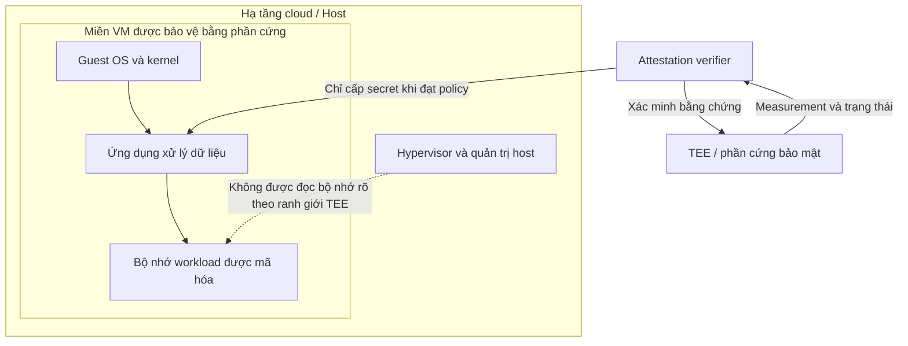
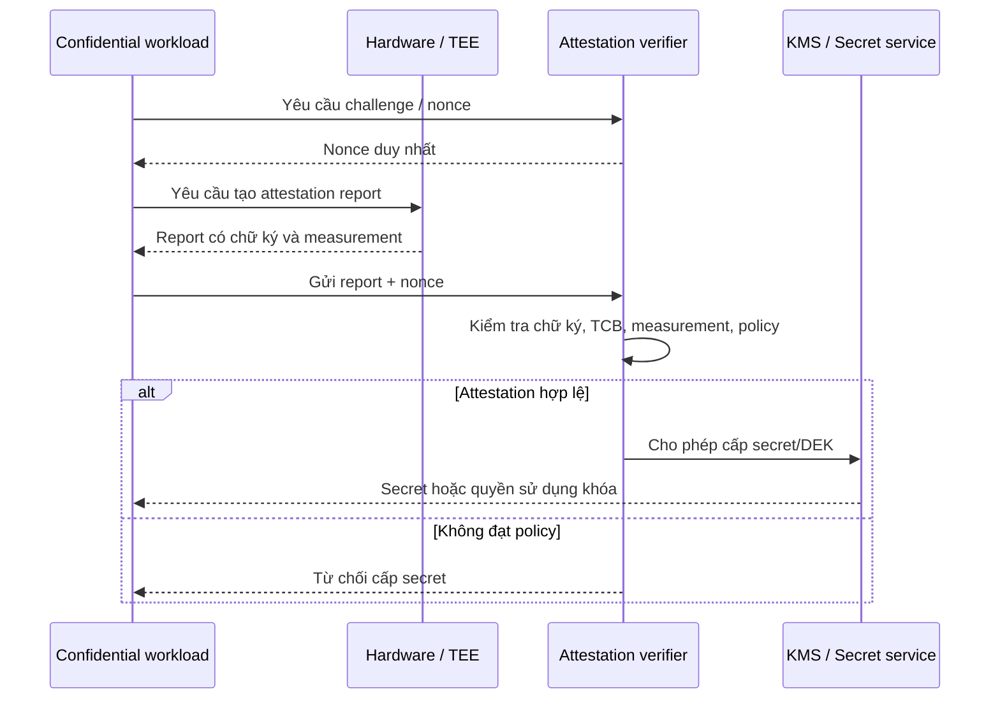
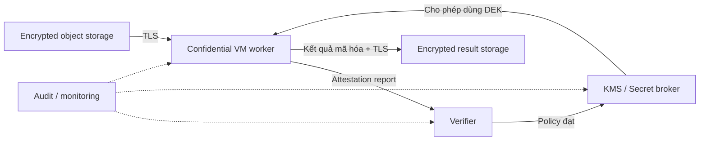

# Mã hóa dữ liệu trong bộ nhớ và mô hình confidential computing

## Mục tiêu học tập

Sau bài học, bạn có thể:

- Giải thích vì sao mã hóa dữ liệu khi lưu trữ và khi truyền chưa đủ để bảo vệ dữ liệu trong lúc workload đang xử lý.
- Phân biệt memory encryption, Trusted Execution Environment (TEE), confidential VM và enclave.
- Mô tả cách các công nghệ như AMD SEV-SNP, Intel TDX và Arm CCA bảo vệ bộ nhớ của workload.
- Giải thích vai trò của attestation, measurement, TCB và quy trình chỉ cấp bí mật sau khi xác minh môi trường chạy.
- Đánh giá giới hạn, ảnh hưởng hiệu năng và yêu cầu tương thích khi triển khai confidential computing trên cloud.
- Xây dựng quy trình thử nghiệm, vận hành và xử lý sự cố cho workload xử lý dữ liệu nhạy cảm.

## 1. Vì sao cần bảo vệ dữ liệu khi đang xử lý?

Một ứng dụng cloud thường bảo vệ dữ liệu ở hai trạng thái quen thuộc:

- **Data at rest:** dữ liệu được mã hóa khi nằm trên disk, snapshot, object storage hoặc backup.
- **Data in transit:** dữ liệu được bảo vệ khi đi qua mạng bằng TLS hoặc một kênh truyền an toàn khác.

Tuy nhiên, để xử lý dữ liệu, CPU và hệ điều hành cần đưa dữ liệu vào bộ nhớ. Khi đó, dữ liệu thường được giải mã trong RAM để ứng dụng có thể đọc, tính toán và cập nhật. Quản trị viên có quyền cao trên host, hypervisor hoặc hệ điều hành có thể có khả năng quan sát một phần trạng thái bộ nhớ, tùy kiến trúc và cơ chế bảo vệ.

Ví dụ, một dịch vụ phân tích hồ sơ khách hàng có thể dùng TLS khi nhận dữ liệu và mã hóa disk khi lưu kết quả. Nhưng trong lúc tính toán, dữ liệu nhạy cảm vẫn được nạp vào RAM. Nếu môi trường thực thi bị xâm nhập hoặc lớp hạ tầng có quyền truy cập bộ nhớ, dữ liệu đang xử lý có thể bị lộ.

**Confidential computing** (điện toán bảo mật) tập trung bảo vệ dữ liệu khi đang được xử lý bằng cách thực thi workload trong một môi trường được phần cứng cô lập và bảo vệ. Mục tiêu thường là giảm khả năng truy cập trái phép vào bộ nhớ và trạng thái thực thi từ các thành phần nằm ngoài ranh giới tin cậy đã định nghĩa.

Cần hiểu rõ phạm vi: confidential computing bổ sung lớp bảo vệ cho data in use. Nó không tự thay thế mã hóa disk, TLS, IAM, bảo vệ ứng dụng, quản lý khóa hay giám sát runtime.

### Ba trạng thái dữ liệu và lớp bảo vệ

| Trạng thái | Ví dụ | Lớp bảo vệ thường dùng |
|---|---|---|
| Data at rest | Boot disk, data volume, snapshot, backup | Disk encryption, KMS, kiểm soát quyền truy cập |
| Data in transit | API request, kết nối database, replication | TLS, mTLS, VPN hoặc kênh truyền được bảo vệ |
| Data in use | Dữ liệu trong RAM khi truy vấn, suy luận AI hoặc xử lý giao dịch | Memory encryption, TEE, confidential VM, enclave |

Một kiến trúc bảo vệ dữ liệu nhạy cảm thường kết hợp cả ba lớp. Chẳng hạn, VM dùng disk mã hóa bằng CMK, kết nối dịch vụ qua TLS và chạy trong confidential VM có attestation.

## 2. Memory encryption là gì?

Memory encryption (mã hóa bộ nhớ) là cơ chế mã hóa dữ liệu khi dữ liệu được lưu trong DRAM. Bộ điều khiển bộ nhớ hoặc phần cứng bảo mật của CPU thực hiện mã hóa khi ghi và giải mã khi đọc theo cơ chế của nền tảng.

Ở mức khái niệm:

1. CPU hoặc thành phần thực thi tạo dữ liệu rõ trong phạm vi xử lý được bảo vệ.
2. Khi dữ liệu được ghi xuống DRAM, bộ điều khiển mã hóa dữ liệu bằng khóa bộ nhớ.
3. Khi dữ liệu được đọc lại vào phạm vi xử lý được bảo vệ, phần cứng giải mã để CPU tiếp tục thực thi.
4. Thành phần nằm ngoài ranh giới tin cậy chỉ quan sát được nội dung bộ nhớ đã mã hóa hoặc dữ liệu đã được kiểm soát theo thiết kế phần cứng.

Khóa bộ nhớ thường được tạo và quản lý bởi phần cứng nền tảng. Trong nhiều mô hình confidential VM, khóa được thiết lập cho từng VM hoặc từng miền bảo vệ và không được xuất ra cho hypervisor dưới dạng rõ. Chi tiết về số lượng khóa, vòng đời, cách xử lý khi migration và phạm vi bảo vệ phụ thuộc công nghệ CPU và nhà cung cấp cloud.

### 2.1. Mã hóa bộ nhớ không giống mã hóa disk

| Tiêu chí | Disk encryption | Memory encryption |
|---|---|---|
| Dữ liệu được bảo vệ | Khối dữ liệu trên thiết bị lưu trữ | Nội dung bộ nhớ trong quá trình thực thi |
| Thời điểm mã hóa/giải mã | Khi đọc/ghi dữ liệu lưu trữ | Khi dữ liệu đi giữa CPU và DRAM theo cơ chế phần cứng |
| Khóa | Có thể dùng KMS, CMK, DEK hoặc khóa của guest OS | Thường do CPU/phần cứng bảo vệ tạo và quản lý |
| Mục tiêu | Bảo vệ dữ liệu lưu trữ và bản sao | Giảm khả năng đọc trộm bộ nhớ từ ngoài miền tin cậy |
| Không tự bảo vệ | Dữ liệu đã mở khóa trong RAM | Disk, backup, network hoặc ứng dụng khỏi mọi loại tấn công |

Nếu chỉ bật disk encryption, dữ liệu vẫn có thể xuất hiện dạng rõ trong RAM sau khi volume được mở khóa. Nếu chỉ bật memory encryption, snapshot hoặc backup vẫn cần cơ chế mã hóa lưu trữ riêng.

### 2.2. Mã hóa bộ nhớ không đồng nghĩa với bảo vệ toàn bộ máy

Cụm từ memory encryption có thể chỉ một tính năng bảo vệ bộ nhớ ở cấp hệ thống hoặc một phần của TEE. Phạm vi bảo vệ cụ thể cần được xác định:

- Bộ nhớ của toàn VM hay chỉ một vùng enclave?
- Có bảo vệ tính toàn vẹn (integrity) hay chỉ mã hóa nội dung?
- Hypervisor có thể quan sát thanh ghi, trạng thái thiết bị hoặc metadata nào?
- Bộ nhớ GPU hoặc accelerator có nằm trong phạm vi bảo vệ không?
- Snapshot, crash dump, live migration và debug có được hỗ trợ không?
- Các thiết bị DMA có thể truy cập vùng nhớ nào?

Mã hóa DRAM là thành phần quan trọng nhưng không tự động biến toàn bộ hệ thống thành môi trường đáng tin cậy. Hãy đọc tài liệu của đúng công nghệ và loại VM để biết ranh giới bảo vệ.

## 3. Trusted Execution Environment và confidential computing

**Trusted Execution Environment (TEE)** là môi trường thực thi được phần cứng hỗ trợ để cô lập mã và dữ liệu khỏi một số thành phần nằm ngoài vùng tin cậy. TEE thường cung cấp một ranh giới bảo vệ, cơ chế đo lường trạng thái ban đầu và cách chứng minh môi trường thực thi đang chạy đúng cấu hình đã phê duyệt.

**Confidential computing** là cách xây dựng và vận hành workload dựa trên các cơ chế bảo vệ data in use, thường sử dụng TEE và attestation. Trên cloud, một hình thức phổ biến là confidential VM (CVM): toàn bộ VM hoặc một miền bộ nhớ của VM được bảo vệ bằng tính năng của CPU.

Các đặc điểm thường gặp:

- Bộ nhớ của workload được mã hóa bằng khóa phần cứng.
- Hypervisor hoặc host administrator bị hạn chế khả năng đọc nội dung bộ nhớ được bảo vệ.
- Có cơ chế bảo vệ tính toàn vẹn và phát hiện một số thao tác sửa đổi trạng thái, tùy công nghệ.
- Có thể tạo measurement hoặc attestation report để chứng minh cấu hình nền tảng và trạng thái khởi động.
- Khóa hoặc bí mật có thể chỉ được cấp sau khi attestation đáp ứng policy.

### 3.1. Ranh giới tin cậy

Trong VM thông thường, khách hàng thường tin cậy hypervisor và một phần hạ tầng quản lý của nhà cung cấp. Với confidential VM, mục tiêu là giảm mức độ phải tin cậy vào host/hypervisor đối với tính bí mật của bộ nhớ và một số thuộc tính toàn vẹn.

Sơ đồ khái niệm:



Sơ đồ chỉ mô tả mục tiêu bảo vệ ở mức khái niệm. Host vẫn có thể kiểm soát một số tài nguyên bên ngoài TEE, chẳng hạn lịch CPU, thiết bị ảo, lưu lượng mạng hoặc trạng thái sẵn sàng. Các kênh I/O cần được bảo vệ riêng.

### 3.2. Confidential VM và enclave

Hai mô hình thường gặp:

- **Confidential VM:** bảo vệ một VM hoặc miền thực thi tương đối lớn. Guest OS và ứng dụng chạy trong VM được bảo vệ. Đây là mô hình phù hợp khi muốn đưa workload hiện có lên môi trường confidential với thay đổi kiến trúc ít hơn, nếu hệ điều hành và loại máy tương thích.
- **Enclave:** bảo vệ một vùng thực thi nhỏ hơn bên trong ứng dụng hoặc hệ điều hành được hỗ trợ. Chỉ mã và dữ liệu trong enclave nằm trong ranh giới bảo vệ; phần còn lại của hệ thống có thể không được bảo vệ tương tự.

| Tiêu chí | Confidential VM | Enclave |
|---|---|---|
| Phạm vi | VM hoặc miền guest được bảo vệ | Một vùng mã và dữ liệu được cô lập |
| Hệ điều hành | Guest OS chạy trong VM | Thường cần runtime, SDK hoặc mô hình lập trình riêng |
| Thay đổi ứng dụng | Có thể ít hơn nếu ứng dụng tương thích | Thường cần chia ứng dụng thành phần enclave và phần không tin cậy |
| Attestation | Thường đo trạng thái firmware/boot, guest hoặc VM theo công nghệ | Thường đo enclave code và cấu hình enclave |
| Trường hợp dùng | Dịch vụ hiện có, database, workload đa tiến trình | Xử lý bí mật nhỏ, khóa, thuật toán hoặc dữ liệu nhạy cảm trong phạm vi hẹp |

Không phải TEE nào cũng hỗ trợ cả hai mô hình. Intel SGX thường gắn với mô hình enclave; Intel TDX hướng đến confidential VM. AMD SEV-SNP bảo vệ VM bằng cơ chế riêng của AMD. Hãy chọn theo workload, hệ điều hành và loại instance được nhà cung cấp hỗ trợ.

## 4. Các công nghệ phần cứng tiêu biểu

Các công nghệ dưới đây là ví dụ về cách CPU và nền tảng triển khai confidential computing. Tên gọi, mức bảo vệ và khả năng cung cấp trên cloud thay đổi theo thế hệ phần cứng.

### 4.1. AMD SEV, SEV-ES và SEV-SNP

AMD Secure Encrypted Virtualization (SEV) được thiết kế để mã hóa bộ nhớ của VM và tách khóa bộ nhớ giữa các VM. Các thế hệ mở rộng bổ sung khả năng bảo vệ trạng thái thực thi và tính toàn vẹn:

- **SEV:** mã hóa bộ nhớ VM bằng khóa riêng cho VM, giúp giảm khả năng hypervisor đọc trực tiếp nội dung RAM.
- **SEV-ES (Encrypted State):** bổ sung bảo vệ trạng thái thanh ghi của guest khi xảy ra một số lần chuyển điều khiển giữa guest và hypervisor.
- **SEV-SNP (Secure Nested Paging):** bổ sung cơ chế bảo vệ tính toàn vẹn và kiểm soát ánh xạ trang bộ nhớ, giúp phát hiện hoặc ngăn một số kiểu sửa đổi bộ nhớ trái phép từ hypervisor độc hại.

SEV-SNP hỗ trợ attestation report để bên xác minh đánh giá trạng thái nền tảng và measurement. Việc sử dụng khóa và xác minh report cần tuân thủ giao thức của AMD và dịch vụ cloud tương ứng.

Không nên suy luận mọi VM chạy trên CPU AMD đều là confidential VM. Cần chọn đúng instance family, bật chế độ confidential được nền tảng hỗ trợ và dùng image tương thích.

### 4.2. Intel TDX và SGX

Intel có hai hướng công nghệ thường được nhắc đến:

- **Intel TDX (Trust Domain Extensions):** hướng đến bảo vệ một VM, được gọi là trust domain (TD), khỏi phần mềm quản lý nền tảng nằm ngoài miền tin cậy. TDX dùng cơ chế bảo vệ bộ nhớ và trạng thái thực thi của trust domain; có thể cung cấp TD report để hỗ trợ attestation.
- **Intel SGX (Software Guard Extensions):** cung cấp enclave trong không gian địa chỉ của ứng dụng. Enclave bảo vệ vùng mã và dữ liệu được định nghĩa, ngay cả khi phần còn lại của hệ điều hành không được tin cậy theo mô hình đe dọa.

TDX phù hợp với mô hình confidential VM. SGX phù hợp với ứng dụng có thể cô lập một phần logic nhạy cảm vào enclave và quản lý giao tiếp với phần không tin cậy.

Các giới hạn của SGX về bộ nhớ enclave, API và mô hình lập trình có thể ảnh hưởng lớn đến việc chuyển đổi ứng dụng. TDX bảo vệ phạm vi VM rộng hơn nhưng vẫn cần bảo vệ guest kernel và ứng dụng trước các lỗ hổng bên trong guest.

### 4.3. Arm Confidential Compute Architecture

Arm Confidential Compute Architecture (CCA) cung cấp mô hình bảo vệ vùng thực thi gọi là Realm. Realm được thiết kế để cô lập mã và dữ liệu khỏi một số thành phần privileged của hệ thống, dựa trên phần cứng và firmware hỗ trợ.

CCA mở rộng cách tiếp cận confidential computing trên kiến trúc Arm. Việc hỗ trợ thực tế phụ thuộc CPU, firmware, hypervisor, hệ điều hành và dịch vụ cloud. Không phải mọi VM ARM đều có Realm hoặc confidential computing chỉ vì dùng kiến trúc Arm.

### So sánh khái quát

| Công nghệ | Phạm vi bảo vệ chính | Khái niệm nổi bật | Cần xác minh |
|---|---|---|---|
| AMD SEV | Bộ nhớ VM | Khóa riêng cho VM | Thế hệ SEV, SEV-ES hay SEV-SNP; hỗ trợ attestation |
| AMD SEV-SNP | VM và ánh xạ trang bộ nhớ | Bảo vệ toàn vẹn và attestation report | Firmware/TCB, guest image và instance family |
| Intel TDX | Trust domain/VM | Miền VM được cô lập bằng phần cứng | TDX module, firmware, guest kernel và attestation |
| Intel SGX | Enclave trong ứng dụng | Cô lập mã và dữ liệu ở phạm vi nhỏ | SDK, kích thước enclave, tương thích ứng dụng |
| Arm CCA | Realm | Miền thực thi bảo mật trên Arm | CPU/firmware/hypervisor và dịch vụ có hỗ trợ |

Bảng trên giúp định hướng khái niệm, không phải bảng xếp hạng mức an toàn. Mỗi công nghệ có mô hình đe dọa, phiên bản, yêu cầu phần cứng và giới hạn khác nhau.

## 5. Attestation: chứng minh workload chạy trong môi trường được tin cậy

Memory encryption giúp bảo vệ nội dung bộ nhớ, nhưng ứng dụng còn cần biết mình có thực sự chạy trong TEE đúng loại và đúng cấu hình hay không. **Attestation** là quá trình tạo và xác minh bằng chứng về trạng thái của nền tảng hoặc workload.

Một attestation report/quote có thể chứa:

- Measurement của firmware, bootloader, kernel, hypervisor hoặc enclave theo công nghệ.
- Thông tin định danh và phiên bản nền tảng.
- Thuộc tính bảo mật như chế độ debug, trạng thái TEE hoặc mức bảo vệ.
- Thông tin về TCB (Trusted Computing Base) và phiên bản thành phần bảo mật.
- Nonce hoặc dữ liệu do bên yêu cầu cung cấp để chống phát lại report cũ.
- Chữ ký hoặc bằng chứng mật mã cho phép verifier xác thực nguồn gốc report.

Các trường cụ thể khác nhau theo công nghệ. Một report không nhất thiết chứa mọi thông tin kể trên; verifier phải hiểu schema và phiên bản giao thức của nền tảng.

### 5.1. Measurement và TCB

**Measurement** là giá trị đo lường, thường dựa trên hash của một hoặc nhiều thành phần. Measurement giúp so sánh trạng thái đang chạy với cấu hình đã được phê duyệt.

**TCB (Trusted Computing Base)** là tập thành phần cần được tin cậy để cơ chế bảo vệ hoạt động đúng. Tùy công nghệ, TCB có thể bao gồm CPU security processor, microcode, firmware, TDX module hoặc thành phần tương đương và chuỗi chứng thực. Hypervisor thường nằm ngoài ranh giới tin cậy của confidential VM; một số thành phần giao tiếp với hypervisor vẫn có thể cần được đánh giá theo mô hình đe dọa của nền tảng.

Một measurement đúng không tự chứng minh toàn bộ workload không có lỗ hổng. Nó chỉ cung cấp bằng chứng về những thành phần và trạng thái được đo. Verifier cần kiểm tra phiên bản, trạng thái thu hồi, advisory bảo mật và policy chấp nhận.

### 5.2. Luồng remote attestation

Một luồng tham khảo:

1. Workload khởi động trong confidential VM hoặc enclave.
2. Workload tạo yêu cầu attestation, thường kèm nonce do verifier cấp.
3. Phần cứng hoặc thành phần bảo mật tạo report/quote có chữ ký.
4. Workload gửi report tới verifier hoặc dịch vụ attestation.
5. Verifier xác thực chữ ký, chuỗi chứng thư, nonce, measurement và trạng thái TCB.
6. Verifier so sánh kết quả với policy đã phê duyệt.
7. Chỉ khi policy đạt, hệ thống mới cấp secret, khóa hoặc quyền truy cập dữ liệu nhạy cảm.
8. Workload sử dụng secret trong miền được bảo vệ và tiếp tục gửi bằng chứng theo chu kỳ nếu kiến trúc yêu cầu.

Sơ đồ:



Nonce giúp chống việc dùng lại một report cũ. Verifier cũng cần kiểm tra thời điểm, chứng thư, trạng thái thu hồi và phiên bản TCB theo chính sách. Không nên chỉ so sánh một hash duy nhất rồi bỏ qua trạng thái bảo mật của nền tảng.

### 5.3. Attestation không phải kiểm thử ứng dụng

Attestation có thể chứng minh một số thuộc tính phần cứng và trạng thái khởi động, nhưng không tự xác nhận:

- Ứng dụng không có lỗ hổng logic.
- Thư viện runtime không chứa mã độc nếu không được đo hoặc xác minh.
- Người dùng được phép truy cập mọi dữ liệu mà ứng dụng có thể đọc.
- Dữ liệu đầu vào là đáng tin cậy.
- Workload không bị tấn công qua API, dependency hoặc lỗi cấu hình sau khi boot.

Cần kết hợp attestation với secure boot, quản lý image, ký artifact, kiểm soát supply chain, IAM, patching và giám sát ứng dụng.

## 6. Cấp bí mật sau attestation

Một trong những ứng dụng quan trọng của attestation là **gated secret release**: chỉ cấp bí mật cho workload nếu môi trường thực thi đáp ứng policy.

Ví dụ, một confidential VM xử lý hồ sơ tài chính cần lấy khóa giải mã dữ liệu. KMS hoặc secret broker có thể yêu cầu bằng chứng attestation trước khi cho phép VM dùng khóa.

Policy có thể kiểm tra:

- Công nghệ TEE và loại VM được chấp nhận.
- Measurement của firmware, bootloader và guest image.
- Phiên bản kernel hoặc image đã được phê duyệt.
- TCB security version không thấp hơn mức tối thiểu.
- Debug mode bị tắt nếu policy yêu cầu.
- Nonce đúng với challenge hiện tại.
- Region, project, workload identity hoặc thuộc tính triển khai hợp lệ.

### Ví dụ policy minh họa

```json
{
  "workload": "financial-data-processor",
  "tee": {
    "technology": "confidential-vm",
    "debug": false
  },
  "measurements": {
    "firmware": ["approved-firmware-measurement"],
    "guestImage": ["approved-image-measurement"]
  },
  "minimumTcbVersion": 5,
  "secretRelease": {
    "key": "finance-data-key",
    "allowOnlyAfterAttestation": true
  }
}
```

Đây là cấu trúc minh họa, không phải schema có thể đưa trực tiếp vào KMS của nhà cung cấp. Policy thực tế phải dùng claim, field và cơ chế attestation mà dịch vụ hỗ trợ.

### Luồng lấy khóa an toàn

1. Workload xác thực danh tính dịch vụ của nó.
2. Workload gửi attestation evidence tới verifier.
3. Verifier xác minh report và ràng buộc report với workload identity hoặc phiên hiện tại.
4. KMS/secret broker kiểm tra policy.
5. KMS cho phép thao tác hoặc trả secret được bảo vệ cho đúng workload.
6. Workload dùng khóa trong bộ nhớ của miền bảo vệ.

Không nên gửi khóa rõ tới host agent hoặc ghi vào disk tạm. Nếu ứng dụng cần lấy khóa từ KMS, cần bảo đảm kênh truyền được xác thực và secret chỉ đi vào vùng xử lý được bảo vệ.

## 7. Triển khai confidential VM trên cloud

Không phải mọi loại VM đều hỗ trợ confidential computing. Khả năng triển khai phụ thuộc region, instance family, CPU generation, hệ điều hành, image, firmware và tính năng dịch vụ.

### 7.1. Các điều kiện cần kiểm tra

- **Instance family:** loại VM có hỗ trợ confidential mode và công nghệ TEE nào?
- **Region/zone:** tính năng có sẵn ở vị trí triển khai không?
- **CPU architecture:** workload và image có tương thích với kiến trúc CPU không?
- **Guest OS:** phiên bản kernel, driver, initramfs và bootloader có hỗ trợ không?
- **Secure Boot:** có cần bật để bảo vệ chuỗi khởi động và measurement không?
- **Attestation:** nhà cung cấp có dịch vụ xác minh report, API hoặc thư viện phù hợp không?
- **Disk/network:** thiết bị ảo và I/O có giới hạn riêng khi chạy confidential mode không?
- **GPU/accelerator:** có được hỗ trợ trong cùng confidential configuration không?
- **Snapshot/migration:** có thể snapshot, backup, suspend hoặc live migrate VM không?
- **Giới hạn vận hành:** console, debug, memory dump, nested virtualization và hibernate có bị giới hạn không?

Các giới hạn này có thể thay đổi theo nhà cung cấp và thế hệ instance. Cần kiểm tra tài liệu mới nhất của đúng loại VM trước khi thiết kế kiến trúc.

### 7.2. Quy trình triển khai tham khảo

1. **Xác định dữ liệu và threat model.** Nêu rõ dữ liệu nào cần bảo vệ, ai nằm ngoài ranh giới tin cậy và những quyền của host/hypervisor cần giảm.
2. **Chọn công nghệ.** Quyết định confidential VM hay enclave dựa trên phạm vi workload và khả năng thay đổi ứng dụng.
3. **Chọn instance và image.** Kiểm tra TEE, region, CPU, kernel, driver, firmware và các giới hạn I/O.
4. **Chuẩn hóa boot chain.** Dùng image đã ký, cập nhật bảo mật, Secure Boot và measurement theo policy nếu nền tảng hỗ trợ.
5. **Thiết lập attestation.** Tạo verifier, policy cho measurement/TCB, kiểm tra nonce và trạng thái thu hồi.
6. **Tích hợp KMS/secret release.** Chỉ cấp secret sau khi identity và attestation đều hợp lệ.
7. **Kiểm thử workload.** Đo latency, throughput, CPU, memory, I/O, startup time và lỗi tương thích.
8. **Kiểm thử khôi phục.** Thử reboot, tạo VM mới, restore backup, cập nhật image và xử lý khi attestation thất bại.
9. **Triển khai theo giai đoạn.** Bắt đầu với workload không ảnh hưởng lớn, theo dõi rồi mở rộng khi đã xác nhận SLA.
10. **Duy trì TCB và image.** Theo dõi security advisory, phiên bản firmware, kernel và thư viện attestation.

### 7.3. Phân biệt khả năng của nền tảng

Một số dịch vụ cloud cung cấp confidential VM như một lựa chọn của loại máy; một số cung cấp confidential computing thông qua enclave hoặc dịch vụ chuyên biệt. Tên sản phẩm có thể thay đổi, vì vậy hãy kiểm tra các thuộc tính kỹ thuật thay vì chỉ dựa vào nhãn marketing.

Khi đánh giá nhà cung cấp, cần biết rõ:

- Ranh giới bảo vệ nằm ở VM, enclave hay một thiết bị cụ thể.
- Thành phần nào tạo attestation evidence và ai xác minh.
- Ai quản lý khóa bộ nhớ và khóa chứng thực.
- Khách hàng có thể kiểm tra measurement/TCB tới mức nào.
- Dữ liệu có bị giải mã ở host hoặc thiết bị I/O nào ngoài phạm vi bảo vệ không.
- Cách xử lý cập nhật firmware, migration, snapshot và sự cố phần cứng.

## 8. Tác động hiệu năng và giới hạn kỹ thuật

Memory encryption và TEE có thể tạo thêm chi phí tính toán, quản lý trang bộ nhớ và chuyển đổi trạng thái. Mức ảnh hưởng phụ thuộc CPU, kích thước bộ nhớ, kiểu workload, số lần chuyển vào/ra enclave và cách triển khai I/O.

Những yếu tố nên đo:

- **CPU overhead:** mức tăng CPU khi mã hóa/giải mã bộ nhớ hoặc xử lý metadata bảo vệ.
- **Memory bandwidth:** thông lượng đọc/ghi RAM khi workload quét tập dữ liệu lớn.
- **Latency:** độ trễ p50, p95 và p99, đặc biệt với workload nhiều lần truy cập bộ nhớ.
- **Page management:** chi phí cấp phát, ánh xạ và bảo vệ trang.
- **I/O overhead:** chi phí với network, storage, interrupt và thiết bị ảo.
- **Startup/attestation time:** thời gian khởi động VM và xác minh report trước khi ứng dụng sẵn sàng.
- **Memory footprint:** phần bộ nhớ dành cho runtime, metadata hoặc vùng bảo vệ.

Không nên dùng một tỷ lệ overhead chung cho mọi TEE. Hãy benchmark bằng dữ liệu và concurrency gần với production.

### Các giới hạn thường gặp

- Một số loại instance không hỗ trợ GPU hoặc thiết bị đặc biệt trong confidential mode.
- Live migration, suspend/resume hoặc snapshot memory có thể không được hỗ trợ hoặc bị giới hạn.
- Guest OS và kernel cần phiên bản tương thích.
- Debug, crash dump và truy cập console có thể bị hạn chế để giữ ranh giới bảo vệ.
- Một số driver hoặc kernel module có thể không hoạt động trong cấu hình được bảo vệ.
- Enclave có giới hạn bộ nhớ và yêu cầu thiết kế ứng dụng riêng.
- I/O vẫn cần đi qua thiết bị hoặc đường dẫn do host quản lý, vì vậy phải xác minh tính toàn vẹn và mã hóa dữ liệu truyền.

## 9. Mô hình đe dọa và những gì TEE không bảo vệ

Confidential computing không phải giải pháp chống mọi cuộc tấn công. Cần viết threat model rõ ràng để biết thành phần nào được xem là tin cậy.

### Các rủi ro có thể được giảm thiểu

- Host hoặc hypervisor cố đọc trực tiếp nội dung bộ nhớ được bảo vệ.
- Một số kiểu sửa đổi ánh xạ bộ nhớ hoặc trạng thái VM từ thành phần ngoài TEE, tùy công nghệ.
- Truy cập trái phép vào vùng enclave hoặc miền thực thi bảo mật.
- Cấp secret cho workload chạy trên image hoặc TCB không được phê duyệt, nếu attestation policy được thiết kế đúng.

### Các rủi ro vẫn cần biện pháp riêng

- **Lỗ hổng trong guest OS hoặc ứng dụng:** TEE không sửa lỗi logic, memory corruption hoặc dependency bị xâm nhập bên trong miền được bảo vệ.
- **Side-channel:** thời gian thực thi, truy cập cache, mẫu truy cập bộ nhớ hoặc tài nguyên dùng chung có thể làm lộ thông tin. Mức bảo vệ phụ thuộc công nghệ và cách lập trình.
- **Denial of service:** host có thể ngừng cấp CPU, mạng hoặc lưu trữ; TEE không bảo đảm tính sẵn sàng.
- **Tấn công qua I/O:** dữ liệu đi qua thiết bị ảo, network, storage hoặc accelerator có thể cần mã hóa, xác thực và kiểm tra tính toàn vẹn riêng.
- **Supply chain:** image, kernel, thư viện hoặc artifact có thể chứa mã độc trước khi được đo hoặc phê duyệt.
- **Credential misuse:** workload được attestation hợp lệ nhưng ứng dụng bị khai thác vẫn có thể sử dụng secret mà nó được cấp.
- **Physical attack:** khả năng chống tấn công vật lý phụ thuộc mức bảo vệ phần cứng và threat model của nhà cung cấp.
- **Rollback hoặc trạng thái cũ:** cần policy kiểm tra phiên bản và TCB để tránh workload chạy cấu hình đã lỗi thời.
- **Sai policy attestation:** measurement được cho phép quá rộng có thể khiến image không mong muốn vẫn nhận được secret.

### Bảo vệ nhiều lớp

| Lớp | Kiểm soát nên có |
|---|---|
| Firmware và boot | Secure Boot, image ký, cập nhật TCB |
| TEE | Memory encryption, integrity protection, attestation |
| Identity | Workload identity, least privilege, token ngắn hạn |
| Secret và key | KMS, gated secret release, rotation và audit |
| Network | TLS/mTLS, segmentation, kiểm soát endpoint |
| Storage | Disk encryption, snapshot/backup encryption |
| Application | Secure coding, patching, dependency scanning, logging |
| Operations | Monitoring, incident response, restore drill |

## 10. Ví dụ thực tế: xử lý dữ liệu tài chính trong confidential VM

Một công ty cung cấp dịch vụ phân tích tài chính cần xử lý hồ sơ giao dịch từ nhiều khách hàng. Chính sách bảo mật yêu cầu hạn chế khả năng quản trị viên hạ tầng hoặc host đọc dữ liệu rõ trong lúc tính toán.

Kiến trúc tham khảo:

- Dữ liệu đầu vào được mã hóa khi lưu trong object storage.
- Worker chạy trong confidential VM thuộc instance family được hỗ trợ.
- Boot image được ký và cập nhật; measurement được đưa vào danh sách được phê duyệt.
- VM tạo attestation report có nonce mới.
- Verifier kiểm tra chữ ký, công nghệ TEE, measurement và TCB.
- Chỉ khi report hợp lệ, secret broker mới cho phép workload dùng khóa giải mã dữ liệu.
- Worker đọc dữ liệu qua TLS, giải mã và xử lý bên trong miền bộ nhớ được bảo vệ.
- Kết quả được mã hóa trước khi lưu vào storage.
- Audit log ghi principal, measurement đã xác minh, key usage và request ID, nhưng không ghi dữ liệu nhạy cảm hoặc token.

Sơ đồ:



Nếu measurement của image không nằm trong policy, verifier từ chối cấp khóa. Worker có thể khởi động nhưng không thể đọc dữ liệu nhạy cảm. Đội vận hành cần kiểm tra image đã được phê duyệt hay chưa, thay vì tắt attestation để làm ứng dụng chạy tiếp.

Trước khi đưa vào production, cần thử:

- VM khởi động với image chuẩn và tạo report hợp lệ.
- Image đã sửa hoặc phiên bản TCB thấp bị từ chối.
- Nonce cũ không được chấp nhận.
- KMS từ chối principal không đúng.
- Khi verifier hoặc KMS tạm thời không sẵn sàng, workload xử lý theo fail-closed policy.
- Backup và restore vẫn hoạt động khi dùng khóa và image đã phê duyệt.
- Latency và throughput đạt SLO với dữ liệu gần thực tế.

## 11. Xử lý sự cố thường gặp

| Triệu chứng | Nguyên nhân có thể | Hướng kiểm tra |
|---|---|---|
| Không tạo được confidential VM | Instance family/zone không hỗ trợ hoặc quota riêng chưa đủ | Kiểm tra ma trận hỗ trợ, region, quota và cấu hình VM |
| Guest OS không khởi động | Image/kernel/driver không tương thích hoặc boot chain sai | Xem boot diagnostics, phiên bản kernel, firmware và image |
| Attestation report bị từ chối | Chữ ký, nonce, measurement hoặc TCB không đạt policy | Kiểm tra report, verifier log, chứng thư và danh sách measurement |
| Verifier báo TCB cũ | Firmware, microcode hoặc thành phần bảo mật cần cập nhật | Đối chiếu security advisory và phiên bản được nền tảng hỗ trợ |
| Workload không nhận được secret | Attestation thất bại, identity sai hoặc KMS policy từ chối | Kiểm tra principal, audience, key policy, grant và audit log |
| Hiệu năng giảm mạnh | Overhead TEE, memory bandwidth hoặc I/O | Benchmark theo profile CPU/RAM/network/storage |
| Không thể snapshot hoặc migrate | Tính năng bị giới hạn trong confidential mode | Kiểm tra giới hạn dịch vụ và phương án backup/restore thay thế |
| Ứng dụng lỗi khi dùng driver đặc biệt | Driver hoặc thiết bị không tương thích với TEE | Xác nhận hỗ trợ của image, kernel và instance family |
| Report hợp lệ nhưng ứng dụng vẫn bị xâm nhập | Lỗ hổng trong guest hoặc policy đo lường chưa bao phủ artifact | Kiểm tra secure boot, image provenance, dependency và runtime security |

### Quy trình chẩn đoán

1. Xác định lỗi ở lớp cấp phát VM, firmware/boot, TEE, attestation, IAM/KMS hay ứng dụng.
2. Lưu request ID, VM ID, image version, instance type, thời điểm và mã lỗi.
3. Kiểm tra VM có chạy đúng confidential mode đã yêu cầu không.
4. Kiểm tra guest kernel, driver, firmware và TCB.
5. Thu thập report theo quy trình an toàn; không đưa token hoặc secret vào log.
6. Kiểm tra nonce, chữ ký, certificate chain, measurement và verifier policy.
7. Đối chiếu principal và quyền KMS nếu secret release bị từ chối.
8. Kiểm tra thay đổi gần nhất ở image, policy, firmware hoặc instance family.
9. Thử lại trên VM kiểm thử với image đã biết là tốt.
10. Chỉ thay đổi policy sau khi xác định nguyên nhân và đánh giá tác động bảo mật.

Không nên nới lỏng measurement policy hoặc bỏ qua attestation chỉ để khắc phục lỗi triển khai. Nếu cần dùng chế độ chẩn đoán, hãy dùng dữ liệu thử nghiệm và không cấp secret production.

## 12. Checklist thiết kế và vận hành

Trước khi triển khai confidential computing, hãy xác nhận:

- [ ] Dữ liệu nhạy cảm và ranh giới tin cậy đã được mô tả.
- [ ] Threat model nêu rõ thành phần nào nằm ngoài TEE và cần được bảo vệ khỏi thành phần nào.
- [ ] Instance family, region, CPU và guest OS hỗ trợ công nghệ đã chọn.
- [ ] Image, firmware, kernel và driver đã được kiểm thử.
- [ ] Secure Boot và quy trình ký artifact được cấu hình khi cần.
- [ ] Attestation verifier kiểm tra nonce, chữ ký, measurement và TCB.
- [ ] Policy từ chối report cũ, image không được duyệt và trạng thái debug không phù hợp.
- [ ] KMS chỉ cấp secret sau khi identity và attestation đều đạt yêu cầu.
- [ ] Token, key và report nhạy cảm không bị ghi vào log.
- [ ] Disk, snapshot, backup và kết nối mạng vẫn được bảo vệ riêng.
- [ ] Hiệu năng và chi phí đã được benchmark.
- [ ] Quy trình cập nhật TCB, image và thu hồi measurement cũ đã rõ.
- [ ] Backup/restore, reboot và xử lý sự cố đã được diễn tập.
- [ ] Có phương án khi verifier, KMS hoặc nền tảng attestation tạm thời không khả dụng.

## 13. Những nhầm lẫn thường gặp

- **Memory encryption đồng nghĩa toàn bộ workload đã an toàn.** Mã hóa bộ nhớ chỉ bảo vệ phạm vi được phần cứng định nghĩa; ứng dụng, guest OS, I/O và supply chain vẫn cần bảo vệ.
- **Confidential VM ngăn mọi quyền truy cập của host.** TEE giảm khả năng đọc/sửa bộ nhớ trong phạm vi bảo vệ, nhưng host vẫn có thể kiểm soát tài nguyên và gây gián đoạn.
- **Attestation thành công nghĩa là ứng dụng không có lỗ hổng.** Attestation chỉ chứng minh các thuộc tính và measurement được kiểm tra; không thay thế kiểm thử bảo mật ứng dụng.
- **AMD SEV, SEV-SNP, Intel TDX và SGX giống nhau.** Chúng có ranh giới bảo vệ, mô hình lập trình và khả năng khác nhau.
- **Bật confidential mode là tự động có secret.** Workload vẫn cần identity, policy và cơ chế cấp secret sau attestation.
- **Secure Boot và attestation là một cơ chế.** Secure Boot kiểm soát chương trình được phép chạy ở boot; attestation cung cấp bằng chứng để verifier đánh giá trạng thái.
- **Mọi snapshot đều có thể tạo từ confidential VM.** Một số tính năng snapshot, memory dump hoặc migration có thể bị giới hạn.
- **TEE chống được side-channel.** Side-channel cần đánh giá riêng theo CPU, microcode, workload và biện pháp lập trình.
- **Chỉ cần đo firmware là đủ.** Policy có thể cần đo thêm bootloader, kernel, image hoặc enclave tùy mục tiêu.
- **Có thể tắt attestation khi dịch vụ gặp lỗi.** Làm vậy có thể cấp secret cho môi trường chưa được xác minh; cần fail closed với dữ liệu nhạy cảm.

## 14. Tự kiểm tra

**Tình huống 1:** Một VM đã bật disk encryption và TLS nhưng dữ liệu vẫn được giải mã trong RAM để xử lý. Rủi ro nào còn tồn tại?

**Gợi ý:** Dữ liệu in use có thể bị quan sát từ thành phần nằm ngoài ranh giới tin cậy tùy kiến trúc. Memory encryption và TEE có thể giảm rủi ro này nếu workload chạy trong môi trường được hỗ trợ.

**Tình huống 2:** Một confidential VM tạo attestation report nhưng verifier từ chối vì measurement của guest image không nằm trong danh sách phê duyệt. Có nên bỏ qua kiểm tra để lấy khóa production không?

**Gợi ý:** Không. Hãy xác minh nguồn gốc image, measurement và quy trình phê duyệt. Chỉ thêm measurement sau khi đã kiểm tra artifact và policy.

**Tình huống 3:** Workload chạy trong TEE và attestation hợp lệ nhưng ứng dụng có lỗ hổng SQL injection. TEE có ngăn việc khai thác không?

**Gợi ý:** Không. TEE bảo vệ miền thực thi khỏi một số thành phần bên ngoài, nhưng không tự sửa lỗi logic trong ứng dụng. Cần kiểm tra input, truy vấn tham số hóa và kiểm thử bảo mật.

**Tình huống 4:** Một tổ chức cần bảo vệ một dịch vụ Linux hiện có mà không muốn viết lại ứng dụng. Nên đánh giá confidential VM hay enclave trước?

**Gợi ý:** Confidential VM thường là ứng viên đầu tiên vì bảo vệ phạm vi VM rộng hơn và có thể yêu cầu ít thay đổi ứng dụng hơn. Vẫn phải xác nhận hệ điều hành, driver, I/O và loại instance hỗ trợ.

**Tình huống 5:** Attestation verifier tạm thời không truy cập được. Có nên cấp khóa theo cache policy cũ không?

**Gợi ý:** Với secret production nhạy cảm, policy thường nên fail closed hoặc dùng một cơ chế cache có thời hạn và ràng buộc được đánh giá rõ. Không dùng report cũ vô thời hạn vì có thể bị replay hoặc không phản ánh TCB hiện tại.

**Tình huống 6:** Một workload confidential có throughput thấp hơn VM thông thường. Những chỉ số nào cần đo trước khi kết luận TEE là nguyên nhân?

**Gợi ý:** Đo CPU utilization, memory bandwidth, latency p95/p99, page management, network/storage I/O, startup và thời gian attestation. So sánh cùng dữ liệu, cùng tải và cùng thế hệ CPU.

## Kết luận

Mã hóa dữ liệu trong bộ nhớ và confidential computing bổ sung lớp bảo vệ cho data in use. Memory encryption bảo vệ nội dung DRAM theo cơ chế phần cứng; TEE tạo ranh giới thực thi được cô lập; confidential VM và enclave áp dụng ranh giới đó ở các phạm vi khác nhau. Attestation giúp verifier đánh giá measurement và trạng thái TCB trước khi cấp secret hoặc quyền sử dụng khóa. Để triển khai an toàn, cần kết hợp TEE với secure boot, workload identity, KMS, TLS, disk encryption, quản lý image, patching và kiểm thử khôi phục. Quyết định cuối cùng phải dựa trên threat model, khả năng của instance family, hiệu năng thực đo và giới hạn vận hành của nhà cung cấp.
