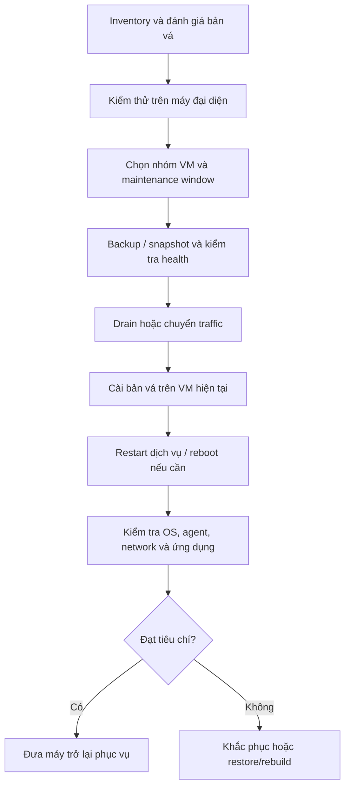
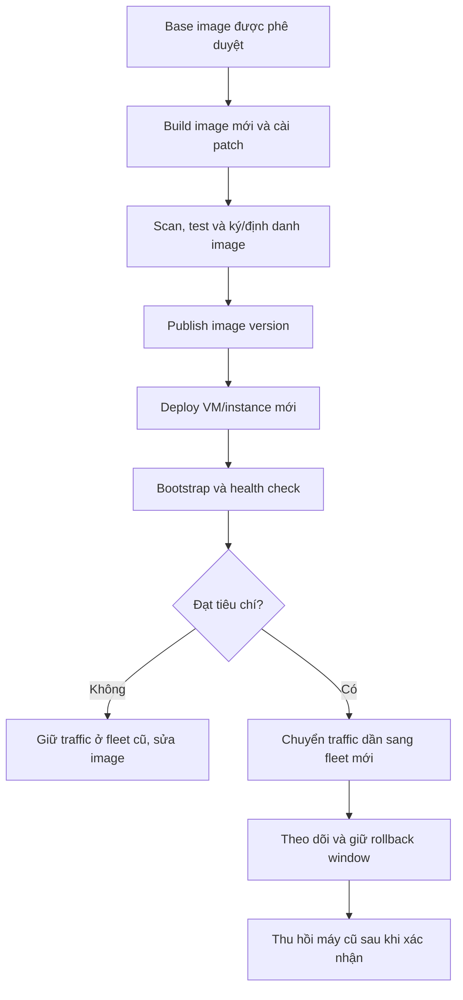
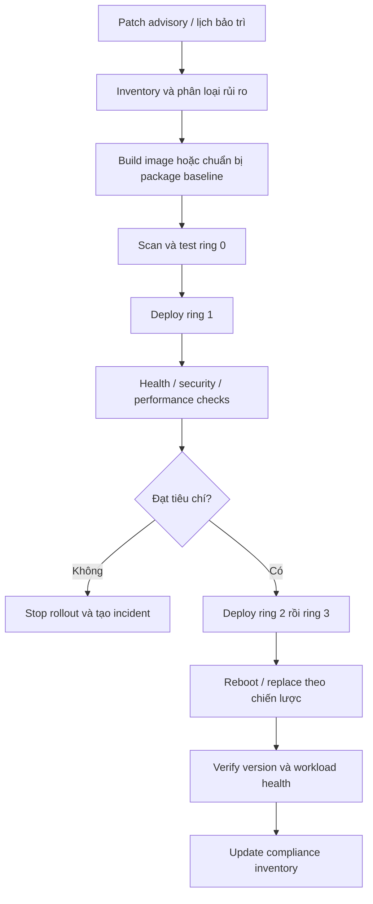

# Áp dụng bản vá bằng cập nhật tại chỗ hoặc thay image

## Bối cảnh: giữ hệ điều hành an toàn mà không làm gián đoạn dịch vụ

Máy ảo và máy chủ cloud cần được cập nhật thường xuyên để sửa lỗ hổng bảo mật, khắc phục lỗi, cải thiện độ ổn định và duy trì khả năng tương thích. Bản vá có thể áp dụng cho kernel, thư viện hệ thống, package, driver, firmware hoặc phần mềm nền tảng. Nếu trì hoãn quá lâu, máy chủ có thể tiếp tục chạy phiên bản có lỗ hổng đã được công bố; nếu triển khai vội vàng, bản cập nhật có thể làm hỏng ứng dụng, driver hoặc quá trình khởi động.

Hai cách tiếp cận phổ biến là:

- **Cập nhật tại chỗ (in-place patching):** cài bản vá trực tiếp lên hệ điều hành đang chạy trên VM hoặc máy chủ hiện có.
- **Thay image (image replacement):** tạo image máy chủ mới đã được vá, sau đó triển khai VM/instance mới từ image đó và chuyển workload sang máy mới.

In-place patching giữ nguyên máy và thường phù hợp với máy chủ có trạng thái hoặc dữ liệu cục bộ khó thay thế. Image replacement tạo ra máy mới từ một mẫu đã kiểm thử, giúp triển khai đồng nhất và dễ quay lại phiên bản trước khi chuyển đổi. Nhiều tổ chức kết hợp cả hai tùy loại workload, mức độ quan trọng và khả năng tự động hóa.

Trong module **CLOUD_CORE_SERVICES_COMPUTE**, lựa chọn phương pháp vá cần gắn với mô hình VM, image, lưu trữ, mạng, autoscaling và mục tiêu sẵn sàng. Mục tiêu là đưa bản vá đến đúng máy, xác minh máy sau cập nhật và có phương án phục hồi khi xảy ra lỗi.

## 1. Vì sao cần quản lý bản vá có quy trình?

Quản lý bản vá (patch management) là vòng đời từ phát hiện bản cập nhật, đánh giá mức độ ảnh hưởng, kiểm thử, triển khai, xác minh đến báo cáo tuân thủ. Đây không chỉ là chạy lệnh cập nhật package.

Các lý do chính:

- **Giảm rủi ro bảo mật:** khắc phục CVE, lỗi xác thực, lỗi nâng quyền và lỗ hổng từ thư viện hệ thống.
- **Duy trì ổn định:** sửa lỗi kernel, driver, filesystem, network stack và dịch vụ nền.
- **Tương thích:** duy trì khả năng hỗ trợ của runtime, agent, ứng dụng và nền tảng cloud.
- **Tuân thủ:** chứng minh máy chủ được cập nhật theo chính sách và thời hạn của tổ chức.
- **Giảm nợ kỹ thuật:** tránh để hệ điều hành tụt quá xa khiến nâng cấp sau này phức tạp và rủi ro hơn.

Không phải mọi bản cập nhật đều có cùng mức độ khẩn cấp. Bản vá bảo mật đang bị khai thác cần ưu tiên cao hơn bản cập nhật tính năng không ảnh hưởng bảo mật. Cần đánh giá mức nghiêm trọng, khả năng khai thác, mức phơi nhiễm của máy, mức độ quan trọng của workload và tính sẵn sàng của bản vá.

### 1.1. Phân loại bản cập nhật

| Loại | Ví dụ | Tác động có thể có |
|---|---|---|
| Security patch | Sửa lỗ hổng kernel, OpenSSL, SSH hoặc thư viện hệ thống | Giảm nguy cơ bị khai thác; có thể cần restart dịch vụ hoặc reboot |
| Bug fix | Sửa lỗi filesystem, memory leak hoặc network driver | Cải thiện ổn định; có thể thay đổi hành vi đã tồn tại |
| Kernel update | Cập nhật kernel Linux hoặc Windows kernel component | Thường cần reboot để kernel mới có hiệu lực |
| Driver/agent update | Driver NIC/GPU, guest agent, monitoring agent | Có thể ảnh hưởng thiết bị ảo, telemetry hoặc hiệu năng |
| Feature update | Bổ sung tính năng hoặc thay đổi phiên bản hệ điều hành | Phạm vi thay đổi lớn hơn; cần kiểm thử tương thích kỹ |
| Firmware/platform update | Firmware ảo hoặc thành phần do nhà cung cấp quản lý | Có thể do cloud provider triển khai; cần theo dõi maintenance event |

Một số bản vá thư viện có thể có hiệu lực sau khi restart tiến trình; bản vá kernel thường cần reboot trừ khi dùng công nghệ live patch được hỗ trợ. Luôn xác minh trạng thái cần reboot và điều kiện của nhà cung cấp hoặc bản phân phối.

### 1.2. Xác định ưu tiên

Không nên chỉ dựa vào điểm CVSS. Hãy kết hợp:

- Mức nghiêm trọng và khả năng khai thác thực tế của lỗ hổng.
- Máy có public exposure, quyền truy cập nhạy cảm hoặc dữ liệu quan trọng không.
- Máy có nằm trong đường xử lý dữ liệu hoặc control plane trọng yếu không.
- Có exploit công khai, dấu hiệu bị khai thác hoặc yêu cầu khẩn từ nhà cung cấp không.
- Bản vá có sẵn cho image/kernel đang sử dụng không; có known issue nào không.
- Rủi ro downtime và phương án failover của workload.

Chính sách có thể quy định SLA vá theo mức rủi ro, ví dụ bản vá khẩn cấp trong vài ngày, bản vá cao trong một chu kỳ bảo trì ngắn và bản cập nhật thông thường theo lịch. Mốc thời gian cụ thể phải do tổ chức quyết định theo yêu cầu vận hành và tuân thủ.

## 2. Cập nhật tại chỗ (in-place patching)

### 2.1. Cách hoạt động

In-place patching cài package hoặc bản cập nhật trực tiếp lên hệ điều hành của VM hiện tại. Máy thường giữ nguyên ID, NIC, địa chỉ IP, volume và cấu hình cloud; các package được nâng cấp và một số dịch vụ có thể được restart. Nếu bản vá kernel hoặc thành phần khởi động yêu cầu, máy cần reboot để chạy phiên bản mới.

Luồng tổng quát:



### 2.2. Ưu điểm và giới hạn

Ưu điểm:

- Không cần tạo VM mới hoặc chuyển toàn bộ workload sang máy khác.
- Có thể giữ nguyên ID, IP, volume và các liên kết với hệ thống giám sát.
- Phù hợp với máy có cấu hình thủ công, dữ liệu cục bộ hoặc phần mềm khó tái tạo.
- Có thể áp dụng dần theo nhóm nhỏ, ít thay đổi cấu trúc hạ tầng.

Giới hạn:

- Trạng thái package và cấu hình có thể khác nhau giữa các máy sau nhiều lần sửa thủ công.
- Bản vá lỗi có thể để lại trạng thái không nhất quán nếu cài đặt bị gián đoạn.
- Reboot có thể gây downtime nếu workload không có replica hoặc failover.
- Rollback package không phải lúc nào cũng an toàn; downgrade có thể không đảo ngược thay đổi schema hoặc dữ liệu.
- Máy chủ tích lũy drift theo thời gian và khó chứng minh toàn bộ cấu hình giống nhau.

In-place phù hợp khi máy chủ cần được giữ nguyên, nhưng phải có inventory, quản lý cấu hình, log triển khai và phương án phục hồi đã kiểm thử.

### 2.3. Ví dụ cập nhật Linux

Trên Ubuntu/Debian, quy trình cơ bản có thể dùng APT:

```bash
# Cập nhật danh mục package
sudo apt-get update

# Xem các package có thể nâng cấp
apt list --upgradable

# Áp dụng bản cập nhật theo kế hoạch đã phê duyệt
sudo apt-get upgrade

# Kiểm tra có cần reboot hay không (nếu hệ thống có công cụ này)
test -f /var/run/reboot-required && echo "Reboot required"
```

Trên hệ thống RHEL-compatible có thể dùng DNF:

```bash
# Xem các bản cập nhật có sẵn
sudo dnf check-update

# Áp dụng bản cập nhật đã được phê duyệt
sudo dnf upgrade --security

# Kiểm tra kernel đang chạy và kernel đã cài
uname -r
rpm -q kernel
```

Tên lệnh và tùy chọn có thể khác theo phiên bản phân phối. `dnf upgrade --security` chỉ lọc bản cập nhật được đánh dấu security advisory; cần xác minh metadata repository và chính sách package. Không chạy lệnh hàng loạt trên production trước khi kiểm thử và chuẩn bị maintenance window.

### 2.4. Ví dụ Windows Server

Windows Server thường nhận bản cập nhật qua Windows Update, Windows Server Update Services (WSUS), Microsoft Configuration Manager hoặc công cụ patch management của cloud. Quy trình vận hành gồm đánh giá update classification, thử trên nhóm máy thử nghiệm, triển khai theo ring, kiểm tra trạng thái cài đặt và reboot theo yêu cầu.

Có thể kiểm tra lịch sử và trạng thái cập nhật bằng Windows Update UI, công cụ quản lý tập trung hoặc PowerShell module phù hợp với môi trường. Không nên giả định một lệnh PowerShell đơn lẻ sẽ triển khai an toàn cho mọi phiên bản Windows Server; cần dùng phương thức được tổ chức chuẩn hóa và ghi log kết quả.

## 3. Thay image (image replacement)

### 3.1. Cách hoạt động

Thay image tạo một image máy chủ mới đã được cập nhật từ base image được phê duyệt. Image được kiểm tra, gắn version/digest và dùng để tạo VM/instance mới. Workload sau đó được triển khai lên máy mới; khi health check đạt, traffic được chuyển dần từ máy cũ sang máy mới. Máy cũ được giữ trong thời gian rollback rồi mới thu hồi theo chính sách.

Đây là cách tiếp cận thường gắn với **immutable infrastructure**: sau khi VM được triển khai, không sửa hệ điều hành bằng tay trong suốt vòng đời bình thường. Khi cần cập nhật, tạo image mới và thay máy bằng instance mới. Điều này giúp máy trong cùng fleet có nguồn gốc rõ ràng và dễ tái tạo.



### 3.2. Ưu điểm và giới hạn

Ưu điểm:

- Máy mới được tạo từ một image có version, dễ tái tạo và kiểm tra.
- Giảm configuration drift do sửa thủ công trên từng VM.
- Có thể triển khai rolling, canary hoặc blue-green để giảm downtime.
- Rollback ứng dụng/hệ điều hành thường rõ ràng hơn bằng cách chuyển traffic về fleet cũ, nếu dữ liệu và schema vẫn tương thích.
- Phù hợp với autoscaling group, VM scale set và fleet được quản lý bằng IaC.

Giới hạn:

- Cần pipeline build image, kiểm thử, registry và quy trình phát hành.
- Cần capacity tạm thời để chạy song song máy cũ và máy mới.
- Dữ liệu trên boot disk hoặc local disk không tự chuyển sang máy mới.
- Có thể phát sinh thay đổi IP, hostname, instance ID hoặc metadata; hệ thống phụ thuộc các giá trị này cần được thiết kế phù hợp.
- Cần xử lý stateful workload, volume attachment, session, queue và kết nối đang mở khi chuyển traffic.

Image replacement hiệu quả nhất khi ứng dụng stateless hoặc state được lưu ở dịch vụ ngoài VM, chẳng hạn database, block volume có cơ chế attach/failover, file share hoặc object storage.

### 3.3. Golden image và image pipeline

**Golden image** là image nền đã được tổ chức kiểm tra và phê duyệt. Image thường bao gồm hệ điều hành, cấu hình bảo mật cơ bản, agent cần thiết và package nền tảng. Không nên nhúng secret, credential cá nhân hoặc dữ liệu môi trường vào image.

Một image pipeline có thể gồm:

1. Chọn base image từ nguồn tin cậy và cố định phiên bản.
2. Cài bản vá hệ điều hành và package đã được phê duyệt.
3. Áp dụng hardening baseline, cấu hình audit, time sync và agent.
4. Quét lỗ hổng, kiểm tra package, cấu hình và phần mềm không mong muốn.
5. Khởi động image trong môi trường thử nghiệm, xác minh boot, network, storage và agent.
6. Chạy smoke test, kiểm tra ứng dụng mẫu và kiểm tra khả năng quản trị.
7. Đóng image, gắn version/metadata và publish vào image catalog.
8. Promote image qua staging rồi production theo quy trình phê duyệt.

Image cần có thông tin truy vết như base image ID, ngày build, phiên bản package, patch advisory, commit pipeline, kết quả scan và người phê duyệt. Dùng image ID/version bất biến khi triển khai để tránh cùng một tag trỏ đến nội dung khác nhau theo thời gian.

Ví dụ metadata của một image đã phát hành:

```yaml
image:
  name: compute-linux-golden
  version: "2026.11.22-2"
  base_image: "linux-lts-approved-2026-10"
  patch_baseline: "security-baseline-2026-11"
  build_id: "image-pipeline-1842"
  scan_status: passed
  approval: production-approved
```

Đây là metadata minh họa; schema thật phụ thuộc image catalog hoặc công cụ build. Tránh đưa secret, khóa riêng hoặc thông tin nhạy cảm vào metadata công khai.

## 4. So sánh hai cách tiếp cận

| Tiêu chí | In-place patching | Image replacement |
|---|---|---|
| Đối tượng thay đổi | Hệ điều hành trên VM hiện tại | Tạo VM mới từ image mới |
| Giữ nguyên VM ID | Thường có | Thường không; máy mới có ID mới |
| Downtime | Có thể cần restart/reboot; phụ thuộc replica/failover | Có thể giảm bằng rolling/canary/blue-green |
| Tính đồng nhất | Phụ thuộc lịch sử và drift của từng máy | Cao hơn nếu image và bootstrap giống nhau |
| Rollback | Có thể khó nếu package/schema không hỗ trợ downgrade | Có thể chuyển traffic về fleet/image trước nếu state tương thích |
| Dữ liệu cục bộ | Thường giữ nguyên | Cần tách và di chuyển/attach lại dữ liệu |
| Yêu cầu tự động hóa | Patch orchestration và quản lý cấu hình | Image pipeline, registry, IaC và rollout controller |
| Capacity tạm thời | Thường ít cần hơn | Thường cần máy mới chạy song song trong rollout |
| Phù hợp | Stateful/legacy VM, máy khó thay thế, môi trường ít tự động hóa | Stateless fleet, autoscaling, immutable infrastructure |

Không có quy tắc rằng mọi máy phải dùng cùng một phương pháp. Có thể dùng image replacement cho web/API fleet, in-place patching cho một số máy stateful hoặc legacy, và dịch vụ managed patching cho nhóm máy được nhà cung cấp hỗ trợ. Quyết định cần dựa trên rủi ro, khả năng tái tạo, cách lưu state, yêu cầu downtime và năng lực vận hành.

## 5. Quy trình triển khai bản vá an toàn

Dù chọn in-place hay image replacement, nên dùng một quy trình có kiểm soát từ inventory đến xác minh.

### 5.1. Inventory và đánh giá phạm vi

Trước tiên cần biết chính xác máy nào cần vá:

- Hệ điều hành, phiên bản, kiến trúc và image nguồn.
- Kernel đang chạy và kernel/package đã cài.
- Package, driver, runtime và agent quan trọng.
- Môi trường, owner, ứng dụng, mức độ quan trọng và miền lỗi.
- Public exposure, dữ liệu nhạy cảm và quyền của máy.
- Trạng thái backup, snapshot, replication và phương án khôi phục.
- Lần vá gần nhất, patch compliance và reboot pending.

Inventory cần được cập nhật tự động khi VM được tạo hoặc thay thế. Không chỉ dựa vào danh sách tĩnh vì fleet autoscaling có thể thay đổi liên tục.

### 5.2. Đánh giá và thử nghiệm

Đọc advisory của nhà cung cấp hệ điều hành và phần mềm, xác định package bị ảnh hưởng, điều kiện áp dụng, dependency và yêu cầu reboot. Kiểm tra known issues, driver compatibility, agent support và khả năng tương thích của ứng dụng.

Triển khai thử trên nhóm canary hoặc staging đại diện. Kiểm tra boot, disk, network, DNS, monitoring, logging, security agent, application health, hiệu năng và các tác vụ nền. Với workload quan trọng, nên chạy kiểm thử chức năng và tải trước khi mở rộng rollout.

### 5.3. Chuẩn bị trước khi vá

- Xác nhận backup/snapshot gần nhất và khả năng restore; snapshot không thay thế backup độc lập.
- Xác định maintenance window, người trực và kênh thông báo.
- Xác định thứ tự node/replica để không làm mất quorum hoặc toàn bộ capacity.
- Kiểm tra capacity còn lại để drain hoặc thay thế máy.
- Xác minh health check, load balancer, autoscaling và quy trình failover.
- Lưu lại image ID, package inventory và cấu hình hiện tại để đối chiếu.
- Xác định tiêu chí dừng rollout và điều kiện rollback.

### 5.4. Triển khai theo từng đợt

Không nên vá đồng loạt toàn bộ fleet production trong một thao tác duy nhất. Chia máy thành các ring hoặc batch, ví dụ canary, nhóm nhỏ, một zone, rồi toàn bộ fleet. Sau mỗi batch, chờ health và metric ổn định trước khi tiếp tục.

Với cluster có nhiều node, cần drain workload theo cơ chế của nền tảng, tôn trọng PodDisruptionBudget hoặc quorum, vá/reboot node, xác minh node quay lại Ready rồi mới tiếp tục node tiếp theo. Với VM sau load balancer, rút máy khỏi pool, chờ connection drain, vá hoặc thay máy, kiểm tra health rồi đăng ký lại.

### 5.5. Xác minh sau cập nhật

Không chỉ kiểm tra lệnh cập nhật trả về thành công. Cần xác minh:

- Kernel/package đang chạy đúng phiên bản mong muốn.
- Không còn reboot pending hoặc update bị lỗi.
- VM boot thành công, filesystem và volume được mount.
- NIC, route, DNS, firewall và kết nối dependency hoạt động.
- Monitoring, logging, security agent và backup agent hoạt động.
- Ứng dụng vượt readiness/health check và không tăng lỗi.
- Latency, throughput, CPU, RAM, disk I/O và network ổn định.
- Inventory/CMDB và báo cáo patch compliance được cập nhật.

## 6. Giảm downtime bằng rollout có kiểm soát

### 6.1. Rolling update

Rolling update cập nhật hoặc thay thế một nhóm nhỏ máy tại một thời điểm. Load balancer hoặc orchestrator chỉ đưa máy trở lại phục vụ sau khi health check đạt. Cách này phù hợp với fleet có nhiều replica và có thể duy trì capacity trong lúc một số máy đang bảo trì.

Cần xác định `maxUnavailable`, `maxSurge` hoặc giới hạn tương đương. Nếu `maxUnavailable` quá cao, capacity phục vụ có thể giảm mạnh; nếu `maxSurge` quá cao, có thể vượt quota hoặc gây thiếu capacity. Với ứng dụng stateful, cần phối hợp thứ tự cập nhật với quorum và replication.

### 6.2. Canary deployment

Canary triển khai image/bản vá mới lên một tỷ lệ nhỏ máy trước. Theo dõi error rate, latency, log, resource saturation và metric nghiệp vụ. Nếu đạt tiêu chí, mở rộng sang nhóm lớn hơn; nếu không, dừng rollout và điều tra.

Canary có ích khi bản vá có thể gây thay đổi hành vi khó phát hiện bằng kiểm tra boot đơn giản. Tuy nhiên, nhóm canary cần đại diện cho phần còn lại về loại máy, zone, traffic và dependency.

### 6.3. Blue-green deployment

Blue-green duy trì hai fleet: blue đang phục vụ và green đã được cập nhật. Sau khi green vượt qua kiểm thử, traffic được chuyển dần hoặc chuyển toàn bộ sang green. Nếu phát hiện lỗi, có thể chuyển traffic về blue trong thời gian blue còn nguyên vẹn.

Mô hình này cần capacity chạy song song và phải xử lý tương thích dữ liệu. Nếu green nâng cấp database schema theo cách blue không đọc được, quay traffic về blue có thể không an toàn. Hãy thiết kế migration theo hướng tương thích ngược hoặc tách migration khỏi bước chuyển fleet.

## 7. Rollback và phục hồi khi bản vá gây lỗi

Rollback cần được thiết kế trước khi triển khai. Khả năng quay lui phụ thuộc loại thay đổi:

- **Package update:** có thể downgrade nếu repository còn phiên bản cũ và package hỗ trợ downgrade an toàn. Một số bản vá thay đổi dữ liệu hoặc schema nên không thể hoàn nguyên đơn giản.
- **Kernel update:** có thể chọn kernel cũ trong bootloader nếu kernel cũ còn được giữ và boot configuration cho phép. Cần kiểm tra bảo mật trước khi tiếp tục chạy kernel cũ.
- **Image replacement:** có thể chuyển traffic về fleet cũ hoặc tạo lại VM từ image trước, miễn là dữ liệu và cấu hình tương thích.
- **Database/application schema:** cần migration tương thích ngược, backup và kế hoạch phục hồi riêng; quay image cũ không tự đảo ngược schema đã thay đổi.

### 7.1. Tiêu chí dừng rollout

Đặt trước ngưỡng dừng, ví dụ:

- Tỷ lệ health check thất bại vượt ngưỡng.
- Error rate hoặc latency p95/p99 tăng đáng kể so với baseline.
- Node không quay lại trạng thái Ready hoặc VM không boot được.
- Security/monitoring agent không hoạt động.
- Database replication lag, quorum hoặc queue backlog vượt giới hạn.
- Có dấu hiệu mất dữ liệu, lỗi filesystem hoặc lỗi ứng dụng nghiêm trọng.

Khi chạm ngưỡng, dừng batch tiếp theo, giữ nguyên bằng chứng, xác định phạm vi ảnh hưởng và chọn hướng phục hồi. Không tiếp tục rollout chỉ vì một phần máy đã cập nhật thành công.

### 7.2. Snapshot và backup

Snapshot volume trước khi vá có thể hỗ trợ khôi phục dữ liệu hoặc trạng thái đĩa, nhưng không nhất thiết tạo bản sao nhất quán của toàn ứng dụng. Với database hoặc hệ thống ghi liên tục, cần backup theo cơ chế application-aware hoặc phối hợp flush/quiesce trước snapshot nếu yêu cầu nhất quán.

Trước khi dựa vào snapshot làm phương án rollback, hãy thử tạo VM từ snapshot, gắn volume, boot hệ điều hành và kiểm tra dữ liệu. Snapshot không thay thế bản backup ở failure domain độc lập, đặc biệt khi tài khoản hoặc vùng có thể bị ảnh hưởng đồng thời.

## 8. Live patching và cập nhật không cần reboot

Một số hệ điều hành và nhà cung cấp hỗ trợ **live patching** cho một tập con bản vá kernel hoặc thành phần hệ thống. Công nghệ này áp dụng thay đổi vào kernel đang chạy để giảm nhu cầu reboot và downtime.

Live patching có lợi cho máy chủ cần duy trì hoạt động dài, nhưng có giới hạn:

- Chỉ áp dụng cho kernel, phiên bản và loại bản vá được hỗ trợ.
- Không phải mọi thay đổi kernel, driver, firmware hoặc user-space đều có thể live patch.
- Có thể cần reboot định kỳ để hoàn tất các thay đổi hoặc đưa máy về trạng thái baseline.
- Cần kiểm tra trạng thái live patch và phiên bản kernel thực tế sau khi áp dụng.
- Không thay thế quy trình image refresh, backup và kiểm thử phục hồi.

Vì vậy, live patching là một công cụ giảm gián đoạn trong chiến lược patch tổng thể. Không nên xem máy đã live patch là có thể bỏ qua mọi chu kỳ bảo trì hoặc thay image.

## 9. Tự động hóa quản lý bản vá trên fleet

Khi số lượng VM tăng, cập nhật thủ công từng máy dễ bỏ sót và khó chứng minh tuân thủ. Patch orchestration giúp quản lý inventory, chọn nhóm máy, chạy lệnh, lên lịch reboot, thu thập kết quả và báo cáo.

### 9.1. Nhóm máy theo ring và môi trường

Một mô hình triển khai thường dùng:

| Ring | Phạm vi | Mục tiêu |
|---|---|---|
| Ring 0 | Máy thử nghiệm nội bộ hoặc sandbox | Phát hiện lỗi cơ bản nhanh |
| Ring 1 | Staging hoặc canary production ít rủi ro | Kiểm tra hành vi gần thực tế |
| Ring 2 | Một phần fleet production, có phân tán zone | Đánh giá dưới lưu lượng thật có kiểm soát |
| Ring 3 | Phần còn lại của production | Hoàn tất rollout sau khi các ring trước ổn định |

Không nên đặt toàn bộ máy quan trọng trong cùng một batch hoặc cùng zone. Hãy phân tán theo ứng dụng, miền lỗi, vai trò và mức độ quan trọng để tránh một lỗi bản vá làm mất toàn bộ dịch vụ.

### 9.2. Ví dụ luồng tự động hóa



Pipeline nên lưu:

- Patch advisory hoặc change ID và lý do triển khai.
- Danh sách máy thuộc từng batch và image/package version trước/sau.
- Thời điểm bắt đầu, kết thúc, reboot và trạng thái từng máy.
- Kết quả scan, test, health check và metric sau cập nhật.
- Lỗi, retry, ngoại lệ, người phê duyệt và phương án phục hồi.
- Bằng chứng tuân thủ và danh sách máy chưa cập nhật.

### 9.3. Tránh chạy lệnh cập nhật thiếu kiểm soát

Automation cần có timeout, retry có giới hạn, lock hoặc cơ chế tránh hai job cùng vá một máy. Tránh reboot đồng thời nhiều node trong cùng cluster. Nếu agent không phản hồi hoặc máy offline, cần đánh dấu trạng thái chưa xác minh thay vì mặc định đã cập nhật thành công.

Với image replacement, pipeline cần quản lý image version bất biến và chỉ chuyển traffic sau khi VM mới vượt qua health check. Với in-place patching, automation cần kiểm tra exit code, reboot-required, trạng thái package và xác minh kernel/package sau reboot.

## 10. Bảo mật và quản trị thay đổi

Patch pipeline có quyền cao vì có thể cài package và chạy lệnh quản trị trên nhiều máy. Cần bảo vệ pipeline và nguồn package như một phần của chuỗi cung ứng phần mềm.

- Chỉ lấy package/image từ repository hoặc registry tin cậy; xác minh chữ ký và nguồn phát hành nếu nền tảng hỗ trợ.
- Phân quyền pipeline theo môi trường và phạm vi máy; không dùng một credential admin không giới hạn.
- Lưu secret trong secret manager, dùng credential ngắn hạn và rotation.
- Ghi audit cho thay đổi repository, image pipeline, patch policy và quyền triển khai.
- Quét image/package, kiểm tra cấu hình hardening và loại bỏ công cụ không cần thiết.
- Kiểm soát ngoại lệ trì hoãn bản vá: phải có owner, lý do, biện pháp giảm thiểu và ngày hết hạn.
- Tách người tạo bản vá/image, người phê duyệt và người triển khai production khi mức rủi ro yêu cầu.

Không nên tự động cài mọi package mới nhất vào production mà không có kiểm soát phiên bản. Một repository bị thay đổi hoặc package độc hại có thể ảnh hưởng toàn fleet nếu pipeline có quyền rộng.

## 11. Xử lý các tình huống thường gặp

| Triệu chứng | Nguyên nhân có thể | Hướng kiểm tra và xử lý |
|---|---|---|
| Package manager báo dependency conflict | Repository không đồng bộ, package bị pin hoặc dependency không tương thích | Kiểm tra repo, package hold/pin, advisory và thử trên staging |
| Cài đặt thành công nhưng kernel cũ vẫn chạy | Chưa reboot hoặc bootloader chọn kernel cũ | Kiểm tra reboot-required, kernel đã cài và `uname -r`; lên lịch reboot |
| VM không boot sau kernel update | Driver/module không tương thích, initramfs hoặc bootloader lỗi | Dùng serial/console, boot kernel cũ hoặc phục hồi từ snapshot/image đã xác minh |
| Ứng dụng lỗi sau patch | Thư viện/runtime thay đổi hoặc service chưa restart đúng | So sánh package version, application log, dependency và rollback có kiểm soát |
| VM mới không nhận traffic | Health check, security group, route, DNS hoặc bootstrap lỗi | Kiểm tra NIC/IP, route, firewall, cloud-init/agent và target health |
| Fleet thiếu capacity khi thay image | Không đủ quota/instance capacity hoặc surge quá lớn | Giảm batch, mở rộng capacity, chọn zone/family phù hợp hoặc kéo dài rollout |
| Node cluster không quay lại Ready | Kubelet/agent, CNI, disk, certificate hoặc runtime lỗi | Kiểm tra node condition, system log, CNI và runtime trước khi tiếp tục |
| Patch compliance vẫn báo thiếu | Inventory chậm, máy offline hoặc package không thuộc baseline | Đồng bộ inventory, kiểm tra phiên bản và xử lý ngoại lệ có thời hạn |
| Live patch báo unsupported | Kernel/package không thuộc ma trận hỗ trợ | Chuyển sang maintenance window và reboot/replace theo kế hoạch |

## 12. Chọn phương pháp theo loại workload

| Workload | Cách tiếp cận thường phù hợp | Lưu ý |
|---|---|---|
| Web/API stateless fleet | Image replacement với rolling/canary | Dữ liệu và session cần nằm ngoài VM hoặc có cơ chế chuyển tiếp |
| Worker xử lý hàng đợi | Image replacement hoặc in-place theo batch | Drain queue, xử lý message đang chạy và đảm bảo idempotency |
| Database trên VM | In-place theo node/replica hoặc thay image có failover được thiết kế | Bảo vệ dữ liệu, replication lag, quorum, backup và thời gian phục hồi |
| Máy legacy có cấu hình thủ công | In-place có kiểm soát | Tăng inventory, quản lý drift và dần chuẩn hóa image |
| Bastion/management host | Image replacement hoặc in-place theo HA pair | Không làm mất toàn bộ đường quản trị trong lúc bảo trì |
| GPU/accelerator host | Phụ thuộc driver, kernel và framework; thường cần kiểm thử kỹ | Driver compatibility, CUDA/runtime và workload drain có thể yêu cầu reboot |
| Kubernetes worker node | Drain, patch/replace node theo node pool | Tôn trọng PDB, capacity, local data và phiên bản control plane/node |

Đối với database hoặc workload stateful, thay image vẫn có thể phù hợp nếu dữ liệu tách khỏi boot disk, replication và failover đã được kiểm thử. Ngược lại, in-place không tự động an toàn chỉ vì giữ nguyên VM; bản vá có thể ảnh hưởng filesystem, driver hoặc dịch vụ đang ghi dữ liệu.

## 13. Lịch bảo trì, tuân thủ và quản lý ngoại lệ

Một chương trình patch hiệu quả cần có lịch thường xuyên và quy trình xử lý bản vá khẩn cấp. Lịch bảo trì nên tính đến giờ tải thấp, múi giờ của người dùng, lịch batch, thời gian backup, replication và khả năng trực vận hành.

### 13.1. Maintenance window

Maintenance window xác định khoảng thời gian được phép triển khai thay đổi có thể gây gián đoạn. Trước cửa sổ bảo trì, thông báo cho owner, xác nhận người trực, kiểm tra dependency và capacity dự phòng. Trong cửa sổ, triển khai theo batch và theo dõi health; sau cửa sổ, xác nhận dịch vụ ổn định và gửi báo cáo.

Không phải mọi bản vá đều có thể chờ lịch thường kỳ. Khi lỗ hổng có khả năng bị khai thác cao, tổ chức có thể kích hoạt emergency patching với quy trình rút gọn nhưng vẫn cần phê duyệt phù hợp, ghi nhận thay đổi, kiểm thử tối thiểu và kế hoạch phục hồi.

### 13.2. Patch compliance

Patch compliance đo mức độ máy chủ đáp ứng baseline cập nhật. Baseline cần xác định hệ điều hành được hỗ trợ, mức bản vá tối thiểu, nhóm package, thời hạn áp dụng và điều kiện ngoại lệ.

Một báo cáo hữu ích nên thể hiện:

- Tổng số máy thuộc phạm vi và số máy đang hoạt động.
- Số máy đạt baseline, chưa đạt, offline hoặc chưa được đánh giá.
- Số lượng lỗ hổng theo mức độ và tuổi của bản vá còn thiếu.
- Máy cần reboot, máy đã cài nhưng chưa khởi động lại và máy gặp lỗi.
- Image version đang dùng trong từng environment/region.
- Ngoại lệ được phê duyệt, owner, biện pháp giảm thiểu và ngày hết hạn.

Không nên xem máy offline hoặc không có dữ liệu inventory là compliant. Trạng thái `unknown` cần được thể hiện riêng và có người chịu trách nhiệm xác minh.

### 13.3. Quản lý ngoại lệ

Một số máy có thể chưa vá được do ứng dụng cũ, driver chưa tương thích, nhà cung cấp chưa phát hành bản sửa hoặc rủi ro downtime cao. Ngoại lệ cần ghi:

- Máy, ứng dụng và owner bị ảnh hưởng.
- Lỗ hổng/bản vá chưa áp dụng và lý do kỹ thuật.
- Mức độ rủi ro còn lại và khả năng khai thác.
- Biện pháp giảm thiểu tạm thời như network isolation, giảm quyền hoặc tắt chức năng bị ảnh hưởng.
- Người phê duyệt, thời hạn ngoại lệ và ngày đánh giá lại.
- Kế hoạch loại bỏ nguyên nhân và thời điểm vá lại.

Ngoại lệ không nên trở thành trạng thái vĩnh viễn. Khi hết hạn, hệ thống cần cảnh báo và yêu cầu đánh giá lại.

## 14. Chi phí và hiệu quả vận hành

In-place patching có thể tiết kiệm capacity tạm thời vì không cần chạy fleet mới song song, nhưng có thể làm tăng chi phí nhân công nếu nhiều máy có cấu hình khác nhau và cần xử lý thủ công. Image replacement cần đầu tư pipeline, registry và capacity surge, nhưng có thể giảm thời gian khắc phục drift và đơn giản hóa các lần triển khai sau.

Khi so sánh, nên tính:

- Chi phí compute cho máy cũ và máy mới trong thời gian rollout.
- Chi phí storage cho snapshot, image và bản sao lưu.
- Chi phí network khi sao chép image, dữ liệu và chuyển traffic.
- Thời gian kỹ sư dành cho kiểm thử, xử lý lỗi, reboot và hậu kiểm.
- Chi phí downtime hoặc giảm capacity nếu không có đủ replica.
- Rủi ro và chi phí phục hồi khi bản vá gây lỗi.

Một chỉ số thực tế là thời gian từ khi bản vá được phát hành đến khi toàn bộ máy thuộc phạm vi đạt baseline. Có thể theo dõi thêm tỷ lệ rollout thành công, tỷ lệ cần rollback, thời gian reboot, số ngoại lệ và số máy không có telemetry.

## 15. Ví dụ quy trình thay image cho fleet web stateless

Giả sử dịch vụ web có sáu VM trong hai availability zone, đặt sau load balancer. Boot disk chứa hệ điều hành và ứng dụng; dữ liệu người dùng nằm trong database và object storage. Có thể triển khai image mới theo các bước:

1. Build image mới từ base image được phê duyệt, cài security patch và agent.
2. Quét lỗ hổng, kiểm tra package và chạy smoke test trên VM tạm.
3. Publish image với version bất biến và gắn patch baseline.
4. Tạo hai VM mới trong các zone tương ứng, kiểm tra bootstrap, health endpoint và kết nối database/object storage.
5. Đưa một VM mới vào canary target group với tỷ lệ traffic nhỏ.
6. Theo dõi error rate, latency, CPU/RAM, log và metric nghiệp vụ.
7. Nếu ổn định, tạo và kiểm tra các VM mới còn lại theo batch.
8. Chuyển traffic dần sang fleet mới; giữ fleet cũ trong rollback window.
9. Sau khi xác nhận không có lỗi và các phiên kết nối đã drain, thu hồi VM cũ.
10. Cập nhật inventory, image catalog, patch compliance và change record.

Nếu canary lỗi, dừng rollout và chuyển traffic về fleet cũ. Vì dữ liệu nằm ngoài VM và ứng dụng tương thích schema, rollback không cần khôi phục boot disk của máy mới. Nếu có thay đổi database schema, phải bảo đảm phiên bản cũ vẫn tương thích trước khi dựa vào cách rollback này.

## 16. Những nhầm lẫn thường gặp

**Cài package thành công nghĩa là bản vá đã có hiệu lực.** Kernel patch thường cần reboot; dịch vụ có thể cần restart. Phải kiểm tra phiên bản đang chạy và trạng thái reboot.

**Tất cả VM phải được vá cùng lúc để đồng nhất.** Triển khai theo batch giúp phát hiện lỗi sớm và giữ capacity phục vụ. Đồng nhất là trạng thái cuối cùng, không phải yêu cầu thay đổi đồng thời.

**Snapshot là phương án rollback hoàn chỉnh.** Snapshot có thể không application-consistent và không bảo vệ khỏi sự cố ảnh hưởng cùng failure domain. Cần backup và thử restore.

**Thay image luôn không downtime.** Chuyển máy cần capacity, health check, drain connection và xử lý state. Workload đơn lẻ hoặc stateful có thể vẫn gián đoạn.

**Image mới tự động an toàn vì đã build từ base image.** Image vẫn cần scan, test, hardening, metadata truy vết và kiểm soát nguồn package.

**Live patching thay thế toàn bộ reboot và image refresh.** Live patch chỉ hỗ trợ một tập con bản vá và cấu hình; vẫn cần maintenance định kỳ cho thay đổi không hỗ trợ.

**Máy không báo lỗi sau cập nhật nghĩa là compliant.** Cần xác minh package/kernel, health, agent, telemetry và inventory. Máy offline hoặc không có dữ liệu phải được xem là chưa xác minh.

## 17. Checklist triển khai bản vá

### Trước khi triển khai

- [ ] Có inventory chính xác về OS, image, package, kernel, owner và môi trường.
- [ ] Đã đánh giá advisory, mức độ rủi ro, phạm vi ảnh hưởng và yêu cầu reboot.
- [ ] Đã chọn in-place hay image replacement theo state, HA, drift và khả năng tự động hóa.
- [ ] Đã kiểm thử trên staging/canary và kiểm tra tương thích driver, agent, runtime.
- [ ] Backup/snapshot có thể khôi phục; dữ liệu và schema có phương án bảo vệ.
- [ ] Capacity, replica, quorum, maintenance window và người trực đã được xác nhận.
- [ ] Tiêu chí dừng rollout, rollback và thông báo sự cố đã được định nghĩa.

### Trong khi triển khai

- [ ] Triển khai theo ring/batch, không làm mất toàn bộ capacity cùng lúc.
- [ ] Drain traffic/workload đúng cách trước khi reboot hoặc thay máy.
- [ ] Theo dõi trạng thái package, reboot, boot, health và metric sau từng batch.
- [ ] Dừng rollout khi chạm ngưỡng lỗi; lưu log và bằng chứng cần thiết.
- [ ] Ghi nhận image/version, máy đã xử lý, lỗi và ngoại lệ.

### Sau khi triển khai

- [ ] Kernel/package đang chạy đạt baseline; không còn reboot pending ngoài kế hoạch.
- [ ] Ứng dụng, network, storage, monitoring và security agent hoạt động.
- [ ] Latency, error rate và tài nguyên trở về ngưỡng chấp nhận được.
- [ ] Fleet cũ chỉ bị thu hồi sau khi rollback window kết thúc và dữ liệu đã an toàn.
- [ ] Inventory và patch compliance được cập nhật; máy offline/unknown được giao owner xử lý.
- [ ] Ngoại lệ có biện pháp giảm thiểu, người phê duyệt và ngày hết hạn.

## Kết luận

In-place patching cập nhật hệ điều hành ngay trên VM hiện có, giữ nguyên phần lớn định danh và tài nguyên nhưng cần quản lý reboot, package drift và khả năng rollback. Image replacement tạo image mới đã vá rồi thay VM theo rolling, canary hoặc blue-green, giúp tăng tính đồng nhất và khả năng tái tạo nhưng cần pipeline, capacity tạm thời và chiến lược lưu state. Chọn phương pháp theo đặc tính workload, dữ liệu, mức sẵn sàng và năng lực tự động hóa. Dù triển khai theo cách nào, cần inventory chính xác, kiểm thử đại diện, rollout từng đợt, xác minh sau cập nhật, giám sát compliance và phương án phục hồi được thử nghiệm.
