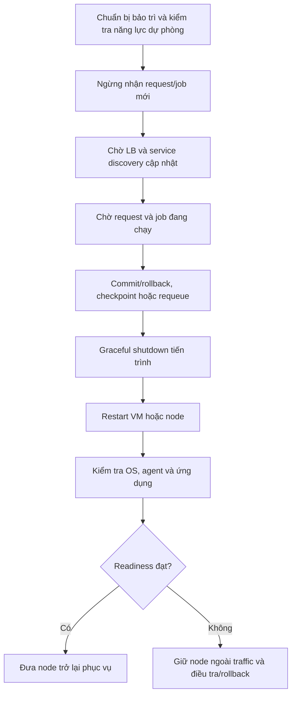

# Drain lưu lượng và tác vụ trước khi khởi động lại

Khởi động lại máy ảo hoặc node để cài bản vá, nâng cấp kernel, cập nhật driver hay xử lý sự cố là thao tác bảo trì thường gặp. Nếu restart ngay khi máy vẫn nhận request hoặc đang xử lý công việc, kết nối có thể bị ngắt, giao dịch dở dang, message bị xử lý lặp hoặc dữ liệu chưa kịp ghi xuống storage. Một máy khỏe trở lại sau reboot cũng chưa có nghĩa dịch vụ đã phục hồi đúng.

**Drain** là quá trình đưa một instance ra khỏi vai trò nhận công việc mới, chờ hoặc xử lý an toàn những công việc đang chạy, rồi mới dừng tiến trình và khởi động lại máy. Drain cần phối hợp giữa load balancer, ứng dụng, worker/queue, hệ điều phối và hệ thống dữ liệu. Bài học này trình bày cách thực hiện drain có kiểm soát cho VM, container và workload xử lý nền để giảm gián đoạn và bảo vệ tính toàn vẹn dữ liệu.

## 1. Drain là gì và khi nào cần thực hiện?

Drain là quá trình làm cho một node hoặc instance ngừng nhận workload mới trong khi vẫn tạo điều kiện để request, kết nối hoặc tác vụ đang chạy kết thúc an toàn. Sau khi drain hoàn tất, node có thể được restart, thay thế, nâng cấp hoặc đưa ra khỏi cụm.

Drain thường cần thiết trước khi:

- Khởi động lại VM để áp dụng kernel update, driver update hoặc bản vá bảo mật.
- Bảo trì host, thay đổi cấu hình phần cứng hoặc resize instance.
- Nâng cấp hệ điều hành, container runtime hoặc agent hạ tầng.
- Thay thế một node trong cluster hoặc chuyển workload sang node khác.
- Rút một instance khỏi autoscaling group hoặc backend pool.
- Xử lý máy có dấu hiệu lỗi nhưng vẫn còn đủ thời gian để chuyển workload.

Drain không đồng nghĩa với tắt máy. Đây là một giai đoạn chuẩn bị có mục tiêu rõ ràng: **ngừng nhận việc mới, hoàn tất hoặc bàn giao việc đang làm, xác nhận trạng thái an toàn rồi mới restart**.

## 2. Phân biệt drain, stop, restart và failover

| Thao tác | Ý nghĩa | Tác động chính |
|---|---|---|
| Drain | Ngừng nhận workload mới và xử lý phần đang chạy | Giảm request/tác vụ bị gián đoạn trước bảo trì |
| Stop | Dừng tiến trình hoặc VM | Workload không còn chạy trên máy đó |
| Restart/reboot | Dừng rồi khởi động lại hệ điều hành hoặc VM | Mất kết nối và trạng thái trong bộ nhớ trong thời gian restart |
| Replace | Tạo instance/node mới và loại bỏ instance cũ | Thay đổi hạ tầng, thường dùng với mô hình immutable |
| Failover | Chuyển vai trò hoặc traffic sang bản sao/đầu mối khác | Duy trì dịch vụ khi node chính ngừng hoạt động |

Drain có thể là bước trước stop/restart/replace. Failover có thể diễn ra trước hoặc trong quá trình drain tùy kiến trúc. Với database hoặc hệ thống có leader, cần chuyển vai trò theo cơ chế của ứng dụng trước khi dừng node đang giữ vai trò chính.

## 3. Những loại công việc cần drain

Một instance có thể đồng thời xử lý nhiều loại hoạt động. Cần xác định đúng loại workload để chọn cách drain.

| Loại workload | Ví dụ | Cách xử lý trước restart |
|---|---|---|
| Request mới | HTTP request, RPC, TCP session mới | Đánh dấu unready hoặc deregister khỏi load balancer |
| Request đang chạy | Upload, API request dài, streaming response | Ngừng nhận request mới và chờ trong giới hạn thời gian |
| Kết nối dài hạn | WebSocket, gRPC stream, TCP session | Thông báo đóng kết nối, hỗ trợ reconnect/resume nếu có |
| Tác vụ nền | Worker lấy message từ queue | Ngừng poll/lấy message mới; hoàn tất hoặc nhả lease/visibility timeout |
| Batch job | Import, export, báo cáo, xử lý dữ liệu lớn | Tạm dừng lịch khởi chạy; checkpoint hoặc để job hoàn tất |
| Giao dịch dữ liệu | Database transaction, ghi file | Commit/rollback có kiểm soát và flush dữ liệu cần thiết |
| Tác vụ quản trị | Backup, log rotation, cập nhật package | Chờ hoàn tất hoặc dừng theo hướng dẫn của công cụ |

Không phải mọi công việc đều có thể chờ vô hạn. Một request bị treo, job lỗi hoặc kết nối không phản hồi cần có timeout và chính sách xử lý. Drain phải có thời hạn để không chặn bảo trì mãi mãi.

## 4. Trình tự drain tổng quát

Một quy trình có thể chia thành sáu giai đoạn:

1. **Chuẩn bị:** xác minh node thay thế còn đủ năng lực, kiểm tra health của các bản sao khác, thông báo cửa sổ bảo trì và xác định deadline.
2. **Ngừng nhận việc mới:** đánh dấu instance không sẵn sàng hoặc deregister khỏi load balancer; dừng consumer nhận message mới và tạm dừng scheduler nếu cần.
3. **Chờ lan truyền:** chờ health check, endpoint controller, DNS/service discovery hoặc load balancer cập nhật trạng thái.
4. **Hoàn tất việc đang chạy:** chờ request và job kết thúc, commit/rollback giao dịch, checkpoint hoặc trả message về queue an toàn.
5. **Dừng tiến trình:** gửi tín hiệu graceful shutdown, đóng connection pool, flush log/buffer và xác nhận tiến trình đã dừng.
6. **Restart và phục hồi:** reboot, kiểm tra hệ điều hành, khởi động dịch vụ, xác nhận readiness rồi mới đưa instance trở lại nhận traffic.



Thời gian chờ ở mỗi giai đoạn phải phù hợp với timeout của ứng dụng, load balancer và hệ điều phối. Không nên chỉ dựa vào một khoảng sleep cố định nếu có tín hiệu trạng thái đáng tin cậy để kiểm tra.

## 5. Drain traffic tại load balancer

Với ứng dụng nhận request qua load balancer, cần loại instance khỏi nhóm backend trước khi restart. Hầu hết load balancer có trạng thái deregister/draining và một khoảng thời gian chờ để xử lý kết nối hiện tại.

### 5.1. Ngừng gửi request mới

Khi instance bắt đầu drain:

- Đánh dấu backend không còn nhận request mới hoặc bắt đầu deregistration.
- Chờ trạng thái của load balancer chuyển sang draining/deregistering hoặc trạng thái tương đương.
- Xác minh request mới đã được phân phối sang backend khỏe khác.
- Giữ các kết nối đang hoạt động trong khoảng deregistration delay nếu dịch vụ hỗ trợ.

Health check và deregistration là hai cơ chế có liên quan nhưng không giống nhau. Health check đánh giá backend có đủ điều kiện nhận traffic hay không; deregistration là thao tác quản trị đưa backend khỏi target group. Một số load balancer có thể tiếp tục giữ kết nối hiện tại, một số có thể đóng kết nối khi hết thời gian chờ. Cần đọc hành vi cụ thể của dịch vụ.

### 5.2. Connection draining và timeout

Connection draining cho phép request hoặc connection đang hoạt động có thời gian hoàn tất. Thời gian này cần đủ dài cho request hợp lệ nhưng không quá dài khiến bảo trì bị treo.

Ví dụ, nếu API thường hoàn thành trong vài giây nhưng có export request kéo dài 10 phút, cần quyết định liệu export có được phép tiếp tục trên node đang drain hay phải chuyển thành job bất đồng bộ có checkpoint. Một timeout 30 giây có thể phù hợp với API thông thường nhưng không phù hợp với tác vụ export dài.

Với WebSocket hoặc gRPC streaming, ứng dụng nên gửi tín hiệu đóng có lý do, cho client thời gian reconnect và hỗ trợ resume nếu giao thức nghiệp vụ cho phép. Không nên giả định load balancer sẽ tự chuyển một kết nối TCP đang mở sang backend khác.

### 5.3. Kiểm tra năng lực còn lại

Trước khi deregister một instance, kiểm tra các backend còn lại có đủ CPU, bộ nhớ, connection limit và throughput để nhận thêm tải. Nếu cụm đang chạy sát giới hạn, drain đồng thời nhiều instance có thể làm phần còn lại quá tải.

## 6. Graceful shutdown trong ứng dụng

Graceful shutdown là cách ứng dụng tự dừng theo trình tự có kiểm soát khi nhận tín hiệu kết thúc. Trên Linux, tiến trình thường nhận `SIGTERM` trước; nếu không dừng trong thời gian cho phép, hệ thống quản lý có thể gửi `SIGKILL`.

Một ứng dụng hỗ trợ graceful shutdown nên:

- Ngừng nhận request hoặc công việc mới.
- Đánh dấu readiness là false.
- Cho request đang chạy hoàn tất trong thời hạn cấu hình.
- Ngừng tạo tác vụ nền mới và chờ worker đang chạy.
- Commit hoặc rollback transaction theo đúng trạng thái.
- Đóng connection pool, socket, file handle và client tới dịch vụ phụ thuộc.
- Flush log và telemetry buffer.
- Ghi nhận trạng thái shutdown để có thể điều tra.
- Thoát trước deadline để tránh bị cưỡng bức kết thúc.

### 6.1. Ví dụ xử lý SIGTERM trong Python

Ví dụ minh họa cách đặt cờ shutdown để vòng lặp worker ngừng nhận job mới. Hàm `finish_current_job()` đại diện cho logic nghiệp vụ phải có timeout, checkpoint và xử lý lỗi phù hợp.

```python
import signal
import threading
import time

shutdown_requested = threading.Event()


def handle_shutdown(signum, frame):
    shutdown_requested.set()


signal.signal(signal.SIGTERM, handle_shutdown)
signal.signal(signal.SIGINT, handle_shutdown)


def run_worker():
    while not shutdown_requested.is_set():
        job = receive_job(timeout=1.0)  # Không block vô hạn
        if job is None:
            continue

        try:
            finish_current_job(job, deadline_seconds=20)
            acknowledge_job(job)
        except Exception:
            release_or_requeue_job(job)

    close_worker_clients()
    flush_application_logs()


if __name__ == "__main__":
    run_worker()
```

Các hàm `receive_job`, `finish_current_job`, `acknowledge_job` và `release_or_requeue_job` là phần phụ thuộc queue/application, không phải API có sẵn của Python. Khi triển khai thật, cần bảo đảm signal handler không thực hiện thao tác blocking hoặc không an toàn trong ngữ cảnh signal; ở đây handler chỉ đặt một event để vòng lặp xử lý việc dừng.

### 6.2. Deadline và timeout phải thống nhất

Ứng dụng, container runtime, orchestrator và hệ điều hành đều có timeout riêng. Ví dụ, nếu ứng dụng cần 60 giây để hoàn tất request nhưng Kubernetes chỉ cho Pod 30 giây trước khi gửi SIGKILL, ứng dụng vẫn có thể bị dừng giữa chừng.

Nên thiết kế theo thứ tự:

- Thời gian ngừng nhận request mới và chờ propagation.
- Thời gian drain request/job đang chạy.
- Thời gian đóng kết nối và flush dữ liệu.
- Khoảng dự phòng trước deadline cưỡng bức kết thúc.

Tổng thời gian thực tế phải nằm trong giới hạn của nền tảng hoặc quy trình bảo trì. Nếu công việc dài hơn giới hạn, cần checkpoint, chia nhỏ job hoặc chuyển tác vụ sang hệ thống xử lý bất đồng bộ.

## 7. Drain worker và queue an toàn

Worker xử lý message thường cần một trình tự khác với web server. Khi drain, worker phải ngừng lấy message mới nhưng vẫn giữ trách nhiệm với message đã nhận.

### 7.1. Hoàn tất và acknowledge

Nếu job có thể hoàn tất trong thời gian drain:

1. Ngừng poll hoặc nhận message mới.
2. Tiếp tục xử lý job đang chạy.
3. Chỉ acknowledge message sau khi kết quả đã được ghi bền vững.
4. Đóng consumer và connection tới broker.

Không acknowledge trước khi lưu kết quả. Nếu worker crash sau khi acknowledge nhưng trước khi ghi dữ liệu, message có thể bị mất khỏi queue trong khi công việc chưa hoàn tất.

### 7.2. Requeue, visibility timeout và lease

Nếu job không thể hoàn tất trước deadline, cần dùng cơ chế của broker để trả message về queue hoặc để lease/visibility timeout hết hạn. Cần tránh hai worker xử lý cùng message đồng thời ngoài ý muốn.

Với queue dùng visibility timeout, thời hạn này phải đủ dài hoặc được gia hạn trong khi job chạy. Khi worker dừng, phải bảo đảm message có thể được nhận lại sau khi lease kết thúc. Với broker dùng lock/lease, cần release lock theo API chính thức nếu có thể.

### 7.3. Idempotency và xử lý trùng lặp

Nhiều hệ thống queue cung cấp delivery ít nhất một lần (at-least-once). Vì vậy, job có thể được giao lại sau timeout hoặc restart. Handler cần idempotent: xử lý cùng một job nhiều lần không tạo ra tác động nghiệp vụ sai.

Có thể dùng job ID, idempotency key, unique constraint hoặc bảng trạng thái để nhận diện công việc đã hoàn tất. Nếu tác vụ gồm nhiều bước, hãy lưu checkpoint sau từng bước có thể khôi phục.

### 7.4. Tác vụ dài và checkpoint

Với job xử lý hàng triệu bản ghi, export lớn hoặc training batch, không nên phụ thuộc vào việc drain có thể chờ tới khi toàn bộ job hoàn tất. Hãy chia job thành chunk, lưu offset/checkpoint bền vững và cho phép worker mới tiếp tục từ vị trí đã lưu.

## 8. Drain batch scheduler và tác vụ định kỳ

Máy có thể chạy cron, systemd timer, scheduler nội bộ hoặc batch orchestrator. Nếu restart đúng thời điểm job bắt đầu, có thể tạo job trùng hoặc bỏ lỡ lịch.

Trước bảo trì:

- Tạm dừng scheduler hoặc đánh dấu node không được nhận job mới.
- Kiểm tra job đang chạy và thời gian hoàn tất dự kiến.
- Nếu job có thể hoàn tất trong maintenance window, chờ hoàn tất.
- Nếu không, checkpoint và chuyển quyền thực thi sang node khác theo cơ chế của scheduler.
- Ghi nhận lịch bị bỏ qua hoặc chạy bù để tránh xử lý trùng.
- Sau restart, chỉ bật scheduler khi node đã sẵn sàng và lease/lock cũ đã được giải phóng.

Với cron chạy trên nhiều VM, cần cơ chế distributed lock hoặc leader election nếu một lịch chỉ được chạy một lần trong toàn cụm. Chỉ tắt cron trên một VM không bảo đảm không có node khác chạy cùng job.

## 9. Drain database và workload stateful

Database và hệ thống stateful cần thận trọng hơn vì trạng thái trong bộ nhớ, transaction log và replication có thể ảnh hưởng tính nhất quán.

Trước restart database node:

- Xác định node là primary, replica, leader hay follower.
- Kiểm tra replication lag và trạng thái bản sao thay thế.
- Nếu cần, chuyển primary/leader sang node khỏe theo quy trình failover của database.
- Ngừng nhận connection mới hoặc đưa ứng dụng vào chế độ bảo trì.
- Cho transaction đang chạy hoàn tất hoặc rollback theo timeout.
- Đảm bảo log/WAL/journal được flush theo yêu cầu của database engine.
- Dừng database bằng công cụ/service manager được hỗ trợ.
- Sau restart, kiểm tra recovery, replication, consistency và khả năng nhận kết nối.

Không nên kill tiến trình database hoặc reboot host ngay khi chưa hiểu trạng thái storage và replication. Một số database có thể tự recovery sau crash, nhưng thời gian khôi phục và nguy cơ mất dữ liệu phụ thuộc cấu hình durability, storage và engine.

Với cache hoặc session store, cần xác định dữ liệu có thể tạo lại hay không. Nếu cache mất làm tăng tải đột biến lên database, hãy warm cache hoặc giới hạn traffic sau khi node quay lại.

## 10. Drain trên Kubernetes

Kubernetes cung cấp cơ chế cordon và drain node để chuẩn bị bảo trì.

- `kubectl cordon` đánh dấu node không nhận Pod mới qua scheduler thông thường.
- `kubectl drain` evict các Pod phù hợp khỏi node để chúng được controller tạo lại ở node khác nếu cấu hình cho phép.
- PodDisruptionBudget (PDB) giới hạn số Pod khả dụng có thể bị gián đoạn trong các voluntary disruption được thực hiện qua eviction API.

Ví dụ:

```bash
# Ngăn scheduler đặt Pod mới lên node
kubectl cordon worker-01

# Evict Pod khỏi node; DaemonSet cần được xử lý theo chính sách riêng
kubectl drain worker-01 --ignore-daemonsets

# Sau khi bảo trì và xác minh node khỏe
kubectl uncordon worker-01
```

Lệnh trên là ví dụ vận hành. Trước khi chạy production, hãy kiểm tra PDB, local storage, DaemonSet, static Pod, workload stateful và capacity của các node còn lại. `kubectl drain` có thể chờ hoặc bị chặn nếu PDB không cho phép eviction; không nên tùy tiện thêm `--disable-eviction` hoặc `--force` để vượt qua bảo vệ.

### 10.1. PodDisruptionBudget

PDB có thể đặt `minAvailable` hoặc `maxUnavailable` để giới hạn số Pod bị gián đoạn trong voluntary disruption. Ví dụ:

```yaml
apiVersion: policy/v1
kind: PodDisruptionBudget
metadata:
  name: checkout-api
spec:
  minAvailable: 2
  selector:
    matchLabels:
      app: checkout-api
```

Với PDB trên, ít nhất hai Pod phù hợp cần tiếp tục khả dụng trong quá trình eviction được PDB bảo vệ. Cụm phải có đủ replica và tài nguyên node để reschedule Pod. PDB không bảo vệ khỏi mọi loại lỗi: nó không ngăn node chết đột ngột, không đảm bảo ứng dụng không lỗi và không thay thế readiness/liveness probe.

### 10.2. Readiness, preStop và termination grace period

Khi Pod bị terminate, Kubernetes chạy `preStop` hook nếu có, gửi tín hiệu kết thúc tới container và chờ trong `terminationGracePeriodSeconds`. Thời gian chạy `preStop` nằm trong grace period; nó không phải khoảng thời gian cộng thêm độc lập.

Một pattern thường dùng:

1. Ứng dụng chuyển readiness sang false.
2. Endpoint controller và proxy/load balancer có thời gian cập nhật endpoint.
3. `preStop` có thể chờ một khoảng propagation ngắn nếu cần.
4. Container nhận SIGTERM và thực hiện graceful shutdown.
5. Nếu vượt grace period, container có thể bị SIGKILL.

Không nên chỉ dùng `sleep` dài trong `preStop` mà không có logic ứng dụng. Hãy đặt readiness false sớm, chọn grace period dựa trên thời gian xử lý thực tế và bảo đảm ứng dụng nhận SIGTERM trước deadline. Với kết nối dài, cần có chính sách reconnect/resume.

### 10.3. Workload stateful và local storage

StatefulSet, PersistentVolume và local ephemeral storage có các ràng buộc riêng. Trước drain, kiểm tra volume có thể attach ở node khác, Pod có dùng local data, database có replication và quy trình detach/attach có an toàn không. Pod dùng local storage có thể bị mất dữ liệu nếu node bị xóa; `kubectl drain` có thể cần tùy chọn xử lý local data nhưng không thể biến dữ liệu local thành bền vững.

## 11. Drain và restart VM bằng systemd

Trên VM Linux, systemd quản lý vòng đời service. Unit có thể được cấu hình để gửi SIGTERM và chờ một khoảng thời gian trước khi cưỡng bức dừng.

Ví dụ unit:

```ini
[Service]
Type=simple
ExecStart=/opt/myapp/bin/server
KillSignal=SIGTERM
TimeoutStopSec=90s
Restart=on-failure
```

Ứng dụng cần xử lý SIGTERM đúng cách. `TimeoutStopSec` là thời gian systemd chờ service dừng theo cấu hình; nếu ứng dụng không dừng, systemd có thể áp dụng hành vi kill theo cấu hình unit. Không nên tăng timeout vô hạn để che giấu tiến trình bị treo.

Một quy trình bảo trì VM tổng quát:

```bash
# 1. Đưa instance ra khỏi backend pool bằng công cụ của load balancer.
# 2. Xác minh trạng thái draining và chờ request đang chạy.

# 3. Dừng worker nhận job mới (tên service chỉ là ví dụ).
sudo systemctl stop myapp-worker.service

# 4. Dừng web/API sau khi load balancer đã drain.
sudo systemctl stop myapp-api.service

# 5. Xác minh service đã dừng.
systemctl is-active myapp-worker.service
systemctl is-active myapp-api.service

# 6. Khởi động lại máy sau khi các bước kiểm tra đạt.
sudo systemctl reboot
```

Các lệnh stop chỉ phù hợp khi service có graceful shutdown và worker đã có logic hoàn tất/requeue job. Trong môi trường production, cần kiểm tra exit status, log và trạng thái backend thay vì chỉ dựa vào lệnh đã chạy.

## 12. Lập kế hoạch bảo trì không làm cạn năng lực cụm

Drain một node làm giảm capacity khả dụng. Nếu cụm chỉ có đúng lượng tài nguyên cần thiết để chạy tải hiện tại, việc drain có thể gây quá tải cho các node còn lại.

Trước khi bảo trì, đánh giá:

- CPU và bộ nhớ headroom của các node còn lại.
- Số replica tối thiểu và PDB.
- Connection limit của database, cache và upstream service.
- Network throughput, load balancer capacity và giới hạn IOPS.
- Pod/VM có thể được reschedule ở zone khác hay bị ràng buộc topology.
- Autoscaler có thể bổ sung capacity trước khi drain hay không.
- Số node có thể drain đồng thời mà vẫn đáp ứng SLO.

Với cụm nhiều node, thường nên bảo trì tuần tự hoặc theo batch nhỏ: drain một node, chờ node mới khỏe và capacity ổn định rồi mới tiếp tục. Nếu cần bảo trì đồng thời nhiều node, phải tính trước năng lực dự phòng và kiểm tra ảnh hưởng tới failure domain.

## 13. Timeout, force termination và xử lý công việc không hoàn tất

Không phải lúc nào mọi request hoặc job cũng kết thúc trước deadline. Cần xác định hành vi khi drain timeout:

| Tình huống | Hành vi khuyến nghị |
|---|---|
| Request ngắn vẫn đang chạy | Chờ tới request deadline trong giới hạn drain |
| Request dài có thể resume | Gửi thông báo đóng kết nối và hỗ trợ client tiếp tục |
| Job nền chưa hoàn tất | Checkpoint hoặc requeue/release lease; không acknowledge sớm |
| Transaction chưa commit | Commit nếu hoàn tất hợp lệ, nếu không rollback hoặc để database recovery theo quy trình |
| Worker bị treo | Hết timeout thì dừng có kiểm soát; bảo đảm job có thể được retry an toàn |
| Tiến trình không phản hồi SIGTERM | Ghi log/alert, chờ tới deadline rồi mới dùng cơ chế cưỡng bức theo chính sách |

Force termination có thể cần thiết để hoàn tất bảo trì hoặc ứng phó sự cố, nhưng có nguy cơ làm mất trạng thái trong bộ nhớ và gián đoạn I/O. Trước khi dùng, cần biết job có thể chạy lại không, dữ liệu đã ghi bền vững chưa và hệ thống có thể phục hồi ra sao.

## 14. Ví dụ runbook bảo trì một VM API và worker

Giả sử một VM chạy hai service: API nhận HTTPS từ load balancer và worker lấy message từ queue. Mục tiêu là restart VM để cập nhật kernel.

**Trước bảo trì**

1. Kiểm tra backend khác đang healthy và đủ capacity.
2. Kiểm tra queue backlog, tuổi message lâu nhất và job đang chạy.
3. Xác nhận bản cập nhật đã được thử trên môi trường tương đương và có phương án rollback.
4. Xác minh log, metric và alert đang hoạt động.

**Drain**

1. Deregister API khỏi load balancer và chờ connection draining.
2. Chuyển worker sang trạng thái ngừng nhận message mới.
3. Chờ API request đang chạy hoàn tất trong giới hạn đã định.
4. Chờ worker hoàn tất job ngắn; job dài được checkpoint hoặc requeue an toàn.
5. Kiểm tra không còn transaction hoặc I/O quan trọng đang chạy.
6. Dừng API và worker qua systemd, xác minh cả hai service đã thoát.

**Restart và đưa trở lại phục vụ**

1. Reboot VM và kiểm tra kernel/version mong muốn.
2. Xác minh volume, network, DNS, agent giám sát và identity hoạt động.
3. Khởi động API/worker; chạy health check và smoke test.
4. Xác minh API readiness trước khi đăng ký lại vào load balancer.
5. Bật worker nhận job mới sau khi dependency và queue connection khỏe.
6. Theo dõi error rate, latency, queue backlog, job retry và tài nguyên.
7. Chỉ tiếp tục bảo trì node khác khi hệ thống đã ổn định.

Thứ tự bật API và worker tùy dependency. Nếu worker tạo dữ liệu mà API cần đọc, có thể cần xác minh trạng thái dữ liệu trước khi mở traffic. Nếu API phụ thuộc queue hoặc database chưa sẵn sàng, readiness phải phản ánh dependency thiết yếu.

## 15. Quan sát và tiêu chí xác nhận drain hoàn tất

Không nên coi drain hoàn tất chỉ vì instance đã bị gỡ khỏi target group hoặc lệnh `kubectl drain` trả về thành công. Cần kiểm tra nhiều tín hiệu:

- Instance không còn nhận request mới.
- Số request in-flight đã về 0 hoặc còn trong ngưỡng được chấp nhận.
- Không còn worker đang giữ job chưa được bảo vệ.
- Queue message đã được acknowledge sau khi kết quả bền vững hoặc được requeue đúng cách.
- Transaction, file write và buffer quan trọng đã được hoàn tất/flush.
- Kết nối ứng dụng được đóng theo quy trình.
- Tiến trình đã dừng trước deadline.
- Node/VM không còn là backend nhận traffic.
- Log và metric không có lỗi shutdown bất thường.

Metric hữu ích gồm active connection, in-flight request, request duration, worker active jobs, queue visibility/lease, retry count, termination duration, shutdown timeout, Pod eviction status và backend health. Cần có log/audit về ai yêu cầu drain, node nào, lý do và kết quả.

## 16. Các lỗi thường gặp

**Restart trước khi gỡ instance khỏi load balancer.** Client tiếp tục gửi request tới máy đang dừng và nhận lỗi kết nối. Hãy deregister hoặc đánh dấu unready trước, rồi chờ propagation.

**Chỉ dừng process mà không ngừng nhận job mới.** Worker có thể nhận thêm message trong lúc shutdown. Hãy dừng poll/consumer trước khi chờ job hiện tại.

**Acknowledge message trước khi ghi dữ liệu.** Nếu process chết giữa hai bước, message mất nhưng kết quả không tồn tại. Chỉ acknowledge sau khi kết quả được lưu bền vững.

**Timeout giữa các lớp không đồng bộ.** Orchestrator gửi SIGKILL trước khi ứng dụng hoàn tất. Hãy thiết kế deadline tổng và grace period nhất quán.

**Dùng `sleep` thay cho kiểm tra trạng thái.** Thời gian propagation có thể thay đổi theo tải và nền tảng. Dùng API/status/metric khi có thể; sleep chỉ là khoảng đệm có giới hạn.

**Drain nhiều node cùng lúc.** Capacity còn lại không đủ nhận tải, gây quá tải dây chuyền. Bảo trì tuần tự hoặc theo batch có tính toán.

**Bỏ qua PDB hoặc ép eviction.** Có thể làm số replica khả dụng thấp hơn yêu cầu. Kiểm tra PDB và capacity trước khi drain.

**Không có idempotency/checkpoint.** Job được giao lại có thể tạo dữ liệu trùng hoặc không thể tiếp tục. Thiết kế handler idempotent và lưu tiến độ bền vững.

**Đưa node trở lại traffic quá sớm.** Ứng dụng đã mở port nhưng dependency, volume hoặc cache chưa sẵn sàng. Chỉ đăng ký backend sau khi readiness và smoke test đạt.

## 17. Checklist trước khi restart

- [ ] Đã xác định lý do, phạm vi và thời gian bảo trì.
- [ ] Các instance/node còn lại đủ capacity để nhận tải.
- [ ] Đã kiểm tra replica, health check, PDB và failure domain liên quan.
- [ ] Đã ngừng nhận request mới bằng readiness hoặc deregistration.
- [ ] Đã chờ load balancer/service discovery cập nhật trạng thái.
- [ ] Đã ngừng worker nhận job/message mới.
- [ ] Job đang chạy được hoàn tất, checkpoint hoặc requeue an toàn.
- [ ] Message chỉ được acknowledge sau khi kết quả được lưu bền vững.
- [ ] Transaction và dữ liệu đang ghi được xử lý theo quy trình ứng dụng/database.
- [ ] Ứng dụng hỗ trợ SIGTERM và có timeout/grace period phù hợp.
- [ ] Log, metric và connection được flush/đóng có kiểm soát.
- [ ] Tiến trình đã dừng và node không còn nhận traffic.
- [ ] Sau restart, OS, volume, network, identity và agent đã được xác minh.
- [ ] Readiness/smoke test đạt trước khi đưa node trở lại phục vụ.
- [ ] Đã theo dõi latency, error rate, queue backlog và retry sau bảo trì.
- [ ] Có phương án rollback hoặc xử lý khi node không phục hồi.

## 18. Kết luận

Drain lưu lượng và tác vụ là bước cần thiết trước khi restart VM hoặc node để hạn chế request bị ngắt, job bị mất và dữ liệu ở trạng thái dở dang. Quy trình cần ngừng nhận công việc mới, chờ các thành phần đang chạy, hoàn tất hoặc bàn giao tác vụ, graceful shutdown rồi mới reboot. Load balancer, ứng dụng, queue, database và orchestrator phải dùng các timeout tương thích.

Với VM, hãy phối hợp deregistration, connection draining và service manager như systemd. Với Kubernetes, kết hợp cordon/drain, PDB, readiness và termination grace period. Với worker và batch job, dừng poll, checkpoint hoặc requeue, acknowledge sau khi lưu kết quả và thiết kế idempotency. Chỉ đưa node trở lại traffic khi hệ điều hành, ứng dụng và dependency đã sẵn sàng. Cách làm này giúp bảo trì compute có kiểm soát và duy trì độ sẵn sàng của dịch vụ.
