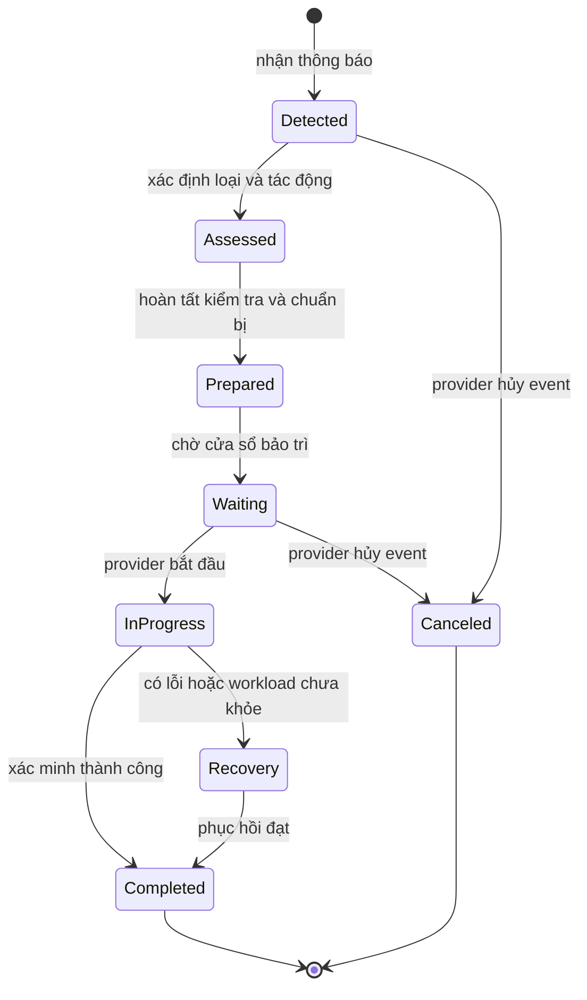
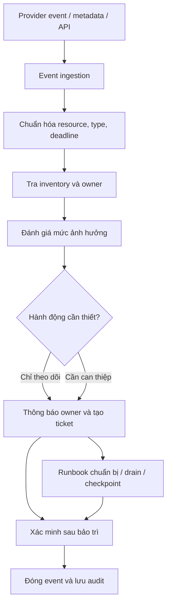

# Sự kiện bảo trì của nhà cung cấp và tác động đến máy khách

Nhà cung cấp cloud phải bảo trì máy chủ vật lý, hypervisor, firmware, mạng và hệ thống lưu trữ để duy trì độ an toàn, hiệu năng và tính sẵn sàng của nền tảng. Trong quá trình đó, VM của khách hàng có thể được live migrate sang host khác, bị reboot, bị stop/start, được yêu cầu thay thế hoặc tạm thời mất kết nối. Một số sự kiện được thông báo trước; một số sự kiện khẩn cấp có thể xảy ra khi phần cứng hoặc nền tảng gặp lỗi.

Đội vận hành không kiểm soát lịch bảo trì của host vật lý, nhưng có thể thiết kế workload để chịu được gián đoạn, theo dõi thông báo từ provider và chuẩn bị hành động phù hợp. Điều quan trọng là hiểu **loại sự kiện**, **thời hạn phản hồi**, **tác động đến dữ liệu và mạng**, cùng **trách nhiệm của khách hàng** đối với hệ điều hành và ứng dụng.

## 1. Vì sao nhà cung cấp thực hiện bảo trì?

Hạ tầng cloud gồm nhiều lớp phần cứng và phần mềm. Nhà cung cấp cần bảo trì định kỳ hoặc đột xuất để thay thế linh kiện, cập nhật bảo mật, xử lý lỗi và nâng cấp năng lực nền tảng.

Các nguyên nhân thường gặp:

- **Phần cứng:** thay DIMM, CPU, NIC, bộ điều khiển lưu trữ, nguồn hoặc máy chủ có dấu hiệu suy giảm.
- **Firmware và BIOS/UEFI:** cập nhật firmware, microcode CPU, cấu hình bảo mật hoặc thành phần khởi động.
- **Hypervisor:** vá lỗ hổng, cập nhật phiên bản, thay đổi cấu hình hoặc khởi động lại host.
- **Mạng và lưu trữ:** bảo trì switch, fabric, thiết bị lưu trữ hoặc thành phần điều khiển.
- **Bảo mật khẩn cấp:** xử lý lỗ hổng nghiêm trọng hoặc rủi ro có thể ảnh hưởng nhiều tenant.
- **Vòng đời nền tảng:** di chuyển workload khỏi host cũ, vùng phần cứng hết hỗ trợ hoặc cấu hình không còn được cung cấp.

Không phải mọi hoạt động bảo trì đều làm gián đoạn VM. Một số thay đổi được thực hiện ở lớp nền tảng mà workload hầu như không nhận thấy; một số yêu cầu VM di chuyển hoặc khởi động lại. Thông báo của provider cần được xem là tín hiệu để đánh giá và chuẩn bị, không phải bằng chứng rằng mọi workload sẽ có cùng mức tác động.

## 2. Các loại sự kiện bảo trì

### Bảo trì định kỳ có kế hoạch

Provider xác định trước phạm vi và khoảng thời gian bảo trì, sau đó gửi thông báo tới tài khoản, project, subscription hoặc từng instance. Khách hàng có thể được cung cấp một cửa sổ thời gian, deadline hoặc lựa chọn hành động. Thông tin có thể xuất hiện trong portal, event service, API, email hoặc metadata endpoint.

Thông báo trước giúp đội vận hành kiểm tra replica, backup, lịch triển khai và capacity. Tuy nhiên, thời điểm cụ thể, khả năng trì hoãn và hành động được phép phụ thuộc loại dịch vụ. Một số sự kiện có deadline bắt buộc vì host cần được rút khỏi hoạt động.

### Live migration

Live migration chuyển VM đang chạy từ host vật lý này sang host khác mà không yêu cầu khách hàng tắt máy theo cách thông thường. Nền tảng sao chép hoặc đồng bộ trạng thái bộ nhớ và CPU, sau đó chuyển quyền thực thi sang host đích. Với workload tương thích, gián đoạn thường ngắn, nhưng không nên giả định hoàn toàn không có ảnh hưởng.

Trong thời điểm chuyển đổi có thể xuất hiện một khoảng pause ngắn, biến động latency, thay đổi đường mạng vật lý hoặc sự kiện đồng bộ clock. Workload nhạy với thời gian thực, packet processing hoặc I/O liên tục cần được kiểm thử trên loại instance và nền tảng cụ thể.

Live migration có thể bị giới hạn bởi loại instance, thiết bị passthrough, GPU, local NVMe, host affinity, dedicated host hoặc cấu hình đặc biệt. Nếu VM không hỗ trợ live migration, provider có thể yêu cầu reboot, stop/start hoặc thay thế instance.

### Reboot do bảo trì host

Provider có thể yêu cầu reboot VM để hoàn tất cập nhật hypervisor, firmware hoặc phần cứng. Reboot có thể được lên lịch trước hoặc được thực hiện trong cửa sổ bảo trì. Khi reboot, tiến trình trong RAM và kết nối hiện tại bị mất; OS phải khởi động lại và ứng dụng cần tự phục hồi.

Nếu VM chạy workload đơn lẻ, reboot có thể làm dịch vụ ngừng hoàn toàn trong thời gian boot. Nếu ứng dụng có nhiều replica và load balancer, traffic có thể được chuyển sang replica khác trong lúc một VM bảo trì, miễn là capacity dự phòng đủ.

### Stop/start hoặc deallocate

Một số sự kiện yêu cầu VM dừng rồi khởi động lại, đôi khi trên host vật lý khác. Tác động có thể lớn hơn reboot thông thường:

- VM mất trạng thái trong RAM và mọi tiến trình đang chạy.
- Local/ephemeral disk có thể bị mất dữ liệu hoặc không còn được bảo đảm.
- Public IP động có thể thay đổi nếu dịch vụ thu hồi địa chỉ khi deallocate.
- Host placement và topology vật lý có thể thay đổi.
- VM có thể cần thời gian để được cấp phát lại nếu vùng đang thiếu capacity.

Phải kiểm tra chính sách cụ thể của instance, disk, NIC và địa chỉ IP trước khi chấp nhận stop/start.

### Instance retirement hoặc thay thế

Nếu host hoặc instance có lỗi không thể sửa tại chỗ, provider có thể đánh dấu VM cần retirement, yêu cầu khách hàng tạo instance thay thế hoặc di chuyển workload. Trong một số dịch vụ, tài nguyên compute cũ có thể bị dừng hoặc xóa sau deadline.

Retirement là tín hiệu cần kiểm tra dữ liệu và dependency ngay. Không nên chờ tới thời điểm cuối cùng nếu workload có state cục bộ, IP cố định, license gắn với host hoặc yêu cầu placement đặc biệt.

### Sự kiện khẩn cấp và lỗi ngoài kế hoạch

Host có thể gặp lỗi nguồn, nhiệt độ, bộ nhớ, CPU, NIC hoặc storage mà không có thời gian thông báo dài. Provider có thể tự động di chuyển VM, reboot hoặc dừng máy để bảo vệ nền tảng. Khách hàng có thể chỉ nhận được thông báo sau khi sự kiện đã bắt đầu hoặc hoàn tất.

Đây là lý do workload production cần khả năng chịu lỗi độc lập với thông báo bảo trì. Notification giúp chuẩn bị cho sự kiện có kế hoạch; replication, health check và failover giúp ứng phó với sự kiện không báo trước.

## 3. Phân biệt các hành động và tác động

| Hành động của provider | VM có tiếp tục chạy? | RAM/tiến trình | Local/ephemeral disk | IP và kết nối | Mức gián đoạn thường gặp |
|---|---|---|---|---|---|
| Live migration | Thường có | Trạng thái được chuyển; có thể có pause ngắn | Thường không đổi nếu dịch vụ hỗ trợ | Có thể có biến động ngắn | Thấp nhưng không bằng 0 |
| Guest/instance reboot | Không trong lúc reboot | Mất | Thường còn qua reboot, tùy loại disk | TCP session bị ngắt; IP thường giữ | Trung bình |
| Host maintenance yêu cầu stop/start | Không trong lúc dừng | Mất | Có thể mất hoặc thay đổi theo cam kết | Public IP động có thể đổi; kết nối mất | Cao hơn reboot |
| Instance retirement/replace | Instance cũ ngừng phục vụ | Mất | Phụ thuộc disk và quy trình thay thế | Có thể phải gắn lại NIC/IP hoặc cập nhật DNS | Phụ thuộc migration |
| Host failure đột xuất | Có thể mất ngay | Mất nếu không được bảo toàn | Không bảo đảm với local disk | Kết nối bị ngắt | Không dự đoán được |

Bảng mô tả hành vi phổ biến. Provider có thể định nghĩa riêng cho từng family, loại disk, accelerator và chế độ tenancy. Hãy đọc thông báo sự kiện và tài liệu của đúng dịch vụ trước khi chọn hành động.

## 4. Sự kiện bảo trì thường được thông báo như thế nào?

Provider có thể phát sự kiện theo nhiều kênh. Đội vận hành nên biết nơi nhận thông báo, cách liên kết sự kiện với tài nguyên và cách chuyển thông tin tới người chịu trách nhiệm.

### Portal và event API

Portal quản trị thường hiển thị sự kiện theo resource ID, trạng thái, loại hành động và thời gian dự kiến. Event API hoặc dịch vụ event routing có thể đưa thông báo vào hệ thống ticket, chat nội bộ, event bus hoặc automation.

Không nên chỉ dựa vào email cá nhân của người tạo VM. Thông báo nên được gửi tới kênh vận hành chung, có lưu lịch sử và có người chịu trách nhiệm xử lý.

### Metadata endpoint và guest agent

Một số cloud cung cấp thông tin maintenance event qua metadata service hoặc agent trong guest OS. Cách này giúp ứng dụng hoặc daemon trên VM nhận thông báo gần thời điểm xảy ra sự kiện. Tuy nhiên:

- Không phải mọi provider hoặc loại instance đều hỗ trợ cùng một cơ chế.
- Metadata có thể chỉ cung cấp trạng thái hoặc thời điểm dự kiến, không phải toàn bộ kế hoạch bảo trì.
- Workload phải truy cập endpoint theo yêu cầu bảo mật của provider.
- Ứng dụng cần xử lý timeout, dữ liệu không có sẵn và sự kiện lặp lại.

Không dùng metadata event làm kênh duy nhất. Nếu VM không thể boot hoặc agent bị lỗi, thông báo bên trong guest có thể không được xử lý. Cần có kênh control plane độc lập.

### Các trường thông tin cần thu thập

Khi nhận event, nên chuẩn hóa thành một bản ghi có các trường:

| Trường | Ý nghĩa |
|---|---|
| Event ID | Định danh để chống xử lý trùng |
| Resource ID | VM, host group hoặc tài nguyên chịu ảnh hưởng |
| Event type | Live migration, reboot, stop/start, retirement hoặc loại khác |
| Status | Scheduled, in progress, completed, canceled hoặc trạng thái tương ứng |
| Not-before / deadline | Thời điểm sớm nhất hoặc hạn cuối cần hành động |
| Maintenance window | Khoảng thời gian dự kiến nếu được cung cấp |
| Required action | Provider tự xử lý hay khách hàng cần chủ động thay thế/di chuyển |
| Region / zone | Phạm vi hạ tầng liên quan |
| Documentation link | Hướng dẫn cụ thể cho loại event |
| Received time | Thời điểm hệ thống của khách hàng nhận được thông báo |

Thời gian cần được lưu theo múi giờ rõ ràng, tốt nhất chuẩn hóa UTC trong hệ thống điều phối rồi hiển thị theo múi giờ của đội trực. Tránh diễn giải nhầm deadline do khác múi giờ hoặc giờ mùa hè.

## 5. Trạng thái của một maintenance event

Một event có thể đi qua nhiều trạng thái. Tên trạng thái cụ thể phụ thuộc provider, nhưng workflow nội bộ có thể chuẩn hóa như sau:



Không nên đóng event chỉ vì provider báo `completed`. Hệ thống khách hàng cần xác nhận VM, disk, mạng và ứng dụng đã trở lại trạng thái mong muốn. Ngược lại, nếu provider hủy event, vẫn cần cập nhật lịch và đóng các hành động tạm thời đã chuẩn bị.

## 6. Tác động đến workload và dịch vụ

### CPU, bộ nhớ và tiến trình

Live migration có thể làm VM tạm pause hoặc thay đổi độ trễ thực thi. Reboot hoặc stop/start làm mất RAM và trạng thái tiến trình. Các tác vụ dài như batch, xử lý video, huấn luyện mô hình hoặc tính toán khoa học nên có checkpoint để tiếp tục sau khi VM khởi động lại.

Nếu workload dùng CPU pinning, NUMA, huge pages hoặc thiết bị tăng tốc, cần kiểm tra host đích có topology tương thích. Với GPU passthrough hoặc accelerator chuyên dụng, live migration có thể không khả dụng hoặc có giới hạn riêng.

### Storage và dữ liệu

Persistent block volume thường được thiết kế để tồn tại độc lập với host, nhưng vẫn cần xác minh chính sách gắn và detach. Local NVMe hoặc instance store có thể gắn với host vật lý và không được bảo toàn khi VM chuyển host hoặc bị retirement.

Với database, event bảo trì có thể làm mất kết nối storage trong thời gian ngắn hoặc kích hoạt recovery sau reboot. Ứng dụng cần dùng transaction log, replication, checkpoint và backup phù hợp. Không coi snapshot tự động của volume là bằng chứng rằng database luôn có application-consistent backup.

### Mạng và phiên kết nối

Trong live migration, đường mạng vật lý hoặc mapping của NIC có thể thay đổi. Dù IP logic được giữ, kết nối TCP đang mở vẫn có thể bị pause, timeout hoặc reset tùy cách nền tảng thực hiện migration và cách ứng dụng xử lý.

Trong reboot hoặc stop/start, kết nối hiện tại chắc chắn bị gián đoạn. Sau khi máy boot, cần kiểm tra:

- NIC và driver đã hoạt động.
- Private IP, public IP, route, DNS và security policy đúng.
- Load balancer health check đã nhận VM trở lại.
- Service discovery và connection pool đã tái lập kết nối.
- Các client có retry với backoff và tránh retry storm.

### Đồng hồ hệ thống và thời gian

Pause/resume hoặc migration có thể ảnh hưởng cách guest OS quan sát thời gian, đặc biệt với workload nhạy với clock. OS cần đồng bộ thời gian qua dịch vụ được hỗ trợ; ứng dụng không nên dựa vào clock đơn điệu hoặc wall clock để giả định VM chưa từng bị pause.

Với hệ thống phân tán, dùng cơ chế timeout, lease và heartbeat có khả năng chịu pause. Nếu node bị dừng lâu hơn lease, node khác có thể được bầu làm leader; khi node cũ trở lại, cần fencing hoặc kiểm tra quyền ghi để tránh split-brain.

### License và host affinity

Một số phần mềm được cấp phép theo core, socket, host ID hoặc phần cứng cụ thể. Live migration hoặc thay host có thể ảnh hưởng cách đếm license hoặc điều kiện sử dụng. Dedicated host, host group hoặc placement constraint cũng có thể giới hạn khả năng di chuyển.

Trước khi triển khai, cần xác minh điều khoản license và chính sách provider. Không giả định host ID hoặc topology vật lý luôn giữ nguyên qua bảo trì.

## 7. Trách nhiệm của provider và khách hàng

Mô hình trách nhiệm chia sẻ vẫn áp dụng trong sự kiện bảo trì. Provider quản lý host vật lý, hypervisor và hạ tầng nền theo dịch vụ; khách hàng quản lý guest OS, ứng dụng, dữ liệu và kiến trúc chịu lỗi theo phạm vi dịch vụ đã chọn.

| Công việc | Provider thường chịu trách nhiệm | Khách hàng thường chịu trách nhiệm |
|---|---|---|
| Bảo trì máy chủ vật lý và firmware | Lập lịch, thông báo và thực hiện | Theo dõi thông báo và chuẩn bị workload |
| Hypervisor và nền tảng ảo hóa | Vá lỗi, thay host, live migration theo khả năng dịch vụ | Chọn loại instance và tính năng tương thích |
| Guest OS | Có thể cung cấp tín hiệu sự kiện hoặc agent | Cập nhật OS, cấu hình reboot và kiểm tra dịch vụ |
| Ứng dụng | Không đảm bảo logic ứng dụng tự phục hồi | Thiết kế retry, checkpoint, health check và failover |
| Dữ liệu | Cung cấp độ bền theo cam kết storage | Backup, replication, restore test và consistency |
| Network logic của khách hàng | Duy trì hạ tầng mạng cloud theo SLA | Security group, route, DNS, load balancer và ứng dụng |
| Business continuity | Cung cấp khả năng nền theo dịch vụ | Thiết kế đa instance/zone, RTO/RPO và runbook |

Ranh giới chính xác phụ thuộc dịch vụ managed hay unmanaged, SLA và hợp đồng. Đọc tài liệu sản phẩm để biết provider cam kết loại bảo trì nào, cách thông báo và giới hạn của từng loại instance.

## 8. Chuẩn bị workload trước cửa sổ bảo trì

Khi nhận được event, đội vận hành cần phân loại mức độ ảnh hưởng và chuẩn bị theo loại workload.

### Xác định phạm vi

1. Tra resource ID để tìm VM, ứng dụng, owner và môi trường.
2. Xác định loại event: live migration, reboot, stop/start hay retirement.
3. Kiểm tra thời gian dự kiến, deadline và hành động bắt buộc.
4. Xác định instance family, zone, host affinity, GPU và local disk.
5. Liệt kê volume, NIC, IP, DNS, load balancer và dependency.
6. Kiểm tra replica, capacity dự phòng, SLA, RTO và RPO.

### Kiểm tra backup và dữ liệu

- Xác minh backup gần nhất thành công và có thể khôi phục.
- Kiểm tra replication lag của database hoặc storage.
- Tạo checkpoint cho batch job, training job hoặc tiến trình dài.
- Xác định local/ephemeral disk có dữ liệu cần chuyển đi không.
- Kiểm tra transaction log, filesystem flush và khả năng recovery sau reboot.
- Xác định volume nào được giữ lại, detach hoặc cần gắn lại sau sự kiện.

### Kiểm tra capacity và khả năng failover

Nếu một VM phải reboot, các replica còn lại cần đủ capacity xử lý tải. Không chỉ xem số lượng instance; cần xem CPU, RAM, connection limit, database throughput, network bandwidth và quota của vùng dự phòng.

Với autoscaling, xác minh min/max capacity, quota và khả năng khởi tạo instance mới trong zone còn lại. Nếu nhiều VM cùng một nhóm bị bảo trì, scale out có thể không đủ nhanh hoặc không có capacity ở cùng thời điểm.

### Chuẩn bị lịch và liên lạc

Gắn event với ticket/change record, owner và người trực. Thông báo tới nhóm ứng dụng, database, network, security và service desk nếu sự kiện ảnh hưởng tới họ. Nếu provider cho phép chọn maintenance window, chọn thời điểm phù hợp với tải và khả năng hỗ trợ.

## 9. Runbook cho từng loại sự kiện

### Khi provider thông báo live migration

1. Xác minh VM và loại instance có hỗ trợ migration theo thông báo.
2. Kiểm tra metric latency, packet loss, CPU pause hoặc lỗi ứng dụng trong thời gian bảo trì.
3. Xác nhận workload có retry và timeout phù hợp.
4. Kiểm tra GPU, passthrough, local disk và placement constraint có giới hạn migration không.
5. Theo dõi event đến khi hoàn tất và xác minh health sau migration.

Thông thường không cần tự reboot VM nếu provider chỉ yêu cầu live migration. Không tự ý stop/start vì điều đó có thể làm tăng gián đoạn và thay đổi IP hoặc host placement.

### Khi provider yêu cầu reboot

1. Drain traffic khỏi VM hoặc giảm weight trong load balancer.
2. Chờ request và job đang chạy hoàn tất.
3. Flush dữ liệu, checkpoint và xác nhận replica khỏe.
4. Cho phép provider thực hiện reboot trong cửa sổ hoặc chủ động reboot theo hướng dẫn cụ thể.
5. Theo dõi boot log, OS service, disk, NIC và agent.
6. Chạy health check, smoke test rồi đưa VM trở lại nhận traffic.

Nếu provider đưa ra deadline tự reboot trước khi họ thực hiện, cần xác định thời gian boot và test đủ sớm để còn cơ hội xử lý lỗi.

### Khi provider yêu cầu stop/start hoặc retirement

1. Xác định local disk và dữ liệu nào không được bảo toàn.
2. Di chuyển dữ liệu stateful sang persistent storage hoặc replica khác.
3. Lưu cấu hình, image ID, instance metadata cần thiết và thông tin license.
4. Chuẩn bị instance thay thế hoặc xác nhận quota/capacity ở zone đích.
5. Xác định cách giữ hoặc chuyển private IP, static public IP, NIC và DNS.
6. Chuyển traffic hoặc quyền ghi sang instance mới.
7. Thực hiện stop/start, migrate hoặc replace theo chỉ dẫn provider.
8. Kiểm tra dữ liệu, mạng, agent, ứng dụng và hiệu năng.
9. Chỉ thu hồi tài nguyên cũ sau khi xác nhận hệ thống mới ổn định và dữ liệu đầy đủ.

Không terminate VM cũ chỉ dựa trên việc instance thay thế đã boot. Cần xác nhận dữ liệu, backup, network endpoint và các dependency đã chuyển thành công.

## 10. Workload stateless và stateful cần cách xử lý khác nhau

### Stateless

Stateless workload không lưu dữ liệu duy nhất trên một VM. Khi có event bảo trì, có thể drain node, tạo hoặc scale replica khác và chuyển traffic. Các thành phần cần thiết:

- Nhiều replica phân bố qua các fault domain phù hợp.
- Load balancer health check và connection draining.
- Retry có giới hạn, exponential backoff và idempotent request.
- Session và file người dùng lưu ở dịch vụ dùng chung hoặc storage bền vững.
- Autoscaling và quota đủ để bù capacity khi một phần node ngừng hoạt động.

### Stateful

Stateful workload giữ dữ liệu hoặc quyền ghi gắn với node/volume. Cần xác định replication, quorum, leader election, fencing, backup và khả năng attach volume vào máy thay thế.

Với database cluster, việc một node reboot có thể kích hoạt failover. Cần xác minh replica lag, quorum và khả năng chịu thêm tải của node còn lại. Khi node cũ trở lại, không tự động cho phép nó ghi dữ liệu trước khi cluster xác nhận trạng thái và vai trò.

Với batch hoặc AI training, checkpoint thường xuyên giúp tiếp tục công việc sau stop/start hoặc retirement. Khoảng cách giữa các checkpoint quyết định lượng công việc có thể phải chạy lại.

## 11. Bảo trì trong cụm container và Kubernetes

Khi VM là Kubernetes worker node, maintenance event có thể yêu cầu drain node để Pod được lập lịch sang node khác. Tuy nhiên, `kubectl drain` hoặc cơ chế node maintenance không tự bảo đảm mọi Pod đều di chuyển được.

Các yếu tố cần kiểm tra:

- **PodDisruptionBudget (PDB):** có thể ngăn eviction nếu số replica khỏe không đủ.
- **Replica và topology spread:** workload có đủ Pod ở node/zone khác không.
- **Local Persistent Volume:** Pod có thể không di chuyển nếu dữ liệu gắn với node.
- **EmptyDir và ephemeral storage:** dữ liệu tạm có thể mất khi Pod bị tạo lại.
- **DaemonSet:** một số Pod hệ thống không bị drain theo cách thông thường.
- **GPU/accelerator:** node đích phải có cùng loại thiết bị và đủ tài nguyên.
- **Node affinity/taint/toleration:** Pod có thể không tìm được node thay thế.

Quy trình bảo trì node nên gồm cordon, drain có kiểm soát, xác minh Pod đã chạy ở node khác, sau đó mới cho provider bảo trì host. Sau khi node trở lại, kiểm tra kubelet, CNI, CSI, device plugin và trạng thái node trước khi uncordon.

Với managed Kubernetes, provider có thể tự động nâng cấp hoặc thay node theo node pool policy. Cần hiểu ranh giới giữa hoạt động của control plane và worker node, cũng như thông báo bảo trì của dịch vụ quản lý.

## 12. Tự động hóa tiếp nhận và xử lý maintenance event

Ở quy mô lớn, không thể dựa vào người vận hành kiểm tra portal liên tục. Có thể xây dựng luồng tự động nhận event từ provider, phân loại, tạo ticket và kích hoạt runbook.



Đây là luồng tham khảo. Với event yêu cầu hành động phá hủy hoặc ảnh hưởng dữ liệu, automation nên dừng ở bước đề xuất và chờ phê duyệt của owner. Không tự động terminate, detach volume hoặc chuyển leader chỉ dựa trên một event chưa được xác minh.

### Thiết kế event handler

Handler nên có các đặc tính:

- **Idempotent:** nhận cùng event nhiều lần không tạo nhiều hành động phá hủy.
- **Deduplication:** dùng event ID hoặc khóa kết hợp resource ID và thời điểm để loại thông báo trùng.
- **Deadline-aware:** tính thời gian còn lại và ưu tiên event gần hạn.
- **Owner-aware:** tìm đúng nhóm chịu trách nhiệm theo tag, service catalog hoặc inventory.
- **Retry có giới hạn:** xử lý lỗi tạm thời mà không tạo vòng lặp vô hạn.
- **Audit:** ghi event gốc, quyết định, người duyệt, hành động và kết quả.
- **Safe default:** nếu không xác định được loại event hoặc resource, tạo cảnh báo và yêu cầu người vận hành xem xét.

### Pseudocode xử lý event

```text
onMaintenanceEvent(event):
    if alreadyProcessed(event.id):
        return

    resource = inventory.lookup(event.resourceId)
    if resource is unknown:
        alertOperations(event)
        recordForReview(event)
        return

    impact = assessImpact(resource, event.type)
    owner = resolveOwner(resource)
    createOrUpdateTicket(event, resource, impact, owner)

    if impact.requiresDestructiveAction:
        requestHumanApproval()
    else:
        runApprovedPreparationChecks()

    recordEventDecisionAndResult(event)
```

Pseudocode mô tả logic, không phải mã có thể chạy trực tiếp. Khi triển khai, cần xác minh chữ ký hoặc nguồn event, chống giả mạo, bảo vệ credential của automation và giới hạn quyền của service identity.

## 13. SLA, maintenance window và giới hạn cam kết

SLA của cloud thường quy định mức availability theo dịch vụ, phạm vi tài nguyên và điều kiện đủ điều kiện nhận service credit. Nó không có nghĩa một VM đơn lẻ không bao giờ bị reboot hoặc live migrate. Nhiều SLA tính availability theo tháng và có ngoại lệ, yêu cầu cấu hình đa instance hoặc điều kiện sử dụng cụ thể.

Khi đọc SLA và chính sách bảo trì, cần xác định:

- Cam kết áp dụng cho VM, disk, network hay dịch vụ managed nào.
- Availability được đo ở cấp instance, zone, region hay dịch vụ.
- Sự kiện bảo trì có kế hoạch được tính vào downtime theo cách nào.
- Provider có thông báo trước bao lâu và kênh nào là nguồn chính thức.
- Khách hàng có quyền trì hoãn, chọn cửa sổ hoặc chủ động reboot không.
- Những loại instance hoặc thiết bị nào không hỗ trợ live migration.
- Điều kiện để yêu cầu service credit và thời hạn gửi claim.

Không thiết kế hệ thống chỉ dựa trên việc provider sẽ luôn live migrate. Loại instance, GPU, local disk, dedicated host hoặc lỗi khẩn cấp có thể dẫn tới hành vi khác. Thiết kế HA cần chịu được việc một VM bị gián đoạn bất kỳ lúc nào.

## 14. Kiểm thử khả năng chịu bảo trì

Runbook chỉ có giá trị khi được diễn tập. Có thể kiểm tra từng lớp trong môi trường staging hoặc nhóm canary:

1. Reboot một VM stateless và xác nhận traffic được chuyển sang replica khác.
2. Drain một worker node và kiểm tra PDB, topology spread, local volume và Pod startup.
3. Mô phỏng mất kết nối ngắn giữa ứng dụng và storage/database.
4. Kiểm tra retry, timeout, circuit breaker và khả năng tránh retry storm.
5. Dừng một node stateful theo quy trình failover đã phê duyệt và xác nhận quorum.
6. Khôi phục VM từ image/backup trên instance family tương thích.
7. Đo thời gian từ event đến thông báo owner, hoàn tất chuẩn bị và phục hồi dịch vụ.

Không thử nghiệm bằng cách gây lỗi host production hoặc ép provider thực hiện bảo trì không kiểm soát. Dùng cơ chế fault injection được hỗ trợ và phạm vi thử nghiệm có giới hạn.

### Các chỉ số nên theo dõi

| Chỉ số | Mục đích |
|---|---|
| Event detection latency | Thời gian từ khi provider phát event đến khi hệ thống khách hàng nhận được |
| Owner acknowledgement time | Thời gian owner xác nhận đã tiếp nhận |
| Preparation completion | Tỷ lệ event hoàn tất pre-check trước deadline |
| Maintenance-related downtime | Thời gian gián đoạn do bảo trì |
| Failover success rate | Tỷ lệ chuyển workload thành công |
| Recovery time | Thời gian ứng dụng trở lại trạng thái khỏe |
| Data recovery point | Mức mất dữ liệu hoặc replication lag khi phục hồi |
| Unhandled event count | Số event không có owner hoặc runbook phù hợp |

Các chỉ số này giúp tìm ra điểm yếu trong thông báo, inventory, capacity, automation và thiết kế ứng dụng.

## 15. Những sai lầm thường gặp

- **Cho rằng live migration hoàn toàn không gây gián đoạn.** Một khoảng pause hoặc biến động latency vẫn có thể ảnh hưởng workload nhạy cảm.
- **Cho rằng reboot chỉ làm mất vài phút.** Thời gian boot, recovery database, warm cache và health check có thể kéo dài hơn nhiều.
- **Bỏ qua local/ephemeral disk.** Dữ liệu trên disk gắn với host có thể mất khi stop/start hoặc retirement.
- **Không kiểm tra IP sau stop/start.** Public IP động hoặc host placement có thể thay đổi theo dịch vụ.
- **Chỉ dựa vào email thông báo.** Người nhận có thể nghỉ phép, đổi nhóm hoặc bỏ lỡ deadline; cần event routing và owner rõ ràng.
- **Drain Kubernetes node mà không xem PDB.** Pod có thể không được eviction hoặc không có node thay thế.
- **Tự động xử lý mọi event giống nhau.** Live migration, reboot và retirement có tác động khác nhau; cần runbook theo event type.
- **Không kiểm tra capacity dự phòng.** Replica còn lại có thể quá tải khi một zone hoặc nhóm host bị bảo trì.
- **Tin SLA bảo đảm một VM cụ thể không bị gián đoạn.** SLA không thay thế kiến trúc chịu lỗi ở cấp ứng dụng.
- **Đóng event khi control plane báo hoàn tất.** Cần xác minh guest OS, ứng dụng và dữ liệu đã khỏe trở lại.

## 16. Checklist vận hành sự kiện bảo trì

**Khi nhận thông báo:**

- [ ] Xác minh nguồn event, event ID, resource ID và loại hành động.
- [ ] Xác định owner, môi trường, dịch vụ và mức độ quan trọng.
- [ ] Ghi lại deadline, maintenance window và yêu cầu của provider.
- [ ] Xác định VM có GPU, passthrough, local disk, host affinity hoặc license đặc biệt không.
- [ ] Mở ticket và thông báo các nhóm liên quan.

**Trước khi bảo trì:**

- [ ] Kiểm tra replica, quorum và capacity dự phòng.
- [ ] Xác minh backup, snapshot, replication lag và checkpoint.
- [ ] Xác định dữ liệu trên ephemeral disk và phương án di chuyển.
- [ ] Drain traffic hoặc node theo đúng loại workload.
- [ ] Kiểm tra IP, NIC, DNS, volume và dependency.
- [ ] Chuẩn bị runbook phục hồi và người trực trong cửa sổ bảo trì.

**Sau khi bảo trì:**

- [ ] Xác nhận event hoàn tất hoặc bị hủy.
- [ ] Kiểm tra VM, OS, driver, agent, volume và network.
- [ ] Chạy health check và smoke test ở cấp ứng dụng.
- [ ] Kiểm tra replication, quorum, dữ liệu và checkpoint.
- [ ] Đưa traffic trở lại theo từng đợt và theo dõi metric.
- [ ] Ghi nhận downtime, bất thường, hành động và kết quả vào audit/ticket.

## Kết luận

Sự kiện bảo trì của provider có thể chỉ là live migration với gián đoạn ngắn, nhưng cũng có thể yêu cầu reboot, stop/start hoặc thay thế instance. Tác động phụ thuộc loại instance, storage, network, accelerator và cách ứng dụng quản lý trạng thái. Hãy nhận event qua kênh tập trung, liên kết với owner và inventory, đánh giá dữ liệu cùng capacity, rồi thực hiện runbook phù hợp. Workload stateless cần replica và traffic draining; workload stateful cần replication, checkpoint, backup và quy trình failover. Sau bảo trì, phải xác minh cả hạ tầng lẫn ứng dụng trước khi đóng event. Thiết kế như vậy giúp hệ thống compute duy trì độ sẵn sàng ngay cả khi host vật lý cần được bảo trì hoặc thay thế.
