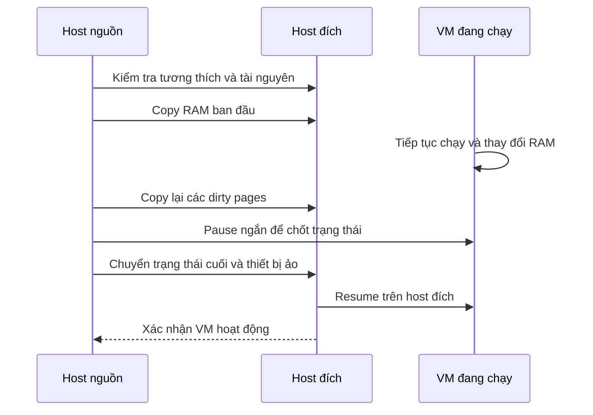

# Live migration, reboot và host replacement trong bảo trì

Máy ảo (VM) chạy trên máy chủ vật lý của nhà cung cấp cloud. Để vá lỗi phần cứng, cập nhật hypervisor, thay thiết bị hoặc xử lý sự cố, nhà cung cấp đôi khi cần di chuyển VM, khởi động lại VM hoặc chuyển VM sang host khác. Những hoạt động này có thể ảnh hưởng đến kết nối, hiệu năng và tính sẵn sàng của ứng dụng.

Ba khái niệm thường gặp là **live migration**, **reboot** và **host replacement**. Live migration chuyển trạng thái VM sang host khác trong khi cố gắng duy trì dịch vụ với thời gian gián đoạn rất ngắn. Reboot khởi động lại VM hoặc hệ điều hành khách, khiến tiến trình và kết nối bị gián đoạn. Host replacement thay thế máy chủ vật lý đang chạy VM; tùy nền tảng, VM có thể được di chuyển trực tiếp, khởi động lại trên host mới hoặc được tạo lại từ đĩa và cấu hình hiện có.

Nhóm vận hành cần hiểu nhà cung cấp thực hiện loại bảo trì nào, workload chịu ảnh hưởng ra sao và ứng dụng có thể phục hồi như thế nào. Không phải mọi sự kiện bảo trì đều có cùng hành vi; khả năng live migration phụ thuộc hypervisor, loại VM, thiết bị gắn kèm, cấu hình lưu trữ, vùng triển khai và chính sách của dịch vụ.

Sau bài học, bạn có thể:

- Phân biệt live migration, guest reboot, host reboot và host replacement.
- Giải thích các giai đoạn và điều kiện kỹ thuật của live migration.
- Đánh giá ảnh hưởng của reboot hoặc thay host đến trạng thái, kết nối và dữ liệu.
- Chuẩn bị ứng dụng, storage, network và HA để chịu được bảo trì hạ tầng.
- Đọc thông báo bảo trì, lập kế hoạch phản ứng và xác minh sau sự kiện.
- Xác định khi nào cần failover, restart, redeploy hoặc khôi phục từ backup.

## 1. Vì sao host cần bảo trì?

VM là môi trường ảo hóa chạy trên CPU, RAM, NIC, thiết bị lưu trữ và hypervisor của máy chủ vật lý. Nhà cung cấp phải bảo trì lớp này để duy trì độ an toàn, hiệu năng và độ tin cậy của nền tảng.

Các nguyên nhân thường gặp:

- Thay CPU, RAM, DIMM, NIC, nguồn điện, quạt hoặc thiết bị lưu trữ có dấu hiệu lỗi.
- Cập nhật firmware, BIOS/UEFI, microcode CPU hoặc hypervisor.
- Vá lỗ hổng bảo mật ở phần cứng, firmware hoặc lớp ảo hóa.
- Nâng cấp switch, rack, mạng lưu trữ hoặc hệ thống điện/làm mát.
- Di chuyển tải khỏi host có nguy cơ hỏng hoặc cần ngừng hoạt động.
- Thay thế host sau khi phần cứng gặp lỗi không thể tiếp tục phục vụ.

Nhà cung cấp có thể chủ động lên lịch bảo trì hoặc phản ứng khẩn cấp khi phát hiện lỗi. Bảo trì có kế hoạch thường có thông báo và thời gian chuẩn bị; sự cố host đột ngột có thể khiến VM dừng mà không có giai đoạn di chuyển trước.

## 2. Phân biệt live migration, reboot và host replacement

| Hoạt động | Điều gì thay đổi? | Ảnh hưởng thường gặp đến VM | Ứng dụng cần chuẩn bị |
|---|---|---|---|
| Live migration | Trạng thái VM được chuyển từ host nguồn sang host đích | Có thể chỉ có một khoảng dừng rất ngắn; TCP connection có thể tiếp tục nhưng vẫn cần kiểm thử | Chịu được độ trễ tăng ngắn, packet loss nhỏ hoặc pause; không phụ thuộc vào host vật lý cố định |
| Guest OS reboot | Hệ điều hành bên trong VM khởi động lại | Tiến trình và kết nối bị ngắt; dữ liệu chưa ghi bền vững có thể mất | Graceful shutdown/startup, tự khởi động service, kiểm tra readiness và phục hồi job |
| Host reboot / maintenance reboot | Host vật lý hoặc lớp nền cần khởi động lại; VM có thể được reboot hoặc di chuyển theo chính sách | Có thể gây gián đoạn nếu không thể live migrate hoặc dịch vụ yêu cầu reboot VM | Thiết kế HA, theo dõi maintenance event, kiểm thử reboot và failover |
| Host replacement | Host vật lý cũ được thay bằng host khác | VM có thể được di chuyển, dừng/khởi động lại hoặc tạo lại tùy dịch vụ | Dữ liệu phải nằm trên storage bền vững hoặc có backup; cấu hình và identity cần phục hồi đúng |
| Host failure đột ngột | Host không còn hoạt động trước khi di chuyển hoàn tất | VM có thể mất nguồn đột ngột; ứng dụng cần khởi động lại hoặc failover | Crash recovery, journal/database recovery, retry an toàn và backup/replication |

Các thuật ngữ của nhà cung cấp có thể khác nhau. Ví dụ, một số nền tảng dùng “redeploy”, “recovery”, “rehost” hoặc “maintenance event” cho các thao tác có hành vi khác nhau. Luôn xác minh chính sách của loại VM cụ thể và đọc nội dung sự kiện thay vì suy luận từ tên.

## 3. Live migration hoạt động như thế nào?

Live migration chuyển một VM đang chạy từ host nguồn sang host đích mà không cần tắt hoàn toàn workload trong phần lớn thời gian chuyển. Mục tiêu là giảm downtime, nhưng không bảo đảm thời gian gián đoạn bằng không.

### Những thành phần cần chuyển hoặc duy trì

- **CPU state:** trạng thái thanh ghi, ngữ cảnh thực thi và các đặc tính CPU mà VM đang sử dụng.
- **Memory state:** nội dung RAM của VM, gồm trang nhớ đang được tiến trình sử dụng.
- **Virtual device state:** trạng thái thiết bị mạng, bộ điều khiển đĩa và thiết bị ảo.
- **Storage access:** host đích phải tiếp tục truy cập được đĩa VM hoặc nhận bản sao dữ liệu nhất quán.
- **Network identity:** địa chỉ IP, MAC logic, virtual NIC và luồng mạng phải tiếp tục hoạt động theo thiết kế nền tảng.
- **Execution state:** tại thời điểm chuyển cuối, VM phải tiếp tục thực thi từ trạng thái nhất quán trên host đích.

### Quy trình pre-copy phổ biến

Một kỹ thuật thường dùng là pre-copy:

1. **Khởi tạo:** control plane chọn host đích và kiểm tra khả năng tương thích, tài nguyên, mạng và storage.
2. **Copy RAM lần đầu:** các trang nhớ của VM được sao chép từ host nguồn sang host đích trong khi VM vẫn chạy.
3. **Theo dõi trang bị ghi lại:** nếu ứng dụng tiếp tục thay đổi RAM, hypervisor đánh dấu các trang đã bị ghi (dirty pages).
4. **Copy lặp:** các trang bị thay đổi được truyền lại cho đến khi lượng dữ liệu còn lại đủ nhỏ hoặc đạt điều kiện dừng.
5. **Pause ngắn:** VM tạm dừng để chuyển phần trạng thái cuối cùng, thiết bị ảo và thông tin thực thi.
6. **Resume trên host đích:** VM tiếp tục chạy trên host mới; mạng và storage được chuyển tiếp theo cơ chế của nền tảng.
7. **Hoàn tất:** host nguồn giải phóng tài nguyên sau khi xác nhận host đích hoạt động ổn định.



Một số nền tảng có thể dùng post-copy hoặc kỹ thuật kết hợp. Với post-copy, VM có thể bắt đầu chạy ở host đích trước khi toàn bộ RAM được chuyển; các trang chưa có sẽ được lấy từ host nguồn khi cần. Kỹ thuật này có đặc tính hiệu năng và rủi ro khác pre-copy. Người dùng thường không chọn thuật toán, nhưng cần hiểu rằng hành vi và mức gián đoạn phụ thuộc cách nhà cung cấp triển khai.

### Vì sao live migration vẫn có thể gây ảnh hưởng?

- VM có thể pause trong khoảng ngắn khi chốt trạng thái.
- Luồng mạng có thể mất một số packet hoặc tăng latency khi đường đi được cập nhật.
- Tải mạng lưu trữ và migration có thể làm thay đổi latency I/O.
- Dirty page rate cao có thể khiến quá trình copy kéo dài hoặc khó hội tụ.
- Host đích có đặc tính CPU, NUMA, cache hoặc băng thông khác.
- Một số workload nhạy với thời gian pause, clock drift hoặc thiết bị passthrough.

Do đó, live migration giảm tác động nhưng không thay thế thiết kế ứng dụng chịu lỗi.

## 4. Điều kiện và giới hạn của live migration

Không phải VM nào cũng có thể live migrate trong mọi tình huống. Khả năng này phụ thuộc vào cả phần cứng, hypervisor, cấu hình VM và dịch vụ cloud.

### Tương thích CPU và host

Host đích phải hỗ trợ tập lệnh CPU và các đặc tính ảo hóa mà VM cần. Một số nền tảng cung cấp CPU compatibility mode hoặc giới hạn tập lệnh hiển thị cho guest để hỗ trợ migration giữa các thế hệ host. Nếu VM dùng tính năng CPU đặc thù hoặc cấu hình gắn chặt với host, migration có thể bị giới hạn.

### Thiết bị và tính năng đặc biệt

Các cấu hình sau có thể không hỗ trợ live migration hoặc cần quy trình riêng:

- GPU passthrough hoặc thiết bị PCIe passthrough.
- SR-IOV hoặc NIC có chức năng offload đặc biệt.
- Local/ephemeral disk phụ thuộc trực tiếp host vật lý.
- Host affinity/anti-affinity hoặc dedicated host constraint.
- Thiết bị ảo hoặc driver không tương thích với host đích.
- VM dùng nested virtualization hoặc cấu hình đặc biệt theo nhà cung cấp.

Danh sách này không áp dụng giống nhau cho mọi cloud. Một số nền tảng đã hỗ trợ migration cho một phần thiết bị tăng tốc; cần kiểm tra ma trận hỗ trợ của loại instance cụ thể.

### Dung lượng và mạng migration

Host đích cần đủ CPU, RAM, storage và năng lực mạng để nhận VM. Nếu cụm đang gần đầy hoặc có nhiều VM cùng cần di chuyển, nhà cung cấp có thể phải xếp hàng, chọn host khác hoặc yêu cầu reboot.

### Shared storage và dữ liệu cục bộ

Nếu VM dùng shared storage, host đích có thể tiếp tục truy cập cùng volume. Nếu VM dùng local disk gắn với host, dữ liệu có thể không đi theo VM khi thay host. Phải xác định rõ dữ liệu nào bền vững, dữ liệu nào chỉ là cache/tạm thời và cách khôi phục.

## 5. Reboot: điều gì xảy ra khi VM khởi động lại?

Reboot có thể được yêu cầu bởi hệ điều hành, quản trị viên, công cụ patching hoặc nhà cung cấp cloud. Dù nguyên nhân khác nhau, tiến trình trong VM sẽ bị dừng và khởi chạy lại.

### Guest reboot

Guest reboot khởi động lại hệ điều hành khách. Trình tự thường gồm:

1. Hệ điều hành nhận yêu cầu reboot.
2. Service nhận tín hiệu dừng và hoàn tất công việc có thể hoàn tất.
3. Filesystem flush dữ liệu và unmount theo quy trình.
4. Kernel dừng, VM khởi động lại và bootloader nạp hệ điều hành.
5. Network, disk, agent và service được khởi tạo.
6. Ứng dụng bootstrap, kết nối dependency và báo readiness.

Nếu VM bị reset cưỡng bức hoặc host mất nguồn, các bước graceful shutdown có thể không chạy. Filesystem journal và database recovery giúp phục hồi nhưng không thay thế backup.

### Host reboot hoặc bảo trì cần reboot VM

Nhà cung cấp có thể thông báo VM cần reboot để áp dụng bản vá hoặc cập nhật phần cứng. Một số sự kiện cho phép người dùng chọn thời gian trong cửa sổ nhất định; một số sự kiện khẩn cấp có thể có thời hạn ngắn hoặc do nhà cung cấp quyết định.

Khi nhận thông báo, cần xác định:

- VM ID, region/zone, host hoặc nhóm tài nguyên bị ảnh hưởng.
- Thời hạn hoàn thành bảo trì và liệu có lựa chọn thời điểm không.
- Hành động là live migration, reboot VM, stop/deallocate hay redeploy.
- Local/ephemeral disk có bị mất hay không.
- IP, MAC, hostname, instance identity và attached disk có được giữ không.
- Các workload phụ thuộc và thời gian gián đoạn dự kiến.

## 6. Host replacement và phục hồi VM

Host replacement thay thế máy chủ vật lý bị lỗi hoặc cần ngừng hoạt động. Tùy nền tảng, quá trình có thể diễn ra tự động và không cần người dùng thao tác, hoặc yêu cầu người dùng xác nhận redeploy/recovery.

### Các kiểu phục hồi thường gặp

| Cách phục hồi | Hành vi | Điều kiện quan trọng |
|---|---|---|
| Live migrate trước khi host ngừng | VM được chuyển sang host khác khi còn hoạt động | VM và thiết bị hỗ trợ migration; host đích có đủ năng lực |
| Reboot trên host mới | VM dừng rồi khởi động lại trên host thay thế | Boot disk và dữ liệu cần thiết còn truy cập được; ứng dụng tự phục hồi |
| Stop/deallocate rồi start | VM được giải phóng khỏi host cũ và cấp phát lại | Phải hiểu IP, local disk, reservation và trạng thái compute sau deallocate |
| Redeploy/recreate | Nền tảng tạo môi trường VM mới từ disk hoặc image/config hiện có | Cấu hình có thể tái lập; dữ liệu bền vững được lưu ngoài local disk |
| Failover sang VM dự phòng | Workload chuyển sang instance khác hoặc zone khác | Replication, health check, routing và cơ chế failover được cấu hình trước |

Tên gọi và semantics cụ thể khác nhau. Ví dụ, “redeploy” ở một dịch vụ có thể chuyển VM sang host khác nhưng giữ disk; ở dịch vụ khác có thể tạo lại môi trường và làm mất local temporary storage. Hãy kiểm tra chính xác dữ liệu và thuộc tính được giữ lại.

### Điều gì có thể thay đổi sau khi thay host?

- Host vật lý, CPU stepping hoặc đặc tính NUMA có thể khác.
- VM có thể khởi động lại và mọi kết nối đang mở bị ngắt.
- Local/ephemeral disk có thể bị mất hoặc được khởi tạo lại.
- Private IP có thể giữ nguyên nếu gắn với NIC, nhưng có thể đổi nếu tài nguyên mạng được tạo lại.
- Public IP, hostname, instance ID và metadata có hành vi phụ thuộc nền tảng.
- Monitoring agent hoặc phần mềm đăng ký host có thể cần đăng ký lại.
- Hiệu năng CPU, network hoặc storage có thể thay đổi do loại host mới.

Không giả định VM sẽ giữ nguyên mọi thuộc tính chỉ vì tên VM không đổi. Hãy dùng resource ID và kiểm tra lại NIC, IP, disk, identity và metadata sau phục hồi.

## 7. Dữ liệu: persistent disk và local/ephemeral disk

Đây là một trong những điểm quan trọng nhất khi chuẩn bị host replacement.

| Loại storage | Đặc điểm | Cách chuẩn bị |
|---|---|---|
| Persistent/managed disk | Được quản lý độc lập với host; có thể detach/attach hoặc tồn tại qua reboot tùy dịch vụ | Kiểm tra backup, encryption, attachment và khả năng gắn lại |
| Local/ephemeral disk | Nằm trên thiết bị cục bộ hoặc storage gắn với host; có thể mất khi host thay thế/deallocate | Chỉ lưu cache, scratch data hoặc dữ liệu có thể tái tạo; không dùng làm bản duy nhất của dữ liệu quan trọng |
| Network file/object storage | Truy cập qua mạng và tồn tại độc lập với VM | Kiểm tra quyền, endpoint, route và khả năng truy cập sau migration |
| Snapshot/backup | Bản sao tại thời điểm hoặc theo lịch | Xác minh tính nhất quán, retention, quyền khôi phục và thời gian phục hồi |

Với cơ sở dữ liệu, cần xác định log, data file, journal và write cache đang nằm ở đâu. Một snapshot đĩa đơn lẻ có thể không nhất quán nếu ứng dụng vẫn đang ghi. Dùng công cụ backup của database, quiesce workload hoặc cơ chế snapshot nhất quán của nền tảng.

## 8. Chuẩn bị ứng dụng để chịu được migration và reboot

Ứng dụng nên được thiết kế với giả định kết nối có thể gián đoạn và tiến trình có thể khởi động lại bất cứ lúc nào.

### Không phụ thuộc trạng thái chỉ nằm trong RAM

- Lưu trạng thái nghiệp vụ quan trọng vào database hoặc storage bền vững.
- Dùng queue có acknowledgement phù hợp cho tác vụ nền.
- Thiết kế job có thể retry và idempotent để không tạo giao dịch trùng.
- Dùng checkpoint cho batch hoặc công việc tính toán dài.
- Không giữ dữ liệu duy nhất trong local/ephemeral disk.

### Phục hồi kết nối

Sau reboot hoặc migration, kết nối TCP, database connection pool, DNS cache và session có thể bị reset hoặc hết hạn. Ứng dụng nên:

- Dùng timeout cho kết nối và request.
- Retry với exponential backoff và jitter, có giới hạn số lần.
- Tạo lại connection pool khi phát hiện kết nối hỏng.
- Không retry vô hạn hoặc retry đồng loạt gây thundering herd.
- Xử lý lỗi DNS và endpoint thay đổi theo cơ chế discovery.

### Startup và readiness

Tiến trình có thể chạy trước khi ứng dụng thực sự sẵn sàng. Readiness endpoint cần chỉ báo ready sau khi cấu hình, secret, dependency và thành phần bắt buộc đã khởi tạo. Load balancer không nên gửi request mới đến VM hoặc container chưa ready.

### Graceful shutdown

Khi nền tảng gửi maintenance event hoặc yêu cầu dừng, ứng dụng nên:

1. Ngừng nhận công việc mới.
2. Đánh dấu not-ready và rút khỏi backend pool.
3. Drain request hoặc message đang xử lý.
4. Flush dữ liệu và đóng kết nối.
5. Thoát trong thời gian grace period.

Không phải mọi host failure đều gửi được tín hiệu shutdown. Graceful shutdown giúp giảm lỗi trong bảo trì có kế hoạch; crash recovery vẫn cần thiết cho sự cố đột ngột.

## 9. Thiết kế HA để bảo trì không làm gián đoạn dịch vụ

Live migration giúp giảm ảnh hưởng trên một VM, nhưng HA cần được thiết kế ở cấp ứng dụng. Nếu một dịch vụ chỉ có một VM, reboot hoặc host replacement vẫn có thể làm dịch vụ ngừng trong thời gian VM phục hồi.

### Nhiều instance và load balancing

Chạy nhiều instance ở các host hoặc miền lỗi khác nhau, đặt sau load balancer có health check. Khi một instance cần bảo trì, có thể drain instance đó và để các instance còn lại phục vụ.

### Phân bố qua nhiều Availability Zone

Nếu yêu cầu sẵn sàng cao, phân bố instance qua nhiều AZ. Nhiều VM cùng một host hoặc cùng một AZ không bảo vệ trước lỗi host/rack/zone ở mức tương ứng. Kiểm tra topology thực tế và chính sách placement của dịch vụ.

### Capacity headroom

Khi một instance bị drain hoặc một AZ mất, phần còn lại phải đủ năng lực gánh tải. Nếu cụm chạy ở mức 90–100% CPU thường xuyên, bảo trì một VM có thể khiến các VM còn lại quá tải. Tính trước năng lực N+1 hoặc mức dự phòng theo mục tiêu dịch vụ.

### Dữ liệu và failover

Ứng dụng stateless thường dễ thay thế instance hơn. Với database hoặc workload stateful, cần replication, quorum, failover, backup và kiểm tra RPO/RTO. Replication bất đồng bộ có thể mất một phần dữ liệu gần nhất khi failover; replication đồng bộ có trade-off về latency và khả năng sẵn sàng.

## 10. Thông báo bảo trì và maintenance event

Nhà cung cấp có thể gửi thông báo qua portal, email, event service, API, metadata endpoint hoặc hệ thống health/advisor. Một số nền tảng cung cấp maintenance event có resource ID, loại hành động, thời điểm bắt đầu, deadline và trạng thái.

Quy trình tiếp nhận nên gồm:

1. **Thu thập:** nhận event và ghi lại VM/resource ID, vùng, loại bảo trì, deadline và hành động dự kiến.
2. **Phân loại:** xác định event ảnh hưởng một instance, một host, một AZ hay dịch vụ dùng chung.
3. **Đánh giá:** kiểm tra workload, dữ liệu local, dependency, HA và mức độ quan trọng.
4. **Lập lịch:** nếu được chọn thời điểm, chọn cửa sổ ít tải và tránh trùng backup, batch hoặc release.
5. **Chuẩn bị:** drain, backup, xác nhận capacity và kiểm tra instance dự phòng.
6. **Thực hiện/giám sát:** theo dõi trạng thái maintenance, health check, latency, error rate và event tiếp theo.
7. **Xác minh:** kiểm tra VM, storage, network, identity và ứng dụng sau sự kiện.
8. **Đóng sự kiện:** ghi nhận kết quả, downtime thực tế, dữ liệu mất (nếu có) và hành động cải tiến.

Không nên chỉ dựa vào email của một cá nhân. Tích hợp maintenance event vào hệ thống ticket/alert để có owner, thời hạn và audit trail. Đồng thời, tránh tự động thực hiện thao tác phá hủy chỉ dựa trên event chưa được xác thực.

## 11. Kế hoạch bảo trì theo loại workload

| Workload | Rủi ro chính | Chuẩn bị ưu tiên |
|---|---|---|
| Web/API stateless | Request lỗi, connection reset, giảm capacity | Nhiều instance, readiness, load balancer drain, retry có giới hạn |
| Worker queue | Mất hoặc xử lý trùng message | Graceful stop, visibility timeout, idempotency, checkpoint |
| Database | Mất ghi, recovery lâu, failover sai | Backup nhất quán, replication, quorum, RPO/RTO, kiểm thử restore |
| Cache | Cache miss tăng đột biến, tải dồn về database | Warm-up, cache stampede protection, capacity database |
| GPU/accelerator workload | Không hỗ trợ live migration, mất local data hoặc thời gian khởi động dài | Checkpoint, queue job, xác minh hỗ trợ host maintenance và driver |
| Batch/HPC | Job dài bị gián đoạn | Checkpoint định kỳ, retry, chia nhỏ job, dùng năng lực có thể thu hồi khi phù hợp |
| Bastion/management VM | Mất đường quản trị | Đường truy cập dự phòng, console/managed session, nhiều AZ nếu cần |

## 12. Ví dụ: bảo trì host cho hệ thống API và database

Một ứng dụng bán hàng chạy ba VM API sau load balancer và một cụm database có primary/standby ở hai AZ. Nhà cung cấp gửi thông báo một VM API sẽ được di chuyển live; một VM database cần reboot trong cửa sổ bảo trì.

**Với API:** nhóm kiểm tra ba instance đều healthy và còn đủ capacity nếu một instance bị rút khỏi backend. Load balancer drain VM mục tiêu; các request đang xử lý hoàn tất. Nhà cung cấp thực hiện migration. Sau sự kiện, nhóm kiểm tra instance healthy, độ trễ, error rate và kết nối database trước khi đưa trở lại đầy đủ tải.

**Với database:** nhóm kiểm tra replication lag, backup gần nhất, trạng thái quorum và khả năng failover. Nếu dịch vụ hỗ trợ, nhóm chuyển primary sang node standby trước cửa sổ reboot. Sau khi node được reboot, nhóm xác minh replication đã bắt kịp, kiểm tra truy vấn đọc/ghi và quyết định đưa node trở lại vai trò standby.

**Xác minh tổng thể:** nhóm theo dõi error rate, transaction failure, queue depth và p95/p99 latency. Nếu có bất thường, giữ traffic ở node khỏe và thực hiện rollback/failback theo runbook.

Ví dụ cho thấy một sự kiện host có thể tác động khác nhau đến workload stateless và stateful. Cùng một thông báo bảo trì không nên được xử lý bằng một hành động giống nhau cho tất cả VM.

## 13. Runbook xử lý maintenance event

Một runbook ngắn có thể chuẩn hóa phản ứng của đội vận hành:

```text
1. Xác thực maintenance event và xác định resource ID.
2. Xác định hành động: live migration, reboot, redeploy hay host replacement.
3. Kiểm tra owner, mức độ quan trọng, dependency và cửa sổ bảo trì.
4. Kiểm tra HA, capacity, replication, backup và local/ephemeral storage.
5. Drain traffic hoặc dừng job nếu cần.
6. Theo dõi event và trạng thái VM trong khi nhà cung cấp bảo trì.
7. Sau sự kiện, kiểm tra boot, IP/NIC, disk, identity, agent và application readiness.
8. Kiểm thử giao dịch hoặc job đại diện; kiểm tra metric và log.
9. Khôi phục phân phối tải và xác nhận SLO.
10. Ghi downtime, tác động, bằng chứng và bài học vận hành.
```

### Các điều kiện dừng hoặc escalations

- Instance dự phòng không healthy hoặc capacity không đủ.
- Replication lag vượt ngưỡng hoặc backup không hoàn tất.
- Event cho biết local disk có thể bị mất nhưng dữ liệu chưa được chuyển.
- Thời gian bảo trì vượt cửa sổ hoặc trạng thái không cập nhật.
- Sau reboot, VM không nhận IP, không mount disk hoặc không báo readiness.
- Error rate, latency hoặc dữ liệu nghiệp vụ vượt ngưỡng chấp nhận.

Khi gặp điều kiện này, giữ workload ở trạng thái an toàn, kích hoạt owner/on-call và làm theo quy trình incident. Không cố lặp lại thao tác reboot/redeploy nhiều lần nếu chưa hiểu nguyên nhân.

## 14. Kiểm tra sau live migration, reboot hoặc host replacement

Sau sự kiện, cần xác minh cả hạ tầng và ứng dụng. Trạng thái VM “running” không đủ để kết luận dịch vụ đã phục hồi.

### Hạ tầng

- VM đang ở trạng thái mong muốn và không còn maintenance event chưa xử lý.
- CPU, memory, disk I/O và network throughput không có bất thường.
- NIC, private/public IP, route và security policy đúng như thiết kế.
- Persistent disk được gắn đúng; local/ephemeral disk được kiểm tra theo chính sách.
- Agent quản trị, monitoring, backup, patch và endpoint protection đang hoạt động.
- Instance identity, certificate và quyền truy cập vẫn hợp lệ.

### Ứng dụng và dữ liệu

- Process và service đã khởi động; readiness đạt trước khi nhận traffic.
- Kết nối database, queue, cache và API phụ thuộc hoạt động.
- Không có transaction dang dở, job mất hoặc message bị xử lý trùng ngoài khả năng kiểm soát.
- Database recovery/replication hoàn tất; kiểm tra tính nhất quán theo runbook.
- Load balancer, service discovery và DNS trỏ đến endpoint đúng.
- Error rate, latency p95/p99, queue depth và saturation trở về mức bình thường.

### Bằng chứng vận hành

Ghi lại thời gian bắt đầu/kết thúc, loại hành động, VM ID, host/zone nếu được cung cấp, downtime quan sát được, metric trước/sau, kết quả kiểm thử và các vấn đề phát sinh. Bằng chứng giúp cải thiện kế hoạch bảo trì lần sau.

## 15. Đo lường tác động và mục tiêu phục hồi

Để biết workload chịu bảo trì tốt đến đâu, cần theo dõi:

- **Downtime:** thời gian dịch vụ không đáp ứng được request hợp lệ.
- **Recovery Time:** thời gian từ khi bắt đầu gián đoạn đến khi dịch vụ đạt readiness và SLO.
- **RTO (Recovery Time Objective):** thời gian khôi phục mục tiêu được nghiệp vụ chấp nhận.
- **RPO (Recovery Point Objective):** lượng dữ liệu tối đa có thể mất theo mục tiêu, thường biểu diễn bằng khoảng thời gian.
- **Error rate và latency:** tỷ lệ request lỗi, p95/p99 trong và sau bảo trì.
- **Replication lag và data integrity:** độ trễ sao chép và kết quả kiểm tra dữ liệu.
- **Capacity headroom:** mức tải các instance còn lại phải gánh khi một VM hoặc AZ bị rút khỏi phục vụ.

Đừng dùng thời gian pause của live migration do nhà cung cấp công bố làm đại diện duy nhất cho downtime ứng dụng. DNS, connection pool, retry, load balancer health check và dependency recovery có thể làm thời gian phục hồi thực tế dài hơn.

## 16. Những sai lầm thường gặp

**Cho rằng live migration hoàn toàn không gây gián đoạn.** Có thể có pause ngắn, packet loss hoặc latency tăng. Ứng dụng vẫn cần timeout và retry an toàn.

**Cho rằng reboot giữ nguyên mọi trạng thái.** Process, RAM và kết nối bị mất; local disk hoặc địa chỉ có thể thay đổi theo loại tài nguyên.

**Dùng local disk làm nơi lưu dữ liệu duy nhất.** Host replacement hoặc deallocate có thể làm mất dữ liệu cục bộ. Dùng persistent storage và backup phù hợp.

**Chỉ có một VM cho dịch vụ quan trọng.** Live migration không bảo đảm mọi sự kiện đều không downtime. Cần nhiều instance, HA và capacity dự phòng.

**Không đọc maintenance event.** Reboot, redeploy và live migration có hành vi khác nhau. Phải xác định hành động, deadline và tài nguyên bị ảnh hưởng.

**Failover database mà không kiểm tra replication.** Có thể mất dữ liệu hoặc tạo split-brain nếu cơ chế quorum/fencing không đúng. Làm theo runbook database.

**Đưa VM trở lại traffic chỉ vì trạng thái running.** Ứng dụng có thể chưa kết nối dependency hoặc chưa warm-up. Dùng readiness và kiểm tra giao dịch đại diện.

**Không tính capacity khi một instance bị drain.** Phần còn lại có thể quá tải trong bảo trì hoặc failover. Thiết kế headroom theo N+1 hoặc mục tiêu thực tế.

## 17. Checklist chuẩn bị bảo trì host

### Trước sự kiện

- [ ] Xác định VM ID, owner, môi trường, region/zone và workload.
- [ ] Đọc loại maintenance action, thời hạn và hành vi dữ liệu của dịch vụ.
- [ ] Xác minh live migration có được hỗ trợ cho loại VM và thiết bị đang dùng.
- [ ] Kiểm tra local/ephemeral disk, persistent disk, snapshot và backup.
- [ ] Xác nhận HA, instance dự phòng, load balancer và capacity headroom.
- [ ] Kiểm tra replication, quorum, RPO/RTO với workload stateful.
- [ ] Chọn cửa sổ bảo trì tránh giờ cao điểm và batch quan trọng.
- [ ] Chuẩn bị drain, graceful shutdown, retry, checkpoint và rollback/failover runbook.
- [ ] Thông báo owner, on-call và các nhóm phụ thuộc.

### Trong sự kiện

- [ ] Theo dõi maintenance event và trạng thái VM.
- [ ] Theo dõi health check, traffic, latency, error rate và queue.
- [ ] Xác nhận instance dự phòng vẫn healthy và đủ capacity.
- [ ] Không chạy thêm thao tác reboot/redeploy khi chưa xác định nguyên nhân.
- [ ] Escalate nếu vượt deadline hoặc điều kiện an toàn không còn đúng.

### Sau sự kiện

- [ ] Xác minh VM boot, network, IP, disk, identity và agent.
- [ ] Xác minh readiness trước khi đưa VM trở lại traffic.
- [ ] Kiểm tra database, queue, cache, job và dữ liệu nghiệp vụ.
- [ ] Kiểm tra metric, log, SLO và replication lag.
- [ ] Xác nhận backup và monitoring tiếp tục hoạt động.
- [ ] Ghi nhận downtime, tác động và kết quả vào ticket/runbook.

## 18. Tự kiểm tra

1. Live migration khác reboot ở trạng thái VM và thời gian gián đoạn như thế nào?
2. Vì sao live migration vẫn có thể làm tăng latency hoặc gây mất một số packet?
3. Dirty page là gì và vì sao workload ghi RAM liên tục có thể làm migration khó hội tụ?
4. Những thiết bị hoặc cấu hình nào có thể hạn chế live migration?
5. Khi host replacement xảy ra, vì sao local/ephemeral disk cần được kiểm tra đặc biệt?
6. Một API stateless có ba instance sau load balancer cần chuẩn bị gì trước khi một VM reboot?
7. Với database primary/standby, cần xác minh những gì trước khi failover hoặc reboot node?
8. Vì sao trạng thái VM `running` chưa đủ để đưa instance trở lại load balancer?
9. Phân biệt RTO và RPO trong kế hoạch bảo trì và phục hồi.

Live migration, reboot và host replacement là những hoạt động bình thường trong vòng đời hạ tầng cloud, nhưng mức ảnh hưởng phụ thuộc loại workload và cấu hình cụ thể. Khi dữ liệu được đặt đúng nơi, ứng dụng chịu được restart, HA có đủ capacity, maintenance event được xử lý theo runbook và readiness được xác minh sau sự kiện, tổ chức có thể giảm gián đoạn và phục hồi có kiểm soát khi host cần bảo trì hoặc thay thế.
