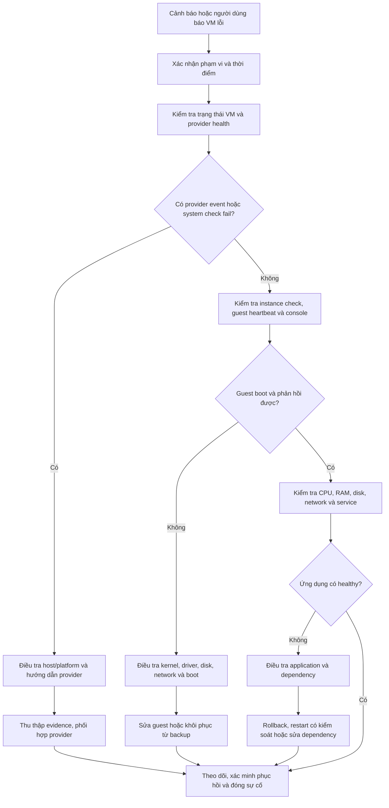

# Theo dõi sức khỏe instance và phân biệt lỗi host với lỗi guest

## Mục tiêu học tập

Sau bài học, bạn có thể:

- Xây dựng bộ chỉ số theo dõi sức khỏe VM ở lớp hạ tầng, guest OS và ứng dụng.
- Phân biệt lỗi host hoặc nền tảng cloud với lỗi bên trong guest OS dựa trên tín hiệu và bằng chứng.
- Hiểu giới hạn của trạng thái VM, status check, heartbeat và metric mặc định.
- Sử dụng log, console, agent và công cụ hệ điều hành để khoanh vùng sự cố.
- Thiết kế cảnh báo, quy trình xử lý và phương án phục hồi phù hợp với từng miền lỗi.
- Ghi nhận bằng chứng trước khi reboot, migrate hoặc thay thế instance để giảm thời gian gián đoạn và hỗ trợ phân tích nguyên nhân.

## 1. Sức khỏe của instance là gì?

Một VM có thể hiển thị trạng thái **Running** trong cloud console nhưng ứng dụng vẫn không truy cập được. Ngược lại, guest OS có thể hoạt động bình thường trong khi nền tảng cloud đang thông báo host cần bảo trì hoặc có lỗi hạ tầng. Vì vậy, trạng thái nguồn của VM không đủ để kết luận máy đang khỏe.

Sức khỏe instance (instance health) là đánh giá tổng hợp về khả năng hoạt động của VM và dịch vụ chạy trên đó. Việc đánh giá nên nhìn từ nhiều lớp:

1. **Lớp host và nền tảng cloud:** máy chủ vật lý, hypervisor, mạng lưu trữ, nguồn điện, hệ thống điều phối và các thành phần hạ tầng do nhà cung cấp vận hành.
2. **Lớp VM/virtual hardware:** trạng thái cấp phát, CPU ảo, RAM, thiết bị mạng, disk ảo và các kênh kết nối với nền tảng.
3. **Lớp guest OS:** kernel, driver, filesystem, tiến trình, dịch vụ hệ thống, bộ nhớ, network stack và các agent.
4. **Lớp ứng dụng:** tiến trình nghiệp vụ, endpoint, dependency, hàng đợi, kết nối database và khả năng phục vụ yêu cầu thực tế.

Các lớp này liên quan nhưng không đồng nhất. Host có thể khỏe trong khi guest bị kernel panic. Guest có thể khỏe nhưng ứng dụng chết do hết connection pool. Một ứng dụng vẫn trả lời health check đơn giản dù chức năng quan trọng đã lỗi.

### 1.1. Host và guest khác nhau thế nào?

- **Host** là máy chủ vật lý và lớp ảo hóa chạy VM. Nhà cung cấp cloud thường chịu trách nhiệm vận hành, sửa chữa và bảo trì lớp này.
- **Guest** là hệ điều hành và phần mềm chạy bên trong VM. Khách hàng thường quản trị kernel, driver, dịch vụ, agent, filesystem và ứng dụng của guest.
- **Control plane** là mặt phẳng quản lý dùng để tạo, dừng, cấu hình và theo dõi tài nguyên. Control plane có thể báo VM đang Running dù guest không phản hồi.
- **Data plane** là đường xử lý lưu lượng và I/O thực tế, ví dụ truy cập mạng hoặc disk. Control plane và data plane có thể gặp sự cố độc lập.

Ví dụ: API tạo VM trả về trạng thái Running nghĩa là tài nguyên đã được cấp phát và đang ở trạng thái chạy theo mô hình của nền tảng. Nó không chứng minh SSH/RDP hoạt động, guest đã boot xong hay ứng dụng đã sẵn sàng.

### 1.2. Bốn lớp quan sát

| Lớp | Câu hỏi cần trả lời | Ví dụ tín hiệu |
|---|---|---|
| Host/platform | Hạ tầng bên dưới có lỗi hoặc đang bảo trì không? | System health event, host maintenance event, platform status check |
| VM/virtual hardware | VM có được cấp phát và kết nối với thiết bị ảo không? | Instance state, system/instance status check, disk/network attachment |
| Guest OS | Hệ điều hành có boot và vận hành bình thường không? | Heartbeat agent, CPU/RAM, filesystem, kernel log, service state |
| Application | Người dùng có sử dụng được chức năng không? | HTTP probe, latency, error rate, queue lag, synthetic transaction |

Một quy trình giám sát tốt cần có tín hiệu ở cả bốn lớp. Nếu chỉ có metric CPU của cloud, bạn có thể biết VM bận nhưng không biết ứng dụng có phục vụ được người dùng hay không. Nếu chỉ có HTTP health check, bạn có thể biết API lỗi nhưng chưa biết lỗi xuất phát từ host, guest, network hay database.

## 2. Hiểu trạng thái VM và health check của cloud

Cloud console thường hiển thị trạng thái vòng đời như Creating, Starting, Running, Stopping, Stopped, Deleting hoặc Failed. Đây là trạng thái điều khiển tài nguyên. Nhà cung cấp cũng có thể cung cấp status check hoặc resource health để phản ánh khả năng hoạt động của hạ tầng và VM.

Cần phân biệt:

- **Instance state:** trạng thái vòng đời của tài nguyên VM.
- **Host/system health check:** tín hiệu từ nền tảng về host, hypervisor hoặc hạ tầng cần thiết để VM hoạt động.
- **Instance/guest reachability check:** tín hiệu cho biết guest có phản hồi các kiểm tra cơ bản hay không.
- **Guest agent heartbeat:** tín hiệu từ agent bên trong OS gửi về hệ thống quản lý.
- **Application health check:** kiểm tra endpoint hoặc chức năng nghiệp vụ.

Tên gọi và cách kiểm tra khác nhau theo nhà cung cấp. Ví dụ, AWS EC2 có các nhóm status checks cho system và instance; Azure cung cấp các tín hiệu Resource Health, VM availability và boot diagnostics tùy loại dịch vụ; Google Cloud có trạng thái VM, guest attributes/agent và các sự kiện bảo trì hoặc lỗi host theo khả năng nền tảng. Hãy đọc tài liệu của đúng dịch vụ và loại VM đang sử dụng.

### 2.1. Status check không phải phép kiểm tra toàn diện

Một status check đạt có nghĩa các điều kiện được kiểm tra đã đạt tại thời điểm đó. Nó không chứng minh:

- Ứng dụng đang xử lý đúng nghiệp vụ.
- Mọi filesystem còn đủ dung lượng.
- Database hoặc dịch vụ phụ thuộc đang khỏe.
- Guest không có memory leak hoặc lỗi logic.
- Tất cả đường mạng từ mọi client đều hoạt động.
- VM sẽ tiếp tục khỏe trong vài phút tiếp theo.

Tương tự, một status check thất bại cần được đọc cùng loại check, thời gian và chi tiết sự kiện. Nếu system check thất bại, cần điều tra host/platform. Nếu instance check thất bại, có thể guest không phản hồi do kernel, network stack, firewall, boot hoặc tài nguyên bên trong VM.

### 2.2. Metric mặc định và guest monitoring agent

Nền tảng cloud thường thu thập một số metric ở lớp hypervisor hoặc dịch vụ, ví dụ CPU utilization, network bytes, disk operations và trạng thái VM. Các metric này hữu ích nhưng không nhất thiết phản ánh mọi chi tiết bên trong guest.

Để theo dõi RAM, swap, filesystem, tiến trình, service, log và metric ứng dụng, có thể cần cài guest agent hoặc monitoring agent. Agent thường thu thập dữ liệu bên trong OS rồi gửi về dịch vụ giám sát.

Trước khi cài agent, cần xác định:

- Agent hỗ trợ OS và phiên bản nào.
- Quyền hệ thống và endpoint mạng mà agent cần.
- Cách xác thực agent với dịch vụ giám sát.
- Tần suất gửi metric và log, dung lượng phát sinh và chi phí.
- Cách phát hiện agent bị dừng hoặc mất heartbeat.
- Agent có ảnh hưởng CPU, RAM, disk I/O hoặc bảo mật không.

Không nên xem việc thiếu metric như bằng chứng VM bị lỗi. Có thể agent chưa cài, cấu hình sai, bị chặn mạng hoặc thiếu quyền ghi dữ liệu.

## 3. Các dấu hiệu sức khỏe cần theo dõi

Bộ metric cần phù hợp với vai trò của VM. Một database server, web server, worker xử lý batch và máy jump host có đặc điểm tải khác nhau. Hãy xây dựng baseline theo từng nhóm workload thay vì dùng một ngưỡng duy nhất cho toàn bộ hệ thống.

### 3.1. CPU

Các chỉ số thường dùng:

- CPU utilization theo tổng thể và theo từng vCPU.
- Load average hoặc run queue trong guest.
- CPU steal time nếu OS cung cấp.
- Thời gian chờ I/O (I/O wait).
- Tần suất throttling hoặc giới hạn CPU của VM/container nếu có.
- CPU usage theo tiến trình và dịch vụ.

CPU cao kéo dài có thể do tải nghiệp vụ tăng, vòng lặp vô hạn, tiến trình lỗi hoặc thiếu vCPU. CPU steal time cao có thể cho thấy guest không nhận được thời gian CPU như mong muốn trong một số môi trường ảo hóa, nhưng không tự chứng minh host bị lỗi. Cần đối chiếu loại VM, chính sách chia sẻ CPU, thời điểm và metric nền tảng.

Load average cao cũng không luôn đồng nghĩa CPU quá tải. Tiến trình chờ I/O có thể làm load tăng trong khi CPU utilization không cao. Hãy xem đồng thời run queue, CPU, I/O wait và thời gian phản hồi ứng dụng.

### 3.2. Bộ nhớ

Theo dõi:

- RAM available và mức sử dụng theo tiến trình.
- Swap in/out và page fault.
- OOM killer hoặc lỗi cấp phát bộ nhớ.
- Bộ nhớ cache/buffer của hệ điều hành.
- Heap, garbage collection và memory pool của runtime.
- Memory pressure và giới hạn của VM/container.

Không dùng riêng tỷ lệ RAM used để kết luận thiếu bộ nhớ. Linux thường tận dụng RAM nhàn rỗi làm page cache. Nên xem available, swap activity, OOM event và mức tăng bộ nhớ theo thời gian. Một VM có RAM còn trống nhưng ứng dụng Java vẫn có thể gặp OutOfMemoryError do heap limit hoặc vùng nhớ non-heap.

### 3.3. Disk và filesystem

Theo dõi hai lớp khác nhau:

- **Disk ở lớp cloud:** trạng thái volume, IOPS, throughput, latency, queue depth, burst balance hoặc giới hạn dịch vụ.
- **Filesystem trong guest:** dung lượng đã dùng, inode, mount point, read-only state, lỗi filesystem và dung lượng tạm.

Các dấu hiệu đáng chú ý:

- Disk latency hoặc queue depth tăng bất thường.
- IOPS/throughput chạm giới hạn cấu hình.
- Filesystem đầy hoặc inode cạn.
- Volume bị detach, mất đường dẫn hoặc chuyển sang read-only.
- Kernel log xuất hiện lỗi block device, timeout hoặc filesystem corruption.

Disk metric ở cloud có thể phản ánh I/O được cấp cho volume nhưng không cho biết đầy đủ filesystem bên trong guest. Cần kết hợp metric của volume với df, iostat và kernel log.

### 3.4. Network

Theo dõi:

- Bytes/packets in và out.
- Packet drops, errors và retransmissions.
- Network latency và kết nối TCP.
- Số lượng connection, socket ở trạng thái bất thường.
- DNS resolution và khả năng truy cập dependency.
- Network interface state và route.

VM có thể có metric network bình thường nhưng ứng dụng vẫn không truy cập được do security group, firewall guest, route, DNS hoặc cạn ephemeral port. Hãy kiểm tra từ nhiều điểm: trong guest, từ máy cùng subnet và từ client thực tế.

### 3.5. Boot, kernel và dịch vụ hệ thống

Các tín hiệu quan trọng:

- Boot diagnostics, serial console hoặc screenshot console.
- Thời gian từ lúc bật VM đến khi guest agent heartbeat xuất hiện.
- Kernel panic, bugcheck/BSOD, watchdog reset.
- Lỗi mount root filesystem hoặc disk.
- Dịch vụ quan trọng không khởi động.
- Systemd failed units hoặc Windows Service failures.
- Thay đổi kernel, driver, package hoặc cấu hình gần thời điểm lỗi.

Một VM có thể không gửi metric vì guest chưa boot xong. Khi đó console log và boot diagnostics có giá trị hơn dashboard metric thông thường.

### 3.6. Ứng dụng và dependency

Sức khỏe cuối cùng nên gắn với khả năng phục vụ:

- HTTP success/error rate.
- Latency p50, p95, p99.
- Số request đang xử lý và queue depth.
- Connection pool, thread pool và worker count.
- Database connection, query latency và replication lag.
- Cache hit ratio, eviction và timeout.
- Queue lag, retry và dead-letter count.
- Synthetic transaction mô phỏng hành động người dùng.

Health endpoint cần phản ánh đúng mục đích. Liveness check trả lời ứng dụng có cần restart hay không; readiness check trả lời ứng dụng có nên nhận traffic hay không. Không nên đưa mọi dependency không thiết yếu vào liveness check, vì một database tạm thời lỗi có thể khiến toàn bộ instance restart liên tục.

## 4. Phân biệt lỗi host/platform và lỗi guest OS

Không có một dấu hiệu đơn lẻ nào đủ để phân biệt mọi sự cố. Hãy kết hợp status check, sự kiện nền tảng, metric guest, console và phạm vi ảnh hưởng.

### 4.1. Dấu hiệu nghiêng về host hoặc nền tảng

- Cloud provider phát thông báo host degradation, hardware failure, scheduled maintenance hoặc recovery event.
- System/host status check thất bại trong khi không có bằng chứng guest đã gây ra lỗi.
- Nhiều VM độc lập cùng bị ảnh hưởng tại một thời điểm và cùng phạm vi hạ tầng hoặc dịch vụ.
- Nền tảng thông báo VM cần được migrate, restart hoặc recover do host issue.
- Guest không thể truy cập thiết bị ảo do lỗi được xác nhận từ phía provider.
- Lỗi xuất hiện sau một sự kiện hạ tầng và được provider xác nhận trong resource health hoặc service health.

Đây là các dấu hiệu để điều tra, không phải bằng chứng tuyệt đối. Ví dụ, nhiều VM cùng mất kết nối cũng có thể do route, firewall hoặc thay đổi cấu hình mạng chung của khách hàng.

### 4.2. Dấu hiệu nghiêng về guest OS

- Host/system check đạt nhưng instance/guest reachability check thất bại.
- Guest agent heartbeat mất trong khi nền tảng vẫn báo VM đang chạy.
- Serial console cho thấy kernel panic, boot loop, filesystem error hoặc lỗi driver.
- OS log có OOM killer, bugcheck, service crash, disk full hoặc network configuration error.
- SSH/RDP không hoạt động do firewall guest, sshd/Remote Desktop service hoặc cấu hình OS.
- Một tiến trình chiếm CPU/RAM, hết file descriptor hoặc làm cạn socket.
- Khởi động vào rescue mode hoặc gắn disk vào rescue VM cho thấy lỗi nằm trong filesystem, bootloader hoặc cấu hình guest.

Host check đạt không đảm bảo guest khỏe tuyệt đối; host check chỉ đánh giá những thành phần mà nền tảng kiểm tra.

### 4.3. Bảng so sánh

| Tiêu chí | Lỗi host/platform | Lỗi guest OS |
|---|---|---|
| Nơi phát sinh | Máy vật lý, hypervisor hoặc dịch vụ hạ tầng | Kernel, driver, filesystem, service hoặc cấu hình bên trong VM |
| Tín hiệu chính | Provider event, system/host check, maintenance notice | Guest heartbeat, instance check, OS log, console |
| Phạm vi ảnh hưởng | Có thể ảnh hưởng nhiều VM hoặc một nhóm tài nguyên cùng host/zone/service | Thường tập trung ở một VM hoặc nhóm VM có cùng image/config |
| SSH/RDP | Có thể mất do host/virtual network | Có thể mất do OS boot, firewall, service hoặc tài nguyên |
| CPU/RAM guest | Có thể không thu thập được khi guest không phản hồi | Có thể cho thấy quá tải, OOM hoặc tiến trình lỗi nếu agent còn hoạt động |
| Hành động | Theo dõi provider, dùng recovery/migration theo hỗ trợ | Sửa OS, driver, disk, service hoặc rollback thay đổi |
| Chủ thể xử lý | Provider chịu trách nhiệm host; khách hàng phối hợp và khôi phục workload | Đội vận hành guest/ứng dụng chịu trách nhiệm chính |

### 4.4. Trường hợp không thể kết luận ngay

Một số trường hợp nằm giữa hai miền:

- Guest bị treo khiến instance check thất bại, nhưng nguyên nhân ban đầu có thể là I/O từ host hoặc storage.
- Mạng ảo bị gián đoạn do cấu hình guest hoặc sự cố hạ tầng mạng.
- CPU steal tăng có thể liên quan đến contention, nhưng cần xem loại instance và chính sách CPU.
- Agent không gửi metric có thể do agent crash, DNS, proxy, firewall hoặc dịch vụ monitoring.
- Một zone gặp sự cố có thể làm nhiều VM mất kết nối, nhưng cũng có thể do một thay đổi route chung.

Khi chưa đủ bằng chứng, ghi nhận là **chưa xác định nguyên nhân (undetermined)**. Không gán lỗi cho host hoặc guest chỉ dựa trên việc VM không ping được.

## 5. Quy trình chẩn đoán theo lớp

Sử dụng quy trình dưới đây để đi từ triệu chứng đến miền lỗi. Mục tiêu là thu thập bằng chứng trước, sau đó chọn hành động có tác động nhỏ nhất.



### Bước 1: Xác nhận triệu chứng

Ghi nhận:

- VM ID, hostname, region/zone và loại instance.
- Thời điểm bắt đầu, múi giờ và thời gian kéo dài.
- Người dùng hoặc hệ thống nào bị ảnh hưởng.
- SSH/RDP, ping, endpoint ứng dụng và các dependency có hoạt động không.
- Có thay đổi gần đây về image, kernel, driver, firewall, route, disk hoặc policy không.
- Lỗi ảnh hưởng một VM, nhiều VM cùng nhóm hay toàn bộ dịch vụ.

So sánh thời điểm lỗi với deployment, autoscaling, backup, patching và maintenance window.

### Bước 2: Kiểm tra control plane và sự kiện provider

- Xem instance state và các status check.
- Xem Resource Health/instance health event của nhà cung cấp.
- Kiểm tra service health hoặc maintenance event ở region/zone.
- Đọc boot diagnostics, serial console hoặc system log nếu có.
- Ghi lại request ID, event ID và mã lỗi.
- Xác định nền tảng đề xuất recovery, reboot, redeploy hoặc migration hay không.

Nếu provider xác nhận host issue, lưu bằng chứng và làm theo quy trình recovery được hỗ trợ. Không tự giả định có thể migrate live hoặc chuyển host theo ý muốn; nhiều nền tảng chỉ cho phép stop/start, automatic recovery hoặc tạo VM thay thế.

### Bước 3: Kiểm tra guest

Nếu VM còn truy cập được:

- Xác nhận OS uptime và boot time.
- Kiểm tra CPU, RAM, swap, disk và network.
- Xem kernel/system log quanh thời điểm lỗi.
- Kiểm tra service và tiến trình quan trọng.
- Kiểm tra agent heartbeat, DNS và kết nối tới monitoring endpoint.
- Xác minh filesystem còn writable và không đầy.

Nếu VM không truy cập được:

- Dùng serial console hoặc boot diagnostics.
- Kiểm tra screenshot boot nếu nền tảng cung cấp.
- Xem log crash, kernel panic hoặc Windows bugcheck.
- Dùng rescue mode hoặc gắn bản sao disk vào VM khác nếu cần.
- Trước khi sửa filesystem hoặc bootloader, giữ snapshot/bản sao theo quy trình.

### Bước 4: Kiểm tra ứng dụng và dependency

Nếu guest OS khỏe:

- Gọi endpoint từ localhost và từ mạng bên ngoài.
- Kiểm tra service status, application log và error rate.
- Kiểm tra DNS, route, firewall và security group.
- Kiểm tra database, cache, queue và secret service.
- Kiểm tra pool kết nối, worker, thread và file descriptor.
- So sánh với deployment hoặc cấu hình gần nhất.

### Bước 5: Chọn hành động và xác minh

Chỉ thực hiện reboot, restart service, detach disk, migrate hoặc thay VM sau khi đã cân nhắc tác động và thu thập bằng chứng cần thiết. Sau hành động, kiểm tra lại các lớp host, guest và application; đừng đóng sự cố chỉ vì console hiển thị Running.

## 6. Công cụ kiểm tra bên trong Linux guest

Các lệnh sau hỗ trợ chẩn đoán ban đầu. Tùy bản phân phối, một số tiện ích cần cài gói bổ sung hoặc quyền sudo.

### 6.1. CPU, load và bộ nhớ

```bash
# Tổng quan CPU, tiến trình và RAM
top

# CPU, run queue, swap và I/O wait theo từng giây
vmstat 1

# Bộ nhớ, swap và RAM available
free -h

# Thống kê CPU theo tiến trình (nếu sysstat đã được cài)
pidstat 1

# Thống kê CPU theo từng lõi (nếu sysstat đã được cài)
mpstat -P ALL 1
```

Khi xem vmstat, chú ý run queue, si/so (swap in/out), wa (I/O wait) và st (steal time nếu hệ thống cung cấp). Không diễn giải một cột riêng lẻ mà bỏ qua tải và loại instance.

### 6.2. Disk và filesystem

```bash
# Dung lượng filesystem và inode
df -h
df -i

# Thiết bị, filesystem và mount point
lsblk -f

# Độ trễ, IOPS, queue và utilization (nếu sysstat đã được cài)
iostat -xz 1

# Các mount đang hoạt động
findmnt
```

Nếu filesystem đầy, xác định thư mục hoặc log chiếm dung lượng trước khi xóa. Không xóa file dữ liệu hoặc log phục vụ điều tra khi chưa lưu bằng chứng và xác định chính sách lưu giữ.

### 6.3. Kernel và dịch vụ

```bash
# Log kernel hiện tại
sudo dmesg -T | tail -n 100

# Lỗi nghiêm trọng từ lần boot hiện tại
sudo journalctl -p err -b

# Danh sách service lỗi
systemctl --failed

# Trạng thái một service
systemctl status sshd

# Uptime và tải trung bình
uptime
```

Tên service SSH có thể là ssh thay vì sshd tùy distro. Với sự cố sau reboot, xem log của boot trước bằng journalctl -b -1 nếu journal được lưu bền vững.

### 6.4. Network và kết nối

```bash
# Địa chỉ IP và trạng thái interface
ip -br address

# Route và default gateway
ip route

# Socket đang lắng nghe và kết nối
ss -tulpn

# Kiểm tra phân giải DNS
getent hosts example.internal

# Kiểm tra kết nối TCP tới dịch vụ đích
nc -vz example.internal 443
```

ping chỉ kiểm tra ICMP và có thể bị chặn bởi policy. Không ping được không đồng nghĩa VM hoặc ứng dụng đã chết. Dùng kiểm tra TCP/HTTP phù hợp với giao thức thực tế.

## 7. Công cụ kiểm tra bên trong Windows guest

Chạy PowerShell với quyền phù hợp. Một số lệnh yêu cầu module hoặc quyền quản trị.

### 7.1. Trạng thái hệ thống và dịch vụ

```powershell
# Thông tin hệ điều hành và thời gian khởi động
Get-ComputerInfo | Select-Object WindowsProductName, WindowsVersion, OsLastBootUpTime

# Thời gian hoạt động
(Get-Date) - (Get-CimInstance Win32_OperatingSystem).LastBootUpTime

# Dịch vụ đang dừng hoặc không ở trạng thái Running
Get-Service | Where-Object Status -ne 'Running'

# Kiểm tra một dịch vụ cụ thể
Get-Service -Name 'TermService'
```

Không phải mọi service đều cần ở trạng thái Running. Hãy so sánh với danh sách dịch vụ cần thiết của workload.

### 7.2. Event log và hiệu năng

```powershell
# Lỗi System trong 24 giờ gần nhất
$since = (Get-Date).AddHours(-24)
Get-WinEvent -FilterHashtable @{
  LogName = 'System'
  Level = 1,2
  StartTime = $since
} | Select-Object TimeCreated, ProviderName, Id, LevelDisplayName, Message

# Một số counter CPU và bộ nhớ
Get-Counter '\Processor(_Total)\% Processor Time',
            '\Memory\Available MBytes',
            '\Memory\Pages/sec' -SampleInterval 2 -MaxSamples 5
```

Tên performance counter có thể khác theo ngôn ngữ Windows và cấu hình máy. Event log cần được lọc theo thời điểm sự cố, provider và event ID để tránh kết luận từ các cảnh báo không liên quan.

### 7.3. Network

```powershell
# IP, gateway và DNS
Get-NetIPConfiguration

# Route
Get-NetRoute -AddressFamily IPv4

# Kết nối tới endpoint
Test-NetConnection example.internal -Port 443

# Socket và port đang sử dụng
Get-NetTCPConnection
```

Nếu RDP không vào được, kiểm tra service Remote Desktop, Windows Firewall, Network Security Group, route và boot diagnostics. RDP failure không tự chứng minh host failure.

## 8. Thiết kế health check và cảnh báo

Một bộ health check nên phân biệt liveness, readiness và dependency health:

- **Liveness:** tiến trình còn sống và có thể tiếp tục chạy không? Nếu không, hệ thống có thể restart tiến trình hoặc instance theo policy.
- **Readiness:** instance có đủ điều kiện nhận traffic không? Nếu không, load balancer hoặc service discovery nên tạm ngừng gửi traffic.
- **Dependency health:** database, cache, queue, DNS hoặc API phụ thuộc có hoạt động không?
- **Platform health:** provider có thông báo host hoặc hạ tầng bị lỗi không?

Không nên dùng một health endpoint duy nhất cho tất cả mục đích. Ví dụ, database tạm thời mất kết nối có thể khiến readiness fail để ngừng nhận traffic, nhưng liveness vẫn pass để tránh restart toàn bộ VM liên tục.

### 8.1. Ngưỡng cảnh báo dựa trên baseline

Một số chỉ số thường cần cảnh báo:

| Tín hiệu | Ví dụ điều kiện cảnh báo | Cách diễn giải |
|---|---|---|
| Provider system check | Bất kỳ trạng thái fail kéo dài theo policy | Điều tra host/platform |
| Guest heartbeat | Mất heartbeat quá khoảng thời gian đã xác định | Agent, OS, mạng hoặc VM không phản hồi |
| CPU | Cao kéo dài và latency tăng | Có thể thiếu CPU hoặc tiến trình bất thường |
| RAM | Available thấp kèm swap/OOM | Áp lực bộ nhớ |
| Disk | Filesystem gần đầy hoặc latency tăng | Nguy cơ lỗi ghi hoặc I/O bottleneck |
| Network | Drops/retransmits tăng hoặc probe thất bại | Điều tra NIC, route, firewall và upstream |
| Application | Error rate/latency vượt SLO | Người dùng bị ảnh hưởng |
| Boot time | VM boot lâu hơn baseline | OS, driver, disk hoặc dependency khởi động |

Các ngưỡng là ví dụ về loại điều kiện, không phải con số phù hợp cho mọi workload. Hãy đặt theo baseline, SLO, thời gian duy trì và mức độ ảnh hưởng. Một cảnh báo CPU 90% trong 30 giây có thể không có ý nghĩa với batch job, nhưng CPU 70% kéo dài kèm p99 latency tăng có thể là dấu hiệu quan trọng.

### 8.2. Correlation và cảnh báo nhiều lớp

Khi một VM có application probe fail, hãy liên kết các tín hiệu cùng khoảng thời gian:

- Provider event và status check.
- Guest heartbeat và OS log.
- CPU/RAM/disk/network.
- Application log, latency và error rate.
- Deployment, patching, backup và thay đổi cấu hình.
- Sự cố của database, DNS, load balancer hoặc network.

Dùng VM ID, instance name, zone, timestamp và request/correlation ID làm nhãn để truy vấn chéo. Đồng bộ thời gian bằng NTP hoặc dịch vụ time synchronization của nền tảng; lệch đồng hồ có thể làm sai thứ tự sự kiện.

### 8.3. Cảnh báo cần có hành động rõ

Một cảnh báo hữu ích nên nêu:

- Tài nguyên và môi trường bị ảnh hưởng.
- Triệu chứng và thời điểm bắt đầu.
- Lớp nghi vấn: host, guest, application hay dependency.
- Mức độ nghiêm trọng và phạm vi người dùng.
- Dashboard, log và runbook liên quan.
- Hành động đầu tiên và điều kiện escalation.

Tránh gửi cảnh báo trùng lặp cho cùng một sự cố. Có thể nhóm theo VM, service và incident window; dùng thời gian duy trì (for duration), hysteresis hoặc recovery threshold để giảm alert flapping.

## 9. Tự động phục hồi và bảo trì host

Nhà cung cấp cloud có thể phát hiện host suy giảm và thực hiện một số hành động tự động như khởi động lại VM trên host khác, live migration, thông báo maintenance hoặc yêu cầu khách hàng redeploy. Khả năng này phụ thuộc loại VM, vùng, chính sách và tính năng dịch vụ.

### 9.1. Các phương án phục hồi

- **Automatic recovery:** nền tảng tự khôi phục VM khi phát hiện một số lỗi host được hỗ trợ.
- **Restart/reboot:** khởi động lại guest hoặc instance. Có thể khắc phục trạng thái tạm thời nhưng cũng làm mất bằng chứng volatile.
- **Stop/start hoặc redeploy:** có thể bố trí VM trên host khác theo cơ chế nền tảng, nhưng cần kiểm tra ảnh hưởng tới ephemeral disk, IP, placement và thời gian gián đoạn.
- **Live migration:** di chuyển VM đang chạy nếu nền tảng và loại VM hỗ trợ.
- **Replace instance:** tạo VM mới từ image, cấu hình và dữ liệu bền vững.
- **Failover:** chuyển traffic sang VM hoặc zone khác khi kiến trúc có dự phòng.

Không phải tất cả hành động đều khả dụng với mọi VM. Với workload stateful, phải xác định dữ liệu nằm trên persistent disk, local/ephemeral disk hay trong RAM trước khi chọn recovery.

### 9.2. Sự kiện bảo trì

Khi nhận thông báo host maintenance:

1. Xác định VM, zone, thời điểm và loại sự kiện.
2. Đọc hướng dẫn của provider về automatic migration, restart hoặc deadline.
3. Kiểm tra redundancy, replica, load balancer và khả năng failover.
4. Kiểm tra dữ liệu trên local/ephemeral disk và trạng thái ứng dụng.
5. Thông báo cho chủ sở hữu workload theo quy trình.
6. Diễn tập hoặc thực hiện chuyển tải theo cửa sổ phù hợp.
7. Xác minh VM sau bảo trì và đóng sự kiện khi dịch vụ ổn định.

Maintenance event không nhất thiết là incident đang gây lỗi. Tuy nhiên, nó là tín hiệu cần lập kế hoạch trước để tránh gián đoạn bất ngờ.

### 9.3. Khi nào nên reboot?

Reboot có thể cần thiết khi guest OS treo, kernel yêu cầu restart hoặc bản vá cần khởi động lại. Trước khi reboot:

- Lưu console, event log, kernel log và metric có thể mất sau restart.
- Kiểm tra tiến trình và I/O đang hoạt động.
- Xác định dữ liệu chưa ghi, queue và transaction đang chạy.
- Xác nhận ứng dụng có replica hoặc cơ chế drain traffic.
- Kiểm tra persistent disk và snapshot nếu cần.
- Ghi lại thời điểm, người thực hiện và lý do.

Nếu provider xác nhận host issue và khuyến nghị recovery cụ thể, hãy theo runbook nền tảng. Không reboot lặp lại nhiều lần khi chưa có giả thuyết rõ vì có thể làm mất bằng chứng và kéo dài thời gian phục hồi.

## 10. Ví dụ thực tế: VM Running nhưng API không phản hồi

Một API chạy trên VM Linux. Dashboard cloud cho thấy VM ở trạng thái Running, CPU khoảng 35%, network bytes vẫn tăng. Người dùng báo request timeout và SSH cũng không kết nối được.

Đội vận hành kiểm tra theo lớp:

1. **Control plane:** VM vẫn Running. System/host check đạt, instance/guest reachability check thất bại.
2. **Provider events:** không có host maintenance hoặc hardware degradation event.
3. **Console:** serial console cho thấy guest đã boot nhưng kernel log xuất hiện thông báo filesystem gần đầy và tiến trình logging không ghi được.
4. **Guest:** guest agent heartbeat đã mất. Khi truy cập qua rescue path, filesystem root đạt 100% và inode gần cạn.
5. **Application:** API process bị dừng do không ghi được log và file tạm.

Nguyên nhân chính nằm ở guest filesystem. Đội vận hành lưu log và thông tin cần thiết, xác định thư mục log tăng bất thường, mở rộng volume hoặc giải phóng dung lượng theo retention policy, sau đó khởi động lại service. Cuối cùng, đội bổ sung cảnh báo dung lượng filesystem/inode và log rotation.

Nếu chỉ nhìn trạng thái Running hoặc CPU, sự cố khó được phát hiện. Nếu vội quy lỗi cho host vì SSH không kết nối được, đội có thể mất thời gian chờ provider trong khi nguyên nhân nằm trong guest.

### Biến thể: host check thất bại

Giả sử VM không phản hồi và system/host check thất bại; provider đồng thời phát event host degradation. Guest metric ngừng cập nhật và console không cung cấp log mới. Khi đó, đội vận hành lưu event ID và thời điểm, kiểm tra hướng dẫn recovery của provider, xác minh persistent disk và failover sang instance dự phòng nếu cần. Sau khi VM được phục hồi, kiểm tra OS log để xác định liệu có thêm lỗi guest hay không.

Hai tình huống có triệu chứng bên ngoài giống nhau nhưng cần hành động khác nhau. Việc phân loại dựa trên nhiều bằng chứng giúp tránh xử lý sai miền lỗi.

## 11. Những nhầm lẫn thường gặp

- **VM Running nghĩa là máy khỏe.** Running chỉ phản ánh trạng thái vòng đời ở control plane; guest và ứng dụng vẫn có thể lỗi.
- **Ping thất bại chứng minh host hỏng.** ICMP có thể bị chặn; lỗi có thể nằm ở firewall, route, guest network stack hoặc ứng dụng.
- **System check đạt nghĩa là guest OS khỏe.** System check chỉ đánh giá những thành phần nền tảng mà provider kiểm tra.
- **Instance check fail luôn là lỗi guest.** Có thể có lỗi ở thiết bị ảo hoặc dependency nền tảng; cần đối chiếu provider event và console.
- **CPU thấp nghĩa là VM không có vấn đề.** Guest có thể treo, chờ I/O, hết RAM, mất network hoặc ứng dụng không lắng nghe port.
- **Không có metric nghĩa là host đã chết.** Agent có thể bị dừng, mất quyền hoặc không gửi được dữ liệu.
- **Nhiều VM cùng lỗi chắc chắn do host chung.** Có thể là network, DNS, policy hoặc dependency dùng chung.
- **Reboot là bước chẩn đoán đầu tiên.** Reboot có thể xóa bằng chứng volatile và làm phức tạp việc tìm nguyên nhân.
- **Health check của ứng dụng có thể thay thế platform health.** Application probe không thể cho biết host có maintenance event hoặc disk volume có lỗi nền tảng.
- **Một ngưỡng CPU/RAM dùng được cho mọi VM.** Cần baseline theo workload, SLO và hành vi tải.
- **Automatic recovery thay thế backup.** Recovery không bảo vệ mọi dữ liệu và không thay thế backup/restore đã kiểm thử.

## 12. Checklist vận hành sức khỏe instance

### Trước khi đưa VM vào production

- [ ] Xác định owner, vai trò VM và SLO của workload.
- [ ] Bật theo dõi trạng thái VM và provider/system health.
- [ ] Cài và cấu hình guest monitoring agent phù hợp.
- [ ] Thu thập CPU, RAM, swap, disk, filesystem, network và service state.
- [ ] Thiết lập liveness, readiness và application synthetic check.
- [ ] Đồng bộ thời gian và chuẩn hóa nhãn VM ID, zone, environment.
- [ ] Cấu hình log boot, kernel, system và application theo retention policy.
- [ ] Tạo cảnh báo có runbook và escalation owner.
- [ ] Xác định phương án recovery khi host hoặc guest lỗi.
- [ ] Kiểm tra backup, persistent disk và dữ liệu ephemeral.

### Khi xảy ra sự cố

- [ ] Ghi nhận thời điểm, phạm vi, VM ID và triệu chứng.
- [ ] Kiểm tra provider event, system check và instance check.
- [ ] Lưu boot diagnostics, console và log trước khi reboot nếu có thể.
- [ ] Kiểm tra guest heartbeat và agent.
- [ ] Kiểm tra CPU, RAM, disk, filesystem, network và dịch vụ.
- [ ] Kiểm tra application health và dependency.
- [ ] Phân loại host/platform, guest, application hoặc chưa xác định.
- [ ] Chọn hành động recovery theo runbook và đánh giá dữ liệu có thể mất.
- [ ] Xác minh phục hồi ở cả platform, guest và application.
- [ ] Ghi lại nguyên nhân, thời gian phát hiện, thời gian khôi phục và việc cần cải thiện.

## 13. Tự kiểm tra

**Tình huống 1:** Cloud console hiển thị VM Running, nhưng SSH và API đều không phản hồi. Có thể kết luận host đã lỗi không?

**Gợi ý:** Chưa thể. Hãy kiểm tra system/host health, instance/guest check, provider event, serial console, guest heartbeat và log. Running không chứng minh guest đã sẵn sàng.

**Tình huống 2:** System status check đạt nhưng instance status check thất bại. Bạn nên điều tra lớp nào trước?

**Gợi ý:** Kiểm tra guest OS, boot, kernel, firewall, network stack và tài nguyên bên trong VM. Tuy vậy, vẫn đối chiếu console và sự kiện nền tảng để không bỏ sót lỗi thiết bị ảo.

**Tình huống 3:** Năm VM ở cùng subnet mất kết nối cùng lúc. Đây có chắc là lỗi host không?

**Gợi ý:** Không. Kiểm tra route, firewall, security policy, DNS, subnet và sự kiện mạng dùng chung. Phạm vi ảnh hưởng giúp khoanh vùng nhưng không đủ để kết luận.

**Tình huống 4:** Guest agent ngừng gửi metric nhưng ứng dụng vẫn phục vụ request bình thường. Có nên reboot ngay không?

**Gợi ý:** Không. Kiểm tra agent process, quyền, endpoint, DNS, proxy và log agent. Ứng dụng vẫn khỏe có thể cho phép xử lý agent riêng trong khi tiếp tục theo dõi.

**Tình huống 5:** Provider thông báo host maintenance vào ngày mai. Đội vận hành nên chuẩn bị gì?

**Gợi ý:** Xác định VM và thời điểm, kiểm tra failover/replica, persistent và ephemeral disk, load balancer, backup và recovery procedure. Sau maintenance phải xác minh guest và ứng dụng.

**Tình huống 6:** CPU chỉ 10% nhưng API timeout và iostat cho thấy disk latency tăng mạnh. Nên tập trung điều tra điều gì?

**Gợi ý:** Kiểm tra I/O wait, queue depth, IOPS/throughput limit, volume health, filesystem và log block device. CPU thấp không loại trừ lỗi I/O.

## Kết luận

Theo dõi sức khỏe instance cần kết hợp tín hiệu từ host/platform, VM, guest OS và ứng dụng. Trạng thái Running, một status check hay một metric đơn lẻ không đủ để kết luận toàn hệ thống khỏe. Lỗi host thường cần được xác nhận qua provider health event hoặc system check; lỗi guest cần được khoanh vùng bằng heartbeat, console, kernel/system log và metric bên trong OS. Hãy thu thập bằng chứng trước khi reboot, chọn recovery đúng miền lỗi và xác minh dịch vụ ở cả ba lớp platform, guest và application sau khi khôi phục.
