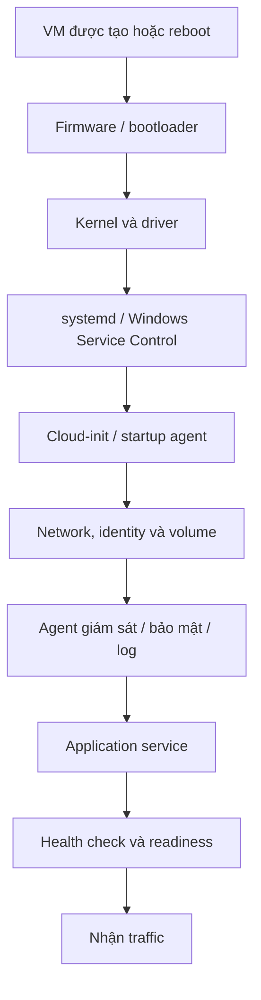
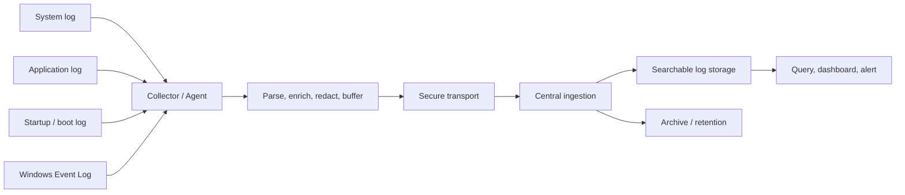

# Thu thập system log, application log và startup log

Khi một máy ảo hoặc workload compute gặp sự cố, trạng thái hiện tại của CPU, bộ nhớ hay mạng thường chưa đủ để giải thích điều gì đã xảy ra. Log cung cấp dòng thời gian về hoạt động của hệ điều hành, tiến trình ứng dụng và quá trình khởi động. Nếu thu thập đúng cách, nhóm vận hành có thể xác định máy đã reboot lúc nào, service nào thất bại, ứng dụng nhận request gì, dependency nào timeout và thay đổi nào xuất hiện trước sự cố.

Ba nhóm log cần phân biệt là **system log**, **application log** và **startup log**. System log phản ánh hoạt động của hệ điều hành và dịch vụ nền; application log mô tả hành vi của chương trình; startup log ghi lại quá trình khởi tạo VM, hệ điều hành và ứng dụng. Chúng có nguồn, định dạng, vòng đời và quyền truy cập khác nhau. Một hệ thống quan sát tốt cần thu thập chúng có cấu trúc, đồng bộ thời gian, chuyển tới nơi lưu tập trung và bảo vệ dữ liệu nhạy cảm.

## 1. Vì sao cần thu thập log?

Log là một trong những tín hiệu chính của observability, bên cạnh metrics và traces. Metrics cho biết một đại lượng đang thay đổi ra sao; traces cho thấy request đi qua những thành phần nào; log ghi lại sự kiện và ngữ cảnh chi tiết tại một thời điểm.

Thu thập log giúp:

- Điều tra lỗi khởi động, crash, reboot và service không tự phục hồi.
- Xác định nguyên nhân request thất bại hoặc độ trễ tăng.
- Theo dõi cập nhật hệ điều hành, driver, agent và ứng dụng.
- Phát hiện đăng nhập bất thường, thay đổi quyền hoặc hành vi đáng ngờ.
- Đối chiếu sự kiện giữa nhiều VM, container, zone và dịch vụ.
- Hỗ trợ audit, tuân thủ và phân tích sự cố bảo mật.
- Đo lường mức độ ổn định của quy trình triển khai và bảo trì.

Log chỉ hữu ích nếu có thể tìm kiếm, diễn giải và tin cậy. Log thiếu timestamp, thiếu định danh workload hoặc bị mất khi VM bị xóa sẽ khiến quá trình điều tra bị gián đoạn. Ngược lại, ghi quá nhiều dữ liệu hoặc ghi secret có thể làm tăng chi phí và tạo rủi ro bảo mật.

## 2. Phân biệt system log, application log và startup log

| Nhóm log | Nội dung chính | Nguồn thường gặp | Ví dụ câu hỏi điều tra |
|---|---|---|---|
| System log | Kernel, service manager, daemon, driver, xác thực, thiết bị và tài nguyên hệ thống | `journald`, `syslog`, Windows Event Log, kernel log | Vì sao VM reboot? Service nào bị kill? Disk có lỗi I/O không? |
| Application log | Sự kiện nghiệp vụ và kỹ thuật do ứng dụng phát ra | stdout/stderr, file log, logging framework, container runtime | Request nào lỗi? Database timeout ở bước nào? Phiên bản ứng dụng nào đang chạy? |
| Startup log | Các bước từ boot VM tới khi hệ điều hành và ứng dụng sẵn sàng | cloud-init, serial console, boot diagnostics, systemd boot/service log, startup script | VM dừng ở bước nào? User data có chạy không? Agent có khởi động thành công không? |

Các nhóm có thể giao nhau. Ví dụ, lỗi khởi động `nginx` xuất hiện trong system journal, trong application/service log và trong startup timeline nếu lỗi xảy ra lúc boot. Khi thiết kế pipeline, hãy gắn nhãn loại nguồn để có thể truy vấn theo từng lớp.

## 3. Những nguồn log trên máy Linux

Linux có nhiều cơ chế ghi log. Cách triển khai phụ thuộc bản phân phối, init system, package và cấu hình của image.

### 3.1. systemd journal

Trên các hệ thống dùng systemd, `systemd-journald` thu thập thông điệp từ kernel, service và ứng dụng gửi qua journal API hoặc stdout/stderr của service. `journalctl` là công cụ đọc journal.

Một số lệnh hữu ích:

```bash
# Xem log gần đây
journalctl -n 100

# Theo dõi log mới theo thời gian thực
journalctl -f

# Xem log của một service
journalctl -u nginx.service

# Xem log từ lần boot hiện tại
journalctl -b

# Xem log của lần boot trước
journalctl -b -1

# Lọc theo khoảng thời gian
journalctl --since "2026-11-22 08:00:00" --until "2026-11-22 09:00:00"

# Xem log có mức warning trở lên
journalctl -p warning
```

Journal có thể lưu theo kiểu volatile trong bộ nhớ hoặc persistent trên disk. Nếu `/var/log/journal` chưa được cấu hình hoặc journal storage đặt volatile, log có thể mất sau reboot. Với VM cần điều tra sau sự cố, hãy xác định chính sách lưu journal, giới hạn dung lượng và cách forward log ra ngoài máy.

### 3.2. Syslog và file log truyền thống

Một số bản phân phối Linux lưu log tại các file như:

| Đường dẫn thường gặp | Nội dung |
|---|---|
| `/var/log/syslog` | System message trên một số hệ Debian/Ubuntu |
| `/var/log/messages` | System message trên một số hệ RHEL-compatible |
| `/var/log/auth.log` | Xác thực và hoạt động đăng nhập trên một số hệ Debian/Ubuntu |
| `/var/log/secure` | Xác thực và hoạt động bảo mật trên một số hệ RHEL-compatible |
| `/var/log/kern.log` | Kernel message trên một số bản phân phối |
| `/var/log/audit/audit.log` | Audit event khi audit subsystem được cấu hình |

Đường dẫn có thể khác theo bản phân phối và cấu hình. Không nên giả định mọi máy đều có tất cả file trên. Dùng `journalctl`, cấu hình syslog và tài liệu OS để xác định nguồn chính xác.

`rsyslog` hoặc `syslog-ng` có thể nhận, lọc, định tuyến và chuyển tiếp syslog tới máy chủ tập trung. Nếu nhiều nguồn cùng ghi một file, cần xác định parser và format để tránh mất trường hoặc trộn log không đúng.

### 3.3. Kernel và phần cứng

Kernel log giúp điều tra lỗi driver, thiết bị, filesystem, memory pressure và network. Có thể xem bằng:

```bash
# Kernel message trong bộ đệm hiện tại
dmesg -T | tail -n 100

# Kernel message từ journal
journalctl -k -b

# Tìm sự kiện OOM hoặc lỗi thiết bị trong journal
journalctl -b | grep -Ei "oom|out of memory|I/O error|reset|failed"
```

`dmesg` phản ánh ring buffer hiện tại và có thể không giữ toàn bộ lịch sử qua reboot. Khi cần điều tra nhiều lần boot, journal persistent hoặc hệ thống thu thập log từ xa quan trọng hơn.

### 3.4. Log của service do systemd quản lý

Service thường ghi log ra stdout/stderr hoặc journal. Có thể xem cấu hình unit và trạng thái:

```bash
systemctl status myapp.service
journalctl -u myapp.service --since today
systemctl cat myapp.service
```

Nếu service ghi log vào file riêng, cần xác định đường dẫn, owner, permission, rotation và agent nào sẽ thu thập file đó. Tránh để ứng dụng và daemon log collector cùng tranh quyền hoặc cùng rotate một file mà không có cấu hình phối hợp.

## 4. Thu thập log trên Windows Server

Windows sử dụng Windows Event Log để ghi các sự kiện của hệ điều hành, service, ứng dụng và thành phần bảo mật. Event Viewer là giao diện phổ biến để xem các channel như:

- **System:** driver, service control manager, phần cứng và sự kiện hệ thống.
- **Application:** sự kiện do ứng dụng và runtime ghi.
- **Security:** đăng nhập, audit và sự kiện bảo mật theo chính sách audit.
- **Setup:** sự kiện cài đặt và cập nhật.
- **Forwarded Events:** sự kiện được chuyển tiếp từ máy khác nếu đã cấu hình Windows Event Forwarding.

Có thể dùng PowerShell để đọc sự kiện:

```powershell
# Lấy 50 sự kiện mới nhất từ System
Get-WinEvent -LogName System -MaxEvents 50

# Lọc sự kiện lỗi từ Application trong 24 giờ gần nhất
$since = (Get-Date).AddHours(-24)
Get-WinEvent -FilterHashtable @{
    LogName = 'Application'
    Level = 2
    StartTime = $since
}

# Xem các channel hiện có
Get-WinEvent -ListLog * | Select-Object LogName, RecordCount, IsEnabled
```

`wevtutil` cũng hỗ trợ truy vấn, export và cấu hình Event Log. Khi thu thập tập trung, có thể dùng Windows Event Forwarding hoặc agent hỗ trợ Windows Event Log. Cần xác định channel, event level, retention, dung lượng tối đa và quyền đọc từng log.

Không nên chỉ thu thập Application và System rồi bỏ qua Security nếu yêu cầu điều tra cần audit đăng nhập hoặc thay đổi quyền. Ngược lại, bật audit quá rộng có thể tạo lượng log lớn; cần chọn policy theo mục tiêu bảo mật và năng lực lưu trữ.

## 5. Startup log và quá trình boot

Startup log ghi lại các bước từ khi nền tảng khởi tạo VM cho tới khi ứng dụng sẵn sàng. Đây là nguồn quan trọng khi VM không thể SSH/RDP, agent chưa chạy hoặc startup script thất bại.

Các giai đoạn có thể bao gồm:

1. Hypervisor và firmware ảo khởi tạo thiết bị.
2. Bootloader tải kernel và initramfs.
3. Kernel phát hiện CPU, memory, disk và network device.
4. Init system khởi động target và system service.
5. Cloud-init hoặc agent bootstrap đọc user data/metadata và chạy cấu hình ban đầu.
6. Agent quản trị, giám sát, bảo mật và logging được khởi động.
7. Ứng dụng khởi động, kết nối dependency và chuyển readiness sang trạng thái sẵn sàng.



Nếu một bước thất bại, các bước sau có thể không chạy. Khi điều tra, hãy xác định điểm cuối cùng thành công thay vì chỉ xem log ứng dụng ở cuối chuỗi.

### 5.1. Cloud-init trên Linux

Cloud-init thường xử lý metadata và user data để cấu hình VM lần đầu hoặc theo module được thiết lập. Trên nhiều image Linux, log thường nằm ở:

- `/var/log/cloud-init.log`: chi tiết hoạt động của cloud-init.
- `/var/log/cloud-init-output.log`: stdout/stderr từ các giai đoạn chạy script/module tùy cấu hình.

Lệnh kiểm tra:

```bash
cloud-init status --long
sudo tail -n 200 /var/log/cloud-init.log
sudo tail -n 200 /var/log/cloud-init-output.log
```

Không phải mọi image đều cài cloud-init hoặc dùng cùng đường dẫn. Một số nhà cung cấp dùng agent khởi tạo riêng. Startup script có thể được chạy lại tùy cấu hình và trạng thái instance; vì vậy, script cần idempotent và không ghi secret ra output.

### 5.2. Serial console và boot diagnostics

Khi VM không lên mạng hoặc SSH/RDP không hoạt động, serial console hoặc boot diagnostics có thể cung cấp output ở giai đoạn rất sớm của boot. Dữ liệu này thường được truy cập qua control plane của cloud provider và có thể lưu theo thời gian giới hạn hoặc chính sách riêng.

Serial output hữu ích để chẩn đoán kernel panic, bootloader error, filesystem failure hoặc lỗi khởi động trước khi logging agent chạy. Nó không thay thế system log sau khi hệ điều hành đã hoạt động. Hãy bật và kiểm tra quyền truy cập boot diagnostics cho các workload quan trọng.

### 5.3. Startup log trên Windows

Trên Windows Server, có thể kết hợp System/Application Event Log, log của Windows service, log của cloud agent và boot diagnostics/serial output do nền tảng cung cấp. Với startup script hoặc extension, kiểm tra log của agent tương ứng và trạng thái extension trong control plane.

Các nguồn cụ thể phụ thuộc image và nhà cung cấp. Nên ghi rõ trong runbook nơi tìm log của VM agent, custom script extension, initialization task và ứng dụng, thay vì giả định tất cả đều nằm trong một Event Log channel.

## 6. Application log: ghi lại điều gì?

Application log do ứng dụng hoặc framework tạo ra để mô tả hoạt động. Một log entry tốt thường trả lời được:

- Sự kiện gì đã xảy ra?
- Xảy ra lúc nào?
- Ứng dụng, phiên bản và instance nào phát ra?
- Request, transaction hoặc job nào liên quan?
- Mức độ nghiêm trọng ra sao?
- Kết quả hoặc lỗi là gì?
- Có thể liên kết với trace hoặc metric nào?

Ví dụ log có ích:

```text
2026-11-22T09:15:32.418Z INFO service=checkout-api version=2.8.1
instance_id=vm-024 region=asia-southeast1 request_id=req-8f21
event=payment_authorized duration_ms=184 status=success
```

Log này có timestamp, service, version, instance, region, request ID, event, duration và status. Nó không ghi số thẻ, access token hay thông tin thanh toán nhạy cảm.

### 6.1. Log level

| Level | Mục đích | Ví dụ |
|---|---|---|
| TRACE | Chi tiết rất sâu để chẩn đoán luồng nội bộ | Bước thực thi hoặc trạng thái biến không nhạy cảm |
| DEBUG | Thông tin phục vụ phát triển và điều tra | Thời gian gọi dependency, lựa chọn nhánh xử lý |
| INFO | Sự kiện vận hành bình thường có ý nghĩa | Service started, job completed, config loaded |
| WARN | Tình huống bất thường nhưng hệ thống vẫn tiếp tục | Retry, fallback, quota gần đạt ngưỡng |
| ERROR | Một thao tác thất bại cần điều tra | Database query failed, request xử lý lỗi |
| FATAL/CRITICAL | Sự cố nghiêm trọng khiến tiến trình hoặc chức năng chính không thể tiếp tục | Không tải được cấu hình bắt buộc, mất dữ liệu quan trọng |

Không phải mọi thư viện đều dùng đúng các level này. Cần thống nhất quy ước giữa các service. Nếu mọi request bình thường đều ghi ERROR hoặc mọi lỗi chỉ ghi DEBUG, alert và điều tra sẽ kém hiệu quả.

### 6.2. Structured logging

Structured logging lưu log dưới dạng trường dữ liệu, thường là JSON, thay vì chỉ là một câu văn tự do. Ví dụ:

```json
{
  "timestamp": "2026-11-22T09:15:32.418Z",
  "severity": "INFO",
  "service": "checkout-api",
  "version": "2.8.1",
  "instance_id": "vm-024",
  "region": "asia-southeast1",
  "request_id": "req-8f21",
  "event": "payment_authorized",
  "duration_ms": 184,
  "status": "success"
}
```

JSON giúp hệ thống log parse và truy vấn theo `service`, `severity`, `request_id` hoặc `event`. Hãy thống nhất tên trường, kiểu dữ liệu và timestamp format. Không đổi `duration_ms` từ số sang chuỗi tùy tiện giữa các phiên bản.

### 6.3. Ví dụ Python logging dạng JSON đơn giản

```python
import json
import logging
from datetime import datetime, timezone


class JsonFormatter(logging.Formatter):
    def format(self, record):
        payload = {
            "timestamp": datetime.fromtimestamp(
                record.created, timezone.utc
            ).isoformat(),
            "severity": record.levelname,
            "logger": record.name,
            "message": record.getMessage(),
        }
        if hasattr(record, "request_id"):
            payload["request_id"] = record.request_id
        return json.dumps(payload, ensure_ascii=False)


handler = logging.StreamHandler()
handler.setFormatter(JsonFormatter())
logging.basicConfig(level=logging.INFO, handlers=[handler])

logger = logging.getLogger("checkout-api")
logger.info("application_started")
```

Đây là ví dụ tối giản. Ứng dụng production nên bổ sung service name, version, environment, instance/pod ID, trace ID, exception type và schema version. Không đưa object request hoặc credential trực tiếp vào `extra` hay message.

## 7. Correlation ID, trace ID và context giữa nhiều service

Trong kiến trúc nhiều VM hoặc microservice, một request có thể đi qua load balancer, API, queue, worker và database. Mỗi thành phần tạo log riêng. Nếu không có định danh chung, việc ghép các dòng log thành một luồng sự kiện sẽ khó khăn.

Các trường thường dùng:

- `request_id`: định danh request ở biên hệ thống.
- `trace_id`: định danh trace phân tán, liên kết các span qua nhiều service.
- `span_id`: định danh một đoạn xử lý trong trace.
- `correlation_id`: định danh nghiệp vụ hoặc chuỗi công việc xuyên qua nhiều request.
- `job_id` hoặc `message_id`: định danh tác vụ nền.
- `instance_id`, `pod_name`, `host_id`: xác định nơi log được phát ra.

Khi nhận request, service nên tiếp nhận hoặc tạo correlation context theo quy ước. Khi gọi downstream, truyền trace context qua header chuẩn như W3C Trace Context nếu hệ thống hỗ trợ. Với queue, ghi trace/correlation ID vào metadata của message và khôi phục context ở worker.

Không tin tưởng mọi ID do client gửi mà không giới hạn kích thước hoặc xác thực theo mục đích. ID dùng để liên kết log không phải bằng chứng xác thực. Tránh đưa dữ liệu cá nhân hoặc secret vào correlation ID.

## 8. Log pipeline tập trung

Không nên chỉ lưu log trên filesystem của VM. Máy có thể bị xóa, disk đầy, filesystem lỗi hoặc attacker sửa log. Một pipeline tập trung thường có các thành phần:

1. **Nguồn phát:** journald, syslog, Windows Event Log, application stdout/file, cloud-init và boot diagnostics.
2. **Collector/agent:** đọc log, parse, thêm metadata và buffer tạm.
3. **Transport:** gửi qua TLS hoặc kênh riêng tới hệ thống nhận.
4. **Ingestion/processing:** chuẩn hóa schema, lọc, redaction, enrich và định tuyến.
5. **Storage/index:** lưu log có thể tìm kiếm theo thời gian, service, host và severity.
6. **Alert/dashboard:** tạo cảnh báo, truy vấn và hiển thị xu hướng.
7. **Archive/retention:** chuyển dữ liệu cũ sang tầng lưu trữ phù hợp và xóa theo chính sách.



Collector cần chạy với quyền tối thiểu để đọc nguồn log được chỉ định. Nếu agent có quyền đọc toàn bộ filesystem hoặc mọi secret, sự cố ở agent có thể mở rộng phạm vi ảnh hưởng. Cần cập nhật agent, bảo vệ cấu hình và giám sát tình trạng gửi log.

### 8.1. Gửi stdout/stderr hay ghi file?

Với ứng dụng chạy trong container, pattern phổ biến là ghi log ra stdout/stderr để runtime hoặc agent thu thập. Với VM truyền thống, ứng dụng có thể ghi vào journald hoặc file theo quy ước hệ điều hành.

| Cách ghi | Ưu điểm | Điều cần quản lý |
|---|---|---|
| stdout/stderr | Đơn giản cho container và service manager; collector tích hợp dễ | Rotation và buffering của runtime, multiline event |
| systemd journal | Có metadata service/process và truy vấn thống nhất | Journal retention, dung lượng và persistent storage |
| File log | Hữu ích với ứng dụng/agent legacy và định dạng riêng | File permission, rotation, rename/reopen và collector offset |
| Windows Event Log | Chuẩn hóa theo channel, event ID và level | Channel, retention, subscription và forwarding |

Không nên để hai collector đọc cùng một file theo cách không phối hợp vì có thể tạo bản ghi trùng. Nếu ứng dụng ghi file, cấu hình rotation và agent phải thống nhất cách xử lý file rename, truncate và inode.

## 9. Thu thập log trong môi trường cloud

Nhà cung cấp cloud có thể cung cấp agent và dịch vụ log tập trung để thu thập system/application log từ VM.

| Nền tảng | Công cụ thường gặp | Vai trò |
|---|---|---|
| AWS | CloudWatch Agent, CloudWatch Logs, EC2 console output | Thu thập file log, metric/log từ VM và xem output boot khi nền tảng hỗ trợ |
| Azure | Azure Monitor Agent, Data Collection Rules, Log Analytics | Chọn nguồn log, chuyển dữ liệu và truy vấn tập trung |
| Google Cloud | Ops Agent, Cloud Logging, serial port output | Thu thập system/application log và hỗ trợ chẩn đoán boot |

Tên agent, khả năng và phương thức cấu hình thay đổi theo hệ điều hành và phiên bản. Cần xác minh agent có hỗ trợ image/OS đang dùng, có quyền truy cập nguồn log và có endpoint mạng để gửi dữ liệu.

### 9.1. Chọn nguồn log thay vì thu thập tất cả

Agent thường cho phép chọn file, journal, Windows Event channel hoặc loại log. Hãy xác định nguồn cần thu thập theo use case. Thu thập toàn bộ debug log từ mọi thư viện có thể làm tăng chi phí, giảm tín hiệu quan trọng và khiến truy vấn chậm.

Một cấu hình hợp lý có thể gồm:

- System: warning/error, service lifecycle, kernel và authentication theo yêu cầu.
- Application: INFO/WARN/ERROR có cấu trúc; DEBUG bật có thời hạn khi điều tra.
- Startup: cloud-init, agent bootstrap, serial output và application startup.
- Security/audit: event đăng nhập, thay đổi quyền và thao tác quản trị được yêu cầu.

Không bỏ qua log thành công có ý nghĩa vận hành như application started, deployment version loaded hoặc backup completed. Chúng giúp phân biệt “không có lỗi” với “dịch vụ chưa hề chạy”.

## 10. Timestamp, timezone và đồng bộ thời gian

Log từ nhiều VM chỉ có thể sắp xếp chính xác nếu thời gian được đồng bộ. Một máy lệch đồng hồ vài phút có thể làm sự kiện xuất hiện sai thứ tự khi điều tra.

Nguyên tắc nên áp dụng:

- Đồng bộ thời gian hệ thống bằng NTP hoặc dịch vụ time synchronization của nền tảng.
- Ghi timestamp ở UTC, ưu tiên định dạng ISO 8601 có timezone.
- Giữ timestamp gốc của sự kiện và timestamp collector nhận được nếu pipeline hỗ trợ.
- Theo dõi clock drift và cảnh báo khi lệch vượt ngưỡng.
- Không suy luận thứ tự tuyệt đối chỉ từ timestamp nếu nhiều hệ thống có độ trễ truyền khác nhau; dùng trace/span ID và sequence khi cần.

Ví dụ timestamp tốt: `2026-11-22T09:15:32.418Z`. Hậu tố `Z` biểu thị UTC. Nếu dùng giờ địa phương, phải ghi offset rõ ràng để tránh nhầm khi chuyển timezone hoặc đổi giờ mùa hè.

## 11. Bảo mật và quyền riêng tư của log

Log có thể chứa dữ liệu nhạy cảm dù không được thiết kế làm kho dữ liệu nghiệp vụ. Cần kiểm soát nội dung, quyền đọc, truyền tải và thời hạn lưu.

### 11.1. Không ghi secret và dữ liệu nhạy cảm

Tránh ghi:

- Password, API key, access token, refresh token và session cookie.
- Authorization header, private key hoặc connection string có credential.
- Số thẻ thanh toán, dữ liệu định danh cá nhân hoặc dữ liệu sức khỏe nếu không có nhu cầu và cơ sở xử lý phù hợp.
- Nội dung request/response đầy đủ khi chỉ cần status, request ID hoặc loại lỗi.
- Secret từ metadata, user data, environment hoặc secret manager.

Thiết kế logging theo allowlist các trường cần thiết. Áp dụng redaction ở ứng dụng và collector, nhưng không dựa hoàn toàn vào regex để sửa dữ liệu sau khi đã ghi.

### 11.2. Kiểm soát quyền truy cập

- Dùng role riêng cho người vận hành, developer, security analyst và auditor.
- Giới hạn quyền truy vấn theo project, environment hoặc data classification khi có thể.
- Ghi audit cho thao tác tìm kiếm/export/xóa log nhạy cảm.
- Bảo vệ endpoint ingestion bằng identity và TLS.
- Không dùng chung credential của agent trên mọi VM nếu nền tảng hỗ trợ identity riêng.
- Bảo vệ cấu hình collector khỏi sửa đổi trái phép.

### 11.3. Integrity và chống sửa/xóa log

Đối với log phục vụ điều tra bảo mật hoặc audit, cần giảm khả năng một tài khoản bị xâm nhập có thể xóa cả log gốc lẫn bản tập trung. Có thể dùng quyền append-only, immutable retention hoặc bản sao ở security account riêng tùy nền tảng.

Lưu log ở hệ thống tập trung không tự động bảo đảm tính bất biến. Người có quyền quản trị log service vẫn có thể xóa hoặc thay đổi dữ liệu nếu policy cho phép. Hãy tách quyền quản trị workload khỏi quyền xóa log và lưu audit cho các thao tác này.

## 12. Log rotation, buffering và nguy cơ mất log

Log có thể tăng liên tục. Nếu không có rotation hoặc quota, filesystem đầy có thể làm ứng dụng ngừng ghi dữ liệu hoặc ảnh hưởng toàn bộ VM.

### 12.1. Rotation

Với file log, `logrotate` thường được dùng để xoay file theo dung lượng hoặc thời gian, nén và xóa bản cũ theo retention. Ứng dụng cần hỗ trợ reopen file hoặc dùng cơ chế tương thích với cách collector theo dõi file sau rename.

Ví dụ cấu hình minh họa:

```text
/var/log/myapp/*.log {
    daily
    rotate 14
    compress
    missingok
    notifempty
    create 0640 myapp adm
    sharedscripts
    postrotate
        systemctl kill -s HUP myapp.service >/dev/null 2>&1 || true
    endscript
}
```

Đây chỉ là ví dụ; tín hiệu `HUP` phải phù hợp với ứng dụng. Một số ứng dụng không reopen log khi nhận HUP hoặc dùng stdout/journald nên không cần cấu hình này. Cần kiểm tra owner/group, đường dẫn và cách collector xử lý file đã rotate.

### 12.2. Buffer và backpressure

Collector có thể buffer log khi mạng tạm gián đoạn. Buffer giúp giảm mất log nhưng cần giới hạn dung lượng và chính sách khi đầy. Nếu buffer đầy, agent có thể drop log, block nguồn hoặc ghi vào disk tùy cấu hình.

Hãy theo dõi:

- Agent đang chạy và phiên bản agent.
- Số event được gửi, retry và drop.
- Queue/buffer utilization.
- Độ trễ từ thời điểm log phát sinh tới khi truy vấn được.
- Lỗi xác thực, DNS hoặc kết nối tới ingestion endpoint.
- Dung lượng filesystem dành cho journal và file log.

Không nên cho phép collector block vô hạn luồng xử lý ứng dụng chỉ vì hệ thống log tạm thời chậm. Cần quyết định mức độ ưu tiên: log audit bắt buộc có thể cần cơ chế bền vững mạnh hơn log debug.

## 13. Retention, archive và chi phí

Chi phí log phụ thuộc lượng dữ liệu ingest, dung lượng lưu, index, truy vấn và thời gian retention. Chính sách nên phân loại theo mục đích:

| Nhóm log | Mục đích | Cách lưu thường cân nhắc |
|---|---|---|
| Debug/trace chi tiết | Điều tra ngắn hạn | Retention ngắn, bật theo thời gian hoặc lấy mẫu |
| Application operational | Vận hành, SLO và phân tích lỗi | Searchable storage theo nhu cầu điều tra |
| System/startup | Điều tra boot, service và OS | Lưu đủ dài để bao phủ chu kỳ bảo trì và sự cố |
| Security/audit | Điều tra và chứng minh hoạt động | Retention theo chính sách bảo mật/tuân thủ, quyền xóa hạn chế |
| Archive | Điều tra lịch sử hoặc lưu theo yêu cầu | Tầng lưu trữ chi phí thấp hơn, có quy trình truy xuất |

Không có một thời hạn retention phù hợp cho mọi tổ chức. Cần xét yêu cầu pháp lý, hợp đồng, ngành nghề, thời gian phát hiện sự cố và chi phí. Khi xóa log hết hạn, phải bảo đảm bản sao, export và archive cũng tuân thủ chính sách xóa dữ liệu.

Các cách kiểm soát chi phí:

- Chọn đúng nguồn và severity; không ingest debug vô hạn.
- Dùng structured logging để lọc và truy vấn hiệu quả.
- Loại bỏ health check lặp lại nếu không cần lưu từng dòng.
- Sampling cho log/traces có lưu lượng lớn nhưng giữ nguyên log lỗi/audit cần thiết.
- Đặt retention theo loại dữ liệu và archive log ít truy cập.
- Theo dõi ingest volume theo service và owner để tìm nguồn tăng bất thường.

## 14. Chẩn đoán sự cố bằng cách ghép ba nhóm log

Giả sử VM khởi động lại nhưng API không phục vụ request. Một quy trình điều tra có thể là:

1. Xem boot diagnostics hoặc serial output để xác định VM có qua được firmware, bootloader và kernel không.
2. Xem `journalctl -b` hoặc Windows System log để xác định service và driver nào khởi động thất bại.
3. Xem startup log/cloud-init để kiểm tra metadata, user data, mount volume, network và agent bootstrap.
4. Xem application startup log để kiểm tra cấu hình, secret retrieval, database connection và bind port.
5. Đối chiếu health check/load balancer log để biết backend có được đánh dấu healthy hay không.
6. Dùng instance ID, version, request ID và timestamp để liên kết các sự kiện.
7. Kiểm tra log collector có hoạt động hay không; log vắng mặt có thể do agent chưa chạy hoặc không gửi được.

Ví dụ, nếu cloud-init thất bại khi mount data volume, ứng dụng có thể báo không tìm thấy thư mục dữ liệu. Chỉ xem application log sẽ cho thấy lỗi cuối cùng; xem startup và system log giúp tìm ra nguyên nhân sớm hơn.

### 14.1. Log không xuất hiện cũng là một tín hiệu

Khi log không có dữ liệu, cần phân biệt:

- Ứng dụng không phát sinh sự kiện.
- Ứng dụng chưa khởi động.
- Collector chưa chạy hoặc thiếu quyền đọc.
- Log bị lọc do sai severity/path/parser.
- Mạng hoặc credential khiến agent không gửi được.
- Buffer đầy hoặc dữ liệu bị drop.
- Đồng hồ lệch khiến truy vấn tìm sai khoảng thời gian.

Hãy có heartbeat hoặc agent health metric để xác nhận nguồn log vẫn gửi dữ liệu. Không nên kết luận “không có lỗi” chỉ vì truy vấn log trả về rỗng.

## 15. Ví dụ cấu hình thu thập log cho một VM Linux

Giả sử VM chạy một API qua systemd và cloud-init thực hiện bootstrap. Một thiết kế có thể gồm:

1. systemd journal lưu system log và stdout/stderr của API.
2. cloud-init log được thu thập từ `/var/log/cloud-init.log` và `/var/log/cloud-init-output.log` nếu image sử dụng cloud-init.
3. Agent cloud logging thu thập journal và hai file startup, bổ sung `instance_id`, `environment`, `service` và `region`.
4. Ứng dụng ghi JSON ra stdout với timestamp UTC, severity, request ID, trace ID và event name.
5. Collector redaction các trường nhạy cảm trước khi gửi.
6. Log được gửi qua TLS tới hệ thống tập trung bằng identity riêng của VM.
7. Dashboard hiển thị application error, service restart, startup failure và agent delivery status.
8. Security/audit log được định tuyến tới nơi có retention và quyền xóa nghiêm ngặt hơn.

Các truy vấn điều tra có thể tìm theo `instance_id`, `service`, `request_id` hoặc khoảng thời gian. Nếu VM bị xóa, log đã gửi vẫn có thể được truy xuất theo retention của hệ thống tập trung.

## 16. Checklist triển khai thu thập log

- [ ] Đã liệt kê system log, application log, startup log và security/audit log cần thu thập.
- [ ] Đã xác định nguồn cụ thể trên Linux hoặc Windows và đường dẫn/channel tương ứng.
- [ ] Journal hoặc file log có retention và giới hạn dung lượng phù hợp.
- [ ] Startup log/serial output có thể truy cập khi VM không lên mạng.
- [ ] Ứng dụng dùng severity nhất quán và structured logging khi phù hợp.
- [ ] Log có timestamp UTC, service, version, instance ID và correlation/trace ID cần thiết.
- [ ] Secret, token, password và dữ liệu nhạy cảm được loại bỏ trước khi ghi hoặc gửi.
- [ ] Collector chạy với quyền tối thiểu và được giám sát tình trạng hoạt động.
- [ ] Transport được bảo vệ và agent dùng identity/credential phù hợp.
- [ ] Pipeline parse, enrich, redact và định tuyến log theo loại dữ liệu.
- [ ] Buffer, retry, drop và backpressure có giới hạn rõ ràng.
- [ ] Log rotation không làm mất bản ghi hoặc khiến collector đọc trùng.
- [ ] Retention, archive, quyền truy cập và xóa log đáp ứng chính sách.
- [ ] Đã kiểm thử điều tra một lần reboot, service failure và startup script failure.
- [ ] Có heartbeat/metric để phát hiện nguồn log ngừng gửi.

## 17. Kết luận

System log cho biết hệ điều hành và dịch vụ nền hoạt động ra sao; application log giải thích hành vi của chương trình và request; startup log cho thấy quá trình VM, OS và ứng dụng đi từ boot tới readiness. Ba nhóm cần được thu thập cùng nhau để điều tra được toàn bộ chuỗi sự kiện.

Hãy xác định đúng nguồn log trên Linux/Windows, giữ startup và boot diagnostics có thể truy cập, dùng structured logging và correlation ID, đồng bộ thời gian, chuyển log tới hệ thống tập trung và bảo vệ nội dung bằng redaction, IAM, TLS và retention phù hợp. Theo dõi cả tình trạng collector và độ trễ ingest để biết khi nào log bị mất. Khi đó, log trở thành dữ liệu vận hành đáng tin cậy cho giám sát, khắc phục sự cố và bảo mật workload compute.
