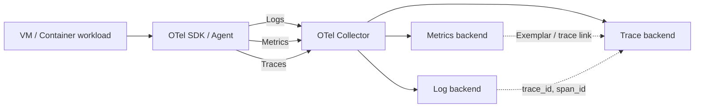

# Liên kết log, metric và trace theo workload hoặc instance

Khi một ứng dụng chạy trên nhiều máy ảo, container hoặc vùng sẵn sàng, một request có thể đi qua load balancer, nhiều service, hàng đợi và cơ sở dữ liệu. Mỗi thành phần tạo ra log, metric và trace ở một nơi khác nhau. Nếu các dữ liệu này không có thông tin nhận diện thống nhất, đội vận hành sẽ khó trả lời những câu hỏi quan trọng: request lỗi xảy ra ở instance nào, service nào làm tăng độ trễ, máy ảo nào có CPU cao vào đúng thời điểm đó và thay đổi triển khai nào bắt đầu gây ra sự cố.

Liên kết ba loại telemetry giúp chuyển từ việc xem các biểu đồ và log rời rạc sang điều tra một workload xuyên suốt. Cần có một bộ định danh ổn định cho service, môi trường và instance; truyền ngữ cảnh trace giữa các thành phần; đưa trace ID và span ID vào log; đồng thời giữ metric ở mức tổng hợp phù hợp để quan sát xu hướng và phát hiện bất thường.

## 1. Ba loại telemetry bổ sung cho nhau

**Log** ghi lại sự kiện đã xảy ra tại một thời điểm, thường kèm mức độ nghiêm trọng, thông điệp và các trường ngữ cảnh. Log hữu ích khi cần biết một request cụ thể thất bại vì lý do gì, tiến trình đã thực hiện thao tác nào hoặc cấu hình nào bị từ chối.

**Metric** là số liệu được đo và tổng hợp theo thời gian, chẳng hạn CPU utilization, dung lượng bộ nhớ, số request mỗi giây, tỷ lệ lỗi, độ trễ p95 hoặc độ sâu hàng đợi. Metric giúp phát hiện xu hướng, so sánh giữa các instance và cảnh báo khi hệ thống vượt ngưỡng.

**Trace phân tán** mô tả đường đi của một request hoặc một công việc qua nhiều thành phần. Một trace gồm các span; mỗi span biểu diễn một thao tác như nhận HTTP request, gọi service khác, truy vấn database hoặc xử lý message. Trace giúp xác định phần nào đóng góp nhiều nhất vào thời gian hoàn tất và nơi phát sinh lỗi.

| Loại dữ liệu | Trả lời câu hỏi | Ví dụ |
|---|---|---|
| Log | Điều gì đã xảy ra trong sự kiện cụ thể? | `orders-api` ghi lỗi timeout khi gọi `inventory-service` |
| Metric | Vấn đề xuất hiện thường xuyên đến mức nào và xu hướng ra sao? | Tỷ lệ timeout tăng từ 0,2% lên 4% trong 5 phút |
| Trace | Request đi qua đâu và thời gian tiêu tốn ở bước nào? | Span gọi inventory chiếm 1,8 giây trong tổng 2,1 giây |

Không loại telemetry nào thay thế hoàn toàn hai loại còn lại. Metric thường giúp phát hiện vấn đề nhanh, trace khoanh vùng thành phần chậm và log cung cấp chi tiết sự kiện để xác định nguyên nhân.

## 2. Thiết lập danh tính workload nhất quán

Trước khi liên kết dữ liệu, cần xác định rõ workload là gì và instance nào đang thực thi workload đó. Một service có thể chạy trên nhiều máy ảo, mỗi máy có thể chạy nhiều tiến trình, và mỗi tiến trình có thể xử lý hàng nghìn request. Không nên dùng hostname hoặc IP làm định danh duy nhất cho service vì các giá trị này có thể thay đổi khi autoscaling, thay máy hoặc triển khai lại.

Nên phân biệt các cấp định danh:

- **Service/workload identity:** tên logic ổn định của ứng dụng, ví dụ `orders-api`.
- **Namespace:** nhóm hoặc miền nghiệp vụ chứa service, ví dụ `commerce`.
- **Environment:** môi trường chạy, ví dụ `production`, `staging` hoặc `development`.
- **Instance identity:** định danh một bản chạy cụ thể của service, ví dụ instance ID của máy ảo hoặc ID container.
- **Infrastructure identity:** thông tin máy, vùng, zone, tài khoản cloud và loại tài nguyên.

OpenTelemetry định nghĩa Resource để mô tả thực thể tạo ra telemetry. Các resource attributes thường dùng gồm:

| Attribute | Ý nghĩa | Ví dụ |
|---|---|---|
| `service.name` | Tên logic của service | `orders-api` |
| `service.namespace` | Namespace hoặc miền chứa service | `commerce` |
| `service.instance.id` | Định danh riêng của instance service | `vm-i-0abc123-orders-api` |
| `deployment.environment.name` | Môi trường triển khai | `production` |
| `cloud.provider` | Nhà cung cấp cloud | `aws`, `azure`, `gcp` |
| `cloud.region` | Region triển khai | `ap-southeast-1` |
| `cloud.availability_zone` | Availability zone | `ap-southeast-1a` |
| `host.id` | ID máy chủ hoặc máy ảo | `i-0abc123` |
| `host.name` | Hostname | `orders-vm-07` |
| `host.type` | Loại máy hoặc instance | Giá trị theo nền tảng |

Các giá trị trên là ví dụ; cần dùng đúng tên attribute và quy ước của phiên bản semantic conventions đang áp dụng. `service.name` nên giữ ổn định giữa các lần triển khai của cùng service. `service.instance.id` cần phân biệt được các bản chạy đồng thời; với VM chạy một tiến trình service, có thể kết hợp cloud instance ID và tên service. Nếu một VM chạy nhiều bản service độc lập, cần bổ sung định danh tiến trình hoặc workload để tránh trùng.

Không đưa version ứng dụng, request ID hoặc hostname thay đổi theo lần deploy vào `service.name`. Những thông tin đó thuộc attribute riêng. Nếu tên service thay đổi theo mỗi release, dashboard và cảnh báo sẽ bị chia thành nhiều nhóm khó so sánh.

## 3. Chọn attribute đặt ở Resource và attribute đặt ở từng sự kiện

Resource attributes mô tả nơi telemetry được tạo ra và thường được gắn vào log, metric hoặc trace trong suốt vòng đời của resource. Event/span attributes mô tả một request hoặc thao tác cụ thể.

Ví dụ:

- `service.name`, `service.instance.id`, `cloud.region` và `deployment.environment.name` mô tả resource.
- `http.request.method`, `http.response.status_code`, `db.system` hoặc `messaging.destination.name` mô tả hoạt động cụ thể.
- `trace_id`, `span_id` liên kết log với trace tương ứng.
- `request.id` có thể giúp đối chiếu với log của gateway hoặc hệ thống nghiệp vụ.

Không nên sao chép mọi thông tin vào mọi record. Hãy xác định attribute nào là định danh nền tảng, attribute nào chỉ có giá trị trong một request và attribute nào nhạy cảm. Một bộ attribute thống nhất giúp truy vấn đơn giản hơn, nhưng đưa quá nhiều trường có giá trị thay đổi liên tục vào metric có thể làm tăng cardinality và chi phí lưu trữ.

Đặc biệt, không dùng trace ID, span ID, user ID, session ID, raw URL có mã định danh hoặc request ID làm nhãn metric thông thường. Những giá trị này có thể tạo ra một time series mới cho gần như mỗi request. Hãy dùng trace để xem request riêng lẻ và metric để tổng hợp xu hướng; nếu backend hỗ trợ, dùng exemplar để liên kết một mẫu metric với trace đại diện.

## 4. Truyền ngữ cảnh trace xuyên qua các service

Trace chỉ liên kết được các span nếu ngữ cảnh được truyền từ thành phần này sang thành phần tiếp theo. Khi service A gọi service B, A gửi thông tin trace context trong request; B dùng context đó để tạo span con thuộc cùng trace.

W3C Trace Context là chuẩn phổ biến cho HTTP. Header `traceparent` mang trace ID, parent span ID và trace flags. Ví dụ minh họa:

```http
traceparent: 00-4bf92f3577b34da6a3ce929d0e0e4736-00f067aa0ba902b7-01
```

Các thành phần được instrument bằng OpenTelemetry hoặc thư viện tương thích có thể đọc header này, tạo span mới và truyền context tiếp. Khi gọi qua HTTP client, gRPC, message broker hoặc framework được hỗ trợ, instrumentation phù hợp có thể thực hiện propagation tự động.

Với hàng đợi hoặc xử lý bất đồng bộ, context cần được đưa vào metadata của message khi publish và khôi phục khi consumer xử lý. Nếu không truyền context qua ranh giới message, trace của request gửi message và trace của worker xử lý có thể bị tách rời. Với công việc kéo dài hoặc fan-out, có thể dùng quan hệ span link khi quan hệ không phù hợp với mô hình parent-child đơn giản.

Không tự tạo trace ID mới ở mỗi service nếu request vẫn thuộc cùng một luồng xử lý. Cũng không tin header trace context từ mọi client bên ngoài một cách vô điều kiện: gateway có thể cần loại bỏ hoặc chuẩn hóa context do client cung cấp, tùy mô hình tin cậy và chính sách chống giả mạo telemetry.

## 5. Gắn trace ID và span ID vào log

Khi log được tạo trong lúc xử lý một span đang hoạt động, logger hoặc logging bridge có thể thêm `trace_id` và `span_id` vào record. Nhờ đó, từ một log lỗi có thể mở trace tương ứng; từ một span lỗi có thể tìm các log được ghi trong cùng ngữ cảnh.

Một log JSON minh họa:

```json
{
  "timestamp": "2026-11-22T10:15:32.481Z",
  "severity": "ERROR",
  "service.name": "orders-api",
  "service.namespace": "commerce",
  "service.instance.id": "vm-i-0abc123-orders-api",
  "deployment.environment.name": "production",
  "cloud.region": "ap-southeast-1",
  "host.id": "i-0abc123",
  "trace_id": "4bf92f3577b34da6a3ce929d0e0e4736",
  "span_id": "00f067aa0ba902b7",
  "request.id": "req-7d3a",
  "message": "Inventory lookup timed out",
  "error.type": "TimeoutException"
}
```

Đây là cấu trúc minh họa; tên trường và cách ghi ID phụ thuộc logger, exporter và backend. OpenTelemetry Log Data Model có các trường TraceId và SpanId riêng; backend có thể ánh xạ chúng sang tên trường khác.

Nếu log được ghi ở background thread hoặc sau khi request context đã kết thúc, trace context có thể không còn trong thread-local context. Với tác vụ bất đồng bộ, cần truyền context rõ ràng qua executor, coroutine, message hoặc callback. Không tự gắn trace ID bằng cách đọc biến toàn cục vì nhiều request có thể chạy đồng thời và làm liên kết nhầm log.

Log cần giữ được thời gian, severity, service identity và instance identity ngay cả khi không có trace. Các sự kiện boot, shutdown, health check hoặc lỗi xảy ra ngoài request có thể không có trace ID; vẫn cần log đầy đủ để chẩn đoán.

## 6. Liên kết metric với workload và instance

Metric nên cho phép quan sát từ tổng thể xuống từng instance. Ở mức service, thường cần số request, tỷ lệ lỗi, độ trễ, số request đang xử lý và độ sâu queue. Ở mức instance, cần CPU, RAM, disk, network, số tiến trình, restart và tình trạng agent.

Một cách tổ chức phổ biến:

| Phạm vi | Metric tiêu biểu | Attribute để phân nhóm |
|---|---|---|
| Service | Request rate, error rate, latency histogram | `service.name`, `service.namespace`, `deployment.environment.name` |
| Instance | CPU, memory, disk, network, process health | `service.instance.id`, `host.id`, `cloud.availability_zone` |
| Runtime | Heap, garbage collection, thread count, connection pool | Service identity và runtime attributes |
| Dependency | DB latency, connection errors, queue lag | Service identity, dependency type/name |
| Hạ tầng | VM CPU credit, NIC throughput, storage IOPS | `host.id`, instance type, region/zone |

Khi dashboard cho thấy latency của `orders-api` tăng, có thể lọc theo `service.instance.id` để xem chỉ một máy bị ảnh hưởng hay toàn bộ fleet. Nếu chỉ một instance có CPU cao, điều tra process, noisy neighbor, loại máy hoặc lỗi cấu hình cục bộ. Nếu tất cả instance cùng tăng latency nhưng CPU thấp, kiểm tra database, network, DNS hoặc dịch vụ phụ thuộc.

Metric theo instance có ích nhưng cần quản lý cardinality. Instance ID có số lượng hữu hạn theo fleet, tuy nhiên autoscaling và instance churn có thể tạo nhiều series theo thời gian. Giữ metric service-level để theo dõi dài hạn; chỉ bật metric chi tiết theo instance khi có mục đích vận hành. Tránh gắn các giá trị duy nhất theo request vào metric.

## 7. Dùng exemplar để đi từ metric tới trace

Metric histogram tổng hợp độ trễ của nhiều request. Khi backend hỗ trợ **exemplar**, một số quan sát trong histogram có thể lưu kèm tham chiếu tới trace ID của mẫu đó. Người vận hành có thể nhìn thấy latency tăng trên biểu đồ rồi mở một trace đại diện để xem request đã đi qua những span nào.

Exemplar không có nghĩa mọi request đều được lưu thành trace hoặc mọi bucket đều có trace tham chiếu. Sự sẵn có của exemplar phụ thuộc SDK, exporter, collector và backend. Nếu dùng sampling, exemplar có thể chỉ trỏ tới trace đã được giữ lại; cần cấu hình tương thích để liên kết có ích.

Nếu backend chưa hỗ trợ exemplar, vẫn có thể liên kết bằng cách lọc trace theo service, instance, thời gian và thuộc tính request. Tuy nhiên, truy vấn theo timestamp cần tính đến độ lệch đồng hồ, độ trễ ingest và độ phân giải metric.

## 8. Chuẩn hóa telemetry bằng OpenTelemetry

OpenTelemetry (OTel) cung cấp API, SDK, instrumentation và Collector để tạo, xử lý và chuyển log, metric, trace. Dùng cùng quy ước resource attributes và semantic conventions giúp telemetry từ nhiều runtime và nền tảng có thể liên kết được.

Một kiến trúc tổng quát:



Ứng dụng có thể gửi telemetry trực tiếp tới Collector hoặc qua agent/daemon gần workload. Collector nhận dữ liệu, áp dụng processor như batch, memory limiter, resource enrichment hoặc filtering rồi xuất tới backend. Mô hình Collector trung gian giúp tách ứng dụng khỏi backend cụ thể và quản lý cấu hình tập trung.

Nên chuẩn hóa các điểm sau:

- Service name, namespace, environment và instance identity.
- Cloud provider, region, zone, host ID và workload metadata.
- Quy ước tên metric, đơn vị đo và thuộc tính span/log.
- Cách truyền trace context qua HTTP, gRPC và message broker.
- Cách ghi trace ID/span ID trong structured log.
- Sampling, retention, quyền truy cập và chính sách lọc dữ liệu nhạy cảm.

Không nhất thiết phải dùng cùng một backend cho cả ba loại telemetry, nhưng cần giữ khả năng truy vấn chéo hoặc tạo link giữa các backend. Nếu tách hệ thống lưu trữ, thống nhất service identity, environment, instance ID và timestamp là điều kiện quan trọng để điều tra xuyên suốt.

## 9. Ví dụ cấu hình resource cho ứng dụng Java trên VM

Giả sử `orders-api` chạy trên một máy ảo Linux trong production. Ứng dụng được instrument bằng OpenTelemetry Java Agent và gửi dữ liệu qua Collector nội bộ.

Có thể khai báo các biến môi trường như sau:

```bash
export OTEL_SERVICE_NAME="orders-api"
export OTEL_RESOURCE_ATTRIBUTES="service.namespace=commerce,deployment.environment.name=production,service.instance.id=vm-i-0abc123-orders-api,cloud.provider=aws,cloud.region=ap-southeast-1,cloud.availability_zone=ap-southeast-1a,host.id=i-0abc123"
export OTEL_EXPORTER_OTLP_ENDPOINT="https://otel-collector.internal:4317"
export OTEL_EXPORTER_OTLP_PROTOCOL="grpc"
```

Đây là ví dụ với OTLP/gRPC. Endpoint, giao thức, TLS và xác thực phải khớp cấu hình Collector. Trong production, dùng TLS và cơ chế xác thực phù hợp; không để endpoint nhận telemetry mở công khai. Instance ID nên được lấy từ metadata hoặc hệ thống provisioning thay vì hard-code cùng một giá trị cho mọi máy. Bảo đảm mỗi bản chạy có `service.instance.id` riêng.

Nếu dùng nhiều môi trường, có thể cung cấp cùng service name nhưng environment khác nhau. Như vậy, dashboard có thể so sánh `orders-api` giữa staging và production mà không tạo ra hai service identity hoàn toàn khác nhau.

## 10. Ví dụ cấu hình OpenTelemetry Collector

Collector có thể nhận OTLP qua gRPC hoặc HTTP và chuyển tiếp ba loại telemetry. Cấu hình tối giản minh họa:

```yaml
receivers:
  otlp:
    protocols:
      grpc:
        endpoint: 0.0.0.0:4317
      http:
        endpoint: 0.0.0.0:4318

processors:
  memory_limiter:
    check_interval: 1s
    limit_mib: 512
  batch:
    timeout: 5s

exporters:
  otlp:
    endpoint: observability-backend.internal:4317

service:
  pipelines:
    traces:
      receivers: [otlp]
      processors: [memory_limiter, batch]
      exporters: [otlp]
    metrics:
      receivers: [otlp]
      processors: [memory_limiter, batch]
      exporters: [otlp]
    logs:
      receivers: [otlp]
      processors: [memory_limiter, batch]
      exporters: [otlp]
```

Đây là cấu hình minh họa cho Collector distribution có các component tương ứng; cần xác nhận receiver, processor và exporter có trong bản build đang dùng. Cấu hình thật cần thêm TLS, authentication, giới hạn mạng, retry/queue phù hợp, health check và giám sát chính Collector. Không bind receiver ra mọi interface nếu mạng hoặc firewall không giới hạn nguồn gửi.

Trong môi trường production, endpoint exporter thường cần cấu hình TLS và xác thực. Có thể thêm processor resource để chuẩn hóa hoặc bổ sung metadata, nhưng tránh ghi đè giá trị `service.name` hoặc instance ID do workload cung cấp nếu chưa xác minh nguồn. Với dữ liệu không đáng tin từ client, Collector có thể cần lọc attribute hoặc xóa trường có nguy cơ chứa thông tin nhạy cảm.

## 11. Tích hợp log ứng dụng với trace context

Với ứng dụng Java, có thể dùng OpenTelemetry Java Agent để tự động instrument framework HTTP, client, database và một số thư viện phổ biến. Logger cần được cấu hình để xuất structured log và nhận trace context từ instrumentation hoặc logging bridge tương thích.

Một cách tiếp cận thực tế:

1. Bật instrumentation cho server HTTP để mỗi request tạo server span.
2. Bật instrumentation cho HTTP client, JDBC hoặc thư viện messaging để tạo span cho lời gọi phụ thuộc.
3. Cấu hình logger xuất JSON với timestamp, severity, service identity và trace/span ID khi có context.
4. Đảm bảo context được truyền qua executor, thread pool và message consumer.
5. Kiểm tra một request mẫu từ gateway đến API, database và worker để xác nhận trace liên tục.

Không ghi toàn bộ request body, authorization header, cookie, access token hoặc dữ liệu cá nhân chỉ để phục vụ tracing. Span attribute nên chứa thông tin chẩn đoán cần thiết và đã được kiểm duyệt. Ví dụ, ghi route template `/orders/{orderId}` thường an toàn và hữu ích hơn ghi URL thô có ID hoặc dữ liệu người dùng.

Nếu log backend nhận log qua file tailing, cần xác định cách đưa trace context vào log record. Agent có thể đọc trường JSON đã được logger ghi ra, hoặc logging appender có thể chuyển log trực tiếp sang OTel. Tránh gửi cùng một log qua hai pipeline mà không có cơ chế chống trùng lặp.

## 12. Lựa chọn sampling và retention

Trace có thể tạo ra lượng dữ liệu lớn, đặc biệt với service có request rate cao. Sampling giúp kiểm soát chi phí và tải lưu trữ, nhưng phải cân bằng giữa khả năng điều tra và lượng dữ liệu được giữ.

Một số cách sampling:

- **Head sampling:** quyết định giữ trace ngay khi bắt đầu, thường dựa trên tỷ lệ hoặc thuộc tính sẵn có ở đầu request. Cách này đơn giản và giảm dữ liệu sớm, nhưng có thể bỏ qua trace lỗi nếu quyết định ban đầu không giữ.
- **Tail sampling:** quyết định sau khi Collector nhận đủ trace hoặc một phần trace, có thể ưu tiên giữ trace lỗi, latency cao hoặc thuộc tính đặc biệt. Cách này cần trạng thái và bộ nhớ ở Collector, đồng thời phải bảo đảm các span của cùng trace được định tuyến tới cùng nơi xử lý sampling.
- **Always-on hoặc always-off theo môi trường:** có thể phù hợp cho tải thấp hoặc môi trường thử nghiệm, nhưng cần xem xét chi phí và dữ liệu nhạy cảm.

Log và metric cũng cần retention riêng. Metric tổng hợp có thể lưu dài hơn log chi tiết; log debug và trace đầy đủ có thể lưu ngắn hơn log audit hoặc security. Chính sách cần dựa trên mục tiêu điều tra, SLO, quy định dữ liệu và ngân sách.

Không dùng sampling để thay thế alerting. Cảnh báo về error rate, saturation hoặc latency nên dựa trên metric phù hợp; trace được dùng để điều tra mẫu request. Nếu cần giữ 100% một nhóm sự kiện bảo mật, hãy xác định rõ quy tắc và đường lưu trữ riêng.

## 13. Cardinality, chất lượng dữ liệu và chi phí

Cardinality là số lượng tổ hợp giá trị attribute tạo ra các series hoặc nhóm dữ liệu riêng. Nếu metric có các nhãn `service.name`, `instance.id`, `http.route` và `status_code`, số series có thể tăng theo số instance, route và mã trạng thái. Nếu thêm `user.id` hoặc `trace_id`, cardinality có thể tăng rất nhanh.

Thực hành tốt:

- Giữ nhãn metric ở mức hữu hạn và có ý nghĩa vận hành.
- Dùng route template thay cho URL có ID động.
- Không gắn request ID, trace ID, email, user ID hoặc session token làm nhãn metric.
- Chỉ bật metric per-instance khi cần khoanh vùng; giữ metric service-level cho xu hướng dài hạn.
- Lọc hoặc loại bỏ attribute không cần thiết ở Collector trước khi xuất.
- Theo dõi số lượng series, kích thước log, span rate và chi phí ingest.

Chất lượng dữ liệu cũng quan trọng như số lượng. Hai service dùng tên khác nhau cho cùng một workload, timestamp sai múi giờ hoặc instance ID bị tái sử dụng có thể làm dashboard sai và trace bị gán nhầm. Nên kiểm tra tự động resource attributes khi ứng dụng khởi động và cảnh báo khi thiếu `service.name`, environment hoặc instance identity.

## 14. Bảo mật và quyền riêng tư của telemetry

Log, metric và trace có thể chứa thông tin nhạy cảm: địa chỉ IP, email, order ID, SQL statement, URL, tên bucket, thông tin tenant hoặc dữ liệu trong exception. Hệ thống observability vì vậy cũng là một nơi cần bảo vệ.

Các nguyên tắc cần áp dụng:

- Không ghi secret, password, access token, cookie hoặc private key vào log/span.
- Mask hoặc loại bỏ dữ liệu cá nhân và dữ liệu nghiệp vụ không cần thiết.
- Mã hóa dữ liệu trên đường truyền giữa workload, Collector và backend.
- Xác thực workload gửi telemetry; giới hạn ai có thể query hoặc export dữ liệu.
- Tách quyền xem log ứng dụng, audit log và dữ liệu bảo mật theo vai trò.
- Áp dụng retention, deletion và residency theo chính sách dữ liệu.
- Kiểm soát endpoint nhận telemetry để tránh bị lợi dụng làm nơi exfiltration hoặc gây quá tải.

Trace context từ bên ngoài có thể được dùng để liên kết dữ liệu giữa các hệ thống, nhưng không nên coi baggage là nơi truyền secret hoặc dữ liệu cá nhân. Baggage có thể được chuyển tiếp qua nhiều service và ra ngoài trust boundary nếu không được lọc.

## 15. Xây dựng dashboard từ service xuống instance

Dashboard nên hỗ trợ điều tra theo thứ tự từ tổng quan tới chi tiết:

1. **Service overview:** request rate, error rate, latency p50/p95/p99 và saturation.
2. **Instance comparison:** CPU, memory, disk, network, restart, request rate và latency theo `service.instance.id` hoặc `host.id`.
3. **Dependency view:** latency và error của database, cache, queue, HTTP dependency.
4. **Trace exploration:** trace lỗi hoặc trace có latency cao, lọc theo service, environment, region và instance.
5. **Log exploration:** log theo service, severity, time range, trace ID và instance ID.

Một quy trình điều tra điển hình:

- Metric cảnh báo error rate của `orders-api` tăng.
- Dashboard service cho thấy chỉ instance `vm-i-0abc123` có latency p99 cao.
- Lọc trace theo `service.instance.id` và khoảng thời gian sự cố để tìm span chậm.
- Mở trace, xác định span gọi `inventory-service` timeout.
- Từ trace ID, tìm log của `orders-api` và `inventory-service` để đọc exception và retry.
- Đối chiếu CPU, network, DNS và log của instance để xác định lỗi cục bộ hay dependency chung.

Dashboard không nên chỉ hiển thị trạng thái xanh/đỏ. Cần có link hoặc cách chuyển từ service sang instance, từ metric sang trace, từ trace sang log và ngược lại. Các bộ lọc service, environment, region, version và thời gian phải dùng cùng quy ước giữa các trang.

## 16. Kiểm tra chất lượng liên kết telemetry

Sau khi triển khai instrumentation, hãy kiểm tra liên kết bằng một request có thể tái tạo. Không chỉ xác nhận rằng ba backend đều có dữ liệu; cần xác nhận dữ liệu nói về cùng một workload và cùng một hoạt động.

Checklist kiểm tra:

- `service.name`, namespace và environment nhất quán giữa log, metric và trace.
- Instance ID trong telemetry khớp với VM/container thực tế và không bị dùng chung giữa các instance.
- Một request tạo trace có server span và các client/dependency span mong đợi.
- Trace context được truyền qua HTTP/gRPC và message broker.
- Log trong request có trace ID/span ID khớp với trace đã lưu.
- Metric service-level tổng hợp đúng service; metric instance-level có thể lọc theo instance.
- Exemplar hoặc link tương đương mở được trace phù hợp nếu backend hỗ trợ.
- Timestamp và timezone nhất quán; đã tính đến clock skew và ingest delay.
- Không có secret hoặc dữ liệu cá nhân ngoài chính sách trong log/span.
- Sampling không làm mất toàn bộ trace lỗi quan trọng.
- Collector có metric riêng về receiver accepted/refused, exporter failure, queue và memory.

Có thể kiểm tra một instance bị thiếu dữ liệu bằng cách so sánh trạng thái agent, endpoint Collector, quyền mạng, TLS certificate, cấu hình exporter và log lỗi gửi telemetry. Đừng kết luận workload không phát sinh request chỉ vì backend chưa nhận dữ liệu; pipeline telemetry cũng có thể đang lỗi.

## 17. Những lỗi thường gặp

- **Dùng hostname làm service identity:** hostname đổi khi thay máy hoặc autoscaling, làm dữ liệu bị chia nhóm. Dùng `service.name` ổn định và instance ID riêng.
- **Mỗi service tự đặt tên khác nhau:** dashboard không thể nhóm các bản chạy của cùng workload. Chuẩn hóa namespace và service name.
- **Không truyền trace context:** mỗi service tạo trace riêng, không nhìn thấy toàn bộ request. Bật propagation qua HTTP, RPC và message.
- **Log không có trace ID:** phải tìm log bằng timestamp và text, dễ nhầm request. Gắn trace/span context vào structured log.
- **Đưa trace ID vào metric label:** cardinality và chi phí tăng mạnh. Dùng exemplar hoặc truy vấn trace riêng.
- **Chỉ có metric tổng hợp:** khó biết instance nào gây lỗi. Bổ sung metric theo instance có chọn lọc.
- **Chỉ có trace mà không có log:** khó đọc chi tiết exception hoặc trạng thái nghiệp vụ. Liên kết log trong context của span.
- **Sampling không phù hợp:** trace lỗi hoặc trace chậm bị bỏ qua. Đánh giá head/tail sampling theo mục tiêu điều tra.
- **Resource attributes bị thiếu hoặc sai:** dữ liệu bị gắn nhầm môi trường hoặc instance. Kiểm tra resource khi khởi động và ở Collector.
- **Telemetry chứa secret:** hệ thống quan sát trở thành nơi rò rỉ dữ liệu. Lọc, mask và giới hạn quyền truy cập.

## 18. Ví dụ hoàn chỉnh cho workload chạy trên nhiều VM

Một `orders-api` được triển khai trên ba VM trong hai availability zone. Mỗi VM chạy cùng image và cùng phiên bản ứng dụng, nhưng có `host.id` và `service.instance.id` riêng. Load balancer phân phối HTTP request tới các instance. API gọi `inventory-service`, truy vấn PostgreSQL và gửi một số công việc bất đồng bộ vào queue.

Thiết kế telemetry:

| Thành phần | Dữ liệu cần phát | Cách liên kết |
|---|---|---|
| Orders API | HTTP server/client span, request/error/latency metric, structured log | `service.name=orders-api`, instance ID, trace/span ID |
| Inventory service | Server span, dependency metric và log | Propagate `traceparent` từ Orders API |
| PostgreSQL client | DB client span, connection pool metric, error log | Span con trong trace request |
| Queue producer/consumer | Messaging span, queue depth/lag metric, worker log | Truyền trace context trong message metadata hoặc dùng span link |
| VM/OS agent | CPU, memory, disk, network và system log | `host.id`, region, zone và service instance mapping |
| OTel Collector | Receive/export metrics, logs, traces và pipeline health | Chuẩn hóa resource, lọc dữ liệu, batch và export |

Khi một request tạo đơn hàng chậm, metric service cho biết p99 tăng. Dashboard instance cho thấy hai VM bình thường, một VM có network retransmission cao. Trace của request chậm cho thấy span gọi inventory mất nhiều thời gian; log cùng trace ID ghi nhận timeout retry. Metric và log hạ tầng của instance cho thấy vấn đề chỉ xuất hiện ở một AZ. Từ đó, đội vận hành có thể khoanh vùng route, NIC hoặc dependency tại AZ đó thay vì tăng cấu hình CPU cho toàn bộ fleet.

Ví dụ này cho thấy giá trị của việc liên kết workload identity, instance identity và trace context: metric phát hiện vấn đề, instance metadata xác định phạm vi, trace chỉ ra bước chậm và log cung cấp chi tiết sự kiện.

## 19. Checklist triển khai

- [ ] Mỗi workload có `service.name` và `service.namespace` ổn định.
- [ ] Mỗi bản chạy có `service.instance.id` riêng; host/VM identity được ghi nhận.
- [ ] Environment, cloud provider, region và zone được chuẩn hóa.
- [ ] Log, metric và trace dùng cùng resource attributes cần thiết.
- [ ] Trace context được truyền qua HTTP, gRPC và message broker.
- [ ] Structured log có trace ID/span ID khi đang xử lý trace context.
- [ ] Metric service-level và instance-level được phân biệt rõ.
- [ ] Metric label không chứa trace ID, request ID hoặc dữ liệu có cardinality quá cao.
- [ ] Exemplar hoặc liên kết metric-to-trace được bật nếu backend hỗ trợ.
- [ ] Collector có TLS, xác thực, giới hạn mạng, batch và memory protection.
- [ ] Sampling, retention và chi phí ingest được xác định theo nhu cầu.
- [ ] Log/span được lọc secret và dữ liệu cá nhân; quyền truy cập được giới hạn.
- [ ] Dashboard hỗ trợ đi từ service tới instance, metric, trace và log.
- [ ] Có kiểm thử end-to-end và cảnh báo khi pipeline telemetry bị gián đoạn.

Liên kết log, metric và trace theo workload hoặc instance giúp đội vận hành hiểu được cả xu hướng của service lẫn hành vi của từng máy đang chạy nó. Khi định danh được chuẩn hóa, trace context được truyền xuyên suốt và log mang trace ID phù hợp, một cảnh báo metric có thể dẫn tới đúng instance, request và sự kiện cần điều tra; từ đó rút ngắn thời gian phát hiện và xử lý sự cố trong môi trường compute phân tán.
