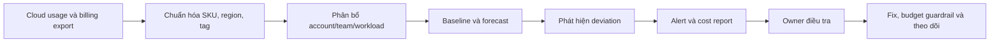

# Cảnh báo thiếu dung lượng, cạn tài nguyên và tăng chi phí bất thường

## 1. Vì sao cần cảnh báo sớm?

Một workload compute có thể ngừng phục vụ dù máy chủ vẫn đang chạy. Filesystem đầy khiến ứng dụng không ghi được log hoặc dữ liệu; bộ nhớ cạn làm tiến trình bị hệ điều hành chấm dứt; connection pool hết chỗ khiến request phải chờ; hàng đợi tăng nhanh làm thời gian xử lý vượt SLO. Ở cấp cloud, tài khoản có thể hết quota vCPU, GPU, địa chỉ IP hoặc số volume trước khi hệ thống đạt giới hạn phần cứng. Cùng lúc đó, autoscaling sai cấu hình, log tăng đột biến hoặc lưu lượng egress bất thường có thể làm hóa đơn tăng nhanh.

Giám sát chỉ có ích khi biến dữ liệu thành hành động đúng lúc. Dashboard cho biết điều gì đang xảy ra; cảnh báo thông báo khi có điều kiện cần can thiệp; runbook hướng dẫn người trực xử lý. Một cảnh báo tốt phải chỉ ra tài nguyên hoặc workload bị ảnh hưởng, mức độ khẩn cấp, tốc độ suy giảm, tác động dự kiến và bước kiểm tra tiếp theo.

Trong module **CLOUD_CORE_SERVICES_COMPUTE**, người học cần kết nối giám sát với các mô hình VM, container và serverless; cách chọn CPU, bộ nhớ, mạng; triển khai và mở rộng tải; bảo đảm tính sẵn sàng; cùng tối ưu chi phí vận hành. Bài học này tập trung vào ba nhóm tín hiệu:

- **Thiếu dung lượng (capacity shortage):** tài nguyên còn lại không đủ cho nhu cầu hiện tại hoặc dự báo.
- **Cạn tài nguyên (resource exhaustion):** một giới hạn cụ thể đã gần chạm hoặc đã chạm, khiến workload không thể tiếp tục hoạt động bình thường.
- **Tăng chi phí bất thường (cost anomaly):** mức chi tiêu hoặc tốc độ tiêu thụ tài nguyên lệch đáng kể so với baseline, ngân sách hoặc sản lượng công việc.

Sau bài học, người học có thể:

- Xác định metric cần theo dõi cho compute, memory, storage, network, quota và dịch vụ phụ thuộc.
- Thiết lập ngưỡng cảnh báo dựa trên mức sử dụng, tốc độ tiêu thụ và thời gian còn lại trước khi cạn.
- Phân biệt cảnh báo sớm, cảnh báo khẩn cấp và cảnh báo thông tin.
- Phát hiện bất thường chi phí theo dịch vụ, môi trường, owner và đơn vị công việc.
- Giảm cảnh báo nhiễu bằng thời gian duy trì, baseline, grouping và routing.
- Kết nối cảnh báo với runbook, autoscaling, capacity planning và quy trình xử lý sự cố.

## 2. Các khái niệm nền tảng

### 2.1. Capacity, utilization và headroom

**Capacity** là lượng tài nguyên tối đa mà một thành phần có thể cung cấp trong điều kiện và giới hạn cụ thể. **Utilization** là phần capacity đang được sử dụng. **Headroom** là phần capacity còn lại để hấp thụ tăng tải, biến động hoặc lỗi thành phần.

Với một tài nguyên có capacity (C) và mức sử dụng (U):

\[
Utilization = \frac{U}{C} \times 100\%
\]

\[
Headroom = C - U
\]

Ví dụ, một nhóm worker có khả năng xử lý 1.000 tác vụ đồng thời và đang dùng 750 slot thì utilization là 75%, headroom còn 250 slot. Tuy nhiên, headroom chỉ có ý nghĩa nếu capacity đo được thực sự có thể sử dụng. Quota cloud, giới hạn connection, CPU throttling hoặc dependency chậm có thể khiến capacity danh nghĩa không chuyển thành throughput thực tế.

Không nên đặt mục tiêu utilization 100% cho mọi tài nguyên. Hệ thống cần phần dự phòng để xử lý burst, scale-out, rolling maintenance và sự cố. Mức headroom phù hợp phụ thuộc độ biến động tải, thời gian cấp thêm tài nguyên, SLO và khả năng suy giảm có kiểm soát.

### 2.2. Thiếu dung lượng khác với cạn tài nguyên

Thiếu dung lượng thường là xu hướng: dung lượng đĩa giảm đều, queue tăng theo giờ hoặc CPU thường xuyên tiến gần mức bão hòa. Cạn tài nguyên là lúc một giới hạn trở thành nguyên nhân trực tiếp gây lỗi: filesystem không còn block trống, hết inode, hết connection, hết PID, hết địa chỉ IP hoặc cloud API từ chối tạo instance do quota.

Một tài nguyên có thể cạn mà dashboard utilization tổng thể vẫn thấp. Ví dụ, một mount point riêng đầy trong khi tổng dung lượng các đĩa còn trống; một pod hết ephemeral storage trong khi node còn dung lượng; một subnet hết IP trong khi VPC còn nhiều dải địa chỉ chưa sử dụng.

Vì vậy, phải giám sát đúng phạm vi nơi workload cấp phát tài nguyên: tiến trình, container, volume, mount point, subnet, node pool, region, account và quota dịch vụ.

### 2.3. Metric, log, trace và event

- **Metric:** chuỗi số theo thời gian, phù hợp để theo dõi mức sử dụng, tốc độ, độ trễ và xu hướng.
- **Log:** bản ghi sự kiện hoặc thông điệp có ngữ cảnh, giúp tìm nguyên nhân cụ thể như `OutOfMemory`, `No space left on device` hoặc API quota exceeded.
- **Trace:** theo dõi một request qua nhiều dịch vụ, giúp xác định thành phần nào đang chậm hoặc retry nhiều.
- **Event:** sự kiện thay đổi trạng thái như pod bị evict, instance scale-out, volume resize, quota rejection hoặc thay đổi cấu hình.

Không nên chỉ dựa vào một loại tín hiệu. Metric có thể phát hiện memory pressure; log cho biết tiến trình nào bị OOM; trace cho thấy request tăng thời gian vì connection pool chờ database; event ghi lại autoscaler đã đạt giới hạn replica.

### 2.4. Symptom và cause

Một cảnh báo thường biểu thị triệu chứng, không nhất thiết là nguyên nhân gốc. CPU cao có thể do lưu lượng tăng, vòng lặp lỗi, garbage collection, mã mới hoặc một dependency chậm làm retry. Chi phí tăng có thể đến từ request tăng hợp lệ, scale-out, egress, log ingestion hoặc tài nguyên bị bỏ quên.

Thiết kế alert nên giúp người trực xác định bước phân tích tiếp theo thay vì kết luận nguyên nhân chỉ từ một metric.

## 3. Xây dựng mô hình capacity cho workload

### 3.1. Bắt đầu từ workload và SLO

Trước khi đặt ngưỡng, xác định workload phục vụ chức năng gì, tải bình thường và tải đỉnh, tốc độ tăng tải, thời gian khởi tạo tài nguyên, dependency và hậu quả nếu cạn tài nguyên. Gắn metric kỹ thuật với SLO hoặc kết quả nghiệp vụ như request thành công, số job hoàn tất, số giao dịch xử lý và thời gian chờ trong queue.

Ví dụ, CPU 85% trong vài phút có thể chấp nhận được với batch job nhưng đáng lo với API có latency p99 đang vượt SLO. Queue backlog tăng có thể bình thường trong một đợt batch đã lên lịch, nhưng là sự cố nếu thời gian chờ khiến đơn hàng không được xử lý đúng hạn.

### 3.2. Xác định đơn vị đo và phạm vi

Mỗi metric cần có phạm vi rõ ràng:

| Phạm vi | Ví dụ metric | Câu hỏi cần trả lời |
|---|---|---|
| Process | RSS, heap, file descriptor, thread count | Tiến trình nào đang tiêu thụ hoặc cạn tài nguyên? |
| Container/pod | CPU request/limit, memory working set, ephemeral storage | Container nào bị throttling, OOM hoặc eviction? |
| VM/node | CPU, RAM, disk, network, PID, conntrack | Máy hoặc node nào gần giới hạn? |
| Storage | Bytes, inode, IOPS, throughput, latency, queue | Volume hoặc mount point nào sắp đầy/bão hòa? |
| Network | Bandwidth, packet drop, connection, IP/port | Đường mạng hay bảng trạng thái nào sắp cạn? |
| Cloud service/account | Quota vCPU/GPU/IP/volume/API | Có thể tạo thêm tài nguyên khi cần scale không? |
| Application | Queue backlog, pool usage, request concurrency | Giới hạn nội bộ nào đang chặn throughput? |
| Cost allocation | Spend, usage, SKU, owner, environment | Dịch vụ hoặc workload nào làm chi phí lệch baseline? |

Metric tổng hợp cấp cluster không thay thế metric theo node hoặc workload. Một node có thể đầy trong khi trung bình toàn cluster còn thấp; một namespace có thể hết quota trong khi cluster vẫn dư CPU và RAM.

### 3.3. Tính thời gian còn lại trước khi cạn

Với tài nguyên có dung lượng còn lại (A) và tốc độ tiêu thụ ròng (R) ổn định, có thể ước lượng:

\[
Time\ to\ exhaustion \approx \frac{A}{R}
\]

Ví dụ, volume còn 120 GB và đang tăng dữ liệu ròng 10 GB mỗi ngày thì thời gian đến khi đầy xấp xỉ 12 ngày. Đây chỉ là dự báo đơn giản; cần tính đến tốc độ tăng tải, retention, log rotation, cleanup và biến động theo chu kỳ.

Time-to-exhaustion hữu ích hơn một ngưỡng phần trăm đơn lẻ khi tài nguyên tăng liên tục. Một volume 80% đầy nhưng chỉ tăng 100 MB mỗi tuần có thể ít khẩn cấp hơn volume 50% đầy nhưng tăng 100 GB mỗi giờ.

### 3.4. Đặt ngưỡng theo thời gian phản ứng

Ngưỡng cảnh báo phải cho đội vận hành đủ thời gian xử lý. Nếu cần 4 giờ để mở rộng volume và kiểm tra ứng dụng, cảnh báo phải phát ra sớm hơn thời điểm dự báo đầy ít nhất 4 giờ, cộng thêm khoảng dự phòng. Nếu cloud quota cần phê duyệt thủ công trong một ngày, không thể đợi đến khi quota còn 5% mới báo.

Một cách phân tầng tham khảo:

- **Info:** xu hướng tăng cần theo dõi, chưa cần hành động ngay.
- **Warning:** headroom thấp hoặc time-to-exhaustion nằm trong thời gian chuẩn bị thay đổi.
- **Critical:** dự báo cạn trước khi có thể xử lý, hoặc lỗi cấp phát đã xảy ra.
- **Page/Incident:** workload đang bị ảnh hưởng, SLO hoặc chức năng nghiệp vụ bị suy giảm.

Các tỷ lệ như 70%, 85% hoặc 95% chỉ là điểm khởi đầu. Ngưỡng cuối cùng phải dựa trên tốc độ tiêu thụ, thời gian cấp thêm tài nguyên và mức độ quan trọng của workload.

## 4. Cảnh báo thiếu dung lượng lưu trữ

### 4.1. Dung lượng block và filesystem

Theo dõi cả số byte còn trống và tỷ lệ phần trăm đã sử dụng. Một volume lớn có thể còn 10% nhưng vẫn có hàng trăm GB; một volume nhỏ còn 10% có thể đầy trong vài phút nếu log tăng nhanh. Nên kết hợp ngưỡng phần trăm với ngưỡng dung lượng tuyệt đối và dự báo thời gian đến khi đầy.

Phân biệt các lớp:

- Dung lượng volume hoặc block device được cấp trên cloud.
- Dung lượng filesystem sau khi partition và format.
- Dung lượng mount point cụ thể như `/`, `/var`, `/var/log`, `/tmp` hoặc thư mục dữ liệu.
- Dung lượng ephemeral storage của container hoặc node.
- Dung lượng snapshot, backup và object storage theo chính sách retention.

Tăng kích thước volume không nhất thiết tự động mở rộng partition và filesystem. Sau khi resize ở cloud control plane, có thể cần thao tác ở hệ điều hành; cảnh báo cần kiểm tra cả dung lượng cloud lẫn filesystem mà ứng dụng thực sự sử dụng.

### 4.2. Inode và file descriptor

Filesystem có thể hết inode dù còn nhiều GB trống nếu ứng dụng tạo số lượng rất lớn tệp nhỏ. Theo dõi số inode còn lại và tốc độ tạo tệp. Log rotation, cache file, temporary file hoặc thư mục session có thể là nguồn tăng inode.

File descriptor là giới hạn ở cấp tiến trình hoặc hệ điều hành. Ứng dụng mở quá nhiều file, socket hoặc pipe mà không đóng đúng cách có thể gặp lỗi `Too many open files`. Theo dõi số descriptor đang dùng so với soft/hard limit, cùng số socket và connection.

### 4.3. PVC và ephemeral storage trong Kubernetes

Trong Kubernetes, theo dõi dung lượng PersistentVolumeClaim, filesystem của volume, ephemeral storage của container và dung lượng node. Pod có thể bị evict khi vượt giới hạn ephemeral storage hoặc node gặp disk pressure. PVC có thể hết dung lượng dù node còn trống vì đó là một volume riêng.

Theo dõi thêm trạng thái PVC pending, volume attach/mount error, tốc độ tăng dữ liệu và khả năng mở rộng volume của StorageClass. Không phải storage class nào cũng hỗ trợ volume expansion; một số thay đổi có thể cần filesystem resize hoặc thao tác theo nhà cung cấp.

### 4.4. Cảnh báo theo time-to-full

Một cảnh báo hữu ích có thể kết hợp:

- Tỷ lệ dung lượng đã sử dụng vượt ngưỡng trong một khoảng thời gian.
- Dung lượng tuyệt đối còn lại thấp hơn mức tối thiểu an toàn.
- Dự báo dung lượng còn lại chạm 0 trong thời gian nhỏ hơn thời gian xử lý.
- Tốc độ tăng dung lượng bất thường so với baseline.

Không cảnh báo trên filesystem tạm hoặc mount point không liên quan nếu chúng không ảnh hưởng workload. Cần lọc đúng loại filesystem và gắn nhãn workload, mount point, owner và môi trường.

## 5. Cảnh báo cạn tài nguyên compute

### 5.1. CPU và CPU throttling

Theo dõi CPU utilization cùng run queue, load average, CPU steal, CPU throttling và latency ứng dụng. CPU cao kéo dài có thể là dấu hiệu thiếu capacity; CPU throttling trong container cho biết workload bị giới hạn bởi CPU limit dù node còn tài nguyên ở nơi khác.

Trong Kubernetes, xem cả CPU request và limit. Request ảnh hưởng scheduling; limit có thể gây throttling. Một pod có CPU utilization thấp so với node nhưng liên tục bị throttling do limit nhỏ vẫn có thể chậm.

CPU cao không phải lúc nào cũng cần scale. Trước tiên kiểm tra traffic, retry storm, vòng lặp, GC, lock contention và dependency. Nếu throughput không tăng dù CPU tăng, cần xác định nút thắt trước khi thêm instance.

### 5.2. Memory và OOM

Memory exhaustion có thể khiến Linux OOM killer chấm dứt process, container bị OOMKilled hoặc runtime serverless từ chối cấp thêm memory. Theo dõi memory available, working set, RSS, heap, swap, page fault, GC pause và OOM event.

Đừng chỉ dùng memory utilization toàn máy. Một container có thể chạm memory limit trong khi node vẫn còn RAM; một tiến trình có thể rò rỉ bộ nhớ dù tổng memory cluster chưa cao. Với JVM, theo dõi heap và non-heap cùng RSS; với runtime khác, dùng metric tương ứng.

Memory tăng đều theo thời gian có thể báo hiệu leak. Memory tăng theo tải nhưng giảm sau khi tải kết thúc có thể là cache hoặc buffer hợp lệ. Baseline và hành vi sau khi tải giảm giúp phân biệt hai trường hợp.

### 5.3. Process, thread và connection

Các giới hạn thường bị bỏ quên gồm:

- PID hoặc số process tối đa.
- Thread count và giới hạn thread của runtime.
- File descriptor và socket.
- TCP connection, ephemeral port và conntrack table.
- Database connection pool, HTTP connection pool và worker pool.
- Request concurrency, queue length và số tác vụ đang chạy.

Khi một pool đạt tối đa, request có thể chờ dù CPU và RAM vẫn còn. Theo dõi tỷ lệ sử dụng pool, thời gian chờ lấy connection, timeout và số lần retry. Nếu tăng pool size, phải kiểm tra giới hạn database hoặc dịch vụ phía sau để tránh chuyển nút thắt sang dependency.

### 5.4. GPU và accelerator

Với workload GPU, theo dõi GPU utilization, memory utilization, VRAM còn lại, ECC error, temperature, power limit, thời gian chờ cấp GPU và queue của scheduler. GPU utilization thấp không nhất thiết có nghĩa thiếu GPU; job có thể đang chờ dữ liệu, network collective hoặc CPU preprocessing.

Theo dõi thêm quota GPU theo region/account, số node GPU có thể cấp, thời gian chờ capacity và mức sử dụng VRAM. Một job có thể không schedule được dù tổng GPU trong tổ chức còn đủ vì quota hoặc placement constraint không phù hợp.

### 5.5. Hàng đợi và backlog

Queue backlog là chỉ báo hữu ích cho worker và hệ thống bất đồng bộ. Theo dõi số message đang chờ, tuổi của message lâu nhất, tốc độ vào/ra, retry và dead-letter count. Backlog tăng liên tục cho thấy tốc độ xử lý thấp hơn tốc độ phát sinh.

Có thể ước lượng thời gian xả queue bằng:

\[
Drain\ time \approx \frac{Backlog}{Processing\ rate - Arrival\ rate}
\]

Công thức chỉ có ý nghĩa khi processing rate lớn hơn arrival rate và tốc độ tương đối ổn định. Nếu tốc độ đến bằng hoặc cao hơn tốc độ xử lý, queue sẽ không tự giảm. Cảnh báo nên ưu tiên tuổi message và thời hạn nghiệp vụ, không chỉ số lượng message.

## 6. Cảnh báo mạng và quota cloud

### 6.1. Network capacity

Theo dõi băng thông vào/ra, packet drop, retransmission, connection count, latency và lỗi DNS. Một workload có thể hết băng thông NIC hoặc đạt giới hạn network performance của instance dù CPU còn thấp.

Các tài nguyên mạng có thể cạn gồm:

- Địa chỉ IP khả dụng trong subnet.
- Ephemeral port trên máy hoặc NAT gateway.
- Conntrack table hoặc connection tracking quota.
- NAT gateway port allocation hoặc số kết nối đồng thời.
- Load balancer connection/target quota.
- Network interface hoặc giới hạn băng thông theo instance.
- DNS query rate, resolver capacity hoặc API rate limit.

Khi cảnh báo connection tăng, kiểm tra connection leak, keep-alive, retry, timeout và khả năng đóng socket. Không chỉ tăng giới hạn kernel nếu dependency phía sau không thể xử lý thêm kết nối.

### 6.2. Quota và service limit

Cloud provider áp dụng quota theo account, region, zone hoặc dịch vụ. Ví dụ: vCPU, số VM, GPU, địa chỉ IP, volume, snapshot, load balancer, network interface, API request và số function concurrency.

Quota thường là giới hạn control plane, không phải mức sử dụng phần cứng hiện tại. Autoscaler có thể yêu cầu thêm node nhưng thất bại vì quota; dashboard CPU vẫn cho thấy cluster đang quá tải. Do đó, phải giám sát cả quota usage và số lần API trả lỗi quota/throttling.

Đối với quota có thể xin tăng, cảnh báo phải phát ra đủ sớm để gửi yêu cầu và chờ phê duyệt. Với quota không thể tăng tức thời, cần giới hạn autoscaling, phân bổ quota cho workload quan trọng và chuẩn bị phương án fallback.

### 6.3. Kiểm tra khả năng scale thực tế

Scale-out chỉ hoạt động nếu đồng thời có:

- Quota đủ cho instance/GPU/IP/volume.
- Capacity khả dụng ở region/zone và loại instance được chọn.
- Subnet còn địa chỉ IP.
- Image, registry, secret và network endpoint có thể truy cập.
- Database, queue và dependency chịu được thêm concurrency.
- Autoscaler có quyền và cấu hình đúng.

Một cảnh báo capacity tốt nên kiểm tra chuỗi này thay vì chỉ báo CPU cao. Khi scale không thành công, cần phân biệt quota exceeded, insufficient capacity, subnet exhausted, image pull failure và lỗi quyền.

## 7. Phát hiện tăng chi phí bất thường

### 7.1. Cost anomaly là gì?

Cost anomaly là mức chi tiêu hoặc tốc độ tiêu thụ tài nguyên lệch đáng kể so với kỳ vọng. Bất thường có thể là hóa đơn tăng đột ngột, một dịch vụ tiêu thụ nhanh hơn baseline, chi phí trên mỗi request tăng, hoặc tài nguyên tiếp tục tính phí sau khi workload đã kết thúc.

Không phải mọi mức tăng chi phí đều là sự cố. Tăng traffic, mở rộng kinh doanh, chạy batch lớn hoặc bật thêm môi trường có thể làm chi phí tăng hợp lệ. Hệ thống cần đối chiếu spend với usage, sản lượng công việc, lịch triển khai và thay đổi cấu hình để xác định nguyên nhân.

### 7.2. Dữ liệu cần thu thập

Để điều tra cost anomaly, cần phân bổ chi phí theo:

- Account, subscription, project hoặc cloud organization.
- Service và SKU: compute, GPU, storage, database, network, logging.
- Region, availability zone và loại tài nguyên.
- Environment: production, staging, development, test.
- Owner, team, application, cost center và workload.
- Tag hoặc label liên quan đến phiên bản, deployment và ticket thay đổi.
- Usage quantity, unit price, discount, commitment và credit.

Nếu tài nguyên thiếu tag hoặc owner, chi phí sẽ rơi vào nhóm không phân bổ. Theo dõi tỷ lệ chi phí không có owner và tạo quy trình bổ sung metadata. Không dùng tag làm ranh giới bảo mật; tag phục vụ phân bổ và quản trị chi phí.

### 7.3. So sánh với baseline

Baseline có thể dựa trên trung bình hoặc median của các ngày tương đương, cùng giờ trong tuần, cùng chu kỳ batch hoặc mô hình dự báo theo sản lượng. Tránh so sánh một ngày cuối tuần với ngày làm việc nếu workload có tính mùa vụ.

Một cách phát hiện đơn giản là so sánh actual spend với baseline:

\[
Absolute\ deviation = Actual - Baseline
\]

\[
Relative\ deviation = \frac{Actual - Baseline}{Baseline} \times 100\%
\]

Ví dụ, chi phí compute hôm nay là 1.300 đơn vị tiền tệ, baseline cùng ngày/khung giờ là 1.000. Chênh lệch tuyệt đối là 300 và tương đối là 30%. Có thể cảnh báo khi cả mức tăng tuyệt đối lẫn phần trăm vượt ngưỡng để tránh báo động với thay đổi nhỏ trên một dịch vụ có chi phí nền rất thấp.

Nếu baseline bằng 0 hoặc rất nhỏ, phần trăm tăng không có ý nghĩa. Khi đó dùng ngưỡng tuyệt đối, phát hiện tài nguyên mới hoặc so sánh với ngân sách/forecast.

### 7.4. Forecast cuối kỳ

Không đợi hóa đơn tháng đóng mới phát hiện vượt ngân sách. Dùng usage hiện tại và xu hướng để dự báo chi phí cuối kỳ. Forecast đơn giản có thể lấy tốc độ tiêu thụ trung bình nhân với thời gian còn lại, nhưng cần điều chỉnh theo ngày trong tuần, lịch batch, commitment và chu kỳ tính phí.

Một cảnh báo có thể phát ra khi forecast vượt ngân sách hoặc mục tiêu đã đặt, ví dụ dự báo vượt 15% trong khi còn đủ thời gian điều tra. Mức 15% chỉ là ví dụ; tổ chức cần chọn ngưỡng theo ngân sách và độ biến động.

Lưu ý dữ liệu billing có thể đến trễ hoặc được điều chỉnh sau khi nhà cung cấp tổng hợp. Dashboard chi phí gần thời gian thực có thể không phản ánh đầy đủ usage vừa phát sinh. Với cảnh báo nhanh, kết hợp billing data với metric usage trực tiếp và sự kiện tạo tài nguyên.

### 7.5. Chi phí đơn vị (unit economics)

Chi phí tổng tăng chưa chắc là bất thường nếu sản lượng tăng tương ứng. Theo dõi chi phí trên đơn vị công việc giúp đánh giá hiệu quả:

- Chi phí trên 1.000 request thành công.
- Chi phí trên một đơn hàng hoặc giao dịch.
- Chi phí trên một triệu token hoặc một nghìn ảnh xử lý.
- Chi phí trên một giờ GPU hữu ích hoặc một job hoàn tất.
- Chi phí trên TB dữ liệu lưu trữ trong một tháng.

Nếu tổng chi phí tăng 20% nhưng request thành công tăng 40%, chi phí trên request có thể đã giảm. Ngược lại, tổng chi phí không đổi nhưng throughput giảm một nửa có thể là dấu hiệu lãng phí tài nguyên.

## 8. Các nguyên nhân chi phí compute tăng bất thường

### 8.1. Autoscaling hoặc workload runaway

Một lỗi retry, queue backlog hoặc cấu hình HPA/ASG có thể khiến số instance tăng liên tục. Theo dõi replica count, scale event, CPU/memory, queue depth và chi phí theo workload. Đặt maximum capacity, quota và budget guardrail. Giới hạn tối đa phải đủ cho tải hợp lệ nhưng không để một lỗi cấu hình tạo chi phí không kiểm soát.

### 8.2. GPU hoặc instance đắt tiền chạy nhàn rỗi

GPU instance có thể tiếp tục tính phí khi job đã kết thúc nhưng máy chưa bị thu hồi. Theo dõi GPU utilization, job scheduler state, thời gian idle và chủ sở hữu instance. Tự động dừng tài nguyên không được sử dụng chỉ khi có quy tắc an toàn cho dữ liệu và workload.

### 8.3. Storage tăng không kiểm soát

Snapshot, backup, log, image layer, volume chưa gắn và object version có thể tích lũy. Theo dõi dung lượng, tuổi tài nguyên, retention và tốc độ tăng. Không xóa dữ liệu chỉ vì tài nguyên không được gắn vào VM; cần kiểm tra owner, chính sách lưu giữ và khả năng khôi phục.

### 8.4. Network egress và NAT

Chi phí truyền dữ liệu có thể tăng do tải dữ liệu lặp lại, cross-zone traffic, egress ra Internet, replication hoặc NAT gateway. Theo dõi bytes theo đường đi, region, service và workload. Tối ưu bằng cache, placement gần dữ liệu, private endpoint hoặc giảm trao đổi không cần thiết.

### 8.5. Logging và observability quá mức

Log debug, metric cardinality cao, trace sampling 100% hoặc retention dài có thể làm chi phí ingest và lưu trữ tăng nhanh. Theo dõi log bytes, số series metric, trace volume, retention và cost theo pipeline. Giảm dữ liệu không có giá trị vận hành, dùng sampling có chủ đích và tránh nhúng ID duy nhất vào label metric tạo cardinality quá lớn.

### 8.6. Tài nguyên không được thu hồi

IP, load balancer, NAT gateway, disk, snapshot, cluster và môi trường test có thể còn tồn tại sau khi workload bị xóa. Dùng inventory và owner tag để phát hiện tài nguyên mồ côi. Quy trình dọn dẹp cần có thời gian chờ, xác minh owner và bảo vệ dữ liệu stateful.

## 9. Thiết kế cảnh báo có thể hành động

### 9.1. Ngưỡng tĩnh, ngưỡng động và dự báo

**Ngưỡng tĩnh** dễ hiểu và phù hợp với giới hạn cứng như quota, inode hoặc dung lượng volume. **Ngưỡng động** so sánh với baseline theo thời gian, phù hợp với tải có chu kỳ. **Dự báo** ước tính khi nào tài nguyên sẽ cạn hoặc chi phí sẽ vượt ngân sách.

Có thể kết hợp nhiều cách:

- Cảnh báo ngay khi chạm hard limit hoặc API trả lỗi quota.
- Cảnh báo khi utilization cao liên tục trong một khoảng thời gian.
- Cảnh báo sớm khi tốc độ tăng cho thấy sẽ chạm giới hạn trước thời gian xử lý.
- Cảnh báo bất thường khi usage/spend lệch baseline đáng kể.
- Cảnh báo theo SLO khi tài nguyên đã gây tác động đến request hoặc job.

### 9.2. Severity và routing

| Severity | Ý nghĩa | Kênh xử lý |
|---|---|---|
| Info | Xu hướng hoặc thay đổi cần theo dõi | Dashboard, báo cáo hoặc ticket không khẩn cấp |
| Warning | Headroom thấp, forecast gần ngưỡng hoặc chi phí lệch baseline | Nhóm owner/on-call trong giờ hỗ trợ, tạo ticket có thời hạn |
| Critical | Sắp cạn trước khi có thể xử lý, quota chặn scale hoặc spend runaway | On-call, escalation và runbook ngay |
| Incident | Workload đã lỗi, mất chức năng hoặc SLO bị vi phạm | Incident response, incident commander và thông báo theo quy trình |

Không route mọi cảnh báo đến cùng một kênh. Cảnh báo phải có owner, workload, environment, region, severity và link đến dashboard/runbook. Cảnh báo không có người nhận hoặc không có hành động rõ ràng sẽ nhanh chóng bị bỏ qua.

### 9.3. Giảm alert fatigue

Để giảm cảnh báo nhiễu:

- Dùng `for` hoặc thời gian duy trì để loại bỏ spike ngắn không có ý nghĩa.
- Group các alert cùng nguyên nhân, chẳng hạn một node mất metric không cần tạo hàng trăm cảnh báo pod độc lập.
- Deduplicate theo fingerprint và phân biệt alert đang firing với alert đã resolved.
- Inhibit cảnh báo con khi có sự cố gốc đã được xác định, nhưng không che mất tín hiệu độc lập quan trọng.
- Tạo maintenance silence có thời hạn và owner; tránh silence vô thời hạn.
- Đánh giá cảnh báo không có hành động hoặc thường xuyên false positive.
- Giữ cảnh báo page cho tình huống cần người can thiệp nhanh; các xu hướng dài hạn có thể thành ticket.

### 9.4. Nội dung của một alert

Một alert nên có:

- Tên ngắn thể hiện tình trạng.
- Tài nguyên/workload bị ảnh hưởng và môi trường.
- Giá trị hiện tại, ngưỡng và thời gian duy trì.
- Xu hướng hoặc thời gian dự báo đến khi cạn.
- Tác động có thể xảy ra.
- Dashboard, log query và runbook liên quan.
- Owner và severity.

Ví dụ: “Filesystem `/var/lib/app` trên `worker-07` còn 8%, tốc độ tăng 12 GB/giờ, dự báo đầy trong khoảng 4 giờ; owner `payments-platform`; kiểm tra log growth và volume expansion runbook.” Nội dung này hữu ích hơn một thông báo chung “Disk usage high”.

## 10. Ví dụ cấu hình cảnh báo bằng Prometheus

Prometheus có thể đánh giá metric và tạo alert theo biểu thức. Ví dụ dưới đây minh họa cảnh báo filesystem, memory, CPU throttling và dung lượng PVC. Tên metric phụ thuộc exporter, phiên bản và cấu hình; cần xác minh metric có tồn tại trước khi áp dụng.

```yaml
groups:
  - name: compute-capacity
    rules:
      - alert: FilesystemSpaceLow
        expr: |
          (
            node_filesystem_avail_bytes{fstype!~"tmpfs|overlay"}
            /
            node_filesystem_size_bytes{fstype!~"tmpfs|overlay"}
          ) < 0.10
        for: 15m
        labels:
          severity: warning
        annotations:
          summary: "Filesystem còn dưới 10% dung lượng"
          description: "Kiểm tra mount point, tốc độ tăng dữ liệu và kế hoạch mở rộng."

      - alert: FilesystemWillFillSoon
        expr: |
          predict_linear(
            node_filesystem_avail_bytes{fstype!~"tmpfs|overlay"}[6h],
            24 * 3600
          ) < 0
        for: 10m
        labels:
          severity: critical
        annotations:
          summary: "Filesystem có thể đầy trong 24 giờ"
          description: "Dự báo dựa trên xu hướng 6 giờ; xác minh tốc độ tăng và thời gian xử lý."

      - alert: MemoryAvailableLow
        expr: |
          node_memory_MemAvailable_bytes
          /
          node_memory_MemTotal_bytes < 0.10
        for: 10m
        labels:
          severity: warning
        annotations:
          summary: "Bộ nhớ khả dụng dưới 10%"
          description: "Kiểm tra process, container limit, cache, swap và OOM event."

      - alert: ContainerCpuThrottlingHigh
        expr: |
          sum by (namespace, pod) (
            rate(container_cpu_cfs_throttled_periods_total[5m])
          )
          /
          sum by (namespace, pod) (
            rate(container_cpu_cfs_periods_total[5m])
          ) > 0.25
        for: 15m
        labels:
          severity: warning
        annotations:
          summary: "Container bị CPU throttling kéo dài"
          description: "Đối chiếu CPU limit với latency và throughput của workload."

      - alert: PersistentVolumeSpaceLow
        expr: |
          kubelet_volume_stats_available_bytes
          /
          kubelet_volume_stats_capacity_bytes < 0.10
        for: 10m
        labels:
          severity: warning
        annotations:
          summary: "Persistent volume còn dưới 10%"
          description: "Xác định PVC, namespace, owner và khả năng volume expansion."
```

Các ngưỡng 10%, 15 phút và 24 giờ là ví dụ để minh họa. Cần hiệu chỉnh theo workload, dung lượng, tốc độ tăng và thời gian xử lý. Biểu thức dự báo tuyến tính có thể không phù hợp với dữ liệu có chu kỳ hoặc retention; cần loại trừ filesystem tạm, mount không liên quan và metric bị thiếu. Tỷ lệ CPU throttling cũng cần được diễn giải cùng request/limit và SLO.

### 10.1. Kiểm tra alert trước khi phát hành

Trước khi bật cảnh báo production:

1. Xác minh metric và label có trong hệ thống.
2. Chạy biểu thức trực tiếp trên dữ liệu lịch sử.
3. Kiểm tra hành vi khi metric bị thiếu hoặc exporter ngừng hoạt động.
4. Dùng `promtool check rules` để kiểm tra cú pháp rule file.
5. Dùng dữ liệu thử hoặc môi trường staging để kiểm tra firing/resolved.
6. Xác minh routing, deduplication, owner và runbook.
7. Theo dõi false positive trong một giai đoạn trước khi chuyển thành page.

Không nên giả định một alert không firing có nghĩa hệ thống khỏe. Có thể exporter mất dữ liệu, scrape lỗi hoặc rule không được nạp. Cần cảnh báo riêng cho telemetry pipeline và target down.

## 11. Thiết kế phát hiện cost anomaly

### 11.1. Pipeline dữ liệu chi phí

Một pipeline điển hình gồm:



Billing export thường có độ trễ và có thể điều chỉnh hồi tố. Vì vậy, nên kết hợp dữ liệu hóa đơn với metric usage gần thời gian thực như instance count, GPU hours, storage growth, egress bytes và log ingestion.

### 11.2. Quy tắc cảnh báo chi phí

Một quy tắc thực tế có thể yêu cầu đồng thời:

- Mức chênh lệch tuyệt đối vượt một số tiền tối thiểu.
- Tỷ lệ tăng so với baseline vượt ngưỡng.
- Bất thường kéo dài qua nhiều chu kỳ đo hoặc forecast cuối kỳ vượt ngân sách.
- Không có deployment, campaign hoặc batch đã được đăng ký giải thích mức tăng.

Ví dụ minh họa: cảnh báo nếu chi phí compute theo ngày vượt baseline cùng ngày trong tuần ít nhất 25% và chênh lệch tuyệt đối vượt 500 đơn vị tiền tệ. Con số thực tế cần theo ngân sách, scale của tổ chức và độ trễ billing. Với dịch vụ mới chưa có baseline, dùng budget, quota và cảnh báo tài nguyên mới được tạo.

### 11.3. Phân tích nguyên nhân theo usage

Khi phát hiện cost anomaly, điều tra theo thứ tự:

1. Xác định account, service, SKU, region và thời điểm bắt đầu tăng.
2. So sánh usage quantity với unit price để phân biệt dùng nhiều hơn hay giá/discount thay đổi.
3. Nhóm theo owner, environment, application và deployment.
4. Đối chiếu autoscaling, instance/GPU count, storage growth, egress, logs và request volume.
5. Tìm tài nguyên mới, tài nguyên mồ côi, job kéo dài hoặc retry loop.
6. Kiểm tra commitment/discount, credit, tax và điều chỉnh billing nếu có.
7. Ghi nhận nguyên nhân, hành động và cách ngăn tái diễn.

Không nên tự động xóa tài nguyên chỉ vì cost anomaly. Trước tiên xác định owner và tác động; tài nguyên có thể đang phục vụ backup, DR hoặc workload theo mùa.

### 11.4. Budget, quota và kill switch

Budget alert thông báo nguy cơ vượt ngân sách; quota giới hạn khả năng tạo tài nguyên; kill switch hoặc policy guardrail có thể ngăn scale hoặc tạm dừng workload. Đây là các cơ chế khác nhau.

Không nên tự động dừng production chỉ vì ngân sách vượt ngưỡng nếu chưa có chính sách được phê duyệt. Có thể ưu tiên ngăn tạo tài nguyên mới ở môi trường dev/test, giới hạn autoscaling tối đa, tạm dừng job batch không khẩn cấp hoặc yêu cầu phê duyệt trước khi mở rộng GPU đắt tiền. Với production, quyết định phải cân bằng chi phí và tác động dịch vụ.

## 12. Runbook xử lý cảnh báo

### 12.1. Khi disk sắp đầy

1. Xác định filesystem, mount point, volume, workload và owner.
2. Kiểm tra tốc độ tăng, thư mục chiếm dung lượng, inode và file descriptor.
3. Phân biệt log, cache, temporary data, backup và dữ liệu nghiệp vụ.
4. Dọn dẹp theo retention đã phê duyệt hoặc mở rộng volume.
5. Nếu mở rộng volume, xác minh cloud volume, partition và filesystem đều nhận dung lượng mới.
6. Kiểm tra ứng dụng ghi/đọc bình thường và cảnh báo đã resolved.
7. Ghi nhận nguyên nhân gốc và điều chỉnh retention/capacity plan.

Không xóa database file, log giao dịch, snapshot hoặc backup chỉ để giảm utilization nếu chưa hiểu chính sách dữ liệu.

### 12.2. Khi memory/CPU/connection cạn

1. Xác định process, pod hoặc instance bị ảnh hưởng.
2. Kiểm tra metric, log OOM, throttling, thread, connection pool và queue.
3. Xem thay đổi gần đây, traffic, retry và trạng thái dependency.
4. Giảm tải hoặc scale nếu quota/capacity cho phép.
5. Điều chỉnh limit/pool sau khi xác minh dependency chịu được tải.
6. Khôi phục service theo runbook và theo dõi SLO.
7. Tạo action item cho leak, retry storm, sizing hoặc quota.

Nếu scale-out làm database quá tải, cần giới hạn concurrency hoặc backpressure thay vì tiếp tục tăng replica.

### 12.3. Khi cloud quota sắp hết

1. Xác định quota, account, region và dịch vụ bị giới hạn.
2. Kiểm tra usage hiện tại, request đang chờ và capacity dự phòng.
3. Ước lượng nhu cầu trong đợt tải tiếp theo.
4. Gửi yêu cầu tăng quota nếu có thể; ghi nhận thời gian phê duyệt.
5. Thu hồi tài nguyên không dùng sau khi xác minh owner.
6. Điều chỉnh autoscaling max hoặc chuyển workload sang cấu hình/vùng thay thế đã kiểm thử.
7. Kiểm tra API lỗi quota đã giảm và scale hoạt động trở lại.

### 12.4. Khi chi phí tăng bất thường

1. Xác định dịch vụ/SKU và khoảng thời gian tăng.
2. Kiểm tra usage, giá, region, egress, log, storage và số instance.
3. Đối chiếu với deployment, batch, chiến dịch và sản lượng công việc.
4. Xác định tài nguyên runaway hoặc không có owner.
5. Áp dụng biện pháp an toàn: giới hạn scale, dừng job không cần thiết hoặc sửa pipeline log.
6. Không xóa dữ liệu/production resource khi chưa có xác nhận owner.
7. Theo dõi cost rate và unit cost sau khi khắc phục.

## 13. Tổ chức dashboard và cảnh báo

### 13.1. Dashboard theo lớp

Nên có các góc nhìn liên kết:

- **Service overview:** availability, error rate, latency, throughput, SLO và workload owner.
- **Compute capacity:** CPU, memory, throttling, instance count, autoscaling và quota.
- **Storage capacity:** dung lượng, inode, IOPS, throughput, latency, queue và time-to-full.
- **Network capacity:** bandwidth, packet drop, connections, IP availability, NAT và quota.
- **Application saturation:** thread pool, connection pool, queue backlog, worker concurrency.
- **Cost:** spend theo service/team/workload, forecast, budget, unit cost và chi phí không phân bổ.

Dashboard nên có liên kết từ metric đến log/trace và từ cảnh báo đến runbook. Dùng cùng label owner, service, environment và region để người trực lọc dữ liệu nhất quán.

### 13.2. SLO và error budget

Không phải mọi cảnh báo tài nguyên đều cần page. Một số metric chỉ là tín hiệu dự báo; page nên dành cho tình huống cần hành động ngay hoặc có nguy cơ vi phạm SLO trong thời gian ngắn.

Kết hợp saturation với latency/error rate giúp xác định tác động. Ví dụ, CPU 90% nhưng request vẫn đáp ứng SLO có thể chỉ cần theo dõi; CPU 75% cùng p99 tăng và error rate tăng có thể cần xử lý ngay. Error budget còn lại và tốc độ tiêu thụ budget giúp ưu tiên giữa bảo trì, capacity và thay đổi tính năng.

### 13.3. Quyền sở hữu và escalation

Mỗi alert phải có owner chính và owner dự phòng. Đặt thời gian phản hồi theo severity, cơ chế escalation nếu không acknowledge và cách chuyển giao khi hết ca. Với cost anomaly, cần phối hợp platform/FinOps, owner dịch vụ và procurement/finance khi liên quan commitment hoặc billing.

## 14. Ví dụ thực tế

### Ví dụ 1: API VM sắp hết dung lượng log

Một nhóm VM chạy API có filesystem `/var` tăng nhanh sau khi triển khai phiên bản mới. Dashboard cho thấy disk usage 82%, nhưng tốc độ tăng là 8 GB mỗi giờ và cửa sổ mở rộng volume cần khoảng 3 giờ.

**Cách cảnh báo:** phát warning khi time-to-full thấp hơn thời gian chuẩn bị cộng dự phòng; phát critical nếu dự báo đầy trước khi hoàn thành mở rộng. Alert phải gắn instance, mount point, service owner và link log dashboard.

**Xử lý:** xác định log mới có mức verbosity cao, áp dụng log rotation/retention, kiểm tra volume và filesystem, sau đó cập nhật baseline dung lượng. Không chỉ tăng volume mà bỏ qua nguyên nhân làm log tăng bất thường.

### Ví dụ 2: Kubernetes cluster không scale được do quota

Một worker queue tăng backlog. HPA tăng replica nhưng pod Pending vì node pool không tạo thêm VM do quota vCPU của region đã gần hết. CPU trung bình của cluster chưa đạt 80%, nên dashboard tổng không báo quá tải.

**Cách cảnh báo:** theo dõi quota usage, autoscaler scale failure, pod Pending và queue age. Kết hợp cảnh báo quota warning trước khi hết với cảnh báo critical khi scale request bị từ chối.

**Xử lý:** yêu cầu tăng quota, kiểm tra node pool và subnet IP, giới hạn consumer concurrency theo database, đồng thời ưu tiên queue theo SLA. Sau sự cố, bổ sung quota headroom vào capacity plan.

### Ví dụ 3: Chi phí GPU tăng sau job bị treo

Một job huấn luyện gặp lỗi nhưng GPU instance vẫn chạy trong nhiều giờ. Billing cho thấy GPU hours tăng trong khi số checkpoint hoặc step hoàn tất không tăng.

**Cách cảnh báo:** đối chiếu GPU utilization, scheduler job state, process activity, instance age và cost per completed step. Nếu GPU idle kéo dài nhưng instance vẫn tính phí, gửi cảnh báo đến owner và scheduler team.

**Xử lý:** xác minh job không còn tiến triển, lưu log/checkpoint nếu có thể, dừng instance theo quy trình và kiểm tra scheduler cleanup. Thêm timeout/lease cho job và cảnh báo chi phí theo GPU hour hữu ích.

### Ví dụ 4: Logging làm chi phí tăng đột biến

Sau một lần bật debug, lượng log ingestion tăng nhiều lần và chi phí observability vượt forecast. Ứng dụng vẫn hoạt động bình thường nên alert availability không phát hiện.

**Cách cảnh báo:** theo dõi log bytes theo service, environment và log level; so sánh baseline cùng khung giờ; dự báo chi phí ingest cuối kỳ. Alert cần chỉ ra service và phiên bản triển khai bắt đầu tăng log.

**Xử lý:** hạ log level theo chính sách, giảm log lặp, sampling các sự kiện không cần thiết và giữ lại audit/security log bắt buộc. Kiểm tra retention và unit cost sau thay đổi.

## 15. Những sai lầm thường gặp

- **Chỉ đặt ngưỡng phần trăm:** bỏ qua tốc độ tăng, dung lượng tuyệt đối và thời gian xử lý.
- **Chỉ xem metric trung bình:** che khuất node, pod, mount point hoặc namespace riêng lẻ đã cạn.
- **Không giám sát inode/PID/connection/quota:** workload có thể lỗi khi dung lượng tổng vẫn còn.
- **Coi CPU cao luôn là thiếu CPU:** nguyên nhân có thể là retry storm, lock, GC hoặc dependency.
- **Scale mà không kiểm tra quota:** autoscaler có thể không tạo được capacity mới.
- **Cảnh báo mọi spike ngắn:** tạo alert fatigue và khiến người trực bỏ qua cảnh báo quan trọng.
- **Chỉ so sánh chi phí tháng này với tháng trước:** bỏ qua chu kỳ, sản lượng, ngày làm việc và thay đổi giá.
- **Dùng phần trăm cost anomaly khi baseline gần 0:** tạo tỷ lệ tăng rất lớn nhưng giá trị tuyệt đối không đáng kể.
- **Chờ billing export mới phát hiện runaway:** dữ liệu hóa đơn có độ trễ; cần kết hợp usage telemetry.
- **Tự động xóa tài nguyên theo cost alert:** có thể xóa backup, DR hoặc dữ liệu quan trọng.
- **Không gắn owner:** cảnh báo không có nhóm chịu trách nhiệm sẽ bị trì hoãn.
- **Không kiểm tra telemetry pipeline:** exporter hoặc billing ingestion mất dữ liệu có thể khiến dashboard trông bình thường giả tạo.

## 16. Checklist triển khai

### Capacity và resource exhaustion

- [ ] Đã xác định workload, owner, SLO và criticality.
- [ ] Đã đo CPU, memory, storage, network và application pool theo đúng phạm vi.
- [ ] Đã theo dõi dung lượng byte, inode, file descriptor, PID, connection và queue.
- [ ] Đã theo dõi quota cloud, subnet IP, GPU và giới hạn autoscaling.
- [ ] Đã tính headroom và time-to-exhaustion theo tốc độ tiêu thụ.
- [ ] Đã đặt warning/critical theo thời gian cần xử lý, không chỉ theo phần trăm.
- [ ] Đã kiểm tra alert với dữ liệu lịch sử và tình huống metric bị thiếu.

### Cost anomaly

- [ ] Đã phân bổ chi phí theo account, service, SKU, region, environment và owner.
- [ ] Đã theo dõi usage quantity cùng unit price và billing delay.
- [ ] Đã có baseline theo chu kỳ và forecast cuối kỳ.
- [ ] Đã kết hợp ngưỡng tuyệt đối với tỷ lệ deviation.
- [ ] Đã theo dõi unit cost và tài nguyên chạy nhàn rỗi.
- [ ] Đã kiểm tra egress, NAT, storage, snapshot, log và GPU hours.
- [ ] Đã có budget/quota guardrail và chính sách phê duyệt hành động tự động.

### Alert operations

- [ ] Mỗi alert có severity, owner, workload, environment và runbook.
- [ ] Đã cấu hình `for`, grouping, deduplication, inhibition và maintenance silence có thời hạn.
- [ ] Đã phân biệt cảnh báo cần page với cảnh báo tạo ticket.
- [ ] Đã kiểm tra routing, escalation và người trực dự phòng.
- [ ] Đã có dashboard liên kết metric, log, trace và event.
- [ ] Đã diễn tập xử lý disk full, OOM, quota exhaustion và cost runaway.
- [ ] Đã rà soát false positive, alert không có hành động và khoảng trống telemetry định kỳ.

## 17. Kết luận

Cảnh báo thiếu dung lượng, cạn tài nguyên và tăng chi phí bất thường cần được xây dựng từ hiểu biết về workload và giới hạn thực tế của từng lớp compute. Theo dõi CPU, memory, disk, inode, network, connection, queue và quota giúp phát hiện nơi sắp hết capacity; dự báo time-to-exhaustion tạo đủ thời gian xử lý. Phân tích chi phí theo usage, owner, service và đơn vị công việc giúp phân biệt tăng trưởng hợp lệ với runaway hoặc lãng phí.

Một hệ thống cảnh báo hiệu quả kết hợp ngưỡng tĩnh, baseline, dự báo và SLO; giảm nhiễu bằng thời gian duy trì, grouping và routing; đồng thời gắn từng cảnh báo với người chịu trách nhiệm và runbook. Khi capacity telemetry và cost telemetry được theo dõi cùng nhau, đội ngũ có thể mở rộng đúng lúc, bảo vệ chất lượng dịch vụ và kiểm soát chi phí cloud.
