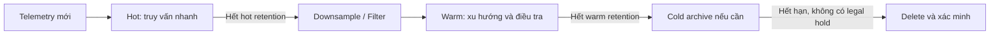
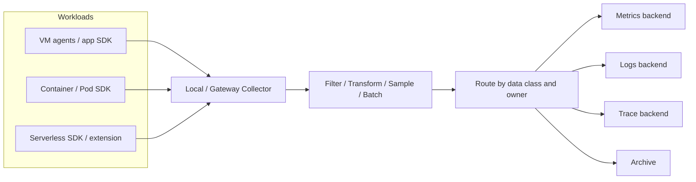

# Kiểm soát cardinality, thời gian lưu giữ và chi phí telemetry

Telemetry giúp đội ngũ hiểu workload compute đang hoạt động ra sao thông qua metrics, logs, traces và sự kiện. Tuy nhiên, mỗi nhãn metric mới, mỗi dòng log được lưu, mỗi span được tạo và mỗi ngày retention đều làm tăng dung lượng, tải xử lý và chi phí. Nếu không thiết kế từ đầu, một thay đổi nhỏ như đưa `user_id` vào label metric hoặc ghi toàn bộ request body vào log có thể khiến hệ thống quan sát tăng chi phí nhanh hơn chính workload.

Trong module **CLOUD_CORE_SERVICES_COMPUTE**, telemetry phản ánh sức khỏe của VM, container, hàm serverless, network, storage và dịch vụ phụ thuộc. Bài học này tập trung vào ba quyết định gắn chặt với nhau: giới hạn cardinality để kiểm soát số chuỗi và chiều dữ liệu; xác định thời gian lưu giữ theo mục đích sử dụng; và quản lý chi phí theo lượng dữ liệu thu thập, xử lý, truy vấn, sao chép và lưu trữ. Mục tiêu là giữ đủ tín hiệu để vận hành, điều tra và đáp ứng yêu cầu kiểm toán mà không thu thập dữ liệu vô hạn.

## Mục tiêu học tập

Sau bài này, bạn có thể:

- Giải thích cardinality trong metrics, logs và traces, đồng thời phân biệt số chuỗi metric với số giá trị khác nhau trong log.
- Thiết kế label và attribute có tập giá trị hữu hạn, tránh đưa định danh hoặc dữ liệu tùy ý vào chiều metric.
- Ước tính khối lượng telemetry từ số series, tần suất scrape, event rate, kích thước bản ghi và retention.
- Chọn sampling, aggregation, filtering và downsampling phù hợp với từng loại dữ liệu.
- Xây dựng chính sách retention theo mức độ quan trọng, thời gian điều tra và nghĩa vụ lưu trữ.
- Phân tích các thành phần tạo chi phí: ingestion, indexing, storage, query, egress, replication và archive.
- Thiết lập budget, quota, cảnh báo, ownership và quy trình xử lý khi telemetry tăng bất thường.
- Thiết kế pipeline telemetry có kiểm soát bằng OpenTelemetry Collector hoặc cơ chế tương đương.

## 1. Telemetry và bài toán chi phí

Telemetry là dữ liệu được tạo ra từ ứng dụng, runtime, hệ điều hành và hạ tầng để mô tả hoạt động của hệ thống. Ba loại dữ liệu phổ biến nhất là:

| Loại | Nội dung | Câu hỏi vận hành thường trả lời |
|---|---|---|
| Metrics | Giá trị số được ghi theo thời gian, thường tổng hợp theo chu kỳ | CPU có tăng không? Tỷ lệ lỗi và latency có vượt SLO không? |
| Logs | Bản ghi sự kiện có timestamp và trường ngữ cảnh | Request cụ thể thất bại vì lý do gì? Ai đã thay đổi cấu hình? |
| Traces | Chuỗi span mô tả một request hoặc công việc đi qua nhiều dịch vụ | Request chậm ở API, queue, database hay dịch vụ ngoài? |

Ngoài ra, hệ thống có thể thu thập profile, event bảo mật, audit log, flow log và dữ liệu kiểm kê tài nguyên. Mỗi loại có giá trị và đặc tính lưu trữ khác nhau. Metrics thường có kích thước bản ghi nhỏ nhưng số series có thể tăng rất nhanh. Logs có thể chiếm nhiều byte do nội dung văn bản và payload. Traces có thể tạo nhiều span cho mỗi request và thường cần sampling.

### 1.1. Vì sao telemetry tăng chi phí?

Một nền tảng quan sát có thể tính phí theo một hoặc nhiều đơn vị:

- Số lượng series metric đang hoạt động hoặc số mẫu metric được ingest.
- Số GB log được ingest, index hoặc truy vấn.
- Số span/trace được ingest hoặc lưu trữ.
- Dung lượng lưu trữ và thời gian retention.
- Số lần truy vấn, thời gian compute, scan bytes hoặc số người dùng.
- Băng thông truyền dữ liệu, replication giữa vùng và truy xuất archive.
- Tài nguyên collector, gateway, message queue và backend tự vận hành.

Mô hình giá cụ thể tùy nhà cung cấp và gói dịch vụ. Cần đọc cách tính của nền tảng đang dùng; không thể suy ra chi phí chỉ từ kích thước file hoặc số dòng log. Một backend có thể tính riêng ingestion, index, retention và query.

### 1.2. Ba câu hỏi trước khi thu thập

Với mỗi tín hiệu, hãy xác định:

1. **Mục đích:** tín hiệu này dùng cho alert, dashboard, debug, audit, bảo mật hay phân tích dài hạn?
2. **Độ phân giải:** cần quan sát từng request, từng phút, từng giờ hay chỉ cần tổng hợp theo ngày?
3. **Thời hạn:** cần dữ liệu thô trong bao lâu, sau đó có thể tổng hợp, chuyển archive hoặc xóa?

Nếu không có người dùng, truy vấn hoặc quyết định vận hành nào phụ thuộc vào dữ liệu, cần xem xét giảm mức thu thập hoặc retention.

## 2. Cardinality là gì?

Cardinality là số lượng giá trị khác nhau trong một tập dữ liệu hoặc số tổ hợp giá trị tạo ra các chuỗi riêng. Trong hệ thống metrics dạng time series, một metric name kết hợp với tập label values tạo thành một time series riêng. Khi thêm label có nhiều giá trị, số series có thể tăng theo cấp số nhân.

Ví dụ metric `http_requests_total` có các label:

```text
http_requests_total{
  service="orders-api",
  method="GET",
  route="/orders/{order_id}",
  status_code="200"
}
```

Mỗi tổ hợp giá trị `service`, `method`, `route` và `status_code` tạo một chuỗi khác. Nếu các tập giá trị lần lượt có 4, 5, 20 và 6 giá trị, số tổ hợp tối đa theo phép nhân là:

```text
4 × 5 × 20 × 6 = 12.000 time series
```

Đây là cận trên lý thuyết nếu mọi tổ hợp đều xuất hiện; số series thực tế có thể thấp hơn. Tuy nhiên, chỉ cần thêm một label có hàng trăm nghìn giá trị như `user_id`, `request_id` hoặc URL đầy đủ, cardinality có thể tăng rất mạnh.

### 2.1. Cardinality và số time series

Với một metric, có thể ước tính số series tối đa như sau:

\[
N_{series} \approx \prod_{i=1}^{k} |V_i|
\]

Trong đó:

- `k` là số label dimensions.
- `V_i` là tập giá trị có thể xuất hiện của label thứ `i`.
- `|V_i|` là số giá trị khác nhau của label đó.

Nếu có nhiều metric, tổng số series là tổng số series của từng metric, sau khi xét các tổ hợp label thực tế. Các metric có label set khác nhau nên không thể luôn dùng một phép nhân duy nhất cho toàn bộ hệ thống.

Ví dụ, `http_requests_total` có 12.000 series; `http_request_duration_seconds` có cùng label dimensions và là histogram cổ điển với 12 bucket hữu hạn cộng bucket `+Inf`, `sum` và `count`. Với mỗi tổ hợp label, histogram cổ điển có thể tạo 15 series thành phần, tương đương khoảng 180.000 series cho metric histogram này. Native histogram có cách biểu diễn và chi phí khác, vì vậy cần xem loại histogram backend sử dụng.

### 2.2. Cardinality không chỉ là số label

Một metric có 8 label không nhất thiết có cardinality cao nếu mọi label đều có tập giá trị nhỏ. Ngược lại, metric chỉ có 2 label vẫn có thể tạo hàng triệu series nếu một label chứa định danh tùy ý.

Hãy xem xét đồng thời:

- Số lượng label dimensions.
- Số giá trị có thể xuất hiện ở mỗi label.
- Số tổ hợp thực tế.
- Tốc độ xuất hiện và biến mất của series (series churn).
- Số metric name được instrument.
- Số bucket của histogram và cách backend lưu histogram.
- Số workload, replica, region và môi trường được scrape.

Cardinality cao làm tăng RAM, CPU, index, metadata, compaction, query planning và dung lượng lưu trữ. Series churn cao cũng gây tải ngay cả khi số series đồng thời không quá lớn, vì backend liên tục tạo và đóng series mới.

### 2.3. Cardinality trong logs và traces

Với logs, cần phân biệt:

- **Event volume:** số bản ghi và tổng byte được ghi.
- **Field cardinality:** số giá trị khác nhau của một trường như `user_id`, `session_id`, `url` hoặc `exception.message`.
- **Index cardinality:** số lượng giá trị hoặc term mà hệ thống index phải quản lý, tùy cấu trúc backend.

Một trường có nhiều giá trị không nhất thiết làm tăng số time series, nhưng có thể làm index phình to, truy vấn chậm hoặc tăng chi phí lưu trữ index. Nếu backend cho phép lưu field dạng không index hoặc chỉ index một tập field, cần chọn theo truy vấn thực tế.

Với traces, mỗi request có thể tạo nhiều span. `trace_id` và `span_id` vốn có độ đa dạng rất lớn; chúng cần để liên kết trace và debug, nhưng thường không nên dùng làm chiều metric tổng hợp hoặc index toàn bộ như một dimension phổ biến. Attribute như `http.route` đã chuẩn hóa thường phù hợp hơn `url.full` chứa path/query tùy ý.

## 3. Thiết kế label và attribute có kiểm soát

Nguyên tắc chính là chỉ đưa vào metric labels những chiều có tập giá trị hữu hạn, ổn định và có giá trị cho dashboard/alert. Định danh duy nhất nên nằm trong logs hoặc traces khi cần điều tra, với quyền truy cập và retention phù hợp.

### 3.1. Label có cardinality thấp và cao

| Trường | Đánh giá thường gặp | Lý do và cách dùng |
|---|---|---|
| `service` | Thấp đến trung bình | Danh sách service được quản lý; dùng nếu có registry/ownership |
| `environment` | Thấp | Ví dụ dev, staging, production |
| `region` | Thấp | Tập region triển khai có giới hạn |
| `method` | Thấp | GET, POST, PUT, DELETE hoặc tập method chuẩn hóa |
| `status_code` | Thấp | Mã HTTP hữu hạn; có thể nhóm theo class 2xx/4xx/5xx |
| `route` | Thấp nếu chuẩn hóa | Dùng route template như `/orders/{order_id}`, không dùng URL cụ thể |
| `instance_type` | Thấp đến trung bình | Loại VM được chọn từ catalog; theo dõi số giá trị thực tế |
| `version` | Trung bình | Có ích khi so sánh release; cần kiểm soát số phiên bản tồn tại |
| `instance_id` | Cao/churn cao | Từng VM tạo series riêng; ưu tiên log/resource metadata khi cần drill-down |
| `pod_uid` / `container_id` | Cao/churn cao | Thay đổi theo vòng đời Pod/container; tránh đưa vào metric mặc định |
| `user_id` | Rất cao và nhạy cảm | Không dùng làm metric label; lưu có kiểm soát trong trace/log nếu thật sự cần |
| `request_id` / `trace_id` | Gần như duy nhất mỗi request | Dùng để liên kết log/trace, không dùng làm metric label |
| `url.full` | Có thể rất cao | Query string/path tùy ý; thay bằng route template và domain đã chuẩn hóa |
| `exception.message` | Có thể rất cao | Nội dung lỗi có thể chứa ID, đường dẫn và dữ liệu; dùng exception type/code chuẩn hóa |
| `sql.query` | Có thể rất cao và nhạy cảm | Không dùng raw SQL làm label; dùng operation/query fingerprint đã chuẩn hóa |

Cardinality là thuộc tính của dữ liệu thực tế. Một trường có vẻ hữu hạn hôm nay có thể tăng vô hạn nếu ứng dụng cho phép người dùng tự đặt giá trị. Cần có quy tắc và kiểm tra ở nơi phát sinh dữ liệu.

### 3.2. Chuẩn hóa route và lỗi

Không tạo metric riêng cho từng URL như:

```text
http_requests_total{path="/orders/839201"}
http_requests_total{path="/orders/839202"}
http_requests_total{path="/orders/839203"}
```

Thay vào đó dùng route template:

```text
http_requests_total{route="/orders/{order_id}"}
```

Tương tự, không đưa nguyên văn thông báo exception vào label. Dùng `exception_type="TimeoutError"` hoặc `error_code="DB_POOL_EXHAUSTED"` nếu tập giá trị được kiểm soát. Nội dung stack trace có thể lưu trong log có quyền truy cập giới hạn và retention phù hợp.

### 3.3. Resource attributes và metric labels

OpenTelemetry resource attributes mô tả thực thể tạo telemetry, ví dụ `service.name`, `service.version`, `deployment.environment.name`, `cloud.region` và `host.name`. Backend có thể chuyển một số resource attributes thành metric dimensions hoặc index fields. Vì vậy việc gắn attribute vào resource không tự động loại bỏ rủi ro cardinality.

Phân biệt:

- **Resource attributes:** định danh dịch vụ, process, host, container hoặc function tạo dữ liệu.
- **Metric attributes/labels:** chiều được dùng để phân nhóm và truy vấn time series.
- **Log attributes:** ngữ cảnh của một event; chọn trường index theo nhu cầu truy vấn.
- **Span attributes:** ngữ cảnh của một operation; giữ trace/span ID để liên kết nhưng kiểm soát việc lập chỉ mục và chuyển thành metric.

Một số resource attributes như `host.id`, `container.id` hoặc `faas.instance` có thể có nhiều giá trị và churn cao. Chỉ đưa chúng vào metric khi có nhu cầu vận hành rõ ràng và đã tính cardinality.

### 3.4. Quy ước đặt tên và giới hạn

Đặt quy ước telemetry dùng chung:

- Tên metric mô tả đại lượng và đơn vị, ví dụ `http_server_request_duration_seconds`.
- Label dùng tên chuẩn, tập giá trị được liệt kê và có owner.
- Không đưa dữ liệu cá nhân, secret, token, email hoặc nội dung request vào metric.
- Chuẩn hóa route, error code, operation và trạng thái.
- Có giới hạn số label dimensions và budget series theo service.
- Thay đổi label phải qua review vì có thể tạo breaking change cho dashboard, alert và chi phí.

## 4. Quản lý cardinality của metrics

Metrics thường được lưu thành time series. Mỗi series có metadata và mẫu theo thời gian; vì vậy cardinality ảnh hưởng cả bộ nhớ đang hoạt động lẫn dữ liệu lưu trữ.

### 4.1. Ước tính số mẫu

Nếu có `N` series đang được scrape mỗi `T` giây, số mẫu trong khoảng thời gian `D` giây xấp xỉ:

\[
Samples \approx N \times \frac{D}{T}
\]

Ví dụ có 1.200 series, scrape mỗi 15 giây, trong 30 ngày:

```text
Số lần scrape mỗi giây = 1 / 15
Số giây trong 30 ngày = 30 × 24 × 60 × 60 = 2.592.000
Số mẫu = 1.200 × (2.592.000 / 15)
       = 207.360.000 samples
```

Nếu cardinality tăng lên 12.000 series, số mẫu tăng lên khoảng 2,0736 tỷ trong cùng thời gian. Đây là phép ước tính số mẫu thô; chi phí thực tế còn phụ thuộc encoding, compression, replication, metadata, index, retention và mô hình giá.

### 4.2. Histogram và summary

Histogram giúp phân tích phân phối latency hoặc kích thước payload. Với histogram cổ điển, mỗi label set tạo nhiều bucket series cùng `sum` và `count`; số bucket tăng làm số series tăng. Không nên thêm quá nhiều bucket chỉ để có độ chính xác không cần thiết.

Chọn bucket dựa trên:

- SLO hoặc ngưỡng latency cần đánh giá.
- Phân phối thực tế qua benchmark.
- Nhu cầu tính quantile và khả năng tổng hợp giữa replica.
- Chi phí series và khả năng lưu trữ của backend.

Summary có thể tính quantile ở phía client nhưng thường không thể tổng hợp quantile chính xác giữa nhiều instance theo cách đơn giản. Histogram thường thuận lợi hơn cho tổng hợp phân phối ở backend hỗ trợ histogram. Cần chọn loại metric theo ngữ nghĩa và backend, không chỉ theo thói quen.

### 4.3. Kiểm soát cardinality ở nhiều lớp

1. **Instrumentation:** thiết kế label có tập giá trị hữu hạn; chuẩn hóa route và error code.
2. **SDK/agent:** hạn chế attribute, loại bỏ trường không cần trước khi export.
3. **Collector:** transform, filter, aggregate hoặc drop dimension theo policy.
4. **Backend:** đặt giới hạn series, cảnh báo cardinality, quota theo tenant/service và theo dõi series churn.
5. **Dashboard/alert:** dùng aggregation hợp lý, tránh truy vấn mọi định danh khi chỉ cần xu hướng.

Ưu tiên sửa tại nguồn. Drop label ở collector có thể cứu backend trong sự cố nhưng không giải quyết triệt để việc ứng dụng tiếp tục phát sinh dữ liệu không kiểm soát. Khi loại bỏ label, cần kiểm tra xem dashboard, alert hoặc quy trình điều tra có phụ thuộc vào chiều đó không.

### 4.4. Phát hiện metric cardinality bất thường

Theo dõi các chỉ số:

- Tổng active series và series mới theo thời gian.
- Series theo metric name, service, namespace và environment.
- Số label values mới và top label có nhiều giá trị.
- Series churn, scrape samples, ingestion rate và rejected samples.
- Tỷ lệ metric không được dashboard/alert sử dụng.
- Tốc độ tăng dung lượng và chi phí theo service/tenant.

Ví dụ truy vấn PromQL để xem số series theo metric name:

```promql
topk(20, count by (__name__) ({__name__=~".+"}))
```

Ví dụ xem số series theo service nếu metric có label `service`:

```promql
topk(20, count by (service) ({__name__=~".+"}))
```

Các truy vấn này có thể tốn tài nguyên trên backend lớn; dùng công cụ cardinality explorer hoặc API metadata của nền tảng nếu có. Cú pháp và hiệu quả phụ thuộc Prometheus-compatible backend.

## 5. Quản lý cardinality của logs

Logs thường được lưu dưới dạng event có timestamp, severity, body và attributes. Chi phí chịu ảnh hưởng bởi event rate, kích thước trung bình, mức độ index, compression, retention và truy vấn.

### 5.1. Structured logging

Ưu tiên log có cấu trúc để trường cần lọc được thể hiện riêng:

```json
{
  "timestamp": "2026-11-22T10:15:30Z",
  "severity": "ERROR",
  "service": "orders-api",
  "environment": "production",
  "route": "/orders/{order_id}",
  "error_code": "DB_POOL_EXHAUSTED",
  "request_id": "req-7f91c2",
  "message": "Database connection pool exhausted"
}
```

Trong ví dụ, `service`, `environment`, `route` và `error_code` có thể là các trường lọc thường dùng. `request_id` có giá trị cao khi điều tra một request nhưng có thể có cardinality rất lớn; backend nên lưu để tra cứu khi cần mà không nhất thiết tạo index đắt tiền cho mọi bản ghi. Cần cân nhắc chính sách index, field mapping và quyền truy cập của nền tảng.

### 5.2. Không log dữ liệu không cần thiết

Tránh ghi:

- Password, access token, API key, session cookie và private key.
- Toàn bộ request/response body nếu có dữ liệu cá nhân hoặc thanh toán.
- Raw SQL chứa dữ liệu người dùng.
- Header xác thực hoặc thông tin bí mật trong URL query string.
- Stack trace lặp lại với nội dung không có giá trị chẩn đoán.

Nếu cần correlation, ghi request/trace ID đã tạo có kiểm soát và dùng nó để liên kết đến trace. Redaction nên diễn ra trước khi dữ liệu rời workload hoặc tại collector đáng tin cậy; xóa secret sau khi đã ingest vào backend có thể không loại bỏ được bản sao, index hoặc archive.

### 5.3. Sampling và giảm log volume

Các cách giảm log volume:

- Giảm log lặp ở mức `DEBUG` trong production.
- Chỉ ghi log theo sự kiện có ý nghĩa, tránh log mỗi vòng lặp hoặc mỗi lần polling.
- Dùng sampling cho log thành công có tần suất rất cao nếu yêu cầu audit không bắt buộc lưu mọi event.
- Giữ log lỗi, cảnh báo bảo mật và sự kiện quản trị theo policy.
- Gộp hoặc rate-limit log lặp nhưng giữ counter về số lần bị giới hạn.
- Dùng metric cho xu hướng số lượng thay vì lưu một log cho mỗi lần xảy ra.

Không sampling audit log bắt buộc, giao dịch tài chính hoặc sự kiện cần bằng chứng đầy đủ nếu policy yêu cầu lưu toàn bộ. Với log lỗi, có thể dùng sampling có điều kiện nhưng cần tránh bỏ mất lỗi hiếm hoặc lỗi chỉ xảy ra ở một tenant.

### 5.4. Index có chọn lọc

Không phải mọi trường log đều cần index. Xác định các truy vấn phổ biến và index những trường có giá trị như timestamp, service, severity, environment, error code và một số correlation key. Trường có cardinality cao có thể lưu trong document nhưng không index, hoặc dùng cơ chế tra cứu khác nếu backend hỗ trợ.

Trước khi thay mapping/index, kiểm tra ảnh hưởng đến truy vấn, dashboard, alert và chi phí reindex. Một số backend tính chi phí theo ingest hoặc storage dù field không index; giảm index có thể giảm một phần chi phí nhưng không nhất thiết giảm toàn bộ.

## 6. Quản lý cardinality và volume của traces

Distributed tracing theo dõi request qua nhiều dịch vụ bằng trace gồm nhiều span. Một span thường có tên operation, thời gian bắt đầu/kết thúc, status, parent và attributes.

### 6.1. Span và attribute

Các trường hữu ích thường gồm:

- `service.name`, `service.version`, `deployment.environment.name`.
- `http.request.method`, `http.route`, `http.response.status_code`.
- `db.system`, `db.operation.name` hoặc query fingerprint đã chuẩn hóa.
- `messaging.system`, destination đã chuẩn hóa và consumer group.
- `exception.type` và status code.

Hạn chế attribute có giá trị tùy ý như raw URL, SQL statement, user email, payload, token hoặc nội dung exception không chuẩn hóa. Giữ `trace_id` và `span_id` để liên kết theo thiết kế của tracing; kiểm soát việc lập chỉ mục và biến chúng thành metric dimensions.

### 6.2. Sampling

Sampling quyết định trace nào được giữ. Các cách thường gặp:

- **Head sampling:** quyết định sớm khi trace bắt đầu, ví dụ lấy một tỷ lệ cố định. Dễ mở rộng nhưng có thể bỏ lỡ lỗi hiếm vì quyết định trước khi biết kết quả.
- **Tail sampling:** quyết định sau khi đã quan sát các span hoặc trạng thái kết thúc, có thể ưu tiên giữ trace lỗi, trace chậm hoặc trace của nhóm được chọn. Cần collector giữ dữ liệu tạm và gom các span cùng trace, tăng yêu cầu bộ nhớ và độ phức tạp.
- **Adaptive/dynamic sampling:** điều chỉnh tỷ lệ theo tải, service hoặc tình trạng hệ thống; cần giới hạn và giám sát để tránh làm mất tính đại diện.

Ví dụ policy tail sampling có thể giữ 100% trace có status error, giữ trace vượt latency threshold và lấy mẫu một tỷ lệ nhỏ trace thành công. Đây chỉ là ví dụ; ngưỡng cần theo SLO và traffic thực tế.

### 6.3. Không làm mất khả năng liên kết

Nếu logs chứa `trace_id`, có thể truy từ một log lỗi sang trace tương ứng. Metrics có thể dùng exemplars để liên kết một điểm đo với trace mẫu nếu backend hỗ trợ. Khi sampling, cần hiểu rằng không phải request nào cũng có trace đầy đủ; dashboard không nên giả định mọi log đều có trace được lưu.

## 7. Thiết kế retention theo mục đích

Retention là thời gian dữ liệu được giữ trong một hệ thống hoặc một tầng lưu trữ. Chính sách tốt xác định thời hạn theo loại telemetry, mục đích, độ nhạy cảm, yêu cầu pháp lý/hợp đồng, khả năng điều tra và chi phí.

### 7.1. Phân biệt retention với backup và archive

- **Retention:** khoảng thời gian dữ liệu được giữ để truy vấn hoặc đáp ứng mục đích đã định.
- **Backup:** bản sao phục vụ khôi phục khi dữ liệu/hệ thống bị mất hoặc hỏng.
- **Archive:** lưu dữ liệu dài hạn với chi phí thấp hơn, thường truy xuất chậm hơn.
- **Legal hold:** giữ dữ liệu vượt thời hạn thông thường theo yêu cầu pháp lý/điều tra được phê duyệt.

Backup không thay thế retention policy; archive không mặc nhiên đáp ứng yêu cầu truy vấn nhanh; xóa khỏi hot tier không đồng nghĩa dữ liệu đã bị xóa khỏi mọi replica, snapshot hoặc archive.

### 7.2. Retention theo loại dữ liệu

| Dữ liệu | Mục đích chính | Cách xác định retention |
|---|---|---|
| Metrics độ phân giải cao | Alert, dashboard, điều tra sự cố gần thời điểm xảy ra | Giữ raw đủ cho cửa sổ điều tra và phân tích xu hướng gần |
| Metrics đã downsample | Phân tích xu hướng dài hạn và capacity planning | Giữ lâu hơn với độ phân giải thấp hơn nếu còn giá trị |
| Application logs | Debug, vận hành và phân tích lỗi | Theo nhu cầu sự cố, SLO, privacy và policy tổ chức |
| Security/audit logs | Điều tra truy cập, thay đổi và sự kiện bảo mật | Theo yêu cầu pháp lý, kiểm toán, hợp đồng và quy định nội bộ |
| Traces | Debug request và phân tích latency | Giữ raw có chọn lọc; sampling và thời gian ngắn hơn nếu không có yêu cầu khác |
| Flow/network logs | Điều tra đường đi và bất thường mạng | Theo thời gian cần cho điều tra và năng lực lưu trữ |
| Profiles | Phân tích hiệu năng CPU/memory | Giữ theo chiến dịch profiling và nhu cầu so sánh |

Không có một số ngày retention đúng cho mọi tổ chức. Hãy xác định yêu cầu theo data classification, nghĩa vụ pháp lý, thời gian phát hiện sự cố, thời gian điều tra và ngân sách. Nếu chưa có policy, cần thống nhất với chủ sở hữu dữ liệu, bảo mật và pháp chế trước khi đặt thời hạn production.

### 7.3. Tiered retention

Có thể chia lưu trữ thành các tầng:

| Tầng | Đặc điểm | Dữ liệu phù hợp |
|---|---|---|
| Hot | Truy vấn nhanh, chi phí cao hơn | Metrics/logs/traces mới, dữ liệu phục vụ alert và điều tra đang diễn ra |
| Warm | Chi phí và tốc độ ở mức trung gian | Dữ liệu cần truy vấn ít thường xuyên hơn |
| Cold/archive | Chi phí lưu trữ thấp hơn, thời gian khôi phục/truy vấn dài hơn | Audit hoặc dữ liệu dài hạn được phép archive |
| Expired/deleted | Hết thời hạn và không còn legal hold | Dữ liệu đã được xóa theo policy và quy trình xác minh |

Ví dụ luồng vòng đời:



Không phải mọi dữ liệu đều cần đi qua mọi tầng. Trace thành công có thể được sampling và xóa sớm; audit log quan trọng có thể cần lưu lâu hơn; metric raw có thể được downsample trước khi archive.

### 7.4. Downsampling và aggregation

Downsampling giảm độ phân giải theo thời gian. Ví dụ, metric CPU ghi mỗi 15 giây có thể được tổng hợp thành trung bình, min/max hoặc percentile theo 5 phút và 1 giờ. Điều này giảm số mẫu nhưng làm mất chi tiết ngắn hạn.

Chọn phép tổng hợp theo ý nghĩa metric:

- Gauge như CPU utilization: có thể lưu average, min, max hoặc percentile tùy mục đích.
- Counter: cần dùng delta/rate và tổng hợp đúng cách, tránh cộng các giá trị counter tuyệt đối qua reset.
- Histogram: tổng hợp bucket/count/sum đúng cấu trúc để giữ khả năng tính phân phối.
- Error count: giữ tổng số lỗi và tổng request để có thể tính tỷ lệ chính xác.

Không downsample bằng cách lấy trung bình mọi metric. Với latency, trung bình có thể che giấu tail latency; cần giữ histogram hoặc thống kê percentile phù hợp.

### 7.5. Privacy, legal hold và xóa dữ liệu

Logs/traces có thể chứa dữ liệu cá nhân hoặc thông tin bí mật. Chính sách retention phải xét mục đích thu thập, quyền truy cập, vị trí lưu trữ, mã hóa, retention và xóa dữ liệu. Nếu một request có quyền yêu cầu xóa dữ liệu cá nhân, cần biết dữ liệu đó xuất hiện trong log/trace/index/archive nào và quy trình xử lý ra sao.

Legal hold phải có người phê duyệt, phạm vi dữ liệu, lý do và thời điểm kết thúc. Khi hết hold, dữ liệu trở lại quy trình retention bình thường. Không giữ telemetry vô thời hạn chỉ vì có thể hữu ích trong tương lai.

## 8. Ước tính khối lượng telemetry và chi phí

Ước tính trước giúp phát hiện thiết kế không bền vững. Dùng số liệu đo được từ staging/load test hoặc production tương tự; giả định phải được ghi rõ.

### 8.1. Metrics

```text
Số mẫu metric ≈ active_series × (thời gian tính bằng giây / scrape_interval)
Dung lượng thô ≈ số mẫu × byte trung bình mỗi mẫu
Dung lượng lưu trong cửa sổ retention ≈ dung lượng/ngày sau nén × số ngày retention × replication factor
```

Byte trung bình mỗi mẫu phụ thuộc backend và encoding; không dùng một con số cố định cho mọi hệ thống. Ngoài samples, cần tính metadata/index, WAL, compaction, replica và head block.

### 8.2. Logs

```text
Log bytes mỗi ngày ≈ events_per_second × average_event_bytes × 86.400
Dung lượng retention ≈ log_bytes_per_day × số ngày × hệ số lưu trữ
```

Ví dụ một service phát 250 log events/giây, trung bình 700 byte/event:

```text
250 × 700 × 86.400 = 15.120.000.000 byte/ngày
≈ 15,12 GB/ngày theo hệ thập phân, trước compression/index/replication
```

Nếu giữ 14 ngày, dữ liệu đầu vào tương đương khoảng 211,68 GB trước khi xét compression, index và bản sao. Đây là ví dụ số học, không phải dự báo chi phí của một nhà cung cấp.

### 8.3. Traces

```text
Spans mỗi ngày ≈ requests_per_second × average_spans_per_request
                × 86.400 × sampling_ratio

Trace bytes ≈ số spans được giữ × average_span_bytes
```

Ví dụ 500 request/giây, trung bình 8 span/request và giữ 10% trace:

```text
500 × 8 × 86.400 × 0,10 = 34.560.000 spans/ngày
```

Nếu một trace có nhiều span, sampling theo trace giúp giữ hoặc bỏ cả nhóm liên kết nhất quán hơn so với sampling từng span độc lập. Thực tế cần tính thêm attribute, event, link, index và overhead.

### 8.4. Mô hình tổng chi phí

Có thể lập bảng chi phí theo thành phần:

| Thành phần | Driver chính | Câu hỏi kiểm soát |
|---|---|---|
| Ingestion | Samples, log bytes, spans, events | Có thu thập dữ liệu trùng hoặc không cần không? |
| Cardinality/index | Số series, field values, index terms | Có dimension không giới hạn hoặc index quá nhiều field không? |
| Storage | Dung lượng, retention, replication | Raw có cần giữ lâu không? Có thể downsample/archive không? |
| Query/compute | Số truy vấn, scan bytes, thời gian compute | Dashboard có truy vấn quá rộng hoặc refresh quá thường xuyên không? |
| Egress/network | GB truyền giữa region, account hoặc provider | Có thể xử lý gần nguồn hoặc dùng private path không? |
| Collector/agent | CPU, RAM, queue, disk buffer | Collector có overprovision hoặc retry gây nhân đôi dữ liệu không? |
| Archive/restore | Dung lượng cold, request retrieval, thời gian phục hồi | Dữ liệu có thực sự cần archive và đã thử restore chưa? |
| People/operations | Công sức vận hành và điều tra | Thiết kế có quá phức tạp hoặc thiếu ownership không? |

Chi phí tổng thể có thể mô tả:

```text
Total telemetry cost
  = ingestion
  + indexing/cardinality
  + hot/warm/cold storage
  + query/compute
  + network/egress/replication
  + collector and pipeline infrastructure
  + archive retrieval and operations
```

Một số gói dịch vụ gộp nhiều thành phần hoặc tính theo host/seat thay vì từng GB. Hãy map các driver trên vào bảng giá và hóa đơn thực tế, không giả định mọi nhà cung cấp đều tính cùng cách.

## 9. Pipeline telemetry có kiểm soát

Thay vì gửi trực tiếp mọi dữ liệu từ từng workload đến backend, có thể dùng collector/gateway để áp dụng policy tập trung. OpenTelemetry Collector là một lựa chọn phổ biến cho metrics, logs và traces.

### 9.1. Kiến trúc tham khảo



Collector có thể chuẩn hóa resource attributes, xóa secret, drop field không cần, batch dữ liệu, sampling trace và route theo loại dữ liệu. Với dữ liệu nhạy cảm, cần bảo vệ đường truyền, collector, buffer và quyền truy cập config.

### 9.2. Các processor thường dùng

- **Memory limiter:** bảo vệ collector khỏi sử dụng RAM vượt giới hạn.
- **Batch:** gom nhiều record để giảm overhead truyền tải.
- **Filter:** loại bỏ telemetry không cần hoặc không được phép.
- **Attributes/resource transform:** chuẩn hóa, đổi tên hoặc xóa attribute.
- **Probabilistic sampling:** lấy mẫu theo tỷ lệ khi phù hợp.
- **Tail sampling:** chọn trace sau khi đã quan sát trạng thái hoặc đặc điểm của trace.
- **Routing:** gửi loại dữ liệu đến backend hoặc retention policy phù hợp.

Thứ tự processor quan trọng. Redaction dữ liệu nhạy cảm nên diễn ra trước khi export đến hệ thống bên ngoài. Tail sampling cần đủ buffer để giữ các span của một trace; nếu collector thiếu bộ nhớ hoặc phân phối span không nhất quán, quyết định sampling có thể sai.

### 9.3. Cấu hình minh họa

Ví dụ dưới đây mô tả ý tưởng cấu hình Collector; tên receiver/exporter và cú pháp chi tiết cần điều chỉnh theo phiên bản, backend và môi trường triển khai:

```yaml
processors:
  memory_limiter:
    check_interval: 1s
    limit_mib: 512
    spike_limit_mib: 128

  batch:
    send_batch_size: 1024
    timeout: 5s

  attributes/sanitize:
    actions:
      - key: http.request.header.authorization
        action: delete
      - key: user.email
        action: delete

  filter/drop_debug:
    logs:
      log_record:
        - 'severity_text == "DEBUG"'

service:
  pipelines:
    logs:
      receivers: [otlp]
      processors: [memory_limiter, attributes/sanitize, filter/drop_debug, batch]
      exporters: [otlp/logs-backend]
```

Đây là ví dụ định hướng, không phải cấu hình hoàn chỉnh có thể copy vào mọi Collector. Cần khai báo receiver/exporter thực tế, kiểm tra biểu thức filter theo phiên bản và xác minh việc xóa attribute không ảnh hưởng audit hoặc điều tra. Không drop DEBUG nếu môi trường hoặc yêu cầu cụ thể cần giữ dữ liệu đó.

## 10. Budget, quota và ownership

Telemetry cần có chủ sở hữu và ngân sách giống compute. Nếu không biết service nào tạo dữ liệu, nhóm nền tảng khó kiểm soát tăng trưởng và phân bổ chi phí.

### 10.1. Telemetry budget theo service

Một budget có thể gồm:

- Active series tối đa và tốc độ tăng series.
- Samples/sec hoặc ingest bytes/ngày.
- Log bytes/ngày theo severity/service.
- Spans/sec, sampling ratio và số trace giữ lại.
- Retention hot/warm/archive.
- Chi phí dự kiến theo tháng và ngưỡng cảnh báo.
- Owner, cost center, environment và ngày review.

Ví dụ budget định hướng:

| Tín hiệu | Mục tiêu ban đầu | Ngưỡng cần xem xét |
|---|---|---|
| Metrics | Label có tập giá trị được duyệt; active series theo service có quota | Tăng series vượt 20% so với baseline trong một ngày |
| Logs | Có volume budget theo service và severity | Ingest bytes/ngày vượt budget hoặc tăng đột biến |
| Traces | Sampling theo loại request và lỗi; attribute được chuẩn hóa | Span rate hoặc trace bytes tăng ngoài dự kiến |
| Retention | Hot/warm/cold theo data class | Dữ liệu hết hạn vẫn tồn tại hoặc archive không có owner |

Các ngưỡng 20% chỉ là ví dụ để minh họa cách đặt cảnh báo; cần hiệu chỉnh theo biến động bình thường và SLO. Đặt alert dựa trên baseline và tốc độ tăng giúp phát hiện sớm hơn so với chỉ dùng giới hạn tuyệt đối.

### 10.2. Chargeback và showback

- **Showback:** hiển thị chi phí telemetry cho từng team/service để tăng nhận thức.
- **Chargeback:** phân bổ hoặc tính chi phí về cost center theo quy tắc nội bộ.

Để phân bổ được, cần gắn metadata như `service`, `team`, `environment`, `cost_center` và `data_class` một cách nhất quán. Không dùng định danh cá nhân hoặc giá trị tùy ý làm dimension chi phí. Nếu backend không thể phân bổ chính xác theo service, dùng số liệu collector/ingestion hoặc phương pháp ước tính được công bố rõ.

### 10.3. Guardrail tự động

Có thể kiểm tra ở CI/CD hoặc admission:

- Từ chối metric instrumentation đưa `user_id`, `request_id` hoặc raw URL thành label.
- Cảnh báo khi thêm label mới chưa có owner hoặc cardinality estimate.
- Chặn log field chứa token/secret đã biết qua secret scanning.
- Kiểm tra retention policy được gán cho data stream/index.
- Cảnh báo collector exporter hoặc sampling policy bị thay đổi.
- Theo dõi service mới chưa có budget/owner.

Guardrail cần có cơ chế ngoại lệ có thời hạn và audit. Nếu chặn quá cứng, developer có thể bỏ qua pipeline hoặc tự gửi telemetry qua đường khác.

## 11. Ví dụ thực tế: kiểm soát telemetry cho nền tảng compute

Giả sử một nền tảng có 40 VM chạy API, 60 Pod worker và một số function xử lý event. Metrics được scrape mỗi 15 giây; logs gửi tập trung; traces được instrument bằng OpenTelemetry.

### 11.1. Vấn đề cardinality

API thêm label `customer_id` vào `http_requests_total` để tìm lỗi theo khách hàng. Nền tảng có 200.000 khách hàng, 5 HTTP methods, 30 route template và 6 nhóm status. Cận trên số tổ hợp của riêng các dimensions đó:

```text
200.000 × 5 × 30 × 6 = 180.000.000 series
```

Không phải mọi tổ hợp đều xuất hiện, nhưng chỉ riêng `customer_id` đã có khả năng tạo một lượng series rất lớn. Cách sửa:

1. Loại `customer_id` khỏi metric labels.
2. Giữ metric tổng hợp theo `service`, `route`, `method` và `status_class`.
3. Đưa customer identifier vào trace/log khi cần điều tra, theo chính sách privacy và quyền truy cập.
4. Dùng correlation ID để tìm request cụ thể.
5. Theo dõi series count sau deploy và đặt cảnh báo nếu tăng bất thường.

### 11.2. Ước tính metrics

Giả sử sau khi chuẩn hóa, API có 1.500 active series. Với scrape interval 15 giây và retention raw 15 ngày:

```text
Số mẫu/ngày = 1.500 × (86.400 / 15)
             = 8.640.000 samples/ngày

Số mẫu/15 ngày = 129.600.000 samples
```

Nếu tăng scrape frequency lên mỗi 5 giây, số mẫu tăng gấp ba trong khi cardinality giữ nguyên. Vì vậy độ phân giải cần gắn với nhu cầu alert và debug, không nên giảm interval cho mọi metric chỉ vì muốn dashboard cập nhật nhanh hơn.

### 11.3. Chính sách logs và traces

Một chính sách ví dụ cho workload này:

- Giữ application error logs ở hot tier trong cửa sổ điều tra vận hành đã thống nhất.
- Giảm DEBUG logs ở production; bật theo thời hạn cho một service khi điều tra.
- Không lưu access token, email hoặc request body nhạy cảm.
- Giữ security/audit logs theo policy riêng và có quyền truy cập hạn chế.
- Lấy mẫu trace thành công theo tỷ lệ; ưu tiên giữ trace lỗi và trace chậm bằng tail sampling nếu pipeline đáp ứng.
- Giữ trace ID trong log để liên kết; không biến trace ID thành metric label.
- Archive dữ liệu audit dài hạn nếu policy yêu cầu, sau đó xóa khi hết hạn và không có legal hold.

Thời gian cụ thể phải do owner dữ liệu, bảo mật và pháp chế thống nhất theo nghĩa vụ áp dụng. Ví dụ này mô tả cách phân loại, không áp đặt một số ngày chung.

### 11.4. Phản ứng khi chi phí tăng

Nếu ingest volume tăng gấp đôi trong một ngày:

1. Xác định tín hiệu tăng: metrics series/samples, logs bytes hay spans.
2. Phân nhóm theo service, environment, collector và deployment version.
3. Kiểm tra thay đổi gần nhất về instrumentation, label, log level, retry hoặc sampling.
4. Xác định dimension hoặc event type đóng góp lớn nhất.
5. Áp dụng mitigation có kiểm soát: bỏ label không cần, giảm log lặp, sampling phù hợp hoặc tạm dừng telemetry không thiết yếu.
6. Giữ nguyên audit/security signal bắt buộc và các metric phục vụ SLO.
7. Xác minh dashboard, alert và điều tra vẫn hoạt động.
8. Ghi nhận nguyên nhân, owner, thời hạn khắc phục tại nguồn và cập nhật budget.

## 12. Xử lý sự cố cardinality hoặc telemetry cost

### 12.1. Dấu hiệu nhận biết

- Active series hoặc series churn tăng đột biến.
- Backend báo giới hạn cardinality, từ chối samples hoặc ingestion throttling.
- RAM/CPU của metrics backend hoặc collector tăng.
- Query chậm, timeout hoặc dashboard không tải được.
- Log ingest bytes/index size tăng dù request rate không đổi.
- Span rate tăng bất thường hoặc tail sampling buffer quá tải.
- Hóa đơn telemetry tăng nhanh hơn lưu lượng ứng dụng.

### 12.2. Quy trình điều tra

1. Xác nhận phạm vi và thời điểm bắt đầu; đối chiếu deployment/change event.
2. Tách theo signal type: metrics, logs, traces, profiles hoặc flow logs.
3. Tìm top service/metric/field/event type đóng góp lớn nhất.
4. So sánh cardinality, event rate, record size, scrape interval và sampling với baseline.
5. Kiểm tra label/attribute mới, raw URL, ID, exception text, retry loop hoặc log level.
6. Kiểm tra collector queue, retry, exporter và duplicate pipeline.
7. Xác định tín hiệu bắt buộc giữ và tín hiệu có thể giảm tạm thời.
8. Áp dụng thay đổi có phạm vi, theo dõi backend và xác minh alert/SLO.
9. Sửa instrumentation/policy tại nguồn, thêm regression guardrail và ghi lại chi phí trước/sau.

### 12.3. Biện pháp giảm tải khẩn cấp

- Drop một metric hoặc dimension được xác nhận là không cần thiết.
- Tắt log DEBUG hoặc rate-limit một loại log lặp.
- Giảm sampling trace thành công trong giới hạn đã thống nhất.
- Tăng batch hoặc scale collector nếu bottleneck nằm ở pipeline và ngân sách cho phép.
- Tạm dừng dashboard/query tốn tài nguyên không phục vụ sự cố.
- Chuyển dữ liệu ít truy vấn sang tier rẻ hơn nếu chính sách cho phép.

Không xóa dữ liệu đang chịu legal hold hoặc audit requirement. Không tắt toàn bộ telemetry để giảm hóa đơn; việc đó có thể làm mất khả năng phát hiện và điều tra sự cố đang diễn ra.

## 13. Những lỗi thiết kế thường gặp

| Lỗi | Hậu quả | Cách khắc phục |
|---|---|---|
| Dùng `user_id` hoặc `request_id` làm metric label | Series tăng theo từng người dùng/request | Chuyển định danh sang log/trace và dùng metric tổng hợp |
| Dùng URL đầy đủ làm label | Path/query tùy ý tạo cardinality lớn và có thể lộ dữ liệu | Dùng route template và loại query string |
| Thêm quá nhiều histogram buckets | Nhân số series theo mỗi label set | Chọn bucket theo SLO và phân phối thực tế |
| Index mọi trường log | Index lớn, ingest và query đắt | Index trường được truy vấn thường xuyên; lưu phần còn lại theo nhu cầu |
| Log toàn bộ request/response | Volume lớn và nguy cơ lộ PII/secret | Log có cấu trúc, redaction và chọn trường cần thiết |
| Sampling độc lập từng span | Trace thiếu span, khó phân tích | Sampling theo trace hoặc cơ chế giữ trace nhất quán |
| Tail sampling không đủ buffer | Mất span hoặc quyết định sampling sai | Phân phối theo trace ID, sizing collector và theo dõi buffer |
| Giữ raw telemetry vô thời hạn | Storage và index tăng liên tục | Tiered retention, downsampling và deletion policy |
| Xóa dữ liệu chỉ ở hot tier | Replica/archive vẫn giữ dữ liệu ngoài dự kiến | Định nghĩa vòng đời xuyên mọi bản sao và xác minh deletion |
| Không có owner/budget theo service | Không xác định được nguồn tăng chi phí | Gắn service/team/cost center và showback |
| Chỉ theo dõi hóa đơn hàng tháng | Phát hiện quá muộn | Alert theo ingest rate, cardinality và daily cost estimate |
| Drop telemetry không qua review | Mất tín hiệu bảo mật hoặc SLO | Phân loại bắt buộc/tùy chọn và có audit cho ngoại lệ |

## 14. Checklist quản trị telemetry

**Cardinality và instrumentation**

- [ ] Metric labels có tập giá trị hữu hạn và được owner duyệt.
- [ ] Không dùng user ID, request ID, trace ID, raw URL hoặc exception text làm metric labels.
- [ ] Route, error code và operation được chuẩn hóa.
- [ ] Histogram buckets phù hợp với SLO và chi phí series.
- [ ] Có theo dõi active series, churn và top dimensions.
- [ ] Resource attributes được đánh giá trước khi chuyển thành metric dimensions/index fields.

**Logs và traces**

- [ ] Logs có cấu trúc, có severity và correlation ID phù hợp.
- [ ] Secret, token và dữ liệu nhạy cảm được redaction trước khi export.
- [ ] Index chỉ áp dụng cho trường có nhu cầu truy vấn.
- [ ] Sampling không loại bỏ audit/security events bắt buộc.
- [ ] Trace sampling nhất quán theo trace; tail sampling có đủ buffer.
- [ ] Có liên kết logs, metrics và traces mà không tạo cardinality không cần thiết.

**Retention và chi phí**

- [ ] Mỗi data class có owner, purpose, retention và access policy.
- [ ] Raw, downsampled, hot, warm, cold và deletion lifecycle được xác định.
- [ ] Legal hold và backup được quản lý riêng với retention thông thường.
- [ ] Đã ước tính ingestion, storage, index, query, egress và replication.
- [ ] Có budget/quota và cảnh báo theo service/team.
- [ ] Có showback/chargeback hoặc báo cáo phân bổ chi phí.

**Vận hành**

- [ ] Collector có memory limit, batch, retry và queue monitoring.
- [ ] Có quy trình xử lý cardinality/volume spike.
- [ ] Thay đổi instrumentation, label và retention được review.
- [ ] Có kiểm tra tự động để ngăn dimension nguy hiểm và secret trong telemetry.
- [ ] Có quy trình xác minh xóa dữ liệu hết hạn trên index, replica và archive.

## 15. Kết luận

Cardinality, retention và chi phí telemetry cần được thiết kế cùng nhau. Metrics cần label có tập giá trị hữu hạn; logs cần kiểm soát event volume và index field; traces cần giới hạn span/attribute và sampling theo trace. Retention nên dựa trên mục đích, độ nhạy cảm, thời gian điều tra và nghĩa vụ lưu trữ, với các tầng hot, warm, cold và deletion rõ ràng.

Đo lường active series, samples, log bytes, spans, query và storage giúp phát hiện tăng trưởng trước khi hóa đơn hoặc backend trở thành sự cố. Collector, budget, quota, ownership và guardrail tự động biến các nguyên tắc này thành vận hành có thể kiểm chứng. Hãy giữ tín hiệu phục vụ SLO, bảo mật và điều tra; giảm dữ liệu trùng, không cần thiết hoặc có cardinality không kiểm soát; và xác minh vòng đời dữ liệu từ lúc phát sinh đến khi xóa.

## Thuật ngữ cần nhớ

| Thuật ngữ | Ý nghĩa |
|---|---|
| Telemetry | Dữ liệu được tạo từ workload/hạ tầng để quan sát hoạt động hệ thống. |
| Cardinality | Số giá trị hoặc tổ hợp giá trị khác nhau trong một tập dữ liệu. |
| Time series | Chuỗi mẫu theo thời gian được xác định bởi metric name và label set. |
| Label / attribute | Trường chiều dùng để mô tả và phân nhóm telemetry. |
| Series churn | Tốc độ tạo mới và kết thúc time series. |
| Histogram | Metric biểu diễn phân phối giá trị qua bucket, sum và count hoặc cấu trúc histogram native. |
| Structured logging | Ghi log theo trường có cấu trúc để lọc và phân tích. |
| Head sampling | Quyết định lấy mẫu trace ở đầu quá trình xử lý. |
| Tail sampling | Quyết định giữ trace sau khi quan sát các span/kết quả. |
| Downsampling | Giảm độ phân giải dữ liệu bằng tổng hợp theo khoảng thời gian. |
| Retention | Thời gian dữ liệu được giữ trong hệ thống hoặc tầng lưu trữ. |
| Archive | Tầng lưu trữ dài hạn, thường rẻ hơn nhưng truy xuất chậm hơn. |
| Legal hold | Yêu cầu giữ dữ liệu vượt thời hạn thông thường vì mục đích pháp lý/điều tra. |
| Showback | Báo cáo chi phí cho team/service để minh bạch mức sử dụng. |
| Chargeback | Phân bổ hoặc tính chi phí về cost center theo quy tắc tổ chức. |
| OpenTelemetry Collector | Thành phần nhận, xử lý và xuất telemetry theo pipeline cấu hình. |
