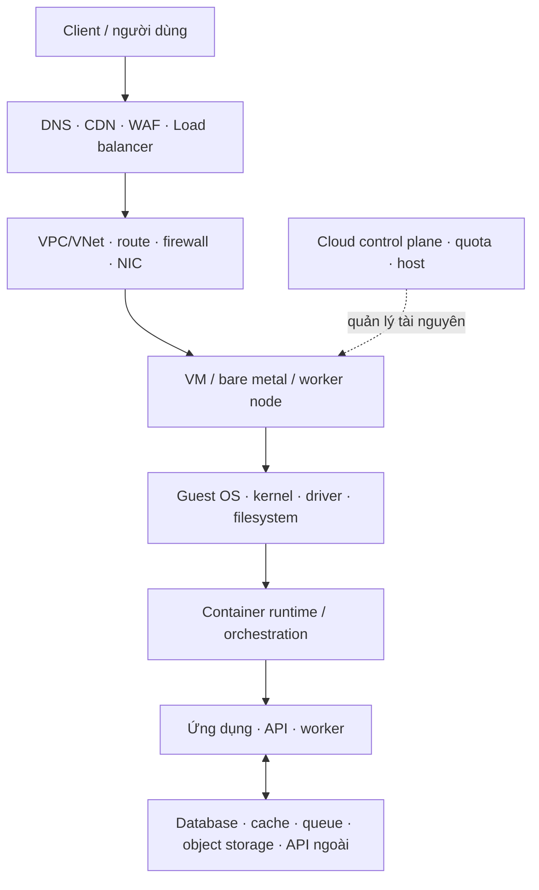
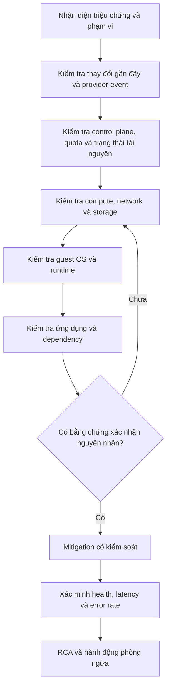

# Quy trình khoanh vùng lỗi từ cloud platform đến ứng dụng

Khi một dịch vụ compute bị chậm, không truy cập được hoặc trả lỗi, nguyên nhân có thể nằm ở nhiều lớp: cloud control plane, năng lực máy chủ, mạng, lưu trữ, hệ điều hành, container/runtime, ứng dụng hoặc dịch vụ phụ thuộc. Một VM có trạng thái `Running` chưa chắc ứng dụng đã khỏe; một Pod ở trạng thái `Running` chưa chắc đã sẵn sàng nhận traffic; một hàm serverless được triển khai thành công chưa chắc có đủ concurrency hoặc quyền truy cập để xử lý request.

Chẩn đoán hiệu quả cần đi từ triệu chứng và bằng chứng, sau đó khoanh vùng từng lớp theo thứ tự. Mỗi bước nên trả lời ba câu hỏi: **đang quan sát thấy điều gì, bằng chứng nào xác nhận giả thuyết, và phép kiểm tra tiếp theo giúp loại trừ nguyên nhân nào?** Cách làm có hệ thống giúp giảm thời gian khôi phục, tránh thay đổi gây thêm lỗi và giữ lại dữ liệu cần thiết để tìm nguyên nhân gốc.

## 1. Nhìn hệ thống compute theo từng lớp

Một request đi qua nhiều thành phần trước khi tới mã ứng dụng. Sơ đồ dưới đây mô tả đường đi thường gặp của một ứng dụng chạy trên VM hoặc container; dịch vụ serverless có thể bỏ qua một số lớp do nhà cung cấp quản lý.



Các lớp có thể được kiểm tra theo thứ tự sau:

1. **Cloud platform và control plane:** tài nguyên có được cấp phát không, quota/capacity có đủ không, provider có sự cố hoặc maintenance event không?
2. **Compute:** VM, host hoặc node có hoạt động ổn định không; CPU, RAM, GPU và giới hạn tài nguyên có bị cạn không?
3. **Network:** DNS, route, firewall, load balancer, NIC, TLS và kết nối outbound có hoạt động không?
4. **Storage:** volume, filesystem, IOPS, throughput và độ trễ lưu trữ có đáp ứng không?
5. **Guest OS:** kernel, service, driver, process, file descriptor và agent có lỗi không?
6. **Runtime và orchestration:** container, Pod, scheduler, probe, resource request/limit và serverless runtime có hoạt động không?
7. **Ứng dụng và dependency:** mã ứng dụng, thread pool, connection pool, queue, database và API ngoài có lỗi không?

Đây là thứ tự khoanh vùng, không phải quy tắc cứng. Nếu có bằng chứng rõ ràng từ một lớp, hãy đi thẳng tới lớp đó. Ví dụ, cloud event cho biết volume đã detach ngoài dự kiến thì cần kiểm tra storage ngay; không cần bắt đầu bằng profiling CPU.

## 2. Nguyên tắc chẩn đoán trước khi thay đổi hệ thống

### Bắt đầu từ tác động và phạm vi

Trước tiên xác định dịch vụ nào bị ảnh hưởng, bắt đầu từ lúc nào, ảnh hưởng toàn bộ hay chỉ một nhóm request, một zone, một instance hoặc một phiên bản triển khai. Phân biệt lỗi hoàn toàn (availability) với suy giảm một phần (latency, throughput, error rate).

Ghi lại tối thiểu:

- Thời điểm bắt đầu và múi giờ; thời điểm lỗi xuất hiện lần đầu và lần gần nhất.
- Endpoint, chức năng, tenant, region/zone và nhóm người dùng bị ảnh hưởng.
- Tỷ lệ lỗi, p50/p95/p99 latency, throughput và số request đang chờ.
- Mã lỗi và thông báo đã được chuẩn hóa, ví dụ 4xx, 5xx, timeout, connection reset hoặc OOM.
- Thay đổi gần đây: release, cấu hình, image, instance family, network rule, secret, certificate hoặc maintenance event.
- Các biện pháp đã thử, người thực hiện và kết quả.

Không gộp nhiều triệu chứng khác nhau thành một lỗi chung. Ví dụ, timeout tới database và HTTP 500 do lỗi validate request có thể cùng xuất hiện nhưng cần hai hướng điều tra riêng.

### Giữ nguyên bằng chứng

Trước khi reboot, terminate, scale down hoặc xóa Pod, hãy thu thập log, event, metric và trạng thái cần thiết. Một lần reboot có thể xóa dấu vết trong RAM; một lần thay instance có thể làm mất local disk; xóa Pod có thể khiến log cục bộ không còn truy cập được.

Ưu tiên thao tác đọc trước: xem trạng thái, lấy log, chụp metric, kiểm tra cấu hình và đối chiếu audit event. Nếu cần thay đổi để giảm tác động, ghi lại trạng thái trước khi thay đổi và thực hiện một thay đổi tại một thời điểm.

### Dùng giả thuyết có thể kiểm chứng

Ví dụ: “API chậm vì CPU thiếu” là giả thuyết, chưa phải kết luận. Để kiểm chứng, cần xem CPU utilization, run queue, throttling/steal, số request, latency và thời điểm các chỉ số tăng. Nếu CPU thấp nhưng request vẫn chậm, cần chuyển sang kiểm tra network, storage hoặc dependency.

Tránh thay đồng thời instance type, timeout, connection pool và network rule. Nếu tình hình thay đổi, sẽ khó biết thay đổi nào tạo ra tác động.

### Phân biệt mitigation và root cause

Mitigation là biện pháp giảm tác động ngay, ví dụ chuyển traffic sang replica khỏe, tăng tạm capacity hoặc rollback release. Root cause là nguyên nhân tạo ra sự cố, ví dụ memory leak, quota cạn, route sai hoặc truy vấn database bị khóa. Một mitigation có thể khôi phục dịch vụ nhưng không giải quyết nguyên nhân gốc; cần tiếp tục điều tra sau khi hệ thống ổn định.

## 3. Quy trình khoanh vùng tổng quát



Quy trình thực tế có thể quay lại lớp trước khi có dữ liệu mới. Ví dụ, log ứng dụng cho thấy `connection refused` tới database; kiểm tra tiếp phát hiện route hoặc security rule đã thay đổi. Khi đó nguyên nhân thuộc network dù triệu chứng xuất hiện trong log ứng dụng.

## 4. Bước đầu tiên: xác minh cloud platform và control plane

Control plane là lớp quản lý tài nguyên cloud: tạo VM, gắn volume, cấu hình NIC, thay đổi security group, quản lý quota và gửi event. Lỗi ở lớp này có thể khiến thao tác quản trị thất bại dù các VM đang chạy vẫn phục vụ traffic.

### Kiểm tra trạng thái tài nguyên

Với VM, kiểm tra:

- Trạng thái instance và trạng thái health do provider báo.
- Trạng thái system check và instance/guest check nếu dịch vụ có phân biệt.
- Boot/console log, serial output hoặc screenshot console khi OS không khởi động.
- Trạng thái volume attachment, NIC, public IP, security group và placement.
- Event bảo trì, host retirement, migration hoặc cảnh báo phần cứng.

Với container platform hoặc managed Kubernetes, kiểm tra control plane, node pool, cluster event, quota và tình trạng scheduler. Với serverless, kiểm tra deployment revision, invocation error, concurrency, timeout, quota và trạng thái dịch vụ phụ thuộc.

### Kiểm tra quota và capacity

Một thao tác tạo hoặc scale VM có thể thất bại do quota vCPU, số lượng instance, địa chỉ IP, volume, GPU hoặc giới hạn API. Một zone cũng có thể tạm thời không có đủ capacity cho loại instance cụ thể.

Phân biệt:

- **Quota:** giới hạn được áp dụng cho tài khoản, project, subscription hoặc region.
- **Capacity:** năng lực vật lý sẵn có tại zone/region ở thời điểm yêu cầu.
- **Permission:** identity không có quyền gọi API hoặc thao tác trên resource.
- **Configuration error:** tham số instance, image, subnet, key hoặc disk không hợp lệ.
- **Service/API issue:** control plane có lỗi, throttling hoặc đang degraded.

Đọc mã lỗi và request ID từ API để phân loại. Không lặp lại yêu cầu tạo tài nguyên liên tục khi lỗi là quota hoặc permission; retry chỉ phù hợp với lỗi tạm thời và cần backoff.

### Kiểm tra thay đổi và provider event

Đối chiếu audit log với thời điểm bắt đầu sự cố. Tìm thay đổi gần đây ở instance type, image, route, firewall, IAM, volume, autoscaling policy và deployment. Kiểm tra maintenance event hoặc advisory trong portal/event service. Một host maintenance có thể tạo pause hoặc reboot mà không có thay đổi từ nhóm ứng dụng.

Nếu control plane đang gặp sự cố, các lệnh quản trị có thể thất bại trong khi data plane vẫn chạy. Không terminate hoặc recreate VM chỉ vì portal tạm thời không hiển thị trạng thái như mong đợi; cần đối chiếu API, event và dữ liệu quan sát độc lập trước khi hành động.

## 5. Kiểm tra compute: CPU, RAM và accelerator

### CPU cao hoặc throughput giảm

Các dấu hiệu thường gặp:

- CPU utilization duy trì cao và run queue tăng.
- Latency tăng cùng lúc với CPU saturation.
- Một core hoặc một thread đạt gần 100% trong khi tổng CPU còn thấp.
- CPU bị throttling do quota, limit hoặc hết credit trên instance burstable.
- vCPU chờ hypervisor cấp thời gian chạy; một số môi trường hiển thị steal time hoặc CPU ready.

Kiểm tra cả tiến trình và loại workload. Tác vụ CPU-bound có thể cần thêm vCPU hoặc tối ưu thuật toán; ứng dụng single-threaded có thể cần core nhanh hơn; workload bị lock contention có thể không cải thiện khi tăng vCPU.

### RAM cạn và OOM

Dấu hiệu gồm memory utilization tăng, swap hoạt động nhiều, process bị kernel OOM killer kết thúc, container bị `OOMKilled` hoặc runtime liên tục restart. Cần xem memory working set, heap, native memory, page cache, swap, cgroup limit và lịch sử tăng trưởng.

Tăng RAM có thể là mitigation, nhưng cần tìm nguyên nhân: memory leak, cache không giới hạn, batch quá lớn, số worker tăng, heap cấu hình sai hoặc container limit thấp hơn nhu cầu. Nếu chỉ tăng RAM mà không giới hạn memory leak, sự cố có thể quay lại.

### GPU hoặc accelerator không hoạt động

Kiểm tra thiết bị có được VM/container nhận diện không, driver và runtime có tương thích kernel không, VRAM/HBM có đủ không và workload có thật sự chạy kernel trên accelerator không. GPU utilization thấp có thể do CPU preprocessing, data loader, storage hoặc network không cấp dữ liệu đủ nhanh.

Với nhiều GPU, kiểm tra topology và interconnect, lỗi ECC, nhiệt độ/công suất nếu có metric, và thời gian đồng bộ giữa thiết bị. Không kết luận GPU hỏng chỉ từ utilization thấp.

### Lệnh quan sát trên Linux

```bash
# Tải trung bình và thời gian hoạt động
uptime

# CPU, tiến trình và bộ nhớ
top
free -h
vmstat 1

# CPU theo từng core nếu sysstat đã được cài
mpstat -P ALL 1

# Bộ nhớ và swap theo tiến trình
pidstat -r 1

# OOM và lỗi kernel gần đây
dmesg -T | grep -i -E 'oom|out of memory|killed process'
```

Tên công cụ và quyền truy cập có thể khác theo bản phân phối. Các lệnh trên dùng để quan sát; không tự động kết luận thiếu RAM chỉ vì page cache lớn, vì Linux có thể dùng RAM nhàn rỗi làm cache và thu hồi khi cần.

## 6. Kiểm tra network: DNS, route, firewall và load balancer

Network issue thường biểu hiện bằng timeout, connection refused, TLS handshake failure, packet loss hoặc chỉ một nhóm client không truy cập được. Cần kiểm tra đường đi từ nguồn đến đích thay vì chỉ ping một địa chỉ.

### DNS

Kiểm tra hostname có phân giải được không, có trả đúng địa chỉ không và TTL/caching có phù hợp không. So sánh kết quả từ máy bị lỗi với máy khỏe. Một record stale hoặc split-horizon DNS có thể khiến hai môi trường đi tới endpoint khác nhau.

```bash
# Phân giải tên trên Linux
getent hosts api.example.internal
nslookup api.example.internal

# Xem cấu hình resolver
cat /etc/resolv.conf
```

Trên Windows:

```powershell
Resolve-DnsName api.example.internal
ipconfig /displaydns
```

### Route và địa chỉ mạng

Kiểm tra NIC có địa chỉ IP đúng, route tới subnet/endpoint tồn tại và không bị route ưu tiên sai. Xem network interface, subnet, route table, NAT gateway, peering, VPN hoặc private endpoint liên quan.

```bash
# Interface và địa chỉ
ip addr

# Bảng định tuyến
ip route

# Kết nối và socket đang lắng nghe
ss -lntup

# Đường đi tới đích nếu công cụ có sẵn
traceroute api.example.internal
```

Không dùng traceroute thất bại làm bằng chứng duy nhất rằng mạng hỏng; firewall có thể chặn ICMP hoặc UDP probe trong khi TCP vẫn hoạt động.

### Security group, network ACL và firewall host

Kiểm tra cả hai chiều. Security group thường là stateful ở nhiều nền tảng, còn network ACL hoặc firewall khác có thể là stateless; quy tắc return traffic và ephemeral port cần phù hợp. Firewall trong guest OS cũng có thể chặn kết nối dù cloud rule cho phép.

Đối chiếu source/destination CIDR, protocol, port, interface, route và thứ tự rule. Tránh mở rộng thành `0.0.0.0/0` để “thử cho nhanh”; nếu cần test, giới hạn nguồn, thời gian và phạm vi rồi khôi phục ngay.

### Load balancer và health check

Nếu VM truy cập trực tiếp được nhưng qua load balancer không được, kiểm tra:

- Listener, target group/backend pool và protocol/port.
- Health check path, expected status code, timeout và interval.
- Security rule giữa load balancer và backend.
- TLS certificate, SNI, hostname và chuỗi chứng thư.
- Connection draining, idle timeout và giới hạn kết nối.
- Backend có bind vào đúng interface/port hay chỉ lắng nghe trên loopback.

Health check không đạt có thể do ứng dụng chưa sẵn sàng, path kiểm tra phụ thuộc database, hoặc firewall chặn probe. Không chỉ tăng timeout mà chưa tìm hiểu vì sao health check chậm.

### Kiểm tra kết nối TCP và TLS

```bash
# Kiểm tra TCP tới port đích
nc -vz api.example.internal 443

# Kiểm tra HTTP status và thời gian kết nối
curl -sS -o /dev/null -w 'status=%{http_code} connect=%{time_connect} tls=%{time_appconnect} total=%{time_total}\n' https://api.example.internal/health

# Kiểm tra chứng thư TLS và handshake
openssl s_client -connect api.example.internal:443 -servername api.example.internal </dev/null
```

Trên Windows:

```powershell
Test-NetConnection api.example.internal -Port 443
```

Không đưa token, cookie hoặc thông tin xác thực vào lệnh test nếu output có thể được lưu trong shell history hoặc ticket. Khi kiểm tra TLS, xác minh hostname và thời hạn chứng thư; không tắt kiểm tra certificate như một cách khắc phục lâu dài.

## 7. Kiểm tra storage: dung lượng, mount và hiệu năng I/O

Storage issue có thể khiến ứng dụng chậm dù CPU thấp. Các dấu hiệu gồm I/O wait cao, request đọc/ghi lâu, filesystem đầy, inode cạn, volume detached hoặc lỗi filesystem.

### Dung lượng và mount

```bash
# Dung lượng filesystem
df -h

# Inode
df -i

# Block device và filesystem
lsblk -f

# Các mount point
findmnt
```

Filesystem đầy có thể khiến log không ghi được, database không tạo file mới hoặc ứng dụng lỗi khi ghi upload. Inode cạn có thể xảy ra dù vẫn còn dung lượng byte, đặc biệt khi có rất nhiều file nhỏ.

### Độ trễ và throughput

```bash
# Thống kê I/O nếu sysstat được cài
iostat -xz 1

# Thống kê tiến trình đọc/ghi
pidstat -d 1

# Thông tin lỗi kernel và thiết bị
dmesg -T | grep -i -E 'blk|nvme|scsi|I/O error|filesystem'
```

Đối chiếu IOPS, throughput, queue depth và latency với giới hạn của volume và instance. Một volume có giới hạn IOPS cao vẫn có thể bị giới hạn bởi băng thông tổng hoặc burst credit. Kiểm tra cả giới hạn ở cấp volume, instance và đường truyền storage.

### Volume detach hoặc filesystem read-only

Kiểm tra cloud control plane xem volume có đang attached vào đúng VM/zone không. Trong guest OS, xác minh thiết bị xuất hiện, filesystem mount và log kernel. Nếu filesystem chuyển read-only sau lỗi I/O, không cố remount read-write hoặc chạy repair khi chưa xác định tình trạng dữ liệu và backup.

Với database hoặc filesystem quan trọng, ưu tiên snapshot/backup theo quy trình nhất quán, thu thập log và tham khảo runbook phục hồi. Không format hoặc tạo filesystem mới trên thiết bị nghi chứa dữ liệu.

## 8. Kiểm tra guest OS và dịch vụ hệ thống

Nếu VM đang running và network cơ bản hoạt động, kiểm tra OS có boot hoàn tất, process cần thiết có tồn tại và service có lắng nghe đúng port không.

### Linux

```bash
# Trạng thái systemd service
systemctl status my-app

# Log service trong 30 phút gần đây
journalctl -u my-app --since '30 minutes ago' --no-pager

# Tiến trình và socket
ps aux
ss -lntp

# File descriptor và giới hạn process
ulimit -n
```

Kiểm tra `systemd` dependency, restart loop, exit code, permission, file descriptor, disk mount và environment. Không in toàn bộ environment hoặc file cấu hình có thể chứa secret vào output chia sẻ.

### Windows

```powershell
# Trạng thái service
Get-Service -Name 'MyApp'

# Sự kiện hệ thống gần đây
Get-WinEvent -LogName System -MaxEvents 50

# Cấu hình mạng
Get-NetIPConfiguration

# Kiểm tra port đang lắng nghe
Get-NetTCPConnection -State Listen
```

Kiểm tra Event Viewer ở các log System/Application, service recovery policy, Windows Firewall, driver, disk và trạng thái cập nhật. Nếu VM không boot được, dùng console/serial log hoặc recovery workflow của provider thay vì liên tục reset máy.

### Agent nền tảng

Cloud guest agent, monitoring agent, backup agent và security agent có thể ảnh hưởng đến quản trị hoặc quan sát. Agent lỗi có thể khiến portal báo VM không khỏe, không chạy được command từ xa hoặc không gửi metric. Phân biệt lỗi agent với lỗi ứng dụng; kiểm tra log và phiên bản agent tương thích với image/kernel hiện tại.

## 9. Kiểm tra container và Kubernetes

Container thêm các lớp như image, runtime, cgroup, network namespace, volume mount và scheduler. Một container có thể chạy nhưng ứng dụng bên trong chưa sẵn sàng; Pod có thể Pending do thiếu tài nguyên hoặc không có node phù hợp.

### Kiểm tra theo trạng thái Pod

| Trạng thái hoặc lý do | Nguyên nhân thường gặp | Hướng kiểm tra |
|---|---|---|
| `Pending` | Thiếu CPU/RAM, quota, node selector, taint/toleration hoặc PVC chưa bind | `describe pod`, scheduler event, node capacity và PVC |
| `ImagePullBackOff` | Sai image/tag, registry auth, network hoặc rate limit | Image reference, image pull secret, registry event |
| `CrashLoopBackOff` | Process thoát, cấu hình sai, thiếu secret hoặc probe thất bại | Container log trước/sau restart, exit code, probe và config |
| `OOMKilled` | Vượt memory limit hoặc memory leak | Memory usage, limit, heap và số worker |
| `Running` nhưng `NotReady` | Readiness probe fail hoặc dependency chưa sẵn sàng | Probe path/port, endpoint và log ứng dụng |
| `ContainerCreating` kéo dài | CNI, CSI, volume mount hoặc image pull chậm | Pod event, node event, CNI/CSI log |
| `Evicted` | Node thiếu memory, disk hoặc ephemeral storage | Node condition, pressure và resource request |

### Lệnh kiểm tra Kubernetes

```bash
# Node và Pod trên toàn cluster
kubectl get nodes -o wide
kubectl get pods -A -o wide

# Chi tiết Pod và event liên quan
kubectl describe pod <pod-name> -n <namespace>
kubectl get events -n <namespace> --sort-by=.lastTimestamp

# Log hiện tại và container trước lần restart
kubectl logs <pod-name> -n <namespace> --since=15m
kubectl logs <pod-name> -n <namespace> --previous

# CPU/RAM nếu metrics API được cài
kubectl top nodes
kubectl top pods -A
```

Các lệnh trên chủ yếu đọc trạng thái. `kubectl logs --previous` hữu ích khi container đã restart. Nếu Pod có nhiều container, chỉ rõ `-c <container-name>`. Không xóa Pod hoặc rollout restart ngay khi thấy `CrashLoopBackOff`; trước tiên giữ log, event và exit reason.

### Probe và resource limit

- **Startup probe:** cho ứng dụng thời gian khởi động; nếu cấu hình quá ngắn, container có thể bị restart trước khi boot xong.
- **Liveness probe:** xác định process có cần restart; không nên phụ thuộc vào dịch vụ ngoài dễ chập chờn nếu restart liên tục làm tăng tải.
- **Readiness probe:** quyết định Pod có nhận traffic; cần phản ánh khả năng phục vụ request thực tế.
- **CPU limit:** có thể gây throttling dù node còn CPU.
- **Memory limit:** vượt giới hạn có thể dẫn đến OOM kill.
- **Requests:** ảnh hưởng scheduling và phân bổ tài nguyên; khai báo quá thấp có thể gây overcommit.

Nếu nhiều Pod cùng không Ready sau rollout, kiểm tra image, config, secret, probe và dependency thay vì chỉ tăng replica.

## 10. Kiểm tra serverless và workload được quản lý

Serverless loại bỏ phần lớn trách nhiệm quản lý host, nhưng vẫn có giới hạn runtime, concurrency, timeout, memory, package và network.

Các câu hỏi cần kiểm tra:

- Invocation có tới được function/service không, hay lỗi ở API gateway/event source?
- Có lỗi deployment, runtime initialization hoặc dependency import không?
- Function có timeout, memory exhaustion hoặc concurrency throttling không?
- Cold start có làm tăng p95/p99 latency không?
- VPC connector, subnet, NAT, DNS hoặc private endpoint có kết nối được không?
- Service identity có quyền đọc secret, ghi storage hoặc gọi database không?
- Event source có retry, dead-letter queue hoặc cơ chế xử lý message trùng không?

Đọc log theo invocation/request ID và đối chiếu metric concurrency, duration, error, throttles và retry. Với queue trigger, kiểm tra age of oldest message, backlog, visibility timeout hoặc ack deadline theo dịch vụ. Tăng concurrency có thể làm database quá tải; cần tính giới hạn connection pool và năng lực dependency.

## 11. Kiểm tra ứng dụng và dịch vụ phụ thuộc

Khi cloud resource, network, OS và runtime có vẻ khỏe, chuyển sang ứng dụng. Cần phân biệt lỗi trong process với lỗi do dịch vụ phụ thuộc.

### Ứng dụng

Kiểm tra:

- Error log, stack trace, exception và request ID.
- Thread pool, worker pool, queue nội bộ và event loop lag.
- Connection pool tới database/cache và số kết nối đang chờ.
- File descriptor, socket, lock contention và deadlock.
- Heap, garbage collection, native memory và memory leak.
- Timeout, retry, circuit breaker và giới hạn request body.
- Thay đổi release, feature flag, config hoặc secret gần thời điểm lỗi.

Một API có thể trả 500 vì connection pool cạn dù database vẫn hoạt động. Ngược lại, database có thể khỏe nhưng ứng dụng gửi truy vấn chậm hoặc giữ transaction quá lâu. Trace phân tán giúp xác định thời gian nằm ở từng span.

### Database

Kiểm tra trạng thái endpoint, DNS, network, TLS, authentication, connection count, CPU, memory, storage latency, lock, slow query và replication lag. Nếu chỉ một ứng dụng không kết nối được, so sánh identity, subnet, security policy và connection string với ứng dụng khỏe.

Không tăng connection pool vô hạn. Nhiều connection có thể làm database quá tải hoặc vượt giới hạn. Ước lượng tổng connection từ số replica nhân với pool size, cộng worker và tác vụ nền.

### Queue, cache và object storage

- Queue: backlog, message age, consumer lag, retry count, dead-letter queue và visibility/ack timeout.
- Cache: hit ratio, eviction, memory pressure, connection count và latency.
- Object storage: quyền IAM, bucket policy, endpoint, DNS, request throttling và kích thước object.
- API bên ngoài: timeout, rate limit, circuit breaker và thay đổi chứng thư hoặc endpoint.

Nếu dependency ngoài gặp sự cố, tăng compute ở tầng ứng dụng có thể làm số request lỗi tăng nhanh hơn. Dùng bulkhead, backoff và circuit breaker để bảo vệ phần còn lại của hệ thống.

## 12. Ma trận triệu chứng và lớp cần kiểm tra trước

| Triệu chứng | Lớp ưu tiên | Bằng chứng cần tìm |
|---|---|---|
| Không tạo được VM mới | Control plane | API error, quota, capacity, permission, image/zone |
| VM không boot | Compute / image / storage | Console log, bootloader, root volume, driver, maintenance event |
| VM Running nhưng không SSH/RDP được | Network / guest OS | Route, security rule, firewall host, service, console log |
| API timeout từ mọi client | Edge / network / app / dependency | LB health, DNS, route, latency trace, dependency health |
| Chỉ một subnet không truy cập được | Network | Route table, ACL, NAT, peering, DNS resolver |
| 5xx tăng sau release | Application / runtime | Deployment diff, exception, readiness, config và secret |
| CPU cao và latency tăng | Compute / application | Per-core CPU, run queue, profile, throttling và traffic |
| CPU thấp nhưng I/O wait cao | Storage | Volume latency, IOPS, queue depth, filesystem và kernel log |
| Container restart liên tục | Runtime / OS / app | Exit code, OOM, probe, log trước restart và node pressure |
| Pod Pending | Scheduler / capacity / storage | Events, requests, taints, quota, PVC và node capacity |
| Serverless throttling | Managed runtime | Concurrency, quota, invocation rate và downstream capacity |
| Database connection timeout | Network / IAM / database | DNS, port, TLS, credentials, connection count và DB health |
| Lỗi sau maintenance event | Provider / compute / network / storage | Event details, reboot, host migration, NIC và volume state |

Ma trận giúp chọn điểm bắt đầu. Không kết luận nguyên nhân chỉ dựa trên một triệu chứng; cần xác nhận bằng log, metric, event hoặc phép thử độc lập.

## 13. Runbook xử lý sự cố theo từng giai đoạn

### Giai đoạn A: tiếp nhận và phân loại

1. Xác nhận alert có thật và có ảnh hưởng người dùng không.
2. Xác định severity theo số người dùng, dịch vụ, dữ liệu và mức độ vi phạm SLO.
3. Ghi thời gian, phạm vi, request ID, error code và dashboard liên quan.
4. Chỉ định incident owner và người điều tra từng lớp.
5. Kiểm tra thay đổi gần đây và provider event.

### Giai đoạn B: khoanh vùng

1. Kiểm tra endpoint từ nhiều điểm quan sát: bên ngoài, trong VPC/VNet và từ VM/Pod.
2. Xác minh DNS, route, firewall và load balancer.
3. Kiểm tra trạng thái VM/node/function, quota và health event.
4. Đối chiếu CPU, RAM, storage, network và runtime metrics.
5. Đọc log OS, container và ứng dụng theo cùng khoảng thời gian.
6. Kiểm tra dependency theo trace và connection error.
7. Ghi lại giả thuyết đã loại trừ và bằng chứng còn thiếu.

### Giai đoạn C: giảm tác động

Chọn mitigation nhỏ nhất có thể khôi phục dịch vụ:

- Rollback phiên bản ứng dụng hoặc cấu hình vừa phát hành.
- Drain instance/node không khỏe khỏi load balancer.
- Scale thêm capacity khi đã xác nhận bottleneck là compute và quota/capacity cho phép.
- Chuyển traffic sang zone hoặc replica khỏe.
- Giảm concurrency hoặc tạm dừng producer để bảo vệ database/queue.
- Failover theo runbook đã kiểm thử nếu dependency chính bị lỗi.

Trước khi reboot, terminate, detach volume hoặc xóa Pod, lưu bằng chứng và đánh giá tác động dữ liệu. Không thực hiện nhiều mitigation cùng lúc nếu chưa có lý do rõ ràng.

### Giai đoạn D: xác minh phục hồi

- Health check ở cấp platform, OS, runtime và ứng dụng đều đạt.
- Error rate, latency và throughput trở lại ngưỡng mục tiêu.
- Queue backlog giảm; database connection và replication ổn định.
- Không xuất hiện OOM, restart loop, disk pressure hoặc network error mới.
- Người dùng hoặc synthetic probe xác nhận luồng nghiệp vụ chính hoạt động.

Không đóng incident chỉ vì alert đã tự hết. Xác nhận qua thời gian quan sát phù hợp với chu kỳ tải và tính chất hệ thống.

### Giai đoạn E: phân tích nguyên nhân gốc

Sau khi dịch vụ ổn định, dựng timeline từ alert, deployment, audit log, provider event, metric và log. Phân biệt trigger (điều kiện kích hoạt), root cause (nguyên nhân gốc), contributing factors (yếu tố góp phần) và detection gap (vì sao phát hiện chậm).

Action item nên có owner, thời hạn và tiêu chí hoàn tất. Ví dụ: bổ sung alert memory pressure, giới hạn retry, kiểm thử migration, cập nhật quota, thêm canary hoặc sửa policy. Tránh kết luận chung chung như “do con người thao tác sai” nếu hệ thống cho phép thay đổi không review hoặc thiếu guardrail.

## 14. Ví dụ thực tế: API tăng latency và trả 5xx

Giả sử p95 latency tăng từ 200 ms lên 3 giây, HTTP 5xx tăng từ 0,2% lên 8% và CPU VM vẫn quanh 35%.

Một quy trình điều tra hợp lý:

1. **Xác nhận phạm vi:** lỗi xuất hiện ở mọi endpoint hay chỉ endpoint đọc dữ liệu; tất cả zone hay một zone; tất cả client hay một nhóm.
2. **Kiểm tra thay đổi:** release mới được triển khai 10 phút trước khi latency tăng. Ghi nhận commit và config diff.
3. **Kiểm tra platform/network:** VM và load balancer khỏe; DNS và TCP tới database thành công; không có maintenance event.
4. **Kiểm tra storage/compute:** CPU không cao, RAM ổn định, disk latency bình thường; chưa có bằng chứng compute là nút thắt.
5. **Kiểm tra trace:** thời gian request tăng chủ yếu ở span gọi database; số lần retry tăng.
6. **Kiểm tra database:** connection pool ứng dụng đạt giới hạn, truy vấn mới trong release giữ connection lâu hơn.
7. **Mitigation:** rollback release hoặc tắt feature gây truy vấn chậm; giảm retry để tránh tạo thêm tải.
8. **Xác minh:** pool utilization giảm, p95 và 5xx trở lại bình thường; theo dõi backlog và database load.
9. **RCA:** tối ưu truy vấn, đặt timeout hợp lý, giới hạn retry, bổ sung metric pool wait và kiểm thử tải trước release.

Trong ví dụ này, tăng vCPU không giải quyết vấn đề vì CPU không phải bottleneck. Dữ liệu trace và connection pool mới chỉ ra nguyên nhân cần xử lý.

## 15. Observability: metric, log, trace và event

Chẩn đoán nhanh phụ thuộc khả năng liên kết dữ liệu của nhiều lớp.

### Metrics

Metrics cho biết xu hướng và mức độ ảnh hưởng theo thời gian. Nên có:

- Compute: CPU utilization, run queue, memory/swap, OOM, GPU utilization và throttling.
- Network: throughput, packet drop, retransmission, connection count, DNS latency và load balancer target health.
- Storage: capacity, inode, IOPS, throughput, latency, queue depth và disk error.
- Runtime: container restart, Pod readiness, eviction, serverless duration, concurrency và throttle.
- Application: request rate, error rate, p50/p95/p99 latency, queue depth và saturation.
- Dependency: DB connection, slow query, replication lag, cache hit ratio và external API latency.

### Logs

Log cần timestamp có múi giờ rõ ràng, severity, service name, version, environment, instance/pod identity và request/correlation ID. Đồng bộ thời gian giữa host và ứng dụng để có thể đối chiếu timeline. Không ghi password, access token, private key hoặc dữ liệu nhạy cảm không cần thiết.

### Distributed tracing

Trace cho biết request đi qua những service nào và thời gian tiêu tốn ở từng span. Đây là công cụ hữu ích để phân biệt ứng dụng chậm do CPU, queue, database hay API bên ngoài. Cần truyền trace context qua HTTP, message queue và worker để giữ liên kết giữa các bước bất đồng bộ.

### Provider event và audit log

Event giúp giải thích thay đổi do nền tảng như host maintenance, instance retirement, volume detach hoặc quota update. Audit log cho biết ai hoặc service identity nào đã thay đổi tài nguyên. Đối chiếu event với metric giúp xác định tương quan thời gian; tương quan là manh mối, cần thêm bằng chứng để kết luận nguyên nhân.

## 16. Những lỗi chẩn đoán thường gặp

- **Reboot ngay khi có lỗi:** có thể xóa bằng chứng, làm mất RAM state hoặc local data và không giải quyết nguyên nhân.
- **Tăng cấu hình theo cảm tính:** thêm CPU/RAM khi bottleneck nằm ở network, storage hoặc database làm tăng chi phí mà không cải thiện dịch vụ.
- **Chỉ kiểm tra VM state:** `Running` không chứng minh OS, port, ứng dụng và dependency đều khỏe.
- **Chỉ nhìn CPU tổng:** một core có thể bão hòa, CPU có thể bị throttling hoặc workload đang chờ I/O.
- **Nhầm DNS với network:** DNS phân giải sai có thể tạo triệu chứng giống firewall hoặc route lỗi.
- **Mở firewall quá rộng để thử:** làm tăng rủi ro bảo mật và không xác định chính xác rule gây lỗi.
- **Xóa Pod/instance trước khi lấy log:** mất dữ liệu điều tra và có thể làm sự cố lặp lại.
- **Tăng retry vô hạn:** làm quá tải dependency và tạo retry storm.
- **Bỏ qua quota/capacity:** autoscaling không thể tạo tài nguyên nếu provider từ chối vì quota hoặc zone thiếu capacity.
- **Đóng incident khi metric ngắn hạn tốt lên:** chưa chắc backlog, dữ liệu và các luồng nghiệp vụ đã phục hồi.

## 17. Checklist chẩn đoán nhanh

**Tiếp nhận:**

- [ ] Xác định service, endpoint, region/zone và nhóm người dùng bị ảnh hưởng.
- [ ] Ghi thời điểm, error code, request ID và mức độ tác động.
- [ ] Kiểm tra release, config change, maintenance event và audit log gần đây.
- [ ] Giữ lại log/metric/event trước khi restart hoặc thay thế tài nguyên.

**Cloud platform và compute:**

- [ ] Kiểm tra instance/node/function state và health event.
- [ ] Kiểm tra quota, capacity, permission và API error.
- [ ] Đối chiếu CPU, RAM, throttling/steal, GPU và OOM.

**Network và storage:**

- [ ] Kiểm tra DNS, IP, route, security group, ACL, firewall và load balancer.
- [ ] Kiểm tra TCP/TLS, port lắng nghe, packet drop và connection timeout.
- [ ] Kiểm tra volume attachment, filesystem, dung lượng, inode, IOPS và latency.

**OS, runtime và ứng dụng:**

- [ ] Kiểm tra boot log, service, driver, agent và kernel event.
- [ ] Kiểm tra container/Pod state, event, probe, restart và resource limit.
- [ ] Kiểm tra application log, trace, thread/connection pool và dependency.
- [ ] Với serverless, kiểm tra timeout, concurrency, throttling và event retry.

**Phục hồi và hậu kiểm:**

- [ ] Chọn mitigation dựa trên bằng chứng và đánh giá rủi ro dữ liệu.
- [ ] Xác minh health, latency, error rate, throughput và backlog.
- [ ] Ghi timeline, root cause, contributing factors và action item có owner.

## Kết luận

Khoanh vùng sự cố compute hiệu quả bằng cách kết hợp triệu chứng, metric, log, trace, provider event và audit log. Bắt đầu từ phạm vi ảnh hưởng và thay đổi gần đây; kiểm tra lần lượt control plane, compute, network, storage, guest OS, runtime, ứng dụng và dependency. Dùng phép kiểm tra đọc trước, thay đổi có kiểm soát và xác minh phục hồi ở cấp dịch vụ. Khi đã giảm tác động, hoàn tất RCA và bổ sung guardrail để sự cố tương tự được ngăn chặn hoặc phát hiện sớm hơn.
