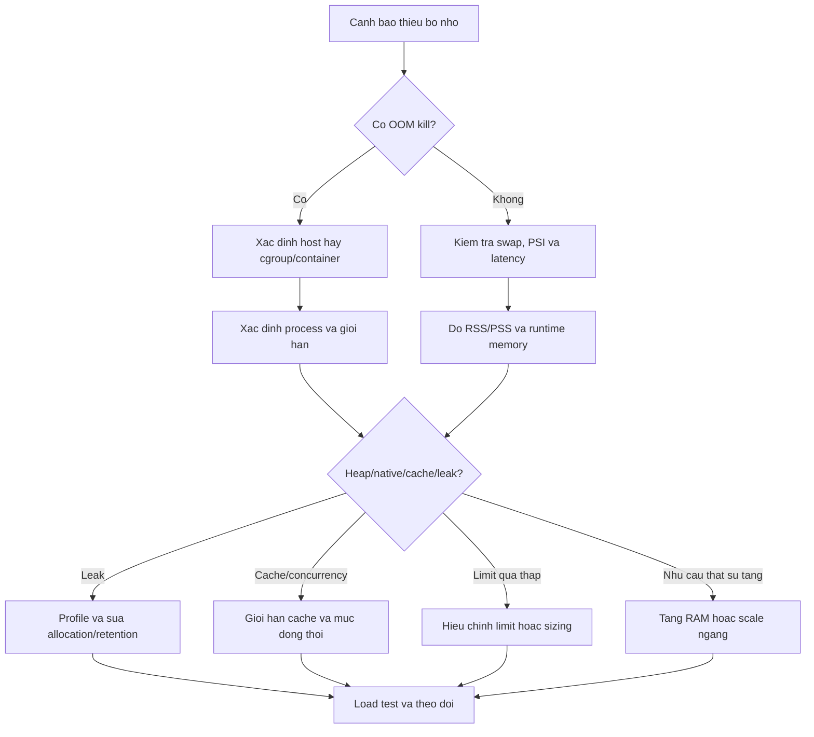

# Thiếu bộ nhớ: OOM, swap, memory leak và giới hạn tiến trình

Một máy ảo có thể chạy chậm, timeout hoặc tự khởi động lại dù CPU và mạng vẫn bình thường khi bộ nhớ không còn đủ cho workload. Ứng dụng có thể bị hệ điều hành dừng bằng cơ chế Out Of Memory (OOM), tiến trình phải liên tục chờ swap, heap tăng không ngừng hoặc một giới hạn bộ nhớ của service/container bị chạm tới. Nếu chỉ nhìn tổng RAM đã dùng, rất dễ nhầm cache có thể thu hồi với bộ nhớ thực sự gây áp lực.

Chẩn đoán thiếu bộ nhớ cần xác định **phạm vi bị giới hạn**, **tiến trình hoặc nhóm tiến trình tiêu thụ**, **loại bộ nhớ đang tăng** và **thời điểm áp lực xuất hiện**. Từ đó mới quyết định tăng RAM, điều chỉnh giới hạn, sửa memory leak, giảm mức đồng thời hay thay đổi cách cache và xử lý dữ liệu.

## 1. Hiểu các dạng thiếu bộ nhớ

Thiếu bộ nhớ không chỉ có nghĩa là RAM vật lý đã hiển thị 100% sử dụng. Một số tình huống thường gặp:

- **Host memory pressure:** tổng nhu cầu của hệ điều hành và các tiến trình vượt lượng RAM có thể sử dụng; kernel phải thu hồi page cache, swap hoặc chọn tiến trình để kết thúc.
- **OOM do giới hạn cgroup/container:** máy còn RAM nhưng một service hoặc container vượt `memory.max` hay giới hạn được nền tảng áp dụng.
- **Application-level out of memory:** runtime không cấp phát được vùng nhớ cần thiết, ví dụ Java heap đầy hoặc .NET GC không thể cấp phát thêm.
- **Swap thrashing:** hệ thống liên tục chuyển page giữa RAM và swap, khiến thời gian phản hồi tăng mạnh dù chưa nhất thiết có OOM kill.
- **Memory leak:** bộ nhớ được cấp phát nhưng không còn cần thiết vẫn bị giữ tham chiếu, làm mức sử dụng tăng theo thời gian.
- **Memory fragmentation hoặc giới hạn vùng cấp phát:** tổng bộ nhớ còn trống có vẻ đủ nhưng một loại cấp phát hoặc vùng địa chỉ cụ thể không đáp ứng được yêu cầu.
- **Giới hạn tiến trình hoặc tài khoản:** tiến trình chạm giới hạn địa chỉ ảo, số task, commit hoặc cấu hình quản trị dù máy vẫn còn tài nguyên tổng thể.

Phân biệt ba lớp sự cố giúp chọn đúng hướng điều tra:

| Lớp | Ví dụ dấu hiệu | Nơi cần kiểm tra |
|---|---|---|
| Hệ điều hành/máy ảo | OOM killer, swap tăng, memory pressure toàn máy | Kernel log, RAM, swap, PSI, cloud metrics |
| Service/container | Một unit hoặc container bị OOMKilled trong khi host còn RAM | Cgroup, systemd, Docker/Kubernetes limit |
| Runtime/ứng dụng | `OutOfMemoryError`, heap đầy, allocation failure | Heap, GC, native memory, dump và profiler |

Một ứng dụng có thể đồng thời gặp nhiều lớp. Ví dụ JVM chạm giới hạn cgroup vì tổng heap, direct buffer và thread stack vượt mức container, dù heap chưa đạt `-Xmx`.

## 2. Phân biệt RAM vật lý, bộ nhớ ảo và bộ nhớ tiến trình

Hệ điều hành dùng bộ nhớ ảo để cấp cho tiến trình một không gian địa chỉ riêng. Không phải mọi địa chỉ ảo đều tương ứng với một trang RAM vật lý đang được sử dụng. Một phần có thể chưa được chạm tới, được chia sẻ, nằm trong file mapping hoặc được đưa ra swap.

Các chỉ số thường gặp trên Linux:

- **VSZ/VIRT:** tổng không gian địa chỉ ảo mà tiến trình ánh xạ hoặc dành trước. Giá trị này có thể lớn hơn nhiều RAM thực dùng.
- **RSS:** số trang hiện đang resident trong RAM của tiến trình, bao gồm một phần bộ nhớ chia sẻ. Cộng RSS của nhiều tiến trình có thể đếm trùng các trang dùng chung.
- **PSS:** phân bổ phần bộ nhớ chia sẻ cho các tiến trình cùng dùng theo tỷ lệ; hữu ích hơn khi muốn ước lượng phần thực sự thuộc mỗi tiến trình.
- **Anonymous memory:** bộ nhớ không gắn trực tiếp với file, thường gồm heap, stack và dữ liệu runtime.
- **File-backed memory/page cache:** trang bộ nhớ được hỗ trợ bởi file; nhiều phần có thể được thu hồi khi hệ thống cần RAM.
- **Swap:** trang bộ nhớ được chuyển ra vùng swap trên đĩa hoặc thiết bị swap.
- **Kernel memory/slab:** bộ nhớ dành cho cấu trúc và cache của kernel, socket, inode, dentry và các đối tượng hệ thống.

Do đó, không nên kết luận máy sắp OOM chỉ vì `used` cao. Linux có thể dùng RAM nhàn rỗi làm page cache và thu hồi phần lớn cache khi ứng dụng cần. Hãy xem `available`, swap-in/swap-out, memory pressure, OOM event và độ trễ cùng lúc.

Lệnh kiểm tra nhanh:

```bash
free -h
cat /proc/meminfo
vmstat 1
```

Trong `free -h`, trường `available` ước lượng lượng RAM có thể cấp cho ứng dụng mà không cần swap đáng kể. `buff/cache` không đồng nghĩa bộ nhớ bị chiếm cố định. `vmstat 1` hiển thị các cột `si` và `so` (swap-in/swap-out) theo từng khoảng đo; nếu chúng liên tục lớn cùng với độ trễ cao, cần điều tra swap pressure.

## 3. Nhận biết OOM trên Linux

Linux kernel có cơ chế OOM killer để chọn một tiến trình kết thúc khi không thể đáp ứng nhu cầu bộ nhớ trong một phạm vi cấp phát. OOM có thể xảy ra ở phạm vi toàn máy hoặc bên trong một memory cgroup. Khi cgroup đạt giới hạn, kernel có thể kill tiến trình thuộc cgroup đó dù máy chủ còn RAM.

Thông báo thường gặp trong kernel log gồm `Out of memory`, `oom-kill`, `Killed process` hoặc `Memory cgroup out of memory`. Cần xác định:

- Tiến trình nào bị kill, PID và command line.
- Tiến trình thuộc service/cgroup/container nào.
- OOM xảy ra ở cấp host hay do giới hạn memory cgroup.
- Tổng RAM, swap và giới hạn tại thời điểm xảy ra.
- Có tiến trình khác cùng tăng bộ nhớ hoặc workload đột biến không.

Đọc kernel log:

```bash
sudo journalctl -k --since "2 hours ago" --no-pager
sudo dmesg -T | grep -Ei 'out of memory|oom|killed process|memory cgroup'
```

Trên một số hệ thống, `dmesg` có thể bị giới hạn quyền hoặc log đã bị rotate. Hãy lấy log từ hệ thống tập trung nếu máy đã reboot. Dòng OOM thường chứa thông tin về process bị chọn, mức RSS, cgroup và memory constraint; lưu toàn bộ đoạn log xung quanh sự kiện để phân tích.

OOM killer không nhất thiết chọn tiến trình có RSS lớn nhất. Kernel cân nhắc nhiều yếu tố như mức sử dụng bộ nhớ, đặc tính tiến trình và `oom_score_adj`. Không chỉnh `oom_score_adj` để che giấu sự cố nếu chưa hiểu tác động: điều này chỉ thay đổi ưu tiên chọn nạn nhân, không tạo thêm RAM.

## 4. Xác định tiến trình tiêu thụ bộ nhớ

Sau khi biết thời điểm OOM hoặc pressure, tìm tiến trình có RSS/PSS tăng và so sánh qua nhiều mẫu. Một ảnh chụp tại một thời điểm có thể bỏ lỡ leak tăng chậm hoặc spike ngắn.

Một số lệnh Linux:

```bash
# Sap xep process theo RSS
ps -eo pid,ppid,user,rss,vsz,%mem,etime,cmd --sort=-rss | head -n 20

# Xem chi tiet mot process
cat /proc/1234/status

# Xem map bo nho cua process (neu co pmap)
sudo pmap -x 1234

# Theo doi memory theo process moi giay
pidstat -r 1
```

Thay `1234` bằng PID thực tế. Trong `/proc/PID/status`, chú ý `VmRSS`, `VmSize`, `VmSwap`, `RssAnon`, `RssFile` và `RssShmem`. `pmap -x` giúp xem vùng mapping, nhưng không tự chứng minh vùng nào là leak. `pidstat` thuộc gói sysstat trên nhiều distribution.

Nếu cần phân bổ bộ nhớ chia sẻ chính xác hơn, có thể dùng `smem` để xem USS/PSS/RSS nếu công cụ có sẵn. Không cài công cụ mới lên máy production trong lúc sự cố nếu chưa được phê duyệt; có thể dùng agent giám sát, package đã có hoặc thu thập trên máy thử nghiệm.

## 5. Kiểm tra memory pressure và swap

Swap cho phép hệ điều hành chuyển một số trang ít được sử dụng ra thiết bị lưu trữ để giải phóng RAM. Nó giúp hấp thụ một số đợt tăng ngắn, nhưng tốc độ truy cập thường chậm hơn RAM nhiều bậc. Khi working set liên tục lớn hơn RAM, hệ thống có thể phải đọc/ghi swap liên tục, gây swap thrashing.

Kiểm tra swap:

```bash
swapon --show
free -h
vmstat 1
```

Chỉ số cần quan sát:

- Dung lượng swap đã dùng và xu hướng tăng.
- `si`/`so` trong `vmstat`, tức lượng dữ liệu swap-in/swap-out theo mẫu.
- Độ trễ ứng dụng, thời gian chờ I/O và mức sử dụng disk.
- RAM `available`, page cache và tiến trình có working set lớn.

Swap đã dùng không nhất thiết là sự cố. Kernel có thể giữ các trang ít hoạt động trong swap ngay cả khi pressure hiện tại đã giảm. Điều đáng quan tâm là swap I/O diễn ra liên tục và đi kèm latency, queue hoặc memory pressure.

Linux Pressure Stall Information (PSI) cung cấp tín hiệu thời gian task bị trì hoãn do thiếu tài nguyên. Có thể xem:

```bash
cat /proc/pressure/memory
```

Các trường `some` và `full` thể hiện tỷ lệ thời gian một phần hoặc toàn bộ task bị stall do memory pressure trong cửa sổ đo. PSI giúp phát hiện áp lực trước khi OOM xảy ra. Không nên đặt một ngưỡng chung cho mọi workload; hãy so sánh baseline và liên hệ với SLO/latency.

Không tắt swap chỉ để làm biểu đồ RAM trông dễ hiểu hơn. Nếu workload cần swap để tránh OOM đột ngột, tắt nó có thể làm sự cố xảy ra sớm hơn. Ngược lại, tăng swap quá lớn có thể khiến ứng dụng tiếp tục chạy nhưng phản hồi rất chậm. Chọn chính sách swap theo yêu cầu latency, đặc tính workload và hướng dẫn của nhà cung cấp.

## 6. Phân biệt memory leak với cache và tăng tải bình thường

Memory leak xảy ra khi ứng dụng giữ tham chiếu tới dữ liệu không còn cần thiết, khiến bộ nhớ không thể được thu hồi. Tuy nhiên, RSS tăng không luôn đồng nghĩa leak.

Một số nguyên nhân khiến bộ nhớ tăng hợp lệ:

- Lượng request đồng thời hoặc số worker tăng.
- Cache được làm nóng và giữ dữ liệu trong giới hạn cấu hình.
- Runtime tăng heap để giảm số lần cấp phát hoặc GC.
- Page cache tăng khi đọc file hoặc dữ liệu.
- Connection pool, thread pool hoặc buffer được mở rộng theo tải.
- Native allocator giữ lại arena đã cấp phát dù ứng dụng đã giải phóng object.

Dấu hiệu leak thường rõ hơn khi chạy cùng một tải lặp lại: bộ nhớ sau mỗi chu kỳ xử lý hoặc sau khi garbage collection hoàn tất tiếp tục tăng, không quay về vùng ổn định. Cần quan sát đủ lâu để phân biệt tăng trưởng warm-up với tăng trưởng không giới hạn.

Quy trình kiểm tra:

1. Ghi nhận baseline khi service vừa khởi động.
2. Tạo tải đại diện và theo dõi request rate, concurrency, RSS, heap/native và cache size.
3. Sau khi tải giảm, quan sát bộ nhớ có ổn định hoặc giảm không.
4. Lặp lại chu kỳ nhiều lần và so sánh mức nền sau mỗi chu kỳ.
5. Dùng profiler hoặc heap/native dump để tìm object, buffer hoặc allocation site giữ bộ nhớ.
6. Kiểm tra phiên bản thư viện, cấu hình cache, connection pool và thay đổi gần thời điểm bắt đầu tăng.

Không kết luận leak chỉ từ một biểu đồ RSS đi lên. Cần kết hợp số liệu runtime và hành vi ứng dụng.

## 7. Chẩn đoán bộ nhớ ứng dụng Java

Với JVM, heap chỉ là một phần bộ nhớ của tiến trình. Tổng bộ nhớ process còn gồm metaspace, code cache, thread stack, direct buffer, JNI/native allocation, thư viện native, agent giám sát và cấu trúc JVM.

Một mô hình khái quát:

\[
\text{Process memory} \approx \text{Heap} + \text{Metaspace} + \text{Thread stacks} + \text{Direct/native buffers} + \text{JVM/native overhead}
\]

Vì vậy, đặt `-Xmx` bằng toàn bộ RAM máy hoặc bằng giới hạn cgroup có thể khiến kernel OOM kill JVM dù heap chưa đầy. Cần chừa bộ nhớ cho native và hệ điều hành.

### Phân biệt các lỗi Java

| Thông báo/dấu hiệu | Ý nghĩa thường gặp | Hướng điều tra |
|---|---|---|
| `OutOfMemoryError: Java heap space` | Heap không đáp ứng được allocation | Heap dump, object retention, cấu hình heap, tải và cache |
| `OutOfMemoryError: Metaspace` | Metaspace không đủ hoặc class metadata tăng bất thường | Classloader leak, dynamic class generation, metaspace limit |
| `OutOfMemoryError: Direct buffer memory` | Không cấp phát được direct buffer theo giới hạn runtime | Direct buffer usage, `MaxDirectMemorySize`, thư viện I/O |
| `GC overhead limit exceeded` | JVM dành quá nhiều thời gian cho GC nhưng thu hồi được ít | Heap pressure, object churn, leak và workload |
| Tiến trình bị `Killed`/exit 137, không có Java OOME | Có thể bị kernel/cgroup kill hoặc bị dừng bằng SIGKILL | Kernel log, cgroup memory events, container/runtime events |

Một số công cụ hữu ích:

```bash
jcmd 1234 VM.flags
jcmd 1234 GC.heap_info
jcmd 1234 GC.class_histogram
jcmd 1234 VM.native_memory summary
```

Thay PID bằng tiến trình JVM. `VM.native_memory` chỉ cung cấp dữ liệu chi tiết khi Native Memory Tracking (NMT) đã được bật lúc khởi động JVM, ví dụ với `-XX:NativeMemoryTracking=summary`; việc bật NMT có overhead. `GC.class_histogram` có thể tốn thời gian và ảnh hưởng ứng dụng lớn, nên thực hiện theo quy trình vận hành.

Có thể bật GC log theo cú pháp phù hợp với phiên bản JVM, ví dụ Java hiện đại hỗ trợ unified logging:

```bash
-Xlog:gc*,safepoint:file=/var/log/orders/gc.log:time,uptime,level,tags
```

Heap dump có thể giúp tìm object giữ tham chiếu nhưng có thể rất lớn và chứa dữ liệu nhạy cảm. Hãy bảo đảm đĩa đủ chỗ, giới hạn quyền truy cập, mã hóa và tuân thủ retention. Nếu JVM bị kernel kill đột ngột, tùy cấu hình có thể không tạo được heap dump.

## 8. Giới hạn bộ nhớ của tiến trình và service trên Linux

Có nhiều cơ chế giới hạn tài nguyên, nhưng không phải cơ chế nào cũng giới hạn RAM resident theo cách giống nhau.

### Cgroup và systemd

Trên Linux, cgroup là cơ chế chính để giới hạn và kế toán tài nguyên của nhóm tiến trình. Với cgroup v2, một số file quan trọng gồm:

| File | Ý nghĩa |
|---|---|
| `memory.current` | Bộ nhớ hiện đang được tính cho cgroup |
| `memory.max` | Giới hạn cứng bộ nhớ |
| `memory.high` | Ngưỡng pressure/throttling để kernel cố gắng reclaim |
| `memory.events` | Bộ đếm sự kiện như `high`, `max`, `oom`, `oom_kill` |
| `memory.stat` | Phân rã một số loại bộ nhớ trong cgroup |
| `memory.swap.current` | Swap hiện dùng bởi cgroup nếu controller hỗ trợ |
| `memory.swap.max` | Giới hạn swap của cgroup nếu được cấu hình |

Để xác định cgroup của tiến trình:

```bash
cat /proc/1234/cgroup
```

Với cgroup v2, đường dẫn thường nằm dưới `/sys/fs/cgroup`. Ví dụ:

```bash
cat /sys/fs/cgroup/system.slice/orders-api.service/memory.current
cat /sys/fs/cgroup/system.slice/orders-api.service/memory.max
cat /sys/fs/cgroup/system.slice/orders-api.service/memory.events
```

Đường dẫn thay đổi theo unit, container runtime và cấu hình hệ thống. Không giả định mọi máy đều dùng cgroup v2; cgroup v1 có cấu trúc controller và tên file khác.

Trong systemd, có thể đặt giới hạn trong unit:

```ini
[Service]
MemoryHigh=3G
MemoryMax=4G
MemorySwapMax=1G
```

`MemoryHigh` là ngưỡng pressure để hệ thống cố gắng reclaim và điều tiết workload; `MemoryMax` là giới hạn cứng. Khi vượt giới hạn cứng và không thể reclaim đủ, tiến trình trong cgroup có thể bị OOM kill. `MemorySwapMax` kiểm soát swap của unit trên hệ thống hỗ trợ. Chọn giá trị dựa trên tổng process memory, peak workload và phần dự phòng; không đặt bằng đúng mức RSS trung bình.

Sau khi thay đổi unit, nạp lại cấu hình và restart service theo quy trình triển khai. Theo dõi `memory.events`, systemd status và kernel log để xác nhận giới hạn có bị chạm không.

### RLIMIT và ulimit

Linux cũng có resource limits ở cấp tiến trình, có thể xem bằng `ulimit` hoặc `prlimit`. Ví dụ `RLIMIT_AS` giới hạn tổng không gian địa chỉ ảo; nó không tương đương giới hạn RAM resident. Một số giới hạn cũ như `RLIMIT_RSS` không phải cơ chế đáng tin cậy để cô lập RAM trên Linux hiện đại.

```bash
ulimit -a
prlimit --pid 1234
```

Không dùng `ulimit -v` như thay thế cgroup memory limit mà không hiểu tác động: ứng dụng có thể thất bại khi reserve address space dù RAM vật lý vẫn còn. `TasksMax` của systemd giới hạn số task/process/thread theo cách kernel đếm, không phải giới hạn dung lượng RAM.

## 9. Giới hạn bộ nhớ trong container và Kubernetes

Container dùng cgroup để kế toán và áp dụng giới hạn bộ nhớ. Một container có thể bị OOM kill khi vượt limit ngay cả khi node còn bộ nhớ. Cần kiểm tra cả container limit, pod limit, node pressure và cách runtime báo trạng thái.

Với Docker, `--memory` đặt giới hạn memory cho container; `--memory-swap` điều khiển tổng memory+swap theo semantics của Docker và kernel. Cách diễn giải phụ thuộc phiên bản và cấu hình host, vì vậy cần xem tài liệu runtime đang dùng. Không nên chỉ tăng swap để tránh OOM nếu workload yêu cầu latency thấp.

Trong Kubernetes:

- `requests.memory` là lượng bộ nhớ scheduler dùng để đặt pod và tính mức bảo đảm tương đối; nó không phải hard cap.
- `limits.memory` là giới hạn bộ nhớ của container; vượt giới hạn có thể dẫn tới OOM kill.
- Trạng thái `OOMKilled` trong container status là dấu hiệu quan trọng, nhưng cần xem event, exit code, node memory pressure và log runtime.
- Pod có thể bị eviction khi node thiếu tài nguyên, ngay cả khi container chưa vượt memory limit riêng.

Đặt request quá thấp làm scheduler đóng gói quá nhiều workload lên node. Đặt limit quá thấp gây OOM; đặt limit quá cao có thể khiến node bị pressure. Cần sizing theo peak working set, runtime overhead và mức đồng thời, đồng thời theo dõi memory working set và OOM/eviction events.

## 10. Giới hạn và chẩn đoán bộ nhớ trên Windows

Windows quản lý bộ nhớ ảo và commit khác Linux. **Committed memory** là lượng bộ nhớ mà hệ điều hành đã cam kết có thể backing bằng RAM hoặc pagefile. **Commit limit** thường phụ thuộc RAM và pagefile. Nếu committed bytes tiến sát commit limit, cấp phát có thể thất bại dù working set của một số tiến trình không quá lớn.

Phân biệt các chỉ số:

- **Working Set:** các trang của tiến trình hiện đang resident trong RAM.
- **Private Bytes:** bộ nhớ commit riêng của tiến trình, không chia sẻ theo cách working set có thể chia sẻ.
- **Commit charge/Committed Bytes:** lượng bộ nhớ hệ thống đã cam kết.
- **Commit Limit:** giới hạn commit hiện tại của hệ thống.
- **Pagefile usage:** mức sử dụng pagefile; cần xem cùng committed bytes và paging activity.

Có thể quan sát bằng Task Manager, Resource Monitor và Performance Monitor. Một số counter hữu ích:

- `Memory\Committed Bytes` và `Memory\Commit Limit`.
- `Memory\Available MBytes`.
- `Memory\Pages/sec` hoặc các counter paging liên quan.
- `Process\Private Bytes`, `Process\Working Set`.

Event Viewer có thể ghi nhận cảnh báo Resource-Exhaustion-Detector, thường gặp Event ID 2004 trong một số phiên bản Windows. Cần kiểm tra nội dung sự kiện để biết tiến trình và mức sử dụng; không chỉ dựa vào số Event ID.

PowerShell có thể hỗ trợ kiểm tra nhanh:

```powershell
Get-CimInstance Win32_OperatingSystem |
  Select-Object TotalVisibleMemorySize, FreePhysicalMemory, TotalVirtualMemorySize, FreeVirtualMemory

Get-Process |
  Sort-Object PrivateMemorySize64 -Descending |
  Select-Object -First 20 ProcessName, Id, WorkingSet64, PrivateMemorySize64
```

Đơn vị của các trường trong `Win32_OperatingSystem` là KB; các thuộc tính `WorkingSet64` và `PrivateMemorySize64` được trả về theo byte. Với ứng dụng Windows service, xem thêm Job Object hoặc giới hạn container nếu workload được đặt trong môi trường có quota. Không nên tắt pagefile để “buộc ứng dụng dùng RAM”; điều đó có thể làm commit limit giảm và tăng lỗi cấp phát.

## 11. Phân biệt OOM của runtime với OOM của kernel

Hai lỗi này có biểu hiện và cách xử lý khác nhau:

| Dấu hiệu | Runtime OOM | Kernel/cgroup OOM |
|---|---|---|
| Tiến trình | Có thể vẫn chạy nhưng request lỗi hoặc runtime ném exception | Thường bị kill đột ngột |
| Log ứng dụng | Có exception hoặc thông báo allocation failure | Có thể không kịp ghi log cuối |
| Kernel log | Không nhất thiết có OOM killer event | Thường có thông báo OOM/kill nếu log còn |
| Exit status | Phụ thuộc ứng dụng xử lý exception | Có thể là 137 khi bị SIGKILL trong nhiều môi trường, nhưng cần xác minh |
| Dữ liệu cần xem | Heap/native dump, GC, profiler | Kernel log, cgroup events, host/container memory |

Exit code 137 thường tương ứng với tiến trình kết thúc do signal 9 trong một số shell/runtime, nhưng không tự chứng minh OOM. Một quản trị viên hoặc hệ thống khác cũng có thể gửi SIGKILL. Phải đối chiếu OOM event, kernel log và container status.

## 12. Quy trình chẩn đoán theo từng bước

Khi nhận cảnh báo thiếu bộ nhớ, hãy đi từ phạm vi rộng đến tiến trình và runtime:

1. **Xác định thời điểm và phạm vi:** một instance, một service hay toàn bộ máy/cluster; đối chiếu deploy, traffic và batch job.
2. **Kiểm tra RAM và swap:** `free -h`, `/proc/meminfo`, `vmstat`, PSI và cloud monitoring.
3. **Tìm OOM event:** kernel log, systemd journal, container event hoặc Windows Event Viewer.
4. **Tìm process tiêu thụ:** RSS/PSS, `pidstat`, `pmap`, runtime metrics hoặc Private Bytes.
5. **Kiểm tra giới hạn:** cgroup, systemd `MemoryMax`, Docker/Kubernetes limit, RLIMIT hoặc Windows commit/pagefile.
6. **Xác định loại bộ nhớ:** heap, native, cache, page cache, thread stack, direct buffer hoặc file mapping.
7. **Tái hiện có kiểm soát:** tải đại diện, soak test, heap profile hoặc allocation profile.
8. **Áp dụng biện pháp:** sửa leak, giới hạn cache/concurrency, điều chỉnh limit hoặc tăng RAM.
9. **Xác minh:** chạy lại tải, theo dõi memory pressure, OOM event, latency và error rate.

Sơ đồ quyết định đơn giản:



## 13. Các biện pháp khắc phục

Biện pháp phù hợp phụ thuộc nguyên nhân:

| Nguyên nhân | Biện pháp thường phù hợp |
|---|---|
| Instance thiếu RAM so với working set hợp lệ | Resize instance hoặc phân tải sang nhiều instance |
| Memory leak trong ứng dụng | Profile, sửa vòng đời object/reference, nâng cấp thư viện và kiểm thử soak |
| Cache không giới hạn | Đặt maximum size, TTL, eviction policy và metric cache |
| Concurrency quá cao | Giới hạn worker/request in-flight, backpressure và queue |
| Cgroup/systemd limit quá thấp | Điều chỉnh `MemoryHigh`/`MemoryMax` dựa trên capacity thực và dự phòng |
| JVM heap chiếm gần hết container limit | Giảm heap target hoặc tăng limit để dành chỗ cho native/runtime |
| Swap thrashing | Giảm working set, tăng RAM hoặc phân tán workload; xem lại swap policy |
| Node/container packing quá dày | Điều chỉnh requests/limits và phân bổ pod/instance |
| Spike do batch | Chạy theo đợt, giới hạn batch size hoặc tách node/pool riêng |

Không chỉ tăng RAM nếu leak vẫn tiếp tục; việc tăng dung lượng chỉ kéo dài thời gian trước khi sự cố lặp lại. Ngược lại, không ép giảm heap hoặc cache quá mức khiến GC, disk I/O và latency tăng mạnh. Cần đánh giá tổng chi phí và SLO.

## 14. Thiết lập cảnh báo sớm

Chỉ cảnh báo khi RAM vượt một tỷ lệ cố định có thể tạo nhiều false positive do page cache. Nên kết hợp nhiều tín hiệu:

- Available memory thấp trong một khoảng thời gian liên tục.
- Swap-in/swap-out tăng và có latency hoặc I/O wait bất thường.
- PSI memory `some`/`full` tăng so với baseline.
- Cgroup `memory.events` tăng ở `high`, `max`, `oom` hoặc `oom_kill`.
- Process RSS/PSS, JVM heap/native hoặc Windows Private Bytes tăng liên tục.
- OOM kill, container `OOMKilled`, pod eviction hoặc runtime allocation failure.
- Request latency, error rate và restart count xấu đi cùng thời điểm.

Đặt ngưỡng theo workload và SLO, sử dụng cửa sổ thời gian để tránh cảnh báo do spike ngắn. Cảnh báo theo xu hướng tăng liên tục có thể phát hiện leak trước khi chạm giới hạn. Tách cảnh báo “memory utilization cao nhưng ổn định” khỏi “memory pressure đang ảnh hưởng workload”.

## 15. Ví dụ: JVM bị OOMKilled dù heap chưa đạt Xmx

Một API Java chạy trong container có giới hạn memory 4 GiB. JVM được cấu hình `-Xmx3g`. Trong tải cao, heap đang dùng khoảng 2,4 GiB nhưng container vẫn bị `OOMKilled`.

Nguyên nhân có thể là tổng bộ nhớ ngoài heap cộng với heap vượt 4 GiB:

| Thành phần | Mức dùng minh họa |
|---|---:|
| Java heap | 2,4 GiB |
| Metaspace và code cache | 0,25 GiB |
| Thread stacks | 0,35 GiB |
| Direct buffers/JNI/native | 0,55 GiB |
| Agent và runtime overhead | 0,25 GiB |
| Tổng | 3,8 GiB |

Con số thực tế còn có thể bao gồm page tables, file-backed memory và các tiến trình phụ trong cùng cgroup. Khi tải tăng, direct buffer hoặc thread count có thể tăng thêm và vượt giới hạn 4 GiB. Kernel kill container trước khi JVM có cơ hội ném `OutOfMemoryError` trong heap.

Cách điều tra là đối chiếu `memory.current`, `memory.max`, `memory.events`, container status và kernel log; sau đó đo heap, thread, direct buffer và native memory. Cách khắc phục có thể là giảm `-Xmx` để chừa headroom, giới hạn thread/buffer, sửa leak native hoặc tăng container limit nếu node đủ capacity. Sau thay đổi, chạy soak test ở tải đỉnh và theo dõi tổng process/cgroup memory, không chỉ heap.

## 16. Thực hành tốt để tránh sự cố lặp lại

- Sizing RAM theo peak working set và tổng bộ nhớ của runtime, agent cùng tiến trình phụ.
- Đặt giới hạn cache, queue, connection pool, thread pool và số request đồng thời.
- Dùng backpressure để ứng dụng không nhận công việc nhanh hơn khả năng xử lý.
- Kiểm thử soak đủ lâu để phát hiện leak tăng chậm.
- Theo dõi memory theo service, instance, process và cgroup; giữ lịch sử để so sánh.
- Quản lý `Xmx`, native memory và container limit như một ngân sách chung.
- Duy trì swap policy phù hợp với latency và hướng dẫn cloud provider.
- Tránh giới hạn quá chặt khiến ứng dụng bị OOM ở mức tải bình thường.
- Ghi nhận OOM event và giữ log kernel/container ngoài máy để điều tra sau reboot.
- Khi scale ngang, kiểm tra database, cache và queue có chịu được số instance tăng thêm không.

## 17. Checklist xử lý sự cố thiếu bộ nhớ

- [ ] Xác định sự cố xảy ra ở host, service, container hay runtime ứng dụng.
- [ ] Ghi lại thời điểm, instance/resource ID, workload và thay đổi gần thời điểm lỗi.
- [ ] Kiểm tra `available`, swap, PSI và memory pressure thay vì chỉ nhìn RAM `used`.
- [ ] Tìm OOM killer/kernel log, cgroup events, container status hoặc Windows memory event.
- [ ] Xác định process tiêu thụ bằng RSS/PSS, Private Bytes hoặc runtime metrics.
- [ ] Kiểm tra memory limit, swap limit, RLIMIT, systemd, container và scheduler settings.
- [ ] Phân biệt heap, native, thread stack, direct buffer, page cache và cache ứng dụng.
- [ ] Đánh giá leak bằng nhiều chu kỳ tải và số liệu sau GC/giảm tải.
- [ ] Chọn biện pháp dựa trên nguyên nhân: sửa leak, giới hạn cache/concurrency, điều chỉnh limit hoặc tăng capacity.
- [ ] Chạy load/soak test và xác minh latency, error rate, OOM event cùng memory headroom.
- [ ] Có cảnh báo sớm và lưu log ngoài instance để điều tra khi máy reboot.

Sự cố thiếu bộ nhớ được xử lý hiệu quả khi đội vận hành biết chính xác bộ nhớ đang bị tiêu thụ ở đâu và giới hạn nào đã bị chạm. Kết hợp số liệu hệ điều hành, cgroup, runtime và ứng dụng giúp phân biệt OOM thật với cache hoặc tải tăng hợp lệ, từ đó sửa nguyên nhân và giữ đủ headroom cho workload compute.
