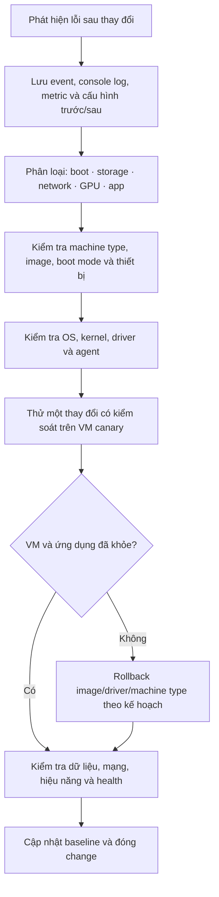

# Lỗi sau khi đổi image, driver hoặc machine type

Một thay đổi image, driver hoặc machine type có thể cải thiện bảo mật, hiệu năng và chi phí của máy ảo. Tuy nhiên, thay đổi đó cũng có thể làm VM không boot được, mất kết nối mạng, không nhận ổ đĩa, không nhận GPU hoặc chạy ứng dụng chậm hơn trước. Những sự cố này thường xuất hiện ngay sau khi tạo VM mới, thay image, nâng kernel, cập nhật driver hoặc chuyển sang một instance family khác.

Để xử lý an toàn, cần xác định chính xác **thành phần nào đã thay đổi**, **lớp nào không còn tương thích** và **dữ liệu nào có nguy cơ bị ảnh hưởng**. Không nên tiếp tục thay nhiều driver hoặc boot setting cùng lúc. Hãy lưu bằng chứng, so sánh cấu hình trước/sau, khôi phục khả năng truy cập nếu cần, rồi kiểm thử từng thay đổi trên một VM thử nghiệm trước khi triển khai lại diện rộng.

## 1. Phân biệt image, driver và machine type

Ba thành phần này tác động đến các lớp khác nhau của VM:

| Thành phần | Vai trò | Thay đổi có thể ảnh hưởng |
|---|---|---|
| Machine image | Cung cấp OS, kernel, bootloader, package, agent và cấu hình ban đầu | Boot, dịch vụ hệ thống, thư viện, bảo mật và khả năng tương thích ứng dụng |
| Driver | Cho OS giao tiếp với thiết bị ảo hoặc phần cứng được gán | Root disk, NIC, GPU, console, hiệu năng I/O và mạng |
| Machine type / instance family | Xác định CPU, RAM, thiết bị, network capability, accelerator và một số đặc tính host | Kiến trúc CPU, tập lệnh, NUMA, controller lưu trữ, NIC, GPU, giới hạn tài nguyên và license |

Ví dụ, một image Linux cũ có thể boot trên instance family dùng controller lưu trữ ảo A nhưng không nhận root disk trên family mới dùng controller B. Một image x86_64 không thể được chuyển thành image arm64 chỉ bằng cách đổi machine type. Một driver GPU đã cài có thể không tương thích với kernel mới hoặc model GPU trên instance đích.

### Xác định thay đổi nào đã diễn ra

Trước khi chẩn đoán, ghi lại:

- Image ID, image version, OS release, kiến trúc CPU và ngày build.
- Kernel hoặc Windows build trước và sau thay đổi.
- Driver và phiên bản driver của storage, NIC, GPU và cloud guest agent.
- Machine type/family cũ và mới, số vCPU, RAM, kiến trúc CPU và accelerator.
- Boot mode (BIOS/UEFI), Secure Boot và kiểu root device.
- Loại volume, controller, NIC model, local/ephemeral disk và network policy.
- Thời điểm thay đổi, người hoặc pipeline thực hiện, change record và log triển khai.

Nếu thay image và machine type cùng lúc, sẽ khó xác định yếu tố nào gây lỗi. Khi có thể, tách các thay đổi để kiểm tra riêng; nếu thay đổi đã xảy ra, dùng snapshot, image cũ hoặc VM canary để dựng lại từng tổ hợp cấu hình.

## 2. Phân loại triệu chứng trước khi sửa

| Triệu chứng | Lớp cần kiểm tra đầu tiên | Nguyên nhân thường gặp |
|---|---|---|
| VM không qua trạng thái boot hoặc vào emergency shell | Boot chain / storage | Sai BIOS/UEFI, thiếu driver root disk, initramfs thiếu module, filesystem lỗi |
| VM boot nhưng không SSH/RDP được | NIC / network / guest OS | Driver NIC, tên interface đổi, firewall, route, agent hoặc dịch vụ quản trị |
| OS chạy nhưng disk phụ không xuất hiện | Storage driver / device mapping | Controller khác, driver thiếu, thiết bị đổi tên, volume chưa attach |
| GPU không được nhận diện | GPU driver / runtime / device assignment | Driver không khớp kernel, model GPU không được hỗ trợ, passthrough/profile sai |
| Ứng dụng báo `Illegal instruction` hoặc crash sớm | CPU architecture / instruction set | Binary không đúng kiến trúc hoặc yêu cầu CPU feature không có trên máy mới |
| VM hoạt động nhưng throughput giảm | Machine type / driver / topology | CPU thế hệ khác, throttling, NUMA, network/storage limit hoặc driver chưa tối ưu |
| Windows dừng ở lỗi boot sau đổi controller | Boot-critical storage driver | Driver chưa được cài hoặc chưa ở trạng thái boot-start |
| Linux boot được nhưng mount thất bại | Filesystem / UUID / device path | Tên thiết bị thay đổi, UUID sai, mount option hoặc driver lỗi |
| Cloud agent không hoạt động | Guest agent / image compatibility | Agent cũ, service không khởi động, endpoint hoặc quyền không đúng |
| Lỗi chỉ xảy ra sau reboot lần đầu | Driver/module / update state | Kernel module không tự nạp, update chưa hoàn tất, cấu hình boot chưa được lưu |

Trạng thái `Running` ở control plane chỉ xác nhận VM đã được cấp phát và đang chạy theo góc nhìn nền tảng. Nó không chứng minh guest OS đã boot hoàn tất hoặc ứng dụng sẵn sàng nhận traffic.

## 3. Quy trình chẩn đoán an toàn



Thực hiện theo trình tự:

1. Xác định phạm vi: một VM, một family, một image version hay toàn bộ nhóm máy.
2. Kiểm tra provider event, activity log, console output và trạng thái resource.
3. So sánh thông số trước/sau thay đổi.
4. Thu thập log guest OS và driver trước khi reboot hoặc recreate VM.
5. Kiểm tra từng lớp theo triệu chứng; ưu tiên thao tác đọc.
6. Thử sửa trên một VM không phục vụ production hoặc một canary có thể rollback.
7. Nếu không phục hồi trong thời gian cho phép, thực hiện rollback đã chuẩn bị.
8. Xác minh cả OS, dữ liệu, network, agent và ứng dụng trước khi đưa traffic trở lại.

Không format disk, chạy filesystem repair tùy tiện, xóa volume hoặc terminate VM trước khi xác định vị trí dữ liệu và có phương án khôi phục.

## 4. Kiểm tra cloud control plane và machine type

### Xác minh cấu hình instance

Đọc cấu hình thực tế từ portal, API hoặc CLI của provider:

- Machine type hiện tại có đúng family và size dự kiến không?
- VM có chuyển sang kiến trúc CPU khác, ví dụ x86_64 sang arm64 không?
- Instance có GPU/accelerator không; profile hoặc số thiết bị có thay đổi không?
- Boot disk và data disk có còn gắn đúng VM và đúng zone không?
- NIC, subnet, security group, route và địa chỉ IP có thay đổi không?
- Instance có bị chuyển sang trạng thái stopped, deallocated hoặc pending sau resize không?
- Có event bảo trì, host migration, instance retirement hoặc lỗi provisioning không?

Một số nền tảng yêu cầu stop VM trước khi đổi machine type; một số thay đổi có thể thực hiện khi VM đang chạy hoặc qua thao tác resize riêng. Hành vi và giới hạn phụ thuộc provider, family và loại thiết bị. Không áp dụng một quy trình resize chung cho mọi cloud.

### Kiểm tra quota và khả năng cấp phát

Nếu VM mới không khởi động hoặc resize không hoàn tất, kiểm tra quota vCPU, RAM, GPU, số lượng instance và capacity tại zone. Phân biệt lỗi quota với lỗi image/driver: quota thường xuất hiện trong control plane trước khi guest OS boot; driver lỗi thường thể hiện sau khi thiết bị đã được cấp và OS bắt đầu khởi động.

Ghi lại request ID, operation ID và mã lỗi API. Không lặp vô hạn thao tác resize hoặc tạo VM nếu provider trả lỗi cố định về quota, capacity hoặc permission.

### Kiểm tra image compatibility metadata

Xác minh image hỗ trợ:

- Kiến trúc CPU của instance đích.
- BIOS hoặc UEFI và Secure Boot nếu được yêu cầu.
- Loại virtualization và boot mode của provider.
- Driver storage/NIC/GPU cần thiết.
- OS release và kernel còn được hỗ trợ.
- Guest agent, cloud-init hoặc công cụ khởi tạo phù hợp.

Nếu metadata của image khai báo sai kiến trúc hoặc boot mode, nền tảng có thể từ chối tạo VM hoặc VM tạo được nhưng không boot. Không sửa metadata để ép image chạy trên kiến trúc mà binary bên trong không hỗ trợ.

## 5. Chẩn đoán lỗi boot trên Linux

Khi Linux không boot sau khi đổi image hoặc machine type, hãy xác định VM dừng ở giai đoạn nào: firmware, bootloader, kernel, initramfs, mount root filesystem hay systemd.

### Thu thập console và boot log

Nếu SSH không truy cập được, dùng console output, serial console hoặc recovery console do provider hỗ trợ. Tìm thông báo như:

- `No bootable device` hoặc không tìm thấy bootloader.
- `Kernel panic` hoặc lỗi nạp kernel module.
- `ALERT! UUID=... does not exist` hoặc không tìm thấy root filesystem.
- `Waiting for root device` kéo dài.
- Lỗi mount filesystem hoặc lỗi I/O.
- systemd vào `emergency mode` do mount unit hoặc service thiết yếu thất bại.

Các thông báo này giúp xác định boot stage, nhưng cần đọc đủ ngữ cảnh xung quanh để biết lỗi đầu tiên thay vì chỉ xử lý dòng cuối.

### Kiểm tra boot mode và bootloader

Image được cài theo legacy BIOS có thể không boot trên nền tảng chỉ hỗ trợ UEFI nếu không có EFI System Partition và bootloader phù hợp. Image UEFI cần phân vùng EFI, boot entry và bootloader đúng. Secure Boot có thể từ chối kernel module hoặc driver không có chữ ký được chấp nhận.

Kiểm tra cấu hình VM và cấu trúc disk từ recovery environment. Nếu có thể truy cập filesystem:

```bash
# Xác định hệ thống đang boot theo UEFI hay legacy
test -d /sys/firmware/efi && echo UEFI || echo Legacy-BIOS

# Xem block device, filesystem và UUID
lsblk -f
blkid

# Kiểm tra mount và phân vùng EFI
findmnt
```

Nếu VM không boot tới shell, các lệnh trên phải chạy trong recovery environment hoặc trên bản clone của disk. Không thay đổi phân vùng boot trực tiếp trên disk production khi chưa có snapshot và kế hoạch phục hồi.

### Thiếu driver root disk trong initramfs

Kernel cần driver của controller lưu trữ để đọc root volume. Nếu driver không được tích hợp sẵn hoặc không có trong initramfs, hệ thống có thể khởi động kernel nhưng không tìm thấy root filesystem.

Trên VM Linux còn truy cập được hoặc disk đã được mount từ recovery VM, kiểm tra:

```bash
# Kernel đang chạy và module liên quan
uname -r
lsmod

# Xem controller và driver thiết bị PCI
lspci -nnk

# Xem initramfs trên các bản phân phối dùng dracut
lsinitrd /boot/initramfs-$(uname -r).img
```

Tên file initramfs và công cụ phụ thuộc bản phân phối. Với Ubuntu/Debian, quy trình có thể dùng `update-initramfs`; với RHEL-family có thể dùng `dracut`. Chỉ rebuild initramfs theo hướng dẫn của đúng OS và bảo đảm driver cần thiết được đưa vào image. Sau khi sửa, thử boot bản clone trước.

### UUID và mount path thay đổi

Sau khi đổi controller, thứ tự hoặc tên thiết bị có thể thay đổi, ví dụ `/dev/sda` được trình bày thành `/dev/nvme0n1`. Cấu hình `/etc/fstab` dựa trên tên thiết bị cũ có thể mount nhầm hoặc làm boot vào emergency mode.

Ưu tiên dùng UUID hoặc filesystem label ổn định trong `fstab`, kiểm tra UUID thực tế bằng `blkid` và mount option. Không thay UUID trong cấu hình chỉ để làm mất cảnh báo; cần xác nhận volume đúng và filesystem còn nguyên vẹn.

### Kiểm tra systemd sau khi boot được

```bash
# Trạng thái boot và thời gian các service
systemctl --failed
systemd-analyze critical-chain

# Lỗi trong boot hiện tại
journalctl -b -p warning..alert --no-pager

# Lỗi kernel
dmesg -T | tail -n 100
```

Nếu chỉ một service lỗi, kiểm tra dependency, permission, device path và package thay vì cài lại toàn bộ OS.

## 6. Chẩn đoán lỗi boot trên Windows

Windows VM có thể không boot sau khi đổi image hoặc machine type vì thiếu driver boot-critical, thay đổi firmware, Secure Boot, BCD hoặc trạng thái cập nhật chưa hoàn tất.

### Các dấu hiệu thường gặp

- `INACCESSIBLE_BOOT_DEVICE`: Windows không truy cập được volume hệ thống, thường liên quan storage controller hoặc driver boot-critical.
- Automatic Repair hoặc boot loop: có thể do update chưa hoàn tất, driver lỗi hoặc BCD.
- BSOD sau khi cài driver: driver không tương thích, lỗi phiên bản hoặc xung đột.
- Windows boot được nhưng không có mạng: NIC driver hoặc network configuration.
- Device Manager hiển thị thiết bị Unknown hoặc có dấu chấm than: thiếu driver hoặc thiết bị ảo thay đổi.

### Kiểm tra recovery environment

Nếu không thể RDP, dùng console hoặc Windows recovery workflow của provider. Kiểm tra startup repair, boot log, BCD và driver boot-critical theo tài liệu của Windows và nhà cung cấp. Với disk gắn vào recovery VM, bảo đảm không để hai OS cùng mount ghi một filesystem nếu nền tảng hoặc filesystem không hỗ trợ.

Một số thao tác có thể hữu ích trong recovery environment hoặc hệ điều hành đang chạy:

```powershell
# Liệt kê thiết bị PnP và trạng thái
Get-PnpDevice -PresentOnly

# Xem driver đã cài
Get-CimInstance Win32_PnPSignedDriver |
  Select-Object DeviceName, DriverVersion, Manufacturer

# Xem thông tin volume và filesystem
Get-Volume

# Kiểm tra service liên quan
Get-Service
```

Không chạy lệnh sửa BCD, offline registry hoặc thay driver boot-start nếu chưa xác định đúng phân vùng Windows và có bản sao disk. Với lỗi `INACCESSIBLE_BOOT_DEVICE`, ưu tiên xác minh controller và driver storage trước khi thử sửa các thành phần khác.

### Sysprep và image Windows

Image Windows dùng lại cho nhiều VM cần được chuẩn bị theo quy trình capture, thường có Sysprep để loại bỏ định danh riêng và chạy specialize khi tạo instance mới. Nếu capture image không đúng trạng thái, instance mới có thể gặp lỗi specialize, activation, domain join hoặc trùng danh tính agent.

Khi đổi machine type, kiểm tra Windows version có hỗ trợ loại CPU, firmware và driver của family đích. Cần xác minh licensing/activation vì một số mô hình license có ràng buộc theo core, host hoặc loại máy.

## 7. Chẩn đoán lỗi driver lưu trữ

Storage driver là một trong các nguyên nhân phổ biến khiến VM boot thất bại hoặc volume không xuất hiện sau resize/migration.

### Kiểm tra từ cloud tới guest

1. Xác nhận volume còn tồn tại và ở trạng thái đúng trong control plane.
2. Kiểm tra volume đã attach vào VM đúng zone và đúng device mapping chưa.
3. Xác định controller ảo hoặc loại thiết bị mà machine type mới cung cấp.
4. Kiểm tra kernel/Windows có nhận thiết bị không.
5. Xác minh driver được nạp và filesystem/volume nhận diện đúng.
6. Kiểm tra mount, quyền truy cập và log lỗi I/O.

### Linux

```bash
# Thiết bị block và filesystem
lsblk -o NAME,TYPE,SIZE,FSTYPE,UUID,MOUNTPOINTS

# Driver gắn với thiết bị PCI
lspci -nnk

# Kernel log liên quan storage
dmesg -T | grep -i -E 'nvme|virtio|scsi|blk|I/O error|reset'

# Tình trạng mount
findmnt
```

Nếu volume đã attach ở cloud nhưng không xuất hiện trong `lsblk`, kiểm tra controller, driver, guest kernel và event. Nếu thiết bị xuất hiện nhưng filesystem không mount, kiểm tra UUID, filesystem type, mount option và log trước khi chạy công cụ repair.

### Windows

Kiểm tra Disk Management, Device Manager, Event Viewer và driver controller. Xác nhận disk đang Online, đúng partition và không bị gán trạng thái Offline do policy. Nếu disk chưa được nhận diện, kiểm tra attachment phía cloud trước khi cài driver ngẫu nhiên.

Không initialize hoặc format disk đang chứa dữ liệu chỉ vì Windows hiển thị `Unknown` hoặc `Not initialized`. Trước hết kiểm tra disk identity, attachment và bản sao lưu.

## 8. Chẩn đoán lỗi NIC và network driver

Sau khi đổi machine type hoặc image, VM có thể dùng NIC model hoặc driver khác. OS có thể đặt tên interface mới, khiến cấu hình IP, firewall hoặc script bootstrap không còn áp dụng.

### Linux

```bash
# Interface và trạng thái link
ip -br link
ip -br addr

# Driver của interface
ethtool -i eth0

# Route và socket
ip route
ss -lntup

# Log kernel liên quan NIC
dmesg -T | grep -i -E 'eth|ens|enp|virtio|ena|mlx|link is'
```

Thay `eth0` bằng interface thực tế. Tên driver và công cụ phụ thuộc loại NIC. Kiểm tra cloud network interface, MAC, private IP, security group, route table, DHCP và DNS cùng với guest OS.

### Windows

```powershell
Get-NetAdapter -IncludeHidden
Get-NetIPConfiguration
Get-NetRoute
Get-NetAdapterStatistics
```

Nếu adapter mới xuất hiện nhưng không có IP, kiểm tra DHCP, static IP binding, route và driver. Nếu IP đúng nhưng không truy cập được, kiểm tra Windows Firewall, cloud security rule, DNS và port của dịch vụ.

### Tránh cấu hình phụ thuộc tên interface

Script khởi tạo hoặc firewall rule không nên giả định NIC luôn có tên `eth0`. Dùng cơ chế network manager, match theo MAC/metadata hoặc cấu hình do cloud agent quản lý theo hướng dẫn của nền tảng. Sau khi thay machine type, xác minh cấu hình interface đã được áp dụng cho thiết bị mới.

## 9. Chẩn đoán CPU architecture và instruction set

Chuyển giữa x86_64 và arm64 là thay đổi kiến trúc, không phải chỉ là đổi tốc độ CPU. Image, kernel, package và binary phải được build cho kiến trúc đích.

### Dấu hiệu lỗi

- VM không boot hoặc provider từ chối image do architecture mismatch.
- Binary báo `Exec format error` trên Linux.
- Ứng dụng crash với `Illegal instruction` do sử dụng instruction set không được CPU hỗ trợ.
- Native library, JNI, extension hoặc agent không nạp được.
- Container image không có manifest cho kiến trúc đích.
- Phần mềm thương mại hoặc driver không hỗ trợ CPU family mới.

### Kiểm tra Linux

```bash
# Kiến trúc userspace và kernel
uname -m
getconf LONG_BIT

# CPU model và feature flags mà guest nhìn thấy
lscpu
grep -m1 -E 'model name|Features|flags' /proc/cpuinfo

# Kiến trúc của binary
file /path/to/application
```

Trên container, kiểm tra platform của image và binary bên trong. Image đa kiến trúc thường dùng manifest list để chọn artifact phù hợp; nếu chỉ có `linux/amd64`, không thể giả định nó chạy native trên `linux/arm64`.

### Tương thích instruction set

Binary có thể được biên dịch với yêu cầu AVX2, AVX-512 hoặc extension khác. Nếu machine type mới không cung cấp feature mà binary yêu cầu, process có thể dừng với lỗi illegal instruction. Kiểm tra compiler flags, runtime dispatch và feature flags của CPU guest. Nếu cần chạy trên nhiều family, build baseline tương thích hoặc cung cấp binary riêng theo kiến trúc/feature.

Với Java, bytecode thường đa kiến trúc, nhưng JVM, JNI, native library, cryptographic provider, codec và agent vẫn cần hỗ trợ nền tảng đích. Thực hiện integration test trên đúng machine family thay vì chỉ kiểm tra build thành công.

## 10. Chẩn đoán lỗi GPU và accelerator

Sau khi đổi GPU family hoặc image, ứng dụng có thể không thấy thiết bị, driver module không nạp, CUDA/ROCm runtime không tương thích hoặc profile GPU được cấp không đúng kỳ vọng.

### Kiểm tra từ control plane

- VM có đúng machine type hỗ trợ GPU không?
- GPU được gán bằng passthrough, vGPU hay partitioning?
- Profile và số lượng thiết bị được cấp có đúng không?
- Có quota/capacity và license cần thiết không?
- GPU có bị detach hoặc thay model sau thay đổi không?

### Kiểm tra trong Linux

Với môi trường NVIDIA:

```bash
# Thiết bị và trạng thái driver
nvidia-smi

# Module NVIDIA đã được nạp chưa
lsmod | grep -i nvidia

# Kernel và log driver
uname -r
dmesg -T | grep -i -E 'nvidia|nvrm|xid|gpu'
```

Với môi trường AMD, dùng công cụ tương ứng trong ROCm như `rocminfo` hoặc `rocm-smi` nếu được cài và hỗ trợ. Tên lệnh và metric phụ thuộc thế hệ thiết bị.

### Các điểm tương thích cần kiểm tra

- GPU model và thế hệ driver được hỗ trợ.
- Kernel version và kernel headers dùng để build module.
- Driver, CUDA/ROCm runtime, cuDNN hoặc thư viện tương ứng.
- Framework và phiên bản package.
- Secure Boot và chữ ký module kernel nếu được bật.
- Container runtime, device plugin và quyền truy cập device node.
- VRAM/HBM, profile phân vùng và interconnect khi dùng nhiều GPU.

Không cài driver mới nhất một cách tùy tiện nếu provider yêu cầu driver image hoặc phiên bản đã chứng nhận. Với GPU cloud, driver có thể được cung cấp qua image chuyên dụng hoặc gói cài đặt của provider; hãy theo đúng ma trận tương thích.

## 11. Lỗi cloud guest agent và bootstrap

Image mới có thể chứa cloud guest agent, cloud-init, Windows agent hoặc monitoring/security agent ở phiên bản khác. Nếu agent không chạy, VM vẫn có thể boot và ứng dụng vẫn hoạt động nhưng portal không thể thực hiện remote command, thu thập metric hoặc khởi tạo cấu hình.

Kiểm tra:

- Service agent có được cài và enabled không?
- Phiên bản agent có hỗ trợ OS/kernel và machine family không?
- Agent có quyền truy cập metadata endpoint, API và certificate store cần thiết không?
- DNS, route, proxy và firewall có cho phép kết nối tới endpoint quản lý không?
- Machine ID, agent ID hoặc cloud-init state có bị trùng do capture image không?
- Startup script có chạy lại ngoài dự kiến hoặc bị lỗi idempotency không?

Trên Linux:

```bash
systemctl --failed
systemctl status cloud-init
journalctl -u cloud-init --no-pager
```

Tên service cloud agent thay đổi theo provider và image. Trên Windows, kiểm tra Services và Event Viewer. Không xóa agent identity hoặc reset cloud-init trên production khi chưa hiểu tác động đến remote management và cấu hình instance.

## 12. Chẩn đoán suy giảm hiệu năng sau đổi machine type

VM có thể boot và ứng dụng vẫn chạy nhưng hiệu năng không đạt kỳ vọng. Nguyên nhân có thể do đặc tính CPU, NUMA, network/storage bandwidth, burst credit, driver hoặc giới hạn của dịch vụ.

### CPU và NUMA

So sánh CPU model, generation, số vCPU, socket/core topology, instruction set và mức sử dụng từng core. Nếu VM chuyển từ family compute optimized sang general purpose, throughput CPU-bound có thể giảm dù số vCPU tương đương.

Với VM nhiều vCPU/RAM, kiểm tra NUMA topology và locality. Ứng dụng nhạy với memory latency có thể bị ảnh hưởng nếu vCPU và memory placement khác trước. Một số cloud che giấu topology host và tự quản lý; chỉ tối ưu guest khi nền tảng cung cấp thông tin và tùy chọn được hỗ trợ.

### Network

So sánh băng thông, packet-per-second, NIC queue, offload, MTU và giới hạn theo kích thước instance. Một machine type nhỏ hơn có thể có mức network baseline thấp hơn. Nếu throughput giảm sau resize, xác minh giới hạn của instance trước khi kết luận driver hỏng.

### Storage

Một số instance family có giới hạn tổng IOPS/throughput ở cấp máy, dù volume riêng có thông số cao. Kiểm tra cả volume limit và instance-level bandwidth. Driver mới hoặc controller khác cũng có thể thay đổi queue depth và latency.

### Burst và throttling

Instance burstable hoặc tài nguyên chia sẻ có thể đạt hiệu năng cao trong thời gian ngắn rồi bị giới hạn. Kiểm tra CPU credit, baseline, throttling và metric contention. So sánh benchmark duy trì đủ lâu thay vì chỉ đo một lần ngắn.

### So sánh trước/sau

| Nhóm chỉ số | Trước thay đổi | Sau thay đổi | Cách diễn giải |
|---|---|---|---|
| CPU | Model, vCPU, utilization, run queue | Cùng bộ chỉ số | Xác định năng lực và contention |
| Memory | Dung lượng, swap, page fault | Cùng bộ chỉ số | Phân biệt thiếu RAM và thay đổi locality |
| Network | Throughput, latency, drop, PPS | Cùng bộ chỉ số | Phân biệt driver với giới hạn instance |
| Storage | IOPS, throughput, p95 latency, queue | Cùng bộ chỉ số | Kiểm tra volume và instance cap |
| GPU | Model, VRAM, utilization, driver | Cùng bộ chỉ số | Xác minh profile và runtime |
| Application | Throughput, p95/p99, error rate | Cùng workload | Đo tác động đầu cuối |

Giữ nguyên dữ liệu, phiên bản ứng dụng, concurrency và thời gian đo để phép so sánh có ý nghĩa. Nếu thay nhiều yếu tố cùng lúc, kết quả benchmark khó giải thích.

## 13. Khôi phục quyền truy cập khi VM không boot hoặc mất mạng

Nếu VM không thể SSH/RDP, có thể cần dùng recovery workflow của provider. Các cách thường gặp gồm serial console, rescue mode, attach boot disk vào một VM cứu hộ hoặc khôi phục từ snapshot/image cũ.

### Recovery bằng VM cứu hộ

1. Xác minh root/data volume và tạo snapshot hoặc bản sao theo quy trình phù hợp.
2. Dừng VM bị lỗi nếu cần detach volume và provider yêu cầu.
3. Gắn volume hệ thống vào VM cứu hộ ở chế độ phù hợp.
4. Xác định đúng thiết bị bằng volume ID, serial, UUID và dung lượng; không dựa duy nhất vào `/dev/sdX`.
5. Mount filesystem theo chế độ an toàn; nếu chỉ điều tra, cân nhắc read-only.
6. Thu thập log, kiểm tra cấu hình boot, driver, `fstab`, network và agent.
7. Sửa bản clone hoặc thực hiện thay đổi có backup và ghi nhận rõ.
8. Detach an toàn, gắn lại vào VM đích và thử boot.

Không mount đồng thời một filesystem read-write từ hai VM nếu filesystem hoặc ứng dụng không hỗ trợ shared access. Với database, không dùng recovery VM để sửa file dữ liệu đang được node khác sử dụng.

### Recovery khi chỉ lỗi mạng

Nếu console cho thấy OS boot hoàn tất nhưng không SSH/RDP được:

- Kiểm tra NIC và driver đã nhận thiết bị.
- Xác minh IP, DHCP/static config, route và DNS.
- Kiểm tra firewall host, security group và network ACL.
- Xác minh SSH/RDP service đang lắng nghe trên đúng interface.
- Kiểm tra agent quản trị từ xa và quyền identity.

Không mở port quản trị ra toàn Internet để lấy lại truy cập. Dùng bastion, VPN, session manager hoặc nguồn IP quản trị được phê duyệt.

## 14. Rollback image, driver hoặc machine type

Rollback là phương án đưa workload về một tổ hợp cấu hình đã biết hoạt động. Nó cần được chuẩn bị trước khi thay đổi, đặc biệt với production và workload stateful.

### Rollback image

Giữ image ID/version cũ, boot disk snapshot hoặc template đã kiểm thử. Khi image mới gây lỗi, tạo VM từ image cũ hoặc thay boot disk theo quy trình provider. Kiểm tra data volume, NIC, identity và cấu hình ứng dụng vì image rollback không tự khôi phục dữ liệu đã thay đổi sau thời điểm capture.

### Rollback driver

Giữ gói driver trước đó hoặc image có driver đã chứng nhận. Nếu driver mới làm mất mạng/GPU/storage, dùng console hoặc recovery VM để quay về phiên bản cũ theo hướng dẫn OS/provider. Tránh gỡ driver storage boot-critical khi VM đang phụ thuộc nó để truy cập root volume.

### Rollback machine type

Xác minh machine type cũ còn khả dụng, quota/capacity còn đủ và volume/NIC tương thích. Một số provider yêu cầu stop VM trước khi resize lại; một số thiết bị hoặc accelerator có thể không hỗ trợ chuyển đổi trực tiếp. Nếu cần thay VM, giữ endpoint ổn định qua load balancer, static IP hoặc DNS và thực hiện chuyển traffic có kiểm soát.

### Rủi ro dữ liệu và license

Rollback compute không nhất thiết rollback database schema, dữ liệu ứng dụng, format filesystem hoặc license activation. Nếu phiên bản ứng dụng mới đã migration dữ liệu, cần xác minh phiên bản cũ có đọc được schema mới không. Với license gắn host hoặc core, thay machine type có thể cần kích hoạt lại hoặc xác nhận điều khoản.

## 15. Quy trình thay đổi an toàn trước khi triển khai rộng

### Giai đoạn chuẩn bị

1. Ghi lại image, driver, machine type, boot mode, disk, NIC và accelerator hiện tại.
2. Đọc compatibility matrix của OS, provider, driver, framework và phần mềm thương mại.
3. Xác định dữ liệu trên local disk và tạo backup/snapshot cần thiết.
4. Chuẩn bị phương án rollback và xác nhận quota/capacity cho cả cấu hình cũ lẫn mới.
5. Xác định health check, benchmark và tiêu chí dừng rollout.

### Giai đoạn canary

1. Tạo một VM thử nghiệm từ image hoặc machine type mới.
2. Xác nhận boot, storage, NIC, DNS, cloud agent và quyền truy cập.
3. Chạy kiểm tra OS, driver, ứng dụng, database connectivity và workload đại diện.
4. Đo CPU, RAM, network, storage, GPU và p95/p99 latency.
5. Thử reboot và stop/start nếu loại thay đổi có thể ảnh hưởng tới các thao tác đó.
6. Kiểm tra backup/restore và khả năng quay lui.

### Giai đoạn rollout

- Triển khai theo nhóm nhỏ hoặc một fault domain tại một thời điểm.
- Drain traffic trước khi thay VM đang phục vụ request.
- Giữ capacity dự phòng trong suốt quá trình.
- Theo dõi error rate, latency, restart, disk/network error và health check.
- Dừng rollout nếu một tiêu chí bắt buộc không đạt.
- Chỉ thu hồi image hoặc VM cũ sau khi thời gian quan sát và tiêu chí ổn định đã hoàn tất.

## 16. Ví dụ xử lý sự cố

### Ví dụ 1: Linux vào emergency mode sau khi đổi machine type

Một VM Linux được chuyển sang family mới. Control plane báo `Running`, nhưng console cho thấy boot vào emergency mode với lỗi mount root/data volume.

Quy trình điều tra:

1. Lưu console output và xác định lỗi xảy ra ở root mount hay data mount.
2. So sánh controller của family cũ và mới.
3. Dùng recovery environment kiểm tra `lsblk`, `blkid` và `/etc/fstab`.
4. Nếu root volume không xuất hiện, kiểm tra driver controller trong kernel/initramfs.
5. Nếu chỉ data volume không mount, xác minh UUID và thiết bị trước khi sửa cấu hình mount.
6. Thử trên bản clone, boot lại và xác minh tất cả filesystem.
7. Chạy health check ứng dụng rồi mới đưa VM vào phục vụ.

### Ví dụ 2: Windows báo INACCESSIBLE_BOOT_DEVICE

Sau khi chuyển VM sang machine family dùng controller lưu trữ khác, Windows dừng ở BSOD `INACCESSIBLE_BOOT_DEVICE`.

Hướng xử lý:

1. Kiểm tra event và xác minh root volume còn attach.
2. Đối chiếu controller cũ/mới và driver boot-critical.
3. Dùng recovery workflow để kiểm tra driver và log trên bản sao disk.
4. Cài hoặc kích hoạt driver đúng theo tài liệu của OS/provider.
5. Thử boot trên VM canary cùng machine type.
6. Nếu không phục hồi trong thời gian cho phép, rollback machine type hoặc image đã biết hoạt động.

Không initialize hoặc format boot disk trong quá trình điều tra.

### Ví dụ 3: GPU không được framework nhận diện sau khi nâng kernel

VM GPU đã boot nhưng `nvidia-smi` báo không giao tiếp được với driver.

Kiểm tra kernel mới, module NVIDIA, Secure Boot, driver build và runtime. Nếu module không build được do thiếu kernel headers hoặc phiên bản driver không hỗ trợ kernel, dùng driver đã được chứng nhận cho kernel đó hoặc rollback kernel/driver theo image chuẩn. Sau khi `nvidia-smi` nhận GPU, kiểm tra framework và chạy workload mẫu để xác nhận thiết bị thật sự được sử dụng.

### Ví dụ 4: API chậm sau khi chuyển sang instance family nhỏ hơn

VM hoạt động bình thường sau resize nhưng p95 latency tăng và throughput giảm. So sánh trước/sau cho thấy CPU utilization tăng, network throughput chạm giới hạn instance và disk latency tăng vào giờ cao điểm.

Kiểm tra giới hạn ở cấp machine type, không chỉ volume hoặc ứng dụng. Có thể rollback size, chọn family phù hợp hơn hoặc phân tách workload. Benchmark lại dưới tải đại diện và so sánh chi phí trên mỗi request trước khi chốt cấu hình.

## 17. Ma trận kiểm tra tương thích trước khi thay đổi

| Thành phần | Cần xác minh | Bằng chứng đạt |
|---|---|---|
| OS và kiến trúc | OS release hỗ trợ CPU architecture đích | Image đúng kiến trúc, boot và package hoạt động |
| Firmware | BIOS/UEFI, EFI partition, Secure Boot | VM boot qua bootloader và kernel |
| Storage | Controller, driver, root volume, data volume | Disk nhận diện, filesystem mount đúng |
| Network | NIC model, driver, interface name, IP và route | DNS, TCP/TLS và quản trị từ xa hoạt động |
| CPU | Feature flags, topology, license | Binary và runtime chạy đúng, benchmark đạt |
| GPU/accelerator | Model, profile, driver, runtime, framework | Thiết bị được nhận diện và workload mẫu chạy |
| Guest agent | Phiên bản agent và bootstrap | Monitoring, remote management và metadata hoạt động |
| Security | Driver signing, Secure Boot, IAM và firewall | Chính sách bảo mật vẫn được thực thi |
| Storage durability | Local disk và persistent disk | Dữ liệu quan trọng được bảo vệ/khôi phục |
| Application | Native library, service, dependency | Smoke test và tải đại diện đạt yêu cầu |

Không đánh dấu tương thích chỉ vì VM boot thành công. Cần xác minh cả các thiết bị, agent và ứng dụng mà workload thực tế sử dụng.

## 18. Checklist xử lý sự cố và rollback

**Thu thập bằng chứng:**

- [ ] Ghi image ID, OS/kernel, driver, machine type và thời điểm thay đổi.
- [ ] Lưu provider event, API error, console log và audit log.
- [ ] Ghi nhận disk, NIC, IP, boot mode và accelerator trước/sau.
- [ ] Giữ log guest OS và ứng dụng trước khi reboot hoặc xóa tài nguyên.

**Khoanh vùng:**

- [ ] Xác định lỗi nằm ở boot, storage, network, CPU architecture, GPU hay ứng dụng.
- [ ] Kiểm tra quota/capacity và cấu hình control plane.
- [ ] Kiểm tra driver, kernel, firmware và Secure Boot.
- [ ] Xác minh UUID, mount, NIC, route và agent.
- [ ] Đối chiếu native library, runtime và license.

**Phục hồi:**

- [ ] Có snapshot/backup hoặc bản clone trước khi sửa disk/driver.
- [ ] Thử sửa trên canary hoặc recovery VM trước.
- [ ] Rollback image/driver/machine type nếu không đạt tiêu chí.
- [ ] Xác minh dữ liệu, filesystem, network và identity sau phục hồi.
- [ ] Chạy smoke test, benchmark và health check trước khi nhận traffic.

**Ngăn tái diễn:**

- [ ] Cập nhật compatibility matrix và golden image.
- [ ] Pin phiên bản driver/runtime đã kiểm thử.
- [ ] Thêm boot, network, storage và GPU test vào image pipeline.
- [ ] Ghi lại nguyên nhân gốc, owner và hành động phòng ngừa.

## Kết luận

Lỗi sau khi đổi image, driver hoặc machine type thường bắt nguồn từ khác biệt về kiến trúc CPU, boot mode, kernel, storage controller, NIC, GPU hoặc guest agent. Hãy xác định chính xác thay đổi, lưu console log và trạng thái tài nguyên, rồi khoanh vùng từ control plane tới guest OS và ứng dụng. Dùng recovery workflow và bản clone để kiểm tra driver hoặc cấu hình; bảo vệ dữ liệu trước mọi thao tác sửa disk. Triển khai qua canary, kiểm tra boot và workload thực tế, chuẩn bị rollback image/driver/machine type và chỉ mở rộng khi các tiêu chí tương thích cùng hiệu năng đều đạt.
