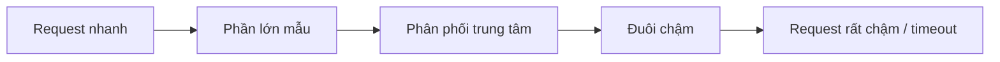
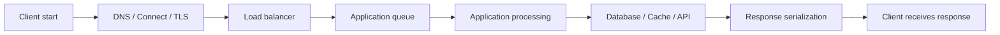
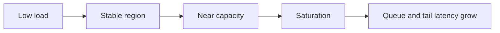

# Đo p50, p95, p99 và phân phối độ trễ dưới tải

Độ trễ của một workload không thể được mô tả đầy đủ chỉ bằng một con số trung bình. Khi hệ thống chịu tải, phần lớn request có thể phản hồi nhanh nhưng một nhóm nhỏ lại chậm do queue, CPU saturation, garbage collection, disk I/O, network, connection pool hoặc dịch vụ phụ thuộc. Các percentile như p50, p95 và p99 giúp nhìn thấy phần đuôi của phân phối độ trễ, từ đó đánh giá trải nghiệm người dùng và xác định giới hạn vận hành.

Trong module **CLOUD_CORE_SERVICES_COMPUTE**, việc đo latency cần gắn với năng lực CPU, bộ nhớ, network, storage, số lượng VM/container/function, autoscaling và dependency. Một phép đo đáng tin phải xác định rõ request nào được đo, tải được tạo ra như thế nào, kết quả được tổng hợp ra sao và hệ thống ở trạng thái nào trong lúc thử nghiệm. Bài học này hướng dẫn cách đọc percentile, xây dựng phép thử dưới tải và phân tích phân phối để tránh kết luận sai từ một giá trị trung bình.

## Mục tiêu học tập

Sau bài này, bạn có thể:

- Giải thích p50, p95, p99 và cách chúng mô tả phân phối độ trễ.
- Tính percentile từ tập mẫu và hiểu ảnh hưởng của kích thước mẫu, histogram và thuật toán ước lượng.
- Phân biệt latency phía client, server, queue và từng dependency.
- Thiết kế load test với warm-up, steady state, ramp-up, peak và cooldown.
- Phân biệt open workload model với closed workload model và nhận diện coordinated omission.
- Đo latency cùng throughput, error rate, concurrency và saturation.
- Tổng hợp histogram đúng cách giữa nhiều instance và tránh lấy trung bình các percentile.
- Đọc p50/p95/p99 trong quan hệ với SLO, xác định bottleneck và đề xuất tối ưu.
- Xây dựng bài test lặp lại được cho VM, container và serverless.

## 1. Độ trễ và phân phối độ trễ

Latency là thời gian từ một mốc bắt đầu đến một mốc kết thúc đã được định nghĩa. Với HTTP API, có thể đo từ lúc client bắt đầu gửi request đến khi nhận đủ response. Với một job nền, có thể đo từ lúc message được enqueue đến khi xử lý hoàn tất. Hai phép đo này trả lời những câu hỏi khác nhau, vì vậy cần ghi rõ phạm vi trước khi so sánh.

Một hệ thống xử lý request thường có phân phối latency thay vì một giá trị cố định. Ví dụ, trong 10.000 request:

- Nhiều request hoàn tất trong 40–80 ms.
- Một phần nhỏ mất 100–200 ms do truy vấn database hoặc network.
- Một số ít mất hơn 1 giây do retry, queueing hoặc garbage collection.

Nếu chỉ tính trung bình, nhóm request rất chậm có thể bị che khuất bởi số lượng lớn request nhanh. Percentile cho biết ngưỡng thời gian mà một tỷ lệ request đã hoàn tất.

### 1.1. P50, p95 và p99

| Chỉ số | Cách hiểu | Câu hỏi thực tế |
|---|---|---|
| p50 | 50% mẫu có latency nhỏ hơn hoặc bằng ngưỡng này; gần với median | Request điển hình thường mất bao lâu? |
| p95 | 95% mẫu có latency nhỏ hơn hoặc bằng ngưỡng này | 5% request chậm nhất bắt đầu ở vùng nào? |
| p99 | 99% mẫu có latency nhỏ hơn hoặc bằng ngưỡng này | Phần đuôi chậm hơn có ảnh hưởng đến trải nghiệm hoặc SLO không? |
| p99.9 | 99,9% mẫu có latency nhỏ hơn hoặc bằng ngưỡng này | Những request rất hiếm có đang tạo rủi ro lớn không? |

Ví dụ p99 = 900 ms nghĩa là khoảng 99% request trong tập đo hoàn tất trong tối đa 900 ms; khoảng 1% request còn lại chậm hơn. Nó không có nghĩa mọi request đều mất 900 ms hoặc hệ thống luôn phản hồi trong 900 ms.

P50 phản ánh trải nghiệm phổ biến. P95 và p99 nhạy hơn với queueing, contention, pause, retry và dependency chậm. Không có percentile nào tự nó cho biết nguyên nhân; cần kết hợp với throughput, error rate và tài nguyên.

### 1.2. Phân phối và tail latency



Tail latency là phần đuôi của phân phối, nơi có một tỷ lệ nhỏ request chậm hơn đáng kể so với phần còn lại. Trong hệ thống nhiều dịch vụ, một request có thể gọi nhiều dependency; chỉ cần một nhánh chậm hoặc retry cũng có thể làm latency tổng tăng mạnh. Với fan-out đến nhiều dịch vụ song song, xác suất ít nhất một nhánh chậm tăng theo số nhánh.

### 1.3. Mean, median và percentile khác nhau

- **Mean (trung bình):** tổng latency chia cho số mẫu; dễ bị ảnh hưởng bởi outlier.
- **Median/p50:** giá trị ở giữa sau khi sắp xếp; ít nhạy với một vài outlier cực lớn.
- **p95/p99:** tập trung vào vùng đuôi, hữu ích để đánh giá request chậm.
- **Min/max:** cho biết cực trị trong tập đo nhưng rất nhạy với nhiễu và số mẫu.

Nên xem cùng mean, p50, p95, p99, max và histogram. Nếu mean cao hơn p50 nhiều, phân phối có thể lệch phải hoặc có outlier. Nếu p50 ổn định nhưng p99 tăng mạnh, cần điều tra tail latency và saturation.

## 2. Cách tính percentile từ dữ liệu mẫu

Để hiểu percentile, giả sử có các mẫu latency được sắp xếp tăng dần:

```text
12, 15, 18, 20, 22, 25, 29, 35, 40, 120 (ms)
```

Median nằm giữa hai mẫu thứ 5 và 6 theo cách tính median thông thường, bằng 23,5 ms. Giá trị p90/p95/p99 phụ thuộc quy ước percentile và nội suy mà công cụ sử dụng. Với tập nhỏ 10 mẫu, phần đuôi được mô tả rất kém; không nên dùng p99 từ tập nhỏ để đưa ra kết luận production.

### 2.1. Nearest-rank method

Một cách tính đơn giản là nearest rank:

\[
rank = \lceil p \times N \rceil
\]

Trong đó:

- `p` là percentile dưới dạng tỷ lệ, ví dụ 0,95 cho p95.
- `N` là số mẫu sau khi sắp xếp tăng dần.
- `rank` là vị trí mẫu được chọn, đánh số từ 1.

Với 10.000 mẫu:

| Percentile | Vị trí nearest-rank | Diễn giải |
|---|---:|---|
| p50 | 5.000 | Ngưỡng ở giữa phân phối |
| p95 | 9.500 | 5% mẫu nằm phía trên |
| p99 | 9.900 | 1% mẫu nằm phía trên |
| p99.9 | 9.990 | 0,1% mẫu nằm phía trên |

Các thư viện thống kê có thể dùng quy tắc nội suy khác nearest-rank. Khi so sánh hai công cụ, cần kiểm tra định nghĩa percentile, cách xử lý mẫu trùng và dữ liệu bị loại bỏ.

### 2.2. Kích thước mẫu và độ tin cậy

Percentile cao cần nhiều mẫu hơn để ước lượng ổn định. Với 1.000 request, p99 chỉ đại diện cho khoảng 10 mẫu ở phía đuôi; p99.9 chỉ có khoảng một mẫu ở vùng đuôi. Một vài outlier hoặc một lần timeout có thể làm giá trị thay đổi lớn.

Gợi ý thực hành:

- Ghi lại số request thành công, thất bại, timeout và bị bỏ lỡ.
- Đảm bảo có đủ mẫu cho percentile mục tiêu; không chỉ nhìn thời lượng test.
- Lặp lại phép thử và so sánh phân phối giữa các lần chạy.
- Xem histogram hoặc confidence interval nếu công cụ hỗ trợ.
- Tránh diễn giải p99.9 khi mẫu quá ít hoặc sampling không đại diện.

Nếu cần p99 đáng tin, hãy thiết kế test có đủ request và đủ thời gian ở steady state. Tăng số request không có nghĩa tăng tải đến mức làm generator trở thành bottleneck; cần xác minh năng lực của load generator.

### 2.3. Outlier và timeout

Timeout không được âm thầm bỏ khỏi tập đo. Nếu client dừng chờ sau 2 giây, request đó không phải request “không có latency”; nó là một request thất bại hoặc timeout và phải được thống kê riêng. Nếu chỉ tính percentile của request thành công, hệ thống có thể trông nhanh hơn trong lúc thực tế nhiều người dùng không nhận được phản hồi.

Hãy báo cáo:

- Percentile của latency request hoàn tất.
- Tỷ lệ timeout và lỗi.
- Số request bị hủy hoặc không được gửi do giới hạn generator.
- Số request còn đang chạy khi phép thử kết thúc.

Với SLO availability/latency, cần áp dụng định nghĩa thành công cụ thể. Một request trả HTTP 500 trong 20 ms không nên được tính như một request thành công nhanh.

## 3. Histogram và cách tổng hợp percentile

Histogram lưu phân phối latency theo các bucket hoặc cấu trúc tương đương. Nó cho phép tổng hợp dữ liệu từ nhiều instance mà không cần lưu mọi mẫu riêng lẻ.

### 3.1. Histogram cổ điển

Histogram cổ điển có các bucket tích lũy. Ví dụ:

| Bucket `le` | Số request có latency nhỏ hơn hoặc bằng |
|---:|---:|
| 50 ms | 420 |
| 100 ms | 820 |
| 200 ms | 960 |
| 500 ms | 990 |
| 1.000 ms | 998 |
| +Inf | 1.000 |

Với 1.000 request, p95 nằm trong bucket đến 200 ms vì 960 request đã hoàn tất ở ngưỡng đó. p99 nằm ở vùng bucket đến 500 ms vì 990 request đã hoàn tất. Giá trị chính xác bên trong bucket cần được ước lượng bằng nội suy; histogram không nhất thiết giữ từng latency riêng lẻ.

Bucket cần tập trung quanh các ngưỡng SLO và vùng có biến động đáng quan tâm. Nếu tất cả bucket đều rất rộng, p95/p99 sẽ thô. Nếu có quá nhiều bucket, số series và chi phí tăng. Bucket phải nhất quán giữa các instance để có thể tổng hợp.

### 3.2. Tổng hợp histogram giữa nhiều instance

Giả sử một service chạy 10 VM. Mỗi VM ghi histogram request latency. Có thể cộng số lượng ở cùng bucket từ tất cả VM rồi tính percentile trên histogram tổng hợp. Không nên tính p99 từng VM rồi lấy trung bình 10 giá trị p99; phép tính đó không cho ra p99 của toàn bộ request.

Ví dụ PromQL với histogram cổ điển:

```promql
histogram_quantile(
  0.99,
  sum by (le, service, route) (
    rate(http_server_request_duration_seconds_bucket[5m])
  )
)
```

Tương tự cho p95:

```promql
histogram_quantile(
  0.95,
  sum by (le, service, route) (
    rate(http_server_request_duration_seconds_bucket[5m])
  )
)
```

Trong ví dụ, `sum by (le, service, route)` cộng bucket giữa các instance nhưng giữ lại bucket boundary và chiều service/route. Nếu cần percentile toàn service, có thể bỏ `route`. Cú pháp chính xác phụ thuộc tên metric và backend Prometheus-compatible.

### 3.3. Vì sao không lấy trung bình p99?

Giả sử instance A xử lý 9.000 request với p99 = 100 ms, instance B xử lý 100 request với p99 = 2.000 ms. Trung bình hai p99 là 1.050 ms, nhưng đó không phải p99 của 9.100 request. Phân phối tổng cần được tính từ các mẫu hoặc histogram/sketch có thể hợp nhất, có tính đến số lượng mẫu mỗi nguồn.

Các quy tắc:

- Không lấy trung bình percentile của các VM, Pod hoặc region để suy ra percentile toàn hệ thống.
- Không cộng percentile giữa các route hoặc status class.
- Dùng histogram bucket hoặc mergeable sketch nếu cần tổng hợp phân tán.
- Nếu backend chỉ cung cấp summary quantile phía client, hiểu rằng quantile đó không thể cộng gộp chính xác theo cách thông thường.
- So sánh cùng khoảng thời gian, cùng đơn vị, cùng population và cùng cách lọc lỗi.

### 3.4. Native histogram và sketch

Một số hệ thống hỗ trợ native histogram hoặc sketch như HDR Histogram, DDSketch và t-digest. Các cấu trúc này nén hoặc biểu diễn phân phối theo cách có thể hợp nhất giữa nguồn, nhưng có trade-off về độ chính xác, bộ nhớ và chi phí.

Khi chọn cấu trúc, xem xét:

- Sai số tương đối/tuyệt đối ở vùng percentile cần quan tâm.
- Khả năng merge giữa nhiều process và shard.
- Hành vi với phân phối lệch mạnh và outlier.
- Dung lượng và chi phí ingest/storage.
- Hỗ trợ của backend, SDK và công cụ query.

Không giả định mọi hệ thống histogram dùng cùng định nghĩa hoặc có cùng độ chính xác. Đọc tài liệu backend và kiểm tra bằng tập mẫu chuẩn trước khi dùng làm căn cứ SLO.

## 4. Đo latency ở đâu?

Latency cần có điểm bắt đầu và kết thúc nhất quán. Một request có thể được đo ở client, load balancer, server, queue hoặc từng dependency. Các con số không thể thay thế cho nhau.

### 4.1. Client-side latency

Client-side latency đo thời gian người dùng hoặc load generator thực sự chờ. Nó có thể bao gồm DNS, TCP connect, TLS handshake, gửi request, thời gian chờ server, nhận response và network transit.

Đây thường là phép đo gần với trải nghiệm người dùng nhất. Tuy nhiên, cần tách các thành phần để biết chậm ở đâu. Một client ở xa region có thể có latency cao dù server xử lý rất nhanh.

### 4.2. Server-side latency

Server-side latency đo thời gian từ lúc request vào ứng dụng hoặc middleware đến lúc ứng dụng hoàn tất xử lý. Nó có thể không bao gồm DNS, TLS handshake ở load balancer hoặc network từ client đến server.

Nên đặt tên metric rõ như:

- `http_server_request_duration_seconds`: thời gian xử lý ở server theo định nghĩa instrumentation.
- `http_client_request_duration_seconds`: thời gian client chờ một dependency.
- `queue_processing_duration_seconds`: thời gian worker xử lý message.
- `request_end_to_end_duration_seconds`: thời gian từ điểm bắt đầu nghiệp vụ đến kết quả cuối cùng.

Không so sánh hai metric chỉ vì cùng có chữ `duration`; hãy kiểm tra instrumentation và boundary.

### 4.3. Latency theo từng giai đoạn

Một request có thể được phân rã như sau:



Các thành phần có thể chồng lấp hoặc diễn ra song song. Không nên cộng các percentile riêng lẻ để suy ra percentile end-to-end. Hãy đo trực tiếp latency end-to-end và dùng trace/span để phân tích thành phần của các request chậm.

### 4.4. Queue time và service time

- **Queue time:** thời gian request/message chờ trước khi được xử lý.
- **Service time:** thời gian worker hoặc server thực sự thực hiện công việc.
- **End-to-end latency:** tổng thời gian từ lúc bắt đầu đến khi kết quả sẵn sàng.

Nếu service time không đổi nhưng queue time tăng, nguyên nhân thường nằm ở tải vượt năng lực xử lý, concurrency giới hạn hoặc downstream backpressure. Nếu queue time thấp nhưng service time tăng, cần điều tra CPU, lock, memory, disk, network hoặc dependency.

## 5. Quan hệ giữa latency, throughput và saturation

Không thể đánh giá latency tách rời tải. Khi throughput tăng, hệ thống có thể phản hồi nhanh cho đến khi một tài nguyên gần bão hòa. Sau ngưỡng đó, queue tăng và tail latency thường tăng nhanh.

### 5.1. Little’s Law

Little’s Law mô tả quan hệ giữa số lượng công việc trung bình trong hệ thống, throughput và thời gian lưu lại:

\[
L = \lambda W
\]

Trong đó:

- `L` là số request/job trung bình đang ở trong hệ thống.
- `λ` là throughput trung bình, ví dụ request/giây.
- `W` là thời gian trung bình một request/job ở trong hệ thống.

Ví dụ, hệ thống xử lý 200 request/giây và mỗi request ở trong hệ thống trung bình 0,25 giây:

```text
L = 200 × 0,25 = 50 request
```

Trung bình có khoảng 50 request đang xử lý hoặc chờ trong hệ thống. Đây là quan hệ cho hệ thống ổn định trong điều kiện phù hợp; không nên dùng nó để suy ra p95/p99 trực tiếp.

### 5.2. Queueing và vùng bão hòa

Khi utilization tiến gần 100%, thời gian chờ có thể tăng mạnh do ít khoảng trống để hấp thụ burst. Ví dụ CPU 70% có thể vẫn giữ latency ổn định; khi CPU liên tục 95–100%, run queue tăng và p99 tăng nhanh. Tương tự, database connection pool đầy có thể khiến request chờ dù CPU database chưa cao.

Các tín hiệu saturation cần theo dõi:

- CPU utilization, run queue, throttling và steal time.
- Memory available, page fault, swap, OOM và garbage collection pause.
- Disk IOPS, throughput, queue depth và latency.
- Network throughput, packet loss, retransmission và connection tracking.
- Database pool utilization, lock wait, query queue và replication lag.
- Queue depth, oldest message age, worker concurrency và retry count.
- Function concurrency, throttling, cold start và execution duration.

### 5.3. Đường cong tải và latency



Trong vùng ổn định, tăng tải có thể làm throughput tăng gần tuyến tính và latency thay đổi ít. Gần capacity, throughput tăng chậm lại trong khi p95/p99 tăng. Sau saturation, hệ thống có thể timeout, retry và giảm throughput hữu ích.

## 6. Thiết kế load test đúng cách

Load test cần mô phỏng workload thực tế đủ gần để kết quả có ý nghĩa. Một test chỉ gửi request đơn giản đến một endpoint rỗng có thể đo network hoặc framework overhead, không phản ánh truy vấn database, cache, xác thực và các dependency production.

### 6.1. Xác định mục tiêu và giả thuyết

Ví dụ mục tiêu:

- Xác định throughput tối đa khi p95 dưới 300 ms và error rate dưới 1%.
- So sánh p99 trước và sau khi tăng số vCPU từ 2 lên 4.
- Kiểm tra autoscaling có giữ latency trong giới hạn khi traffic tăng gấp đôi.
- Xác định queue hoặc database pool có trở thành bottleneck ở 500 request/giây.

Một giả thuyết tốt dự đoán điều gì sẽ xảy ra và có metric để kiểm chứng. Ví dụ: “Tăng worker concurrency từ 20 lên 40 sẽ giảm queue age cho đến khi database pool bão hòa.”

### 6.2. Xây dựng workload profile

Mô tả request mix dựa trên quan sát thực tế:

- Tỷ lệ endpoint đọc/ghi.
- Kích thước request và response.
- Authentication/session behavior.
- Tỷ lệ cache hit/miss.
- Tần suất gọi database, queue và API bên ngoài.
- Số request đồng thời và arrival rate.
- Tỷ lệ lỗi/retry và thời gian xử lý dài.

Ẩn hoặc tổng hợp dữ liệu nhạy cảm khi tạo test data. Không dùng một tài khoản hoặc một key duy nhất nếu nó tạo hot partition, cache pattern hoặc lock contention khác production.

### 6.3. Các giai đoạn của một phép thử

| Giai đoạn | Mục đích | Hành động |
|---|---|---|
| Preflight | Xác nhận môi trường và generator sẵn sàng | Kiểm tra phiên bản, dữ liệu, endpoint, quota và monitoring |
| Warm-up | Làm nóng runtime/cache/connection pool | Tăng tải nhẹ trước khi đo |
| Ramp-up | Tăng dần tải để quan sát điểm chuyển trạng thái | Tăng arrival rate hoặc concurrency theo bước |
| Steady state | Đo ở mức tải mục tiêu | Giữ tải đủ lâu và ghi p50/p95/p99, throughput, errors, saturation |
| Peak/burst | Kiểm tra tải đỉnh hoặc tăng đột ngột | Tạo spike có giới hạn và quan sát queue/autoscaling |
| Cooldown | Cho hệ thống phục hồi | Giảm tải, chờ queue drain và tài nguyên ổn định |
| Analysis | Đối chiếu kết quả và giả thuyết | So sánh baseline, phân phối và resource metrics |

Không lấy mẫu warm-up hoặc cooldown trộn vào steady-state percentile nếu mục tiêu là đo hiệu năng ổn định. Nhưng vẫn nên giữ dữ liệu các giai đoạn đó để đánh giá cold start, autoscaling và khả năng phục hồi.

### 6.4. Chọn thời lượng và số mẫu

Thời lượng test phải đủ để:

- Tạo đủ số request cho percentile cần đánh giá.
- Quan sát chu kỳ autoscaling, cache, garbage collection và batch job.
- Đạt trạng thái ổn định, tránh chỉ đo vài giây đầu.
- Phát hiện memory leak hoặc queue tích lũy trong soak test.

Không có một thời lượng cố định cho mọi hệ thống. Test 1 phút có thể đủ cho microbenchmark đơn giản nhưng không đủ để quan sát autoscaling hoặc tác vụ nền theo chu kỳ. Ghi số request thực tế và khoảng thời gian steady-state để người khác tái lập kết quả.

## 7. Open workload và closed workload model

Mô hình phát tải ảnh hưởng trực tiếp đến latency đo được.

### 7.1. Closed workload model

Trong closed model, một số lượng virtual users cố định gửi request, chờ response rồi mới gửi request tiếp theo. Nếu server chậm, mỗi user tự động giảm tốc độ gửi request.

Mô hình này phù hợp với một số kịch bản người dùng tương tác có think time, nhưng có thể che giấu quá tải vì generator phát ít request hơn đúng lúc hệ thống chậm.

### 7.2. Open workload model

Trong open model, request được lên lịch theo arrival rate độc lập tương đối với thời gian phản hồi trước đó. Ví dụ, hệ thống nhận 200 request/giây dù một số request đang chậm. Mô hình này phù hợp để kiểm tra API có traffic đến từ người dùng hoặc hệ thống khác theo tốc độ xác định.

Nếu server không xử lý kịp, queue và latency tăng; generator phải ghi nhận request không thể khởi tạo đúng lịch hoặc bị drop. Không được bỏ qua `dropped iterations` hoặc request chưa gửi khi báo cáo.

### 7.3. Coordinated omission

Coordinated omission xảy ra khi load generator chờ request trước hoàn tất rồi mới gửi request tiếp theo, khiến nó không ghi nhận những request đáng lẽ đã đến trong lúc server bị chậm. Kết quả percentile có thể lạc quan hơn trải nghiệm thực tế dưới tải liên tục.

Ví dụ, generator định gửi 100 request/giây nhưng dùng một luồng tuần tự. Khi một request mất 1 giây, generator bỏ lỡ nhiều thời điểm gửi tiếp theo. Nếu chỉ tính các request đã hoàn tất, phép đo không phản ánh đầy đủ backlog mà một arrival stream thực tế sẽ tạo ra.

Để hạn chế:

- Chọn open model khi workload production có arrival rate độc lập với response time.
- Dùng công cụ có hỗ trợ arrival-rate executor hoặc correction cho coordinated omission.
- Theo dõi scheduled request, started request, completed request và dropped request.
- Đảm bảo generator có đủ VU, CPU, network và socket capacity.
- Báo cáo rõ workload model để người đọc hiểu kết quả.

## 8. Công cụ và ví dụ thực hành với k6

k6 là công cụ load testing có thể tạo tải theo VU hoặc arrival rate và xuất metric Trend để tính percentile. Các công cụ khác như JMeter, Gatling, Locust, wrk2 hoặc hệ thống nội bộ cũng có thể phù hợp; hãy chọn theo giao thức, workload model và khả năng quan sát cần thiết.

### 8.1. Ví dụ k6 với constant arrival rate

Ví dụ dưới đây tạo tải khoảng 100 iteration mỗi giây trong 5 phút. URL là placeholder cần thay bằng endpoint của môi trường thử nghiệm được phê duyệt.

```javascript
import http from 'k6/http';
import { check } from 'k6';

export const options = {
  scenarios: {
    steady_load: {
      executor: 'constant-arrival-rate',
      rate: 100,
      timeUnit: '1s',
      duration: '5m',
      preAllocatedVUs: 50,
      maxVUs: 200,
    },
  },
  thresholds: {
    http_req_duration: ['p(95)<300', 'p(99)<800'],
    http_req_failed: ['rate<0.01'],
    dropped_iterations: ['count==0'],
  },
};

export default function () {
  const response = http.get('https://test.example.invalid/api/orders');
  check(response, {
    'status is 200': (r) => r.status === 200,
  });
}
```

Chạy script trong môi trường kiểm thử:

```bash
k6 run --summary-trend-stats="avg,min,med,max,p(50),p(90),p(95),p(99),p(99.9)" load-test.js
```

Các ngưỡng trong ví dụ là mục tiêu minh họa, không phải SLO mặc định. `constant-arrival-rate` cố gắng khởi tạo iteration theo lịch; cần cấp đủ `preAllocatedVUs` và `maxVUs`. Nếu generator không đủ VU, `dropped_iterations` tăng và phép thử không còn đạt arrival rate đã định.

### 8.2. Đọc kết quả k6

Các metric cần xem:

- `http_req_duration`: tổng thời gian gửi, chờ và nhận response theo định nghĩa của k6.
- `http_req_waiting`: thời gian chờ response đầu tiên (TTFB) sau khi gửi request.
- `http_req_connecting`: thời gian thiết lập TCP connection.
- `http_req_tls_handshaking`: thời gian TLS handshake.
- `http_req_failed`: tỷ lệ request thất bại theo quy tắc của k6.
- `iterations` và `iteration_duration`: số iteration và thời gian mỗi iteration.
- `dropped_iterations`: iteration không thể bắt đầu đúng lịch ở arrival-rate executor.
- `vus`/`vus_max`: số VU hiện tại và mức tối đa.

`http_req_duration` không bao gồm mọi giai đoạn trước request như blocked time hoặc DNS theo cùng cách với tổng trải nghiệm trình duyệt. Nếu cần end-to-end latency, đo thêm ở client thật hoặc browser synthetic test.

### 8.3. Thêm tag theo route và scenario

Gắn tag như `service`, `route`, `scenario`, `region` hoặc `release` để phân tích theo nhóm có tập giá trị hữu hạn. Tránh đưa `user_id`, `request_id` hoặc URL tùy ý vào tag metrics vì có thể làm tăng cardinality. Nếu cần truy vết request riêng lẻ, dùng log/trace correlation.

### 8.4. Kiểm tra generator

Load generator có thể trở thành bottleneck trước ứng dụng. Theo dõi CPU, memory, network, open file descriptors, socket usage, DNS và số VU. Nếu generator đạt saturation, latency client có thể phản ánh chính generator thay vì server.

Đối với tải lớn, dùng nhiều generator phân tán và đồng bộ thời gian. Ghi lại vị trí generator, region, network path, phiên bản công cụ và cấu hình để phép thử có thể lặp lại.

## 9. Đo percentile trên metrics và dashboard

Trong production, thường cần quan sát latency liên tục bằng histogram metric. Dashboard nên hiển thị p50/p95/p99 cùng throughput, error rate và saturation để người vận hành không đọc percentile tách rời bối cảnh.

### 9.1. Prometheus histogram

Giả sử ứng dụng export histogram `http_server_request_duration_seconds_bucket`. Truy vấn p50:

```promql
histogram_quantile(
  0.50,
  sum by (le, service) (
    rate(http_server_request_duration_seconds_bucket[5m])
  )
)
```

p95:

```promql
histogram_quantile(
  0.95,
  sum by (le, service) (
    rate(http_server_request_duration_seconds_bucket[5m])
  )
)
```

p99:

```promql
histogram_quantile(
  0.99,
  sum by (le, service) (
    rate(http_server_request_duration_seconds_bucket[5m])
  )
)
```

Các truy vấn trên minh họa histogram cổ điển của Prometheus. Đơn vị metric là giây; dashboard có thể đổi sang millisecond để dễ đọc. Cửa sổ 5 phút là ví dụ; chọn cửa sổ theo traffic, độ trễ cảnh báo và yêu cầu SLO.

### 9.2. Histogram bucket theo SLO

Nếu SLO yêu cầu 95% request dưới 300 ms, bucket cần có ranh giới tại hoặc gần 0,3 giây để đo tỷ lệ đáp ứng ngưỡng chính xác hơn. Có thể thiết kế bucket quanh các vùng quan trọng, ví dụ 50 ms, 100 ms, 200 ms, 300 ms, 500 ms, 1 s và 2 s. Danh sách này chỉ là minh họa; chọn dựa trên phân phối thực tế và chi phí.

### 9.3. Dashboard nên có gì?

Một dashboard latency dưới tải nên có:

- p50, p95, p99 theo service và route.
- Request rate/throughput theo cùng khoảng thời gian.
- Error rate, timeout và retry rate.
- Histogram hoặc heatmap để xem hình dạng phân phối.
- CPU, memory, throttling, disk/network và queue depth.
- Database connection pool, query latency và downstream latency.
- Replica/instance count và sự kiện autoscaling/deployment.
- Số request trong cửa sổ đo để đánh giá độ tin cậy percentile.

Tránh hiển thị quá nhiều chiều cardinality cao trên dashboard. Chọn các chiều có giá trị chẩn đoán như service, route template, status class, region và version.

## 10. Phân tích kết quả p50/p95/p99

Percentile là tín hiệu để đặt câu hỏi tiếp theo. Hãy xem độ lệch giữa các percentile, xu hướng theo thời gian và các metric liên quan.

### 10.1. Các mẫu hình thường gặp

| Quan sát | Nguyên nhân có thể | Hướng điều tra |
|---|---|---|
| p50 và p99 cùng tăng | Năng lực chung suy giảm, dependency chậm hoặc network issue | Throughput, CPU, network, downstream latency |
| p50 ổn định, p99 tăng | Tail latency do queue, GC, lock, retry hoặc một số shard/instance | Histogram, trace chậm, per-instance metrics, queue age |
| p50 tăng, p99 tăng ít | Phần lớn request đều chậm hơn | Thay đổi code, CPU throttling, network path, cache hit rate |
| p99 tăng theo burst | Autoscaling trễ, cold start, queue hoặc connection pool | Scale event, warm-up, concurrency, queue depth |
| p99 cao ở một route | Query hoặc logic riêng của endpoint | Trace theo route, DB query, payload size |
| p99 cao ở một region/zone | Network, placement, dependency hoặc capacity lệch | Region/zone breakdown, route và resource metrics |
| Latency thấp nhưng error rate tăng | Request lỗi nhanh hoặc bị reject | Phân loại status, timeout, saturation và dependency errors |
| Client latency cao, server latency thấp | DNS/TLS/network/client hoặc load balancer | Client timing breakdown và network path |

### 10.2. So sánh trước và sau tối ưu

Không chỉ so p99 của hai lần chạy. Cần giữ giống nhau:

- Request mix, dữ liệu, region và network path.
- Arrival rate/concurrency và thời gian steady-state.
- Phiên bản ứng dụng, dependency và cấu hình runtime ngoại trừ biến đang thử.
- Số replica/VM và loại compute.
- Warm-up, cache state và thời điểm chạy.
- Quy tắc loại bỏ lỗi, timeout và outlier.

Nếu thay nhiều yếu tố cùng lúc, khó xác định yếu tố nào tạo cải thiện. Thay một biến chính mỗi lần hoặc dùng thiết kế thử nghiệm có kiểm soát.

### 10.3. Ví dụ kết quả benchmark

Giả sử một API chạy trên 4 VM có kết quả sau ở cùng arrival rate 300 request/giây:

| Chỉ số | Trước tối ưu | Sau tối ưu |
|---|---:|---:|
| Throughput hoàn tất | 298 req/s | 300 req/s |
| p50 | 72 ms | 61 ms |
| p95 | 310 ms | 180 ms |
| p99 | 920 ms | 360 ms |
| Error rate | 0,8% | 0,2% |
| CPU trung bình | 82% | 74% |
| DB pool wait p95 | 140 ms | 35 ms |

Kết quả gợi ý tối ưu connection pool/query đã cải thiện phần đuôi và giảm error rate trong khi throughput giữ nguyên. Tuy nhiên, cần kiểm tra thêm số request, độ biến thiên qua nhiều lần chạy và các metric database trước khi kết luận. CPU trung bình thấp hơn không tự chứng minh hệ thống có nhiều capacity hơn; cần xem peak, run queue và saturation.

## 11. SLO và percentile

SLO latency nên định nghĩa population, cửa sổ đánh giá và điều kiện thành công. Ví dụ: 99% request hợp lệ của endpoint tạo đơn hoàn tất dưới 500 ms trong cửa sổ 30 ngày, không tính một số loại request đã được loại trừ rõ ràng theo policy.

### 11.1. Percentile SLO và threshold-based SLO

Có thể dùng percentile như p99 < 500 ms, hoặc dùng tỷ lệ request dưới ngưỡng:

```text
Latency SLI = số request thành công có latency <= 500 ms
              / tổng số request đủ điều kiện
```

Threshold-based SLI thường thuận tiện cho error budget vì mỗi request được phân loại tốt/xấu theo ngưỡng. Percentile giúp mô tả phân phối nhưng không phải lúc nào cũng phù hợp để tính error budget trực tiếp. Cần theo định nghĩa SLO của tổ chức.

### 11.2. Định nghĩa request đủ điều kiện

Ghi rõ:

- Endpoint và loại traffic nằm trong phạm vi.
- Request thành công hay lỗi có được tính vào latency SLI không.
- Timeout, client cancellation và retry được tính thế nào.
- Internal health check và synthetic traffic có được loại không.
- Các request có tải payload khác thường có được phân nhóm không.
- Đo ở client, gateway hay server.

Nếu chỉ đo request thành công, cần theo dõi error rate riêng để tránh hệ thống trả lỗi nhanh được xem là hiệu năng tốt.

### 11.3. SLO theo route và toàn dịch vụ

SLO toàn service có thể che giấu endpoint quan trọng nhưng traffic thấp. Nên xác định endpoint có mức độ quan trọng khác nhau và theo dõi route template. Không tạo SLO riêng cho mọi ID hoặc URL động vì sẽ làm phức tạp quản lý và tăng cardinality.

## 12. Kiểm thử VM, container và serverless

Mỗi mô hình compute có nguồn latency và hành vi khởi động khác nhau. Test phải đo cả steady-state lẫn các trạng thái chuyển tiếp.

### 12.1. VM

Các yếu tố cần xem:

- vCPU, CPU steal, run queue và throttling của hypervisor/guest.
- Memory pressure, swap, page fault và garbage collection.
- Disk type, IOPS, throughput và queue depth.
- Network bandwidth, packet loss và placement zone.
- Số VM, autoscaling warm-up và thời gian bootstrap.
- Connection pool và local cache trên từng instance.

Khi so sánh VM size, giữ nguyên image, workload, storage, network path và số replica nếu mục tiêu là đánh giá ảnh hưởng CPU/RAM. Nếu đổi cả instance type và autoscaling policy, cần ghi rõ hai biến đã thay.

### 12.2. Container/Kubernetes

Các yếu tố cần xem:

- CPU request/limit và CPU throttling của cgroup.
- Memory request/limit, OOM kill và working set.
- Pod startup, readiness, image pull và node scheduling.
- Node pressure, noisy neighbor và network plugin.
- Replica count, HPA/VPA behavior và scale-up delay.
- Service mesh sidecar, ingress controller và policy network.

Một Pod có CPU limit quá thấp có thể bị throttling dù node còn CPU. p99 có thể tăng ở một nhóm Pod do placement hoặc node pressure. Hãy phân tích theo Pod/node/zone nhưng tránh tổng hợp percentile bằng cách lấy trung bình.

### 12.3. Serverless/FaaS

Các yếu tố cần xem:

- Cold start và warm invocation.
- Memory/CPU allocation và thời gian thực thi.
- Concurrency limit, throttling và queue wait.
- VPC attachment, DNS, NAT và connection setup.
- Runtime initialization, package size và dependency loading.
- Retry, timeout, event batch size và downstream saturation.

Không trộn cold-start latency và warm latency nếu mục tiêu là đo riêng từng trạng thái. Nếu SLO phản ánh trải nghiệm người dùng, phải giữ cold start trong population tương ứng. Thử cả concurrency thấp và cao để thấy tác động đến database, queue và giới hạn function.

## 13. Các kiểu performance test

| Loại test | Mục tiêu | Cách tạo tải |
|---|---|---|
| Load test | Đo hệ thống ở tải dự kiến | Tăng dần đến mức tải bình thường/đỉnh |
| Stress test | Tìm giới hạn và hành vi khi quá tải | Tăng vượt tải thiết kế có kiểm soát |
| Spike test | Đo phản ứng trước burst đột ngột | Nhảy nhanh từ tải thấp lên tải cao rồi giảm |
| Soak/endurance test | Tìm rò rỉ và suy giảm theo thời gian | Giữ tải ổn định trong thời gian dài |
| Scalability test | Xem năng lực tăng khi thêm tài nguyên | Tăng VM/Pod/CPU và đo throughput/latency |
| Capacity test | Xác định tải tối đa đáp ứng SLO | Tăng arrival rate đến khi SLO hoặc saturation bị vi phạm |
| Regression test | Phát hiện hiệu năng suy giảm sau thay đổi | Chạy lại workload chuẩn và so baseline |

Mỗi kiểu test trả lời một câu hỏi khác nhau. Không dùng stress test vượt giới hạn để thay cho load test ở tải production dự kiến; không dùng một lần benchmark ngắn để kết luận soak test không có memory leak.

## 14. Những sai lầm thường gặp

| Sai lầm | Hậu quả | Cách khắc phục |
|---|---|---|
| Chỉ báo cáo average latency | Che giấu tail latency | Báo p50/p95/p99, histogram và error rate |
| Lấy trung bình p99 giữa các instance | Sai percentile toàn hệ thống | Merge histogram/sketch hoặc dùng mẫu tổng hợp |
| Test quá ít request | p99/p99.9 không ổn định | Tăng sample size và lặp lại phép thử |
| Bỏ request timeout khỏi dữ liệu | Kết quả có vẻ nhanh giả tạo | Báo timeout/error riêng và định nghĩa population |
| Dùng closed model cho traffic open | Coordinated omission làm đánh giá thấp latency | Chọn open arrival-rate model và theo dõi dropped request |
| Không kiểm tra load generator | Đo bottleneck của generator thay vì server | Theo dõi CPU/network/VU/socket và phân tán generator |
| Trộn warm-up vào steady state | Percentile khó so sánh | Gắn phase và lọc đúng cửa sổ đo |
| Chỉ đo server-side | Bỏ qua DNS/TLS/network và trải nghiệm người dùng | Đo client-side và phân rã trace/span |
| Chỉ nhìn latency mà không nhìn throughput | Không biết hệ thống có giảm tải hay không | Đọc latency cùng completed RPS và dropped iterations |
| Không giữ request mix | So sánh hai workload khác nhau | Dùng profile và test data nhất quán |
| Tăng nhiều biến cùng lúc | Không xác định được nguyên nhân cải thiện | Thay một biến chính mỗi thử nghiệm |
| Dùng trace sampling thấp để tính p99 | Mẫu trace có thể không đại diện | Dùng histogram metrics cho SLO, traces để điều tra |

## 15. Quy trình phân tích một lần benchmark

1. Xác nhận mục tiêu, SLO, workload profile và tải dự kiến.
2. Kiểm tra môi trường, version, dữ liệu, generator và monitoring.
3. Chạy warm-up rồi ramp-up theo kế hoạch.
4. Chọn cửa sổ steady-state và xác nhận arrival rate thực tế.
5. Ghi số request, throughput, p50/p95/p99, errors, timeouts và dropped iterations.
6. Đối chiếu CPU, memory, disk, network, queue và dependency latency.
7. Xem histogram/trace của request chậm để xác định giai đoạn gây tail latency.
8. So sánh với baseline và giả thuyết ban đầu.
9. Thay đổi một yếu tố, chạy lại với workload tương đương.
10. Ghi kết quả, giới hạn phép đo, cấu hình và quyết định tiếp theo.

Một báo cáo benchmark nên có ngày/giờ, region, loại compute, phiên bản ứng dụng, cấu hình generator, request mix, arrival rate, số mẫu, thời lượng steady-state, percentile, error rate và tài nguyên. Không chỉ ghi một ảnh chụp dashboard.

## 16. Checklist đo latency dưới tải

**Trước khi test**

- [ ] Đã xác định latency boundary và đơn vị đo.
- [ ] Đã định nghĩa request thành công, lỗi, timeout và cancelled.
- [ ] Workload profile và request mix gần với production.
- [ ] Chọn open/closed model đúng mục đích.
- [ ] Có đủ số mẫu cho p95/p99 mục tiêu.
- [ ] Load generator đủ CPU, network, VU và socket capacity.
- [ ] Monitoring thu thập throughput, errors, saturation và dependency metrics.

**Trong khi test**

- [ ] Có preflight, warm-up, ramp-up, steady state và cooldown.
- [ ] Ghi arrival rate dự kiến và thực tế.
- [ ] Theo dõi dropped iterations, timeouts và request failures.
- [ ] Phân biệt client-side và server-side latency.
- [ ] Gắn tag theo service/route/scenario/version có cardinality kiểm soát.
- [ ] Ghi nhận scale event, deployment và thay đổi môi trường.

**Sau khi test**

- [ ] Báo cáo p50, p95, p99 và số lượng mẫu.
- [ ] Xem histogram và phân phối, không chỉ một percentile.
- [ ] Tổng hợp histogram/sketch đúng cách giữa instance.
- [ ] Đối chiếu throughput, error rate, CPU/RAM/disk/network/queue.
- [ ] Phân tích trace của request chậm và dependency.
- [ ] So sánh với baseline cùng điều kiện.
- [ ] Ghi giả định, giới hạn, kết quả và hành động tiếp theo.

## 17. Kết luận

P50 mô tả phần giữa của phân phối, p95 cho thấy nhóm request chậm hơn và p99 làm rõ tail latency. Các giá trị này chỉ có ý nghĩa khi định nghĩa latency boundary, population, workload model và số mẫu rõ ràng. Cần đọc percentile cùng throughput, error rate, dropped requests và saturation để biết hệ thống có thực sự đáp ứng tải hay chỉ đang hoàn tất ít request hơn.

Histogram hoặc sketch cho phép tổng hợp phân phối giữa nhiều instance; lấy trung bình p99 của từng máy không tạo ra p99 toàn hệ thống. Open workload model giúp mô phỏng arrival rate độc lập và hạn chế coordinated omission. Khi tìm bottleneck, hãy kết hợp client timing, server metrics, queue depth và distributed traces. Một benchmark tốt phải lặp lại được, ghi đủ điều kiện và chứng minh được mối liên hệ giữa thay đổi cấu hình với kết quả.

## Thuật ngữ cần nhớ

| Thuật ngữ | Ý nghĩa |
|---|---|
| Latency | Thời gian từ điểm bắt đầu đến điểm kết thúc đã định nghĩa của một thao tác. |
| Percentile | Ngưỡng mà một tỷ lệ phần trăm mẫu có giá trị nhỏ hơn hoặc bằng. |
| p50 / median | Percentile thứ 50, gần với giá trị trung vị. |
| p95 | Percentile thứ 95; 5% mẫu nằm phía trên ngưỡng. |
| p99 | Percentile thứ 99; 1% mẫu nằm phía trên ngưỡng. |
| Tail latency | Độ trễ ở phần đuôi chậm của phân phối. |
| Histogram | Cấu trúc gom mẫu vào các bucket để mô tả phân phối. |
| Nearest rank | Phương pháp chọn vị trí mẫu theo `ceil(p × N)`. |
| Throughput | Số request/job hoàn tất trong một đơn vị thời gian. |
| Saturation | Trạng thái tài nguyên hoặc hàng đợi gần/vượt năng lực phục vụ. |
| Little’s Law | Quan hệ `L = λW` giữa số công việc trong hệ thống, throughput và thời gian lưu lại. |
| Open workload model | Mô hình tạo request theo arrival rate độc lập với response time trước đó. |
| Closed workload model | Mô hình người dùng chờ response rồi mới gửi request tiếp theo. |
| Coordinated omission | Sai lệch khi generator bỏ lỡ thời điểm gửi request trong lúc hệ thống chậm. |
| Warm-up | Giai đoạn làm nóng runtime, cache và connection trước khi đo ổn định. |
| Soak test | Phép thử giữ tải trong thời gian dài để tìm suy giảm theo thời gian. |
| SLI / SLO | Chỉ số đo dịch vụ và mục tiêu mức dịch vụ. |
| Dropped iteration | Iteration không thể bắt đầu theo lịch của load generator. |
