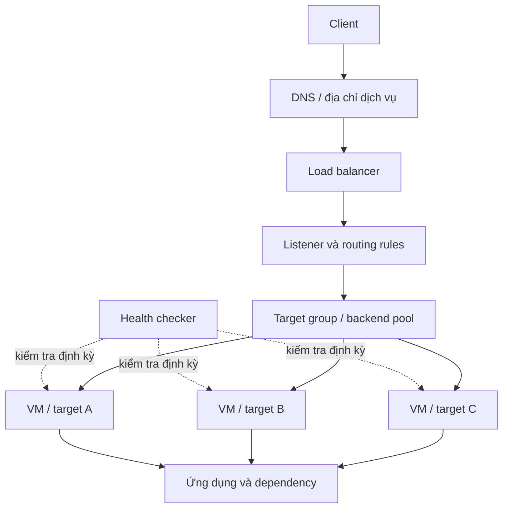

# Backend pool, target group và đăng ký máy tự động

Load balancer phân phối request hoặc kết nối đến nhiều backend để tăng khả năng phục vụ, mở rộng ngang và giảm ảnh hưởng khi một máy gặp sự cố. Backend pool là tập hợp các máy hoặc endpoint có thể nhận traffic; target group là cách nhiều nền tảng cloud gom các target cùng cấu hình để load balancer kiểm tra sức khỏe và định tuyến. Khi VM được tạo, thay thế hoặc scale theo tải, hệ thống cần đăng ký target mới và loại target cũ khỏi pool đúng thời điểm.

Nếu đăng ký máy thủ công, danh sách backend dễ lỗi thời: VM mới không nhận traffic, VM đã terminate vẫn còn trong pool, hoặc target chưa sẵn sàng nhưng đã nhận request. Tự động đăng ký và gỡ đăng ký theo vòng đời compute giúp pool phản ánh đúng các máy có thể phục vụ. Tuy nhiên, tự động hóa cần phối hợp với health check, connection draining, quyền IAM, autoscaling và quy trình triển khai để tránh chuyển traffic quá sớm hoặc ngắt request đang chạy.

## 1. Backend pool và target group là gì?

**Backend** là máy chủ hoặc dịch vụ thực hiện công việc phía sau load balancer, ví dụ VM chạy web server, container, Pod, IP endpoint hoặc dịch vụ ứng dụng. **Backend pool** là tập hợp backend mà load balancer có thể lựa chọn khi chuyển request.

**Target group** là đối tượng cấu hình tập hợp các target và quy tắc kiểm tra sức khỏe/định tuyến. Tùy nền tảng, target có thể là instance ID, địa chỉ IP, endpoint, function hoặc loại tài nguyên khác. Một load balancer có thể có nhiều listener/rule và mỗi rule chuyển traffic tới một target group phù hợp.

Ví dụ, một ứng dụng web có thể dùng:

- Target group `web-http` cho backend phục vụ HTTP nội bộ ở port 8080.
- Target group `web-admin` cho endpoint quản trị chỉ được truy cập từ mạng quản trị.
- Target group `api-v2` cho phiên bản API mới trong giai đoạn canary.

Target group thường gắn với các thuộc tính như protocol, port, target type, health check, stickiness, deregistration delay và thuật toán phân phối. Các thuộc tính chính xác phụ thuộc nhà cung cấp và loại load balancer.

### Các thành phần liên quan

| Thành phần | Vai trò |
|---|---|
| Listener | Nhận kết nối ở protocol/port công khai hoặc nội bộ |
| Listener rule | Chọn hành động theo host, path, header hoặc điều kiện khác |
| Target group / backend pool | Gom các backend có cấu hình định tuyến chung |
| Target | Một VM, IP, Pod endpoint hoặc dịch vụ được đăng ký |
| Health check | Xác định target có đủ khỏe để nhận traffic hay không |
| Registration | Thêm target vào pool và bắt đầu theo dõi trạng thái |
| Deregistration | Ngừng gửi request mới tới target và hoàn tất kết nối đang chạy |
| Autoscaling group / instance group | Tạo hoặc xóa compute member theo policy |
| Lifecycle hook | Cho phép chạy bước chuẩn bị hoặc dọn dẹp trong vòng đời instance |

## 2. Luồng request qua load balancer

Client kết nối tới địa chỉ của load balancer. Listener nhận kết nối, áp dụng rule, chọn target group rồi chọn một target đang ở trạng thái healthy. Load balancer chuyển request hoặc kết nối tới backend qua mạng nội bộ.



Health checker có thể hoạt động từ load balancer hoặc hệ thống điều khiển liên quan. Target chỉ nên nhận traffic khi trạng thái và chính sách định tuyến cho phép. Một target có thể đã đăng ký nhưng vẫn ở trạng thái `initial`, `unhealthy`, `draining` hoặc trạng thái tương đương.

### Một target group có thể có nhiều target type

Các nền tảng thường hỗ trợ một hoặc nhiều cách đăng ký:

- **Instance target:** đăng ký ID của VM/instance; nền tảng ánh xạ target tới network interface và port.
- **IP target:** đăng ký địa chỉ IP và port; hữu ích với endpoint nằm ngoài nhóm VM quản lý trực tiếp, container hoặc địa chỉ nội bộ.
- **Pod/endpoint target:** tích hợp với Kubernetes hoặc container platform để định tuyến trực tiếp tới endpoint phù hợp.
- **Service/function target:** một số dịch vụ hỗ trợ backend được quản lý thay vì VM.

Không phải mọi loại load balancer đều hỗ trợ mọi target type. Chọn loại phù hợp với cách workload được triển khai và cách địa chỉ backend thay đổi.

## 3. Chọn target type và mô hình đăng ký

### Đăng ký theo instance ID

Với instance target, autoscaling group hoặc instance group có thể tự động thêm ID của VM mới vào target group và gỡ ID khi VM bị loại khỏi nhóm. Load balancer dùng thông tin của provider để tìm endpoint mạng.

Ưu điểm:

- Gắn kết tự nhiên với vòng đời VM do autoscaling quản lý.
- Không cần tự duy trì danh sách IP nếu địa chỉ nội bộ thay đổi.
- Có thể liên kết health check và trạng thái instance trong control plane.

Giới hạn:

- Thường chỉ áp dụng cho instance thuộc phạm vi mà load balancer/provider hỗ trợ.
- Cần kiểm tra zone, VPC/VNet, account/project và quyền đăng ký.
- Có thể không phù hợp nếu backend là container endpoint hoặc IP nằm ngoài nhóm instance.

### Đăng ký theo IP và port

IP target cho phép đăng ký endpoint cụ thể, chẳng hạn IP của Pod, container host, máy trong mạng kết nối riêng hoặc dịch vụ ở môi trường khác. Cách này linh hoạt nhưng đòi hỏi hệ thống quản lý địa chỉ và trạng thái endpoint chính xác.

Rủi ro thường gặp:

- IP động bị tái sử dụng sau khi VM/Pod bị xóa.
- Target cũ không được deregister, dẫn tới request tới endpoint không còn tồn tại.
- IP thuộc subnet hoặc network không được load balancer truy cập.
- Port hoặc protocol không khớp với ứng dụng.
- Hệ thống đăng ký target không đồng bộ với scheduler hoặc autoscaler.

Nếu dùng IP động, cần có controller hoặc lifecycle automation cập nhật target group mỗi khi endpoint được tạo hoặc xóa. Không dựa vào file danh sách IP tĩnh nếu backend thường xuyên thay đổi.

### Chọn target type theo kiến trúc

| Kiến trúc backend | Cách đăng ký thường phù hợp | Điểm cần xác minh |
|---|---|---|
| VM trong autoscaling group | Instance target | Liên kết group-target group và lifecycle policy |
| VM tạo bởi nhiều pipeline độc lập | Instance hoặc IP target | Cơ chế owner, tagging và cleanup |
| Container trên VM | IP/endpoint hoặc tích hợp container platform | Port động, network mode và service discovery |
| Kubernetes Pod | Ingress/controller hoặc target integration của CNI/cloud | Endpoint readiness, Pod termination và target health |
| On-premises kết nối hybrid | IP target nếu được hỗ trợ | Routing, firewall, latency và địa chỉ ổn định |
| Dịch vụ được quản lý | Target type chuyên dụng của provider | Giới hạn giao thức, timeout và health semantics |

## 4. Health check quyết định target có nhận traffic hay không

Health check là phép kiểm tra định kỳ để đánh giá target có khả năng phục vụ. Một target mới đăng ký thường chưa được đưa vào pool phục vụ cho tới khi vượt qua số lần kiểm tra thành công theo cấu hình. Khi target liên tục thất bại, load balancer có thể ngừng gửi traffic tới target đó.

### Các kiểu health check

- **TCP check:** xác nhận có thể mở kết nối tới port. Nó không chứng minh ứng dụng xử lý request đúng.
- **HTTP/HTTPS check:** gửi request tới path cụ thể và kiểm tra status code hoặc nội dung theo khả năng của nền tảng.
- **Application-level check:** endpoint kiểm tra trạng thái ứng dụng và dependency cần thiết để phục vụ.
- **Platform check:** một số nền tảng kết hợp trạng thái instance hoặc network với health check của target.

Health check nên phản ánh khả năng nhận traffic thực tế. Nếu endpoint `/health` luôn trả 200 dù database không truy cập được, load balancer có thể tiếp tục gửi request tới một backend không thể hoàn tất công việc. Ngược lại, nếu health check phụ thuộc mọi dịch vụ phụ trợ, một dependency phụ không quan trọng có thể khiến toàn bộ target bị loại khỏi pool.

### Thiết kế endpoint health

Nên tách hai mục đích:

- **Liveness:** process còn hoạt động và không bị kẹt tới mức cần restart.
- **Readiness:** ứng dụng đã khởi tạo và có thể nhận request mới.

Load balancer thường cần readiness/health endpoint để quyết định target có nhận traffic. Endpoint này nên nhẹ, có timeout ngắn và tránh thực hiện truy vấn nặng. Có thể kiểm tra các dependency bắt buộc nhưng không nên biến health check thành tải lớn lên database.

Ví dụ phản hồi:

```http
GET /ready HTTP/1.1
Host: backend.internal

HTTP/1.1 200 OK
Content-Type: application/json

{"status":"ready"}
```

Nếu ứng dụng chưa sẵn sàng, có thể trả mã không thành công hoặc trạng thái mà load balancer được cấu hình nhận diện. Đảm bảo response code và timeout phù hợp với provider.

### Các tham số health check

| Tham số | Ý nghĩa | Cách chọn |
|---|---|---|
| Protocol/port | Giao thức và cổng kiểm tra | Khớp listener nội bộ của ứng dụng |
| Path | Đường dẫn HTTP/HTTPS | Endpoint readiness nhẹ, không redirect ngoài dự kiến |
| Interval | Khoảng cách giữa các lần kiểm tra | Cân bằng tốc độ phát hiện và tải kiểm tra |
| Timeout | Thời gian tối đa chờ phản hồi | Dài hơn response bình thường nhưng không quá lớn |
| Healthy threshold | Số lần thành công liên tiếp để healthy | Tránh đưa target vào pool sau một phản hồi tình cờ |
| Unhealthy threshold | Số lần lỗi liên tiếp để unhealthy | Tránh loại target vì một lỗi mạng thoáng qua |
| Success codes | Mã HTTP được coi là thành công | Chỉ cho phép mã ứng dụng thực sự sẵn sàng |
| Initial delay / grace period | Thời gian chờ sau khi khởi tạo | Đủ cho boot, tải model, warm cache và bootstrap |

Nếu ứng dụng khởi động trong 90 giây nhưng health check bắt đầu sau 10 giây và timeout liên tiếp, target có thể bị đánh dấu unhealthy trước khi hoàn tất bootstrap. Dùng grace period hoặc startup-aware readiness theo khả năng nền tảng, đồng thời không trì hoãn kiểm tra quá lâu khiến lỗi thật bị phát hiện chậm.

## 5. Đăng ký máy tự động với autoscaling

Autoscaling tạo hoặc xóa VM theo tải, lịch hoặc metric. Để load balancer luôn có đúng backend, autoscaling group/instance group cần được liên kết với target group hoặc có controller chịu trách nhiệm đăng ký target.

### Luồng scale out

1. Metric hoặc policy kích hoạt scale out.
2. Autoscaler yêu cầu tạo instance mới.
3. Provider cấp VM, gắn NIC, disk và identity.
4. Guest OS boot, chạy cloud-init/bootstrap và khởi động ứng dụng.
5. VM hoặc controller đăng ký target vào target group.
6. Load balancer bắt đầu health check.
7. Sau khi target healthy, traffic mới được chuyển tới backend.

Điểm quan trọng là **registered không có nghĩa là ready**. Nếu target được đăng ký ngay sau khi instance tạo, load balancer vẫn phải chờ health check. Một số nền tảng tự động xử lý bước này; một số tích hợp cần cấu hình health grace period hoặc lifecycle hook.

### Luồng scale in

1. Autoscaler chọn instance cần loại bỏ.
2. Lifecycle hook hoặc termination workflow giữ instance ở trạng thái chờ nếu cần.
3. Target được deregister hoặc đánh dấu draining.
4. Load balancer ngừng gửi request mới tới target.
5. Kết nối đang chạy được cho thời gian hoàn tất theo deregistration delay.
6. Ứng dụng dừng nhận job mới, hoàn tất hoặc checkpoint công việc.
7. VM được terminate và tài nguyên liên quan được thu hồi.

Nếu autoscaler terminate VM trước khi target được deregister hoặc connection draining hoàn tất, request đang chạy có thể bị reset. Cần kiểm tra thứ tự hook và timeout của từng nền tảng.

### Liên kết autoscaling group với target group

Mô hình cấu hình khái niệm:

```yaml
compute_group:
  min_size: 2
  desired_capacity: 3
  max_size: 10
  health_check_type: load_balancer
  health_check_grace_period: 180

load_balancer:
  listener_port: 443
  target_group: web-backends
  target_type: instance
  backend_port: 8080
  health_check:
    protocol: HTTP
    path: /ready
    interval_seconds: 15
```

Đây là ví dụ minh họa, không phải schema dùng trực tiếp cho một provider. Trong cấu hình thực tế, khai báo group-target group association, quyền đăng ký, health check và lifecycle behavior theo cú pháp của nền tảng.

## 6. Lifecycle hook và quá trình bootstrap

Lifecycle hook cho phép hệ thống thực hiện công việc trước khi instance chuyển sang trạng thái tiếp theo, ví dụ trước khi nhận traffic hoặc trước khi terminate. Tên và khả năng của hook khác nhau giữa autoscaling service.

### Khi instance khởi tạo

Một hook hoặc bootstrap workflow có thể:

- Cài package và cấu hình runtime.
- Lấy secret bằng instance identity.
- Tải model hoặc artifact cần thiết.
- Mount volume và kiểm tra dữ liệu.
- Khởi động service và warm cache.
- Đăng ký service discovery hoặc target group.
- Chờ readiness đạt trước khi cho phép traffic.

Bootstrap cần idempotent: nếu chạy lại do retry, nó không tạo user trùng, mount trùng hoặc đăng ký duplicate target. Các bước dài như tải model lớn cần timeout, progress và khả năng resume.

### Khi instance bị loại bỏ

Hook trước terminate có thể:

- Ngừng nhận công việc mới.
- Deregister target và đợi draining.
- Hoàn tất request đang xử lý hoặc gửi tín hiệu shutdown.
- Ghi checkpoint cho job dài.
- Flush log, metric và dữ liệu cần lưu.
- Detach volume hoặc giải phóng lock theo quy trình.

Hook không nên chờ vô hạn. Đặt deadline và hành vi khi timeout; nếu không thể hoàn tất trước giới hạn, cần quyết định rõ có force terminate, retry hay chuyển trạng thái sự cố.

## 7. Connection draining và deregistration delay

Khi một target bị gỡ khỏi target group, load balancer thường cần ngừng gửi request mới nhưng vẫn cho kết nối hiện tại hoàn tất. Cơ chế này thường được gọi là connection draining, deregistration delay hoặc target draining.

Ví dụ, một request xuất dữ liệu mất 45 giây. Nếu VM bị terminate ngay khi bắt đầu scale in, request sẽ bị ngắt. Nếu load balancer cho target 60 giây để draining và ứng dụng xử lý graceful shutdown đúng cách, request có cơ hội hoàn tất.

### Thứ tự shutdown nên phối hợp

1. Đánh dấu backend không nhận request mới hoặc bắt đầu deregistration.
2. Chờ load balancer cập nhật trạng thái draining.
3. Ứng dụng chuyển sang chế độ shutdown, từ chối job mới nhưng giữ request hiện tại.
4. Chờ request, transaction hoặc message đang xử lý hoàn tất.
5. Ghi checkpoint/flush dữ liệu nếu cần.
6. Dừng process và để autoscaler/provider thu hồi VM.

Thứ tự chi tiết phụ thuộc nền tảng. Một số load balancer bắt đầu draining khi API deregister được gọi; một số autoscaling service tự động gọi deregistration trong lifecycle. Cần tránh hai hệ thống cùng deregister hoặc terminate theo thứ tự không rõ ràng.

### Chọn thời gian draining

Thời gian draining nên dựa trên thời gian request dài nhất được phép, thời gian shutdown ứng dụng và timeout của nền tảng. Nếu đặt quá ngắn, request dài bị ngắt. Nếu quá dài, scale in kéo dài và VM có thể tiếp tục tính phí trong thời gian chờ.

| Đặc điểm workload | Hướng cấu hình |
|---|---|
| Request ngắn, không giữ session | Draining ngắn, nhưng vẫn đủ cho request p99 và shutdown |
| Upload/download lớn | Tính thời gian truyền tối đa và cách resume |
| WebSocket hoặc kết nối dài | Thiết kế reconnect, thông báo client và giới hạn lifetime |
| Batch/worker | Dừng nhận job mới, hoàn tất hoặc checkpoint job đang chạy |
| Streaming | Có cơ chế handoff, reconnect hoặc checkpoint offset |
| Database connection | Đóng connection có trật tự sau khi request hoàn tất |

Draining không bảo đảm request vô hạn sẽ hoàn tất. Ứng dụng cần timeout, retry và idempotency; client cũng cần xử lý reconnect.

## 8. Slow start, stickiness và thuật toán phân phối

### Slow start

Slow start tăng dần lượng traffic gửi tới target mới trong một khoảng thời gian. Nó hữu ích khi backend cần warm cache, JIT compile, tải model hoặc tạo connection pool. Nếu chuyển toàn bộ traffic ngay lập tức, target mới có thể bị quá tải trước khi warm-up xong.

Slow start không thay thế readiness. Target vẫn phải healthy trước khi nhận traffic; slow start chỉ điều chỉnh tốc độ tăng tải sau đó. Nếu ứng dụng khởi tạo chưa hoàn tất, health check phải tiếp tục đánh dấu chưa sẵn sàng.

### Session stickiness

Stickiness giữ request của cùng client hoặc session trên một target trong khoảng thời gian nhất định. Nó có thể hỗ trợ ứng dụng còn lưu session trong bộ nhớ, nhưng làm giảm tính linh hoạt khi phân phối tải.

Hạn chế:

- Một target có thể nhận tải không cân bằng nếu một số session hoạt động nặng.
- Khi target bị unhealthy hoặc bị deregister, session vẫn có thể bị mất hoặc chuyển sang backend khác.
- Cookie affinity không thay thế lưu session bền vững hoặc dùng shared session store.
- Stickiness có thể làm giảm hiệu quả scale out/in.

Ưu tiên thiết kế stateless và lưu session ở nơi dùng chung. Chỉ bật stickiness khi có yêu cầu tương thích cụ thể và đã đánh giá ảnh hưởng đến failover.

### Thuật toán phân phối

Load balancer có thể dùng round robin, least outstanding requests, weighted routing, hash hoặc thuật toán riêng. Lựa chọn phù hợp tùy giao thức và loại load balancer.

- **Round robin:** phân phối lần lượt; phù hợp khi target tương đương và request có chi phí gần nhau.
- **Least outstanding:** ưu tiên target có ít request/kết nối đang xử lý; hữu ích khi request có thời gian khác nhau.
- **Weighted:** phân phối theo tỷ trọng; hỗ trợ canary hoặc backend có capacity khác nhau.
- **Hash/sticky:** giữ một khóa hoặc client gắn với target; có thể hỗ trợ cache locality nhưng cần xử lý khi target membership thay đổi.

Không nên chỉ nhìn số request mỗi target để đánh giá cân bằng. Cần so sánh CPU, latency, active connections, queue depth và thời gian xử lý.

## 9. Tự động đăng ký và gỡ đăng ký trong các mô hình compute

### VM autoscaling

Liên kết autoscaling group với target group là cách phổ biến. Khi instance được tạo, service đăng ký target; khi instance bị loại, target được deregister theo lifecycle policy. Kiểm tra health check type, grace period, lifecycle hook và hành vi khi instance bị terminate ngoài dự kiến.

### Instance group hoặc managed VM group

Một số cloud dùng managed instance group để tạo, thay thế và tự chữa VM. Load balancer backend service có thể tham chiếu trực tiếp tới instance group hoặc network endpoint group. Khi dùng cơ chế tích hợp, provider có thể quản lý membership tự động. Cần hiểu cách group cập nhật backend khi rolling update hoặc autoscaling.

### Container platform

Container orchestrator quản lý endpoint của service dựa trên trạng thái Pod/container. Load balancer controller hoặc ingress controller có thể đồng bộ target group với endpoint đang Ready. Khi Pod terminate, endpoint cần bị loại khỏi danh sách và quá trình shutdown phải phối hợp với `preStop`, termination grace period và readiness.

Nếu đăng ký trực tiếp IP của Pod, cần xác minh IPAM, CNI, target health và thời gian endpoint được cập nhật. Nếu dùng node target, cần hiểu traffic đi qua NodePort hoặc proxy và ảnh hưởng khi node drain.

### Kubernetes và target integration

Luồng tổng quát:

1. Deployment tạo Pod.
2. Pod khởi động và startup probe hoàn tất.
3. Readiness probe thành công.
4. Service endpoint controller thêm Pod IP vào EndpointSlice.
5. Load balancer controller đồng bộ endpoint với target group hoặc backend service.
6. Target health check đạt và bắt đầu nhận traffic.
7. Khi Pod bị xóa, readiness chuyển false và endpoint được loại; controller deregister target.
8. `preStop` và termination grace period cho phép kết nối/job đang chạy kết thúc.

Thứ tự thực tế phụ thuộc CNI, ingress/controller và cloud integration. Kiểm tra tài liệu của plugin đang dùng; không giả định readiness probe tự động đồng nghĩa cloud target đã healthy tức thì.

### Serverless và endpoint được quản lý

Một số dịch vụ serverless được gắn trực tiếp làm backend mà không cần đăng ký từng instance. Provider quản lý concurrency và endpoint. Với dịch vụ này, cần cấu hình quyền invoke, timeout, concurrency và health semantics thay vì quản lý target registration thủ công.

## 10. Bảo mật khi đăng ký backend

Backend pool là một phần của ranh giới mạng và quyền truy cập. Đăng ký nhầm target có thể làm lộ dịch vụ nội bộ hoặc gửi dữ liệu tới endpoint không tin cậy.

### Giới hạn quyền đăng ký

Identity thực hiện register/deregister target cần quyền tối thiểu trên đúng target group và đúng compute group. Không cấp quyền sửa mọi listener hoặc xóa load balancer nếu workflow chỉ cần cập nhật membership.

### Kiểm soát network path

- Chỉ cho phép load balancer kết nối tới port backend cần thiết.
- Backend chỉ nhận traffic từ security group/subnet hoặc nguồn load balancer hợp lệ.
- Không mở port ứng dụng trực tiếp ra Internet nếu không cần.
- Kiểm tra egress và route khi target nằm ở mạng khác hoặc môi trường hybrid.
- Bảo vệ health check endpoint khỏi truy cập không cần thiết nhưng cho phép nguồn kiểm tra hợp lệ.

### TLS và xác thực backend

Nếu load balancer kết thúc TLS ở frontend và kết nối backend bằng HTTP, cần đánh giá dữ liệu có nhạy cảm không và network có được bảo vệ không. Với backend TLS, cấu hình certificate, hostname/SNI và trust chain đúng. Một số nền tảng chỉ mã hóa đường truyền backend mà không xác minh danh tính certificate theo cách người dùng mong muốn; phải đọc rõ cam kết dịch vụ.

### Ngăn target giả hoặc stale target

Chỉ cho phép automation đăng ký target từ inventory hoặc orchestration đã xác minh. Dùng tag/label, subnet và account/project allowlist. Khi một VM bị thu hồi, cleanup target phải được thực hiện ngay cả khi shutdown không hoàn tất. Scheduled reconciliation có thể tìm target không còn thuộc inventory để cảnh báo hoặc gỡ theo policy đã duyệt.

Không tự động deregister target chỉ vì inventory API tạm thời không truy cập được; cần phân biệt dữ liệu thiếu với target thực sự đã bị xóa.

## 11. Quan sát và vận hành target group

Các metric cần theo dõi:

- Số target theo trạng thái healthy, unhealthy, initial, draining và unused.
- Tỷ lệ health check fail theo target và theo zone.
- Request count, active connection và new connection.
- Target response time hoặc backend latency.
- HTTP 4xx/5xx do load balancer và backend.
- Reset, timeout, connection error và số request bị từ chối.
- Số target đăng ký/gỡ trong mỗi lần scale hoặc deployment.
- Thời gian từ instance launch tới target healthy.
- Thời gian từ deregister tới terminate hoàn tất.

Log nên liên kết request ID, target ID, listener/rule và backend response. Tránh ghi dữ liệu nhạy cảm hoặc token trong access log.

### Cảnh báo hữu ích

- Không còn target healthy trong một target group production.
- Target unhealthy tăng đột biến sau deployment.
- Instance mới không trở thành healthy trong thời gian dự kiến.
- Target group có target stale sau khi VM bị terminate.
- Thời gian draining thường xuyên vượt timeout của lifecycle hook.
- Backend latency tăng dù load balancer latency hoặc frontend traffic ổn định.
- Một zone mất toàn bộ target hoặc tỷ lệ phân phối giữa zone mất cân bằng.

## 12. Troubleshooting backend pool và target registration

| Triệu chứng | Nguyên nhân có thể | Cách kiểm tra |
|---|---|---|
| Target mới không xuất hiện trong pool | Association sai, thiếu quyền, controller chưa chạy | Kiểm tra autoscaling integration, event và IAM/RBAC |
| Target ở trạng thái initial quá lâu | Health check chưa chạy hoặc grace period | Kiểm tra interval, port, path và event |
| Target unhealthy ngay sau launch | Ứng dụng chưa sẵn sàng, firewall hoặc sai path | Gọi endpoint từ network phù hợp, xem health reason và app log |
| VM healthy nhưng load balancer không kết nối | Security rule, route, port hoặc protocol mismatch | Kiểm tra LB-to-backend path và listener/backend config |
| Target cũ vẫn nhận traffic | Deregistration không hoàn tất hoặc controller lỗi | Xem target state, event và cleanup automation |
| Request bị reset khi scale in | Terminate trước khi draining xong | Kiểm tra deregistration delay, hook timeout và app shutdown |
| Một số target quá tải | Stickiness, thuật toán hoặc capacity không đồng đều | So sánh request, active connection, CPU và latency từng target |
| Target bị unhealthy sau warm-up | Memory leak, dependency lỗi hoặc probe quá chặt | Xem metric và log theo thời điểm health check fail |
| Pod Ready nhưng target vẫn unhealthy | Controller/CNI chưa đồng bộ hoặc network path lỗi | Kiểm tra EndpointSlice, target registration và firewall |
| Scale out nhưng traffic không tăng | Target chưa healthy hoặc listener rule sai | Theo dõi registration timeline, rule và health threshold |

### Quy trình xử lý nhanh

1. Kiểm tra listener/rule có trỏ tới đúng target group không.
2. Xác nhận target ID/IP/port và loại target đúng.
3. Kiểm tra trạng thái registration và lý do unhealthy.
4. Gọi health endpoint từ đường mạng tương đương load balancer.
5. Kiểm tra security group, firewall, route và TLS.
6. Đối chiếu log ứng dụng, startup time và readiness.
7. Kiểm tra autoscaling event, lifecycle hook và controller.
8. Sau khi sửa, chờ target healthy rồi xác minh request thực tế được phân phối.

## 13. Ví dụ quy trình scale out và scale in

### Scale out

Một nhóm VM web có tối thiểu hai instance. Khi CPU hoặc request count vượt ngưỡng, autoscaler tăng desired capacity từ 2 lên 4.

1. Autoscaler tạo hai VM từ image chuẩn.
2. VM khởi động OS, tải cấu hình và chạy web service.
3. Instance group tự đăng ký hai target mới.
4. Load balancer kiểm tra `/ready`; target mới chưa nhận traffic khi đang `initial`.
5. Sau khi health check thành công đủ số lần, target chuyển healthy.
6. Load balancer phân phối request theo thuật toán đã cấu hình.
7. Metric xác nhận tải được chia đều hơn và latency giảm.

Nếu bootstrap mất nhiều thời gian, tăng grace period hoặc cải thiện image/warm-up. Không đưa target vào nhận traffic chỉ vì VM đã `Running`.

### Scale in

Khi tải giảm, autoscaler giảm desired capacity từ 4 xuống 2.

1. Autoscaler chọn hai VM cần loại bỏ.
2. Lifecycle hook bắt đầu termination workflow.
3. Target được deregister và chuyển sang draining.
4. Load balancer không gửi request mới tới hai target này.
5. Ứng dụng hoàn tất request còn lại, dừng worker nhận job mới và flush log.
6. Hết draining hoặc công việc hoàn tất, lifecycle hook cho phép terminate.
7. Automation kiểm tra target cũ đã biến mất và không còn IP/volume phụ thuộc cần giữ.

Nếu job dài hơn thời gian draining, worker cần checkpoint hoặc chuyển job về queue để worker khác tiếp tục. Không kéo dài draining vô hạn vì sẽ làm scale in kém hiệu quả và có thể vượt giới hạn của provider.

## 14. Checklist triển khai

**Thiết kế target group:**

- [ ] Chọn target type phù hợp với VM, IP, container hoặc dịch vụ quản lý.
- [ ] Khai báo protocol, port và health check đúng với backend.
- [ ] Listener/rule trỏ tới đúng target group.
- [ ] Backend chỉ cho phép traffic từ load balancer hoặc nguồn được phê duyệt.
- [ ] Có đủ target healthy và capacity ở các fault domain cần thiết.

**Tự động đăng ký:**

- [ ] Autoscaling group/instance group được liên kết đúng với target group.
- [ ] Bootstrap idempotent và có readiness check.
- [ ] Có grace period phù hợp với thời gian khởi động.
- [ ] IAM/RBAC chỉ cấp quyền register/deregister cần thiết.
- [ ] Controller hoặc scheduler đồng bộ endpoint khi backend thay đổi.

**Tự động gỡ đăng ký:**

- [ ] Deregistration bắt đầu trước khi VM/Pod bị terminate.
- [ ] Có connection draining và thời gian chờ phù hợp.
- [ ] Ứng dụng dừng nhận công việc mới và hoàn tất/checkpoint job.
- [ ] Lifecycle hook có timeout và hành vi khi lỗi rõ ràng.
- [ ] Cleanup xử lý cả trường hợp instance chết đột ngột.

**Vận hành:**

- [ ] Theo dõi target health, backend latency và lỗi kết nối.
- [ ] Cảnh báo khi không còn target healthy hoặc có target stale.
- [ ] Kiểm thử scale out, scale in, rolling update và zone failure.
- [ ] Kiểm tra stickiness, slow start và thuật toán phân phối dưới tải thực tế.
- [ ] Có runbook phục hồi khi registration controller hoặc load balancer gặp lỗi.

## Kết luận

Backend pool và target group là nơi load balancer quản lý tập hợp backend có thể nhận traffic. Đăng ký tự động cần gắn với vòng đời VM, container hoặc dịch vụ được quản lý; health check xác nhận target sẵn sàng; deregistration và connection draining bảo vệ request đang chạy khi scale in hoặc triển khai phiên bản mới. Hãy chọn target type theo kiến trúc, thiết kế readiness phù hợp, phối hợp autoscaling với lifecycle hook, giới hạn quyền và network path, đồng thời giám sát trạng thái target. Khi các bước này được liên kết đúng, backend pool luôn phản ánh năng lực phục vụ thực tế và hệ thống có thể mở rộng hoặc thay thế máy với gián đoạn thấp.
