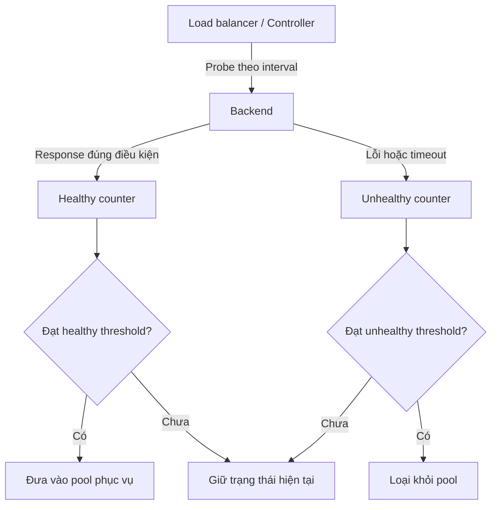

# Health check và ngưỡng loại máy lỗi khỏi phục vụ

## 1. Vì sao health check quan trọng?

Load balancer phân phối request đến nhiều máy hoặc nhiều instance để tăng khả năng phục vụ, mở rộng ngang và giảm phụ thuộc vào một máy đơn lẻ. Tuy nhiên, việc một VM vẫn ở trạng thái `running`, một container vẫn ở trạng thái `Running` hoặc một tiến trình vẫn mở cổng TCP không chứng minh ứng dụng có thể xử lý request đúng cách.

Một máy có thể còn hoạt động nhưng đã gặp lỗi như hết connection pool, không truy cập được database, đầy filesystem, bị CPU throttling, treo worker hoặc không thể đọc secret. Nếu load balancer tiếp tục gửi request đến máy đó, lỗi sẽ lan tới người dùng dù các backend khác vẫn khỏe.

**Health check** là cơ chế kiểm tra tình trạng sẵn sàng của backend. Khi một backend liên tục thất bại theo ngưỡng đã cấu hình, load balancer hoặc bộ điều phối có thể đánh dấu backend không khỏe và ngừng gửi request mới đến đó. Khi backend phục hồi và vượt qua các lần kiểm tra thành công cần thiết, nó có thể được đưa trở lại pool.

Trong module **CLOUD_CORE_SERVICES_COMPUTE**, health check liên quan trực tiếp đến việc triển khai VM, container và serverless; lựa chọn CPU, bộ nhớ, mạng; mở rộng tải; bảo đảm tính sẵn sàng và tối ưu chi phí. Bài học tập trung vào cách thiết kế phép kiểm tra có ý nghĩa, chọn ngưỡng loại máy lỗi khỏi phục vụ và tránh loại nhầm máy vẫn có thể xử lý request.

Sau bài học, người học có thể:

- Phân biệt health check ở tầng mạng, tiến trình, ứng dụng và dependency.
- Phân biệt readiness, liveness và startup probe.
- Thiết kế endpoint kiểm tra sức khỏe an toàn, nhẹ và phản ánh đúng khả năng phục vụ.
- Chọn interval, timeout, healthy threshold và unhealthy threshold.
- Tính gần đúng thời gian phát hiện lỗi và thời gian đưa backend trở lại pool.
- Kết hợp health check với connection draining, failover và autoscaling.
- Xử lý các tình huống flapping, lỗi đồng loạt, startup chậm và dependency dùng chung.

## 2. Health check hoạt động như thế nào?

### 2.1. Luồng kiểm tra cơ bản

Load balancer hoặc control plane gửi probe định kỳ đến từng backend. Backend trả về kết quả hoặc không phản hồi trong thời gian cho phép. Bộ điều khiển ghi nhận kết quả, cập nhật trạng thái và quyết định có tiếp tục gửi request hay không.



Đây là mô hình khái quát. Cách tính số lần thành công/thất bại, thời điểm probe đầu tiên, xử lý lỗi kết nối và trạng thái khi controller không liên lạc được có thể khác giữa các nền tảng. Cần đọc đúng tài liệu của load balancer hoặc orchestrator đang dùng.

### 2.2. Health check không đồng nghĩa với restart máy

Đánh dấu backend unhealthy thường chỉ có nghĩa là ngừng gửi request mới đến backend đó. Nó không nhất thiết reboot VM, restart container hoặc xóa instance. Một controller khác như autoscaling group, node repair hoặc operator có thể quyết định thay thế tài nguyên dựa trên chính sách riêng.

Phân biệt ba hành động:

- **Remove from service:** tạm ngừng định tuyến request mới đến backend.
- **Restart/recover process:** khởi động lại tiến trình hoặc container khi có cơ chế phù hợp.
- **Replace instance/node:** tạo tài nguyên mới và thu hồi tài nguyên lỗi.

Không nên tự động thay máy chỉ vì một probe thất bại ngắn. Lỗi mạng tạm thời, quá tải probe hoặc dependency dùng chung có thể làm nhiều backend cùng thất bại. Nếu thay tất cả máy trong tình huống đó, hệ thống có thể mất thêm capacity và làm sự cố nghiêm trọng hơn.

### 2.3. Active và passive health check

**Active health check** chủ động gửi probe đến backend theo lịch. Nó phát hiện lỗi ngay cả khi chưa có request người dùng, nhưng tạo thêm traffic kiểm tra và có thể không đại diện hoàn toàn cho đường đi của request thật.

**Passive health check** suy luận sức khỏe từ request thực tế, ví dụ tỷ lệ lỗi, timeout hoặc reset connection. Nó phản ánh traffic thật nhưng có thể không phát hiện backend lỗi khi không có request và có nguy cơ nhầm lỗi do client hoặc dependency với lỗi backend.

Một số hệ thống kết hợp hai phương pháp. Active check xác nhận khả năng phản hồi cơ bản; passive signal bổ sung thông tin về chất lượng xử lý. Không nên dùng một vài request lỗi đơn lẻ làm căn cứ loại backend nếu lỗi có thể đến từ client hoặc một dependency dùng chung.

## 3. Các lớp health check

### 3.1. Kiểm tra TCP

TCP health check thử thiết lập kết nối đến địa chỉ và cổng của backend. Nó hữu ích để xác nhận cổng đang mở và có thể nhận kết nối.

Giới hạn: TCP connect thành công không chứng minh ứng dụng có thể xử lý request. Web server có thể mở cổng nhưng worker bị treo, database connection pool đã cạn hoặc ứng dụng trả lỗi cho mọi request.

### 3.2. Kiểm tra HTTP/HTTPS

HTTP health check gửi request đến một path cụ thể như `/health` hoặc `/ready` và đánh giá status code, response body hoặc một số điều kiện cấu hình. HTTPS check còn kiểm tra được đường TLS theo cách triển khai của nền tảng.

Một endpoint readiness thường trả `200 OK` khi backend có thể nhận request mới và `503 Service Unavailable` khi cần tạm ngừng phục vụ. Cần cấu hình rõ status code được coi là thành công; không giả định mọi load balancer đều dùng cùng một dải mã.

Không nên dùng trang chủ hoặc endpoint nghiệp vụ nặng làm health check nếu chúng phụ thuộc nhiều dịch vụ, truy vấn lớn hoặc tạo side effect. Endpoint nên nhanh, có timeout rõ ràng và không thay đổi dữ liệu.

### 3.3. Kiểm tra gRPC

Với dịch vụ gRPC, có thể dùng giao thức health checking chuẩn của gRPC nếu server triển khai. Client hoặc load balancer có thể truy vấn trạng thái cho service cụ thể. Cần xác định tên service, trạng thái `SERVING`/`NOT_SERVING` và hành vi khi health service không được triển khai.

Không nên coi việc HTTP/2 connection thành công là đủ để kết luận mọi gRPC method đều hoạt động. Health service nên phản ánh khả năng xử lý của service mà load balancer đang định tuyến.

### 3.4. Kiểm tra ở tầng ứng dụng

Application health check có thể xác nhận các thành phần quan trọng như worker pool, cấu hình, cache hoặc kết nối đến dependency. Tuy nhiên, càng kiểm tra sâu thì probe càng có nguy cơ chậm, tạo tải và làm backend bị đánh dấu unhealthy do lỗi nằm ngoài backend.

Nên tách endpoint theo mục đích:

- `/live`: tiến trình còn sống và có thể tiếp tục chạy.
- `/ready`: ứng dụng đã khởi tạo xong và có thể nhận traffic.
- `/health/dependencies` hoặc endpoint chẩn đoán nội bộ: cung cấp thông tin dependency cho hệ thống quan sát, không nhất thiết dùng trực tiếp để loại backend khỏi pool.

Không công khai endpoint chi tiết chứa hostname nội bộ, secret, connection string, stack trace hoặc dữ liệu nhạy cảm. Có thể bảo vệ endpoint chẩn đoán bằng mạng nội bộ và quyền truy cập riêng.

### 3.5. Kiểm tra dependency

Một endpoint có thể kiểm tra database, cache, queue hoặc dịch vụ khác. Cách này giúp phát hiện backend không thể phục vụ do dependency hỏng, nhưng cần cẩn trọng với lỗi dùng chung.

Ví dụ, nếu database chính ngừng hoạt động, mọi backend đều có thể trả readiness thất bại. Load balancer loại tất cả backend không làm database khỏe lại; nó chỉ khiến pool không còn target. Với dependency dùng chung, nên phân biệt trạng thái “backend không thể phục vụ” với “toàn hệ thống đang bị dependency chung làm suy giảm”. Có thể dùng readiness có kiểm soát, circuit breaker, degraded mode hoặc thông tin dependency riêng để tránh loại hàng loạt.

## 4. Readiness, liveness và startup probe

### 4.1. Readiness – có thể nhận traffic hay chưa?

Readiness cho biết một instance hoặc container đã sẵn sàng nhận request mới hay chưa. Nó có thể trả về không sẵn sàng trong lúc ứng dụng khởi động, đang nạp cấu hình, warm cache hoặc tạm thời không có capacity.

Khi readiness thất bại, orchestrator thường giữ container chạy nhưng ngừng gửi traffic đến endpoint đó. Đây là cơ chế phù hợp để drain có kiểm soát, khởi động chậm hoặc tạm dừng phục vụ khi ứng dụng chưa đáp ứng được request.

### 4.2. Liveness – tiến trình còn hoạt động đúng không?

Liveness xác định tiến trình có bị treo hoặc rơi vào trạng thái không thể tự phục hồi hay không. Khi liveness thất bại đủ ngưỡng, orchestrator có thể restart container.

Không đưa mọi dependency vào liveness. Nếu database tạm thời mất kết nối và liveness của mọi pod đều thất bại, Kubernetes có thể restart hàng loạt pod dù nguyên nhân nằm ở database. Restart đồng loạt có thể làm tăng connection storm và kéo dài sự cố.

### 4.3. Startup – ứng dụng cần bao lâu để khởi động?

Startup probe bảo vệ ứng dụng có thời gian khởi động dài. Trong thời gian startup chưa thành công, hệ thống có thể trì hoãn đánh giá liveness và readiness theo cấu hình nền tảng. Điều này tránh restart ứng dụng liên tục chỉ vì nó cần thời gian nạp model, warm cache hoặc khởi tạo runtime.

Startup probe cần có giới hạn hợp lý. Nếu cho phép khởi động vô thời hạn, lỗi cấu hình hoặc dependency có thể không được phát hiện đủ sớm.

### 4.4. Bảng so sánh

| Loại probe | Câu hỏi | Khi thất bại | Ví dụ |
|---|---|---|---|
| Readiness | Có thể nhận request mới không? | Loại khỏi endpoint/traffic pool trong thời gian chưa sẵn sàng | App đang warm cache hoặc drain |
| Liveness | Tiến trình có còn hoạt động đúng không? | Có thể restart container/process theo chính sách | Event loop bị treo và không tự hồi phục |
| Startup | Ứng dụng đã hoàn tất khởi động chưa? | Tiếp tục chờ trong giới hạn startup; sau đó áp dụng chính sách thất bại | JVM nạp dữ liệu hoặc model GPU lúc khởi động |

Một health check của load balancer và readiness probe của Kubernetes có thể cùng tồn tại nhưng cần đồng bộ mục tiêu và thời gian. Nếu Kubernetes đánh dấu pod Ready trước khi ứng dụng nhận traffic được, load balancer có thể gửi request quá sớm. Nếu hai lớp có ngưỡng quá khác nhau, trạng thái có thể dao động hoặc phát hiện lỗi chậm.

## 5. Thiết kế endpoint health check tốt

### 5.1. Endpoint phải nhẹ và có giới hạn thời gian

Health endpoint được gọi định kỳ từ nhiều controller. Nó nên:

- Trả lời nhanh và có giới hạn thời gian rõ ràng.
- Không truy vấn dữ liệu lớn hoặc chạy logic nghiệp vụ nặng.
- Không ghi dữ liệu, tạo đơn hàng hoặc kích hoạt side effect.
- Không cần xác thực phức tạp nếu nền tảng probe không hỗ trợ; thay vào đó giới hạn bằng network policy hoặc cơ chế phù hợp.
- Không trả secret, token, stack trace hoặc thông tin nội bộ nhạy cảm.
- Có response ổn định và status code nhất quán.

Nếu mỗi probe thực hiện nhiều truy vấn database, một đợt tăng số backend hoặc controller có thể tạo thêm tải lên chính dependency đang quá tải. Health check cần nhẹ hơn request nghiệp vụ thông thường.

### 5.2. Readiness cần phản ánh khả năng phục vụ

Một backend chỉ nên Ready khi có thể xử lý loại request được định tuyến đến nó. Ví dụ, một worker API có thể cần:

- Ứng dụng đã khởi tạo hoàn tất.
- Cấu hình bắt buộc đã được tải và kiểm tra.
- Worker pool còn capacity tối thiểu.
- Các dependency bắt buộc đang ở trạng thái dùng được hoặc ứng dụng có degraded mode rõ ràng.
- Backend chưa ở trạng thái drain hoặc shutdown.

Không nên đưa vào readiness các dependency tùy chọn mà ứng dụng vẫn có thể hoạt động khi chúng tạm thời không sẵn sàng. Cũng không nên để readiness thành phép kiểm tra quá rộng khiến một lỗi ở dịch vụ phụ trợ làm toàn bộ pool bị loại.

### 5.3. Liveness cần tránh restart loop

Liveness nên kiểm tra dấu hiệu tiến trình bị kẹt hoặc không thể tiếp tục, không phải kiểm tra mọi điều kiện bên ngoài. Ví dụ, một endpoint có thể xác nhận event loop phản hồi hoặc worker supervisor vẫn tiến triển. Nếu liveness gọi database mỗi lần, database outage có thể kích hoạt restart loop.

Khi liveness thất bại, cần hiểu hành động của orchestrator: restart container, restart process hay thay instance. Giới hạn số lần restart và quan sát restart count để phát hiện crash loop.

### 5.4. Kiểm tra từ đúng vị trí mạng

Probe của load balancer có thể đến từ subnet hoặc địa chỉ nguồn khác với traffic người dùng. Security group, firewall, network policy và route phải cho phép probe đến đúng port/path. Nếu ứng dụng chỉ bind vào `127.0.0.1`, probe từ mạng bên ngoài container/VM có thể thất bại dù curl nội bộ thành công.

Khi health check lỗi, kiểm tra cả đường đi từ probe source đến backend: DNS, route, security policy, TLS certificate, port và response. Không kết luận ứng dụng hỏng chỉ từ một lỗi probe nếu có khả năng probe bị chặn ở mạng.

### 5.5. Phân biệt health endpoint với synthetic monitoring

Health check nội bộ thường kiểm tra nhanh một backend để quyết định có định tuyến request đến đó hay không. Synthetic monitoring thực hiện hành trình người dùng hoặc giao dịch mô phỏng từ góc nhìn bên ngoài, có thể kiểm tra DNS công khai, TLS, đăng nhập và một chuỗi chức năng.

Synthetic test thường nặng và không nên được gọi với tần suất cao trên từng backend để làm health check. Hai cơ chế bổ sung cho nhau: health check điều khiển pool; synthetic monitoring xác nhận dịch vụ nhìn từ phía người dùng.

## 6. Các tham số và ngưỡng health check

### 6.1. Interval

`Interval` là khoảng thời gian giữa các lần probe. Interval ngắn giúp phát hiện lỗi nhanh hơn nhưng tạo thêm request kiểm tra và làm trạng thái nhạy với jitter hoặc lỗi mạng ngắn. Interval dài giảm overhead nhưng kéo dài thời gian phát hiện.

Chọn interval theo yêu cầu phát hiện, khả năng xử lý probe của backend và quy mô pool. Một load balancer kiểm tra hàng nghìn target mỗi vài giây có thể tạo lưu lượng đáng kể nếu endpoint quá nặng.

### 6.2. Timeout

`Timeout` là thời gian tối đa chờ một lần probe. Timeout quá thấp có thể loại nhầm backend khi hệ thống đang chịu tải hoặc mạng có jitter. Timeout quá cao làm chậm phát hiện lỗi thực sự.

Timeout cần lớn hơn thời gian phản hồi bình thường ở điều kiện tải phù hợp, nhưng nhỏ hơn khoảng thời gian chấp nhận để phát hiện backend không phản hồi. Có thể tham khảo latency percentile của endpoint health check và network path, đồng thời thử trong tình huống tải đỉnh.

### 6.3. Unhealthy threshold

`Unhealthy threshold` là số lần kiểm tra thất bại liên tiếp cần đạt trước khi backend bị đánh dấu unhealthy. Ngưỡng cao giảm nguy cơ loại nhầm do một lỗi ngắn, nhưng làm chậm việc loại backend lỗi thật. Ngưỡng thấp phát hiện nhanh hơn nhưng có thể gây flapping.

### 6.4. Healthy threshold

`Healthy threshold` là số lần kiểm tra thành công liên tiếp cần đạt trước khi backend được đánh dấu healthy trở lại. Ngưỡng này giúp backend ổn định trước khi nhận traffic mới. Nếu quá thấp, máy vừa hồi phục tạm thời có thể được đưa vào pool rồi lỗi lại; nếu quá cao, capacity phục hồi chậm.

### 6.5. Initial delay, grace period và startup allowance

Một backend mới tạo có thể cần thời gian boot, cài agent, mount volume, tải image, khởi động ứng dụng hoặc warm cache. Dùng initial delay hoặc grace period nếu nền tảng hỗ trợ để không đánh dấu unhealthy trong lúc khởi động bình thường.

Grace period không nên che giấu startup bị treo. Cần có startup timeout tổng thể và alert riêng cho instance không trở nên healthy trong thời gian dự kiến.

### 6.6. Ngưỡng loại khỏi pool và thời gian phát hiện

Giả sử probe chạy mỗi \(I\) giây và cần \(N\) lần thất bại liên tiếp để đánh dấu unhealthy. Nếu lần thất bại đầu tiên xảy ra ngay tại một lần probe, thời gian phát hiện gần đúng có thể là:

\[
T_{detect} \approx (N - 1) \times I + T_{probe}
\]

Trong đó \(T_{probe}\) là thời gian của lần probe cuối, có thể gần bằng timeout khi backend không phản hồi. Thời gian thực tế phụ thuộc lịch probe, timeout, retry, jitter, trạng thái ban đầu và độ trễ cập nhật của controller.

Ví dụ, interval 10 giây, unhealthy threshold 3 và probe cuối hết timeout sau 2 giây thì thời gian phát hiện có thể xấp xỉ 22 giây tính từ lần thất bại đầu tiên nếu probe đầu diễn ra ngay. Nếu lỗi xuất hiện ngay sau một probe thành công, có thể phải cộng thêm thời gian chờ đến lần probe kế tiếp.

Không dùng công thức này thay cho tài liệu nhà cung cấp. Một số hệ thống đếm lần probe theo cách khác, chạy probe phân tán hoặc có thời gian propagation riêng.

### 6.7. Thời gian đưa backend trở lại pool

Nếu cần \(H\) lần probe thành công liên tiếp, interval \(I\), thời gian hồi phục sau khi ứng dụng thực sự sẵn sàng có thể ước lượng:

\[
T_{recover} \approx (H - 1) \times I + T_{probe}
\]

Thời gian thực tế còn bao gồm warm-up, đồng bộ trạng thái, propagation và health check ở các lớp khác. Một backend vừa boot xong chưa chắc đã sẵn sàng nhận tải lớn.

## 7. Hysteresis và chống flapping

### 7.1. Flapping là gì?

Flapping xảy ra khi trạng thái backend liên tục chuyển giữa healthy và unhealthy. Nguyên nhân có thể là CPU tăng ngắn, GC pause, network jitter, dependency chập chờn, probe timeout quá thấp hoặc endpoint health check có tải biến động.

Flapping làm traffic thay đổi liên tục, tăng tải trên backend còn lại, tạo thêm cold cache và khiến sự cố lan rộng. Nếu autoscaler hoặc repair controller phản ứng theo cùng tín hiệu, hệ thống có thể liên tục thay máy dù nguyên nhân gốc chưa được xử lý.

### 7.2. Dùng healthy/unhealthy threshold

Hysteresis tạo khác biệt giữa ngưỡng loại máy và ngưỡng đưa máy trở lại. Ví dụ, cần 3 lần thất bại để loại backend nhưng cần 5 lần thành công để đưa trở lại. Cấu hình này giúp backend chứng minh ổn định trước khi nhận traffic.

Không có cặp ngưỡng phù hợp cho mọi workload. Với API latency-sensitive, cần phát hiện lỗi nhanh nhưng tránh false positive; với worker xử lý nền, có thể chấp nhận thời gian phát hiện dài hơn nếu queue có thể hấp thụ backlog.

### 7.3. Dùng nhiều tín hiệu có chọn lọc

Có thể kết hợp probe với passive error rate, saturation và application readiness. Ví dụ, loại backend nếu endpoint readiness thất bại liên tục; đồng thời phát cảnh báo nếu error rate của toàn pool tăng hoặc dependency dùng chung lỗi.

Tránh ghép quá nhiều điều kiện theo logic khó hiểu. Cần biết rõ điều kiện nào quyết định routing, điều kiện nào chỉ tạo alert và điều kiện nào kích hoạt replacement.

### 7.4. Tránh đồng loạt loại backend

Nếu tất cả backend cùng không trả lời probe, nguyên nhân có thể nằm ở load balancer, network path, DNS hoặc dependency dùng chung. Một số nền tảng có chế độ fail-open khi tất cả target unhealthy; nền tảng khác có thể không gửi traffic hoặc xử lý theo cách riêng. Không giả định hành vi khi toàn bộ pool unhealthy; cần kiểm tra tài liệu và thử nghiệm.

Đặt cảnh báo riêng cho tình trạng không còn target healthy. Khi xảy ra, kiểm tra cả backend lẫn đường probe và tránh tự động thay toàn bộ fleet trước khi xác định phạm vi.

## 8. Kết hợp health check với connection draining

### 8.1. Vì sao cần drain?

Khi backend bị loại khỏi pool, các request mới có thể ngừng được gửi đến nó. Tuy nhiên, request đang xử lý, WebSocket, streaming hoặc kết nối keep-alive có thể vẫn tồn tại. Tắt process ngay lập tức có thể làm các request này thất bại.

**Connection draining** (hoặc deregistration delay/termination grace period) cho backend thời gian hoàn tất kết nối đang mở trước khi bị dừng hoặc thay thế.

### 8.2. Trình tự drain an toàn

1. Đánh dấu backend không nhận request mới hoặc bắt đầu deregistration.
2. Load balancer ngừng phân phối kết nối mới theo hành vi của nền tảng.
3. Chờ request đang chạy hoàn tất trong giới hạn drain timeout.
4. Ứng dụng ngừng nhận việc mới và xử lý shutdown hook nếu cần.
5. Khi hết thời gian, kết thúc process hoặc thay instance theo chính sách.
6. Xác nhận không còn request cần bảo toàn và backend mới đã healthy.

Thời gian drain cần phù hợp với request dài nhất được hỗ trợ, thời gian shutdown của ứng dụng và timeout của load balancer. Nếu drain quá ngắn, request dài bị cắt; nếu quá dài, việc thay máy và thu hồi capacity bị chậm.

### 8.3. Health check khi deploy

Trong rolling deployment, instance mới chỉ nên nhận traffic khi readiness đạt. Instance cũ cần ngừng nhận request mới trước khi shutdown. Với blue/green, nhóm mới phải được health check và smoke test trước khi chuyển traffic; giữ nhóm cũ đủ lâu để rollback nếu cần.

Không dùng liveness làm cơ chế drain. Liveness thất bại có thể kích hoạt restart; readiness hoặc API deregistration phù hợp hơn để chủ động ngừng phục vụ.

## 9. Cấu hình health check trong Kubernetes

### 9.1. Ví dụ readiness, liveness và startup probe

```yaml
apiVersion: apps/v1
kind: Deployment
metadata:
  name: compute-api
spec:
  replicas: 3
  selector:
    matchLabels:
      app: compute-api
  template:
    metadata:
      labels:
        app: compute-api
    spec:
      containers:
        - name: api
          image: example.invalid/compute-api:v1
          ports:
            - name: http
              containerPort: 8080
          startupProbe:
            httpGet:
              path: /health/startup
              port: http
            periodSeconds: 5
            timeoutSeconds: 2
            failureThreshold: 24
          readinessProbe:
            httpGet:
              path: /health/ready
              port: http
            periodSeconds: 5
            timeoutSeconds: 2
            failureThreshold: 3
            successThreshold: 2
          livenessProbe:
            httpGet:
              path: /health/live
              port: http
            periodSeconds: 10
            timeoutSeconds: 2
            failureThreshold: 3
```

Đây là manifest minh họa, không phải cấu hình tối ưu cho mọi ứng dụng. `startupProbe` ở ví dụ cho phép khoảng thời gian khởi động tối đa xấp xỉ 120 giây theo lịch probe, nhưng thời gian thực tế còn phụ thuộc lần probe đầu và cách Kubernetes đánh giá. Khi startup probe được cấu hình, liveness và readiness được trì hoãn cho đến khi startup thành công.

`successThreshold` của readiness có thể dùng để yêu cầu nhiều lần thành công trước khi đánh dấu Ready; liveness và startup probe có quy tắc riêng theo Kubernetes. Hãy kiểm tra phiên bản cluster và tài liệu API tương ứng.

### 9.2. Kết hợp với PodDisruptionBudget

Readiness quyết định pod có nhận traffic hay không; PodDisruptionBudget (PDB) giới hạn số pod có thể bị voluntary disruption cùng lúc. PDB không tự sửa pod lỗi và không bảo đảm mọi tình huống node failure đều giữ đủ replica.

Ví dụ:

```yaml
apiVersion: policy/v1
kind: PodDisruptionBudget
metadata:
  name: compute-api-pdb
spec:
  minAvailable: 2
  selector:
    matchLabels:
      app: compute-api
```

Với ba replica, cấu hình này yêu cầu tối thiểu hai pod khả dụng trong các voluntary disruption được PDB kiểm soát. Cần kiểm tra topology spread, node capacity và replica thực tế; PDB không thể tạo thêm capacity nếu các pod còn lại không schedule được.

### 9.3. Termination grace và preStop

Khi pod bị xóa hoặc rollout, kubelet bắt đầu `terminationGracePeriodSeconds`. Nếu có `preStop`, hook được thực thi trước khi gửi tín hiệu `SIGTERM`, trong cùng khoảng thời gian grace period. Ứng dụng cần ngừng nhận request mới, hoàn tất request đang chạy và đóng kết nối an toàn.

Thứ tự cập nhật endpoint, propagation đến kube-proxy/service mesh/load balancer và chạy hook có thể tạo khoảng thời gian giao nhau. Cần kiểm thử trên cluster thực tế để bảo đảm pod không bị kết thúc trước khi traffic đã ngừng đến.

## 10. Cấu hình health check cho VM và load balancer

### 10.1. Ví dụ cấu hình khái niệm

Một cấu hình load balancer thường có các trường tương tự:

```yaml
health_check:
  protocol: HTTP
  path: /ready
  port: traffic-port
  interval_seconds: 10
  timeout_seconds: 3
  healthy_threshold: 3
  unhealthy_threshold: 3
  success_codes: "200"
```

Đây là ví dụ khái niệm, không phải schema dùng trực tiếp cho một cloud provider. Tên trường, giá trị mặc định, dải status code hợp lệ, giới hạn timeout và cách đếm threshold khác nhau theo dịch vụ.

### 10.2. Chọn endpoint và port

Nếu traffic chính chạy HTTPS nhưng health check dùng HTTP nội bộ, cần xác nhận điều đó được phép và đường probe không đi qua port công khai. Nếu health check dùng traffic port, thay đổi listener hoặc port ứng dụng có thể ảnh hưởng probe.

Đảm bảo firewall/security group cho phép nguồn probe. Nếu dùng hostname hoặc virtual host, cấu hình Host header phù hợp. Nếu dùng TLS, kiểm tra certificate, SNI và trust chain theo yêu cầu của nền tảng.

### 10.3. Startup grace và slow start

VM mới có thể cần thời gian boot, cloud-init, mount volume, cài agent, kéo image hoặc warm cache. Cần kết hợp grace period với readiness endpoint để tránh đưa máy vào pool quá sớm. Một số load balancer hỗ trợ slow start để tăng dần lượng traffic gửi đến backend mới healthy.

Slow start hữu ích với ứng dụng cần warm cache hoặc có giới hạn concurrency ban đầu. Nó không thay thế readiness; backend vẫn phải sẵn sàng trước khi nhận traffic.

## 11. Chọn ngưỡng theo loại workload

### 11.1. API stateless

API stateless thường có nhiều replica và có thể thay thế nhanh. Readiness nên phản ánh khả năng xử lý request; unhealthy threshold cần phát hiện lỗi đủ nhanh nhưng không quá nhạy với một spike ngắn. Dùng connection draining để bảo toàn request đang chạy.

Theo dõi thêm request success, p95/p99 latency, saturation và error rate. Một backend có health endpoint trả 200 nhưng mọi request nghiệp vụ đều lỗi vẫn cần được phát hiện qua metric ứng dụng hoặc synthetic check.

### 11.2. Database và dịch vụ stateful

Database có thể có vai trò primary/replica và cơ chế quorum. Health check của load balancer không nên tự động failover database chỉ dựa trên một timeout ngắn. Phải phân biệt node process khỏe, node có thể nhận query và node đủ điều kiện làm primary.

Nếu health check kiểm tra một query database, dùng truy vấn nhẹ, timeout thấp có kiểm soát và tránh tạo tải lớn. Failover cần theo runbook của database, xác minh replication lag, consistency và fencing để tránh split-brain.

### 11.3. Worker và queue consumer

Worker không nhất thiết phục vụ HTTP request. Readiness có thể dựa trên khả năng nhận message, kết nối broker và capacity worker pool. Khi drain, ngừng nhận message mới, hoàn tất hoặc trả message đang xử lý theo semantics của broker, bảo đảm ack/nack đúng cách.

Liveness không nên thất bại chỉ vì queue backlog lớn; backlog có thể là vấn đề capacity hoặc downstream. Theo dõi message age, processing rate, retry và dead-letter queue.

### 11.4. GPU và workload khởi động lâu

GPU service có thể mất thời gian tải model, cấp VRAM, warm kernel hoặc khởi tạo collective communication. Startup probe/grace period cần đủ dài và readiness chỉ đạt khi model hoặc worker thực sự có thể xử lý request.

Không gửi traffic đến GPU worker chỉ vì process đã mở cổng. Kiểm tra GPU memory, model loaded, device health và capacity tối thiểu. Khi drain, không ngắt job dài nếu chưa checkpoint hoặc có kế hoạch requeue.

### 11.5. Serverless

Serverless thường không cung cấp một pool backend lâu dài do người dùng tự quản lý để load balancer probe từng instance. Nền tảng quản lý instance lifecycle và routing; ứng dụng cần cung cấp readiness qua quá trình khởi tạo, xử lý timeout, concurrency và dependency. Health check có thể được thể hiện qua function health endpoint, synthetic invocation, alias/version validation hoặc service-level metrics.

Với serverless container hoặc managed container platform, cơ chế health check tùy dịch vụ. Cần phân biệt health check của container instance với health của function invocation và trigger. Kiểm tra retry, idempotency và dead-letter handling khi instance bị thay thế.

## 12. Chọn interval và threshold bằng dữ liệu

### 12.1. Xác định mục tiêu phát hiện

Trước tiên, xác định thời gian tối đa backend lỗi được phép tiếp tục nhận request. Gọi mục tiêu này là detection objective. Chọn interval và unhealthy threshold sao cho thời gian phát hiện dự kiến nhỏ hơn mục tiêu, đồng thời vẫn chịu được jitter bình thường.

Ví dụ, nếu cần loại backend lỗi trong khoảng 30 giây, interval 10 giây và threshold 3 có thể phù hợp trong một số hệ thống, nhưng phải tính timeout, lần probe đầu và propagation. Nếu timeout 10 giây và controller cập nhật chậm, cấu hình đó có thể vượt mục tiêu.

### 12.2. Đo latency của endpoint health

Đo latency p50/p95/p99 của health endpoint trong tải bình thường và tải đỉnh. Nếu p99 thường là 1,5 giây, timeout 1 giây sẽ tạo false positive. Nếu endpoint được thiết kế chỉ cần vài millisecond nhưng thường mất nhiều giây, cần điều tra chính endpoint thay vì đơn giản tăng timeout.

### 12.3. Thử nghiệm failure mode

Kiểm tra hành vi với các tình huống:

- Process dừng hoàn toàn.
- Process còn chạy nhưng event loop bị treo.
- Port mở nhưng ứng dụng trả 500/503.
- Dependency bắt buộc mất kết nối.
- Network probe bị chặn hoặc mất gói.
- Backend khởi động chậm.
- Backend phục hồi nhưng warm-up chưa hoàn tất.
- Nhiều backend cùng thất bại do dependency dùng chung.

Ghi lại thời gian từ lúc tạo lỗi đến lúc backend bị loại, thời gian phục hồi đến lúc được đưa vào pool và số request lỗi trong khoảng chuyển trạng thái.

### 12.4. Cân bằng false positive và false negative

False positive là backend khỏe bị đánh dấu unhealthy do probe quá nhạy hoặc lỗi mạng ngắn. False negative là backend không thể phục vụ nhưng vẫn được đánh dấu healthy do probe quá nông hoặc endpoint trả thành công dù xử lý nghiệp vụ lỗi.

Giảm false positive bằng timeout/threshold phù hợp, hysteresis và endpoint ổn định. Giảm false negative bằng readiness phản ánh khả năng phục vụ, kiểm tra passive signal và synthetic test. Không cố giải quyết cả hai bằng cách tăng mọi ngưỡng; điều đó có thể làm phát hiện lỗi thật quá chậm.

## 13. Quan sát và xử lý khi backend bị loại

### 13.1. Metric cần theo dõi

- Số backend healthy, unhealthy, draining và initial.
- Tỷ lệ probe thành công/thất bại theo backend và availability zone.
- Probe latency, timeout, connection error và status code.
- Thời điểm backend chuyển trạng thái và số lần flapping.
- Request count, error rate, latency và traffic phân phối theo backend.
- Connection đang mở, request in-flight và thời gian drain.
- Số instance/pod được tạo mới hoặc thay thế sau health failure.
- Capacity còn lại và mức sử dụng của backend khỏe.

### 13.2. Phân biệt backend lỗi với probe path lỗi

Nếu một backend thất bại probe nhưng truy cập từ một vị trí khác thành công, kiểm tra network path, firewall, source IP, DNS, TLS và Host header của probe. Nếu nhiều backend cùng thất bại tại cùng thời điểm, xem load balancer, subnet, route và dependency chung.

Không chỉ nhìn trạng thái cuối cùng. Lưu lịch sử chuyển trạng thái và probe reason để biết lỗi là timeout, connection refused, DNS failure hay response code không hợp lệ.

### 13.3. Khi pool không còn backend healthy

Đây là tình huống cần xử lý ưu tiên cao. Kiểm tra:

1. Backend có thực sự cùng lỗi hay probe path đang lỗi?
2. Dependency dùng chung như database, DNS, IAM hoặc network có đang gặp sự cố?
3. Load balancer xử lý khi tất cả target unhealthy như thế nào?
4. Có backend dự phòng hoặc vùng khác đủ capacity không?
5. Có thể khôi phục một nhóm nhỏ bằng rollback hoặc scale mà không tạo tải dây chuyền không?

Một số load balancer có thể fail-open và vẫn gửi traffic đến target dù tất cả đều unhealthy; nền tảng khác có hành vi khác. Cần xác minh trước để thiết kế fallback. Không dựa vào fail-open như cơ chế bảo đảm availability.

### 13.4. Cảnh báo flapping

Tạo alert khi backend chuyển trạng thái quá nhiều lần trong một khoảng thời gian, unhealthy target tăng đột ngột hoặc healthy capacity xuống dưới mức tối thiểu. Gắn alert với backend ID, AZ/zone, probe reason và deployment gần nhất để hỗ trợ điều tra.

## 14. Ví dụ thực tế

### Ví dụ 1: VM API mở port nhưng ứng dụng bị treo

Một VM vẫn `running` và TCP port 8080 vẫn mở, nhưng request API timeout vì worker thread pool bị kẹt. TCP health check tiếp tục thành công nên load balancer vẫn gửi traffic.

**Phân tích:** kiểm tra metric request in-flight, thread pool, latency và endpoint readiness. Nếu endpoint chỉ kiểm tra process hoặc TCP, nó không phát hiện worker pool không còn khả năng xử lý.

**Cải thiện:** readiness endpoint xác nhận event loop và worker pool còn capacity tối thiểu; đặt timeout/threshold theo latency đo được; khi readiness thất bại liên tục, loại backend khỏi pool và cho phép drain request đang xử lý. Liveness chỉ restart nếu tiến trình thực sự bị treo và không tự phục hồi.

### Ví dụ 2: Kubernetes pod bị loại quá sớm khi startup

Ứng dụng Java cần khoảng 70 giây để khởi động và warm cache. Liveness probe bắt đầu sau 10 giây với timeout ngắn, khiến pod bị restart trước khi hoàn tất startup.

**Phân tích:** xem restart count, startup log và thời gian boot thực tế. Readiness chưa đạt là bình thường trong giai đoạn này; liveness đang được kích hoạt quá sớm.

**Cải thiện:** dùng startup probe với ngân sách thời gian đủ cho startup, readiness chỉ đạt sau warm-up, liveness kiểm tra tiến trình bị treo. Đo lại startup p95/p99 và đặt giới hạn tổng để phát hiện boot hang.

### Ví dụ 3: Toàn bộ backend bị unhealthy do database outage

Readiness endpoint của mọi API pod gọi database mỗi 2 giây. Database bị gián đoạn ngắn, tất cả pod trả 503, load balancer loại toàn bộ backend. Khi database phục hồi, các pod cùng reconnect và tạo connection storm.

**Phân tích:** lỗi bắt nguồn từ dependency dùng chung; health check đã biến outage database thành mất toàn bộ API pool. Restart hoặc replace pod không giải quyết nguyên nhân.

**Cải thiện:** phân biệt readiness với dependency status, dùng timeout và circuit breaker, giới hạn reconnect, cân nhắc degraded mode nếu ứng dụng có thể phục vụ một phần request. Giữ cảnh báo riêng cho database và số target healthy; thử nghiệm hành vi khi dependency mất.

### Ví dụ 4: Backend mới healthy nhưng nhận tải quá nhanh

Một VM vừa khởi động và health check trả thành công ngay khi web server mở port. Cache chưa warm và connection pool chưa ổn định. Khi nhận traffic đầy đủ, latency tăng và backend lại unhealthy.

**Phân tích:** health endpoint phản ánh cổng mở chứ chưa phản ánh khả năng xử lý tải thực tế. Healthy threshold thấp và không có slow start.

**Cải thiện:** readiness chờ warm-up, kiểm tra dependency tối thiểu, dùng slow start nếu load balancer hỗ trợ và tăng traffic theo giai đoạn. Theo dõi p99 latency, error rate và capacity trong giai đoạn tăng tải.

## 15. Những sai lầm thường gặp

- **Chỉ dùng TCP check cho ứng dụng HTTP:** phát hiện cổng mở nhưng bỏ sót worker hoặc dependency lỗi.
- **Dùng endpoint nghiệp vụ nặng:** probe tạo tải và có thể làm hệ thống quá tải thêm.
- **Gộp readiness và liveness:** dependency outage có thể gây restart loop.
- **Không có startup probe cho ứng dụng khởi động lâu:** container bị restart trước khi sẵn sàng.
- **Đặt timeout quá thấp:** loại nhầm backend do jitter hoặc tải đỉnh.
- **Đặt unhealthy threshold quá cao:** backend lỗi tiếp tục nhận traffic quá lâu.
- **Đặt healthy threshold quá thấp:** backend chưa ổn định đã nhận request.
- **Không cấu hình grace period:** máy mới bị đánh dấu unhealthy trong lúc boot bình thường.
- **Không kiểm tra nguồn probe:** firewall chặn health check dù ứng dụng hoạt động.
- **Dùng dependency chung trong readiness không kiểm soát:** một outage có thể loại toàn bộ pool.
- **Nhầm unhealthy với cần reboot:** thay máy hàng loạt có thể làm mất capacity.
- **Không có connection draining:** request đang xử lý bị ngắt khi backend bị deregister.
- **Không kiểm tra hành vi khi mọi target unhealthy:** giả định sai về fail-open/fail-closed.
- **Không theo dõi flapping:** traffic thay đổi liên tục và che khuất nguyên nhân.

## 16. Checklist thiết kế và vận hành health check

### Thiết kế probe

- [ ] Đã xác định mục tiêu của health check: TCP, protocol, readiness hay liveness.
- [ ] Endpoint nhanh, nhẹ, không có side effect và không lộ thông tin nhạy cảm.
- [ ] Readiness phản ánh khả năng nhận request; liveness chỉ phát hiện tiến trình không thể tự phục hồi.
- [ ] Ứng dụng khởi động lâu có startup probe hoặc grace period phù hợp.
- [ ] Dependency được kiểm tra có chọn lọc, tránh loại đồng loạt do lỗi dùng chung.
- [ ] Probe source có thể truy cập đúng port/path qua firewall, route và TLS.

### Chọn ngưỡng

- [ ] Interval và timeout dựa trên latency đo được và mục tiêu phát hiện.
- [ ] Unhealthy threshold cân bằng tốc độ loại máy và false positive.
- [ ] Healthy threshold đủ để xác nhận backend ổn định trước khi nhận traffic.
- [ ] Grace period/startup allowance phù hợp với thời gian khởi động thực tế.
- [ ] Đã ước lượng detection time và recovery time, kể cả propagation.
- [ ] Đã thử nghiệm flapping, lỗi ngắn và lỗi kéo dài.

### Định tuyến và khôi phục

- [ ] Backend unhealthy ngừng nhận request mới theo đúng hành vi của load balancer.
- [ ] Connection draining phù hợp với request dài và graceful shutdown.
- [ ] Autoscaling/replacement có chính sách riêng, không reboot chỉ vì một probe thất bại.
- [ ] Đã kiểm tra tình huống tất cả backend unhealthy và fallback.
- [ ] Có đủ capacity còn lại khi một backend hoặc fault domain bị loại.

### Quan sát và kiểm thử

- [ ] Theo dõi healthy/unhealthy/draining count và probe failure reason.
- [ ] Theo dõi request error, latency và traffic theo backend.
- [ ] Có cảnh báo khi flapping hoặc healthy capacity xuống thấp.
- [ ] Đã thử các failure mode trong staging/game day.
- [ ] Đã kiểm tra hành vi khi deploy, scale-out, drain và failover.
- [ ] Runbook nêu rõ owner, tiêu chí dừng, rollback và cách xác minh.

## 17. Kết luận

Health check giúp load balancer và orchestrator nhận biết backend có thể phục vụ hay không. TCP check xác nhận kết nối, HTTP/gRPC check xác nhận phản hồi giao thức, readiness phản ánh khả năng nhận traffic, còn liveness và startup hỗ trợ quản lý vòng đời tiến trình. Mỗi loại cần được dùng đúng mục đích.

Interval, timeout, unhealthy threshold và healthy threshold quyết định tốc độ loại backend lỗi và đưa backend phục hồi trở lại pool. Chọn ngưỡng từ latency thực tế, mục tiêu phát hiện và thử nghiệm failure mode; dùng hysteresis để giảm flapping; kết hợp connection draining để bảo toàn request đang chạy. Cuối cùng, theo dõi cả trạng thái backend lẫn chất lượng request, capacity còn lại và hành vi khi toàn bộ pool gặp lỗi để bảo đảm cân bằng tải thực sự cải thiện tính sẵn sàng của workload.
