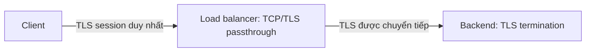
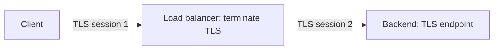
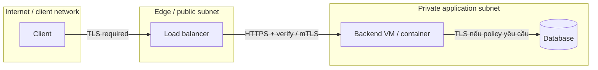

# TLS termination, kết nối đến backend và yêu cầu mã hóa

## Bối cảnh: bảo vệ dữ liệu trên cả hai chặng kết nối

Trong kiến trúc cloud, client thường kết nối đến load balancer trước khi request được chuyển đến VM, container hoặc dịch vụ compute phía sau. Nếu client dùng HTTPS, kết nối từ client đến load balancer được mã hóa bằng TLS. Tuy nhiên, TLS có thể kết thúc tại load balancer; từ load balancer đến backend là một kết nối riêng và có thể dùng HTTP nội bộ hoặc HTTPS/TLS tùy thiết kế.

Điều này tạo ra một câu hỏi bảo mật quan trọng: **dữ liệu được mã hóa ở những chặng nào và thành phần nào có thể đọc nội dung?** Mã hóa client-to-load-balancer không tự động bảo vệ chặng load-balancer-to-backend. Nếu backend nhận HTTP, nội dung có thể đi qua mạng nội bộ dưới dạng rõ. Nếu backend dùng HTTPS, load balancer cần thiết lập một phiên TLS mới và xác minh chứng thư backend theo chính sách.

Trong module **CLOUD_CORE_SERVICES_COMPUTE**, thiết kế TLS cho load balancing liên quan trực tiếp đến bảo mật mạng VM/container, quản lý certificate, phân đoạn subnet, service identity và yêu cầu bảo vệ dữ liệu khi truyền. Cần chọn đúng mô hình termination, passthrough hoặc re-encryption theo trust boundary, hiệu năng và yêu cầu kiểm soát.

## 1. TLS bảo vệ điều gì?

TLS (Transport Layer Security) tạo kênh truyền được xác thực và mã hóa giữa hai endpoint. Với HTTPS, TLS thường cung cấp:

- **Confidentiality:** mã hóa payload để bên trung gian trên đường truyền khó đọc nội dung.
- **Integrity:** phát hiện dữ liệu bị sửa đổi trên đường truyền.
- **Server authentication:** client xác minh máy chủ dựa trên certificate và chuỗi tin cậy.
- **Client authentication (tùy chọn):** máy chủ yêu cầu client certificate, thường gọi là mutual TLS (mTLS).

TLS bảo vệ dữ liệu khi truyền giữa hai endpoint của phiên TLS. TLS không tự bảo vệ dữ liệu sau khi được giải mã tại endpoint, không xác minh quyền truy cập nghiệp vụ của người dùng và không thay thế mã hóa dữ liệu khi lưu trữ (encryption at rest).

### 1.1. Certificate và danh tính máy chủ

Certificate máy chủ thường chứa public key, danh tính DNS (Subject Alternative Name - SAN), thời hạn hiệu lực và chữ ký của CA (Certificate Authority). Client kiểm tra:

1. Certificate còn hiệu lực và chưa hết hạn.
2. Tên host mà client truy cập khớp SAN.
3. Chuỗi certificate dẫn đến CA nằm trong trust store.
4. Chữ ký và thuật toán được chấp nhận.
5. Trạng thái thu hồi được xử lý theo policy và khả năng của client.

Certificate không phải secret; private key đi kèm phải được bảo vệ nghiêm ngặt. Nếu private key bị lộ, kẻ tấn công có thể mạo danh endpoint cho đến khi certificate/key bị thu hồi hoặc hết hiệu lực.

### 1.2. TLS handshake ở mức khái niệm

Trong TLS 1.3, client và server thương lượng phiên bản, cipher suite và tham số key exchange; server gửi certificate và chứng minh quyền sở hữu private key; hai bên thiết lập traffic keys rồi truyền dữ liệu đã mã hóa. TLS 1.2 có quy trình khác và một số cấu hình cũ hơn; nên ưu tiên TLS 1.3 khi các endpoint hỗ trợ, đồng thời giữ TLS 1.2 nếu có yêu cầu tương thích đã đánh giá.

TLS handshake xảy ra cho từng kết nối TLS mới, không nhất thiết cho từng HTTP request. Connection reuse, HTTP keep-alive, HTTP/2 multiplexing và session resumption có thể giảm chi phí handshake.

## 2. Ba mô hình TLS qua load balancer

Có ba cách triển khai phổ biến: TLS passthrough, TLS termination và TLS termination kèm mã hóa lại đến backend (re-encryption). Khác biệt chính là vị trí giải mã và số phiên TLS.

### 2.1. TLS passthrough

Load balancer chuyển tiếp luồng TLS đến backend mà không giải mã payload. Backend trực tiếp kết thúc TLS và trình bày certificate cho client. Load balancer có thể định tuyến dựa trên thông tin L4 như địa chỉ IP/cổng; một số thiết bị có thể đọc TLS metadata như SNI mà không giải mã nội dung ứng dụng, tùy khả năng.



Ưu điểm:

- TLS kết thúc tại backend; load balancer không cần giữ private key của ứng dụng.
- Backend có thể trực tiếp thực hiện mTLS với client nếu kiến trúc yêu cầu.
- Payload được mã hóa xuyên qua load balancer.

Giới hạn:

- Load balancer không thể đọc HTTP header, URL hoặc cookie để áp dụng đầy đủ chính sách L7 như routing theo path, WAF hoặc rewrite.
- Mỗi backend cần certificate và quy trình quản lý private key phù hợp.
- Backend phải xử lý TLS handshake và certificate lifecycle.
- Health check và định tuyến cần hỗ trợ giao thức tương ứng.

Passthrough phù hợp khi backend cần tự xác thực client bằng certificate, cần giữ nguyên TLS end-to-end hoặc load balancer không được phép giải mã payload.

### 2.2. TLS termination tại load balancer

Load balancer kết thúc TLS từ client, giải mã request rồi chuyển đến backend. Chặng backend có thể dùng HTTP hoặc một giao thức nội bộ khác. Load balancer thường giữ certificate/private key công khai của dịch vụ và thực hiện các chức năng L7 như routing theo host/path, WAF, header manipulation và logging.


Ưu điểm:

- Tập trung quản lý certificate và TLS policy ở load balancer.
- Backend giảm chi phí TLS handshake và xử lý mã hóa.
- Load balancer có thể đọc HTTP để định tuyến, kiểm tra và áp dụng policy L7.
- Đơn giản hóa cấu hình TLS cho fleet backend.

Rủi ro và giới hạn:

- Dữ liệu rõ tại load balancer sau khi giải mã.
- Nếu chặng backend dùng HTTP, payload không được mã hóa trên mạng giữa load balancer và backend.
- Load balancer trở thành điểm tin cậy quan trọng; cần bảo vệ private key, quyền truy cập và log.
- Không phù hợp nếu policy yêu cầu mã hóa trên mọi chặng hoặc backend phải xác thực certificate của client trực tiếp.

HTTP nội bộ có thể được chấp nhận trong một mạng riêng được kiểm soát theo chính sách rủi ro, nhưng “nội bộ” không đồng nghĩa “đáng tin cậy”. Cần đánh giá shared network, peering, packet capture, quyền quản trị và yêu cầu pháp lý trước khi chọn.

### 2.3. TLS termination và re-encryption đến backend

Load balancer giải mã TLS từ client, xử lý HTTP, sau đó tạo một phiên TLS mới đến backend. Có hai phiên độc lập: client-to-load-balancer và load-balancer-to-backend.



Ưu điểm:

- Mã hóa dữ liệu trên cả hai chặng mạng.
- Load balancer vẫn thực hiện routing và policy L7.
- Backend có thể xác thực load balancer bằng mTLS.
- Certificate backend có thể dùng CA nội bộ và danh tính service riêng.

Điểm cần kiểm soát:

- Load balancer phải xác minh certificate backend, hostname/SAN và trust chain; không nên tắt xác minh chỉ để kết nối thành công.
- Cần quản lý certificate và private key ở cả hai phía.
- TLS handshake và mã hóa thêm tạo chi phí CPU/latency; cần benchmark ở tải mục tiêu.
- Cần xác định liệu load balancer có truyền danh tính client ban đầu cho backend qua header đáng tin cậy hay qua mTLS/identity token.

Re-encryption thường phù hợp khi cần mã hóa cả hai chặng, backend nằm trong subnet riêng hoặc có yêu cầu bảo mật/tuân thủ cao nhưng vẫn cần L7 load balancing.

## 3. So sánh mô hình và lựa chọn

| Tiêu chí | Passthrough | Termination + HTTP backend | Termination + re-encryption |
|---|---|---|---|
| TLS client kết thúc ở đâu? | Backend | Load balancer | Load balancer |
| TLS backend | Phiên TLS client tiếp tục đến backend | Không có ở chặng backend | Phiên TLS mới đến backend |
| LB đọc được HTTP payload? | Không | Có | Có |
| Routing L7/WAF | Hạn chế hoặc không có | Có | Có |
| Private key public service | Ở backend | Ở load balancer | Ở load balancer; backend có key riêng |
| Mã hóa trên mạng LB-backend | Có, cùng phiên TLS | Không, nếu dùng HTTP | Có, phiên TLS riêng |
| Backend client authentication | Backend trực tiếp xác thực client | Thường dựa vào header/identity khác | Có thể mTLS giữa LB và backend |
| Độ phức tạp vận hành | Certificate phân tán đến backend | Tập trung ở LB | Certificate và trust ở hai chặng |

Chọn mô hình bằng cách trả lời:

1. Có yêu cầu mã hóa trên mọi network hop không?
2. Load balancer có cần đọc HTTP để routing, WAF hoặc rewrite không?
3. Backend cần xác thực certificate của client gốc hay chỉ cần xác thực load balancer?
4. Ai quản lý private key và CA? Có hệ thống cấp phát/rotation tự động không?
5. Backend có thể được truy cập trực tiếp ngoài load balancer không?
6. Tải TLS handshake và mã hóa có nằm trong capacity budget không?

Không có mô hình mặc định phù hợp cho mọi hệ thống. Hãy xác định trust boundary, dữ liệu nhạy cảm, loại load balancer và khả năng backend trước khi quyết định.

## 4. Kết nối từ load balancer đến backend

Khi load balancer kết thúc TLS, nó trở thành client trên chặng kết nối backend. Nó cần thiết lập kết nối đến đúng địa chỉ, cổng và giao thức, đồng thời tuân thủ chính sách xác thực backend.

### 4.1. HTTP backend trong mạng riêng

Với termination-only, load balancer có thể gửi HTTP đến backend qua subnet private. Cần giới hạn security group/firewall để backend chỉ nhận traffic từ load balancer hoặc proxy được chỉ định. Không nên để backend có public IP hoặc cho phép truy cập trực tiếp từ Internet nếu không có lý do rõ ràng.

Các biện pháp giảm rủi ro:

- Đặt load balancer và backend trong network segment có route được kiểm soát.
- Chỉ cho phép ingress backend từ security group hoặc danh sách nguồn của load balancer.
- Hạn chế egress và quyền truy cập quản trị vào backend.
- Dùng service identity hoặc token để xác thực request ở tầng ứng dụng khi cần.
- Tránh ghi payload nhạy cảm vào log tại load balancer hoặc backend.
- Đánh giá yêu cầu mã hóa nội bộ theo threat model và chính sách dữ liệu.

Mạng private giảm mức phơi nhiễm nhưng không thay thế TLS nếu môi trường có nhiều tenant, đường kết nối dùng chung, rủi ro packet capture hoặc yêu cầu mã hóa theo quy định.

### 4.2. HTTPS backend và xác minh certificate

Với re-encryption, load balancer phải xác minh server certificate mà backend trình bày. Cấu hình nên xác định:

- CA hoặc trust bundle được chấp nhận.
- Hostname/SAN mà load balancer kỳ vọng ở backend.
- TLS protocol và cipher policy được cho phép.
- Thời gian timeout handshake và xử lý certificate hết hạn.
- Hành vi khi certificate không hợp lệ: fail closed và không chuyển request.

Chỉ bật `HTTPS` đến backend chưa đủ để bảo đảm kết nối an toàn nếu load balancer không kiểm tra certificate. Nếu chấp nhận mọi certificate, kẻ tấn công có thể giả mạo backend trên đường mạng và load balancer vẫn gửi dữ liệu đến endpoint đó.

Ví dụ cấu hình khái niệm:

```yaml
backend_connection:
  protocol: HTTPS
  port: 8443
  tls:
    min_version: TLS1.2
    verify_certificate: true
    trusted_ca_bundle: internal-service-ca
    expected_server_name: orders-api.internal.example
    client_certificate: lb-client-identity
    fail_on_invalid_certificate: true
```

Đây là cấu trúc minh họa trung lập, không phải schema của một cloud provider. Tên trường và cách cấu hình trust store phụ thuộc sản phẩm load balancer.

### 4.3. Backend connection pooling và keep-alive

Load balancer thường duy trì một pool kết nối đến backend để giảm chi phí thiết lập TCP/TLS lặp lại. Keep-alive và HTTP/2 có thể tái sử dụng kết nối, nhưng cần cấu hình timeout phù hợp với ứng dụng và backend.

Nếu idle timeout của load balancer ngắn hơn timeout của backend, kết nối có thể bị đóng bất ngờ. Nếu backend đóng kết nối nhưng load balancer vẫn coi kết nối còn dùng được, một số request đầu tiên có thể gặp lỗi reset. Cần thống nhất idle timeout, keep-alive, max connection age và connection draining.

Với HTTPS backend, connection pooling giúp giảm số lần TLS handshake, nhưng không loại bỏ yêu cầu xác minh certificate. Khi certificate backend được rotation, cần bảo đảm kết nối mới sử dụng certificate mới và kết nối cũ được drain theo chính sách.

### 4.4. Health check đến backend

Health check cần dùng đúng protocol và cổng mà backend hỗ trợ. Nếu backend chỉ chấp nhận HTTPS, health check cũng cần cấu hình TLS phù hợp, bao gồm SNI/hostname nếu cần. Kiểm tra TCP thành công chỉ chứng minh cổng có thể thiết lập kết nối; nó không chứng minh ứng dụng có thể phục vụ request.

Có thể phân biệt:

- **Liveness:** tiến trình còn hoạt động và không bị treo.
- **Readiness:** backend đã sẵn sàng nhận request và dependency thiết yếu đáp ứng.
- **Deep health:** kiểm tra sâu hơn cho chẩn đoán, không nhất thiết dùng để loại backend khỏi pool ngay lập tức.

Health check không nên quá phụ thuộc vào một dịch vụ bên ngoài chập chờn, nếu điều đó khiến toàn bộ backend bị đánh dấu unhealthy cùng lúc. Hãy chọn endpoint nhẹ, có timeout và ngưỡng fail/recover hợp lý.

## 5. Mutual TLS (mTLS) giữa load balancer và backend

Trong TLS một chiều thông thường, client xác minh certificate của server. Với mTLS, hai phía đều trình certificate và xác minh danh tính của nhau. Khi load balancer kết nối đến backend bằng mTLS:

1. Load balancer xác minh certificate server của backend theo CA và hostname được cấu hình.
2. Backend yêu cầu client certificate từ load balancer.
3. Load balancer gửi certificate client cùng bằng chứng sở hữu private key.
4. Backend xác minh certificate client theo CA/trust policy.
5. Hai bên hoàn tất handshake và trao đổi dữ liệu đã mã hóa.

```mermaid
sequenceDiagram
    participant LB as Load balancer
    participant BE as Backend
    LB->>BE: ClientHello
    BE->>LB: ServerHello + server certificate + CertificateRequest
    LB->>BE: Client certificate + proof of private key
    BE->>LB: Verify client identity and finish handshake
    Note over LB,BE: TLS session established; traffic encrypted
```

mTLS giúp backend xác nhận kết nối đến từ load balancer có danh tính được tin cậy. Nó không tự xác thực người dùng cuối nếu TLS client ban đầu đã kết thúc ở load balancer. Trong kiến trúc termination, backend nhìn thấy load balancer là TLS peer; danh tính client gốc cần được truyền bằng cơ chế khác có bảo vệ.

### 5.1. Khi nào nên dùng mTLS?

- Backend xử lý dữ liệu nhạy cảm và cần xác thực workload gọi đến.
- Mạng nội bộ có nhiều service hoặc nhiều tenant, không thể tin cậy chỉ dựa trên vị trí mạng.
- Có yêu cầu service-to-service identity và kiểm soát kết nối theo certificate.
- Cần ngăn một workload không được phép giả làm load balancer để gửi request đến backend.
- Hệ thống có PKI/service mesh hoặc nền tảng quản lý certificate đủ khả năng rotation.

### 5.2. Quản lý CA và trust bundle

Backend và load balancer phải thống nhất CA tin cậy. Nên dùng CA nội bộ dành cho workload, phân tách theo môi trường hoặc miền tin cậy và giới hạn certificate theo danh tính. Tránh đưa CA root private key vào VM hoặc load balancer; chỉ triển khai CA certificate công khai và private key của endpoint cần thiết.

Nếu có nhiều CA trong giai đoạn rotation, trust bundle có thể tạm thời chứa CA cũ và mới để hỗ trợ chuyển đổi. Sau khi mọi endpoint dùng certificate mới, cần loại CA cũ theo quy trình. Không để trust bundle chứa CA không còn cần thiết vô thời hạn.

### 5.3. mTLS từ client đến load balancer

Một số API nội bộ hoặc B2B yêu cầu client certificate ngay tại listener. Khi đó load balancer yêu cầu certificate từ client và xác minh theo CA/trust policy. Nếu TLS kết thúc tại load balancer, backend vẫn chỉ thấy load balancer là TLS peer; load balancer cần truyền danh tính client đã xác minh bằng một identity assertion được bảo vệ.

Ví dụ, load balancer có thể tạo header nội bộ chứa subject hoặc định danh client đã xác minh, nhưng phải xóa header cùng tên do client gửi vào trước đó. Backend chỉ chấp nhận assertion từ load balancer đã xác thực, có thể dùng chữ ký, token ngắn hạn hoặc mTLS backend. Không truyền một giá trị `X-Client-Cert` tùy ý rồi tin nó nếu backend có thể nhận request từ nguồn khác.

Nếu dùng TLS passthrough, backend trực tiếp nhận client certificate và có thể xác minh nó. Nếu dùng termination, load balancer thực hiện xác minh client certificate và backend cần tin cậy cơ chế truyền identity. Cần quyết định rõ nơi áp dụng authorization: tại load balancer, backend hay cả hai.

## 6. Truyền danh tính client qua TLS termination

Khi TLS kết thúc tại load balancer, backend không còn trực tiếp quan sát TLS peer là client cuối. Backend thấy kết nối đến từ load balancer. Nếu ứng dụng cần biết IP gốc, scheme hoặc host mà client sử dụng, load balancer có thể thêm header như:

- `Forwarded` theo RFC 7239.
- `X-Forwarded-For` cho địa chỉ IP client/proxy.
- `X-Forwarded-Proto` cho scheme gốc (`http` hoặc `https`).
- `X-Forwarded-Host` cho host mà client yêu cầu.

Các header này chỉ đáng tin khi được load balancer kiểm soát. Client có thể tự gửi header giả mạo; load balancer phải loại bỏ hoặc ghi đè header từ nguồn không tin cậy, sau đó tạo giá trị mới theo kết nối thực tế.

Backend chỉ nên tin header forwarded từ địa chỉ hoặc identity của proxy đã được cho phép. Nếu backend có thể truy cập trực tiếp, kẻ tấn công có thể bỏ qua load balancer và gửi header giả. Cần chặn đường truy cập trực tiếp hoặc xác thực proxy ở network/application layer.

### 6.1. Không dùng forwarded header làm bằng chứng xác thực

`X-Forwarded-For` và `Forwarded` cung cấp thông tin về đường đi của request, không chứng minh danh tính người dùng. Để xác thực người dùng, dùng session/token/OIDC hoặc cơ chế identity của ứng dụng. Nếu cần truyền danh tính đã xác thực từ gateway đến backend, dùng token được ký hoặc cơ chế identity assertion có audience, issuer, thời hạn và xác minh chữ ký.

### 6.2. Redirect và secure cookie

Sau TLS termination, backend có thể nhận HTTP từ load balancer và tưởng rằng request gốc là HTTP. Ứng dụng có thể tạo redirect sai sang `http://` hoặc không đặt thuộc tính `Secure` cho cookie. Cần cấu hình framework tin proxy đúng cách và chỉ tin forwarded scheme từ proxy được phép.

Không bật chế độ “trust all proxies” nếu backend có đường truy cập ngoài load balancer. Cookie phiên nên dùng `Secure`, `HttpOnly` và `SameSite` phù hợp. HSTS có thể được đặt ở lớp phù hợp sau khi xác minh toàn bộ domain và subdomain hỗ trợ HTTPS.

## 7. TLS protocol, cipher suite và policy bảo mật

TLS policy quyết định phiên bản giao thức, thuật toán trao đổi khóa, mã hóa và xác thực được phép sử dụng. Cấu hình cần cân bằng bảo mật với khả năng tương thích của client và backend.

### 7.1. Phiên bản TLS

Ưu tiên TLS 1.3 khi client, load balancer và backend hỗ trợ. TLS 1.2 vẫn có thể được dùng khi cần tương thích và được cấu hình bằng cipher suite an toàn. TLS 1.0, TLS 1.1 và SSLv3 đã lỗi thời, không nên bật cho dịch vụ mới.

Với backend, phiên bản TLS có thể khác phiên bản client-facing nếu thiết bị hoặc ứng dụng cũ có giới hạn. Tuy nhiên, không nên hạ policy toàn bộ hệ thống xuống phiên bản yếu chỉ để hỗ trợ một backend legacy; hãy cô lập backend đó và có kế hoạch nâng cấp.

### 7.2. Cipher suite và thuật toán

Ưu tiên cipher suite hiện đại hỗ trợ AEAD như AES-GCM hoặc ChaCha20-Poly1305 và key exchange có forward secrecy. Tránh thuật toán lỗi thời hoặc yếu như RC4, 3DES, export cipher, static RSA key exchange và các cấu hình không còn được khuyến nghị.

TLS 1.3 định nghĩa cipher suite khác TLS 1.2; tên cipher và cấu hình được load balancer hỗ trợ tùy sản phẩm. Nên dùng security policy được nhà cung cấp duy trì và kiểm tra định kỳ theo chuẩn của tổ chức.

### 7.3. TLS termination và HTTP protocol

Load balancer có thể hỗ trợ HTTP/1.1, HTTP/2 hoặc HTTP/3 ở phía client và một giao thức khác ở phía backend. Ví dụ, client dùng HTTP/2 qua TLS nhưng load balancer chuyển request đến backend bằng HTTP/1.1. Cần kiểm tra rõ protocol negotiation, ALPN, gRPC, WebSocket, streaming và connection upgrade.

gRPC thường cần HTTP/2 end-to-end hoặc mô hình proxy hỗ trợ gRPC. WebSocket cần xử lý upgrade và timeout kết nối dài. Không giả định bật HTTPS là tự động hỗ trợ mọi giao thức ứng dụng; kiểm thử đúng loại traffic và cấu hình health check tương ứng.

## 8. Quản lý vòng đời certificate

Certificate là tài sản vận hành cần được inventory, cấp phát, triển khai, rotation, thu hồi và giám sát. Một certificate hết hạn có thể làm client hoặc load balancer từ chối kết nối, gây outage dù compute backend vẫn hoạt động.

### 8.1. Cấp phát và lưu trữ private key

Certificate có thể được cấp bởi public CA cho endpoint Internet hoặc private CA cho service nội bộ. Private key nên được tạo/lưu trong certificate manager, HSM hoặc secret store có kiểm soát quyền. Hạn chế export private key nếu nền tảng hỗ trợ gắn certificate trực tiếp vào load balancer.

Không commit private key vào Git, image, user data hoặc log. Quyền đọc/export key cần giới hạn theo nguyên tắc tối thiểu và có audit. Tách certificate giữa dev/staging/prod và giữa các miền tin cậy để giảm phạm vi ảnh hưởng khi một key bị lộ.

### 8.2. Rotation không gây gián đoạn

Một quy trình rotation thường gồm:

1. Cấp certificate mới và xác minh SAN, chain, thời hạn, key usage và CA.
2. Cập nhật trust bundle ở peer trước nếu CA hoặc issuer thay đổi.
3. Gắn certificate mới vào listener hoặc backend endpoint.
4. Xác minh handshake mới dùng certificate đúng trên tất cả zone/instance.
5. Drain hoặc đóng kết nối cũ theo chính sách để loại phiên dùng certificate cũ.
6. Thu hồi hoặc xóa key/certificate cũ sau khi xác nhận không còn phụ thuộc.
7. Cập nhật inventory và cảnh báo expiry.

Nếu đổi CA, có thể cần giai đoạn overlap: peer tin cả CA cũ và CA mới trong thời gian chuyển đổi. Nếu rotation client certificate cho mTLS, backend cần tin issuer mới trước khi load balancer bắt đầu trình certificate mới.

### 8.3. Giám sát certificate

Theo dõi ít nhất:

- Ngày hết hạn và số ngày còn lại.
- SAN/hostname, issuer, serial number và fingerprint.
- Chain có đầy đủ intermediate certificate không.
- Certificate/key đã gắn vào listener/backend đúng môi trường chưa.
- Lỗi handshake, unknown CA, hostname mismatch hoặc certificate revoked.
- Trạng thái rotation và phiên bản trust bundle.

Đặt cảnh báo nhiều mốc trước ngày hết hạn, ví dụ 30, 14 và 7 ngày tùy thời gian xử lý. Cảnh báo cần chỉ rõ owner và endpoint bị ảnh hưởng; không nên đợi đến ngày hết hạn mới phát hiện.

## 9. Yêu cầu mã hóa theo trust boundary

Mã hóa nên được quyết định dựa trên ranh giới tin cậy, dữ liệu và đường truyền thực tế. Sơ đồ dưới đây minh họa các vùng thường gặp:



Không phải mọi hệ thống đều cần TLS ở mọi hop giống nhau, nhưng cần có quyết định rõ ràng cho từng chặng:

| Chặng | Câu hỏi cần đánh giá | Biện pháp có thể áp dụng |
|---|---|---|
| Client → load balancer | Có truyền qua Internet hoặc mạng không tin cậy? | HTTPS, certificate hợp lệ, TLS policy mạnh, HSTS phù hợp |
| Load balancer → backend | Mạng có nhiều tenant hoặc yêu cầu mã hóa nội bộ? | Re-encryption, xác minh backend certificate, mTLS |
| Backend → database/cache/queue | Dữ liệu có nhạy cảm hoặc kết nối qua network? | TLS client/server, identity riêng, network segmentation |
| Backend → external API | Có truyền token hoặc dữ liệu khách hàng? | HTTPS, hostname validation, CA trust và egress control |
| Admin → load balancer/backend | Có thao tác quản trị certificate/policy? | SSO/MFA, quyền tối thiểu, audit và private management path |

Mã hóa in transit và encryption at rest giải quyết hai rủi ro khác nhau. Dữ liệu có thể được mã hóa khi truyền nhưng vẫn lưu rõ trong disk/log; hoặc được mã hóa khi lưu nhưng đi qua HTTP nội bộ. Cần áp dụng cả hai theo phân loại dữ liệu và chính sách.

## 10. Ví dụ kiến trúc HTTPS từ client đến backend

Giả sử ứng dụng đặt hàng chạy trên nhiều VM trong private subnet, đặt sau một L7 load balancer public. Người dùng truy cập `orders.example.com` bằng HTTPS. Load balancer định tuyến theo host/path và chuyển tiếp đến backend qua HTTPS với mTLS.

Luồng request:

1. Client phân giải DNS và kết nối HTTPS đến listener 443 của load balancer.
2. Load balancer trình certificate cho `orders.example.com`; client xác minh chain và hostname.
3. Load balancer giải mã HTTP, áp dụng WAF/routing và loại bỏ các forwarded header do client tự gửi.
4. Load balancer thiết lập hoặc tái sử dụng kết nối TLS đến backend port 8443.
5. Backend xác minh client certificate của load balancer; load balancer xác minh certificate server của backend.
6. Backend xử lý request và truy cập database bằng kết nối TLS riêng nếu policy yêu cầu.
7. Response đi ngược qua load balancer; mỗi chặng được mã hóa theo phiên tương ứng.

Ví dụ cấu hình khái niệm:

```yaml
listener:
  port: 443
  protocol: HTTPS
  certificate: public-orders-cert
  tls_policy: modern-tls-policy
  http_protocols:
    - HTTP1.1
    - HTTP2
  security:
    redirect_http_to_https: true
    hsts_enabled: true

backend_pool:
  protocol: HTTPS
  port: 8443
  health_check:
    path: /health/ready
    protocol: HTTPS
  tls:
    verify_server_certificate: true
    trusted_ca: internal-workload-ca
    expected_name: orders-api.internal.example
    client_certificate: lb-to-orders-client-cert
```

Đây là ví dụ trung lập để diễn giải ý tưởng. Không dùng trực tiếp như file cấu hình của một nhà cung cấp. Cần xác minh listener, TLS policy, mTLS, health check và certificate validation được sản phẩm cụ thể hỗ trợ.

### 10.1. Network policy tương ứng

- Public subnet chỉ cho phép client đến listener HTTPS cần thiết.
- Backend private subnet chỉ nhận cổng ứng dụng từ security group của load balancer.
- Backend không có public IP nếu không cần.
- Quyền quản trị backend đi qua bastion/session manager hoặc access proxy được kiểm soát.
- Backend chỉ được egress đến dependency cần thiết.
- Certificate manager và secret store có IAM policy giới hạn.

Nếu dùng termination-only với HTTP backend, cần quyết định và ghi rõ vì sao chặng nội bộ được chấp nhận, network boundary nào bảo vệ nó và biện pháp giảm thiểu khi có truy cập trái phép trong private network.

## 11. Kiểm tra TLS và certificate khi vận hành

### 11.1. Kiểm tra endpoint client-facing

Có thể dùng `curl` để kiểm tra handshake, certificate và HTTP response:

```bash
# Xem thông tin kết nối và lỗi xác minh certificate
curl -v https://orders.example.com/health

# Kiểm tra bằng CA bundle cụ thể nếu dùng private CA
curl --cacert ./trusted-ca.pem https://orders.internal.example/health
```

Không dùng `curl -k` hoặc `--insecure` trong kiểm thử chấp nhận production vì tùy chọn đó bỏ qua xác minh certificate và có thể che giấu lỗi trust/hostname.

Có thể xem certificate và thông tin handshake bằng OpenSSL:

```bash
openssl s_client \
  -connect orders.example.com:443 \
  -servername orders.example.com \
  -showcerts
```

`-servername` gửi SNI để server/load balancer chọn certificate đúng hostname. Khi kiểm tra private CA, có thể bổ sung `-CAfile trusted-ca.pem` và dùng tùy chọn verify phù hợp với phiên bản OpenSSL. Cần kiểm tra cả chain và hostname; chỉ nhìn thấy certificate được gửi chưa chứng minh client sẽ tin nó.

Để buộc OpenSSL xác minh hostname và dừng khi certificate không hợp lệ, có thể thêm `-verify_hostname orders.example.com -verify_return_error`; với private CA, thêm `-CAfile trusted-ca.pem`. Kiểm tra `openssl s_client -help` trên phiên bản đang dùng vì tùy chọn có thể khác giữa các bản phát hành.

### 11.2. Kiểm tra backend từ góc nhìn load balancer

Nếu backend dùng HTTPS, kiểm tra:

- Backend listener thực sự phục vụ TLS trên port đã cấu hình.
- Certificate backend còn hạn, SAN khớp expected server name và chain dẫn đến CA tin cậy.
- Load balancer có trust bundle mới và route/DNS đến backend chính xác.
- Nếu dùng mTLS, backend yêu cầu đúng client CA và load balancer có client certificate hợp lệ.
- Security group/firewall cho phép kết nối từ load balancer đến backend port.
- Health check dùng đúng protocol, hostname/SNI, path và certificate trust.

Không khắc phục lỗi handshake bằng cách tắt certificate verification hoặc chấp nhận mọi certificate. Hãy tìm nguyên nhân: CA thiếu, SAN sai, certificate hết hạn, SNI không đúng, protocol/cipher không tương thích hoặc clock bị lệch.

## 12. Troubleshooting TLS qua load balancer

| Triệu chứng | Nguyên nhân thường gặp | Cách kiểm tra |
|---|---|---|
| Client báo certificate expired | Certificate listener hết hạn hoặc chưa rotation | Kiểm tra expiry, certificate đang gắn và trạng thái deploy ở mọi zone |
| Hostname mismatch | SAN không chứa domain client truy cập hoặc SNI sai | Kiểm tra SAN, DNS, listener rule và SNI |
| Unknown CA / unable to verify | Thiếu intermediate CA hoặc trust store không có issuer | Kiểm tra full chain và CA bundle trên client/LB/backend |
| TLS handshake failure | Protocol/cipher không tương thích, clock sai hoặc lỗi key | Xem handshake log, TLS policy, system time và private key association |
| Client HTTPS thành công nhưng backend 502/503 | Backend listener, health check, security group hoặc TLS backend lỗi | Kiểm tra target health, backend protocol/port, CA/SAN và app log |
| Backend certificate không được xác minh | Expected name sai, CA không đúng hoặc certificate backend hết hạn | Xem trust configuration, SAN, chain và expiry; giữ verify bật |
| mTLS handshake bị từ chối | Backend không tin client CA, client cert thiếu/hết hạn hoặc EKU sai | Kiểm tra client certificate, issuer, EKU và trust bundle backend |
| Backend nhận sai scheme hoặc redirect về HTTP | Ứng dụng không tin `X-Forwarded-Proto` hoặc proxy config sai | Kiểm tra forwarded header được LB ghi đè và framework proxy trust |
| Client IP trong log không đúng | Header giả mạo được giữ lại hoặc proxy chain parse sai | Xóa header inbound không tin cậy, cấu hình trusted proxy và kiểm tra hop chain |
| TLS latency tăng | Handshake mới quá nhiều, CPU mã hóa cao hoặc kết nối không reuse | Kiểm tra connection reuse, handshake rate, CPU LB/backend và session resumption |
| Health check fail nhưng app truy cập được trực tiếp | Health check protocol/host/path sai hoặc LB không trust CA | Kiểm tra SNI, hostname, path, firewall và trust bundle của health checker |

Quy trình điều tra nên đi từ ngoài vào trong:

1. Xác định lỗi ở client-to-LB hay LB-to-backend.
2. Ghi lại hostname, thời điểm, listener, backend target và request ID.
3. Kiểm tra certificate, SAN, chain, expiry, SNI và TLS policy ở đúng chặng.
4. Kiểm tra network path, firewall, route và backend listener.
5. Đối chiếu load balancer access log, TLS handshake log, target health và application log.
6. Sau khi sửa, kiểm tra cả kết nối mới và kết nối được tái sử dụng; xác minh certificate đang phục vụ trên tất cả instance/zone.

## 13. Hiệu năng và capacity khi bật TLS

TLS có chi phí CPU và bộ nhớ ở cả client-facing listener lẫn backend. Load balancer có thể giảm tải TLS cho backend khi termination tập trung, nhưng re-encryption khiến load balancer phải giải mã rồi mã hóa lại. Backend vẫn phải thực hiện handshake và mã hóa nếu TLS kết thúc tại backend.

Các yếu tố ảnh hưởng:

- Số kết nối mới và TLS handshake mỗi giây.
- Phiên bản TLS, cipher suite và khả năng tăng tốc phần cứng.
- Tỷ lệ keep-alive, HTTP/2 multiplexing và session resumption.
- Kích thước payload, request/response rate và số kết nối đồng thời.
- Certificate chain dài, OCSP/revocation check và chi phí xác minh.
- CPU/memory của load balancer và backend.

Khi benchmark, đo riêng handshake rate, connection reuse, CPU, throughput, p95/p99 latency và error rate. So sánh termination-only với re-encryption bằng cùng request mix và tải. Không bỏ mã hóa chỉ vì thấy CPU tăng; có thể scale load balancer, tối ưu connection reuse hoặc chọn instance hỗ trợ TLS acceleration.

### 13.1. Timeout và connection lifecycle

Thiết lập timeout hợp lý cho client, load balancer và backend. Các timeout không nhất thiết bằng nhau, nhưng phải được phối hợp để tránh proxy đóng kết nối trước khi backend hoàn tất. Với streaming hoặc WebSocket, cần timeout phù hợp và kiểm tra khả năng giữ kết nối lâu.

Connection draining giúp load balancer ngừng gửi request mới đến backend đang bảo trì và cho request hiện tại hoàn tất. Khi rotate certificate hoặc thay backend, cần xét cả kết nối keep-alive tồn tại trước thời điểm thay đổi.

## 14. Logging, audit và bảo vệ dữ liệu

Load balancer có thể ghi access log, TLS negotiation metadata, target status, latency và header tùy cấu hình. Các log này hữu ích để xác định client nào gặp lỗi, listener nào được dùng và backend nào không khỏe.

Nguyên tắc ghi log:

- Không ghi private key, token, cookie phiên hoặc Authorization header.
- Hạn chế ghi payload chứa dữ liệu cá nhân hoặc dữ liệu nghiệp vụ nhạy cảm.
- Che hoặc loại bỏ header nhạy cảm trước khi log nếu sản phẩm hỗ trợ.
- Bảo vệ log bằng IAM, encryption at rest, retention và audit access.
- Đồng bộ thời gian giữa load balancer, backend và hệ thống log.
- Dùng request/correlation ID để liên kết log giữa các lớp, nhưng không đưa dữ liệu nhạy cảm vào ID.

Nếu cần ghi nhận client certificate identity trong mTLS, chỉ log các thuộc tính cần thiết như issuer/subject hoặc fingerprint theo policy. Không log private key hoặc toàn bộ dữ liệu certificate không cần thiết.

## 15. Những nhầm lẫn thường gặp

**Client dùng HTTPS nghĩa là toàn bộ đường đi đã được mã hóa.** TLS có thể kết thúc tại load balancer; cần xác minh protocol trên chặng backend.

**Backend nằm trong private subnet thì không cần mã hóa.** Private network không tự tạo trust boundary tuyệt đối. Cần đánh giá tenant, peering, quản trị mạng và yêu cầu dữ liệu.

**Bật HTTPS backend là đủ.** Load balancer phải xác minh certificate backend, hostname và trust chain. HTTPS với verify tắt không cung cấp xác thực server đáng tin cậy.

**Re-encryption là cùng một phiên TLS kéo dài qua load balancer.** Đây là hai phiên TLS độc lập; load balancer giải mã ở phiên đầu và mã hóa lại ở phiên sau.

**mTLS giữa load balancer và backend xác thực người dùng cuối.** Backend xác thực load balancer là TLS peer. Danh tính người dùng gốc cần cơ chế ứng dụng hoặc identity assertion riêng.

**X-Forwarded-For luôn là IP thật của client.** Client có thể tự gửi header giả. Load balancer phải loại bỏ/ghi đè header không tin cậy và backend chỉ tin proxy được chỉ định.

**Certificate đã gắn một lần thì không cần theo dõi.** Certificate có thể hết hạn, bị thu hồi hoặc SAN/chain thay đổi. Cần inventory, cảnh báo và rotation.

**Tắt xác minh certificate là cách sửa nhanh hợp lệ.** Việc này mở khả năng giả mạo backend và cần tránh. Hãy sửa CA, hostname, chain hoặc SNI.

## 16. Checklist thiết kế và vận hành TLS load balancing

### Thiết kế

- [ ] Đã xác định TLS termination, passthrough hay re-encryption cho từng chặng.
- [ ] Trust boundary, phân loại dữ liệu và yêu cầu mã hóa nội bộ đã được ghi rõ.
- [ ] Đã chọn TLS version/cipher policy được hỗ trợ và còn an toàn.
- [ ] Backend private, chỉ nhận traffic từ load balancer/proxy được phép.
- [ ] Nếu re-encryption, backend certificate được xác minh bằng CA và hostname/SAN.
- [ ] Nếu dùng mTLS, hai phía có certificate identity và trust bundle phù hợp.
- [ ] Forwarded header được làm sạch, ghi đè và chỉ tin từ proxy đã xác thực.

### Certificate và vận hành

- [ ] Private key được bảo vệ trong certificate manager/HSM/secret store.
- [ ] Có inventory certificate, owner, expiry và cảnh báo trước hạn.
- [ ] Có quy trình rotation, CA overlap và thu hồi certificate.
- [ ] Health check dùng đúng protocol, port, SNI, hostname và trust policy.
- [ ] Timeout, keep-alive, HTTP/2/gRPC/WebSocket và connection draining đã được kiểm thử.
- [ ] Log không chứa secret, cookie hoặc payload nhạy cảm ngoài chính sách.
- [ ] Có runbook cho handshake failure, certificate expiry và backend TLS errors.

### Kiểm thử

- [ ] Client xác minh đúng certificate và hostname.
- [ ] Load balancer xác minh certificate backend khi dùng HTTPS.
- [ ] mTLS từ chối client certificate không tin cậy.
- [ ] Không thể truy cập backend trực tiếp ngoài đường được phê duyệt.
- [ ] Đã đo handshake rate, CPU, latency và throughput ở tải mục tiêu.
- [ ] Rotation được thử nghiệm mà không gây gián đoạn ngoài ngưỡng chấp nhận.

## Kết luận

TLS termination quyết định nơi giải mã TLS và nơi quản lý certificate. Passthrough giữ phiên TLS đến backend nhưng hạn chế khả năng xử lý L7; termination tập trung TLS tại load balancer và có thể gửi HTTP nội bộ; re-encryption tạo phiên TLS thứ hai đến backend để bảo vệ cả hai chặng trong khi vẫn hỗ trợ routing L7. Khi chọn mô hình, cần xác định trust boundary, yêu cầu mã hóa, xác thực backend/client, quản lý private key, forwarded header, health check và chi phí hiệu năng. Xác minh certificate backend, dùng mTLS khi cần service identity, rotation có kiểm soát và giám sát handshake giúp kết nối client-load balancer-backend an toàn và ổn định.
