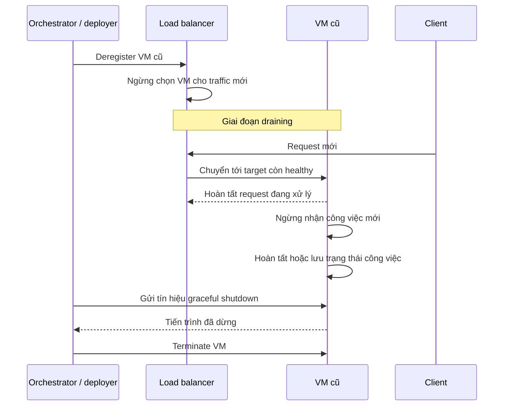
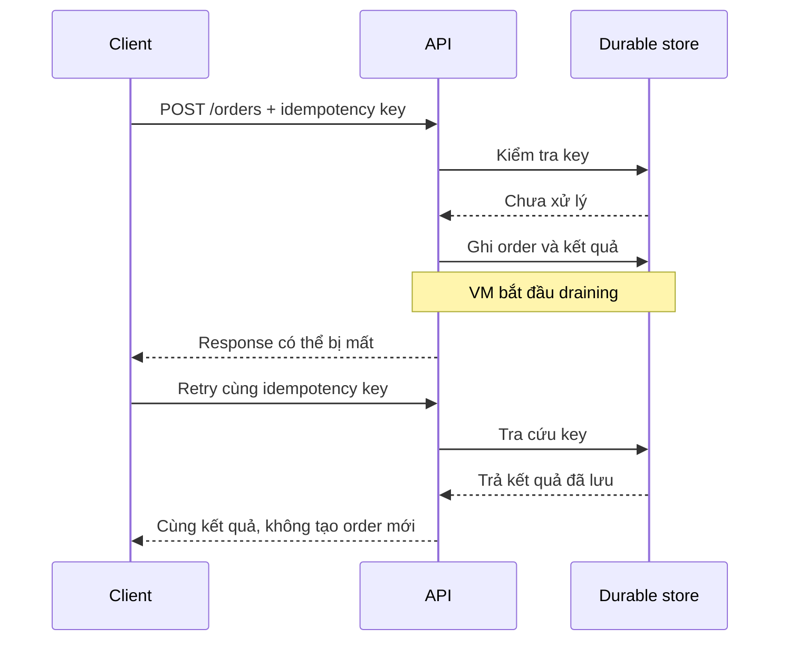

# Connection draining và xử lý kết nối dài khi thay máy

## Mục tiêu học tập

Sau bài học, bạn có thể:

- Giải thích connection draining (ngừng nhận kết nối mới và cho kết nối hiện tại hoàn tất) trong quá trình thay thế hoặc bảo trì VM.
- Phân biệt cách xử lý kết nối ở load balancer lớp 4 và lớp 7.
- Nhận diện đặc điểm của HTTP keep-alive, HTTP/2, gRPC, WebSocket và TCP connection dài hạn.
- Thiết kế trình tự deregister, drain, graceful shutdown và terminate để giảm lỗi khi triển khai.
- Chọn thời gian draining, giới hạn kết nối và timeout dựa trên hành vi workload.
- Kết hợp health check, autoscaling lifecycle hook, rolling update và khả năng retry của ứng dụng.
- Theo dõi và xử lý các tình huống kết nối bị ngắt, request bị lặp hoặc VM không kết thúc đúng hạn.

## 1. Vì sao thay VM có thể làm gián đoạn kết nối?

Một dịch vụ compute thường chạy trên nhiều VM phía sau load balancer. Load balancer phân phối request hoặc kết nối tới các VM đủ điều kiện nhận traffic. Khi cần triển khai phiên bản mới, scale-in, thay host, vá hệ điều hành hoặc loại bỏ một VM lỗi, hệ thống phải ngừng đưa tải mới tới máy cũ.

Nếu VM bị dừng ngay khi bắt đầu thay thế, các kết nối đang hoạt động có thể bị ngắt giữa chừng. Người dùng có thể gặp timeout, lỗi 5xx, mất phiên WebSocket, cuộc gọi gRPC bị hủy hoặc tác vụ upload/download không hoàn tất. Một request đang ghi dữ liệu cũng có thể bị client gửi lại, tạo ra thao tác trùng nếu ứng dụng không thiết kế idempotency.

**Connection draining** là quá trình loại VM khỏi tập đích nhận traffic mới, đồng thời cho các kết nối hoặc request đang tồn tại có thời gian hoàn tất trước khi dừng ứng dụng hay giải phóng VM.

Mục tiêu của draining là giảm gián đoạn trong lúc thay máy. Nó không bảo đảm mọi kết nối đều hoàn tất: một kết nối có thể kéo dài vô hạn, client có thể mất mạng, VM có thể lỗi đột ngột hoặc timeout của nền tảng có thể kết thúc trước khi tác vụ hoàn thành. Vì vậy, ứng dụng vẫn cần hỗ trợ reconnect, retry an toàn và lưu trạng thái công việc bền vững.

### Một tình huống điển hình

Một nhóm có 4 VM chạy API. Khi triển khai phiên bản mới, bộ điều phối cần thay VM cũ bằng VM mới:

- Nếu dừng VM cũ ngay lập tức, request đang xử lý có thể bị mất.
- Nếu tiếp tục gửi request mới vào VM cũ trong lúc tắt ứng dụng, một số request sẽ thất bại.
- Nếu ngừng nhận request mới, chờ request hiện tại hoàn tất rồi mới dừng VM, phần lớn người dùng có thể không nhận ra việc thay máy.

Quá trình chờ này cần có giới hạn thời gian và cơ chế xử lý kết nối còn tồn tại sau khi hết hạn.

## 2. Các khái niệm cần phân biệt

| Khái niệm | Ý nghĩa | Tác động chính |
|---|---|---|
| Deregistration | Loại một VM/target khỏi nhóm đích của load balancer | Load balancer bắt đầu ngừng chọn target cho traffic mới |
| Connection draining | Giai đoạn chờ kết nối hoặc request đang hoạt động kết thúc | Giảm việc cắt ngang request |
| Graceful shutdown | Ứng dụng ngừng nhận công việc mới, hoàn tất công việc đang chạy và đóng tài nguyên | Giảm lỗi ở cấp tiến trình |
| Termination | Dừng hoặc xóa VM | Giải phóng tài nguyên compute |
| Health check | Kiểm tra target có đủ điều kiện phục vụ hay không | Quyết định target có được nhận traffic theo chính sách |
| Connection timeout | Giới hạn thời gian tồn tại hoặc thời gian chờ của kết nối | Tránh giữ tài nguyên vô hạn |
| Request timeout | Giới hạn thời gian xử lý một request | Kiểm soát thời gian chờ của client và server |

Deregistration và graceful shutdown là hai bước khác nhau. Load balancer quản lý việc phân phối traffic; ứng dụng quản lý việc nhận và hoàn tất công việc bên trong tiến trình. Một quy trình tốt phối hợp cả hai.

### 2.1. Luồng draining tổng quát



Sơ đồ là luồng khái niệm. Thứ tự chính xác giữa deregistration và tín hiệu shutdown phụ thuộc load balancer, orchestrator và ứng dụng. Thông thường cần ngừng route traffic mới trước khi đóng listener của ứng dụng; nếu đóng listener quá sớm, load balancer có thể tiếp tục gửi request tới một tiến trình đã ngừng phục vụ.

## 3. Load balancer xử lý kết nối theo lớp nào?

Cách draining hoạt động phụ thuộc load balancer xử lý ở lớp 4 hay lớp 7.

### 3.1. Load balancer lớp 4 (L4)

Load balancer lớp 4 thường phân phối luồng TCP hoặc UDP dựa trên thông tin mạng và transport. Nó không nhất thiết hiểu request HTTP hay biết một request nghiệp vụ đã hoàn tất hay chưa.

Với TCP connection:

- Một luồng đã được thiết lập có thể tiếp tục gắn với target cũ.
- Khi target bị deregister, load balancer có thể ngừng tạo luồng mới tới target đó.
- Kết nối hiện tại có thể được giữ đến khi client đóng, timeout hết hoặc chính sách của nền tảng kết thúc luồng.
- Một số nền tảng có tùy chọn gửi TCP reset hoặc chấm dứt kết nối sau thời gian nhất định.

Với L4, connection draining thường được đo theo vòng đời kết nối TCP. Nếu một kết nối tồn tại nhiều giờ, thời gian drain cần được cân nhắc kỹ. Chờ vô hạn làm chậm scale-in và bảo trì; cắt kết nối quá sớm làm gián đoạn client.

UDP không có kết nối theo nghĩa TCP. Load balancer có thể duy trì trạng thái luồng hoặc ánh xạ theo timeout, nhưng không thể biết chính xác một tác vụ ở tầng ứng dụng đã hoàn tất. Ứng dụng UDP cần tự quản lý session, heartbeat, retry và phục hồi.

### 3.2. Load balancer lớp 7 (L7)

Load balancer lớp 7 hiểu giao thức ứng dụng như HTTP/HTTPS. Tùy sản phẩm, nó có thể theo dõi request, header, stream hoặc kết nối tới backend.

Với HTTP/1.1 keep-alive:

- Một kết nối TCP có thể mang nhiều request tuần tự.
- Khi target bắt đầu draining, load balancer có thể ngừng gửi request mới tới target.
- Request đang xử lý được phép hoàn tất trong thời gian drain.
- Kết nối keep-alive có thể bị đóng sau khi response hoàn tất hoặc khi timeout hết, tùy chính sách.

Với HTTP/2:

- Một kết nối TCP có thể mang nhiều stream đồng thời.
- Draining cần xét cả stream đang hoạt động và việc client có tiếp tục mở stream mới hay không.
- Một số proxy dùng cơ chế GOAWAY để báo cho peer rằng không nên tạo stream mới trên connection đó, trong khi stream đang chạy có cơ hội hoàn tất.
- Hành vi cụ thể phụ thuộc phiên bản HTTP/2, proxy và load balancer.

Với L7, nền tảng có thể xử lý request ở mức chi tiết hơn L4, nhưng không phải sản phẩm nào cũng biết ngữ nghĩa nghiệp vụ. Ví dụ, load balancer có thể biết một HTTP response đã gửi xong nhưng không biết tác vụ nền đã được ghi bền vững hay chưa.

### 3.3. So sánh L4 và L7

| Tiêu chí | L4 | L7 |
|---|---|---|
| Đơn vị phân phối phổ biến | TCP flow hoặc UDP flow | HTTP request, stream hoặc kết nối backend |
| Hiểu HTTP | Không cần | Có |
| Nhận biết request hoàn tất | Thường không | Có thể nhận biết ở mức giao thức |
| HTTP keep-alive | Không hiểu request bên trong | Có thể kiểm soát kết nối và request |
| HTTP/2, gRPC | Chỉ nhìn luồng TCP nếu không có tích hợp khác | Có thể hiểu stream và hỗ trợ graceful protocol behavior |
| Kết nối dài | Draining thường phụ thuộc thời gian sống của flow | Có thể quản lý request/stream, nhưng vẫn cần timeout |
| UDP | Có thể duy trì ánh xạ flow theo timeout | Chỉ khi sản phẩm hỗ trợ giao thức ứng dụng tương ứng |

Không nên giả định mọi load balancer L7 đều xử lý HTTP/2 GOAWAY hoặc WebSocket theo cùng cách. Hãy kiểm tra tài liệu của sản phẩm, chế độ proxy và phiên bản giao thức đang bật.

## 4. Những loại kết nối dài cần xử lý riêng

### 4.1. HTTP keep-alive

HTTP keep-alive cho phép tái sử dụng một kết nối TCP cho nhiều request, giảm chi phí handshake và sử dụng tài nguyên hiệu quả hơn.

Trong lúc draining, cần ngừng gửi request mới tới backend cũ và cho request đang xử lý kết thúc. Sau đó, backend có thể đóng kết nối keep-alive hoặc proxy gửi chỉ thị đóng kết nối theo giao thức.

Các yếu tố cần kiểm tra:

- Keep-alive timeout ở client, load balancer, proxy và backend.
- Request timeout và thời gian xử lý tối đa.
- Số request có thể dùng lại trên một connection nếu proxy hỗ trợ giới hạn.
- Cách backend thông báo không nhận request tiếp theo.
- Hành vi retry của client khi connection bị đóng.

Nếu client giữ connection quá lâu và load balancer không đóng hoặc chuyển connection đúng cách, request mới có thể tiếp tục đi vào target sắp bị thay. Cần kiểm thử trên đúng loại LB.

### 4.2. HTTP/2 và gRPC

HTTP/2 cho phép nhiều stream cùng chạy trên một TCP connection. Vì vậy, chỉ đếm số connection không đủ để biết có bao nhiêu request còn hoạt động.

gRPC thường dùng HTTP/2 và có thể duy trì channel lâu dài. Khi thay VM:

- Backend cần ngừng nhận RPC mới.
- Client hoặc proxy cần được thông báo để tạo channel/connection mới khi cần.
- RPC đang hoạt động nên được phép hoàn tất trong giới hạn drain.
- RPC vượt quá giới hạn cần kết thúc có kiểm soát để client retry nếu thao tác an toàn.
- Với streaming RPC, ứng dụng cần định nghĩa cách gửi trạng thái kết thúc và resume nếu stream bị đóng.

GOAWAY là cơ chế HTTP/2 giúp endpoint thông báo không nhận thêm stream mới trên connection hiện tại. Tuy nhiên, việc client tạo connection mới, retry stream hoặc tiếp tục RPC phụ thuộc thư viện gRPC và cấu hình retry. Không phải mọi RPC đều tự động được retry; RPC có side effect cần idempotency hoặc request ID để tránh thực hiện hai lần.

### 4.3. WebSocket

WebSocket thường giữ một kết nối lâu dài sau handshake HTTP. Các ví dụ gồm chat, thông báo realtime, dashboard và điều khiển từ xa.

Khi target bị draining:

- Load balancer ngừng đưa kết nối mới tới target cũ.
- WebSocket hiện tại có thể tiếp tục tồn tại cho tới khi client hoặc server đóng, hoặc drain timeout kết thúc.
- Ứng dụng cần thông báo client rằng server sắp bảo trì và cung cấp thời điểm reconnect nếu phù hợp.
- Client cần reconnect với backoff và jitter để tránh hàng nghìn client kết nối lại cùng lúc.
- Session, subscription và trạng thái cần được lưu ở nơi bền vững hoặc có thể khôi phục.

Không nên chỉ dựa vào việc đóng socket để bảo đảm client khôi phục đúng trạng thái. Với chat hoặc stream sự kiện, cần sequence number, cursor hoặc last-event ID để client lấy lại dữ liệu đã bỏ lỡ.

### 4.4. TCP connection dài hạn

Một số ứng dụng dùng TCP protocol riêng, agent quản lý, tunnel, database proxy hoặc kết nối thiết bị. L4 load balancer có thể không hiểu thông điệp nghiệp vụ.

Ứng dụng nên có:

- Heartbeat hoặc keepalive để phát hiện peer đã mất.
- Giới hạn thời gian idle và thời gian tồn tại tối đa.
- Cơ chế báo server đang draining nếu protocol hỗ trợ.
- Client reconnect với backoff.
- Session resume hoặc đồng bộ trạng thái nếu cần.
- Xác thực lại sau khi kết nối mới được thiết lập.

TCP keepalive của hệ điều hành chỉ giúp phát hiện peer không phản hồi sau một chuỗi probe; nó không đồng nghĩa với heartbeat nghiệp vụ và không bảo đảm session được phục hồi.

### 4.5. Upload, download và streaming response

Request upload hoặc download lớn có thể kéo dài lâu hơn request API thông thường. Nếu VM bị thay trong lúc truyền:

- Upload có thể bị ngắt trước khi hoàn tất.
- Download có thể bị dừng giữa chừng.
- Streaming response có thể mất phần dữ liệu chưa gửi.
- Client có thể retry toàn bộ nội dung, làm tăng băng thông và ghi lặp.

Thiết kế nên hỗ trợ multipart/resumable upload, HTTP Range hoặc cursor resume nếu giao thức phù hợp. Dữ liệu tạm cần có TTL và cơ chế dọn dẹp; chỉ đánh dấu upload hoàn tất sau khi kiểm tra checksum và ghi metadata thành công.

### 4.6. Kết nối database và connection pool

Ứng dụng có thể duy trì pool kết nối tới database hoặc cache. Khi thay VM ứng dụng, cần đóng pool có kiểm soát sau khi request mới đã được ngừng nhận và transaction đang chạy đã hoàn tất.

Không nên đóng database connection ngay khi bắt đầu drain nếu vẫn còn request cần commit transaction. Ngược lại, không chờ vô hạn một connection bị treo. Cần có transaction timeout, query timeout và quy trình rollback khi connection mất.

## 5. Chọn thời gian draining và timeout

Thời gian draining (deregistration delay hoặc connection draining timeout) là khoảng thời gian load balancer cho phép kết nối/request hiện tại tiếp tục trước khi kết thúc target theo chính sách.

Nếu thời gian quá ngắn:

- Request dài bị cắt ngang.
- Streaming hoặc WebSocket mất kết nối.
- Client retry nhiều và tạo tải đột biến.
- Transaction có thể thất bại hoặc phải rollback.

Nếu thời gian quá dài:

- Scale-in và rolling deployment chậm.
- VM tiếp tục tiêu thụ chi phí dù không nhận traffic mới.
- Kết nối idle hoặc client lỗi có thể giữ tài nguyên lâu.
- Một target bị treo có thể làm quá trình thay máy kéo dài.

### 5.1. Dựa trên phân bố thời gian request

Không chỉ dùng thời gian trung bình. Hãy đo:

- p50, p95, p99 của thời gian xử lý request.
- Thời gian dài nhất được phép theo contract.
- Tỷ lệ request streaming và kết nối dài.
- Thời gian commit transaction và flush dữ liệu.
- Thời gian ứng dụng cần để hoàn tất shutdown.
- Giới hạn tối đa của load balancer và orchestrator.

Một cách lập kế hoạch là chọn drain timeout đủ lớn cho phần lớn request hợp lệ và có giới hạn riêng cho loại kết nối dài. Nếu workload có tác vụ kéo dài hàng giờ, không nên giữ VM chỉ để chờ tất cả kết nối; hãy thiết kế resume hoặc chuyển tác vụ sang worker bền vững.

### 5.2. Các timeout phải phối hợp

| Timeout | Chủ thể quản lý | Vai trò |
|---|---|---|
| Client request timeout | Client/SDK | Giới hạn thời gian client chờ response |
| Application request timeout | Ứng dụng | Giới hạn xử lý request |
| Proxy/LB idle timeout | Load balancer/proxy | Đóng connection không có hoạt động |
| Backend connection timeout | Proxy/LB | Giới hạn thiết lập connection tới target |
| Deregistration/drain timeout | Load balancer | Thời gian chờ khi target bị loại |
| Graceful shutdown timeout | Process/orchestrator | Thời gian tiến trình hoàn tất trước khi bị buộc dừng |
| VM termination deadline | Orchestrator/cloud | Thời hạn giải phóng instance |

Các timeout cần được cấu hình theo thứ tự hợp lý. Ví dụ, graceful shutdown của ứng dụng phải có đủ thời gian trước khi orchestrator gửi tín hiệu kill cuối cùng; drain timeout phải tương thích với request timeout và giới hạn của nền tảng. Nếu một timeout bên ngoài ngắn hơn timeout ứng dụng, kết nối vẫn có thể bị cắt trước khi ứng dụng hoàn tất.

Không có một thứ tự số học duy nhất cho mọi kiến trúc. Hãy vẽ timeline thực tế của deployer, load balancer, process và client rồi kiểm thử.

### 5.3. Ví dụ tính thời gian

Giả sử API có p99 request duration là 18 giây, request timeout của ứng dụng là 30 giây và thời gian shutdown ứng dụng cần 10 giây. Đội vận hành có thể thử drain window 40 giây trong môi trường staging, sau đó kiểm tra tỷ lệ request bị cắt, thời gian thay VM và số connection còn lại.

Nếu có WebSocket tồn tại nhiều giờ, drain window 40 giây không thể bảo đảm mọi WebSocket hoàn tất. Cần thông báo reconnect và lưu trạng thái phiên ở hệ thống bên ngoài VM.

Các con số trên chỉ là ví dụ. Timeout production phải dựa trên dữ liệu đo, giới hạn LB và yêu cầu SLO.

## 6. Trình tự thay VM an toàn

Một quy trình rolling replacement điển hình có các bước:

1. **Chuẩn bị VM mới:** tạo instance từ image/config đã kiểm thử, kiểm tra boot, identity, network và ứng dụng.
2. **Health check VM mới:** chỉ đưa vào nhóm đích khi readiness check đạt.
3. **Bắt đầu drain VM cũ:** yêu cầu load balancer deregister target cũ hoặc đánh dấu trạng thái không nhận traffic mới theo cơ chế được hỗ trợ.
4. **Ngừng nhận công việc mới ở ứng dụng:** đóng admission gate, tắt consumer hoặc ngừng nhận RPC/stream mới.
5. **Hoàn tất công việc đang chạy:** chờ request, transaction và job đang xử lý trong giới hạn đã định.
6. **Thông báo và đóng kết nối dài:** gửi GOAWAY, close frame, protocol shutdown hoặc thông báo reconnect tùy giao thức.
7. **Đóng tài nguyên:** flush log, commit/rollback transaction, đóng connection pool, giải phóng lock và ghi trạng thái công việc.
8. **Dừng tiến trình:** gửi SIGTERM hoặc tín hiệu shutdown tương ứng; chỉ dùng kill cưỡng bức khi hết deadline.
9. **Xác nhận target không còn hoạt động:** kiểm tra connection count, active request, process state và LB target state.
10. **Terminate VM cũ:** chỉ sau khi hoàn tất draining hoặc đạt chính sách timeout đã thống nhất.

Thứ tự giữa bước 3 và bước 4 có thể cần phối hợp sát hơn. Một số ứng dụng phải chuyển sang chế độ draining trước để từ chối request mới ở tầng app; sau đó deregister khỏi LB. Cách phù hợp phụ thuộc khả năng điều khiển target và giao thức. Điều quan trọng là không để một khoảng thời gian mà LB vẫn gửi traffic mới vào tiến trình đã đóng listener.

### 6.1. Ví dụ timeline

| Giai đoạn | VM mới | VM cũ |
|---|---|---|
| Chuẩn bị | Tạo và khởi động | Tiếp tục phục vụ traffic |
| Sẵn sàng | Health check đạt, bắt đầu nhận traffic | Vẫn phục vụ trong lúc chuyển tải |
| Draining | Tiếp tục phục vụ | Ngừng nhận traffic mới, chờ request/connection hiện tại |
| Shutdown | Phục vụ bình thường | Hoàn tất công việc, đóng pool và dừng tiến trình |
| Kết thúc | Tiếp tục phục vụ | Terminate sau khi xác nhận đã drain hoặc hết deadline |

Timeline minh họa một lần thay VM. Thời lượng thực tế phải lấy từ telemetry và giới hạn dịch vụ. Trong deployment có nhiều VM, cần giới hạn số target bị drain đồng thời để giữ đủ capacity phục vụ traffic.

## 7. Graceful shutdown bên trong ứng dụng

Load balancer không thể thay thế logic shutdown của ứng dụng. Ứng dụng cần có trạng thái nội bộ cho biết nó đang nhận traffic, đang drain hay đã dừng.

Một lifecycle phổ biến:

- **Serving:** nhận request và công việc mới.
- **Draining:** từ chối hoặc chuyển hướng công việc mới; tiếp tục hoàn tất request đang chạy.
- **Stopping:** đóng listener, flush dữ liệu, đóng connection pool và giải phóng tài nguyên.
- **Stopped:** tiến trình đã thoát.

Ứng dụng có thể triển khai một endpoint quản trị như /drain hoặc nhận tín hiệu hệ điều hành. Endpoint phải được bảo vệ bằng quyền phù hợp; không để người dùng bên ngoài tự ý đưa instance vào trạng thái draining.

### 7.1. Pseudocode

```python
import signal
import threading
import time

draining = threading.Event()
active_requests = 0
active_lock = threading.Lock()

def on_request_started():
    global active_requests
    with active_lock:
        if draining.is_set():
            return False
        active_requests += 1
        return True

def on_request_finished():
    global active_requests
    with active_lock:
        active_requests -= 1

def begin_shutdown(signum, frame):
    # Ngừng nhận request/công việc mới.
    draining.set()
    stop_accepting_new_work()

    deadline = time.monotonic() + 30
    while time.monotonic() < deadline:
        with active_lock:
            if active_requests == 0:
                break
        time.sleep(0.1)

    # Đóng tài nguyên và thoát có kiểm soát.
    flush_logs()
    close_connection_pools()
    stop_background_consumers()

signal.signal(signal.SIGTERM, begin_shutdown)
```

Đây là pseudocode để giải thích lifecycle, không phải chương trình chạy độc lập. Trong ứng dụng thật, active request phải được đếm an toàn với concurrency, exception và cancellation. Cần bảo đảm listener không nhận request mới sau khi bắt đầu drain, background worker cũng được dừng đúng cách và shutdown handler không chạy trùng.

### 7.2. Tránh race condition

Một race condition có thể xảy ra khi:

1. Ứng dụng kiểm tra draining chưa bật.
2. Tín hiệu shutdown bật draining và đọc thấy active request bằng 0.
3. Request vừa được chấp nhận ở bước 1 mới tăng active count.
4. Ứng dụng thoát trong khi request đang chạy.

Cần đồng bộ thao tác kiểm tra trạng thái và đăng ký request mới bằng lock hoặc admission controller nguyên tử. Sau khi chuyển sang draining, không request mới nào được tăng active count.

### 7.3. Xử lý background job

Worker có thể đang xử lý job lấy từ queue. Khi shutdown:

- Ngừng poll hoặc nhận message mới.
- Hoàn tất job đang xử lý trong thời hạn cho phép.
- Nếu không thể hoàn tất, trả message về queue hoặc để visibility timeout hết theo thiết kế.
- Chỉ acknowledge message sau khi kết quả đã được ghi bền vững.
- Dùng idempotency key để job có thể chạy lại an toàn.
- Lưu checkpoint nếu job dài và có thể resume.

Không acknowledge message trước khi công việc hoàn tất rồi mới shutdown; nếu VM dừng giữa chừng, job có thể mất khỏi queue mà kết quả chưa được lưu.

## 8. Xử lý từng giao thức khi draining

### 8.1. HTTP/1.1

Một backend có thể:

- Ngừng nhận request mới trên listener hoặc đánh dấu readiness fail sau khi LB đã bắt đầu deregister.
- Hoàn tất response đang chạy.
- Trả header Connection: close cho response cuối nếu phù hợp với proxy và client.
- Đóng keep-alive sau khi không còn request đang xử lý.
- Cho client retry request an toàn trên connection mới.

Không đóng socket ngay khi nhận tín hiệu shutdown nếu còn response chưa gửi. Với proxy kết nối backend riêng, cần kiểm tra cả client-to-LB và LB-to-backend connection.

### 8.2. HTTP/2 và gRPC

Khi server bắt đầu graceful shutdown:

- Ngừng nhận stream/RPC mới.
- Gửi GOAWAY theo cách thư viện/proxy hỗ trợ.
- Cho stream đang hoạt động kết thúc trong thời gian drain.
- Đặt deadline cho stream dài.
- Đóng channel sau khi hoàn tất hoặc thông báo lỗi retryable phù hợp.
- Dùng idempotency và request ID với RPC có side effect.

gRPC có API graceful stop trong nhiều implementation. Cần đọc tài liệu của ngôn ngữ và runtime cụ thể vì hành vi chờ RPC đang chạy, deadline và force stop có thể khác nhau.

### 8.3. WebSocket

Một server có thể gửi thông báo ứng dụng như server_restarting cùng thời điểm reconnect dự kiến trước khi đóng WebSocket bằng close frame phù hợp.

Client nên:

- Lắng nghe close event.
- Kết nối lại với exponential backoff và jitter.
- Xác thực lại.
- Gửi session token hoặc cursor hợp lệ để resume.
- Khôi phục subscription và trạng thái.
- Tránh tạo reconnect storm khi cả nhóm VM cùng thay.

Nếu có hàng chục nghìn kết nối, không nên drain toàn bộ fleet cùng lúc. Thay VM theo batch nhỏ và theo dõi connection rate.

### 8.4. TCP protocol riêng

Nếu protocol không có thông điệp draining, có thể bổ sung control message hoặc server banner để báo client. Nếu không thể thay protocol, hãy đặt giới hạn lifetime, idle timeout và heartbeat để kết nối có cơ hội tái lập.

L4 LB không thể bảo đảm một giao dịch TCP riêng đã hoàn tất chỉ vì flow còn tồn tại. Ứng dụng cần xác nhận kết quả bằng protocol-level acknowledgment và lưu trạng thái bền vững.

## 9. Tích hợp với autoscaling và orchestrator

Khi autoscaling giảm số lượng VM, hệ thống có thể chọn một instance để terminate. Nếu không có lifecycle hook, VM có thể bị dừng trước khi ứng dụng hoàn tất công việc.

### 9.1. Scale-in protection và lifecycle hook

Các cơ chế thường gặp:

- **Scale-in protection:** tạm thời ngăn một instance được chọn để scale-in. Đây là biện pháp bảo vệ trong một số nền tảng, không thay thế draining.
- **Lifecycle hook:** tạm dừng quá trình terminate ở một trạng thái trung gian để workload hoặc automation hoàn tất việc deregister và drain.
- **Pre-stop hook:** orchestrator gọi một lệnh/hook trước khi dừng container hoặc tiến trình.
- **Termination grace period:** khoảng thời gian orchestrator cho ứng dụng shutdown trước khi gửi tín hiệu cưỡng bức.
- **Pod disruption budget hoặc deployment strategy:** giới hạn số replica có thể bị gián đoạn đồng thời trong môi trường container.

Tên gọi và khả năng phụ thuộc nền tảng. Cần xác định thứ tự hook, timeout tối đa và hành vi khi hook không hoàn tất.

### 9.2. Luồng scale-in tham khảo

1. Autoscaler chọn VM cần loại bỏ.
2. Lifecycle hook giữ VM ở trạng thái chờ.
3. Automation yêu cầu LB deregister target.
4. Ứng dụng chuyển sang draining, dừng nhận request/job mới.
5. Chờ active request và connection giảm.
6. Hoàn tất hoặc trả lại job chưa xong.
7. Báo lifecycle hook hoàn tất.
8. Nền tảng terminate VM.

Nếu automation bị lỗi hoặc quá thời gian, cần có chính sách rõ: retry, tiếp tục chờ trong giới hạn, chuyển job, hoặc kết thúc cưỡng bức. Không để lifecycle hook treo vô hạn.

### 9.3. Rolling update và capacity

Trong rolling update, cần giữ đủ số VM khỏe để phục vụ tải khi một số target đang drain. Ví dụ, nếu fleet có 4 VM và mỗi VM phục vụ 25% tải tối đa, drain 2 VM cùng lúc có thể làm hai VM còn lại quá tải.

Trước deployment, tính:

- Số target tối thiểu phải healthy.
- Tải đỉnh trên từng VM sau khi loại target.
- Số VM có thể thay đồng thời.
- Thời gian khởi động VM mới và readiness.
- Drain duration và thời gian shutdown.
- Capacity dự phòng nếu VM mới không healthy.

Chỉ deregister VM cũ sau khi VM mới đã sẵn sàng và fleet còn đủ capacity. Với hệ thống stateful, cần đồng bộ dữ liệu hoặc replica trước khi chuyển traffic.

## 10. Ví dụ cấu hình và cách vận hành

Cấu hình cụ thể thay đổi theo sản phẩm. Ví dụ sau minh họa những thuộc tính cần xem, không đại diện cho cú pháp của mọi nhà cung cấp.

### 10.1. Các tham số cần đặt ở load balancer

Một target group hoặc backend service có thể có các cấu hình tương tự:

- Drain/deregistration delay: khoảng chờ target sau khi bị loại.
- Connection idle timeout: thời gian connection không hoạt động trước khi đóng.
- Backend keep-alive: thời gian tái sử dụng connection tới target.
- Health check interval và unhealthy threshold.
- Connection termination behavior: giữ hay reset flow sau khi hết drain.
- Maximum connection age hoặc request limit nếu sản phẩm hỗ trợ.

Không nhầm idle timeout với drain timeout. Idle timeout xử lý connection không hoạt động; drain timeout xử lý target đang được loại khỏi tập phục vụ. Một kết nối hoạt động liên tục có thể không bị idle timeout nhưng vẫn cần kết thúc khi drain deadline hết.

### 10.2. Ví dụ HAProxy

Đoạn cấu hình rút gọn minh họa việc giới hạn thời gian chờ và kiểm soát backend:

```haproxy
defaults
    mode http
    timeout connect 5s
    timeout client  60s
    timeout server  60s
    timeout http-keep-alive 15s

backend api_servers
    balance roundrobin
    option httpchk GET /ready
    server api-1 10.0.1.11:8080 check
    server api-2 10.0.1.12:8080 check
```

Khi cần drain một backend, operator hoặc automation có thể chuyển server sang trạng thái bảo trì/không nhận traffic mới thông qua runtime API hoặc cập nhật cấu hình theo quy trình. Cần kiểm tra đúng phiên bản HAProxy và chế độ hoạt động vì lệnh runtime và hành vi connection reuse có thể khác nhau.

### 10.3. Ví dụ Nginx worker shutdown

Nginx có thể được cấu hình giới hạn thời gian worker cũ thoát sau khi reload:

```nginx
worker_shutdown_timeout 30s;

http {
    keepalive_timeout 15s;

    upstream api_backend {
        server 10.0.1.11:8080;
        server 10.0.1.12:8080;
    }

    server {
        listen 80;
        location / {
            proxy_pass http://api_backend;
            proxy_connect_timeout 5s;
            proxy_read_timeout 60s;
        }
    }
}
```

Khi reload, Nginx tạo worker mới và cho worker cũ hoàn tất kết nối đang xử lý theo cơ chế graceful shutdown, với giới hạn được cấu hình. Đây là hành vi của Nginx proxy; nếu Nginx nằm sau một cloud load balancer, vẫn cần phối hợp draining ở target group và ứng dụng backend.

Các directive timeout phải phù hợp với giao thức. Một proxy_read_timeout là giới hạn giữa các lần đọc dữ liệu từ upstream trong một số ngữ cảnh, không nhất thiết là giới hạn tổng thời gian request. Hãy kiểm tra tài liệu Nginx của phiên bản triển khai.

## 11. Retry, idempotency và tính nhất quán dữ liệu

Draining giảm khả năng request bị cắt nhưng không loại bỏ hoàn toàn lỗi kết nối. Client có thể nhận timeout ngay cả khi server đã commit transaction nhưng response bị mất. Nếu client retry, thao tác có thể được thực hiện hai lần.

### 11.1. Thiết kế retry an toàn

- Chỉ retry lỗi có thể phục hồi như connection reset, timeout hoặc lỗi tạm thời phù hợp.
- Dùng exponential backoff và jitter để tránh nhiều client reconnect cùng lúc.
- Đặt giới hạn số lần retry và deadline tổng.
- Giữ request ID hoặc idempotency key xuyên suốt các lần thử.
- Không retry thao tác không idempotent nếu không có cơ chế chống trùng.
- Phân biệt lỗi trước khi server nhận request với lỗi sau khi server có thể đã commit.

### 11.2. Idempotency key

Với thao tác tạo đơn hàng hoặc thanh toán, client gửi một idempotency key duy nhất. Server lưu key cùng trạng thái/kết quả xử lý. Nếu cùng yêu cầu được gửi lại, server trả kết quả đã lưu thay vì tạo thao tác mới.

Mô hình:



Idempotency cần được bảo đảm ở tầng lưu trữ hoặc dịch vụ điều phối giao dịch, không chỉ trong RAM của VM. Nếu trạng thái chỉ nằm trên instance cũ, khi thay máy, instance mới không thể biết request đã được xử lý hay chưa.

### 11.3. Xử lý công việc dài

Với tác vụ dài hơn drain window, nên tách nhận yêu cầu khỏi xử lý:

1. API xác thực request và ghi job vào queue hoặc durable store.
2. API trả job ID cho client.
3. Worker lấy job và xử lý.
4. Khi worker bị drain, nó ngừng nhận job mới.
5. Worker hoàn tất job hiện tại hoặc lưu checkpoint và trả job về queue.
6. Worker khác tiếp tục từ trạng thái bền vững.

Mô hình này giúp việc thay VM không phụ thuộc vào một kết nối client tồn tại lâu.

## 12. Giám sát quá trình draining

Cần theo dõi cả trạng thái load balancer và trạng thái bên trong ứng dụng.

### Metric nên thu thập

| Metric | Ý nghĩa |
|---|---|
| Target state / deregistration state | Target đang healthy, draining hay đã removed |
| Active connections | Số kết nối còn mở trên target |
| Active requests/streams | Số request hoặc stream đang xử lý |
| In-flight requests | Số request đã nhận nhưng chưa hoàn tất |
| Drain duration | Thời gian từ deregister đến khi target dừng |
| Forced close count | Số connection bị đóng khi hết deadline |
| Request error rate | Tỷ lệ lỗi trong thời gian deployment |
| Client reconnect rate | Tốc độ client tạo kết nối lại |
| Retry count | Số request/job được retry |
| Shutdown duration | Thời gian ứng dụng thoát sau tín hiệu shutdown |
| Termination timeout count | Số lần VM bị buộc terminate trước khi hoàn tất |
| Capacity after drain | Tải và số target healthy còn lại |

### Log và trace cần có

- VM ID, target ID và deployment ID.
- Thời điểm nhận tín hiệu drain.
- Thời điểm target bị deregister.
- Số request/stream còn hoạt động.
- Connection ID hoặc trace ID phù hợp, tránh ghi dữ liệu nhạy cảm.
- Lý do đóng connection: hoàn tất, client close, timeout hoặc forced termination.
- Thời gian shutdown và số job được hoàn tất/trả lại queue.

Dùng cùng timestamp và deployment ID để ghép log load balancer, ứng dụng và orchestrator. Nếu đồng hồ lệch, có thể kết luận sai thứ tự deregistration và shutdown.

### Cảnh báo hữu ích

- Target còn ở trạng thái draining quá thời gian dự kiến.
- Active connection không giảm trong thời gian dài.
- Forced close tăng bất thường sau deployment.
- Client reconnect hoặc retry tăng đột biến.
- Request error rate tăng trong rolling update.
- VM terminate trước khi ứng dụng báo shutdown hoàn tất.
- Fleet còn quá ít healthy target sau khi bắt đầu drain.

## 13. Xử lý sự cố thường gặp

| Triệu chứng | Nguyên nhân có thể | Hướng điều tra |
|---|---|---|
| Request lỗi ngay khi thay VM | VM bị terminate trước khi drain hoặc app shutdown quá sớm | So sánh timeline deregister, SIGTERM và terminate |
| Target draining rất lâu | WebSocket/TCP connection tồn tại lâu, timeout quá lớn hoặc client không đóng | Xem active connection theo protocol, idle timeout và max lifetime |
| Kết nối bị reset khi hết drain timeout | Nền tảng chấm dứt connection sau deadline | Kiểm tra LB behavior và thiết kế reconnect/resume |
| VM không terminate | Lifecycle hook hoặc shutdown handler bị treo | Xem hook state, process state và timeout tối đa |
| Request bị thực hiện hai lần | Client retry sau khi response mất, thao tác không idempotent | Tra cứu request ID/idempotency key và trạng thái durable |
| gRPC stream bị ngắt | Không gửi GOAWAY hoặc client không resume stream | Kiểm tra graceful stop, stream deadline và retry policy |
| WebSocket reconnect storm | Nhiều client cùng reconnect ngay sau khi server đóng | Thêm backoff, jitter và rollout theo batch |
| VM mới nhận traffic trước khi sẵn sàng | Readiness check quá yếu hoặc target đăng ký sớm | Kiểm tra health endpoint và thời điểm target healthy |
| Drain timeout ngắn hơn request timeout | Timeout không phối hợp | Điều chỉnh timeline và giới hạn request/stream |
| Drain hoàn tất nhưng ứng dụng vẫn giữ tài nguyên | Background consumer, pool hoặc thread không được dừng | Kiểm tra shutdown hook và active worker |

### Runbook xử lý

1. Xác định deployment, VM cũ, VM mới, target group và thời điểm lỗi.
2. Kiểm tra trạng thái target và sự kiện deregistration của LB.
3. Đối chiếu thời điểm app nhận SIGTERM/pre-stop với drain start và termination deadline.
4. Xem active request, connection, stream và job còn tồn tại.
5. Phân loại kết nối theo HTTP, gRPC, WebSocket, TCP hoặc background worker.
6. Kiểm tra timeout client, proxy, LB, ứng dụng và orchestrator.
7. Xác định request nào có thể đã commit trước khi client retry.
8. Tra cứu idempotency key, transaction log hoặc job state để tránh xử lý trùng.
9. Khôi phục target capacity nếu fleet còn quá ít máy healthy.
10. Chỉ thay đổi drain timeout hoặc shutdown policy sau khi có số liệu và kiểm thử.

## 14. Ví dụ thực tế: thay VM API có WebSocket và gRPC

Một dịch vụ thông báo realtime chạy trên 6 VM sau load balancer. Mỗi VM phục vụ API HTTP, gRPC streaming và WebSocket. Đội vận hành cần thay 2 VM do cập nhật hệ điều hành.

Nếu deregister cả 2 VM cùng lúc, số kết nối còn lại có thể dồn sang 4 VM khác. Nếu đóng VM ngay sau deregistration, các stream và WebSocket sẽ bị ngắt. Đội vận hành thiết kế quy trình:

1. Tạo 2 VM mới từ image đã kiểm thử, gắn workload identity và đăng ký vào target group.
2. Chờ readiness check và synthetic request đạt.
3. Bắt đầu drain một VM cũ mỗi lần để giữ đủ capacity.
4. Load balancer ngừng đưa kết nối mới tới VM đang drain.
5. Ứng dụng dừng nhận RPC mới, gửi GOAWAY cho HTTP/2/gRPC và gửi thông báo reconnect cho WebSocket.
6. Request ngắn hoàn tất trong drain window; stream dài được kết thúc theo deadline và client resume từ cursor.
7. Worker nền dừng nhận job mới và hoàn tất hoặc trả job về queue.
8. Ứng dụng đóng pool, flush log và thoát trong graceful shutdown timeout.
9. Automation xác nhận target đã removed rồi mới terminate VM.
10. Theo dõi error rate, reconnect rate, forced close và p99 latency trong toàn bộ rollout.

Đội vận hành cũng kiểm tra rằng VM mới đã nhận đúng traffic trước khi loại VM cũ tiếp theo. Nếu client reconnect đồng loạt, backoff và jitter giúp phân tán tải kết nối.

Kết quả cần đánh giá không chỉ là VM đã thay xong mà còn là tỷ lệ request thành công, số stream phục hồi, số job chạy lại, thời gian rollout và mức tải của các VM còn lại.

## 15. Checklist triển khai

### Trước khi thay VM

- [ ] Xác định giao thức và loại kết nối: HTTP/1.1, HTTP/2, gRPC, WebSocket, TCP hoặc UDP.
- [ ] Đo phân bố thời gian request, stream và connection lifetime.
- [ ] Kiểm tra giới hạn deregistration/drain của load balancer.
- [ ] Cấu hình health check và readiness đúng với khả năng phục vụ.
- [ ] Đặt request timeout, idle timeout và graceful shutdown timeout có quan hệ hợp lý.
- [ ] Xác định cách client reconnect, retry và resume.
- [ ] Có idempotency cho thao tác có side effect.
- [ ] Có durable queue/checkpoint cho job dài.
- [ ] Đảm bảo VM mới healthy trước khi drain VM cũ.
- [ ] Giữ đủ capacity trong lúc rollout.

### Trong khi draining

- [ ] Ghi nhận thời điểm deregistration và tín hiệu shutdown.
- [ ] Ngừng nhận request/job mới.
- [ ] Theo dõi active request, stream và connection.
- [ ] Hoàn tất hoặc lưu checkpoint công việc đang chạy.
- [ ] Gửi protocol shutdown hoặc thông báo reconnect phù hợp.
- [ ] Không đóng database pool trước khi transaction đang chạy kết thúc.
- [ ] Theo dõi retry, reconnect và error rate.
- [ ] Không để lifecycle hook chờ vô hạn.

### Sau khi thay VM

- [ ] Xác nhận target cũ đã removed và VM đã terminate đúng quy trình.
- [ ] Xác nhận target mới healthy và nhận traffic.
- [ ] Kiểm tra request error rate, latency và reconnect rate.
- [ ] Đối chiếu job/transaction để phát hiện thao tác trùng hoặc mất.
- [ ] Kiểm tra log và trace của cả LB, ứng dụng và orchestrator.
- [ ] Cập nhật timeout và runbook dựa trên kết quả thực tế.

## 16. Những nhầm lẫn thường gặp

- **Deregister target đồng nghĩa ứng dụng đã shutdown.** Load balancer chỉ thay đổi cách phân phối traffic; tiến trình vẫn cần graceful shutdown.
- **Drain timeout càng dài càng tốt.** Thời gian quá dài làm chậm thay máy và giữ tài nguyên; cần giới hạn dựa trên workload.
- **Mọi kết nối sẽ tự hoàn tất trong drain window.** WebSocket, gRPC stream hoặc TCP connection có thể tồn tại lâu hơn giới hạn.
- **HTTP keep-alive và request timeout là một.** Keep-alive điều khiển tái sử dụng connection; request timeout giới hạn thời gian xử lý/chờ request.
- **L4 load balancer biết request nghiệp vụ đã hoàn tất.** L4 chủ yếu quan sát flow transport, không hiểu transaction bên trong.
- **HTTP/2 chỉ có một request trên một connection.** Một connection HTTP/2 có thể mang nhiều stream đồng thời.
- **Gửi SIGTERM là đủ.** Ứng dụng phải xử lý tín hiệu, ngừng admission, hoàn tất công việc và đóng tài nguyên đúng cách.
- **Client luôn retry an toàn khi connection reset.** Request có side effect có thể đã commit; cần idempotency hoặc tra cứu trạng thái.
- **WebSocket reconnect là đủ để phục hồi phiên.** Ứng dụng cần lưu cursor/session/subscription để khôi phục trạng thái.
- **Health check fail là cách duy nhất để drain.** Deregistration hoặc lifecycle hook có thể điều khiển draining rõ ràng hơn; health check vẫn cần phản ánh readiness đúng.
- **Có thể thay nhiều VM cùng lúc mà không ảnh hưởng capacity.** Cần tính tải còn lại và giới hạn số target drain đồng thời.

## 17. Tự kiểm tra

**Tình huống 1:** Một VM đang phục vụ HTTP request và được deregister khỏi load balancer. Vì sao chưa nên terminate VM ngay?

**Gợi ý:** Request đang xử lý và connection hiện tại có thể vẫn cần hoàn tất. Hãy chờ drain trong giới hạn, sau đó chạy graceful shutdown và xác nhận ứng dụng đã dừng.

**Tình huống 2:** Một dịch vụ WebSocket có kết nối kéo dài nhiều giờ nhưng drain timeout chỉ 60 giây. Có thể bảo đảm mọi client không bị ngắt không?

**Gợi ý:** Không. Cần thông báo reconnect, đóng có kiểm soát khi hết deadline và hỗ trợ resume bằng session/cursor. Có thể giới hạn lifetime để phân tán việc tái kết nối.

**Tình huống 3:** Một gRPC server cần thay VM trong khi nhiều streaming RPC đang hoạt động. Cơ chế nào giúp ngừng nhận stream mới?

**Gợi ý:** Dùng graceful shutdown của gRPC/HTTP2 và GOAWAY theo thư viện hỗ trợ, cho stream hiện tại thời gian kết thúc rồi đóng connection theo deadline.

**Tình huống 4:** Client gửi yêu cầu thanh toán, server đã commit nhưng response bị mất khi VM bị terminate. Client retry và tạo thanh toán lần hai. Cần bổ sung gì?

**Gợi ý:** Dùng idempotency key được lưu bền vững cùng kết quả giao dịch. Retry cùng key phải trả kết quả cũ thay vì thực hiện giao dịch mới.

**Tình huống 5:** VM không terminate vì lifecycle hook vẫn ở trạng thái chờ. Đội vận hành cần kiểm tra gì?

**Gợi ý:** Kiểm tra automation có gửi lệnh hoàn tất hook không, ứng dụng còn active request/connection/job nào không và shutdown handler có bị treo không. Hook phải có deadline và nhánh xử lý khi quá hạn.

**Tình huống 6:** Sau khi thay 2 trong 4 VM, latency tăng mạnh dù mọi target mới đều healthy. Nguyên nhân nào cần xem xét?

**Gợi ý:** Hai VM còn lại có thể đang chịu tải vượt khả năng trong giai đoạn drain hoặc target mới chưa thực sự đạt capacity. Kiểm tra số target nhận traffic, CPU/RAM, connection count và tải theo thời gian; giảm batch size hoặc tăng capacity dự phòng.

## Kết luận

Connection draining giúp thay VM có kiểm soát bằng cách ngừng phân phối traffic mới và cho request hoặc connection đang hoạt động thời gian hoàn tất. Hiệu quả phụ thuộc lớp load balancer, giao thức và cách ứng dụng xử lý graceful shutdown. HTTP/2, gRPC, WebSocket và TCP connection dài cần cơ chế riêng như GOAWAY, reconnect, resume hoặc giới hạn lifetime. Hãy phối hợp deregistration, readiness, drain timeout, shutdown deadline, autoscaling hook và capacity trong rollout; đồng thời dùng idempotency và trạng thái bền vững để xử lý request hoặc job có thể phải retry.
