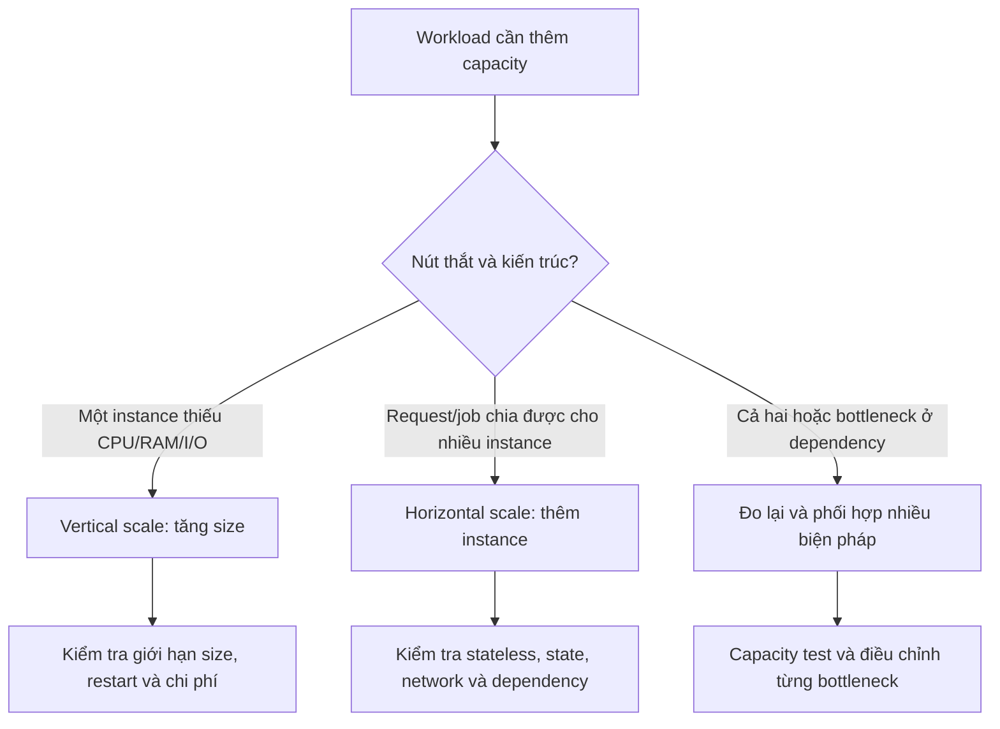
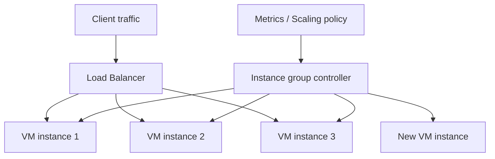

# Horizontal scaling và vertical scaling theo đặc điểm workload

Khi một workload cần thêm năng lực xử lý, đội ngũ vận hành thường có hai hướng chính: tăng tài nguyên cho một instance đang chạy (vertical scaling) hoặc bổ sung nhiều instance để cùng xử lý công việc (horizontal scaling). Hai cách này giải quyết những giới hạn khác nhau. Tăng vCPU và RAM có thể giúp một tiến trình cần bộ nhớ lớn hoặc xử lý đơn luồng chạy nhanh hơn; thêm VM, Pod hoặc execution instance có thể tăng tổng throughput và khả năng chịu lỗi khi ứng dụng có thể phân chia request.

Trong module **CLOUD_CORE_SERVICES_COMPUTE**, quyết định mở rộng phải dựa trên đặc điểm workload, không chỉ dựa vào CPU trung bình. Một workload có thể bị giới hạn bởi CPU, bộ nhớ, disk I/O, network, lock, connection pool, database, queue hoặc quota của dịch vụ cloud. Nếu chọn sai hướng, chi phí tăng nhưng throughput không cải thiện, p95/p99 vẫn cao hoặc hệ thống phụ thuộc bị quá tải. Bài học này trình bày cách phân loại workload, ước tính capacity, lựa chọn horizontal/vertical scaling và triển khai an toàn trên VM, container và serverless.

## Mục tiêu học tập

Sau bài này, bạn có thể:

- Phân biệt scale up/down và scale out/in.
- Nhận diện workload CPU-bound, memory-bound, I/O-bound, stateful, bursty và batch.
- Chọn hướng mở rộng dựa trên bottleneck, khả năng chia nhỏ công việc, yêu cầu latency và tính sẵn sàng.
- Ước tính năng lực xử lý, số instance và headroom theo tải dự kiến.
- Hiểu các giới hạn của vertical scaling và horizontal scaling.
- Áp dụng chiến lược mở rộng cho VM/instance group, container/Kubernetes và serverless.
- Thiết kế scaling policy, cooldown, warm-up, health check, draining và scale-in protection.
- Kiểm soát state, session, database, queue và dependency khi tăng số instance.
- Đo hiệu quả mở rộng bằng throughput, p50/p95/p99, error rate, saturation và chi phí.

## 1. Hai hướng mở rộng năng lực compute

Scaling là điều chỉnh tài nguyên hoặc số lượng execution unit để đáp ứng tải và mục tiêu dịch vụ. Có hai trục cơ bản:

- **Vertical scaling (scale up/down):** thay đổi kích thước tài nguyên của một instance, chẳng hạn tăng/giảm vCPU, RAM hoặc năng lực I/O.
- **Horizontal scaling (scale out/in):** tăng/giảm số lượng instance cùng thực hiện một workload, chẳng hạn thêm/bớt VM, Pod, worker hoặc function execution.



### 1.1. Vertical scaling: scale up và scale down

Scale up tăng tài nguyên của một instance, ví dụ đổi VM từ 2 vCPU/8 GiB RAM sang 8 vCPU/32 GiB RAM, tăng memory allocation của container hoặc chọn cấu hình function có nhiều bộ nhớ và CPU hơn.

Scale down giảm tài nguyên khi instance đang dư công suất. Mục tiêu có thể là giảm chi phí, giảm overprovisioning hoặc đưa workload về cấu hình phù hợp với nhu cầu hiện tại.

Ưu điểm thường gặp:

- Ít thay đổi kiến trúc ứng dụng; tiến trình vẫn chạy trên một instance logic.
- Phù hợp với ứng dụng khó phân tán hoặc có state cục bộ.
- Có thể cải thiện hiệu năng đơn luồng nếu loại instance mới có CPU nhanh hơn, dù cần benchmark thay vì chỉ so số vCPU.
- Tăng RAM có thể tránh swap, OOM hoặc giảm áp lực garbage collection.
- Không cần thêm cơ chế phân phối request giữa nhiều instance nếu chỉ mở rộng một node.

Giới hạn thường gặp:

- Có trần kích thước instance, số vCPU, RAM, IOPS hoặc network throughput theo loại máy và quota.
- Có thể cần stop/start, recreate hoặc restart; điều này gây downtime nếu không có dự phòng.
- Một instance lớn vẫn là một failure domain; lỗi máy hoặc tiến trình có thể ảnh hưởng toàn bộ workload.
- Không cải thiện được bottleneck ở database, lock, API bên ngoài hoặc thuật toán không tận dụng thêm CPU.
- Kích thước lớn hơn thường có chi phí cao hơn theo bước; một instance lớn có thể kém linh hoạt khi tải biến động.

### 1.2. Horizontal scaling: scale out và scale in

Scale out bổ sung instance để chia tải. Ví dụ, tăng một nhóm API từ 3 lên 6 VM sau load balancer, tăng số Pod từ 4 lên 10 hoặc tăng worker consumer để xử lý queue nhanh hơn.

Scale in giảm số instance khi nhu cầu thấp. Nó giúp tiết kiệm chi phí, nhưng cần chọn đúng instance để loại bỏ và cho phép request/job đang chạy hoàn tất an toàn.

Ưu điểm thường gặp:

- Tăng tổng throughput khi workload có thể xử lý song song.
- Có thể cải thiện availability nếu instance được phân bố qua nhiều failure domain.
- Tăng/giảm từng bước nhỏ, linh hoạt theo traffic.
- Giới hạn tác động của một instance lỗi nếu traffic được phân phối và health check đúng.
- Có thể dùng instance nhỏ hơn, đa dạng hơn hoặc kết hợp capacity theo nhu cầu.

Giới hạn thường gặp:

- Ứng dụng phải hỗ trợ nhiều instance cùng lúc; state/session cần được quản lý phù hợp.
- Cần load balancer, service discovery, queue hoặc cơ chế phân phối công việc.
- Tăng số instance có thể làm database, cache, NAT, network hoặc API phụ thuộc quá tải.
- Có overhead của replication, coordination, cache invalidation, connection và observability.
- Scale in sai thời điểm có thể ngắt request, mất job hoặc làm giảm capacity đột ngột.

### 1.3. So sánh nhanh

| Tiêu chí | Vertical scaling | Horizontal scaling |
|---|---|---|
| Cách tăng năng lực | Tăng tài nguyên một instance | Tăng số instance |
| Đơn vị thay đổi | vCPU, RAM, IOPS, network tier, memory allocation | VM, Pod, worker, execution instance |
| Thay đổi ứng dụng | Thường ít hơn | Có thể cần stateless design, shared state hoặc partitioning |
| Trần mở rộng | Giới hạn bởi size và quota của một instance | Giới hạn bởi quota, dependency và khả năng phân phối tải |
| Availability | Instance lớn vẫn có thể là điểm lỗi đơn | Có thể chịu lỗi instance nếu triển khai nhiều failure domain |
| Hiệu năng đơn request | Có thể cải thiện nếu request cần tài nguyên lớn hơn | Không nhất thiết nhanh hơn nếu một request vẫn chạy trên một instance |
| Throughput tổng | Tăng đến giới hạn của instance | Có thể tăng theo số instance đến khi dependency bão hòa |
| Scale down | Đổi về size nhỏ hơn, có thể cần restart | Loại instance sau khi drain và bảo vệ công việc đang chạy |
| Chi phí | Có thể tăng theo bậc cấu hình | Tăng theo số lượng và chi phí điều phối; có thể scale theo tải |
| Workload phù hợp | Khó phân tán, memory-heavy, stateful node | Stateless API, worker pool, tác vụ chia nhỏ, queue consumer |

Không có hướng nào luôn tốt hơn. Một hệ thống có thể scale up database để tăng RAM/IOPS và scale out API để tăng request capacity. Nên chọn theo nút thắt cụ thể và đo lại sau mỗi thay đổi.

## 2. Phân loại workload trước khi chọn hướng scaling

Đặc điểm workload quyết định tài nguyên nào cần tăng và có thể chia công việc ra sao. Phân loại theo hành vi thực tế, không chỉ theo tên ứng dụng.

### 2.1. CPU-bound workload

CPU-bound workload dành phần lớn thời gian thực hiện tính toán: nén/mã hóa, render, xử lý ảnh, inference, phân tích dữ liệu hoặc tính toán số.

Biểu hiện thường gặp:

- CPU utilization cao và kéo dài.
- Run queue tăng hoặc CPU throttling xuất hiện.
- Throughput không tăng khi tăng request concurrency.
- p95/p99 tăng khi CPU gần bão hòa.
- Memory và I/O có thể vẫn còn headroom.

Hướng xử lý:

- Scale up nếu mỗi tác vụ cần nhiều CPU, ứng dụng không dễ chia nhỏ hoặc một thread bị giới hạn bởi hiệu năng từng core.
- Scale out nếu mỗi request/job độc lập hoặc có thể chia thành partition.
- Tối ưu thuật toán, giảm tính toán lặp, dùng cache hoặc vectorization trước khi mua thêm compute.
- Với workload song song, kiểm tra số thread và giới hạn concurrency; thêm vCPU không tự làm ứng dụng đơn luồng chạy nhanh hơn.

### 2.2. Memory-bound workload

Memory-bound workload cần working set lớn hoặc thường xuyên truy cập RAM: cache in-memory, analytics, JVM heap lớn, database buffer, graph processing hoặc xử lý dữ liệu lớn.

Biểu hiện:

- Memory available thấp, working set tăng hoặc page fault/swap xuất hiện.
- OOM kill hoặc process restart.
- Garbage collection pause kéo dài hoặc tần suất GC tăng.
- Latency tăng dù CPU chưa đạt mức cao.
- Một số instance có memory pressure do phân phối dữ liệu không đều.

Hướng xử lý:

- Scale up để tăng RAM nếu một tiến trình cần working set lớn hoặc dữ liệu phải nằm cùng một node.
- Scale out nếu dữ liệu có thể partition, cache có thể phân vùng hoặc worker có thể xử lý các phần độc lập.
- Giảm object allocation, memory leak, cache không giới hạn và dữ liệu giữ quá lâu.
- Kiểm tra memory limit của container/function; node còn RAM không có nghĩa container được phép dùng thêm.

### 2.3. I/O-bound workload

I/O-bound workload thường chờ disk, database, object storage, queue hoặc network hơn là tính toán CPU.

Biểu hiện:

- CPU thấp hoặc trung bình nhưng request latency cao.
- Disk queue depth, I/O wait, storage latency hoặc network retransmission tăng.
- Database connection pool đầy, lock wait hoặc query latency cao.
- Request chờ API phụ thuộc hoặc queue consumer không theo kịp.

Hướng xử lý:

- Scale up IOPS/throughput, chọn storage/network tier phù hợp hoặc tăng connection pool nếu dependency có capacity.
- Scale out worker khi công việc độc lập và downstream còn headroom.
- Dùng batching, async I/O, caching, connection reuse và giảm round trip.
- Nếu database là bottleneck, tăng API instance thường chỉ làm số connection và tải database tăng thêm.

### 2.4. Workload latency-sensitive

Workload tương tác như API giao dịch, xác thực hoặc xử lý thanh toán cần latency ổn định, đặc biệt ở p95/p99.

Hãy xem:

- Thời gian khởi động instance và warm-up cache/runtime.
- Queueing và concurrency limit.
- Tail latency của database và dịch vụ phụ thuộc.
- Vị trí zone/region của client, load balancer và data store.
- Tác động của scale-out/in lên connection, session và cache.

Có thể giữ một mức capacity nền (minimum capacity) và dùng scale-out để xử lý burst. Scale-to-zero thường không phù hợp với endpoint yêu cầu phản hồi tức thời nếu cold start vượt SLO.

### 2.5. Bursty workload

Workload bursty có traffic tăng nhanh trong một khoảng ngắn, ví dụ flash sale, sự kiện, batch đồng loạt hoặc lịch chạy định kỳ.

Scale-out phản ứng theo metric thường cần thời gian phát hiện, tạo instance, boot, tải image và pass health check. Nếu burst đến nhanh hơn thời gian scale-up, hệ thống vẫn có thể quá tải.

Biện pháp:

- Duy trì minimum capacity đủ cho tải nền và burst dự đoán được.
- Dùng scheduled scaling khi sự kiện có lịch.
- Dùng queue để hấp thụ burst và xử lý theo tốc độ dependency cho phép.
- Pre-warm instance, image, cache hoặc function environment khi phù hợp.
- Đặt quota và giới hạn concurrency để tránh tạo tải dây chuyền lên database.

### 2.6. Stateful workload

Workload có state cục bộ hoặc dữ liệu gắn với node có thể khó scale-out. Ví dụ database primary, cache node, ứng dụng giữ session trong RAM hoặc hệ thống xử lý stream có partition ownership.

Không thể chỉ tăng số instance và mong state tự phân phối. Cần xác định:

- State nằm ở RAM, disk, shared storage hay dịch vụ bên ngoài?
- Có thể partition/shard theo key không?
- Có replication và cơ chế failover không?
- Session có thể chuyển sang shared store hoặc token stateless không?
- Có yêu cầu ordering, consistency hoặc single-writer không?

Vertical scaling có thể là bước đơn giản để tăng năng lực cho node stateful, nhưng vẫn cần backup, replication, failover và kế hoạch nâng cấp. Horizontal scaling thường đòi hỏi thiết kế phân vùng dữ liệu và consistency rõ ràng.

### 2.7. Batch và queue-driven workload

Batch workload xử lý tập dữ liệu hoặc job trong khoảng thời gian nhất định. Queue-driven worker có thể tăng số consumer khi backlog lớn và giảm khi backlog nhỏ.

Các tín hiệu quan trọng:

- Queue depth và tuổi của message lâu nhất.
- Arrival rate so với completion rate.
- Processing time mỗi job và retry/dead-letter rate.
- Worker concurrency và downstream capacity.
- Thời hạn hoàn tất batch (deadline) và chi phí mỗi job.

Scale-out worker có hiệu quả khi job độc lập. Nếu job tranh chấp database lock hoặc storage throughput, tăng consumer có thể làm tổng thời gian hoàn tất tệ hơn.

## 3. Ước tính capacity và số instance

Scaling policy cần có mô hình capacity gần đúng để tránh scale quá ít hoặc quá nhiều. Dùng benchmark đại diện để đo năng lực của một instance ở mức utilization còn headroom.

### 3.1. Công thức capacity cơ bản

Nếu một instance có throughput tham chiếu `C` request/giây trong benchmark và cần phục vụ tải `R`, số instance tối thiểu theo mô hình đơn giản là:

\[
N = \left\lceil \frac{R}{C \times U} \right\rceil
\]

Trong đó:

- `R` là arrival rate mục tiêu.
- `C` là throughput đã benchmark trên một instance trong điều kiện tương đương; nên đo đến vùng capacity mà latency/error target bắt đầu bị ảnh hưởng.
- `U` là hệ số capacity được phép sử dụng, nhỏ hơn hoặc bằng 1 để giữ headroom; ví dụ `0,70` nghĩa là chỉ lập kế hoạch dùng 70% throughput tham chiếu.
- `N` là số instance cần thiết theo ước tính.

Ví dụ, benchmark xác định một VM có throughput tham chiếu 120 request/giây trước khi latency bắt đầu vượt mục tiêu. Đội ngũ chỉ lập kế hoạch sử dụng 70% mức đó để có khoảng trống cho burst. Với tải 600 request/giây:

```text
N = ceil(600 / (120 × 0,70))
  = ceil(7,14)
  = 8 VM
```

Đây chỉ là ước tính ban đầu. Throughput không nhất thiết tăng tuyến tính theo số VM do load balancer, database, cache, network, lock hoặc shared dependency. Phải xác nhận bằng test trên toàn hệ thống.

### 3.2. Headroom và failure capacity

Capacity production cần xem xét trường hợp mất một instance hoặc một zone. Nếu cần chịu lỗi `f` instance mà vẫn phục vụ tải `R`, số instance nên thỏa điều kiện:

\[
(N - f) \times C_{safe} \ge R
\]

Trong đó `C_safe` là throughput an toàn trên một instance, đã tính utilization và giới hạn latency. Với multi-zone, phải tính cả trường hợp mất một zone chứ không chỉ một VM.

Ví dụ 8 VM chia đều hai zone, mỗi VM có capacity an toàn 100 req/s. Khi mất một zone, chỉ còn 4 VM, capacity còn 400 req/s. Nếu tải yêu cầu 500 req/s, hệ thống chưa đủ capacity để duy trì SLO sau sự cố. Cần tăng baseline, thêm zone/capacity hoặc chấp nhận mục tiêu degraded mode được định nghĩa rõ.

### 3.3. Capacity của dependency

Trước khi scale-out, lập bản đồ dependency:

| Dependency | Giới hạn cần xem | Tác động khi tăng instance |
|---|---|---|
| Database | Connection, CPU, IOPS, lock, transaction rate | Số connection và query đồng thời tăng |
| Cache | Connection, memory, shard throughput, hot key | Nhiều client có thể tăng connection và request |
| Queue | Partition, consumer group, throughput, visibility timeout | Tăng consumer có thể vượt partition hoặc gây retry |
| NAT/egress | Port, bandwidth, connection tracking, quota | Nhiều instance tạo nhiều outbound connection |
| API bên ngoài | Rate limit, quota, concurrency | Scale-out có thể bị throttle hoặc tăng chi phí |
| Storage | IOPS, throughput, request rate, metadata limits | Tăng worker có thể làm I/O contention tăng |

Tổng capacity của hệ thống bị giới hạn bởi dependency hẹp nhất trên đường xử lý. Scale compute ở tầng API không thể vượt giới hạn database nếu database là bottleneck.

### 3.4. Capacity test thay vì chỉ suy luận

Thực hiện test theo các mức tải và ghi throughput, p50/p95/p99, error rate, CPU, memory, I/O, queue và dependency metrics. Tìm điểm mà tăng instance không còn cải thiện throughput hoặc làm latency tăng. Dùng kết quả đó để xác định `C_safe`, utilization target và scale limit.

## 4. Khi nào nên scale up?

Scale up phù hợp khi bottleneck nằm trong một instance và workload có thể tận dụng tài nguyên bổ sung.

### 4.1. Các trường hợp phù hợp

- Một process cần RAM lớn hoặc working set không dễ partition.
- Ứng dụng cũ chỉ hỗ trợ một node hoặc giữ state cục bộ.
- Database node cần thêm RAM cho buffer/cache hoặc IOPS cho storage.
- Một request cần nhiều CPU/RAM và không thể chia thành nhiều worker độc lập.
- Cần giải pháp nhanh trong khi đang thiết kế lại kiến trúc horizontal.
- Chi phí vận hành nhiều node, replication hoặc distributed coordination lớn hơn lợi ích scale-out.

### 4.2. Các trường hợp scale up không giải quyết được vấn đề

- CPU thấp nhưng request chờ database hoặc API bên ngoài.
- Một thread bị lock hoặc giới hạn bởi thuật toán tuần tự.
- Database connection pool đã đầy vì số connection không được quản lý.
- Disk/network tier hiện tại là giới hạn nhưng chỉ tăng CPU/RAM.
- Một instance đã đạt size tối đa hoặc quota không cho phép đổi size.
- Yêu cầu availability đòi hỏi nhiều failure domain, không chỉ một máy mạnh hơn.

### 4.3. Quy trình vertical scaling

1. Xác định metric chứng minh bottleneck ở CPU, RAM, storage hoặc network của instance.
2. Chọn size mới dựa trên benchmark, không chỉ chọn gấp đôi vCPU.
3. Kiểm tra tương thích kiến trúc CPU, driver, license, OS và storage/network limits.
4. Xác định việc resize có cần stop/restart/recreate không.
5. Đảm bảo backup/snapshot và phương án rollback.
6. Nếu là dịch vụ stateful, kiểm tra replication/failover hoặc maintenance window.
7. Sau thay đổi, chạy cùng workload và so p50/p95/p99, throughput, errors và chi phí.

Với workload quan trọng, có thể tạo instance mới với size mới, đồng bộ dữ liệu hoặc chuyển traffic dần thay vì resize trực tiếp. Cách làm phụ thuộc nền tảng và khả năng migration.

## 5. Khi nào nên scale out?

Scale out phù hợp khi công việc có thể phân phối giữa nhiều instance và hệ thống có cơ chế xử lý state/dependency tương ứng.

### 5.1. Các trường hợp phù hợp

- API stateless nhận nhiều request độc lập.
- Worker xử lý message/job có thể chạy song song.
- Batch job có thể chia theo partition hoặc shard.
- Web tier cần availability qua nhiều zone.
- Workload có burst và nhu cầu thay đổi theo thời gian.
- Có thể tăng throughput bằng cách tăng consumer/replica mà không làm dependency bão hòa.

### 5.2. Điều kiện kiến trúc

- Request có thể đến bất kỳ instance nào hoặc có routing affinity được thiết kế rõ.
- Session/state được lưu ở shared service, database hoặc token stateless.
- Instance mới có thể bootstrap và nhận traffic sau health/readiness check.
- Job có cơ chế lock, lease, idempotency hoặc partition ownership để tránh xử lý trùng.
- Có graceful shutdown và connection draining khi scale-in.
- Shared dependency đủ capacity hoặc có chiến lược partition/cache/queue.

### 5.3. Quy trình horizontal scaling

1. Đo capacity an toàn của một instance và dependency.
2. Đặt minimum/maximum instance count và quota phù hợp.
3. Chọn metric hoặc lịch làm trigger scale.
4. Cấu hình warm-up, readiness và health check trước khi nhận traffic.
5. Phân phối instance qua các zone/failure domain cần thiết.
6. Khi scale-in, drain request/job và bảo vệ instance đang thực hiện tác vụ quan trọng.
7. Theo dõi throughput, latency, errors, queue và chi phí sau mỗi lần scale.

## 6. Thiết kế ứng dụng để scale-out an toàn

Horizontal scaling yêu cầu các instance phối hợp đúng. Một số nguyên tắc kiến trúc thường giúp giảm coupling.

### 6.1. Stateless application tier

Một API stateless không giữ session quan trọng trong RAM của một instance. Mỗi request có thể được xử lý bởi bất kỳ replica nào dựa trên token hoặc state lưu trong shared store.

Nếu session cần lưu phía server:

- Dùng shared session store phù hợp, ví dụ cache/database có HA.
- Hoặc dùng sticky session khi thật sự cần, nhưng hiểu rằng affinity làm giảm tính linh hoạt và có thể tạo hotspot.
- Đặt TTL, eviction và giới hạn dung lượng session.
- Thiết kế khi shared store lỗi: fail closed, degraded mode hay yêu cầu đăng nhập lại.

Không đưa toàn bộ state vào cookie/token nếu dữ liệu lớn, nhạy cảm hoặc khó thu hồi. Stateless không có nghĩa không có state; nó có nghĩa state được quản lý ngoài instance xử lý request.

### 6.2. Shared storage và local disk

Local disk thường gắn với vòng đời instance. Nếu instance bị thay thế, dữ liệu local có thể mất. Với file người dùng hoặc dữ liệu cần chia sẻ, cân nhắc object storage, managed file service hoặc database phù hợp.

Nếu dùng local cache/temp file:

- Xác định có thể tạo lại hay không.
- Đặt giới hạn disk và dọn dữ liệu hết hạn.
- Không dựa vào local file để làm nguồn dữ liệu duy nhất.
- Kiểm tra hành vi khi instance bị terminate bất ngờ.

### 6.3. Idempotency và xử lý job

Khi tăng worker, cùng một message có thể được giao lại do timeout, visibility timeout hoặc lỗi consumer. Dùng idempotency key, transaction hoặc deduplication để tránh side effect lặp.

Các nguyên tắc:

- Job có thể retry mà không tạo giao dịch trùng.
- Lease/visibility timeout dài hơn thời gian xử lý hợp lý và có heartbeat nếu cần.
- Worker dừng nhận job mới trước khi shutdown.
- Job đang chạy được hoàn tất hoặc trả lại queue an toàn.
- Dead-letter queue và retry limit được giám sát.

### 6.4. Cache và consistency

Scale-out có thể tạo nhiều local cache độc lập. Một instance cập nhật dữ liệu nhưng instance khác vẫn giữ bản cũ. Cần xác định:

- Cache có thể stale trong bao lâu?
- Invalidation theo event, TTL hay version key?
- Có hot key hoặc cache stampede không?
- Khi cache lỗi, database có chịu được fallback traffic không?

Không tăng cache node hoặc API replica mà chưa đo hit ratio, eviction, hot key và backend load.

## 7. Scaling trên VM và instance group

VM thường hỗ trợ cả vertical và horizontal scaling. Vertical scaling thay đổi machine type/size; horizontal scaling thay đổi số VM trong instance group hoặc autoscaling group.

### 7.1. Vertical scaling cho VM

Ví dụ một VM API đang dùng 2 vCPU/8 GiB RAM và có CPU saturation. Có thể benchmark cấu hình 4 vCPU/16 GiB RAM, nhưng cần kiểm tra:

- Throughput có tăng theo vCPU không?
- CPU frequency/architecture có khác không?
- Ứng dụng có thread pool tận dụng thêm core không?
- RAM tăng có giảm GC/swap không?
- Network bandwidth/IOPS có thay đổi theo size không?
- Resize có yêu cầu stop/start và ảnh hưởng public/private IP không?

Không suy ra hiệu năng gấp đôi chỉ vì vCPU gấp đôi. Phần tuần tự của ứng dụng, lock contention và dependency giới hạn mức tăng.

### 7.2. Horizontal scaling với instance group

Một nhóm VM có thể giữ minimum, desired và maximum capacity. Load balancer phân phối request đến instance khỏe mạnh. Scaling policy có thể dựa trên CPU, request count, network, custom metric hoặc lịch.



Quy trình scale-out thường gồm:

1. Metric vượt ngưỡng hoặc lịch kích hoạt policy.
2. Controller yêu cầu thêm VM.
3. VM được tạo từ image/launch template và cấu hình identity/network.
4. Bootstrap cài đặt hoặc khởi động ứng dụng.
5. Health check/readiness xác nhận instance có thể phục vụ.
6. Load balancer bắt đầu gửi traffic.

Nếu bootstrap chậm, scale-out có thể đến sau đỉnh tải. Dùng image đã chuẩn bị, startup idempotent, warm pool hoặc scheduled capacity khi phù hợp.

### 7.3. Scale-in và connection draining

Khi giảm số VM, controller cần chọn instance và loại khỏi load balancer một cách an toàn. Connection draining cho phép request đang mở hoàn tất trong thời gian giới hạn.

Trước khi terminate:

- Ngừng nhận request mới.
- Chờ active connection/request hoàn tất hoặc hết timeout.
- Worker ngừng nhận job mới và hoàn tất/nhả job đang chạy.
- Flush log/metric và checkpoint nếu cần.
- Gỡ registration, thu hồi lease và đóng kết nối.

Đặt termination grace period dài hơn thời gian hoàn tất công việc thông thường nhưng có giới hạn. Nếu request có thể kéo dài vô hạn, cần timeout và cancellation policy.

### 7.4. Phân bố qua zone

Nếu instance group chạy nhiều zone, desired capacity cần đủ để phân phối đều và duy trì capacity khi một zone gặp sự cố. Cần kiểm tra quota từng zone, subnet IP capacity, load balancer target health và data dependency. Một nhóm có 6 VM nhưng tất cả nằm trong một zone không có khả năng chịu lỗi zone.

## 8. Scaling trên container và Kubernetes

Container platform thường kết hợp horizontal scaling ở cấp Pod với vertical scaling ở cấp Pod/node.

### 8.1. Horizontal Pod Autoscaler (HPA)

HPA điều chỉnh số replica của workload dựa trên metric như CPU, memory hoặc custom/external metric. Với CPU utilization, giá trị thường được tính tương đối với CPU request của container. Vì vậy request không hợp lý có thể làm trigger scale sai.

Ví dụ manifest HPA minh họa:

```yaml
apiVersion: autoscaling/v2
kind: HorizontalPodAutoscaler
metadata:
  name: orders-api
  namespace: production
spec:
  scaleTargetRef:
    apiVersion: apps/v1
    kind: Deployment
    name: orders-api
  minReplicas: 3
  maxReplicas: 20
  metrics:
    - type: Resource
      resource:
        name: cpu
        target:
          type: Utilization
          averageUtilization: 65
```

Trong ví dụ, HPA duy trì ít nhất 3 Pod và không vượt 20 Pod; mục tiêu CPU utilization trung bình là 65% của CPU request. Đây là cấu hình minh họa; cần có resource requests và Metrics Server/custom metrics adapter phù hợp. Chỉ dùng CPU có thể không phản ánh queue-driven workload; queue depth hoặc request rate có thể là tín hiệu tốt hơn.

### 8.2. Vertical Pod Autoscaler (VPA)

VPA đề xuất hoặc điều chỉnh CPU/memory request/limit theo quan sát sử dụng, tùy chế độ và cấu hình. Nó hữu ích khi sizing Pod không chính xác hoặc workload có nhu cầu tài nguyên khác nhau theo thời gian.

Lưu ý:

- Một số chế độ VPA có thể evict/recreate Pod để áp dụng request mới.
- VPA không tự làm ứng dụng tận dụng nhiều CPU hơn nếu code bị giới hạn tuần tự.
- Memory limit quá thấp có thể gây OOM; limit quá cao có thể làm scheduler khó đặt Pod.
- HPA theo CPU utilization và VPA thay đổi CPU request có thể ảnh hưởng lẫn nhau; cần thiết kế phối hợp và kiểm thử.
- Không nên để nhiều controller cùng điều chỉnh một dimension mà không có chính sách rõ.

### 8.3. Cluster autoscaler và node capacity

HPA có thể tăng Pod nhưng cluster không có node đủ capacity để schedule. Cluster autoscaler hoặc node provisioning controller có thể bổ sung node khi Pod pending do thiếu tài nguyên.

Các tầng cần quan sát:

- HPA desired/current replicas.
- Pod pending và lý do scheduler từ chối.
- Node allocatable, requests, limits và fragmentation.
- Node scale-up delay, image pull và startup.
- Zone balance, quota và subnet IP capacity.
- Pod disruption budget và khả năng drain node.

Scale Pod và scale node là hai vòng điều khiển khác nhau. Nếu node provisioning chậm, cần giữ headroom hoặc warm node pool để đáp ứng burst.

### 8.4. Requests, limits và bin packing

CPU request ảnh hưởng scheduler và cách tính CPU utilization cho HPA; CPU limit có thể gây throttling. Memory request ảnh hưởng scheduling; memory limit thường là ranh giới mà container có thể bị OOM kill khi vượt.

Đặt requests quá thấp làm node overcommit và Pod cạnh tranh; đặt quá cao gây lãng phí và fragmentation. Dùng metrics theo working set, throttling, OOM và tải thực để hiệu chỉnh.

## 9. Scaling trên serverless

Serverless/FaaS thường tự tăng số execution environment theo concurrency hoặc event rate. Người dùng có thể điều chỉnh memory/CPU allocation, concurrency, provisioned/warm capacity và giới hạn account/service tùy nền tảng.

### 9.1. Vertical và horizontal trong FaaS

- **Vertical dimension:** tăng memory/CPU allocation hoặc cấu hình tài nguyên cho mỗi invocation/environment.
- **Horizontal dimension:** tăng số invocation/execution environment đồng thời để xử lý nhiều request/event.

Tăng memory có thể đồng thời tăng CPU ở một số dịch vụ, nhưng tỷ lệ và cách tính phụ thuộc nhà cung cấp. Không giả định mọi function có quan hệ memory/CPU giống nhau.

### 9.2. Khi nào tăng memory/CPU?

- Invocation bị CPU-bound hoặc xử lý payload lớn.
- Function thường timeout do xử lý chậm và metric cho thấy compute thiếu.
- Memory pressure, OOM hoặc runtime phải dùng swap/temporary storage.
- Tăng memory giúp giảm duration đủ để giảm tổng chi phí theo mô hình tính phí của dịch vụ.

### 9.3. Khi nào tăng concurrency?

- Nhiều event/request độc lập có thể chạy đồng thời.
- Downstream database/API có đủ capacity.
- Queue backlog hoặc invocation throttle tăng.
- Handler có idempotency và retry an toàn.

Đặt reserved/max concurrency hoặc giới hạn tương đương để bảo vệ dependency. Nếu không giới hạn, function scale nhanh có thể làm database connection, NAT hoặc API đối tác quá tải.

### 9.4. Cold start và provisioned capacity

Scale-out có thể tạo execution environment mới cần tải package, khởi tạo runtime, kết nối mạng và nạp dependency. Với latency-sensitive workload, cold start có thể làm p95/p99 tăng. Có thể dùng provisioned concurrency, pre-warm hoặc tối ưu package/runtime nếu dịch vụ hỗ trợ.

Đo riêng cold và warm invocation; đồng thời báo cáo end-to-end latency theo population thực tế. Không loại cold start khỏi SLO nếu người dùng thực sự trải nghiệm nó.

## 10. Chọn scaling trigger và policy

Một policy tốt phản ứng với nhu cầu trước khi SLO bị vi phạm nhưng không dao động liên tục.

### 10.1. Metric-based scaling

Các tín hiệu có thể dùng:

- CPU utilization hoặc CPU queue/throttling.
- Memory working set hoặc memory pressure.
- Request count trên mỗi instance.
- Request arrival rate và concurrency.
- Queue depth hoặc oldest message age.
- Custom metric về active jobs, in-flight request hoặc backlog.
- Latency có thể là tín hiệu bổ sung nhưng cần lọc nhiễu và tránh scale theo metric đã chịu tác động từ downstream.

CPU phù hợp với CPU-bound workload; queue depth phù hợp với worker; request count per target phù hợp với API có request phân bố tương đối đều. Không dùng một metric duy nhất cho mọi loại workload.

### 10.2. Threshold, target tracking và step scaling

- **Threshold scaling:** scale khi metric vượt ngưỡng trong một khoảng thời gian.
- **Target tracking:** điều chỉnh capacity để giữ metric gần mục tiêu.
- **Step scaling:** tăng/giảm số instance theo mức độ vượt ngưỡng.
- **Scheduled scaling:** thay đổi capacity theo lịch dự đoán.
- **Predictive scaling:** dự báo nhu cầu từ lịch sử nếu nền tảng hỗ trợ.

Target tracking đơn giản cho metric ổn định, nhưng vẫn cần min/max, cooldown, warm-up và scale-in policy. Step scaling phù hợp khi cần tăng nhanh hơn khi metric vượt xa ngưỡng.

### 10.3. Scale-out và scale-in không nhất thiết đối xứng

Scale-out thường cần nhanh để đáp ứng tải; scale-in nên thận trọng để tránh dao động. Có thể dùng:

- Ngưỡng scale-out thấp hơn hoặc phản ứng nhanh hơn ngưỡng scale-in.
- Stabilization window để tránh scale-in khi tải vừa giảm trong thời gian ngắn.
- Cooldown/warm-up để không tạo thêm instance liên tục khi instance mới chưa sẵn sàng.
- Minimum capacity để giữ baseline.
- Scale-in protection cho instance đang chạy job dài hoặc giữ state quan trọng.

Cooldown không phải lúc nào cũng cần một giá trị cố định cho mọi metric. Chọn theo thời gian boot, bootstrap, warm-up, metric evaluation và tốc độ biến động tải.

### 10.4. Tránh scaling oscillation

Scaling oscillation xảy ra khi policy liên tục thêm rồi bớt instance quanh một ngưỡng. Nguyên nhân gồm metric nhiễu, evaluation window quá ngắn, cooldown không phù hợp hoặc nhiều controller xung đột.

Giảm dao động bằng cách:

- Dùng cửa sổ trung bình và nhiều lần đo liên tiếp.
- Có hysteresis giữa điều kiện scale-out và scale-in.
- Giới hạn tốc độ scale-in/out mỗi chu kỳ.
- Đưa warm-up vào cách đánh giá capacity mới.
- Tránh dùng metric phụ thuộc trực tiếp vào số replica nếu không chuẩn hóa.
- Kiểm tra tương tác giữa HPA, VPA, cluster autoscaler và policy cloud.

## 11. Scale-in an toàn và vòng đời instance

Scale-in là thay đổi có rủi ro vì instance có thể đang phục vụ request, xử lý job, giữ lease hoặc ghi dữ liệu.

### 11.1. Graceful shutdown

Một tiến trình có thể xử lý tín hiệu shutdown theo thứ tự:

1. Đánh dấu instance không còn nhận traffic mới.
2. Readiness/target health chuyển sang trạng thái không nhận request mới.
3. Dừng nhận message/job mới.
4. Hoàn tất request/job đang chạy trong grace period.
5. Flush buffer, log, metric và checkpoint cần thiết.
6. Đóng kết nối và nhả lease/lock.
7. Thoát trước termination deadline.

Nếu công việc không thể hoàn tất trong grace period, cần cơ chế checkpoint hoặc trả job về queue. Không giữ instance vô thời hạn vì một request bị treo; phải có timeout và cancellation.

### 11.2. Health check và readiness

Health check trả lời instance có còn hoạt động hay không. Readiness trả lời instance đã sẵn sàng nhận traffic chưa. Một process có thể sống nhưng chưa warm-up cache hoặc chưa kết nối được dependency, vì vậy liveness và readiness không nên dùng chung một điều kiện quá đơn giản.

Khi scale-out:

- Chỉ thêm instance vào target pool sau khi bootstrap và readiness thành công.
- Tránh health check quá nhạy khiến instance bị loại liên tục.
- Kiểm tra dependency cần thiết nhưng tránh để một dịch vụ phụ thuộc tạm lỗi làm mọi instance bị đánh dấu unhealthy cùng lúc.

Khi scale-in:

- Ngừng nhận kết nối mới trước khi terminate.
- Chờ connection draining và graceful shutdown.
- Bảo vệ worker đang giữ job hoặc instance có state cần di chuyển.

## 12. Các giới hạn và failure mode của scaling

### 12.1. Database bottleneck

Scale API từ 4 lên 20 replica có thể làm số database connection tăng gấp năm. Nếu database không tăng capacity tương ứng, connection pool wait, lock contention và query latency tăng. Cách xử lý có thể là connection pooling/proxy, giới hạn connection mỗi replica, cache, query optimization, read replica hoặc partitioning tùy workload.

### 12.2. Hot partition và uneven load

Nếu traffic phân phối theo key nhưng một key nhận phần lớn request, một shard/partition có thể bão hòa dù tổng cluster còn capacity. Cần đo phân phối theo key/partition, hot key, skew và latency từng shard. Thêm instance không giải quyết được nếu router vẫn gửi traffic đến cùng một partition.

### 12.3. Shared resource và noisy neighbor

Nhiều instance có thể cùng tranh chấp storage, network, cache hoặc node CPU. Scale-out làm tổng demand tăng trên shared resource. Theo dõi resource ở cả cấp instance và dependency, không chỉ nhìn CPU từng Pod.

### 12.4. Quota và giới hạn nền tảng

Scale-out có thể thất bại do quota vCPU, số VM, IP subnet, ENI/NIC, disk, public IP, function concurrency hoặc rate limit API. Capacity plan cần có quota headroom và quy trình tăng quota trước sự kiện lớn.

### 12.5. Retry storm và cascading failure

Khi dependency chậm, client/worker có thể retry, tạo thêm tải và làm dependency chậm hơn. Scale-out tự động dựa trên request hoặc queue có thể khuếch đại vấn đề. Dùng timeout, exponential backoff với jitter, retry budget, circuit breaker và admission control.

### 12.6. Scale-out quá nhanh

Thêm nhiều instance cùng lúc có thể tạo burst image pull, package download, secret fetch, database connection và cache warm-up. Dùng step limit, warm pool, staggered rollout và connection ramp-up để giảm áp lực.

## 13. Kết hợp horizontal và vertical scaling

Nhiều hệ thống dùng cả hai hướng:

- Scale up mỗi VM/Pod để có capacity phù hợp cho một replica.
- Scale out replica để đáp ứng tổng traffic và availability.
- Scale up database/cache khi mỗi node cần thêm RAM/IOPS.
- Scale out read replica hoặc shard khi workload có thể phân tán.
- Dùng worker nhỏ, nhiều replica cho job độc lập; dùng worker lớn cho job cần RAM lớn.

### 13.1. Ví dụ API và worker

Một hệ thống có API đọc/ghi và worker xử lý ảnh:

- API stateless cần nhiều request đồng thời: scale-out API theo request rate per target và p95.
- Worker xử lý ảnh CPU-bound: scale-out theo queue backlog; nếu mỗi ảnh cần nhiều CPU, chọn worker VM/Pod lớn hơn.
- Object storage chịu trách nhiệm lưu file: không dùng local disk của worker làm nguồn dữ liệu chính.
- Database có giới hạn connection: đặt pool cap và giới hạn tổng concurrency của API/worker.

### 13.2. Ví dụ workload memory-heavy

Một service phân tích dữ liệu cần working set 48 GiB và có một process không thể partition dễ dàng. Scale-out nhiều process nhỏ có thể nhân bản toàn bộ dữ liệu, làm tổng RAM tăng nhưng không tăng hiệu quả. Scale-up một node có RAM lớn có thể phù hợp hơn. Nếu có thể chia dữ liệu theo key, scale-out shard có thể cải thiện throughput nhưng phải giải quyết query fan-out và consistency.

### 13.3. Ví dụ workload bursty

Một API có tải nền 100 req/s, giờ cao điểm 800 req/s. Có thể giữ minimum 3 replica để đáp ứng tải nền, scheduled/predictive scaling trước giờ cao điểm và target tracking để phản ứng với biến động. Nếu thời gian tạo replica là 3 phút nhưng traffic tăng trong 20 giây, cần giữ headroom hoặc dùng queue/rate limit để hấp thụ burst.

## 14. So sánh theo đặc điểm workload

| Đặc điểm workload | Hướng ưu tiên ban đầu | Điều kiện cần kiểm tra |
|---|---|---|
| CPU-bound, request độc lập | Horizontal hoặc kết hợp | Có thể chạy song song? Dependency còn headroom? |
| CPU-bound, một tác vụ đơn luồng | Vertical hoặc tối ưu code | Hiệu năng từng core và phần tuần tự |
| Memory-heavy, state tập trung | Vertical | Size tối đa, memory bandwidth, restart/failover |
| Memory-heavy, dữ liệu partition được | Horizontal | Sharding, replication, query fan-out và skew |
| I/O-bound do disk cục bộ | Vertical storage tier hoặc thay kiến trúc I/O | IOPS, throughput, queue depth và cache |
| I/O-bound do database | Tối ưu/scale database trước; giới hạn app concurrency | Connection, lock, query, read/write mix |
| Stateless web/API | Horizontal | Load balancer, session, dependency và readiness |
| Queue worker, job độc lập | Horizontal | Backlog, idempotency, consumer limit và downstream |
| Stateful single-writer | Vertical hoặc kiến trúc replication/partition có kiểm soát | Consistency, failover, data movement |
| Bursty/seasonal | Horizontal + baseline/scheduled capacity | Scale delay, warm-up, quota và queue |
| Latency-sensitive | Giữ baseline + horizontal; cân nhắc vertical cho per-request compute | p95/p99, cold start, locality và dependency |

Bảng này là điểm bắt đầu. Cần xác nhận bằng benchmark và kiến trúc thực tế trước khi chọn policy production.

## 15. Đo lường hiệu quả sau scaling

Không đánh giá thành công chỉ bằng số instance tăng hoặc CPU giảm. Scaling cần cải thiện mục tiêu dịch vụ với chi phí hợp lý.

### 15.1. Chỉ số cần theo dõi

- Throughput hoàn tất (request/job per second).
- p50, p95, p99 và histogram latency.
- Error rate, timeout, retry và dropped request/job.
- CPU utilization, throttling, run queue và steal time.
- Memory working set, OOM, swap và garbage collection.
- Disk/network throughput, IOPS, queue depth, packet loss.
- Queue depth, oldest message age và worker concurrency.
- Database connection, lock wait, query latency và saturation.
- Desired/current/healthy replica count, scale event và startup duration.
- Cost per request/job và tổng chi phí trong cửa sổ tải.

### 15.2. Đánh giá hiệu quả ngang

Nếu số instance tăng từ `N` lên `2N`, throughput không nhất thiết tăng gấp đôi. Có thể tính hiệu suất mở rộng gần đúng:

```text
Scaling efficiency = (Throughput_after / Throughput_before)
                     / (Instances_after / Instances_before)
```

Ví dụ throughput tăng 1,7 lần khi instance tăng 2 lần:

```text
Scaling efficiency = 1,7 / 2 = 0,85 = 85%
```

Hiệu suất này là phép đo gần đúng trong cùng điều kiện thử. Nếu request mix, latency target hoặc dependency thay đổi, không thể so sánh trực tiếp.

### 15.3. Cost per unit of work

Theo dõi chi phí trên mỗi request/job hoàn tất, không chỉ tổng hóa đơn. Scale-out có thể làm tổng chi phí tăng nhưng cost per request giảm nếu utilization tốt hơn; ngược lại, thêm replica nhàn rỗi có thể làm chi phí tăng mà throughput không đổi.

Kết hợp:

- Chi phí compute và storage.
- Chi phí load balancer, network, NAT, logging và telemetry.
- Chi phí database/cache/queue do concurrency tăng.
- Chi phí idle capacity cần giữ cho availability và burst.

## 16. Quy trình ra quyết định scaling

1. Xác định mục tiêu: throughput, latency, availability, thời gian hoàn tất job hay cost.
2. Đo baseline dưới workload đại diện, gồm p50/p95/p99, errors và saturation.
3. Tìm bottleneck ở compute, storage, network, lock, queue hoặc dependency.
4. Phân loại workload: CPU, memory, I/O, stateful, bursty, batch hay latency-sensitive.
5. Xác định công việc có thể chia cho nhiều instance không và state nằm ở đâu.
6. Ước tính capacity an toàn, headroom, failure capacity và quota.
7. Chọn vertical, horizontal hoặc kết hợp; ghi giả thuyết và rủi ro.
8. Triển khai thử ở staging/canary với giới hạn và rollback.
9. Đo lại cùng request mix và điều kiện; so throughput, percentile, errors và cost.
10. Chuyển thành policy có min/max, warm-up, cooldown, readiness, draining và owner.
11. Theo dõi sau deploy và điều chỉnh theo dữ liệu thực tế.

## 17. Ví dụ thực hành: chọn scaling cho ba workload

### 17.1. API stateless

API chạy trên 4 VM, mỗi VM benchmark an toàn 100 req/s ở p95 dưới 250 ms. Tải dự kiến 500 req/s, utilization target 70%:

```text
N = ceil(500 / (100 × 0,70))
  = ceil(7,14)
  = 8 VM
```

Chọn horizontal scaling với minimum 4, desired theo tải và maximum dựa trên quota/dependency. Trước production cần test 8 VM và kiểm tra database connection tổng. Nếu cần chịu lỗi một zone, tính lại số VM còn lại sau khi mất zone.

### 17.2. Worker xử lý ảnh

Worker xử lý từng ảnh độc lập, CPU utilization cao, queue backlog tăng. Một worker hoàn tất 2 ảnh/giây ở SLO. Tải đến 40 ảnh/giây:

```text
N = ceil(40 / 2) = 20 workers
```

Nếu worker concurrency tăng làm object storage hoặc database bị giới hạn, cần giới hạn consumer và đo completion rate. Nếu một ảnh lớn cần nhiều RAM, dùng worker size lớn hơn hoặc queue riêng theo loại ảnh.

### 17.3. Cache in-memory lớn

Một cache node có working set 90 GiB, RAM available thấp và latency tăng do memory pressure. Scale-out thêm cache node chỉ hiệu quả nếu cache hỗ trợ sharding và client phân phối key đúng. Nếu không, tăng RAM node có thể là bước phù hợp hơn. Dù chọn cách nào, cần kiểm tra replication, failover, key skew và cache warm-up.

## 18. Những sai lầm thường gặp

| Sai lầm | Hậu quả | Cách khắc phục |
|---|---|---|
| Scale theo CPU cho mọi workload | Bỏ qua queue, memory, I/O hoặc dependency bottleneck | Chọn metric theo workload và bottleneck đã đo |
| Thêm replica khi database đã bão hòa | Tăng connection/query và làm p99 xấu hơn | Giới hạn concurrency, tối ưu DB hoặc mở rộng dependency |
| Nghĩ vCPU gấp đôi thì throughput gấp đôi | Bỏ qua phần tuần tự, lock và single-core performance | Benchmark cấu hình mới với workload thật |
| Scale-out ứng dụng stateful mà không thiết kế state | Session mất, dữ liệu lệch hoặc request lỗi | Shared state, partitioning, replication và consistency |
| Scale-in ngay khi CPU giảm ngắn hạn | Dao động và thiếu capacity khi tải quay lại | Stabilization window, cooldown và min capacity |
| Terminate worker đang xử lý job | Job mất hoặc side effect dở dang | Graceful shutdown, lease, idempotency và checkpoint |
| Chỉ kiểm tra số replica desired | Pod/VM mới có thể chưa healthy hoặc chưa nhận traffic | Theo dõi ready/healthy capacity và startup time |
| Không tính quota và subnet IP | Scale-out không tạo được instance | Capacity plan theo zone, IP, vCPU và API quota |
| Bỏ qua scale-up delay | Burst đến trước khi capacity sẵn sàng | Headroom, scheduled scaling, warm pool hoặc queue |
| Nhiều autoscaler điều khiển cùng tài nguyên | Policy xung đột và dao động | Phân định quyền điều khiển và kiểm thử tương tác |
| Chỉ đo CPU sau thay đổi | Không biết SLO và chi phí có cải thiện không | So p50/p95/p99, throughput, errors, dependency và cost |

## 19. Checklist production

**Phân tích workload**

- [ ] Đã phân loại CPU, memory, I/O, stateful, bursty hoặc batch.
- [ ] Đã xác định bottleneck bằng metrics/traces và benchmark.
- [ ] Đã xác định latency, throughput, availability và cost objective.
- [ ] Đã lập bản đồ dependency và giới hạn của từng dịch vụ.

**Thiết kế capacity**

- [ ] Đã benchmark capacity an toàn trên một instance.
- [ ] Đã tính headroom, failure capacity và quota.
- [ ] Đã chọn vertical, horizontal hoặc kết hợp có lý do.
- [ ] Đã xác định minimum/maximum và baseline capacity.
- [ ] Đã tính tác động lên database, cache, queue, network và storage.

**Triển khai và vòng đời**

- [ ] Instance mới bootstrap idempotent và có health/readiness check.
- [ ] Warm-up, cooldown và stabilization window phù hợp.
- [ ] Load balancer chỉ gửi traffic đến instance sẵn sàng.
- [ ] Scale-in có connection draining và graceful shutdown.
- [ ] Worker có idempotency, retry/dead-letter và checkpoint khi cần.
- [ ] Có scale-in protection cho state/job quan trọng.

**Xác minh và vận hành**

- [ ] Đã chạy load, burst và failure test.
- [ ] Đo p50/p95/p99, throughput, errors và saturation trước/sau.
- [ ] Đo cost per request/job và tổng chi phí dependency.
- [ ] Có cảnh báo khi scaling không tạo được capacity hoặc vượt quota.
- [ ] Có runbook, owner, rollback và review định kỳ.

## 20. Kết luận

Vertical scaling tăng tài nguyên của một instance và phù hợp khi workload cần CPU/RAM/I/O tập trung hoặc khó phân tán. Horizontal scaling tăng số instance và phù hợp khi request/job có thể chia sẻ tải, state được quản lý đúng và dependency còn capacity. Cả hai đều có giới hạn: vertical bị chặn bởi size và failure domain; horizontal bị chi phối bởi kiến trúc phân tán, state, network, quota và shared dependency.

Hãy bắt đầu từ đặc điểm workload và bottleneck đã đo. Ước tính capacity an toàn, giữ headroom, tính trường hợp mất instance/zone và kiểm tra tác động lên database, cache, queue cùng network. Với horizontal scaling, readiness, warm-up, draining và graceful shutdown quyết định instance mới có hữu ích và instance bị loại có an toàn hay không. Đánh giá kết quả bằng throughput, p50/p95/p99, error rate, saturation và cost per unit of work để chọn cấu hình bền vững.

## Thuật ngữ cần nhớ

| Thuật ngữ | Ý nghĩa |
|---|---|
| Vertical scaling | Tăng hoặc giảm tài nguyên của một instance (scale up/down). |
| Horizontal scaling | Tăng hoặc giảm số lượng instance (scale out/in). |
| Capacity | Năng lực xử lý workload trong điều kiện và mục tiêu đã xác định. |
| Headroom | Phần năng lực dự phòng để hấp thụ burst hoặc lỗi. |
| CPU-bound | Workload bị giới hạn chủ yếu bởi năng lực xử lý CPU. |
| Memory-bound | Workload bị giới hạn bởi dung lượng hoặc băng thông bộ nhớ. |
| I/O-bound | Workload dành nhiều thời gian chờ disk, network hoặc dịch vụ dữ liệu. |
| Stateful workload | Workload phụ thuộc state cục bộ hoặc trạng thái cần đồng bộ giữa instance. |
| Stateless service | Service có thể xử lý request trên bất kỳ replica nào mà không cần session cục bộ bền vững. |
| Autoscaling | Cơ chế tự động điều chỉnh capacity theo metric, lịch hoặc dự báo. |
| Warm-up | Giai đoạn chuẩn bị instance/runtime/cache trước khi nhận toàn bộ traffic. |
| Cooldown | Khoảng thời gian hạn chế điều chỉnh liên tiếp sau một hành động scaling. |
| Readiness | Trạng thái cho biết instance đã sẵn sàng nhận traffic. |
| Connection draining | Ngừng nhận kết nối mới và cho kết nối hiện tại hoàn tất trước khi loại instance. |
| Graceful shutdown | Quy trình dừng tiến trình có kiểm soát để hoàn tất hoặc bàn giao công việc. |
| Idempotency | Tính chất xử lý lặp lại mà không tạo side effect trùng ngoài dự kiến. |
| Scaling efficiency | Mức tăng throughput tương đối so với mức tăng số instance. |
