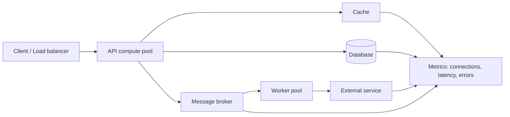

# Phối hợp co giãn compute với giới hạn của dịch vụ phụ thuộc

## 1. Vì sao scale compute có thể làm hệ thống chậm hơn?

Autoscaling giúp tăng hoặc giảm số VM, container, worker hay function instance theo nhu cầu. Khi lưu lượng tăng, thêm compute có thể tăng khả năng nhận request và xử lý song song. Tuy nhiên, compute hiếm khi hoạt động độc lập. Một API có thể cần database, cache, message broker, object storage, dịch vụ xác thực hoặc API bên ngoài. Các dependency này có giới hạn về connection, throughput, concurrency, quota và tốc độ xử lý.

Nếu tăng số instance mà không tính khả năng chịu tải của dependency, hệ thống có thể tạo ra nhiều kết nối database hơn mức cho phép, gửi request vượt rate limit, làm queue hoặc cache quá tải, hoặc tạo retry storm. Khi đó, số máy compute tăng nhưng thời gian phản hồi và tỷ lệ lỗi lại xấu đi. Autoscaler tiếp tục thấy CPU hoặc queue tăng rồi tạo thêm máy, khiến áp lực lên dependency lớn hơn.

Vì vậy, mục tiêu không phải là mở rộng compute tối đa. Mục tiêu là mở rộng toàn bộ luồng xử lý trong giới hạn an toàn của mắt xích có capacity thấp nhất, đồng thời duy trì SLO và kiểm soát chi phí.

Trong module **CLOUD_CORE_SERVICES_COMPUTE**, chủ đề này kết nối nhóm máy và tự động co giãn với lựa chọn CPU, bộ nhớ, mạng, mô hình VM/container/serverless, triển khai ứng dụng, tính sẵn sàng và tối ưu chi phí. Bài học tập trung vào cách phối hợp autoscaling với giới hạn của các dịch vụ phụ thuộc.

Sau bài học, người học có thể:

- Xác định dependency và giới hạn connection, concurrency, throughput, quota của từng thành phần.
- Tính giới hạn replica hoặc worker từ capacity an toàn của database và dịch vụ downstream.
- Chọn tín hiệu autoscaling phản ánh backlog và khả năng xử lý thực tế.
- Dùng backpressure, rate limit, bulkhead, circuit breaker và bounded queue để bảo vệ dependency.
- Thiết kế scale-out, scale-in, cooldown và warm-up có kiểm soát.
- Phối hợp giới hạn cho VM autoscaling group, Kubernetes HPA/KEDA và serverless concurrency.
- Kiểm thử hành vi khi downstream chậm, từ chối kết nối hoặc chạm quota.

## 2. Mô hình capacity của một luồng xử lý

### 2.1. Request đi qua nhiều thành phần

Một request có thể đi qua load balancer, API instance, cache, database và dịch vụ thanh toán. Mỗi thành phần có capacity riêng. Throughput cuối cùng bị giới hạn bởi thành phần không thể xử lý thêm mà không vi phạm latency, error rate hoặc giới hạn vận hành.



Thêm API instance có thể tăng số request đến cache, database và broker. Thêm worker có thể tăng tốc độ lấy message nhưng cũng tăng số kết nối database hoặc request đến external API. Vì vậy, capacity của compute và dependency phải được tính cùng nhau.

### 2.2. Throughput và giới hạn của mắt xích

Gọi:

- \(C_{compute}\): throughput tối đa của compute pool trong điều kiện SLO.
- \(C_1, C_2, \ldots, C_n\): throughput an toàn của các dependency.
- \(C_{network}\): giới hạn throughput của đường mạng hoặc gateway.

Throughput an toàn của luồng xử lý không thể vượt quá giới hạn thấp nhất:

\[
C_{flow} \leq \min(C_{compute}, C_1, C_2, \ldots, C_n, C_{network})
\]

Đây là mô hình đơn giản. Trong hệ thống thực, một request có thể gọi dependency nhiều lần, gọi song song hoặc chỉ gọi dependency trên một nhánh nghiệp vụ. Khi đó cần quy đổi theo số lần gọi và tỷ lệ request đi qua từng nhánh.

Ví dụ, API pool có thể xử lý 8.000 request/giây, nhưng database chỉ đáp ứng an toàn 1.500 query/giây. Nếu mỗi request trung bình tạo 2 query, database chỉ hỗ trợ khoảng 750 request/giây cho luồng đó, trước khi tính các workload khác dùng chung database.

### 2.3. Capacity danh nghĩa và capacity an toàn

Capacity tối đa đo trong benchmark không nhất thiết là capacity nên dùng liên tục. Database có thể đạt throughput cao hơn trong thời gian ngắn nhưng latency tăng mạnh khi CPU, I/O hoặc connection pool gần bão hòa. Dịch vụ ngoài có thể cho phép burst nhưng giới hạn tốc độ trung bình thấp hơn.

Hãy xác định **capacity an toàn** ở mức vẫn đáp ứng SLO, có headroom cho biến động và không làm các workload khác bị ảnh hưởng. Dùng dữ liệu production hoặc load test đại diện để xác định ngưỡng, không chỉ lấy giới hạn lý thuyết trong tài liệu.

### 2.4. Concurrency và throughput không giống nhau

Concurrency là số công việc đang diễn ra cùng lúc; throughput là số công việc hoàn tất trong một đơn vị thời gian. Tăng concurrency có thể tăng throughput khi compute còn nhàn rỗi, nhưng sau khi dependency bão hòa, nó chủ yếu làm tăng thời gian chờ và số request đang giữ tài nguyên.

Theo định luật Little, trong trạng thái ổn định:

\[
L = \lambda W
\]

Trong đó \(L\) là số request trung bình đang ở trong hệ thống, \(\lambda\) là throughput hoàn tất trung bình và \(W\) là thời gian trung bình trong hệ thống. Khi dependency chậm làm \(W\) tăng, số request in-flight tăng ngay cả khi throughput không tăng. Nếu không giới hạn concurrency, pool kết nối, bộ nhớ và thread có thể cạn.

## 3. Lập bản đồ dependency và giới hạn

### 3.1. Liệt kê dependency theo luồng nghiệp vụ

Với mỗi workload, ghi rõ dependency bắt buộc, tùy chọn và có thể suy giảm chức năng khi dependency không sẵn sàng. Một bảng dependency nên bao gồm:

| Thành phần | Giới hạn cần biết | Tín hiệu giám sát |
|---|---|---|
| Database | Max connections, query throughput, CPU, IOPS, transaction rate | Active/idle connections, pool wait, query latency, lock, replication lag |
| Cache | Connection, command rate, memory, eviction, shard capacity | Ops/s, latency, hit ratio, memory, rejected connections |
| Message broker | Producer/consumer throughput, partition, in-flight, storage | Queue depth, oldest message age, consumer lag, publish/ack rate |
| External API | Rate limit, concurrency, quota, timeout | 429/503, latency, remaining quota, retry count |
| Object storage | Request rate, bandwidth, per-prefix/service quota | 4xx/5xx, throttling, bytes/s, request latency |
| NAT/API gateway | Connection, port, request rate, bandwidth | Connection count, port allocation, 5xx, throttling |
| Identity/KMS | API quota, latency, key operation limit | Throttle, access denied, request latency |

Ghi rõ dependency dùng chung với workload khác. Một database có thể phục vụ nhiều API, worker và công cụ báo cáo; capacity còn lại phải trừ nhu cầu của tất cả nhóm này.

### 3.2. Phân loại giới hạn

- **Hard limit:** vượt ngưỡng sẽ bị từ chối hoặc lỗi, ví dụ max connections, quota vCPU hoặc số IP trong subnet.
- **Throughput limit:** tốc độ xử lý tối đa trước khi throttling hoặc latency tăng mạnh.
- **Concurrency limit:** số request hoặc job đồng thời được chấp nhận.
- **Burst limit:** cho phép tăng tốc trong thời gian ngắn nhưng cần thời gian hồi phục hoặc token tích lũy.
- **SLO limit:** mức tải cao nhất vẫn đáp ứng latency/error objective.
- **Operational limit:** ngưỡng đội vận hành chọn thấp hơn giới hạn kỹ thuật để giữ headroom và khả năng xử lý sự cố.

Không nên autoscale đến hard limit. Cần đặt giới hạn vận hành thấp hơn để tránh mọi replica cùng tranh giành tài nguyên khi có biến động.

### 3.3. Xác định quota và phạm vi áp dụng

Quota có thể áp dụng theo project, account, region, zone, database cluster, tenant hoặc API key. Một quota được tăng ở region này không nhất thiết tăng ở region khác. Rate limit có thể áp dụng theo IP, user, credential hoặc organization.

Khi lập kế hoạch, ghi rõ quota là per-instance, per-cluster hay shared. Nếu mỗi API instance được cấp 100 connection nhưng có 20 instance, tổng tiềm năng là 2.000 connection; database có thể chỉ cho phép 500 connection cho toàn ứng dụng.

### 3.4. Tính nhu cầu theo request mix

Không phải request nào cũng dùng dependency giống nhau. Ví dụ, 60% request đọc cache, 30% đọc database và 10% ghi database. Tính số lần gọi trung bình của từng loại request để dự báo tải downstream.

Nếu một API xử lý \(R\) request/giây và mỗi request trung bình tạo \(q\) query đến database, tải query xấp xỉ:

\[
Q_{db} = R \times q
\]

Với nhiều loại request:

\[
Q_{db} = \sum_{i=1}^{k} R_i \times q_i
\]

Trong đó \(R_i\) là tốc độ của loại request thứ \(i\), \(q_i\) là số query trung bình tương ứng. Cần cộng thêm query nền như health check, scheduler, batch và dashboard.

## 4. Tính giới hạn replica từ database connections

### 4.1. Công thức pool connection

Giả sử mỗi compute replica có connection pool tối đa \(P\), số replica là \(N\), và có \(C_{other}\) connection dành cho workload khác. Số connection tối đa ứng dụng có thể mở gần đúng là:

\[
C_{app} = N \times P
\]

Nếu database có giới hạn \(C_{db}\), cần giữ lại dự phòng \(C_{reserve}\) cho quản trị, migration, monitoring và biến động. Khi đó:

\[
N_{max} = \left\lfloor \frac{C_{db} - C_{other} - C_{reserve}}{P} \right\rfloor
\]

Đây là giới hạn theo connection. Database có thể chạm CPU, IOPS hoặc lock contention trước khi dùng hết connection; do đó phải lấy giới hạn nhỏ nhất giữa connection budget và throughput budget.

### 4.2. Ví dụ tính toán

Giả sử database cho phép 600 connection. Các dịch vụ khác sử dụng tối đa 180 connection; đội vận hành giữ lại 60 connection dự phòng. Mỗi API replica có pool tối đa 20 connection.

\[
N_{max} = \left\lfloor \frac{600 - 180 - 60}{20} \right\rfloor = 18
\]

Về mặt connection, API pool không nên vượt quá 18 replica theo giả định này. Nếu autoscaler cho phép 30 replica, lúc scale-out các instance mới có thể không lấy được connection, làm request chờ và timeout.

Trong production, có thể đặt `maxReplicas` thấp hơn 18 để giữ thêm headroom. Nếu pool tạo connection lười, số connection thực tế có thể thấp hơn giới hạn; tuy vậy, capacity plan nên dùng worst-case connection khi tất cả replica hoạt động đồng thời.

### 4.3. Connection pool không phải lúc nào càng lớn càng tốt

Pool quá nhỏ có thể làm request chờ dù database còn capacity. Pool quá lớn có thể làm database chịu quá nhiều session, context switching, memory overhead và lock contention. Cần đo pool wait time, active/idle connection, query latency và throughput.

Một số kiến trúc dùng connection proxy hoặc pooler để multiplex nhiều client connection lên số backend connection nhỏ hơn. Proxy giúp quản lý kết nối hiệu quả nhưng không làm tăng vô hạn khả năng xử lý query của database. Vẫn cần giới hạn concurrency và theo dõi pool phía proxy lẫn database.

### 4.4. Dùng semaphore cho truy vấn đắt

Nếu chỉ một nhóm request tạo query nặng, có thể giới hạn số truy vấn đồng thời bằng semaphore hoặc worker pool riêng. Các request còn lại có thể chờ trong giới hạn, trả lỗi có kiểm soát hoặc chuyển sang xử lý bất đồng bộ.

Giới hạn nên đặt theo dependency và loại tác vụ. Không dùng một pool không giới hạn cho tất cả query; một báo cáo lớn không nên chiếm toàn bộ connection cần cho giao dịch tương tác.

## 5. Phối hợp với rate limit và concurrency của dịch vụ ngoài

### 5.1. Rate limit theo quota

External API có thể giới hạn request/giây, request/phút hoặc quota theo ngày. Khi compute scale-out, tổng request từ tất cả replica tăng. Nếu mỗi replica tự đặt rate limit riêng, tổng tốc độ có thể vượt quota chung.

Ví dụ, API ngoài cho phép 1.000 request/phút. Nếu 10 replica mỗi replica tự cho phép 200 request/phút, tổng giới hạn nội bộ là 2.000 request/phút và vượt quota gấp đôi.

Nên dùng rate limiter phân tán hoặc chia quota có chủ đích cho từng replica. Nếu không có bộ đếm phân tán, có thể phân bổ quota tĩnh theo số replica tối đa, nhưng cần tính lại khi scale và tránh cấp tổng quota vượt mức.

### 5.2. Token bucket và leaky bucket

Token bucket cho phép request tiêu thụ token; token được bổ sung theo tốc độ cấu hình và bucket có dung lượng hữu hạn để hấp thụ burst. Leaky bucket phát request ra theo tốc độ ổn định hơn. Cả hai giúp điều tiết tốc độ đến dependency.

Nếu dịch vụ cho phép 100 request/giây và burst 200 request, token bucket có thể cho phép một burst ngắn nhưng không duy trì tốc độ cao vô hạn. Cần cấu hình bucket theo quota thật, cách nhà cung cấp tính quota và số client cùng dùng credential.

### 5.3. Xử lý HTTP 429 và throttling

Khi dependency trả `429 Too Many Requests` hoặc mã throttling tương đương:

- Tôn trọng `Retry-After` nếu có.
- Giảm tốc độ request hoặc concurrency.
- Dùng exponential backoff có jitter.
- Giới hạn số lần retry và tổng thời gian retry.
- Đưa tác vụ có thể trì hoãn vào queue thay vì retry đồng loạt.
- Theo dõi quota remaining, retry count và tỷ lệ request bị từ chối.

Không retry ngay lập tức trên tất cả replica. Retry đồng thời có thể tạo thundering herd và khiến dịch vụ vừa phục hồi lại bị quá tải.

### 5.4. Concurrency limit

Một dependency có thể giới hạn số request đang chạy cùng lúc dù rate limit theo giây vẫn chưa chạm. Giới hạn concurrency giúp giữ số tác vụ in-flight trong mức dịch vụ có thể xử lý.

Ví dụ, external API chỉ xử lý an toàn 50 request đồng thời. Nếu 20 replica mỗi replica cho phép 10 request đồng thời, tổng có thể lên đến 200. Cần phân phối một ngân sách concurrency chung hoặc đặt giới hạn tổng qua gateway/worker pool.

### 5.5. Tenant fairness

Nếu nhiều tenant dùng chung dependency, một tenant có thể tiêu thụ hết quota. Dùng quota theo tenant, priority queue hoặc weighted fair scheduling để bảo vệ luồng quan trọng. Tuy nhiên, tổng quota theo tenant vẫn phải nằm trong giới hạn chung của dependency.

## 6. Queue-based autoscaling và giới hạn consumer

### 6.1. Queue giúp hấp thụ burst, không tạo thêm capacity downstream

Message queue tách tốc độ nhận việc khỏi tốc độ xử lý. Khi producer tăng đột ngột, queue giữ backlog để consumer xử lý sau. Autoscaler có thể tăng worker theo queue depth hoặc message age.

Nhưng nếu worker gọi database hoặc external API, tăng consumer có thể đẩy downstream vượt giới hạn. Queue chỉ hấp thụ burst trong thời gian lưu trữ và chính sách retention; nó không làm dependency nhanh hơn.

### 6.2. Tính số worker tối đa

Giả sử mỗi worker xử lý tối đa \(r_w\) tác vụ/giây, mỗi tác vụ tạo trung bình \(q\) request đến downstream, và downstream có capacity an toàn \(C_d\) request/giây. Khi đó giới hạn worker theo downstream là:

\[
N_{worker,max} \leq \left\lfloor \frac{C_d}{r_w \times q} \right\rfloor
\]

Ví dụ, mỗi worker hoàn tất 5 tác vụ/giây, mỗi tác vụ gọi external API 2 lần, dịch vụ ngoài cho phép 400 request/giây dành cho workload này. Số worker tối đa theo rate budget là:

\[
N_{worker,max} \leq \frac{400}{5 \times 2} = 40
\]

Nếu có tác vụ khác dùng chung API, phải trừ usage của chúng trước khi tính. Cũng cần xét concurrency limit, latency và quota burst.

### 6.3. Chọn metric scale

Queue depth là số message đang chờ, nhưng không phản ánh tuổi message hoặc tốc độ xử lý. Nên theo dõi:

- Backlog và tuổi message lâu nhất.
- Arrival rate và completion rate.
- Retry, visibility timeout và dead-letter count.
- Số worker healthy và worker concurrency.
- Downstream latency, throttling và connection pool wait.

Nếu queue depth tăng vì downstream throttling, tăng worker có thể làm vấn đề nặng hơn. Trong trường hợp này, autoscaler cần dừng ở `maxReplicas` an toàn hoặc giảm concurrency consumer.

### 6.4. Bounded queue và admission control

Queue không nên tăng vô hạn. Đặt giới hạn dung lượng, retention và chính sách từ chối hoặc điều tiết producer khi backlog vượt khả năng xử lý trong thời hạn nghiệp vụ. Admission control có thể từ chối sớm tác vụ ít ưu tiên, trả `429`/`503` kèm hướng dẫn retry hoặc yêu cầu client gửi lại sau.

Khi đầy queue, cần xác định message nào có thể bị từ chối, message nào phải lưu bền vững và ai chịu trách nhiệm xử lý dead-letter. Không xóa backlog tự động chỉ để giảm metric.

## 7. Autoscaling policy có guardrail

### 7.1. Target tracking và tín hiệu scale

Target tracking điều chỉnh số instance để giữ một metric gần mục tiêu, ví dụ CPU trung bình 60%, request trên mỗi target hoặc số message trên mỗi worker. Cách này phù hợp khi metric phản ánh tải compute và tăng replica giúp tăng throughput.

Nếu CPU thấp nhưng request đang chờ database, scale theo CPU có thể không hoạt động đúng. Nếu queue depth tăng do downstream chậm, scale theo backlog đơn thuần có thể tạo thêm tải không cần thiết.

Nên kết hợp tín hiệu:

- **Scale-out signal:** request rate, queue age, CPU, worker utilization hoặc concurrency đang chờ.
- **Dependency guardrail:** database connection budget, downstream throttling, latency, quota và error rate.
- **Scale-in signal:** backlog ổn định, request rate giảm và dependency còn headroom.

### 7.2. Max replicas phải dựa trên downstream budget

Đặt giới hạn `maxReplicas` từ các ràng buộc thực tế:

\[
N_{max} = \min(N_{compute}, N_{db}, N_{api}, N_{network}, N_{quota})
\]

Trong đó từng giới hạn được tính theo capacity an toàn và phần quota dành cho workload. Đây là guardrail tổng hợp; không nên lấy một giới hạn đơn lẻ như CPU để quyết định max size.

### 7.3. Min replicas và warm capacity

`minReplicas` duy trì capacity nền để đáp ứng tải bình thường, health check và burst đầu tiên. Nếu scale từ 0 hoặc 1 instance, thời gian boot, tải image, khởi tạo JVM/model và warm cache có thể làm request chờ lâu.

Min replicas cũng tiêu tốn chi phí và có thể giữ connection đến database ngay cả khi ít traffic. Khi chọn mức tối thiểu, tính cả connection pool được mở khi idle và tài nguyên nền.

### 7.4. Cooldown, stabilization và warm-up

Scale-out quá nhanh có thể tạo nhiều connection cùng lúc; scale-in quá nhanh có thể làm mất worker đang xử lý. Dùng cooldown, stabilization window hoặc scale policy để tránh dao động. Cấu hình thời gian cần dựa trên thời gian khởi tạo, độ trễ metric và thời gian dependency hồi phục.

Khi scale-out, có thể dùng slow start hoặc readiness để backend mới nhận traffic dần. Khi scale-in, drain request và job trước khi terminate.

### 7.5. Tránh nhiều autoscaler điều khiển cùng một tài nguyên

Nếu HPA, KEDA, cluster autoscaler và cloud instance group cùng tác động, cần hiểu thứ tự và phạm vi mỗi bộ điều khiển. HPA thay đổi replica pod; cluster autoscaler có thể thêm node; instance group cung cấp VM cho node pool. Một bộ điều khiển có thể chờ bộ khác, tạo độ trễ hoặc vòng phản hồi.

Đặt owner cho từng lớp, giới hạn min/max nhất quán và theo dõi event khi scale không thành công. Không để hai hệ thống độc lập liên tục ghi đè số replica hoặc desired capacity của nhau.

## 8. Bảo vệ dependency bằng backpressure và isolation

### 8.1. Backpressure

Backpressure là cách báo ngược cho upstream rằng downstream không thể nhận thêm việc ở tốc độ hiện tại. Thay vì tiếp tục nhận vô hạn, hệ thống có thể giảm tốc độ producer, giới hạn concurrency, tạm dừng consumer hoặc yêu cầu client thử lại sau.

Backpressure giúp ngăn queue, memory và connection tăng không kiểm soát. Cần truyền trạng thái một cách rõ ràng, có timeout và chính sách retry phù hợp để không biến backpressure thành retry storm.

### 8.2. Circuit breaker

Circuit breaker theo dõi lỗi hoặc timeout của dependency. Khi lỗi vượt ngưỡng, breaker mở và chặn request mới trong một khoảng thời gian; sau đó chuyển sang trạng thái half-open để thử một số request giới hạn. Nếu dependency phục hồi, breaker đóng lại.

Circuit breaker giúp tránh lặp request vào dependency đang hỏng. Nó không thay thế timeout, retry budget hoặc rate limit. Ngưỡng mở breaker cần tránh phản ứng quá nhạy với lỗi đơn lẻ.

### 8.3. Bulkhead

Bulkhead tách tài nguyên cho từng dependency hoặc loại tác vụ. Ví dụ, API thanh toán có pool connection riêng với API báo cáo; tác vụ batch không được chiếm hết worker dành cho request tương tác.

Tách pool giúp một dependency chậm không chiếm toàn bộ thread, connection hoặc semaphore. Cần đặt tổng budget của các pool không vượt capacity của compute và dependency.

### 8.4. Timeout và retry budget

Mỗi request nên có deadline tổng thể. Timeout của các lời gọi downstream phải nằm trong deadline đó; không để mỗi lớp tự retry vô hạn. Exponential backoff và jitter giúp phân tán lần thử lại; giới hạn số lần retry và tỷ lệ request được retry.

Chỉ retry thao tác có thể lặp an toàn hoặc có idempotency key. Với thao tác ghi tiền, tạo đơn hàng hoặc gửi thanh toán, retry không kiểm soát có thể tạo tác dụng phụ trùng lặp.

### 8.5. Load shedding và degraded mode

Khi capacity thiếu, có thể từ chối sớm request ít ưu tiên, tắt chức năng tùy chọn hoặc trả dữ liệu cache đã biết là phù hợp. Load shedding giữ tài nguyên cho chức năng cốt lõi. Degraded mode phải được thiết kế và truyền đạt rõ ràng; không được âm thầm trả dữ liệu sai hoặc coi kết quả cũ là mới.

## 9. Cấu hình autoscaling trong Kubernetes

### 9.1. HPA với maxReplicas được tính trước

Ví dụ HPA dùng CPU để scale API:

```yaml
apiVersion: autoscaling/v2
kind: HorizontalPodAutoscaler
metadata:
  name: orders-api
spec:
  scaleTargetRef:
    apiVersion: apps/v1
    kind: Deployment
    name: orders-api
  minReplicas: 3
  maxReplicas: 12
  metrics:
    - type: Resource
      resource:
        name: cpu
        target:
          type: Utilization
          averageUtilization: 60
  behavior:
    scaleUp:
      stabilizationWindowSeconds: 0
      policies:
        - type: Percent
          value: 50
          periodSeconds: 60
    scaleDown:
      stabilizationWindowSeconds: 300
      policies:
        - type: Pods
          value: 2
          periodSeconds: 60
```

`maxReplicas: 12` trong ví dụ phải được xác định sau khi tính database connection budget, downstream rate limit, network và quota. Đây không phải con số mặc định an toàn. CPU target chỉ là tín hiệu scale; cần bổ sung dashboard/alert cho database pool wait, query latency và downstream throttling.

HPA resource utilization phụ thuộc requests được khai báo. Nếu container không có CPU request phù hợp, utilization có thể không được tính như mong đợi. Cần kiểm tra Metrics Server hoặc custom metrics adapter.

### 9.2. KEDA hoặc metric queue

Với worker queue, có thể scale theo backlog hoặc message age. Một cấu hình KEDA minh họa:

```yaml
apiVersion: keda.sh/v1alpha1
kind: ScaledObject
metadata:
  name: invoice-worker
spec:
  scaleTargetRef:
    name: invoice-worker
  minReplicaCount: 2
  maxReplicaCount: 20
  pollingInterval: 15
  cooldownPeriod: 180
  triggers:
    - type: prometheus
      metadata:
        serverAddress: http://prometheus.monitoring.svc:9090
        metricName: invoice_queue_messages_ready
        query: sum(invoice_queue_messages_ready)
        threshold: "100"
```

Đây là cấu hình minh họa, cần adapter/trigger phù hợp và metric thực tế. `maxReplicaCount: 20` chỉ hợp lý nếu downstream budget cho phép. Nếu mỗi worker dùng 10 database connections và database chỉ dành 100 connections cho worker, giới hạn worker theo connection có thể chỉ là 10 trước khi tính các giới hạn khác.

Khi downstream trả throttling hoặc latency tăng, cần giảm concurrency hoặc dừng scale-out ở mức an toàn; queue backlog có thể cần chờ xử lý thay vì tiếp tục tăng worker.

### 9.3. Resource request/limit và node autoscaling

HPA tăng pod replica nhưng pod chỉ chạy được khi node có CPU/RAM phù hợp. Cluster autoscaler có thể thêm node, nhưng node mới cũng cần quota cloud, IP subnet, image pull và thời gian boot. Tính tổng capacity qua cả ba lớp: pod, node pool và cloud quota.

Không chỉ đặt max pod theo downstream; còn cần giới hạn tổng CPU/RAM, GPU, network và chi phí. Nếu node scale-out không kịp, pod Pending có thể tăng dù HPA đã tăng replica.

## 10. VM instance group và autoscaling

### 10.1. Desired capacity và giới hạn nhóm máy

Instance group thường duy trì số VM theo desired capacity trong phạm vi min/max size. Policy có thể dựa trên CPU, request count, queue hoặc lịch. Max size phải tính từ capacity downstream và quota instance, không chỉ từ khả năng tạo VM.

Nếu mỗi VM có pool 30 connection và database chỉ dành 300 connection cho dịch vụ, giới hạn theo connection là 10 VM. Có thể chọn max size thấp hơn để giữ headroom và dành connection cho tác vụ quản trị.

### 10.2. Launch template và cấu hình pool

Launch template/image nên chứa cấu hình pool connection, timeout, retry, concurrency và telemetry nhất quán. Nếu mỗi lần scale-out tạo VM với pool mặc định quá lớn, tổng connection có thể vượt database limit ngay cả khi max size đã được tính đúng.

Ưu tiên cấu hình được quản lý tập trung, kiểm thử trên canary và có thể thay đổi an toàn. Không đưa secret cố định vào image; dùng cơ chế cấp credential phù hợp khi instance khởi tạo.

### 10.3. Warm pool và lifecycle hook

Warm pool có thể giảm thời gian chờ khi cần VM mới, nhưng VM warm vẫn có thể mở connection hoặc chạy agent nền. Đảm bảo instance chưa được đưa vào service pool trước khi readiness đạt. Lifecycle hook có thể hỗ trợ drain trước khi terminate, nhưng cần timeout và xử lý khi hook thất bại.

### 10.4. Scale-in protection và termination policy

Khi scale-in, tránh terminate VM đang xử lý job dài hoặc giữ vai trò quan trọng. Có thể dùng scale-in protection, lifecycle hook, connection draining hoặc scheduler để chuyển workload. Với worker queue, ngừng nhận message mới, chờ xử lý xong hoặc trả message về queue an toàn.

Không để protection bật vĩnh viễn khiến nhóm không thể giảm size. Theo dõi instance bị bảo vệ, lý do và thời gian; có quy trình gỡ protection sau khi workload hoàn tất.

## 11. Serverless concurrency và downstream budget

### 11.1. Concurrency có thể tăng rất nhanh

Serverless platform có thể tạo nhiều execution environment theo tốc độ invocation. Nếu function gọi database trực tiếp, burst invocation có thể mở nhiều connection trong thời gian ngắn. Một function có concurrency 1.000 không có nghĩa database có thể chịu 1.000 session hoặc query đồng thời.

### 11.2. Reserved concurrency và giới hạn tổng

Reserved concurrency có thể giới hạn hoặc dành riêng concurrency cho function tùy nền tảng. Đặt giới hạn dựa trên downstream budget và nhu cầu các function khác dùng chung database/API. Provisioned concurrency chủ yếu giữ sẵn execution environment để giảm cold start; nó không tự tăng capacity của database.

Nếu nhiều function dùng chung dependency, tổng concurrency của chúng phải nằm trong budget chung. Cần tính concurrency theo account, function, alias và các workload khác.

### 11.3. Connection reuse và proxy

Tái sử dụng connection trong execution environment có thể giảm chi phí thiết lập kết nối, nhưng môi trường serverless có thể scale nhanh hoặc bị thu hồi. Không giả định connection luôn tồn tại. Connection proxy có thể giúp quản lý số backend connection; vẫn phải đặt concurrency và query rate an toàn.

### 11.4. Async invocation và queue

Đưa tác vụ vào queue có thể làm phẳng burst và cho phép giới hạn consumer concurrency. Cần thiết kế retry, idempotency, DLQ, message age và visibility timeout. Nếu downstream đang throttling, giảm consumer concurrency hoặc tăng delay; đừng tăng concurrency chỉ để giảm queue depth trong ngắn hạn.

## 12. Scale-in an toàn và phục hồi dependency

### 12.1. Scale-in không nên làm mất việc đang xử lý

Trước khi terminate compute:

1. Ngừng nhận request hoặc message mới.
2. Chờ request/job đang chạy hoàn tất trong thời hạn cho phép.
3. Lưu checkpoint hoặc trả message về queue theo semantics.
4. Đóng connection và flush log/metric cần thiết.
5. Xác nhận load balancer đã deregister backend.
6. Terminate instance/pod theo lifecycle policy.

Với tác vụ dài hơn thời gian drain, cần checkpoint, requeue hoặc scale-in protection có thời hạn. Không giữ compute vô hạn chỉ vì một job không hoàn tất; cần timeout và quy trình xử lý job bị kẹt.

### 12.2. Không scale-out ngay khi dependency chậm

Khi database latency tăng, API request có thể chờ lâu và số in-flight tăng. Autoscaler dựa trên request count hoặc CPU có thể tăng replica, làm tổng connection và query tăng. Trước khi scale-out, kiểm tra downstream saturation.

Trong trạng thái dependency bão hòa, hành động đúng có thể là giảm concurrency, bật circuit breaker, trả lỗi có kiểm soát hoặc chuyển tác vụ sang queue. Sau khi dependency phục hồi và headroom được xác nhận, mới tăng compute dần.

### 12.3. Phục hồi theo từng giai đoạn

Sau một outage downstream, không nên cho tất cả worker reconnect hoặc retry đồng thời. Dùng exponential backoff, jitter, token bucket và ramp-up concurrency. Có thể mở circuit breaker half-open với một số request thử nhỏ trước khi tăng dần tải.

## 13. Giám sát autoscaling và dependency cùng nhau

### 13.1. Metric compute

- Desired, current, pending và healthy replica/instance.
- CPU, memory, throttling và network utilization.
- Startup duration, readiness time và failed launch.
- Pod Pending, node capacity, quota rejection và scale event.
- Request rate, in-flight concurrency và queue backlog.

### 13.2. Metric dependency

- Database active/idle connections, pool wait, query latency, CPU và IOPS.
- Cache ops/s, latency, hit ratio, memory và eviction.
- Broker publish/consume rate, oldest message age và consumer lag.
- External API 429/5xx, latency, quota remaining và retry rate.
- NAT connection/port, gateway throttling, DNS latency và network errors.
- Object storage request rate, throttling và throughput.

### 13.3. Metric chi phí

Theo dõi compute hours, instance type, GPU hours, serverless invocation/concurrency, storage growth, egress và chi phí trên đơn vị công việc. Một autoscaler có thể giữ dịch vụ trong SLO nhưng tạo quá nhiều instance vì target quá thấp hoặc cooldown không phù hợp.

### 13.4. Cảnh báo cần kết hợp

Ví dụ, không chỉ cảnh báo “replica tăng trên 15”. Nên kết hợp:

- Replica tăng nhanh.
- Database connection usage gần budget.
- Pool wait hoặc query latency tăng.
- Error rate hoặc timeout tăng.

Tổ hợp này cho biết autoscaling đang tiến gần giới hạn downstream. Cảnh báo nên chỉ ra owner và runbook điều chỉnh concurrency/max replicas.

## 14. Kiểm thử và diễn tập capacity

### 14.1. Load test theo dependency

Load test cần mô phỏng request mix thật và các dependency tương ứng. Tăng tải theo từng nấc, đo throughput, latency, connection, throttling và error. Không chỉ kiểm tra compute có scale lên được hay không; phải xác định thời điểm dependency bắt đầu bão hòa.

### 14.2. Failure injection

Trong môi trường an toàn, thử:

- Database tăng latency hoặc từ chối connection.
- External API trả 429 và 503.
- Cache mất kết nối hoặc giảm hit ratio.
- Queue consumer chậm và backlog tăng.
- Quota cloud không đủ để tạo thêm node.
- Một zone hoặc một node pool mất capacity.
- Autoscaler metric bị trễ hoặc không có dữ liệu.

Quan sát autoscaler có dừng ở max replica an toàn không, backpressure có hoạt động không, retry có được giới hạn không và người trực có nhận đúng cảnh báo không.

### 14.3. Xác định điểm bão hòa và safe operating range

Vẽ throughput và latency theo mức concurrency. Điểm mà latency tăng nhanh nhưng throughput gần như không tăng thường cho thấy đã chạm vùng bão hòa. Đặt operating target thấp hơn điểm này để giữ headroom.

Thực hiện test cả scale-out lẫn scale-in. Scale-in có thể gây lỗi do drain sai, connection reset, queue re-delivery hoặc mất checkpoint; đây cũng là một phần của capacity validation.

## 15. Ví dụ thực tế

### Ví dụ 1: API scale-out làm database hết connection

Một API chạy trên VM instance group. Mỗi VM có connection pool tối đa 25. Database có 500 connection, trong đó 150 dành cho workload khác và 50 dự phòng. Capacity còn cho API là 300 connection, tương đương 12 VM theo worst-case pool.

**Vấn đề:** autoscaling cho phép tối đa 30 VM theo CPU. Khi traffic tăng, 20 VM mới khởi động và tạo connection; database hết connection, request chờ và timeout. CPU API vẫn cao nên autoscaler tiếp tục tăng.

**Thiết kế lại:** đặt max instance thấp hơn hoặc bằng 12 theo connection budget; kiểm tra query throughput để xác định giới hạn thấp hơn nếu cần; giảm pool size nếu workload phù hợp; thêm connection proxy khi có lợi; cảnh báo pool wait và database saturation. Scale theo request/CPU chỉ trong khi dependency còn headroom.

### Ví dụ 2: Worker queue scale quá mức khi external API throttling

Một worker xử lý hóa đơn gọi dịch vụ ngoài hai lần cho mỗi message. External API cấp quota 600 request/phút. KEDA scale worker theo backlog lên đến 50 replica, mỗi replica có thể xử lý 4 message/giây.

**Vấn đề:** tốc độ gọi lý thuyết có thể lên đến 50 × 4 × 2 = 400 request/giây, vượt xa quota khoảng 10 request/giây. External API trả 429; worker retry ngay, làm backlog và retry tăng.

**Thiết kế lại:** giới hạn tổng consumer throughput theo quota, dùng token bucket phân tán, bounded retry với jitter và DLQ; đặt max worker theo rate budget; theo dõi oldest message age và 429. Nếu backlog tăng do quota, giữ số worker trong giới hạn và thông báo thời gian xử lý dự kiến.

### Ví dụ 3: Serverless burst làm cạn database pool

Một function xử lý sự kiện có thể đạt concurrency 800. Mỗi execution environment mở một connection đến database. Database chỉ dành 200 connection cho function này.

**Vấn đề:** burst sự kiện tạo nhiều environment và connection trong thời gian ngắn. Database từ chối connection, function timeout rồi retry; lượng invocation tăng thêm.

**Thiết kế lại:** đặt reserved concurrency trong budget, dùng queue để hấp thụ burst, tái sử dụng connection và proxy nếu phù hợp, giới hạn query concurrency và cấu hình retry/backoff. Kiểm thử cả cold start lẫn reconnect storm.

### Ví dụ 4: Scale-out node pool bị chặn bởi quota và IP

HPA tăng pod nhưng nhiều pod Pending. Cluster autoscaler yêu cầu VM mới, nhưng quota vCPU region đã gần hết và subnet node chỉ còn ít IP.

**Vấn đề:** compute policy nhìn thấy backlog nhưng không biết node pool không thể mở rộng. Queue age tăng và request timeout.

**Thiết kế lại:** theo dõi quota và IP headroom; đặt cảnh báo trước khi chạm giới hạn; giới hạn HPA max theo capacity có thể cấp; chuẩn bị subnet/region thay thế đã kiểm thử; dùng admission control để giữ workload ưu tiên.

## 16. Những sai lầm thường gặp

- **Chỉ nhìn CPU khi scale:** bỏ qua database, cache, queue và external API.
- **Đặt maxReplicas theo quota compute:** không tính connection, rate limit hoặc concurrency của dependency.
- **Mỗi replica tự dùng hết quota:** tổng giới hạn cục bộ vượt quota chung.
- **Tăng connection pool để xử lý chờ:** có thể làm database bão hòa hơn.
- **Scale worker chỉ theo queue depth:** backlog do downstream throttling không được giải quyết bằng thêm worker.
- **Retry ngay khi nhận 429/503:** tạo retry storm và thundering herd.
- **Không giới hạn concurrency:** số request in-flight tăng, giữ thread, memory và connection.
- **Scale-in không drain:** request/job đang xử lý bị ngắt hoặc message bị xử lý trùng.
- **Không tính shared dependency:** một workload chiếm capacity của workload khác.
- **Bỏ qua quota/IP/network:** autoscaler tăng desired capacity nhưng không tạo được tài nguyên thật.
- **Không có headroom:** hệ thống chạy sát giới hạn và không chịu được node failure hoặc burst.
- **Không diễn tập downstream outage:** autoscaling có thể làm sự cố nặng hơn khi dependency chậm.

## 17. Checklist triển khai

### Trước khi bật autoscaling

- [ ] Đã vẽ luồng request/job và liệt kê dependency bắt buộc/tùy chọn.
- [ ] Đã xác định hard limit, throughput, concurrency, burst và quota theo phạm vi.
- [ ] Đã đo capacity an toàn của dependency theo SLO.
- [ ] Đã tính max replicas/worker từ connection, rate, concurrency và network budget.
- [ ] Đã trừ nhu cầu của workload khác và giữ reserve/headroom.
- [ ] Đã chọn metric scale phản ánh tải thực tế, không chỉ CPU.
- [ ] Đã cấu hình min/max, cooldown, warm-up và stabilization.

### Khi workload hoạt động

- [ ] Theo dõi compute capacity cùng downstream latency, connection và throttling.
- [ ] Có backpressure, rate limit hoặc concurrency limit phù hợp.
- [ ] Retry có giới hạn, backoff, jitter và idempotency.
- [ ] Queue có capacity, retention, DLQ và admission policy.
- [ ] Scale-out không tạo connection storm hoặc vượt quota.
- [ ] Scale-in có drain, checkpoint hoặc requeue an toàn.
- [ ] Có cảnh báo khi autoscaler đạt max nhưng backlog/SLO vẫn xấu.

### Kiểm thử và quản trị

- [ ] Đã load test theo request mix thật và đo điểm bão hòa downstream.
- [ ] Đã thử database chậm, 429, quota exhausted và node capacity shortage.
- [ ] Đã kiểm tra hành vi retry, circuit breaker và recovery ramp-up.
- [ ] Đã gắn owner, dashboard và runbook cho guardrail.
- [ ] Đã theo dõi cost per request/job và tài nguyên nhàn rỗi.
- [ ] Định kỳ rà soát lại budget khi traffic, schema, pool size hoặc quota thay đổi.

## 18. Kết luận

Autoscaling compute chỉ cải thiện hệ thống khi các dịch vụ phụ thuộc có thể xử lý tải phát sinh. Hãy lập bản đồ dependency, đo capacity an toàn và tính giới hạn replica từ connection, throughput, concurrency, rate limit, network và quota. Dùng max replicas làm guardrail, chọn metric scale phản ánh đúng bottleneck và duy trì headroom.

Backpressure, rate limiting, bulkhead, circuit breaker, bounded queue và retry budget bảo vệ dependency khi tải tăng hoặc dịch vụ suy giảm. Scale-in cần drain và bảo toàn công việc đang chạy; sau outage cần ramp-up từ từ để tránh reconnect storm. Khi compute và dependency được giám sát, kiểm thử và điều khiển như một luồng thống nhất, autoscaling mới giúp tăng khả năng phục vụ mà vẫn giữ SLO và chi phí trong giới hạn.
