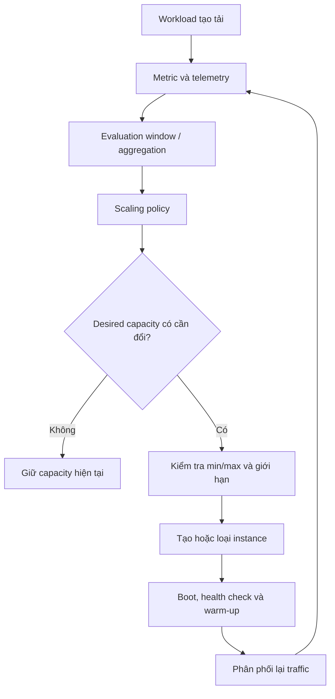
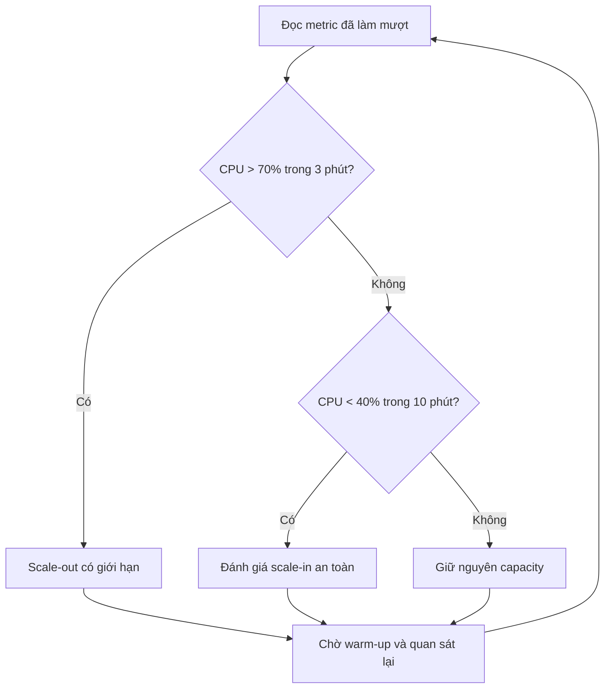

# Phát hiện dao động co giãn và kiểm thử chính sách dưới tải biến động

## Mục tiêu học tập

Sau bài học, bạn có thể:

- Nhận diện hiện tượng autoscaling dao động (scaling oscillation hoặc flapping) khi nhóm VM liên tục tăng rồi giảm số lượng instance.
- Phân biệt dao động do ngưỡng, metric nhiễu, thời gian khởi động, cooldown, warm-up và tải biến động thực tế.
- Đọc metric của workload và nhóm máy để xác định vì sao chính sách co giãn phản ứng quá mức hoặc quá chậm.
- Thiết kế scale-out và scale-in có ngưỡng, thời gian duy trì và bước điều chỉnh phù hợp.
- Lập kế hoạch kiểm thử chính sách autoscaling với tải tăng, giảm, đột biến, theo chu kỳ và nhiều giai đoạn.
- Đánh giá chất lượng chính sách qua latency, error rate, capacity, số lần thay đổi instance, thời gian đáp ứng và chi phí.
- Điều chỉnh chính sách dựa trên bằng chứng và triển khai thay đổi theo từng bước có thể kiểm soát.

## 1. Autoscaling và hiện tượng dao động

Autoscaling tự động thay đổi số lượng hoặc công suất instance để đáp ứng nhu cầu của workload. Khi tải tăng, nhóm máy cần thêm capacity; khi tải giảm, nhóm có thể loại bớt instance để tiết kiệm chi phí. Bộ điều khiển autoscaling quan sát metric hoặc lịch, so sánh với policy rồi yêu cầu tạo hoặc loại VM.

Trong thực tế, tải không tăng giảm đều đặn. Request có thể đến theo burst, batch job chạy theo lịch, cache có thể bị cold start, một số instance mới cần thời gian boot và warm-up. Metric cũng có độ trễ, nhiễu và dao động tự nhiên. Nếu policy phản ứng quá nhạy hoặc không xét thời gian trễ của hệ thống, nhóm máy có thể liên tục tăng rồi giảm capacity.

**Scaling oscillation** là hiện tượng quyết định co giãn lặp đi lặp lại quanh một vùng tải. Ví dụ:

- CPU vượt ngưỡng nên autoscaler thêm hai VM.
- VM mới khởi động, traffic được phân phối lại và CPU trung bình giảm.
- Chính sách scale-in thấy CPU thấp nên loại bớt VM.
- Tải trên các VM còn lại tăng trở lại, CPU vượt ngưỡng và scale-out tiếp tục.
- Chu kỳ lặp lại dù tổng nhu cầu thực tế gần như không đổi.

Hiện tượng này thường được gọi là flapping khi trạng thái hoặc số lượng instance chuyển qua lại thường xuyên. Nó có thể làm tăng chi phí, gây gián đoạn kết nối, tạo tải cho control plane, làm cache liên tục lạnh và khiến ứng dụng khó ổn định.

Không phải mọi thay đổi số lượng instance đều là dao động xấu. Nếu tải thực sự tăng giảm theo chu kỳ, autoscaling thay đổi capacity là hành vi mong muốn. Cần phân biệt phản ứng hợp lý với việc policy liên tục đảo chiều do metric, ngưỡng hoặc thời gian điều khiển chưa phù hợp.

### Ví dụ chu kỳ dao động

| Thời điểm | CPU trung bình | Desired capacity | Hành động |
|---|---:|---:|---|
| 10:00 | 78% | 4 | Scale-out lên 6 |
| 10:04 | 42% | 6 | Tải chia đều, CPU giảm |
| 10:07 | 31% | 6 | Scale-in xuống 4 |
| 10:11 | 76% | 4 | Scale-out lên 6 |
| 10:15 | 40% | 6 | Chu kỳ bắt đầu lặp lại |

Bảng minh họa một policy có phản ứng quá nhanh với CPU trung bình. Để kết luận, cần xem tải request, latency, số request trên mỗi instance, thời gian khởi động và metric của từng máy. CPU giảm sau scale-out có thể là dấu hiệu hệ thống đã đáp ứng tải, nhưng cũng có thể do traffic chưa chuyển tới VM mới hoặc metric đang tính trên một cửa sổ ngắn.

## 2. Bộ điều khiển autoscaling hoạt động như thế nào?

Một bộ điều khiển autoscaling thường có các thành phần:

1. **Metric hoặc lịch:** dữ liệu CPU, request rate, queue depth, latency, số kết nối hoặc lịch tải dự kiến.
2. **Evaluation window:** khoảng thời gian và cách tổng hợp dữ liệu dùng để đánh giá policy.
3. **Scaling policy:** điều kiện và mức thay đổi desired capacity.
4. **Capacity bounds:** min, max và giới hạn số instance được phép chạy.
5. **Cooldown/stabilization:** cơ chế hạn chế thay đổi liên tiếp hoặc trì hoãn quyết định ngược chiều.
6. **Instance lifecycle:** tạo, boot, health check, warm-up, nhận traffic, drain và terminate.
7. **Feedback:** metric sau khi thay đổi được thu thập để bộ điều khiển đánh giá lại.

Sơ đồ khái niệm:



Đây là vòng phản hồi (feedback loop). Một thay đổi capacity tác động lên metric, rồi metric lại ảnh hưởng quyết định kế tiếp. Nếu bộ điều khiển không tính đến độ trễ và tác động của chính hành động vừa thực hiện, nó có thể phản ứng quá mức.

### 2.1. Độ trễ trong vòng điều khiển

Từ lúc tải tăng đến lúc VM mới thực sự giảm tải cho các máy hiện tại có thể trải qua nhiều giai đoạn:

- Metric được thu thập và gửi về hệ thống monitoring.
- Hệ thống đợi đủ datapoint trong evaluation window.
- Autoscaler đánh giá policy và cập nhật desired capacity.
- Control plane cấp phát VM.
- VM boot, chạy cloud-init hoặc startup script.
- Ứng dụng nạp cấu hình, kết nối dependency và warm cache.
- Health check đạt và load balancer bắt đầu gửi traffic.

Nếu toàn bộ quá trình mất vài phút, policy không nên giả định capacity mới xuất hiện ngay sau lệnh scale-out. Nếu metric tiếp tục cao trong thời gian VM boot, autoscaler có thể gửi thêm yêu cầu tạo máy, dẫn đến scale-out quá mức.

### 2.2. Desired, current và healthy capacity

Cần phân biệt ba khái niệm:

- **Desired capacity:** số instance mà autoscaler muốn nhóm có.
- **Current capacity:** số instance đang tồn tại hoặc đang ở trạng thái được nền tảng tính là một phần của nhóm.
- **Healthy/serving capacity:** số instance đã sẵn sàng nhận tải và thực sự phục vụ được.

Trong lúc scale-out, desired có thể là 8, current là 6 vì hai VM đang boot, còn serving capacity vẫn chỉ là 6. Nếu policy chỉ nhìn desired hoặc current mà không xét serving capacity, hệ thống có thể đánh giá sai mức tải còn lại trên các máy đang phục vụ.

Tương tự, khi scale-in, một VM có thể đã được chọn để loại nhưng vẫn đang drain kết nối. Không nên coi capacity đó đã biến mất khỏi tải cho tới khi traffic được chuyển đi và quá trình kết thúc theo thiết kế.

## 3. Nguyên nhân phổ biến gây scaling oscillation

### 3.1. Ngưỡng scale-out và scale-in quá gần nhau

Nếu scale-out khi CPU lớn hơn 60% và scale-in khi CPU nhỏ hơn 60%, metric dao động quanh 60% có thể làm policy đổi chiều liên tục. Đây là hiện tượng thiếu hysteresis.

Ví dụ, CPU lần lượt là 59%, 61%, 58%, 62%. Bộ điều khiển có thể liên tục tạo rồi loại máy nếu mỗi datapoint lập tức kích hoạt hành động.

Giải pháp thường dùng là đặt hai ngưỡng khác nhau, thêm thời gian duy trì và giới hạn mức thay đổi. Ví dụ, scale-out khi CPU vượt 70% trong một khoảng thời gian, nhưng chỉ scale-in khi CPU thấp hơn 40% trong thời gian dài hơn. Các con số cần được hiệu chỉnh theo workload.

### 3.2. Metric quá nhiễu hoặc không đại diện cho nhu cầu

CPU có thể tăng ngắn do garbage collection, backup, cron job hoặc tác vụ khởi động. Một spike 30 giây không nhất thiết cần thêm VM. Ngược lại, CPU trung bình có thể thấp dù một số instance đã bão hòa hoặc một request path có latency cao.

Một metric không đại diện cho nhu cầu có thể dẫn tới quyết định sai:

- CPU trung bình che khuất một instance nóng.
- Request count tổng không phản ánh độ nặng khác nhau giữa request.
- Network bytes không phản ánh số request cần xử lý.
- Queue depth có thể tăng vì consumer bị lỗi thay vì thiếu instance.
- Latency có thể tăng do database chậm dù compute còn dư.
- Metric của instance mới chưa có datapoint khiến phép tổng hợp sai lệch.

Chọn metric gần với mục tiêu phục vụ người dùng hoặc giới hạn tài nguyên thực sự của workload.

### 3.3. Evaluation window quá ngắn

Cửa sổ đánh giá ngắn làm policy phản ứng với biến động nhất thời. Cửa sổ quá dài lại khiến hệ thống phản ứng chậm khi tải tăng đột ngột.

Cần chọn khoảng thời gian theo đặc điểm tải và thời gian đáp ứng của hệ thống. Với workload có burst ngắn, có thể dùng queue depth hoặc request rate kết hợp với thời gian duy trì. Với tải đều, CPU hoặc request trên mỗi instance được làm mượt có thể hữu ích.

### 3.4. Cooldown và stabilization không phù hợp

Cooldown là khoảng thời gian policy hạn chế hoặc trì hoãn hành động tiếp theo sau một lần scale. Stabilization window thường dùng để tránh quyết định ngược chiều quá sớm, đặc biệt khi scale-in.

Nếu cooldown quá ngắn, autoscaler có thể tiếp tục điều chỉnh trong khi VM mới chưa sẵn sàng. Nếu quá dài, hệ thống có thể thiếu capacity sau khi tải tăng thêm.

Tên gọi và cách thực thi khác nhau giữa nhà cung cấp. Một số policy có cooldown theo hướng scale-out/scale-in; một số dùng stabilization window hoặc instance warm-up. Không nên giả định các cơ chế này có cùng ngữ nghĩa.

### 3.5. Warm-up của instance chưa được tính

VM mới có thể mất thời gian boot và khởi động ứng dụng. Trong thời gian này, nó chưa đóng góp đầy đủ vào serving capacity. Nếu autoscaler tính VM mới như một đơn vị capacity hoàn chỉnh ngay khi state chuyển sang Running, quyết định scale tiếp theo có thể sai.

Cần xác định khi nào instance được tính là capacity hữu dụng:

- VM đã boot xong?
- Agent monitoring đã gửi metric?
- Ứng dụng đã nạp model/cache?
- Readiness check đã đạt?
- Load balancer đã bắt đầu phân phối traffic?
- Instance đã qua giai đoạn warm-up để metric ổn định?

### 3.6. Scale-in quá nhạy

Scale-in có thể làm CPU trên các máy còn lại tăng ngay lập tức. Nếu policy không xét tải sau khi loại một máy, nhóm có thể quay lại scale-out. Scale-in cũng có thể tạo thêm biến động do cache cold, connection reconnect, session migration hoặc job bị chuyển.

Thông thường nên thận trọng hơn với scale-in: ngưỡng thấp hơn, thời gian duy trì dài hơn và mức giảm nhỏ hơn. Tuy nhiên, với workload stateless và có khả năng thay thế nhanh, scale-in có thể linh hoạt hơn sau khi kiểm thử.

### 3.7. Nhiều policy cùng điều khiển một nhóm

Nếu nhiều policy cùng thay đổi desired capacity, hành vi tổng hợp có thể khó dự đoán. Ví dụ:

- CPU policy scale-out.
- Request-count policy scale-in.
- Scheduled action đặt capacity về một giá trị cố định.
- Một automation bên ngoài cập nhật desired capacity.
- Operator thay đổi min/max trong lúc test.

Cần xác định policy nào có quyền quyết định cuối cùng, cách nền tảng kết hợp các policy và thứ tự ưu tiên. Tránh để hai bộ điều khiển độc lập cùng ghi vào desired capacity mà không có cơ chế phối hợp.

### 3.8. Tải thay đổi do chính autoscaling tạo ra

Scale-out có thể làm tăng traffic tới dependency, cache miss, kết nối database hoặc số consumer đồng thời. Khi thêm VM, tổng connection pool tới database có thể tăng đột ngột và làm database quá tải. Ứng dụng chậm lại, autoscaler lại thêm VM, khiến sự cố nặng hơn.

Đây là một vòng phản hồi giữa compute và dependency. Autoscaling compute cần đi cùng giới hạn connection, queue, rate limit và capacity plan cho database, cache, network và các dịch vụ phụ thuộc.

## 4. Hysteresis: tạo khoảng cách giữa ngưỡng tăng và giảm

Hysteresis là cách dùng ngưỡng khác nhau cho hai hướng điều khiển để tránh đổi chiều liên tục quanh một điểm.

Ví dụ:

- Scale-out nếu CPU trung bình trên 70% trong 3 phút.
- Scale-in nếu CPU dưới 40% liên tục 10 phút.
- Trong khoảng 40% đến 70%, giữ capacity hiện tại.

Khoảng giữa hai ngưỡng là vùng ổn định (deadband). Metric có dao động nhỏ trong vùng này sẽ không làm nhóm máy đổi số lượng.



Hysteresis không tự giải quyết mọi nguyên nhân. Nếu metric bị sai, instance warm-up quá dài hoặc tải có chu kỳ lớn, nhóm vẫn có thể dao động. Cần kết hợp hysteresis với cửa sổ đánh giá, giới hạn thay đổi và kiểm thử.

### 4.1. Chọn khoảng hysteresis

Không nên chọn ngưỡng chỉ theo cảm tính. Hãy:

1. Thu thập lịch sử metric trong điều kiện bình thường và tải cao.
2. Xác định vùng metric mà ứng dụng vẫn đạt SLO.
3. Xác định mức tải bắt đầu làm latency hoặc error rate tăng.
4. Đặt scale-out trước khi hệ thống chạm vùng không an toàn.
5. Đặt scale-in thấp hơn và chỉ sau khi tải thấp ổn định.
6. Mô phỏng metric nhiễu quanh các ngưỡng để xem policy có đổi chiều không.

Nếu CPU mục tiêu 60% nhưng latency bắt đầu tăng ở 65%, scale-out cần kích hoạt trước khi vượt vùng đó. Nếu CPU thường dao động 35–55% trong điều kiện bình thường, scale-in threshold có thể thấp hơn vùng này hoặc dùng metric khác.

### 4.2. Scale-out và scale-in không cần đối xứng

Scale-out và scale-in phục vụ hai mục tiêu khác nhau:

- Scale-out ưu tiên giữ SLO khi tải tăng.
- Scale-in ưu tiên tiết kiệm chi phí nhưng phải giữ đủ capacity và tránh gián đoạn.

Do đó, có thể dùng thời gian phản ứng ngắn hơn cho scale-out và thời gian ổn định dài hơn cho scale-in. Đây là lựa chọn phổ biến, nhưng cần cân bằng với chi phí và khả năng khởi động VM.

## 5. Chọn metric phù hợp cho autoscaling

CPU là metric dễ dùng nhưng không phù hợp cho mọi workload. Một policy tốt thường dùng metric có quan hệ trực tiếp với mức tải hoặc khả năng phục vụ.

| Loại workload | Metric có thể phù hợp | Điều cần lưu ý |
|---|---|---|
| Web/API stateless | Request/second trên mỗi instance, active request, CPU, latency | Request khác nhau về chi phí; latency còn phụ thuộc dependency |
| Worker queue | Queue depth trên mỗi worker, oldest message age, processing rate | Queue tăng có thể do worker lỗi hoặc producer burst |
| Batch processing | Số job pending, thời gian hoàn tất dự kiến, worker utilization | Job có thời gian xử lý khác nhau |
| Stream processing | Consumer lag, partition assignment, processing throughput | Số partition có thể giới hạn số worker hữu dụng |
| Memory-heavy service | Memory pressure, working set, swap/OOM | RAM thường không giảm ngay khi request giảm |
| Network-heavy service | Network throughput trên mỗi instance, packet rate | Có giới hạn NIC và băng thông của instance |
| GPU workload | GPU utilization, pending inference/job, accelerator memory | GPU metric và thời gian khởi tạo model cần được tính đến |

### 5.1. Metric trên mỗi instance

Với workload phân phối đều, request rate trên mỗi instance có thể phản ánh nhu cầu tốt hơn tổng request rate.

Ví dụ, nếu một instance xử lý ổn định khoảng 200 request/giây trong khi giữ p95 latency dưới SLO, nhóm 5 instance có capacity lý thuyết khoảng 1.000 request/giây. Cần đo thực tế vì request có thể không đồng đều, cache có thể bị lạnh và dependency có thể trở thành bottleneck.

Một metric như backlog trên mỗi worker cũng hữu ích hơn tổng queue depth nếu số worker thay đổi theo autoscaling.

### 5.2. Metric mục tiêu và target tracking

Target tracking là kiểu policy cố giữ một metric quanh giá trị mục tiêu. Ví dụ, autoscaler điều chỉnh số instance để CPU trung bình ở gần 55% hoặc request trên mỗi instance ở gần một mức đã chọn.

Cần lưu ý:

- Metric phải thay đổi theo capacity theo cách bộ điều khiển có thể diễn giải.
- Metric phải được thu thập liên tục và có độ trễ chấp nhận được.
- Khi số instance tăng, metric phải phản ánh sự giảm tải trên mỗi instance nếu workload có thể phân phối.
- Không nên dùng metric bị chi phối chủ yếu bởi dependency bên ngoài.
- Target quá thấp gây dư capacity; target quá cao làm hệ thống ít headroom.

Target tracking có thể tự điều chỉnh mức tăng/giảm theo thuật toán của nền tảng. Không nên giả định policy luôn thêm đúng một instance hoặc phản ứng giống step scaling.

### 5.3. Kết hợp metric bảo vệ SLO

Một số hệ thống cần nhiều tín hiệu:

- Metric chính để điều khiển capacity, ví dụ request trên mỗi instance.
- Metric bảo vệ để phát hiện SLO đang xấu, ví dụ p95 latency hoặc error rate.
- Metric dependency để phát hiện database hoặc queue đang là bottleneck.
- Metric capacity để biết số instance thực sự healthy và serving.

Có thể dùng nhiều policy hoặc cơ chế alarm kết hợp. Tuy nhiên, phải hiểu cách nền tảng kết hợp hành động. Tránh tạo hai policy xung đột.

## 6. Điều chỉnh cooldown, warm-up và stabilization

### 6.1. Instance warm-up

Warm-up là khoảng thời gian instance mới cần để trở thành một đơn vị capacity ổn định. Nó có thể bao gồm:

- Boot OS và khởi chạy agent.
- Kéo image hoặc package nếu cần.
- Khởi động ứng dụng.
- Nạp model, cache hoặc dữ liệu cấu hình.
- Thiết lập connection pool.
- Đạt readiness và bắt đầu nhận traffic.
- Ổn định CPU/RAM sau giai đoạn khởi động.

Đo warm-up từ dữ liệu thực tế, không chỉ dựa vào thời gian boot của OS. Một VM có thể Running sau 30 giây nhưng cần thêm 2 phút để nạp model và sẵn sàng xử lý request.

### 6.2. Cooldown

Cooldown hạn chế số lần policy thực hiện hành động trong một khoảng thời gian sau scale. Nó giúp tránh quyết định mới khi tác động của hành động trước chưa thể hiện đầy đủ trong metric.

Cooldown không nên được dùng để che giấu một policy sai. Nếu cooldown quá dài, hệ thống có thể thiếu capacity. Nếu quá ngắn, hệ thống có thể tạo nhiều VM trước khi các VM trước phục vụ được.

### 6.3. Scale-in stabilization

Scale-in stabilization hoặc cơ chế tương đương giữ lại các quyết định giảm capacity trong một khoảng quan sát để tránh giảm quá sớm khi metric chỉ tạm thời thấp.

Ví dụ, nếu CPU vừa giảm sau khi một batch job kết thúc, hệ thống có thể đợi thêm một khoảng thời gian trước khi loại VM. Nếu tải quay lại, quyết định scale-in có thể bị hủy hoặc điều chỉnh tùy nền tảng.

### 6.4. Cấu hình tham khảo

| Thành phần | Hướng thiết kế |
|---|---|
| Scale-out evaluation | Đủ ngắn để nhận ra tải tăng nhưng tránh spike nhất thời |
| Scale-out cooldown | Tương thích với thời gian VM mới boot và warm-up |
| Instance warm-up | Đo đến khi instance thực sự serving ổn định |
| Scale-in threshold | Thấp hơn scale-out threshold hoặc dựa trên vùng metric khác |
| Scale-in evaluation | Dài hơn để xác nhận tải thấp bền vững |
| Scale-in stabilization | Đủ để quan sát tác động và tránh đảo chiều |
| Step adjustment | Giới hạn số instance thay đổi mỗi lần |
| Min/max | Đảm bảo baseline và giới hạn chi phí/capacity |
| Health check | Chỉ tính instance đủ điều kiện phục vụ |
| Drain timeout | Đủ để xử lý request/connection hiện tại theo SLA |

Các thành phần trên có thể mang tên và hành vi khác nhau giữa các nền tảng. Cần kiểm tra giới hạn min/max, thời gian chờ tối đa và thứ tự xử lý của dịch vụ đang sử dụng.

## 7. Step scaling, target tracking và scheduled/predictive scaling

### 7.1. Step scaling

Step scaling chia metric thành các dải và định nghĩa mức thay đổi capacity cho mỗi dải.

Ví dụ minh họa:

| CPU trung bình | Hành động |
|---|---|
| Dưới 35% trong 10 phút | Giảm 1 instance nếu còn trên min |
| 35–65% | Giữ nguyên |
| 65–80% trong 3 phút | Thêm 1 instance |
| Trên 80% trong 2 phút | Thêm 2 instance, trong giới hạn max |

Ưu điểm là kiểm soát rõ mức tăng/giảm. Nhược điểm là cần hiệu chỉnh dải và khoảng thời gian; nếu các ngưỡng quá gần hoặc step quá lớn, policy vẫn có thể dao động.

### 7.2. Target tracking

Target tracking giữ metric quanh một mục tiêu. Nó phù hợp khi metric phản ánh tương đối tuyến tính nhu cầu trên mỗi instance, ví dụ CPU hoặc request trên mỗi instance trong một số workload.

Cần đánh giá:

- Target có giữ SLO trong giờ cao điểm không?
- Khi tăng instance, metric có giảm như dự kiến không?
- Có metric delay hoặc thiếu datapoint không?
- Target có làm nhóm luôn ở mức capacity quá cao không?
- Scale-in có xảy ra quá sớm khi tải tạm giảm không?

### 7.3. Scheduled scaling

Scheduled scaling đặt capacity trước một thời điểm đã biết, ví dụ tăng số VM trước giờ mở cửa hoặc trước batch job. Nó giúp giảm thời gian chờ boot khi tải có tính dự đoán.

Không nên đặt lịch cố định mà không theo dõi nhu cầu thực tế. Nếu lịch tăng capacity quá sớm hoặc quá cao, chi phí sẽ tăng. Có thể kết hợp scheduled baseline với dynamic scaling để xử lý sai lệch so với dự báo.

### 7.4. Predictive scaling

Predictive scaling dùng lịch sử hoặc mô hình dự báo để chuẩn bị capacity trước khi tải dự kiến tăng. Nó hữu ích với chu kỳ lặp lại đủ ổn định, nhưng dự báo có thể sai khi có chiến dịch, sự kiện bất thường hoặc thay đổi hành vi người dùng.

Cần giữ dynamic scaling làm lớp phản ứng cho sai số dự báo và có giới hạn min/max. Theo dõi forecast error, thời gian chuẩn bị capacity và chi phí dư thừa.

## 8. Kiểm thử chính sách dưới tải biến động

Không thể đánh giá autoscaling chỉ bằng một lần tăng tải tuyến tính. Một policy có thể hoạt động tốt khi tải tăng đều nhưng dao động khi tải lên xuống nhanh hoặc có burst.

Mục tiêu kiểm thử:

- Xác định policy có scale-out đủ sớm để bảo vệ SLO không.
- Kiểm tra scale-in có chờ tải thấp ổn định không.
- Đo thời gian từ tải tăng tới khi capacity mới phục vụ.
- Phát hiện số lần scale-out/scale-in quá nhiều.
- Xác minh min/max và giới hạn capacity.
- Kiểm tra hệ thống có xử lý được tải vượt dự báo hoặc dependency chậm không.
- Đánh giá chi phí và mức dư capacity.

### 8.1. Các dạng tải cần thử

| Dạng tải | Mô tả | Điều cần quan sát |
|---|---|---|
| Step-up | Tải tăng đột ngột từ mức thấp lên cao | Scale-out latency và SLO trong lúc chờ |
| Ramp-up | Tải tăng đều theo thời gian | Policy có tăng capacity mượt và đủ sớm không |
| Step-down | Tải giảm đột ngột | Scale-in có chờ ổn định và tránh cắt capacity quá sớm không |
| Burst | Spike ngắn rồi trở lại mức nền | Policy có tránh scale-out quá mức cho spike ngắn không |
| Sawtooth | Tải tăng giảm theo chu kỳ lặp lại | Có hysteresis và tránh flapping không |
| Oscillating/noisy | Tải dao động quanh ngưỡng | Policy có giữ capacity trong vùng deadband không |
| Diurnal | Tải theo chu kỳ ngày/đêm | Scheduled/predictive scaling có cải thiện đáp ứng không |
| Mixed | Nhiều đợt tải khác nhau cùng lúc | Các policy có xung đột hoặc dependency có bị quá tải không |
| Dependency slowdown | Database/cache chậm trong khi request vẫn đến | Autoscaler có thêm VM vô ích và làm dependency nặng hơn không |
| Instance startup delay | Cố tình kéo dài boot/warm-up trong test | Policy có tính đến capacity chưa serving không |

### 8.2. Ma trận kiểm thử

Mỗi kịch bản nên chạy với nhiều mức tải và thời lượng:

- Baseline thấp để xác nhận min capacity.
- Mức tải bình thường để đo chi phí và headroom.
- Mức tải gần ngưỡng scale-out.
- Mức tải cao kéo dài.
- Spike ngắn hơn evaluation window.
- Chu kỳ lên/xuống quanh ngưỡng.
- Tải giảm rồi tăng trở lại trong scale-in stabilization.
- Tải vượt max capacity để xác minh hành vi khi hết giới hạn.

Lặp lại test nhiều lần để phân biệt hành vi ổn định với biến động ngẫu nhiên. Giữ nguyên cấu hình ứng dụng, image, dependency và dữ liệu giữa các lần so sánh.

### 8.3. Kịch bản sawtooth

Ví dụ tải thay đổi như sau:

| Giai đoạn | Tải mục tiêu | Thời lượng |
|---|---:|---:|
| Baseline | 20% | 5 phút |
| Tăng | 80% | 4 phút |
| Giảm | 35% | 4 phút |
| Tăng | 75% | 4 phút |
| Giảm | 30% | 6 phút |
| Baseline | 20% | 5 phút |

Theo dõi số instance, CPU, request trên mỗi instance, p95/p99 latency và thời gian scale. Nếu nhóm máy tăng giảm sau mỗi bước dù tải thay đổi có chủ đích, cần xem ngưỡng và stabilization. Nếu số instance giữ ổn định trong vùng dao động nhưng scale-out khi tải cao kéo dài, policy có thể đang hoạt động phù hợp.

## 9. Tạo tải thử nghiệm có kiểm soát

Dùng công cụ load test như k6, Locust, JMeter hoặc công cụ nội bộ để tạo tải có thể lặp lại. Kiểm thử trên staging hoặc môi trường được phê duyệt; không tạo spike trên production nếu chưa có kế hoạch tải và người chịu trách nhiệm.

### 9.1. Ví dụ k6 với tải tăng theo giai đoạn

```javascript
import http from "k6/http";
import { check, sleep } from "k6";

export const options = {
  stages: [
    { duration: "2m", target: 10 },
    { duration: "3m", target: 40 },
    { duration: "4m", target: 80 },
    { duration: "3m", target: 20 },
    { duration: "3m", target: 10 }
  ],
  thresholds: {
    http_req_failed: ["rate<0.01"],
    http_req_duration: ["p(95)<500"]
  }
};

export default function () {
  const response = http.get(__ENV.TARGET_URL);
  check(response, {
    "status is 200": (r) => r.status === 200
  });
  sleep(1);
}
```

Đây là ví dụ minh họa. TARGET_URL phải trỏ tới endpoint thử nghiệm có dữ liệu và dependency phù hợp. Ngưỡng 500 ms và tỷ lệ lỗi 1% chỉ là ví dụ, cần thay bằng SLO của hệ thống. Virtual users không đồng nghĩa request/giây; tốc độ thực tế phụ thuộc thời gian response và sleep.

### 9.2. Tạo tải theo chu kỳ

Có thể dùng stages tăng/giảm lặp lại để mô phỏng sawtooth. Giữ nguyên endpoint và payload để so sánh các lần chạy. Nếu muốn kiểm thử request nặng/nhẹ, hãy tách từng nhóm để biết policy phản ứng với metric nào.

Không tăng tải bằng cách gửi request vô hạn không kiểm soát. Đặt giới hạn VU, thời lượng, timeout và ngưỡng dừng khi error rate hoặc latency vượt mức an toàn.

### 9.3. Kiểm thử queue-based scaling

Với worker xử lý queue:

- Tạo producer phát message theo tốc độ có kiểm soát.
- Thay đổi tốc độ producer theo từng giai đoạn.
- Ghi nhận queue depth, oldest message age, processing rate và worker count.
- Tạo tình huống consumer chậm hoặc lỗi để kiểm tra autoscaler có phân biệt thiếu worker với worker bị lỗi.
- Xác nhận message không mất hoặc xử lý trùng khi scale-in.

Queue depth có thể tăng do message khó xử lý hoặc poison message. Nếu autoscaler chỉ dựa trên tổng queue depth, nó có thể liên tục thêm worker mà không làm backlog giảm. Cần theo dõi oldest message age, throughput xử lý và lỗi theo loại message.

## 10. Metric đánh giá chất lượng autoscaling

Đánh giá policy bằng cả kết quả phục vụ, hành vi capacity và chi phí. Chỉ nhìn số instance tăng giảm không đủ.

| Nhóm | Metric | Ý nghĩa |
|---|---|---|
| User experience | p50/p95/p99 latency | Người dùng phải chờ bao lâu |
| Reliability | Error rate, timeout, availability | Tải tăng có làm dịch vụ lỗi không |
| Demand | Request rate, queue depth, oldest message age | Nhu cầu thực tế |
| Capacity | Desired/current/healthy instance count | Nhóm có đủ máy serving không |
| Resource | CPU, RAM, disk, network per instance | Máy có bị bão hòa không |
| Scaling behavior | Scale-out/in event count, direction changes | Có dao động hoặc thay đổi quá thường xuyên không |
| Responsiveness | Time to scale, instance warm-up time | Mất bao lâu để capacity mới hữu dụng |
| Efficiency | Average utilization, idle capacity | Có dư thừa quá nhiều tài nguyên không |
| Cost | Instance-hours, cost per request/job | Chi phí để phục vụ tải |
| Dependency | DB connections, cache hit, downstream latency | Compute scale có làm dependency quá tải không |

### 10.1. Đếm số lần đổi chiều

Một cách đơn giản để đo flapping là đếm số lần hành động scale đổi hướng trong một cửa sổ quan sát.

Ví dụ:

- Scale-out → scale-in → scale-out trong 15 phút: có hai lần đổi hướng.
- Scale-out nhiều lần liên tiếp khi tải tiếp tục tăng: không nhất thiết là dao động.
- Scale-in nhiều lần liên tiếp khi tải giảm đều: có thể là scale-in theo bước hợp lý.

Nên đo cả số lần thay đổi, tổng instance-hours và độ ổn định của SLO. Không đặt một ngưỡng số lần đổi hướng chung cho mọi workload.

### 10.2. Thời gian đáp ứng autoscaling

Có thể chia thành các khoảng:

\[
T_{\text{useful capacity}} =
T_{\text{detect}} +
T_{\text{decision}} +
T_{\text{provision}} +
T_{\text{boot}} +
T_{\text{warm-up}} +
T_{\text{ready}}
\]

Đây là mô hình phân rã để điều tra, các giai đoạn có thể chồng lấn tùy nền tảng. Đo từ lúc tải vượt điều kiện cho tới khi instance mới thực sự phục vụ được traffic.

Nếu thời gian này dài hơn thời gian workload có thể chịu tải cao, cần giữ baseline capacity, dùng scheduled/predictive scaling hoặc chọn loại compute khởi động nhanh hơn.

### 10.3. Chi phí và hiệu quả

Có thể tính các chỉ số tương đối:

\[
\text{Cost per request} =
\frac{\text{Compute cost trong kỳ}}{\text{Số request thành công trong kỳ}}
\]

Với worker:

\[
\text{Cost per job} =
\frac{\text{Compute cost trong kỳ}}{\text{Số job hoàn tất}}
\]

Cần so sánh cùng khối lượng công việc và cùng SLO. Một policy có cost per request thấp nhưng error rate cao không phải policy tốt.

## 11. Quy trình hiệu chỉnh policy

Sau khi có telemetry từ load test, hiệu chỉnh theo thứ tự:

1. **Xác minh metric:** metric có đúng nguồn, đơn vị, aggregation và chu kỳ lấy mẫu không?
2. **Xác minh workload:** tải thử có đại diện request/job production không?
3. **Xác minh warm-up:** instance mới đã được tính là serving capacity đúng thời điểm chưa?
4. **Điều chỉnh scale-out:** bảo đảm phản ứng đủ nhanh trước khi SLO xấu.
5. **Điều chỉnh scale-in:** tăng thời gian duy trì, dùng ngưỡng thấp hơn và giảm theo bước nhỏ.
6. **Điều chỉnh hysteresis:** tạo deadband phù hợp với nhiễu metric.
7. **Điều chỉnh cooldown/stabilization:** dựa trên độ trễ vòng điều khiển và thời gian boot.
8. **Điều chỉnh step size:** tránh tạo hoặc loại quá nhiều VM trong một lần.
9. **Kiểm tra min/max:** bảo đảm baseline đủ và max không vượt giới hạn quota/cost.
10. **Kiểm tra dependency:** tránh compute autoscaling làm database hoặc cache quá tải.
11. **Chạy lại cùng kịch bản:** so sánh với baseline và ghi lại thay đổi.
12. **Triển khai dần:** áp dụng canary hoặc một nhóm nhỏ trước khi mở rộng.

Chỉ thay đổi một nhóm tham số chính trong mỗi vòng thử để biết tác động. Nếu đồng thời đổi metric, threshold, cooldown và min/max, khó xác định yếu tố nào cải thiện hoặc làm xấu kết quả.

### 11.1. Ví dụ điều chỉnh

Giả sử policy ban đầu scale-out khi CPU trên 60% trong 1 phút và scale-in khi dưới 60% trong 1 phút. Test sawtooth cho thấy số instance đổi hướng 8 lần trong 30 phút.

Sau khi xem metric, nhóm phát hiện CPU dao động tự nhiên quanh 60% và VM mới cần khoảng 3 phút để warm-up. Họ thử cấu hình:

- Scale-out khi CPU trên 70% trong 3 phút.
- Scale-in khi CPU dưới 40% trong 10 phút.
- Scale-out thêm tối đa 2 VM mỗi lần.
- Scale-in tối đa 1 VM mỗi lần.
- Warm-up được tính tới khi readiness đạt và metric ổn định.
- Giữ min capacity đủ để chịu baseline và đặt max theo quota/cost.

Sau đó chạy lại cùng tải. Nếu error rate và latency vẫn đạt SLO, số lần đổi hướng giảm và chi phí hợp lý, cấu hình mới có thể được xem xét triển khai. Các ngưỡng chỉ minh họa; không sao chép nguyên xi sang workload khác.

## 12. Giới hạn an toàn trong kiểm thử

Load test và thay đổi autoscaling có thể tạo chi phí hoặc tác động tới hệ thống phụ thuộc. Trước khi chạy:

- Dùng staging hoặc môi trường có giới hạn tài nguyên.
- Đặt min/max rõ ràng và xác minh quota.
- Đặt giới hạn VU, request rate và thời gian test.
- Chuẩn bị ngưỡng dừng khi latency, error rate hoặc dependency vượt giới hạn.
- Kiểm tra test không gửi email, thanh toán hoặc thao tác dữ liệu thật.
- Dùng dữ liệu giả lập và endpoint có thể reset.
- Theo dõi chi phí và số instance trong suốt test.
- Đảm bảo có người theo dõi và biết cách dừng load generator.
- Không chạy nhiều load test đồng thời nếu chưa tính tổng tải.
- Sau test, xác nhận autoscaler trở về baseline và không còn instance hoặc job thử nghiệm bị bỏ lại.

### 12.1. Kiểm tra hành vi khi chạm max

Khi tải vượt capacity tối đa, autoscaler không thể thêm VM nữa. Cần kiểm tra:

- Desired capacity có bị giới hạn đúng max không?
- Có cảnh báo max capacity reached không?
- Hệ thống có rate limit, queue hoặc shed load không?
- Latency và error rate thay đổi thế nào?
- Dependency có bị quá tải không?
- Có kế hoạch fallback hoặc thông báo người dùng không?

Max capacity không chỉ là giới hạn chi phí. Nó còn là điểm cần thiết kế hành vi khi nhu cầu vượt khả năng cung cấp.

### 12.2. Kiểm tra scale-in và công việc đang chạy

Với workload stateful hoặc worker:

- Bật drain/termination hook phù hợp.
- Không loại instance đang giữ dữ liệu chỉ tồn tại cục bộ.
- Đảm bảo job được hoàn tất, checkpoint hoặc trả lại queue.
- Dùng idempotency để xử lý retry.
- Theo dõi active connection và in-flight request.
- Kiểm tra VM có terminate trước khi shutdown hoàn tất không.

## 13. Những mẫu thiết kế giảm dao động

### 13.1. Giữ baseline capacity

Duy trì số instance tối thiểu đủ phục vụ tải nền giúp giảm thời gian phản ứng khi tải tăng. Baseline cũng giảm số lần boot/cold start và giữ cache nóng.

Min capacity quá cao làm tăng chi phí; quá thấp khiến ứng dụng phụ thuộc nhiều vào thời gian scale-out. Chọn theo tải nền, SLO và chi phí.

### 13.2. Scale-out nhanh, scale-in thận trọng

Một chính sách phổ biến:

- Scale-out khi có bằng chứng tải cao đủ mạnh.
- Scale-in chỉ khi tải thấp kéo dài và còn headroom sau khi loại máy.
- Giảm từng bước nhỏ.
- Dùng drain trước khi terminate.
- Giữ capacity dự phòng trong thời gian thay đổi.

Cách này giảm nguy cơ thiếu capacity nhưng có thể giữ dư VM lâu hơn. Đánh giá bằng chi phí và SLO.

### 13.3. Dùng queue để hấp thụ burst

Với workload bất đồng bộ, queue có thể hấp thụ spike ngắn trong khi worker scale theo backlog và tuổi message. Điều này giúp tránh tạo VM cho mọi đợt tăng tải rất ngắn.

Tuy nhiên, queue không làm biến mất yêu cầu latency. Nếu job phải hoàn tất trong một SLA, cần scale theo oldest message age hoặc thời gian hoàn tất dự kiến, không chỉ tổng queue depth.

### 13.4. Giới hạn tốc độ thay đổi capacity

Một số nền tảng cho phép giới hạn số instance thay đổi mỗi lần hoặc thời gian giữa các lần scale. Hãy dùng step size phù hợp để tránh quá nhiều VM khởi động đồng thời, gây cạnh tranh image pull, network, database connection hoặc quota.

### 13.5. Phân tách workload

Nếu một nhóm VM phục vụ nhiều loại workload có profile khác nhau, metric tổng hợp có thể che khuất nhu cầu từng loại. Tách nhóm theo ứng dụng, queue hoặc class công việc có thể giúp policy rõ hơn.

Không tách quá nhỏ đến mức mỗi nhóm có quá ít dữ liệu hoặc không tận dụng được capacity. Cần cân bằng khả năng kiểm soát và chi phí vận hành.

### 13.6. Dùng scheduled/predictive scaling cho tải có lịch

Với giờ cao điểm dự đoán được, chuẩn bị capacity trước khi tải đến. Dynamic scaling tiếp tục xử lý sai lệch thực tế. Theo dõi độ chính xác dự báo và chi phí capacity chuẩn bị sớm.

## 14. Ví dụ thực tế: API dao động quanh ngưỡng CPU

Một API có nhóm autoscaling min 2, max 12. Policy ban đầu scale-out khi CPU trên 65% và scale-in khi CPU dưới 65%. Evaluation window là 1 phút. VM mới cần khoảng 4 phút từ lúc tạo tới khi readiness đạt.

Trong test tải chu kỳ, nhóm nhận thấy:

- CPU thường dao động 60–68%.
- Policy liên tục thay đổi desired capacity.
- VM mới chưa serving thì một quyết định scale tiếp theo đã được gửi.
- Khi traffic chia sang máy mới, CPU giảm dưới ngưỡng và policy scale-in.
- Request latency p95 dao động mạnh trong mỗi chu kỳ.

Nhóm phân tích và điều chỉnh:

1. Chọn metric CPU đã làm mượt và kết hợp request trên mỗi instance.
2. Đặt scale-out threshold cao hơn scale-in threshold.
3. Yêu cầu CPU cao duy trì qua nhiều datapoint trước khi scale-out.
4. Dùng warm-up phản ánh thời gian từ tạo VM đến readiness.
5. Scale-in chỉ sau thời gian thấp kéo dài và giảm một VM mỗi lần.
6. Giữ min 3 trong giờ có tải nền cao theo lịch.
7. Kiểm tra max capacity với quota và giới hạn database connection.
8. Chạy lại step-up, step-down, sawtooth và burst test.

Kết quả được đánh giá qua p95/p99 latency, error rate, thời gian scale, số lần đổi hướng và instance-hours. Nếu latency ổn định nhưng số instance trung bình tăng quá nhiều, nhóm tiếp tục hiệu chỉnh min capacity hoặc target; nếu chi phí giảm nhưng SLO xấu đi, thay đổi không được chấp nhận.

## 15. Những nhầm lẫn thường gặp

- **Scale-out rồi CPU giảm nghĩa là phải scale-in ngay.** Cần chờ metric ổn định và đánh giá tải còn lại sau khi loại máy.
- **Cooldown càng dài càng tốt.** Cooldown dài có thể làm hệ thống phản ứng chậm; cần gắn với warm-up và độ trễ vòng điều khiển.
- **CPU là metric phù hợp cho mọi workload.** Worker queue, memory-heavy, network-heavy hoặc GPU workload có thể cần metric khác.
- **Desired capacity bằng serving capacity.** VM đang boot hoặc chưa readiness chưa chắc đã phục vụ traffic.
- **Scale-in đối xứng với scale-out.** Scale-in thường cần thận trọng hơn vì có thể làm các máy còn lại quá tải và ngắt kết nối.
- **Một lần test ramp-up là đủ.** Cần kiểm tra burst, step-down, sawtooth, tải nhiễu và dependency slowdown.
- **Queue depth tăng luôn cần thêm worker.** Consumer lỗi hoặc poison message có thể làm queue tăng dù thêm worker không giải quyết được.
- **Thêm VM luôn làm ứng dụng nhanh hơn.** Database, cache hoặc network có thể trở thành bottleneck mới.
- **Max capacity chỉ là con số kỹ thuật.** Đây là giới hạn vận hành cần có cảnh báo và hành vi khi tải vượt max.
- **Autoscaling ổn định nghĩa là số instance không đổi.** Nhóm cần thay đổi theo tải thật; mục tiêu là đáp ứng SLO với số lần thay đổi hợp lý và chi phí phù hợp.
- **Predictive scaling thay thế dynamic scaling.** Dự báo có sai số; dynamic policy vẫn cần để xử lý tải bất thường.
- **Load test càng lớn càng tốt.** Test cần có giới hạn, dữ liệu an toàn và điều kiện dừng để tránh gây sự cố.

## 16. Checklist kiểm thử và vận hành

### Trước khi test

- [ ] Xác định mục tiêu SLO và workload profile.
- [ ] Xác nhận metric, đơn vị, aggregation và evaluation window.
- [ ] Ghi lại min, max, desired capacity và policy hiện tại.
- [ ] Đo instance boot time, warm-up và readiness time.
- [ ] Xác định cooldown, stabilization và step size.
- [ ] Kiểm tra quota, capacity, dependency và ngân sách test.
- [ ] Chuẩn bị kịch bản step, ramp, burst, sawtooth và step-down.
- [ ] Đặt giới hạn tải và điều kiện dừng.
- [ ] Chuẩn bị dashboard, log, event và người theo dõi.

### Trong khi test

- [ ] Ghi tải mục tiêu và tải thực tế theo thời gian.
- [ ] Theo dõi desired/current/healthy capacity.
- [ ] Theo dõi CPU, RAM, queue, request rate và latency.
- [ ] Ghi thời điểm policy phát hành scale action.
- [ ] Ghi thời gian VM boot, warm-up và readiness.
- [ ] Đếm số lần scale-out, scale-in và đổi chiều.
- [ ] Theo dõi dependency và giới hạn max.
- [ ] Dừng test nếu chạm ngưỡng an toàn.

### Sau khi test

- [ ] Xác nhận nhóm trở về baseline hoặc trạng thái mong muốn.
- [ ] Kiểm tra không còn VM/job thử nghiệm bị bỏ lại.
- [ ] So sánh SLO, chi phí và số lần thay đổi capacity.
- [ ] Xác định nguyên nhân dao động nếu có.
- [ ] Chỉ thay đổi một nhóm tham số trong mỗi vòng hiệu chỉnh.
- [ ] Chạy lại cùng kịch bản để so sánh.
- [ ] Ghi lại policy, kết quả và giới hạn đã biết.
- [ ] Triển khai dần và tiếp tục theo dõi sau khi áp dụng.

## 17. Tự kiểm tra

**Tình huống 1:** CPU dao động quanh 60%, policy scale-out và scale-in đều dùng ngưỡng 60%. Vì sao nhóm VM có thể flapping?

**Gợi ý:** Metric nhiễu quanh cùng một ngưỡng khiến quyết định đổi chiều liên tục. Dùng hysteresis với ngưỡng scale-out và scale-in khác nhau, thêm thời gian duy trì và giới hạn step.

**Tình huống 2:** Autoscaler đã yêu cầu thêm 3 VM nhưng latency vẫn cao trong 4 phút tiếp theo. Có nên tiếp tục scale-out ngay không?

**Gợi ý:** Kiểm tra desired/current/healthy capacity, thời gian boot và warm-up. Nếu VM mới chưa serving, cần tính độ trễ điều khiển; đồng thời kiểm tra dependency và metric có bị chi phối bởi database hay không.

**Tình huống 3:** Queue depth tăng nhanh nhưng oldest message age không tăng và processing rate vẫn cao. Có nhất thiết phải thêm worker không?

**Gợi ý:** Không nhất thiết. Producer có thể đang gửi burst nhưng worker vẫn xử lý đủ nhanh. Cần xem SLA của message và xu hướng backlog trước khi scale.

**Tình huống 4:** Sau khi scale-in một VM, CPU trên các VM còn lại tăng từ 35% lên 72% và policy lập tức scale-out. Cần điều chỉnh điều gì?

**Gợi ý:** Scale-in có thể quá sớm hoặc giảm quá nhiều. Tăng thời gian xác nhận tải thấp, giảm step scale-in và kiểm tra headroom còn lại sau khi loại một máy.

**Tình huống 5:** Một load test ramp-up đạt SLO nhưng sawtooth test làm số instance đổi hướng 10 lần trong 20 phút. Bạn cần kiểm tra gì?

**Gợi ý:** Xem hysteresis, evaluation window, cooldown, warm-up, metric aggregation và các policy cùng điều khiển nhóm. Chạy lại với cùng profile sau khi thay đổi từng tham số.

**Tình huống 6:** Compute autoscaler liên tục thêm worker nhưng queue vẫn tăng và database connection đã chạm giới hạn. Nên làm gì?

**Gợi ý:** Đây có thể là bottleneck ở dependency. Giới hạn concurrency/connection, kiểm tra throughput database, điều chỉnh tốc độ producer hoặc worker và tránh tiếp tục scale compute một cách mù quáng.

## Kết luận

Scaling oscillation xuất hiện khi vòng điều khiển autoscaling phản ứng quá nhạy, thiếu hysteresis hoặc không tính đến độ trễ boot, warm-up và tác động của scale-in. Hãy chọn metric phản ánh đúng nhu cầu, đặt ngưỡng tăng/giảm khác nhau, dùng evaluation window và stabilization phù hợp, đồng thời giới hạn mức thay đổi capacity. Kiểm thử bằng nhiều dạng tải gồm step, ramp, burst, sawtooth và dependency slowdown; đánh giá đồng thời SLO, serving capacity, số lần đổi hướng, thời gian scale và chi phí. Một policy tốt thay đổi capacity theo nhu cầu thật, giữ dịch vụ ổn định và có hành vi an toàn khi chạm giới hạn.
