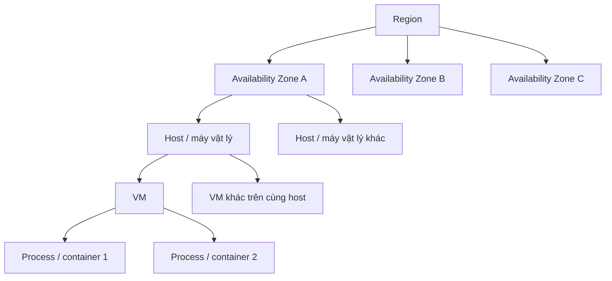
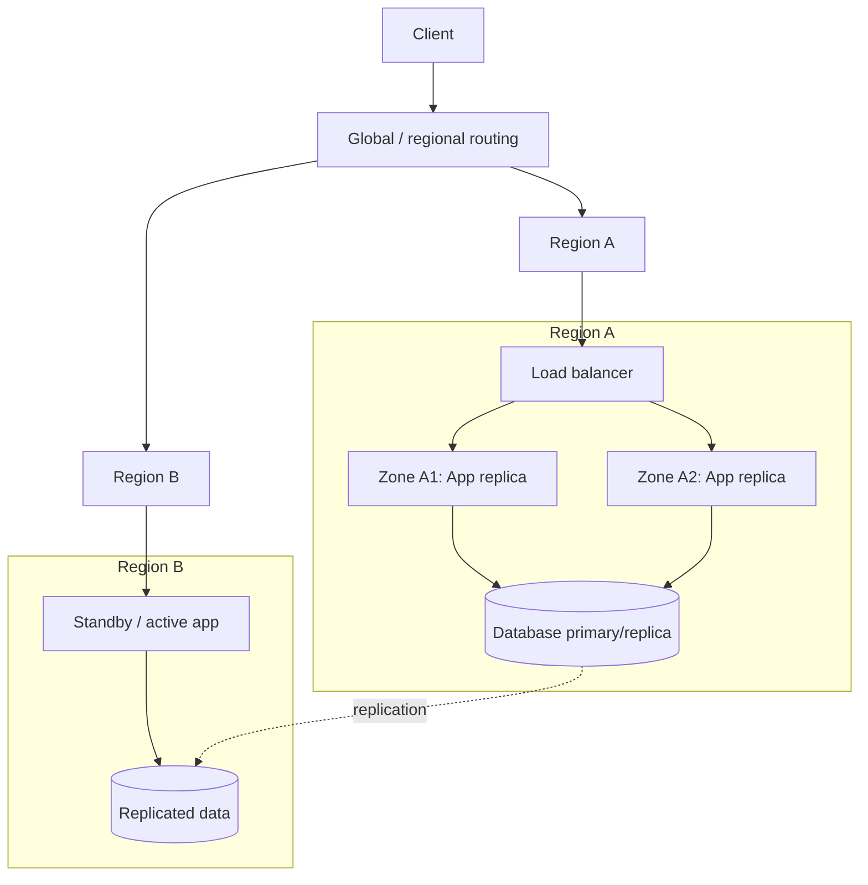

# Xác định failure domain ở mức tiến trình, máy, zone và region

## Bối cảnh: biết một sự cố có thể làm hỏng những gì

Một ứng dụng chạy trên cloud có thể gồm nhiều process, container, VM, network, storage và dịch vụ phụ trợ. Việc tạo nhiều replica chỉ giúp tăng khả năng sẵn sàng khi các replica không cùng phụ thuộc vào một điểm có thể hỏng. Nếu ba VM đều đặt trong cùng một availability zone, một sự cố ở zone có thể làm cả ba VM mất kết nối cùng lúc. Nếu nhiều container chạy trên cùng một VM, lỗi kernel hoặc host có thể làm tất cả container dừng. Nếu nhiều process dùng chung một database duy nhất, lỗi database vẫn có thể khiến toàn bộ ứng dụng không phục vụ được.

**Failure domain** là phạm vi tài nguyên hoặc thành phần có thể cùng bị ảnh hưởng bởi một sự cố hoặc một nguyên nhân chung. Xác định failure domain giúp thiết kế nơi đặt replica, giới hạn blast radius, chọn chiến lược failover và quyết định mức dự phòng cần thiết.

Trong module **CLOUD_CORE_SERVICES_COMPUTE**, cần xem xét failure domain ở ít nhất bốn cấp: tiến trình, máy (VM/host), zone và region. Mỗi cấp có xác suất, phạm vi tác động, thời gian khôi phục và chi phí khác nhau. Kiến trúc có tính sẵn sàng cao cần phân bố workload và dependency sao cho một lỗi trong một domain không làm mất toàn bộ năng lực phục vụ.

## 1. Failure domain, fault, failure và blast radius

Các thuật ngữ liên quan nhưng không đồng nghĩa:

- **Fault:** nguyên nhân hoặc khiếm khuyết có thể dẫn đến sự cố, ví dụ bug, lỗi cấu hình, disk hỏng hoặc mất điện.
- **Failure:** một thành phần không còn thực hiện đúng chức năng, ví dụ process crash, VM không boot hoặc zone mất kết nối.
- **Failure domain:** nhóm thành phần có thể cùng chịu ảnh hưởng từ một fault hoặc một sự kiện chung.
- **Blast radius:** phạm vi người dùng, workload, dữ liệu hoặc tài nguyên bị ảnh hưởng khi sự cố xảy ra.
- **Fault tolerance:** khả năng tiếp tục cung cấp chức năng khi một hoặc nhiều thành phần gặp lỗi.
- **High availability (HA):** thiết kế nhằm giảm thời gian dịch vụ không sẵn sàng, thường thông qua dự phòng, phát hiện lỗi và chuyển đổi.

Ví dụ, một lỗi cấu hình firewall có thể chặn cả subnet. Fault là cấu hình sai; failure là các VM trong subnet không thể nhận request; failure domain có thể là subnet hoặc zone tùy phạm vi rule; blast radius là các dịch vụ và người dùng phụ thuộc vào các VM đó.

Failure domain không chỉ là ranh giới vật lý. Một shared credential, một control plane, một DNS zone, một pipeline phát hành hoặc một cấu hình IAM dùng chung cũng có thể tạo ra failure domain logic. Khi đánh giá HA, cần xem cả hạ tầng lẫn các phụ thuộc vận hành và quản trị.

## 2. Phân cấp failure domain



Sơ đồ thể hiện quan hệ lồng nhau ở mức khái niệm. Trên nền tảng cloud, khách hàng thường không nhìn thấy chính xác host vật lý hoặc rack mà VM đang chạy. Provider quản lý lớp này và có thể cung cấp placement group, anti-affinity hoặc cơ chế phân tán host tùy dịch vụ.

### 2.1. Failure domain ở mức tiến trình

Đây là phạm vi nhỏ nhất trong các cấp đang xét. Một process có thể lỗi do crash, deadlock, memory leak, exception không được xử lý, cạn file descriptor, thread pool hoặc connection pool. Container thường gom một hoặc nhiều process, nhưng container không phải ranh giới cô lập hoàn toàn trước lỗi kernel hoặc VM bên dưới.

Đặc điểm:

- Phạm vi ảnh hưởng có thể chỉ là một worker, một process hoặc một container.
- Có thể khởi động lại nhanh bằng process supervisor, container runtime hoặc orchestrator.
- Các process khác trên cùng máy có thể tiếp tục hoạt động nếu không dùng chung tài nguyên đã cạn hoặc dependency bị ảnh hưởng.
- Lỗi ở shared memory, kernel, filesystem, network namespace hoặc runtime có thể mở rộng ảnh hưởng ra ngoài process.

Ví dụ: một worker xử lý message bị crash khi gặp payload lỗi. Nếu queue có nhiều worker độc lập, các worker còn lại có thể tiếp tục xử lý. Cần có retry có giới hạn, dead-letter queue và idempotency để tránh một message lỗi làm worker restart liên tục hoặc gây xử lý trùng.

### 2.2. Failure domain ở mức máy

Ở cấp máy, một VM hoặc server có thể gặp lỗi guest OS, kernel panic, boot failure, filesystem corruption, hết dung lượng, NIC lỗi, agent treo hoặc host vật lý gặp sự cố. Nhiều process/container trên cùng máy có thể mất cùng lúc.

Đặc điểm:

- Restart process không khôi phục được khi toàn bộ VM hoặc host không hoạt động.
- VM có thể được reboot, recreate hoặc thay bằng instance khác.
- Dữ liệu trên boot disk hoặc local/ephemeral disk có thể bị mất khi thay máy.
- Các VM khác nhau vẫn có thể chia sẻ host, rack, storage backend, network fabric hoặc control plane tùy nền tảng và cấu hình placement.

Hai VM khác ID không nhất thiết là hai failure domain độc lập. Nếu chúng cùng host hoặc cùng storage/network dependency, một sự cố ở lớp dùng chung vẫn có thể ảnh hưởng cả hai. Khi yêu cầu chống lỗi host, cần dùng cơ chế placement/anti-affinity hoặc phân bố do nền tảng hỗ trợ và hiểu rõ giới hạn bảo đảm.

### 2.3. Failure domain ở mức availability zone

Availability Zone (AZ) thường là một vùng hạ tầng độc lập trong một region, có nguồn điện, mạng và hạ tầng riêng ở mức do nhà cung cấp định nghĩa. Workload phân bố qua nhiều AZ giúp giảm nguy cơ một sự cố cục bộ làm mất toàn bộ dịch vụ.

Các sự cố có thể ảnh hưởng một zone:

- Mất điện hoặc lỗi làm mát tại một khu vực hạ tầng.
- Network fabric hoặc kết nối nội bộ của zone bị gián đoạn.
- Sự cố storage hoặc dịch vụ nền tảng giới hạn trong zone.
- Thay đổi cấu hình hoặc lỗi vận hành có phạm vi zone.

Zone không phải lúc nào cũng hoàn toàn độc lập. Một số dịch vụ quản lý, DNS, identity, control plane hoặc storage có thể có dependency liên zone hoặc toàn region. Cần đọc đặc tính của từng dịch vụ và kiểm tra failure behavior thay vì mặc định mọi tài nguyên đều được phân tách giống nhau.

### 2.4. Failure domain ở mức region

Region là phạm vi địa lý chứa nhiều zone và thường có hạ tầng dịch vụ riêng. Triển khai đa region giúp giảm rủi ro từ sự cố diện rộng ảnh hưởng cả region, lỗi cấu hình regional, mất kết nối dài hạn hoặc yêu cầu khôi phục thảm họa.

Sự cố regional có thể gồm:

- Mất kết nối diện rộng đến region hoặc lỗi nhiều zone cùng lúc.
- Dịch vụ control plane hoặc dịch vụ dùng chung của region gặp sự cố.
- Lỗi cấu hình, IAM hoặc thay đổi tự động hóa áp dụng trên toàn region.
- Sự cố dữ liệu, replication hoặc dependency được cấu hình chỉ trong một region.

Đa region phức tạp và tốn kém hơn đa zone. Cần giải quyết replication dữ liệu, consistency, định tuyến toàn cầu, identity, secret, DNS, quota, capacity dự phòng và cách chuyển traffic. Một region thứ hai chỉ tồn tại trên sơ đồ nhưng chưa có dữ liệu, capacity hoặc quy trình failover được thử nghiệm thì chưa phải DR có thể tin cậy.

## 3. Nhận diện failure domain thực tế trong kiến trúc

Để phân loại đúng, hãy liệt kê tài nguyên và hỏi: “Nếu thành phần này hỏng, những thành phần nào có thể hỏng cùng lúc hoặc mất khả năng giao tiếp?” Câu trả lời tạo ra bản đồ dependency và failure domain.

### 3.1. Tiến trình và container

Các rủi ro thường gặp:

- Process crash hoặc bị kill do OOM.
- Deadlock, thread pool cạn hoặc event loop bị chặn.
- Container runtime lỗi hoặc container bị restart liên tục.
- Một pod chiếm hết CPU/memory hoặc I/O làm ảnh hưởng workload cùng node.
- Secret/config sai khiến nhiều process cùng crash khi khởi động.

Biện pháp giới hạn blast radius:

- Tách worker hoặc process theo vai trò và mức độ tin cậy.
- Đặt CPU/memory request và limit phù hợp, tránh một workload chiếm hết node.
- Dùng liveness/readiness probe đúng mục đích; không dùng probe quá nhạy làm restart liên tục.
- Thiết kế retry có backoff, giới hạn số lần và dead-letter queue.
- Dùng circuit breaker, timeout và bulkhead để lỗi một dependency không chiếm hết thread/connection pool.
- Đặt giới hạn concurrency và queue để áp dụng backpressure.

Một pod bị restart có thể là sự cố nhỏ nếu replica khác vẫn phục vụ. Nhưng nếu mọi replica cùng dùng một secret đã hết hạn hoặc cùng nhận image lỗi, restart sẽ xảy ra đồng loạt. Do đó, phân tán process cần đi cùng kiểm soát thay đổi và dependency chung.

### 3.2. VM, host và nhóm máy

Khi thiết kế fleet VM, cần phân biệt:

- **VM failure:** một guest OS hoặc instance bị lỗi.
- **Host failure:** hypervisor hoặc máy vật lý ảnh hưởng nhiều VM cùng host.
- **Rack/power/network failure:** nhiều host cùng khu vực vật lý bị ảnh hưởng.
- **Placement failure:** các VM được đặt cùng failure domain do cách chọn placement hoặc thiếu tùy chọn phân tán.

Khách hàng cloud thường không có quyền chọn chính xác host vật lý. Có thể dùng các cơ chế như spread placement, anti-affinity, dedicated host hoặc zone placement nếu nền tảng cung cấp. Những cơ chế này có mục tiêu và giới hạn khác nhau: spread có thể phân tán instance qua nhiều host; dedicated host dành riêng máy vật lý nhưng không tự bảo vệ trước lỗi zone; zone placement giảm rủi ro zone nhưng không đảm bảo các VM trong cùng zone ở các host khác nhau.

Đối với stateful VM, cần xác định dữ liệu nằm ở đâu. Nếu dữ liệu duy nhất ở ephemeral/local disk, recreate VM có thể làm mất dữ liệu. Nếu dùng block volume, phải kiểm tra attach/failover semantics, giới hạn multi-attach và khả năng phục hồi filesystem/database. Với file/object storage, cần hiểu dependency theo zone/region và chế độ replication.

### 3.3. Zone và các dịch vụ phụ thuộc

Một kiến trúc multi-AZ cần phân bố cả các thành phần cần thiết để phục vụ request:

- Compute instances hoặc node pools.
- Load balancer target/backend và network route.
- Database replica hoặc cluster member.
- Cache, queue, broker và storage phù hợp.
- NAT/egress, DNS resolver hoặc endpoint cần thiết.
- Quota, secret, identity và control plane có thể truy cập trong lúc sự cố.

Chỉ phân tán web server qua ba zone nhưng database chỉ có một node trong một zone vẫn tạo ra điểm lỗi tập trung. Tương tự, nếu tất cả backend phải gọi một cache duy nhất hoặc một NAT gateway duy nhất, lỗi dependency đó có thể làm dịch vụ ngừng dù compute còn hoạt động.

Không phải mọi dịch vụ đều cần ba bản sao trong ba zone. Mức phân tán phải dựa trên criticality, RTO/RPO, khả năng chịu lỗi và chi phí. Một workload nội bộ ít quan trọng có thể chấp nhận khôi phục từ backup; một API thanh toán có thể cần failover tự động và replica đồng bộ hoặc bán đồng bộ.

### 3.4. Region và các dependency toàn cục

Trong thiết kế đa region, ngoài compute và data plane, cần xác định dependency nào nằm ngoài phạm vi region:

- DNS authoritative hoặc global traffic manager.
- Identity provider, certificate authority và secret manager.
- Container/image registry, package repository và CI/CD.
- Logging, monitoring, incident communication và control plane.
- KMS/key management, backup catalog và replication orchestration.
- Third-party API, payment provider hoặc dịch vụ SaaS.

Nếu cả hai region phụ thuộc vào cùng một identity provider không khả dụng, người vận hành có thể không đăng nhập được để kích hoạt failover. Nếu region dự phòng không có image, package hoặc secret mới nhất, workload có thể không khởi động được. Cần xác định phương thức truy cập khẩn cấp, bản sao cấu hình và quy trình hoạt động khi control plane chính bị ảnh hưởng.

## 4. Shared fate và common-cause failure

Replica chỉ tăng độ sẵn sàng khi lỗi của chúng đủ độc lập. **Common-cause failure** xảy ra khi một nguyên nhân chung làm hỏng nhiều thành phần cùng lúc. Đây là lý do số lượng replica không đủ để chứng minh HA.

Ví dụ common-cause failure:

- Tất cả replica dùng cùng một image có lỗi boot.
- Một rollout sai cấu hình được triển khai đồng thời lên mọi zone.
- Tất cả VM dùng cùng một credential đã bị thu hồi.
- Một policy firewall hoặc IAM được áp dụng trên toàn fleet.
- Tất cả replica ghi vào cùng một storage backend đang lỗi.
- Một dependency duy nhất như database, DNS hoặc external API bị gián đoạn.
- Một operator chạy lệnh phá hủy trên tất cả region do context sai.

### 4.1. Giảm rủi ro common-cause

- Triển khai theo canary/ring và giới hạn số replica bị thay đổi trong một batch.
- Tách blast radius theo account/project, environment, zone hoặc region khi phù hợp.
- Dùng image/version bất biến và có thể quay lại phiên bản đã kiểm chứng.
- Dùng IAM role riêng, quyền tối thiểu và phê duyệt cho thao tác phạm vi lớn.
- Có backup độc lập và retention protection cho dữ liệu quan trọng.
- Duy trì dependency dự phòng hoặc phương thức degraded mode.
- Kiểm tra thay đổi network/DNS/IAM bằng policy test và rollout có kiểm soát.
- Diễn tập lỗi shared dependency, không chỉ tắt một VM.

### 4.2. Tách failure domain logic

Không phải lúc nào cũng cần tài khoản cloud riêng cho mỗi workload. Tuy nhiên, môi trường production và non-production nên có ranh giới quyền và dữ liệu rõ ràng; quyền triển khai toàn region cần được bảo vệ; thao tác trên nhiều region cần xác nhận đúng target. Tách blast radius ở tầng quản trị giúp giảm tác động của lỗi người dùng hoặc credential bị xâm nhập.

## 5. Phân bố replica theo failure domain

Một nguyên tắc cơ bản là đặt replica ở các domain khác nhau theo mức sự cố cần chịu đựng. Nếu mục tiêu là chịu lỗi process, có thể chạy nhiều process/worker. Nếu mục tiêu là chịu lỗi VM, đặt replica trên nhiều VM. Nếu mục tiêu là chịu lỗi zone, phân bố VM và dependency qua nhiều zone. Nếu mục tiêu là chịu lỗi region, triển khai và đồng bộ dữ liệu qua region độc lập.



Đây là sơ đồ khái niệm. Trong thực tế, routing global, replication database, failover ownership và consistency cần được thiết kế theo dịch vụ cụ thể.

### 5.1. Replica placement

Khi có nhiều replica, hãy kiểm tra:

- Có replica nào cùng VM/host hoặc cùng zone ngoài dự kiến không?
- Có đủ capacity ở domain còn lại khi một domain mất không?
- Load balancer có nhận biết health của từng zone/region không?
- Stateful replica có quorum và replication topology phù hợp không?
- Các thành phần phụ trợ có được phân bố tương tự không?
- Autoscaler có tiếp tục tạo instance vào zone đang lỗi hoặc cạn capacity không?

Nếu provider hỗ trợ zone-aware load balancing hoặc topology spread constraints, hãy dùng để duy trì phân bố. Tuy nhiên, autoscaling và scheduler có thể không đạt phân bố mong muốn khi quota/capacity một zone cạn; cần alert và kế hoạch dự phòng.

### 5.2. Active-active và active-passive

**Active-active:** nhiều domain cùng phục vụ traffic bình thường. Có thể tăng khả năng sử dụng capacity và giảm thời gian chuyển đổi, nhưng cần xử lý đồng bộ dữ liệu, conflict, session, cache và định tuyến.

**Active-passive:** một domain chính phục vụ, domain dự phòng chờ sẵn hoặc chạy ở mức capacity thấp. Mô hình đơn giản hơn cho một số hệ thống stateful, nhưng cần bảo đảm standby có đủ capacity, dữ liệu đủ mới và quy trình promotion được thử nghiệm.

Active-active không mặc nhiên tốt hơn. Nếu dữ liệu không thể ghi đồng thời hoặc ứng dụng không giải quyết conflict, active-active có thể tạo lỗi consistency. Active-passive cũng không đảm bảo failover nhanh nếu standby thiếu quota, cấu hình cũ hoặc phải khởi tạo nhiều thành phần từ đầu.

## 6. Định lượng availability và độ độc lập

Availability thường được biểu diễn bằng tỷ lệ thời gian dịch vụ sẵn sàng trong một khoảng đo:

\[
Availability = \frac{Uptime}{Uptime + Downtime}
\]

Nếu một thành phần có availability `A`, downtime kỳ vọng trong một năm 365 ngày được ước lượng bằng:

\[
Downtime = (1-A)\times365\times24\times60\text{ phút}
\]

| Availability | Downtime tương đương trong năm 365 ngày |
|---:|---:|
| 99% | khoảng 3 ngày 15 giờ 36 phút |
| 99,9% | khoảng 8 giờ 45 phút 36 giây |
| 99,95% | khoảng 4 giờ 22 phút 48 giây |
| 99,99% | khoảng 52 phút 34 giây |
| 99,999% | khoảng 5 phút 15 giây |

Các con số là quy đổi toán học, không phải cam kết của nhà cung cấp. Cần định nghĩa rõ phép đo theo thời gian hay theo request, thời điểm bảo trì có được tính không và cách xử lý lỗi một phần.

### 6.1. Thành phần nối tiếp và song song

Nếu mọi thành phần trong một đường request đều phải hoạt động, availability end-to-end có thể bị giới hạn bởi thành phần yếu nhất. Với các thành phần độc lập mắc nối tiếp, availability tổng thể xấp xỉ tích availability từng thành phần:

\[
A_{serial}=A_1\times A_2\times\cdots\times A_n
\]

Ví dụ, nếu ba dependency nối tiếp đều có availability 99,9% và độc lập, availability tổng thể xấp xỉ `0,999³ = 99,7003%`. Đây là mô hình đơn giản; trong thực tế dependency có thể không độc lập và ứng dụng có thể có cache, retry hoặc degraded mode.

Với hai replica độc lập theo mô hình song song, dịch vụ chỉ mất khả năng phục vụ khi cả hai replica cùng lỗi:

\[
A_{parallel}=1-(1-A_1)(1-A_2)
\]

Nếu mỗi replica có availability 99% và lỗi độc lập, availability lý thuyết của cặp là 99,99%. Tuy nhiên, nếu hai replica cùng chịu ảnh hưởng bởi một shared dependency hoặc common-cause failure, giả định độc lập không đúng và kết quả thực tế thấp hơn.

### 6.2. Availability không chỉ là số lượng bản sao

Tăng từ một lên ba replica không tự động tăng availability lên theo công thức song song. Cần xét:

- Lỗi có độc lập thật sự không?
- Load balancer có phát hiện và loại replica lỗi kịp thời không?
- Replica còn lại có đủ capacity không?
- Dữ liệu có thể đọc/ghi khi mất một replica không?
- Có quorum hoặc leader election không?
- Dependency chung có thể trở thành điểm lỗi duy nhất không?
- Thời gian phát hiện, chuyển đổi và phục hồi có nằm trong mục tiêu không?

## 7. RTO, RPO và chiến lược phục hồi

Failure domain xác định phạm vi có thể mất; RTO/RPO xác định tổ chức cần phục hồi nhanh và bảo vệ dữ liệu đến mức nào.

- **RTO (Recovery Time Objective):** thời gian tối đa chấp nhận để khôi phục dịch vụ sau sự cố.
- **RPO (Recovery Point Objective):** mức mất dữ liệu tối đa có thể chấp nhận, thường biểu diễn bằng thời gian dữ liệu.

Ví dụ: RTO 30 phút nghĩa là dịch vụ cần được khôi phục trong vòng 30 phút sau sự cố; RPO 5 phút nghĩa là dữ liệu được khôi phục có thể thiếu tối đa khoảng 5 phút thay đổi gần nhất, theo cách đo đã thống nhất.

### 7.1. Các phương án phục hồi

| Chiến lược | Mô tả | RTO/RPO tương đối | Chi phí và độ phức tạp |
|---|---|---|---|
| Backup and restore | Khôi phục từ backup sau sự cố | RTO thường dài; RPO theo lịch backup | Chi phí thấp hơn, cần kiểm thử restore |
| Pilot light | Giữ sẵn phần lõi tối thiểu và dữ liệu/replication cần thiết | RTO trung bình; RPO theo replication | Tốn chi phí duy trì phần lõi và quy trình scale |
| Warm standby | Môi trường dự phòng chạy ở capacity thấp | RTO ngắn hơn; RPO theo replication | Tốn chi phí standby và đồng bộ |
| Hot standby / active-passive | Môi trường dự phòng gần như sẵn sàng chuyển đổi | RTO ngắn; RPO phụ thuộc replication | Chi phí cao hơn, cần promotion/fencing |
| Active-active | Nhiều domain cùng phục vụ | Có thể chuyển traffic nhanh; RPO phụ thuộc consistency | Phức tạp về dữ liệu, conflict và routing |

Tên gọi và đặc tính có thể khác giữa tổ chức/nhà cung cấp. Điều quan trọng là mô tả chính xác phần nào đang chạy, dữ liệu được đồng bộ thế nào, cần thao tác nào khi failover và mất bao lâu.

### 7.2. RPO không đồng nghĩa với backup frequency

Backup mỗi giờ không bảo đảm RPO một giờ nếu backup không nhất quán, không hoàn tất đúng lịch hoặc không thể restore. Replication gần thời gian thực có thể giảm RPO nhưng cũng có thể sao chép thao tác xóa nhầm hoặc dữ liệu hỏng. Backup bất biến và quy trình khôi phục theo thời điểm giúp xử lý các loại sự cố mà replication không giải quyết.

### 7.3. RTO bao gồm toàn bộ chuỗi phục hồi

RTO không chỉ là thời gian boot VM. Cần tính thời gian phát hiện, quyết định failover, cấp capacity, khôi phục dữ liệu, chuyển DNS/traffic, warm cache, xác minh ứng dụng và thông báo người dùng. Runbook chỉ có giá trị khi thời gian thực tế đã được đo qua diễn tập.

## 8. Quorum, replication và split-brain

Với hệ thống phân tán có nhiều node, quyết định node nào được phép ghi hoặc giữ vai trò leader cần tránh hai phía cùng tin rằng mình là primary. Đây là vấn đề **split-brain**.

### 8.1. Quorum

Quorum là số phiếu tối thiểu cần thiết để một quyết định được chấp nhận, ví dụ bầu leader hoặc commit dữ liệu. Với cụm có `N` voting members, quorum đa số thường là:

\[
Q=\lfloor N/2\rfloor+1
\]

Với ba voting members, quorum là hai. Nếu mất một node, hai node còn lại vẫn có thể đạt quorum. Nếu chỉ có hai voting members và mất kết nối giữa chúng, không bên nào có đa số; điều này tránh hai bên tự nhận quyền ghi nhưng có thể làm giảm availability.

Quorum không phải lúc nào cũng đơn giản là số VM. Một số database hoặc consensus system có witness/arbiter, learner hoặc member không có quyền bỏ phiếu. Cần hiểu chính xác vai trò từng member và placement của chúng.

### 8.2. Đặt quorum qua zone

Nếu ba voting members đặt cả ba trong một zone, sự cố zone có thể làm mất toàn bộ quorum. Nếu phân bố mỗi member ở một zone khác nhau, hệ thống có thể duy trì đa số khi một zone mất, miễn là network giữa các zone còn hoạt động và topology được hỗ trợ.

Với ba zone, phân bố một member mỗi zone là mô hình phổ biến cho một số hệ thống quorum-based. Tuy nhiên, latency liên zone, network partition, replica lag và khả năng write khi mất một zone cần được đánh giá. Không áp dụng cùng một topology cho mọi database hoặc distributed system.

### 8.3. Fencing và quyền ghi

Khi failover primary, cần ngăn node cũ tiếp tục ghi sau khi node mới được promote. Fencing có thể dùng lease/epoch, quorum-backed leadership, revoke storage access hoặc cơ chế platform-specific. Nếu không có fencing, hai primary có thể ghi đồng thời và gây split-brain hoặc corruption.

Không nên chỉ dựa vào việc “node cũ không phản hồi” để kết luận node đã dừng. Network partition có thể khiến node vẫn chạy nhưng không liên lạc được với controller. Thiết kế cần cơ chế xác định quyền sở hữu tài nguyên và ngăn writer cũ hoạt động.

## 9. Failover và failback giữa các failure domain

Failover là chuyển workload hoặc traffic từ domain lỗi sang domain khỏe. Failback là chuyển trở lại domain ban đầu hoặc topology bình thường sau khi sự cố được khắc phục. Hai thao tác cần quy trình riêng; failback vội vàng có thể gây gián đoạn lần thứ hai.

### 9.1. Các bước failover cơ bản

1. Phát hiện và xác nhận domain bị ảnh hưởng.
2. Xác định phạm vi dữ liệu, compute, network và dependency còn hoạt động.
3. Kiểm tra domain dự phòng có đủ capacity, quota và phiên bản cấu hình cần thiết.
4. Bảo đảm writer cũ đã bị fencing hoặc không thể tiếp tục ghi.
5. Promote replica hoặc khởi động workload theo runbook.
6. Chuyển traffic bằng load balancer, routing policy hoặc DNS.
7. Warm cache, xác minh health, SLI và dữ liệu.
8. Theo dõi lỗi, replication lag và tải trên domain mới.
9. Ghi nhận thời gian phục hồi, dữ liệu bị mất (nếu có) và quyết định tiếp theo.

### 9.2. DNS failover và giới hạn TTL

DNS failover có thể chuyển client đến endpoint khác, nhưng không phải mọi client đều cập nhật DNS ngay sau TTL. Resolver, browser, JVM và ứng dụng có thể cache DNS theo chính sách riêng. Các kết nối TCP đang mở cũng không tự chuyển sang endpoint mới.

Với yêu cầu failover nhanh, có thể cần global load balancing, anycast hoặc routing layer phù hợp thay vì chỉ thay DNS record. Dù dùng phương pháp nào, phải kiểm thử thời gian hội tụ từ góc nhìn client thực tế.

### 9.3. Failback có kiểm soát

Trước khi chuyển trở lại:

- Xác minh domain ban đầu đã ổn định và không còn lỗi nền tảng.
- Đồng bộ dữ liệu từ domain đang hoạt động về domain phục hồi.
- Xác định nguồn ghi chính và tránh split-brain.
- Kiểm tra version/config tương thích và capacity.
- Chuyển traffic theo batch hoặc canary nếu có thể.
- Giữ khả năng quay lại domain đang phục vụ nếu failback gặp lỗi.

Một số hệ thống có thể tiếp tục hoạt động ở region dự phòng trong thời gian dài thay vì failback ngay. Quyết định phụ thuộc chi phí, dữ liệu, hiệu năng và rủi ro khi chuyển đổi lần nữa.

## 10. Capacity planning khi mất một failure domain

HA không chỉ cần replica; các replica còn lại phải đủ năng lực phục vụ sau khi một domain mất. Nếu hệ thống chạy ở 80% capacity trên mỗi zone và một zone ngừng hoạt động, traffic dồn sang các zone còn lại có thể khiến chúng bão hòa.

### 10.1. N+1 và khả năng chịu mất một domain

N+1 là cách mô tả capacity có thêm một đơn vị dự phòng so với mức tối thiểu cần thiết. Với workload phân tán, cần tính theo capacity thực tế của các domain còn lại, không chỉ số lượng instance.

Ví dụ, một dịch vụ cần 100 đơn vị capacity để xử lý peak. Nếu triển khai hai zone, mỗi zone có 60 đơn vị, tổng capacity là 120. Khi một zone mất, zone còn lại chỉ có 60 và không thể phục vụ toàn bộ peak. Để chịu mất một zone, mỗi zone cần có capacity đủ lớn hoặc hệ thống phải chấp nhận degraded mode/giảm tải.

Một phép kiểm tra đơn giản:

```text
surviving_capacity = total_capacity - capacity_of_failed_domain
required_capacity_after_failure <= surviving_capacity
```

Khi có nhiều domain, hãy tính trường hợp xấu nhất mà thiết kế cam kết chịu đựng, ví dụ mất một VM, một host hoặc một AZ. Không nhất thiết phải chịu mất hai region cùng lúc nếu chi phí quá cao; cần ghi rõ giả định và giới hạn.

### 10.2. Autoscaling không thay thế capacity dự phòng

Autoscaling có thể bổ sung instance khi tải tăng, nhưng cần thời gian phát hiện, schedule, cấp phát VM, boot, bootstrap và warm cache. Trong sự cố zone, capacity ở zone còn lại có thể bị quota hoặc instance availability giới hạn. Vì vậy:

- Giữ đủ baseline capacity cho thời gian scale-out.
- Kiểm tra quota và capacity theo zone/region.
- Đặt autoscaling policy tránh tạo instance trong domain đã lỗi.
- Kiểm tra load balancer chỉ gửi traffic đến backend khỏe.
- Đặt giới hạn scale để không làm dependency downstream quá tải.
- Có degraded mode hoặc admission control khi capacity không đủ.

### 10.3. Capacity cho dependency

Không chỉ compute cần dự phòng. Nếu web tier scale gấp đôi sau failover nhưng database chỉ chịu được mức tải cũ, database sẽ trở thành bottleneck mới. Cần kiểm tra connection pool, storage IOPS, network throughput, queue consumer, cache và giới hạn API bên ngoài trong failure scenario.

## 11. Ví dụ kiến trúc theo từng cấp failure domain

### 11.1. Ứng dụng web chịu lỗi process

Một VM chạy nhiều worker process sau reverse proxy. Khi một worker crash, supervisor khởi động lại worker; proxy loại worker không khỏe và chuyển request sang worker khác. Queue có retry/backoff và dead-letter queue để message lỗi không làm sập toàn bộ nhóm.

Giới hạn: nếu VM reboot hoặc host lỗi, tất cả worker trên VM đều mất. Thiết kế này chỉ xử lý failure domain process.

### 11.2. Ứng dụng web chịu lỗi VM

Hai hoặc nhiều VM chạy cùng ứng dụng sau load balancer. Session được lưu ở shared session store hoặc token stateless; dữ liệu nghiệp vụ nằm trong database/storage riêng. Khi một VM lỗi, load balancer loại instance và traffic được chuyển sang VM còn lại.

Giới hạn: nếu các VM cùng zone hoặc cùng dependency duy nhất, thiết kế vẫn không chịu được lỗi zone hoặc dependency đó.

### 11.3. Ứng dụng web chịu lỗi zone

VM hoặc container node được phân bố qua ít nhất hai zone. Load balancer phân phối traffic đến backend khỏe ở các zone; database và storage có replication hoặc cơ chế multi-zone phù hợp. Khi một zone mất, zone còn lại nhận traffic và có capacity dự phòng.

Giới hạn: region-wide failure, lỗi cấu hình toàn region hoặc dependency regional vẫn có thể ảnh hưởng toàn bộ dịch vụ.

### 11.4. Dịch vụ chịu lỗi region

Ứng dụng có deployment ở hai region. Database replicate dữ liệu sang region dự phòng; global routing chuyển traffic khi region chính không phục vụ. Secrets, image, network, IAM, DNS và quy trình vận hành đều sẵn sàng ở region dự phòng.

Giới hạn: replication lag có thể tạo data loss theo RPO; failover có thể cần promote database và fencing; quota/capacity ở region dự phòng phải được bảo đảm. Multi-region tăng chi phí và yêu cầu vận hành cao.

## 12. Failure domain của state và dữ liệu

Compute có thể được recreate, nhưng dữ liệu thường là phần khó phục hồi nhất. Khi xác định failure domain, cần vẽ riêng đường đi của dữ liệu:

- Boot volume và ephemeral/local disk có mất theo VM/host không?
- Block volume có gắn lại ở zone khác được không? Có giới hạn zone attachment không?
- File share có mount được từ nhiều zone/region không? Có replication không?
- Object storage có redundancy theo zone/region nào và consistency ra sao?
- Database replication là synchronous hay asynchronous?
- Backup nằm ở account, region hoặc failure domain độc lập nào?
- Key mã hóa và metadata backup có sẵn khi region chính mất không?

### 12.1. Replication không thay thế backup

Replication giúp bản sao dữ liệu theo kịp hệ thống chính và hỗ trợ failover, nhưng có thể sao chép cả lỗi ứng dụng, xóa nhầm hoặc ransomware. Backup có retention và khả năng khôi phục theo thời điểm giúp phục hồi trạng thái trước khi dữ liệu bị hỏng.

Backup cần được đặt trong failure domain đủ độc lập với workload nguồn, quyền xóa cần được hạn chế và restore cần được diễn tập. Một backup cùng tài khoản, cùng region và cùng quyền quản trị có thể bị ảnh hưởng bởi cùng một lỗi hoặc hành vi phá hoại.

### 12.2. Consistency và replication lag

Replication đồng bộ thường giảm khả năng mất dữ liệu đã xác nhận nhưng có thể tăng latency ghi và phụ thuộc kết nối giữa các domain. Replication bất đồng bộ giảm độ trễ ghi nhưng có thể mất các thay đổi chưa được truyền khi failover.

Ứng dụng cần xác định hành vi khi replica lag tăng, khi mất kết nối giữa region hoặc khi primary không rõ trạng thái. Không promote replica chỉ dựa trên việc nó còn phản hồi; cần xác định độ mới dữ liệu, quyền ghi và fencing.

## 13. Kiểm thử failure domain và resilience

Thiết kế HA chỉ đáng tin khi các giả định được kiểm chứng. Kiểm thử cần bắt đầu ở môi trường an toàn, tăng dần phạm vi và có tiêu chí dừng.

### 13.1. Các loại kiểm thử

| Kiểm thử | Mô phỏng | Điều cần xác minh |
|---|---|---|
| Process failure | Kill một worker/container | Supervisor/orchestrator restart, replica khác vẫn phục vụ |
| VM failure | Stop/terminate một VM trong test | Load balancer loại instance, traffic chuyển sang máy khác |
| Host/placement failure | Dùng công cụ fault injection được hỗ trợ hoặc mô phỏng mất node | Replica được phân bố, capacity còn lại đáp ứng tải |
| Zone failure | Cô lập traffic hoặc giả lập mất một zone trong môi trường kiểm thử | App, data, network và dependency tiếp tục hoạt động theo RTO/RPO |
| Region failover | Diễn tập DR có kiểm soát | Dữ liệu, secrets, capacity, routing và runbook sẵn sàng |
| Dependency failure | Làm chậm hoặc ngắt database/cache/queue | Timeout, retry, circuit breaker và degraded mode hoạt động |
| Control-plane failure | Giả lập không truy cập được công cụ quản trị chính | Có kênh vận hành dự phòng và quyền khẩn cấp phù hợp |

Không nên cố tình tắt zone hoặc region production chỉ để thử nếu chưa có kế hoạch, phê duyệt và giới hạn ảnh hưởng. Có thể dùng chaos engineering hoặc fault injection trong môi trường riêng, sau đó diễn tập failover production theo quy trình được kiểm soát.

### 13.2. Tiêu chí đánh giá

Trong mỗi bài test, đo:

- Thời gian phát hiện sự cố (MTTD).
- Thời gian chuyển đổi và phục hồi dịch vụ (MTTR/RTO).
- Mức dữ liệu bị mất hoặc độ trễ dữ liệu tại thời điểm phục hồi (RPO thực tế).
- Tỷ lệ request lỗi, latency p95/p99 và throughput trong thời gian failover.
- Capacity và saturation ở domain còn lại.
- Số lượng thao tác thủ công, bước không rõ ràng và phụ thuộc người cụ thể.
- Khả năng failback và thời gian đưa hệ thống về topology dự kiến.

### 13.3. Runbook và diễn tập

Runbook cần có điều kiện kích hoạt, người có quyền quyết định, lệnh/console cần dùng, cách fencing, cách promote dữ liệu, thay đổi routing, kiểm tra SLI, cách thông báo và tiêu chí kết thúc. Cần ghi rõ thao tác nào tự động, thao tác nào cần phê duyệt.

Diễn tập định kỳ giúp phát hiện drift: credential hết hạn, image cũ, quota thiếu, certificate lỗi, DNS cache lâu hoặc backup không restore được. Sau mỗi lần diễn tập, cập nhật RTO/RPO thực tế và khắc phục các bước không đạt.

## 14. Những nhầm lẫn thường gặp

**Có nhiều process nghĩa là ứng dụng chịu được lỗi VM.** Các process trên cùng VM vẫn cùng chịu ảnh hưởng khi guest OS, host, network interface hoặc boot volume gặp lỗi.

**Có nhiều VM nghĩa là đã phân tán failure domain.** Các VM có thể cùng zone, host placement, storage hoặc dependency. Cần kiểm tra placement và shared dependency.

**Multi-AZ chỉ cần đặt web server ở nhiều zone.** Database, queue, cache, storage, egress và network path cũng có thể trở thành điểm lỗi tập trung.

**Ba replica luôn bảo đảm quorum.** Quorum phụ thuộc số voting member, vị trí đặt, network partition và cơ chế consensus. Ba member cùng zone vẫn có thể mất quorum khi zone lỗi.

**Multi-region tự động bảo đảm DR.** Cần dữ liệu được replicate, capacity, quota, secrets, identity, DNS, image và runbook. Nếu chưa thử failover, RTO/RPO chưa được xác minh.

**Replication thay thế backup.** Replication có thể truyền cả thao tác xóa nhầm hoặc dữ liệu hỏng. Cần backup độc lập và kiểm thử restore.

**Autoscaling xử lý được mọi sự cố.** Autoscaling có độ trễ và phụ thuộc quota, capacity, control plane, image và dependency. Cần baseline capacity cho failure scenario.

**Failover chỉ là đổi DNS.** DNS cache, kết nối đang mở, data promotion, fencing và health verification đều ảnh hưởng thời gian chuyển đổi.

**Active-active luôn tốt hơn active-passive.** Active-active cần xử lý consistency và conflict; active-passive có thể phù hợp hơn cho hệ thống stateful hoặc ghi đơn chủ.

**Số replica quyết định availability.** Availability phụ thuộc tính độc lập, blast radius, capacity, dependency và khả năng phát hiện/chuyển đổi/phục hồi.

## 15. Quy trình xác định failure domain cho một workload

Có thể dùng quy trình sau khi thiết kế hoặc rà soát một dịch vụ:

1. **Vẽ đường đi request:** client, DNS, load balancer, process/container, VM, database, queue, storage và external dependency.
2. **Vẽ đường đi dữ liệu:** nơi ghi, nơi replicate, nơi backup, key mã hóa và vị trí restore.
3. **Gắn domain cho từng thành phần:** process, VM/host, zone, region và shared service.
4. **Liệt kê common-cause:** image/config/IAM/DNS/secret/registry/CI/CD hoặc dependency dùng chung.
5. **Xác định failure scenario cần chịu:** một process, một VM, một host, một zone hay một region.
6. **Đặt mục tiêu RTO/RPO:** xác định thời gian phục hồi và mức mất dữ liệu chấp nhận được.
7. **Chọn topology:** replica placement, quorum, active-active/passive, replication và backup.
8. **Tính capacity sau lỗi:** domain còn lại có đủ tài nguyên và quota không?
9. **Định nghĩa failover/failback:** health detection, fencing, promotion, traffic routing và validation.
10. **Kiểm thử và cập nhật:** diễn tập, đo RTO/RPO thực tế, cập nhật runbook và xử lý điểm yếu.

## 16. Ví dụ: thiết kế API đặt hàng qua hai zone và một region dự phòng

Giả sử một API đặt hàng cần chịu lỗi một VM và một zone trong region chính. Mục tiêu khôi phục khi mất region được xác định riêng với RTO 60 phút và RPO 5 phút.

### 16.1. Region chính

- Load balancer nhận HTTPS và phân phối traffic đến application VM/container ở hai zone.
- Mỗi zone có nhiều replica; placement được phân tán để giảm khả năng cùng host.
- Session và dữ liệu người dùng không nằm duy nhất trên boot disk.
- Database có primary và replica theo topology multi-zone mà engine hỗ trợ.
- Queue/cache có cấu hình chịu lỗi hoặc khả năng khôi phục phù hợp.
- Security group chỉ cho phép backend nhận traffic từ load balancer; health check loại target không khỏe.

### 16.2. Region dự phòng

- Có image và cấu hình IaC đã được kiểm thử.
- Có capacity standby hoặc quota được xác nhận để scale trong thời gian mục tiêu.
- Database replicate bất đồng bộ và giám sát lag; backup độc lập được lưu ở failure domain khác.
- Secret, certificate, IAM role, network, DNS và observability đã sẵn sàng.
- Runbook mô tả điều kiện promote, fencing primary cũ, chuyển routing và xác minh dữ liệu.

### 16.3. Xử lý ba tình huống

| Tình huống | Phản ứng | Kết quả cần xác minh |
|---|---|---|
| Một process/VM lỗi | Restart process hoặc loại VM khỏi target; traffic đến replica khác | Error rate phục hồi, capacity còn đủ và không mất state cục bộ |
| Một zone lỗi | Load balancer ngừng gửi traffic đến zone lỗi; zone còn lại nhận traffic | Capacity surviving zone đáp ứng tải; database/queue vẫn hoạt động |
| Region chính lỗi | Kích hoạt DR, fencing primary cũ, promote dữ liệu ở region dự phòng và chuyển traffic | RTO không quá 60 phút, RPO không quá 5 phút, ứng dụng và dữ liệu được xác minh |

Các mục tiêu là giả định của ví dụ. Để chứng minh, phải diễn tập cả zone failover và region DR trong môi trường có kiểm soát, đo thời gian thực tế và kiểm tra dữ liệu sau chuyển đổi.

## 17. Checklist rà soát failure domain

### Kiến trúc và placement

- [ ] Đã xác định failure domain của process/container, VM/host, zone và region.
- [ ] Replica không cùng phụ thuộc một host/zone ngoài dự kiến.
- [ ] Load balancer, network, storage, database, queue và cache được đánh giá cùng compute.
- [ ] Các shared dependency và common-cause failure đã được liệt kê.
- [ ] Có cơ chế giới hạn blast radius cho rollout, IAM, DNS và network changes.

### Dữ liệu và phục hồi

- [ ] Dữ liệu bền vững không phụ thuộc duy nhất vào boot/ephemeral disk.
- [ ] Replication topology, lag, consistency và writer ownership được hiểu rõ.
- [ ] Có fencing để tránh split-brain khi promote primary.
- [ ] Backup độc lập, có retention và đã thử restore.
- [ ] RTO/RPO được xác định và đo qua diễn tập.

### Capacity và vận hành

- [ ] Domain còn lại đủ capacity trong failure scenario đã cam kết.
- [ ] Quota, instance capacity, network, storage và dependency đủ cho failover.
- [ ] Autoscaling delay và control-plane dependency đã được tính đến.
- [ ] Runbook có health check, fencing, promotion, routing, validation và failback.
- [ ] Có cảnh báo cho replica placement drift, replication lag và capacity thiếu.
- [ ] Đã diễn tập process, VM, zone và region failure phù hợp với criticality.

## Kết luận

Failure domain xác định phạm vi thành phần có thể cùng bị ảnh hưởng bởi một sự cố. Process failure thường có thể xử lý bằng restart hoặc thay worker; VM/host failure cần replica trên máy khác; zone failure đòi hỏi compute và dependency phân bố qua nhiều zone; region failure cần DR hoặc multi-region với dữ liệu, capacity, identity, network và routing sẵn sàng. Nhiều replica chỉ cải thiện availability khi chúng đủ độc lập, còn đủ capacity sau khi mất một domain và có quy trình phát hiện, fencing, failover, failback được kiểm thử. Bản đồ failure domain kết hợp RTO/RPO, replication, backup và diễn tập giúp thiết kế compute có khả năng chịu lỗi phù hợp với mức quan trọng và chi phí của dịch vụ.
