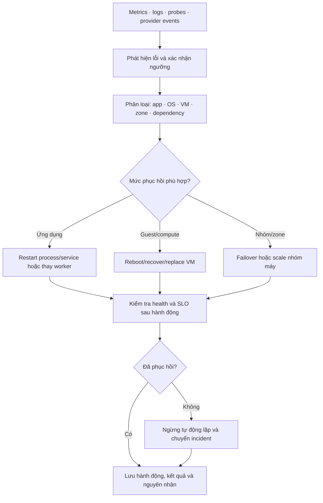

# Auto-healing và phân biệt sửa máy với khởi động lại ứng dụng

Auto-healing là khả năng tự phát hiện một thành phần không còn khỏe, thực hiện hành động phục hồi phù hợp và xác minh dịch vụ đã hoạt động trở lại. Trong môi trường cloud, hành động đó có thể chỉ là khởi động lại một process, restart service, reboot VM, khôi phục VM trên host khác, thay instance bằng máy mới hoặc chuyển traffic sang replica khỏe.

Chọn sai mức phục hồi có thể làm sự cố nặng hơn. Nếu chỉ một process bị treo, reboot cả VM gây gián đoạn không cần thiết. Nếu host hoặc guest OS đã hỏng, restart ứng dụng sẽ không giải quyết được nguyên nhân. Với workload stateful, thay hoặc reboot máy mà chưa bảo vệ dữ liệu có thể gây mất dữ liệu hoặc split-brain. Vì vậy, auto-healing cần phân biệt **sức khỏe của ứng dụng**, **sức khỏe của guest OS** và **sức khỏe của hạ tầng compute**, sau đó chọn hành động nhỏ nhất có khả năng khôi phục dịch vụ.

## 1. Auto-healing trong kiến trúc compute

Một hệ thống compute có nhiều lớp cùng tham gia phục vụ. Mỗi lớp cần tín hiệu sức khỏe và cách phục hồi riêng.

| Lớp | Ví dụ tín hiệu sức khỏe | Hành động phục hồi thường gặp |
|---|---|---|
| Request/service | Error rate, latency, readiness, synthetic transaction | Loại backend khỏi traffic, chuyển traffic, rollback release |
| Process/application | Process exit, deadlock, event loop lag, liveness failure | Restart process hoặc service, thay worker |
| Container/Pod | Liveness/startup probe, OOMKilled, container exit | Restart container, tạo Pod mới, reschedule |
| Guest OS | Kernel panic, filesystem lỗi, agent mất heartbeat, OS check fail | Restart service hệ thống, reboot VM, boot recovery |
| VM/instance | System/instance status check, host failure, hardware event | Provider recovery, stop/start, replace instance |
| Nhóm máy/zone | Healthy capacity, replica/quorum, zone health | Scale out, failover, chuyển traffic sang fault domain khác |
| Dependency | Database health, queue age, storage availability | Failover dependency, circuit breaker, giảm tải hoặc phục hồi theo runbook |

Auto-healing không phải một lệnh restart chung cho mọi lỗi. Nó là một vòng điều khiển: thu thập tín hiệu, xác định phạm vi, chọn hành động, quan sát kết quả và dừng hoặc nâng cấp xử lý khi không phục hồi được.



## 2. Phân biệt application restart và machine repair

### Khởi động lại ứng dụng

Application restart dừng rồi khởi động lại một process, service hoặc worker. Nó phù hợp khi:

- Process bị crash hoặc thoát bất thường.
- Một worker bị kẹt nhưng OS và VM vẫn khỏe.
- Ứng dụng có memory leak và chưa có cơ chế tự phục hồi trong process.
- Service cần nạp lại cấu hình sau thay đổi đã được phê duyệt.
- Một container cần được tạo lại theo desired state.

Restart ứng dụng thường nhanh hơn reboot VM và giữ nguyên kernel, network interface, volume attachment và các service hệ thống khác. Tuy nhiên, restart không sửa được lỗi kernel, driver, filesystem, NIC hoặc host. Nó cũng có thể làm mất trạng thái chỉ nằm trong RAM của process.

### Sửa hoặc phục hồi máy

Machine repair xử lý vấn đề ở guest OS hoặc lớp compute. Tùy loại lỗi, hành động có thể là:

- Restart một service hệ thống như network agent hoặc cloud guest agent.
- Reboot guest OS để khôi phục trạng thái kernel/service.
- Provider recover VM trên host khác khi có lỗi host và dịch vụ hỗ trợ.
- Stop/start VM khi cần cấp phát lại host hoặc hoàn tất maintenance.
- Tạo VM thay thế từ image chuẩn rồi gắn dữ liệu persistent và chuyển traffic.
- Restore hoặc rebuild hệ điều hành khi image/boot disk bị hỏng.

Machine repair có phạm vi tác động lớn hơn. Reboot làm mất RAM state và mọi kết nối đang mở; stop/start có thể làm thay đổi public IP động hoặc host placement; replace có thể làm mất local/ephemeral disk. Vì vậy, cần xác định dữ liệu và dependency trước khi thực hiện.

### So sánh nhanh

| Tiêu chí | Restart ứng dụng | Reboot/recover VM | Replace VM |
|---|---|---|---|
| Phạm vi | Một process/service/container | Toàn bộ guest OS/instance | Một instance được thay bằng instance khác |
| Thời gian phục hồi | Thường ngắn | Thường dài hơn do boot và recovery | Phụ thuộc provisioning, bootstrap và dữ liệu |
| Ảnh hưởng process khác | Thường không | Tất cả process bị dừng | Tất cả process trên máy cũ bị dừng |
| RAM state | Mất state của process được restart | Mất toàn bộ RAM state | Không chuyển sang máy mới trừ khi ứng dụng tự lưu |
| Network connection | Kết nối của process bị ngắt | Các kết nối của VM bị ngắt | Endpoint có thể đổi; cần chuyển traffic |
| Local disk | Thường giữ nguyên | Thường giữ qua reboot, tùy dịch vụ | Có thể không được chuyển hoặc bảo toàn |
| Phù hợp khi | Lỗi cô lập trong ứng dụng | Lỗi guest OS hoặc cần reboot | VM/image/host không thể phục hồi an toàn |

Các hành vi cụ thể phụ thuộc provider, loại instance, loại disk và cơ chế recovery. Luôn xác minh trước khi tự động hóa hành động có thể dừng hoặc thay thế máy.

## 3. Dùng health signal đúng lớp

Một tín hiệu health tốt cần phản ánh đúng điều cần phục hồi. Nếu probe chỉ kiểm tra process còn sống, nó không chứng minh request có thể hoàn tất. Nếu probe kiểm tra database quá sâu, database chậm có thể khiến toàn bộ backend bị restart dù process vẫn hoạt động bình thường.

### Liveness

Liveness trả lời câu hỏi: process có còn hoạt động và có khả năng tự tiếp tục không? Nếu liveness thất bại liên tiếp, runtime hoặc supervisor có thể restart process/container.

Liveness nên tập trung vào trạng thái nội bộ của process như event loop bị treo hoặc worker không còn tiến triển. Không nên phụ thuộc vào mọi dịch vụ ngoài, vì một database tạm thời lỗi có thể làm tất cả process bị restart đồng thời và tạo thêm tải khi dependency hồi phục.

### Readiness

Readiness trả lời câu hỏi: instance có thể nhận request mới không? Khi readiness fail, load balancer hoặc service discovery nên ngừng gửi traffic tới backend đó. Readiness fail không nhất thiết có nghĩa phải restart process.

Ví dụ, ứng dụng đang tải model, warm cache hoặc chờ kết nối database có thể chưa sẵn sàng nhưng vẫn đang khởi động bình thường. Khi đó, đánh dấu not-ready giúp tránh request thất bại trong khi không cần restart.

### Startup probe

Startup probe dành cho ứng dụng khởi động lâu. Nó trì hoãn việc áp dụng liveness/readiness theo cấu hình cho đến khi quá trình startup đạt điều kiện. Điều này tránh restart liên tục một process cần thời gian dài để khởi tạo.

### Infrastructure health check

Provider có thể cung cấp system check và instance/guest check. System check thường phản ánh host hoặc hạ tầng nền; instance check phản ánh khả năng phản hồi của VM/guest theo cơ chế provider. Tên gọi và semantics khác nhau giữa nền tảng. Không coi mọi health check đỏ là cùng một loại lỗi.

### Synthetic check và end-to-end check

Synthetic check thực hiện luồng nghiệp vụ từ góc nhìn client, ví dụ đăng nhập thử hoặc đọc một bản ghi kiểm thử. Nó phát hiện lỗi mà probe nội bộ có thể bỏ sót, nhưng không nên dùng làm liveness probe nếu mỗi lần kiểm tra tạo side effect hoặc tải đáng kể.

## 4. Xác định hành động từ loại lỗi

| Quan sát | Diễn giải có thể có | Hành động ban đầu phù hợp |
|---|---|---|
| Một process crash, OS khỏe | Lỗi ứng dụng hoặc input | Restart process có giới hạn, giữ crash log và điều tra |
| Liveness fail nhưng readiness fail không rõ nguyên nhân | Process có thể bị treo | Restart container/service sau ngưỡng và cooldown |
| Readiness fail, liveness vẫn đạt | Chưa thể phục vụ hoặc dependency chưa sẵn sàng | Ngừng gửi traffic, điều tra dependency/startup; chưa restart ngay |
| Container OOMKilled | Vượt memory limit hoặc memory leak | Thu thập memory metrics, điều chỉnh limit hoặc sửa leak; restart chỉ là phục hồi tạm |
| Guest OS check fail | OS/network/agent có vấn đề | Dùng console và provider diagnostics; cân nhắc reboot nếu xác định được |
| System/host check fail | Host hoặc hạ tầng provider có vấn đề | Dùng provider recovery/host replacement theo dịch vụ |
| VM không boot sau update | Image/kernel/driver/boot config lỗi | Recovery mode hoặc rollback image/kernel |
| Một zone mất kết nối | Lỗi fault domain hoặc network | Failover traffic sang zone khỏe và xác minh capacity |
| Database chậm, nhiều backend cùng not-ready | Dependency chung gặp sự cố | Circuit breaker, giảm tải, failover DB; tránh restart hàng loạt backend |
| Nhiều lần restart nhưng lỗi quay lại | Root cause chưa được xử lý | Dừng vòng restart tự động, mở incident và chuyển cấp xử lý |

Một tín hiệu đơn lẻ hiếm khi đủ để quyết định replace VM. Kết hợp probe, provider event, OS log, metric và lịch sử thay đổi để xác định lớp hỏng.

## 5. Auto-restart process bằng supervisor

Supervisor quản lý vòng đời process và có thể restart khi process thoát. Trên Linux, systemd là một ví dụ phổ biến.

Ví dụ unit file:

```ini
[Unit]
Description=Example application service
After=network-online.target
Wants=network-online.target

[Service]
Type=simple
User=app
WorkingDirectory=/opt/example-app
ExecStart=/opt/example-app/bin/server
Restart=on-failure
RestartSec=5s
StartLimitIntervalSec=300
StartLimitBurst=5
TimeoutStopSec=30s
KillSignal=SIGTERM

[Install]
WantedBy=multi-user.target
```

Trong ví dụ, systemd khởi động lại service khi process thoát với lỗi, chờ 5 giây giữa các lần restart và giới hạn số lần khởi động trong một khoảng thời gian. Cần kiểm tra semantics theo phiên bản systemd và đặt `StartLimit*` phù hợp với unit đang dùng.

Các lệnh quản trị:

```bash
# Kiểm tra trạng thái và log
systemctl status example-app
journalctl -u example-app --since '15 minutes ago'

# Nạp lại unit và khởi động service sau khi thay đổi có kiểm soát
sudo systemctl daemon-reload
sudo systemctl restart example-app
```

Không dùng restart loop vô hạn. Nếu ứng dụng crash do cấu hình sai hoặc dependency không khả dụng, restart liên tục có thể tạo log lớn, tăng tải và làm khó điều tra. Giới hạn retry, có alert và giữ crash dump/log cần thiết.

## 6. Auto-healing trong container và Kubernetes

Container runtime có thể restart container theo restart policy. Kubernetes dùng controller để duy trì số replica mong muốn; kubelet dùng probe để quyết định container có cần restart hoặc Pod có nên nhận traffic.

### Phân biệt ba probe của Kubernetes

- `startupProbe`: cho ứng dụng thời gian khởi động; khi probe này chưa thành công, liveness và readiness chưa được thực thi theo cách thông thường.
- `livenessProbe`: nếu thất bại liên tiếp theo cấu hình, kubelet có thể restart container.
- `readinessProbe`: nếu thất bại, Pod bị đánh dấu không sẵn sàng và thường bị loại khỏi endpoint phục vụ; container không nhất thiết bị restart.

Ví dụ cấu hình:

```yaml
apiVersion: apps/v1
kind: Deployment
metadata:
  name: web-api
spec:
  replicas: 3
  selector:
    matchLabels:
      app: web-api
  template:
    metadata:
      labels:
        app: web-api
    spec:
      containers:
        - name: api
          image: example.invalid/web-api:v1
          ports:
            - containerPort: 8080
          startupProbe:
            httpGet:
              path: /startup
              port: 8080
            periodSeconds: 5
            failureThreshold: 36
          livenessProbe:
            httpGet:
              path: /live
              port: 8080
            periodSeconds: 10
            failureThreshold: 3
          readinessProbe:
            httpGet:
              path: /ready
              port: 8080
            periodSeconds: 5
            failureThreshold: 2
```

Đây là cấu hình minh họa. Path, timeout, period và threshold cần dựa trên thời gian khởi động, đặc tính ứng dụng và mức độ nhạy với lỗi. Image `example.invalid` chỉ là placeholder, không phải image để triển khai.

### Controller sửa Pod khác với sửa node

Deployment/ReplicaSet tạo Pod mới khi Pod bị xóa hoặc không còn đáp ứng desired replica count. Việc này thường thay thế workload instance, không sửa guest OS của worker node. Nếu node hỏng, cần cơ chế node auto-repair hoặc autoscaling group để thay node. Nếu control plane hoặc CNI/CSI lỗi, tạo Pod mới có thể không giúp ích.

### Pod disruption và dữ liệu

Trước khi tự động evict hoặc xóa Pod, kiểm tra:

- Pod có state cục bộ hoặc dùng `emptyDir` không?
- PersistentVolume có thể detach/attach ở node khác không?
- PodDisruptionBudget có bảo vệ số replica tối thiểu không?
- Workload có graceful shutdown, `preStop` và termination grace period không?
- StatefulSet có quorum, identity và thứ tự khởi động phù hợp không?

Không dùng liveness probe để phát hiện database tạm thời lỗi rồi restart toàn bộ Pod. Readiness và circuit breaker thường phù hợp hơn cho tình trạng dependency không sẵn sàng.

## 7. VM auto-recovery và auto-replace

VM có thể được giám sát bởi provider, autoscaling group hoặc hệ thống quản lý cấu hình. Cần hiểu chính xác hành động mà mỗi cơ chế thực hiện.

### Provider recovery

Một số cloud cung cấp automatic instance recovery khi phát hiện lỗi host hoặc phần cứng. Tùy dịch vụ, VM có thể được khởi động lại trên host khỏe khác và giữ một số thuộc tính như instance identity, private IP hoặc attached storage. Không giả định mọi loại instance, accelerator, local disk hoặc dedicated host đều hỗ trợ recovery giống nhau.

Provider recovery phù hợp với lỗi hạ tầng mà khách hàng không thể sửa trong guest. Nó không khắc phục memory leak, cấu hình ứng dụng sai hoặc lỗi dữ liệu trong filesystem.

### Auto-reboot

Policy có thể reboot VM khi health check của guest thất bại trong một khoảng thời gian. Trước khi bật, cần xác định:

- Health signal có phân biệt host failure với guest failure không?
- Reboot có làm mất dữ liệu local hoặc transaction đang chạy không?
- Ứng dụng có replica khác nhận traffic không?
- Có giới hạn số lần reboot và cooldown không?
- Sau reboot có health check xác nhận OS và ứng dụng đã phục hồi không?

Nếu cùng một lỗi lặp lại sau mỗi lần reboot, hệ thống nên dừng auto-reboot và chuyển sang incident thay vì tiếp tục tạo vòng lặp.

### Auto-replace bằng autoscaling group

Với VM stateless, autoscaling group có thể thay instance không khỏe bằng máy mới từ image chuẩn. Quy trình thường gồm:

1. Xác nhận instance unhealthy bằng health check phù hợp.
2. Ngừng gửi traffic mới và deregister target.
3. Drain request/job đang chạy trong giới hạn.
4. Terminate instance lỗi.
5. Tạo instance thay thế từ launch template/image chuẩn.
6. Chạy bootstrap, đăng ký target và chờ health check.
7. Chỉ chuyển traffic khi target healthy.

Auto-replace thường hữu ích hơn việc sửa một VM đã drift cấu hình hoặc bị hỏng khó xác định, nếu ứng dụng được thiết kế stateless và dữ liệu nằm trên storage bền vững.

## 8. Chọn mức phục hồi theo loại workload

### Stateless web/API

Với web/API stateless, ưu tiên loại backend không khỏe khỏi load balancer và restart process hoặc replace instance tùy phạm vi lỗi. Nhiều replica qua các zone giúp request tiếp tục được phục vụ trong khi một máy phục hồi.

Session, upload và dữ liệu người dùng nên nằm ở storage hoặc dịch vụ dùng chung phù hợp. Nếu session chỉ lưu trong RAM, application restart hoặc replace VM có thể làm người dùng bị đăng xuất hoặc mất tiến trình.

### Worker bất đồng bộ

Worker có thể restart hoặc replace nếu message chưa được acknowledge và queue hỗ trợ redelivery. Cần thiết kế xử lý idempotent để message được gửi lại không tạo tác động trùng. Với job dài, checkpoint tiến độ và chỉ acknowledge khi kết quả đã được lưu bền vững.

### Database và workload stateful

Database cần quy trình riêng. Restart process có thể kích hoạt crash recovery; reboot VM có thể kéo dài thời gian phục hồi; replace VM cần đảm bảo volume, replica, identity và quorum. Không để hai node cùng nghĩ mình là primary và cùng ghi dữ liệu.

Trước failover hoặc replace:

- Xác định leader/primary và trạng thái replication.
- Dùng fencing hoặc cơ chế lease để ngăn node cũ tiếp tục ghi.
- Kiểm tra quorum và replica đủ khỏe.
- Xác nhận backup, transaction log và RPO.
- Chỉ gắn volume theo quy trình bảo đảm single-writer nếu storage không hỗ trợ multi-writer.
- Xác minh consistency trước khi mở traffic.

### GPU và workload tính toán dài

GPU job hoặc batch compute có thể mất nhiều giờ. Restart process hoặc replace VM sẽ làm mất tiến độ nếu không có checkpoint. Nên lưu checkpoint định kỳ vào persistent storage/object storage, ghi metadata về model, dataset và phiên bản runtime, sau đó khôi phục trên instance tương thích.

## 9. Ngăn auto-healing tạo ra sự cố lớn hơn

Một hệ thống auto-healing không có guardrail có thể tạo ra restart storm, thundering herd hoặc mất dữ liệu hàng loạt.

### Ngưỡng và thời gian xác nhận

Không hành động chỉ vì một lần probe thất bại. Dùng failure threshold, evaluation window và thời gian xác nhận đủ để lọc lỗi thoáng qua. Ngưỡng phải cân bằng giữa phát hiện nhanh và false positive.

### Cooldown và giới hạn retry

Đặt cooldown giữa các hành động phục hồi, giới hạn số lần restart/reboot trong cửa sổ thời gian và có thời gian ổn định sau khi máy trở lại. Nếu vượt ngưỡng, mở incident và dừng tự động lặp.

### Jitter và backoff

Nếu nhiều instance cùng lỗi, không restart tất cả đồng thời. Dùng jitter để phân tán thời điểm restart, backoff để tăng khoảng chờ và giới hạn số instance phục hồi đồng thời. Điều này tránh tạo tải đột biến lên database, cache, registry hoặc control plane.

### Blast radius và concurrency limit

Chỉ phục hồi một tỷ lệ nhỏ instance trong mỗi nhóm hoặc fault domain tại một thời điểm. Giữ đủ capacity khỏe trước khi xử lý nhóm tiếp theo. Với cluster stateful, tuân thủ quorum và disruption budget.

### Circuit breaker cho remediation

Nếu hành động tự động không làm health tốt lên hoặc metric xấu đi, circuit breaker cần ngừng remediation cùng loại. Ví dụ, nếu restart ứng dụng 3 lần trong 10 phút mà readiness vẫn fail, dừng restart và chuyển incident. Số lần và khoảng thời gian cần điều chỉnh theo workload.

### Không tự động thực hiện hành động phá hủy khi thiếu bằng chứng

Terminate VM, format disk, detach volume, xóa stateful Pod hoặc failover database là hành động có thể gây mất dữ liệu. Chỉ tự động hóa khi đã có invariant, backup, fencing và runbook kiểm chứng. Nếu không xác định được loại lỗi hoặc trạng thái dữ liệu, ưu tiên cảnh báo và yêu cầu người vận hành.

## 10. Tự động hóa remediation theo cấp độ

Có thể thiết kế remediation theo cấp độ tăng dần:

| Cấp | Hành động | Điều kiện nên áp dụng |
|---|---|---|
| 0 | Ghi nhận và cảnh báo | Chưa đủ bằng chứng hoặc hành động có rủi ro |
| 1 | Retry request/job hoặc reconnect | Lỗi tạm thời, thao tác idempotent |
| 2 | Restart worker/process/service | Process lỗi cô lập, OS khỏe |
| 3 | Drain backend và thay container/Pod | Workload có replica và dữ liệu bền vững |
| 4 | Reboot/recover VM | Guest/instance có dấu hiệu lỗi và reboot an toàn |
| 5 | Replace VM hoặc failover zone | Instance không thể phục hồi hoặc fault domain lỗi |
| 6 | Restore dữ liệu hoặc disaster recovery | Có hỏng dữ liệu hoặc mất cả fault domain; cần quy trình đặc biệt |

Không nhất thiết mọi hệ thống phải tự động đi tới cấp 6. Cấp độ càng cao, phạm vi tác động và yêu cầu bằng chứng càng lớn. Tự động hóa nên dừng ở cấp cao nhất mà tổ chức đã kiểm thử và chấp thuận.

### Ví dụ policy remediation dạng khái niệm

```yaml
healing_policy:
  application:
    trigger: liveness_failed
    consecutive_failures: 3
    action: restart_process
    max_attempts: 3
    cooldown_seconds: 300

  virtual_machine:
    trigger: guest_health_failed
    consecutive_failures: 5
    action: notify_and_assess
    auto_reboot: false

  instance_group:
    trigger: instance_unhealthy
    action: replace_instance
    max_unhealthy_replacements: 1
    require_healthy_capacity: true
```

Đây là cấu hình minh họa, không phải schema provider. Giá trị thực tế cần dựa trên probe interval, thời gian startup, SLO, số replica và hành vi của nền tảng. Policy thể hiện rõ rằng lỗi process có thể tự restart trong giới hạn, còn lỗi VM cần đánh giá trước khi reboot.

## 11. Xác minh sau khi phục hồi

Một hành động remediation chỉ được coi là thành công khi dịch vụ thực sự phục vụ trở lại, không phải chỉ khi lệnh restart hoặc replace hoàn tất.

Kiểm tra theo thứ tự:

1. **Control plane:** VM/Pod/instance group có trạng thái mong muốn không?
2. **Guest OS:** OS boot hoàn tất, filesystem mount, NIC và agent hoạt động không?
3. **Process/runtime:** service đang chạy, container không restart loop và probe đạt không?
4. **Network:** DNS, route, TLS, load balancer và kết nối dependency hoạt động không?
5. **Application:** smoke test hoặc synthetic transaction thành công không?
6. **Data:** queue, replication, transaction và checkpoint có nhất quán không?
7. **SLO:** error rate, p95/p99 latency và throughput đã trở lại mức mục tiêu chưa?

Giữ thời gian quan sát sau phục hồi để phát hiện lỗi quay lại. Không đóng incident ngay khi health check chuyển xanh lần đầu.

## 12. Quan sát hiệu quả auto-healing

Theo dõi các chỉ số sau:

| Chỉ số | Ý nghĩa |
|---|---|
| Detection time | Thời gian từ khi lỗi xuất hiện tới khi được phát hiện |
| Remediation start delay | Thời gian từ phát hiện tới khi bắt đầu hành động |
| Recovery time | Thời gian tới khi dịch vụ thực sự khỏe trở lại |
| Healing success rate | Tỷ lệ hành động tự động khôi phục thành công |
| Repeat failure rate | Tỷ lệ lỗi quay lại sau remediation |
| Restart/reboot count | Số lần restart process, container hoặc VM |
| Replacement rate | Tỷ lệ instance bị thay thế trong một khoảng thời gian |
| False positive rate | Tỷ lệ hành động được kích hoạt khi thành phần thực tế vẫn khỏe |
| Data recovery point | Mức mất dữ liệu hoặc replication lag khi phục hồi |
| SLO impact | Error budget hoặc thời gian gián đoạn do sự cố/remediation |

Tỷ lệ healing success cao không có nghĩa hệ thống tốt nếu process liên tục restart để che memory leak. Theo dõi repeat failure, thời gian phục hồi và số lần remediation trên mỗi instance để tìm ra vấn đề nền.

## 13. Ví dụ thực tế

### Ví dụ 1: API process bị treo nhưng VM vẫn khỏe

Synthetic check báo API timeout. VM vẫn có system check tốt, CPU và RAM bình thường, SSH truy cập được. Log cho thấy event loop của process không tiến triển.

Hướng xử lý:

1. Load balancer ngừng gửi traffic tới instance đó bằng readiness/target health.
2. Thu thập thread dump, stack trace hoặc runtime diagnostic.
3. Restart service trong giới hạn đã cấu hình.
4. Chờ readiness đạt và chạy synthetic request.
5. Nếu lỗi tái diễn, dừng auto-restart và mở incident để tìm deadlock hoặc bug.

Reboot VM không cần thiết vì OS và hạ tầng vẫn khỏe.

### Ví dụ 2: Guest OS mất phản hồi sau kernel update

Nhiều lần kiểm tra guest thất bại sau khi cập nhật kernel; console cho thấy kernel panic. Restart ứng dụng không có tác dụng vì OS không boot tới service.

Hướng xử lý:

1. Lưu console log và xác định kernel version mới.
2. Dùng recovery workflow hoặc boot entry kernel trước đó.
3. Khôi phục VM từ image/kernel đã biết hoạt động nếu cần.
4. Kiểm tra driver, initramfs và agent.
5. Chỉ đưa VM trở lại pool sau khi OS và ứng dụng qua health check.

Đây là lỗi ở lớp guest OS; remediation cần sửa hoặc rollback OS.

### Ví dụ 3: Host failure trên VM stateless

Provider báo system check thất bại và có event host failure. VM nằm trong autoscaling group, dữ liệu ứng dụng lưu trên object storage và database managed.

Hướng xử lý:

1. Xác nhận target bị unhealthy và loại khỏi load balancer.
2. Kiểm tra provider có hỗ trợ automatic recovery cho loại instance không.
3. Nếu không phục hồi trong thời gian cho phép, autoscaling group thay instance.
4. VM mới bootstrap từ image chuẩn, đăng ký target và chờ healthy.
5. Xác minh traffic và SLO trước khi đóng sự kiện.

Replace phù hợp vì workload stateless và dữ liệu nằm ngoài VM.

### Ví dụ 4: Database primary không phản hồi

Health check của ứng dụng và database cùng lỗi. Restart tất cả application VM sẽ tạo connection storm khi database trở lại. Quy trình đúng là kích hoạt database failover theo cơ chế đã kiểm thử, dùng circuit breaker để giảm request và chỉ đưa backend trở lại khi dependency sẵn sàng.

Không coi readiness fail do dependency là lý do tự động reboot VM. Đây là lỗi ở dependency và cần remediation tại đúng lớp.

## 14. Những sai lầm thường gặp

- **Dùng một probe cho mọi mục đích:** liveness, readiness và synthetic check trả lời những câu hỏi khác nhau.
- **Restart ứng dụng khi dependency lỗi:** tạo restart storm mà không sửa được database hoặc network.
- **Reboot VM khi chỉ process bị treo:** tăng phạm vi gián đoạn và mất kết nối không cần thiết.
- **Replace VM có local data:** có thể làm mất dữ liệu chưa được chuyển hoặc checkpoint.
- **Không giới hạn restart:** lỗi cấu hình hoặc memory leak tạo vòng lặp vô hạn.
- **Restart đồng thời mọi replica:** toàn bộ dịch vụ có thể mất capacity cùng lúc.
- **Chỉ kiểm tra trạng thái control plane:** VM `Running` không có nghĩa OS và ứng dụng khỏe.
- **Không xác minh sau remediation:** lệnh thành công nhưng ứng dụng vẫn lỗi hoặc dữ liệu không nhất quán.
- **Không lưu bằng chứng:** mất log và trạng thái cần thiết để tìm root cause.
- **Tự động failover stateful mà không fencing:** có thể tạo split-brain và ghi dữ liệu đồng thời.

## 15. Checklist thiết kế auto-healing

**Health signal:**

- [ ] Có health check riêng cho process, readiness, guest OS và hạ tầng khi cần.
- [ ] Probe có timeout, threshold và interval phù hợp.
- [ ] Dependency tạm thời lỗi không kích hoạt restart hàng loạt.
- [ ] Có provider event và audit log để phân biệt lỗi host với guest.

**Remediation:**

- [ ] Chọn hành động nhỏ nhất phù hợp với lớp lỗi.
- [ ] Restart process có giới hạn và cooldown.
- [ ] Reboot/recover VM có điều kiện và phương án phục hồi.
- [ ] Replace chỉ áp dụng khi dữ liệu và identity được quản lý an toàn.
- [ ] Có concurrency limit, jitter, backoff và circuit breaker.
- [ ] Có escalation khi remediation lặp lại không thành công.

**Dữ liệu và tính sẵn sàng:**

- [ ] Workload stateless không phụ thuộc state duy nhất trong RAM/local disk.
- [ ] Workload stateful có backup, replication, quorum và fencing.
- [ ] Job dài có checkpoint hoặc cơ chế redelivery idempotent.
- [ ] Có replica qua fault domain và capacity dự phòng.

**Xác minh và vận hành:**

- [ ] Sau hành động, kiểm tra OS, runtime, network, application và data.
- [ ] Theo dõi recovery time, repeat failure và false positive.
- [ ] Lưu timeline, hành động tự động và người chịu trách nhiệm.
- [ ] Diễn tập process restart, VM recovery, replace và dependency failure.
- [ ] Có cách tạm dừng automation khi nó gây tác động ngoài dự kiến.

## Kết luận

Auto-healing hiệu quả bắt đầu từ việc xác định đúng lớp bị lỗi. Restart ứng dụng phù hợp với process hoặc service bị treo trong khi VM vẫn khỏe; reboot hoặc recover VM phù hợp với lỗi guest OS/instance; replace hoặc failover phù hợp khi máy không thể phục hồi hoặc fault domain gặp sự cố. Dùng liveness để phát hiện process cần restart, readiness để điều khiển traffic và infrastructure health check để đánh giá máy. Mọi remediation cần có ngưỡng, cooldown, giới hạn retry, bảo vệ dữ liệu và bước xác minh sau hành động. Với stateful workload, quorum, fencing, backup và consistency phải được bảo đảm trước khi tự động thay máy. Thiết kế như vậy giúp khôi phục dịch vụ nhanh mà không biến cơ chế tự chữa lành thành nguồn gây gián đoạn mới.
