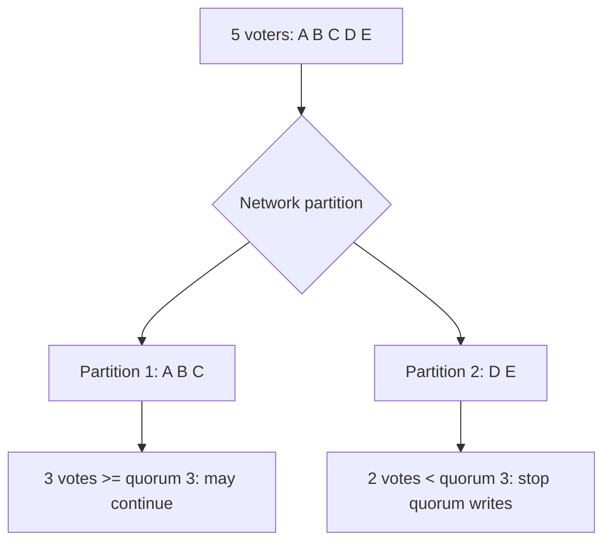
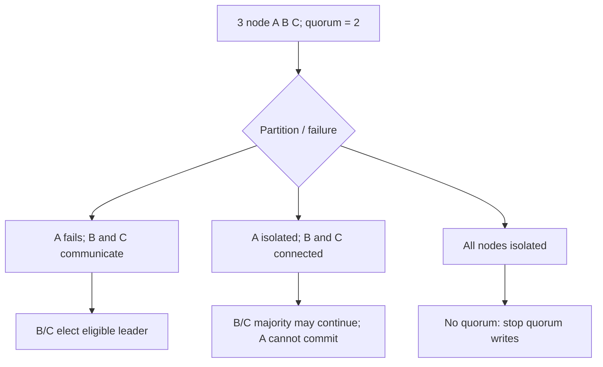

# Quorum, split-brain và ràng buộc của workload có trạng thái

Một cụm máy ảo có thể chạy nhiều node để tăng tính sẵn sàng, nhưng khi mạng bị phân vùng hoặc một số node mất liên lạc, cụm phải quyết định node nào được tiếp tục ghi dữ liệu và node nào phải dừng. Nếu hai phía cùng tin rằng mình đang giữ vai trò primary, cả hai có thể nhận ghi đồng thời. Đây là tình huống **split-brain** và có thể làm dữ liệu phân kỳ hoặc hỏng.

Quorum giúp một cụm phân tán quyết định liệu một nhóm node có đủ quyền tiếp tục hoạt động hay không. Với workload có trạng thái, quorum cần được kết hợp với cơ chế consensus, fencing, lease hoặc epoch, replication và quy trình phục hồi dữ liệu. Chỉ có nhiều VM hoặc nhiều bản sao dữ liệu chưa đủ để bảo đảm một hệ thống an toàn khi lỗi xảy ra.

## 1. Vì sao workload có trạng thái khó chịu lỗi hơn?

Workload stateless có thể nhận request ở bất kỳ instance khỏe mạnh nào nếu cấu hình và dữ liệu cần thiết nằm ở dịch vụ dùng chung. Khi một VM lỗi, load balancer loại nó khỏi pool và request mới được gửi sang máy khác.

Workload stateful giữ hoặc thay đổi trạng thái cần được bảo toàn giữa các lần xử lý. Ví dụ:

- Database lưu transaction và dữ liệu nghiệp vụ.
- Distributed cache có dữ liệu được cập nhật và cần nhất quán giữa các node.
- File server hoặc cluster filesystem quản lý metadata và file đang được nhiều máy truy cập.
- Message broker lưu queue, offset và trạng thái consumer.
- VM chạy ứng dụng legacy giữ session hoặc dữ liệu tạm trong local disk.
- Hệ thống xử lý batch lưu checkpoint để tiếp tục sau khi node bị thay thế.

Khi node lỗi, hệ thống phải xác định dữ liệu nào đã được ghi bền vững, node nào có bản sao mới nhất, ai được quyền nhận ghi và cách tránh hai node cùng cập nhật một trạng thái. Những quyết định này thường quan trọng hơn việc khởi động lại VM nhanh đến đâu.

## 2. Quorum là gì?

**Quorum** là số phiếu tối thiểu hoặc điều kiện đồng thuận tối thiểu mà một nhóm node cần có để thực hiện một quyết định được bảo vệ, chẳng hạn bầu leader, thay đổi membership hoặc cho phép ghi dữ liệu. Trong mô hình majority quorum đơn giản, cụm có `N` thành viên biểu quyết và cần quá nửa số phiếu:

\[
Q = \left\lfloor \frac{N}{2} \right\rfloor + 1
\]

Ví dụ:

| Số thành viên có phiếu (N) | Majority quorum (Q) | Số thành viên có thể mất mà vẫn còn quorum |
|---:|---:|---:|
| 1 | 1 | 0 |
| 2 | 2 | 0 |
| 3 | 2 | 1 |
| 4 | 3 | 1 |
| 5 | 3 | 2 |
| 6 | 4 | 2 |
| 7 | 4 | 3 |

Với majority quorum và giả định các thành viên có quyền biểu quyết tương đương, cụm có thể chịu được tối đa \(\lfloor (N-1)/2 \rfloor\) thành viên không khả dụng mà vẫn còn đa số. Cụm phải có kết nối và trạng thái đủ điều kiện để các phiếu đó thực sự được tính; chỉ đếm số VM đang bật là chưa đủ.

Quorum không nhất thiết chỉ là số node. Một số hệ thống có witness, arbiter hoặc voting member không lưu dữ liệu. Một số hệ thống dùng weighted quorum, dynamic quorum hoặc cơ chế membership riêng. Vì vậy, công thức majority là nền tảng để hiểu nguyên tắc, còn hành vi thực tế phải theo tài liệu của sản phẩm.

## 3. Vì sao số node lẻ thường được dùng?

Với majority voting, ba node cần hai phiếu và có thể mất một node. Bốn node cần ba phiếu và cũng chỉ có thể mất một node. Vì thế, thêm node thứ tư không tăng số lỗi node có thể chịu so với cụm ba node trong mô hình đơn giản.

Năm node vẫn cần ba phiếu và có thể mất hai node. Bảy node cần bốn phiếu và có thể mất ba node. Đó là lý do cụm consensus thường chọn số voter lẻ để đạt khả năng chịu lỗi tốt hơn trên mỗi phiếu bổ sung.

Tuy nhiên, số node không phải yếu tố duy nhất. Bảy voter đặt trong cùng một rack, cùng một AZ hoặc cùng một nguồn điện vẫn có thể cùng mất vì một lỗi miền chung. Cần phân bố voter theo fault domain độc lập và tính đến độ trễ liên vùng.

## 4. Bài toán cụm hai node và witness

Hai node có hai phiếu. Majority là hai, nên nếu một node mất hoặc hai node không liên lạc được, phía còn lại không có quorum. Đây là hành vi an toàn nhưng có thể làm mất khả năng phục vụ khi một node lỗi.

Một số sản phẩm hỗ trợ **witness** hoặc **arbiter** làm thành viên biểu quyết thứ ba. Witness thường lưu metadata hoặc phiếu, không lưu toàn bộ bản sao dữ liệu. Khi một data node và witness còn liên lạc được, chúng có thể tạo majority hai trên ba theo chính sách của sản phẩm.

Ví dụ khái niệm:

| Thành viên | Vai trò | Có lưu dữ liệu workload? | Có phiếu? |
|---|---|---:|---:|
| Node A | Data node | Có | Có |
| Node B | Data node | Có | Có |
| Witness | Arbiter/quorum witness | Thường không | Có |

Witness không thay thế bản sao dữ liệu. Nếu Node A mất và Node B cùng witness còn sống, Node B có thể tiếp tục theo chính sách của hệ thống; nếu cả hai data node mất, witness đơn lẻ không thể phục vụ dữ liệu. Cách xử lý khi witness mất hoặc network partition phụ thuộc sản phẩm và cấu hình.

Đặt witness trong cùng fault domain với một data node có thể làm giảm lợi ích. Ví dụ, nếu Node A và witness cùng AZ còn Node B ở AZ khác, mất AZ chứa A và witness làm phía B mất đa số. Nên đặt witness trong miền lỗi độc lập nếu kiến trúc và nhà cung cấp hỗ trợ, đồng thời cân nhắc chi phí và latency.

## 5. Split-brain là gì?

**Split-brain** xảy ra khi hai phần của một hệ thống phân tán cùng hoạt động như thể mình là cụm hợp lệ hoặc cùng giữ quyền ghi cho một trạng thái mà lẽ ra chỉ có một chủ sở hữu. Tình huống thường xuất hiện sau network partition, lỗi heartbeat, cấu hình quorum sai hoặc failover thiếu bước fencing.

Ví dụ, hai database node A và B đang đồng bộ. Mạng giữa chúng bị đứt. Nếu cả A và B đều tự promote thành primary và tiếp tục nhận ghi, hai nhánh có thể tạo ra dữ liệu khác nhau. Khi mạng phục hồi, việc ghép hai lịch sử ghi có thể không tự động giải quyết được.

Hậu quả có thể gồm:

- Hai bản ghi cùng khóa có giá trị khác nhau.
- Transaction được xác nhận ở một phía nhưng không tồn tại ở phía còn lại.
- File hoặc metadata bị ghi đồng thời từ hai node.
- Sequence, offset hoặc trạng thái job bị lặp hoặc bỏ qua.
- Replication không thể tự hội tụ và cần phục hồi thủ công.
- Mất tính toàn vẹn dữ liệu dù cả hai node đều báo healthy.

Split-brain là lỗi về quyền sở hữu và đồng thuận, không đơn thuần là lỗi mạng. Một hệ thống có thể bị phân vùng mạng mà không split-brain nếu quorum và fencing hoạt động đúng. Ngược lại, một lỗi logic trong failover có thể tạo split-brain ngay cả khi các node đều có kết nối mạng.

## 6. Network partition và failure detection

Network partition là tình trạng các node không thể trao đổi thông tin với một phần khác của cụm. Nguyên nhân có thể là lỗi route, firewall, NIC, gateway, AZ, DNS, packet loss hoặc độ trễ vượt timeout heartbeat.

Một node không nhận heartbeat có thể không phân biệt được peer đã tắt hay chỉ đang bị chậm hoặc mất đường mạng. Vì vậy, failure detector thường chỉ đưa ra phán đoán dựa trên timeout và tín hiệu quan sát được, không phải bằng chứng tuyệt đối rằng node kia đã chết.

Các dấu hiệu cần đối chiếu:

- Heartbeat timeout và thay đổi membership.
- RTT, packet loss, retransmission và trạng thái route giữa các node.
- CPU starvation hoặc pause dài của runtime khiến heartbeat trễ.
- Cloud control plane cho biết VM/NIC/AZ có đang hoạt động không.
- Disk latency hoặc I/O stall làm tiến trình không phản hồi.
- Log consensus cho thấy leader election, term/epoch và vote.

Không nên rút ngắn heartbeat timeout quá mức để failover nhanh hơn nếu mạng có jitter hoặc workload có pause dài. Timeout quá ngắn làm tăng false positive và có thể kích hoạt election liên tục. Timeout quá dài làm phục hồi chậm. Hãy chọn theo latency thực tế và mục tiêu RTO, rồi kiểm thử khi có packet loss và node pause.

## 7. Majority quorum ngăn hai phía cùng quyết định như thế nào?

Trong mô hình majority voting với tập thành viên cố định, hai nhóm đa số bất kỳ luôn có ít nhất một thành viên chung. Điều này tạo giao điểm giữa các quyết định và giúp ngăn hai partition độc lập cùng đạt quorum.

Với năm voter, quorum là ba. Không thể chia năm voter thành hai nhóm rời nhau mà mỗi nhóm có ba phiếu. Nếu partition chia thành nhóm ba và nhóm hai, nhóm ba có thể tiếp tục; nhóm hai phải dừng các thao tác cần quorum.

Đây là mô hình khái niệm. Hệ thống thực tế còn phải xử lý membership change, leader lease, term, log replication và trạng thái node. Không được tự suy ra rằng phía có nhiều VM hơn luôn được phép ghi; chỉ thành viên có phiếu hợp lệ trong cấu hình hiện tại mới được tính.

## 8. Quorum trong consensus và vai trò của leader

Các giao thức consensus như Raft hoặc Paxos giúp nhiều node đồng ý về một lịch sử thao tác hoặc thứ tự cập nhật. Trong Raft, một leader được bầu trong một term và các thay đổi log cần được replication tới quorum trước khi được coi là committed theo quy tắc giao thức.

Một quy trình khái quát:

1. Các node trao đổi heartbeat và theo dõi term/epoch.
2. Khi leader không còn được quan sát, các node đủ điều kiện có thể bắt đầu election.
3. Candidate cần đủ phiếu để trở thành leader.
4. Leader gửi log entry tới follower.
5. Entry được xem là committed khi đáp ứng điều kiện quorum của giao thức.
6. Node mới hoặc node phục hồi đồng bộ log theo quy tắc của consensus.

Không nên triển khai consensus bằng cách tự viết một heartbeat script rồi cho node có PID thấp hơn làm primary. Một giao thức đúng cần xử lý election đồng thời, log divergence, membership, term, persistence, timeout và lỗi bất đồng bộ. Dùng database hoặc distributed system đã triển khai consensus đáng tin cậy thay vì tự xây cơ chế bầu leader cho dữ liệu quan trọng.

Quorum của consensus cũng không tự giải quyết mọi vấn đề storage. Ví dụ, ứng dụng có thể commit log trên đa số node nhưng một volume shared storage vẫn cho phép hai host ghi đồng thời nếu không có fencing. Cần hiểu từng lớp có cơ chế quorum riêng hay không.

## 9. Quorum của node và quorum đọc/ghi dữ liệu

Một số distributed database hoặc storage system dùng read quorum và write quorum trên các replica dữ liệu. Trong mô hình đơn giản có `N` replica, read quorum `R` và write quorum `W` thường được chọn để các tập đọc/ghi có giao nhau:

\[
R + W > N
\]

Điều kiện này giúp một lần đọc có cơ hội quan sát ít nhất một replica đã nhận lần ghi gần nhất, dưới các giả định về protocol và versioning. Một số hệ thống còn yêu cầu:

\[
W > \frac{N}{2}
\]

để hai write quorum không thể rời nhau trong mô hình majority. Đây là mô hình lý thuyết, không phải cấu hình phổ quát. Database có thể dùng replication factor, consistency level, leader-based replication, conflict resolution hoặc quorum theo partition khác nhau.

**Không đồng nhất** quorum membership/election với read/write quorum của dữ liệu. Một cụm có thể có quorum leader nhưng vẫn có replication lag; một hệ thống có read/write quorum vẫn cần xử lý node cũ tiếp tục ghi sau khi mất quyền. Luôn đọc semantics consistency và failure behavior của database/storage cụ thể.

## 10. Fencing: ngăn node cũ tiếp tục ghi

Quorum quyết định phía nào có quyền tiếp tục theo chính sách cụm. Nhưng một node bị cô lập có thể vẫn chạy và không biết rằng nó đã mất quyền. Nếu node đó vẫn có đường tới storage hoặc client, nó có thể tiếp tục ghi.

**Fencing** là cơ chế ngăn node cũ hoặc node không còn quyền truy cập tài nguyên được bảo vệ. Một số cách thực hiện:

- **STONITH (Shoot The Other Node In The Head):** dùng cơ chế quản trị ngoài băng để tắt hoặc reset node bị nghi ngờ.
- **Storage fencing:** thu hồi hoặc khóa quyền truy cập volume, reservation hoặc shared disk của node cũ.
- **Lease:** quyền sở hữu có thời hạn; node phải gia hạn trước khi tiếp tục thao tác được bảo vệ.
- **Epoch/fencing token:** mỗi lần cấp quyền mới có số thế hệ tăng đơn điệu; storage hoặc dịch vụ đích từ chối thao tác mang token cũ.
- **Network fencing:** chặn đường truy cập của node cũ tới dịch vụ dữ liệu hoặc client theo chính sách đã kiểm chứng.

Fencing phải được thực thi ở nơi có thể ngăn hành động nguy hiểm. Chỉ cập nhật trạng thái trong một bảng điều khiển hoặc gửi tín hiệu dừng qua chính mạng đang bị partition có thể không đủ.

Ví dụ với fencing token: node A giữ token 41. Sau failover, node B được cấp token 42. Storage chỉ chấp nhận ghi từ token mới nhất là 42; mọi ghi đến muộn từ A mang token 41 bị từ chối. Cơ chế này chỉ có tác dụng nếu storage hoặc lớp bảo vệ thực sự kiểm tra token một cách nguyên tử và không thể bị bỏ qua.

## 11. Lease, epoch và giới hạn của đồng hồ

Lease là quyền sở hữu tài nguyên có thời hạn. Node giữ lease phải gia hạn; nếu hết hạn, nó không còn được phép thực hiện thao tác yêu cầu quyền sở hữu đó. Lease có thể hỗ trợ leader election hoặc khóa phân tán.

Tuy nhiên, lease dựa trên thời gian cần xử lý clock skew, pause dài của VM, network delay và scheduler stall. Một node có thể bị pause lâu, lease hết hạn rồi được tiếp tục chạy mà không nhận biết quyền đã bị cấp cho node khác. Nếu không có fencing token hoặc xác minh quyền ở phía tài nguyên đích, node cũ có thể ghi sau khi tỉnh lại.

Epoch hoặc term tăng đơn điệu giúp phân biệt thế hệ chủ sở hữu. Tài nguyên được bảo vệ cần từ chối lệnh từ epoch cũ. Không dùng timestamp của đồng hồ wall-clock làm token fencing nếu không có bảo đảm về thứ tự và tính duy nhất. Dùng counter/term do hệ thống đồng thuận cấp hoặc cơ chế được sản phẩm hỗ trợ.

## 12. Ràng buộc của shared storage và filesystem

Một cluster filesystem hoặc shared block volume có thể được gắn từ nhiều VM. Việc nhiều host nhìn thấy cùng một disk không có nghĩa chúng được phép mount và ghi đồng thời bằng filesystem thông thường.

Các trường hợp cần phân biệt:

- **Single-writer volume:** chỉ một node được phép ghi tại một thời điểm; failover cần detach/fence node cũ trước khi attach cho node mới.
- **Multi-attach block storage:** nhiều VM có thể gắn cùng volume theo khả năng dịch vụ, nhưng filesystem và ứng dụng phải hỗ trợ truy cập đồng thời.
- **Cluster filesystem:** dùng distributed lock manager, membership và fencing để phối hợp truy cập metadata/block.
- **Object storage:** thường cung cấp API object và semantics riêng, không tương đương block device hay POSIX shared filesystem.
- **Replicated storage:** nhiều bản sao dữ liệu cần cơ chế xác định phiên bản mới nhất và xử lý split-brain.

Nếu hai VM cùng mount một filesystem không hỗ trợ cluster access, cache metadata và write ordering có thể gây corruption. Trước khi bật multi-attach, kiểm tra loại volume, filesystem, lock manager, reservation và yêu cầu của nhà cung cấp.

## 13. Database replication và promotion an toàn

Database thường có primary/leader nhận ghi và một hoặc nhiều replica. Khi primary lỗi, một replica có thể được promote. Nhưng việc promote chỉ an toàn khi hệ thống xác định được primary cũ không còn quyền ghi và replica mới đáp ứng yêu cầu dữ liệu.

Các câu hỏi cần trả lời:

- Replication đồng bộ hay bất đồng bộ?
- Replica mới nhất đã nhận tới log sequence number/commit index nào?
- Có transaction đã được xác nhận ở primary nhưng chưa tới replica không?
- Quorum hoặc election quyết định primary mới ra sao?
- Primary cũ bị fence bằng cơ chế nào?
- Client có thể ghi vào endpoint cũ sau khi DNS hoặc connection pool chưa cập nhật không?
- Có thể chấp nhận mất một phần dữ liệu trong giới hạn RPO hay không?

Replication đồng bộ thường giảm nguy cơ mất dữ liệu đã xác nhận nhưng có thể tăng latency và phụ thuộc vào số replica phản hồi. Replication bất đồng bộ thường giảm độ trễ ghi nhưng có thể mất các thay đổi chưa được replica nhận khi primary hỏng.

Không phải mọi database đều dùng majority quorum đơn giản. Một số hệ thống dùng witness, log shipping, synchronous standby, consensus log hoặc cơ chế failover riêng. Hãy dùng quy trình failover được hỗ trợ và không tự promote replica chỉ dựa vào việc primary không ping được.

## 14. RPO, RTO và consistency khi failover

**RPO (Recovery Point Objective)** là mức dữ liệu có thể chấp nhận mất tính theo thời gian hoặc điểm khôi phục. **RTO (Recovery Time Objective)** là thời gian mục tiêu để khôi phục dịch vụ. Hai mục tiêu này ảnh hưởng tới replication, quorum, headroom và cách failover.

| Chiến lược | RPO tiềm năng | Đặc điểm cần cân nhắc |
|---|---|---|
| Replication đồng bộ | Có thể gần 0 cho các ghi đã commit theo semantics của hệ thống | Tăng latency, cần đủ replica phản hồi và xử lý quorum |
| Replication bất đồng bộ | Có thể mất phần ghi chưa replicate | Latency thấp hơn, cần đo replication lag và chấp nhận RPO |
| Snapshot/backup định kỳ | Phụ thuộc chu kỳ backup và thời điểm bản sao sạch | Phục hồi chậm hơn, cần kiểm thử restore |
| Log-based recovery | Có thể giảm mất dữ liệu nếu log được bảo vệ đầy đủ | Phải bảo toàn log và kiểm tra chuỗi transaction |

RPO bằng 0 không thể được khẳng định chỉ vì có hai replica. Cần hiểu thời điểm ACK, durability guarantee, quorum commit và phạm vi lỗi mà hệ thống cam kết chịu được. RTO cũng không chỉ là thời gian khởi động VM; còn gồm phát hiện lỗi, bầu leader, fencing, mount/restore, warm-up, cập nhật endpoint và xác nhận dữ liệu.

## 15. Vì sao workload có trạng thái cần placement cẩn thận?

Đặt các replica ở nhiều AZ giảm rủi ro mất một zone nhưng có thể tăng latency giữa các replica. Nếu database yêu cầu đồng bộ ghi qua nhiều zone, mỗi transaction có thể phải chờ network round trip liên zone. Nếu đặt các node quá gần nhau, cùng một sự cố có thể làm mất nhiều voter.

Khi placement, cân nhắc:

- Phân bố voter và replica qua fault domain độc lập.
- Latency giữa các zone và ảnh hưởng tới commit path.
- Network partition, route và firewall giữa các node.
- Storage volume có phạm vi zone hay regional.
- Backup nằm ở đâu và có thể phục hồi khi mất cả zone không.
- Witness có nằm độc lập với các data node không.
- Quota và capacity có đủ để tạo node thay thế trong zone còn sống không.

Không đặt tất cả quorum voter trong một AZ chỉ để giảm latency nếu mục tiêu là chịu lỗi AZ. Ngược lại, không dàn node ra quá xa nếu workload không thể chịu độ trễ replication. Thiết kế cần phản ánh failure domain và SLO thực tế.

## 16. Quy trình xử lý network partition và nghi ngờ split-brain

Khi cluster mất liên lạc, không nên để từng operator tự chạy failover script. Hãy dùng một quy trình có người điều phối và các điều kiện rõ ràng.

Một trình tự khái quát:

1. Xác định cluster membership, leader hiện tại, term/epoch và node nào còn quorum.
2. Đối chiếu cloud control plane, network telemetry, heartbeat và trạng thái storage để phân biệt node down với partition.
3. Kiểm tra node nào có quyền ghi theo consensus/quorum hiện tại.
4. Nếu cần chuyển primary, fence node cũ hoặc xác minh token/lease cũ đã hết hiệu lực ở tài nguyên đích.
5. Chọn replica đủ điều kiện theo log position, replication lag và chính sách RPO.
6. Promote node mới bằng cơ chế được database/cluster hỗ trợ.
7. Cập nhật endpoint/service discovery/load balancer sau khi xác nhận primary mới sẵn sàng.
8. Giữ node cũ cách ly khi nó quay lại; không cho nhận ghi trước khi đồng bộ và gia nhập membership đúng quy trình.
9. Xác minh dữ liệu, transaction, replication và application health.
10. Ghi timeline, quyết định và bằng chứng để phân tích nguyên nhân.

Nếu không xác định được phía nào có quorum hoặc không thể fence primary cũ, ưu tiên dừng ghi để bảo vệ tính toàn vẹn dữ liệu theo runbook. Việc tạm ngừng ghi có thể ảnh hưởng availability nhưng tránh tạo hai lịch sử dữ liệu không thể ghép.

## 17. Ví dụ: cụm database ba node qua ba AZ

Giả sử database dùng ba node A, B và C, mỗi node có một phiếu. Quorum là hai. A đang là leader; B và C là follower.

**Trường hợp 1: A lỗi hoàn toàn.** B và C vẫn liên lạc được, có hai phiếu. Một node đủ điều kiện có thể được bầu làm leader mới theo consensus. Trước khi mở ghi, hệ thống cần xác nhận log đã được commit và node A không thể tiếp tục nhận ghi khi phục hồi.

**Trường hợp 2: mạng chia A riêng, B và C cùng phía.** B/C có đa số và có thể tiếp tục theo protocol; A chỉ có một phiếu nên không được commit ghi mới. Khi A kết nối lại, nó phải theo leader/term mới và đồng bộ log.

**Trường hợp 3: mạng chia A+B và C.** A+B có hai phiếu, C chỉ có một. Cần consensus xác định leader hợp lệ trong phía đa số. C không được tự promote chỉ vì không nhìn thấy A/B.

**Trường hợp 4: cả ba node không liên lạc được.** Không phía nào có quorum; hệ thống cần dừng thao tác yêu cầu quorum cho tới khi kết nối hoặc membership được khôi phục theo quy trình an toàn.

Ví dụ giả định ba voter tương đương và protocol dùng majority. Database thực tế còn có log freshness, election timeout, synchronous commit, fencing và membership rules.

## 18. Ví dụ: cụm hai data node có witness

Một ứng dụng legacy chạy trên hai VM A và B dùng shared storage, có witness W làm phiếu thứ ba. Khi A gặp sự cố, B và W còn liên lạc. Cluster có thể cấp quyền cho B theo chính sách quorum; tuy nhiên, B chỉ được mount/ghi shared volume sau khi xác nhận A đã bị fence hoặc storage reservation của A đã bị thu hồi.

Nếu chỉ thấy A mất heartbeat rồi cho B mount volume, A có thể vẫn chạy trong một partition khác và tiếp tục ghi. Khi kết nối trở lại, hai node có thể đã sửa cùng filesystem hoặc metadata. Witness giải quyết quyền biểu quyết nhưng không tự fence storage.

Trong mô hình này, cần kiểm thử:

- Mất một data node.
- Mất witness.
- Mất đường mạng giữa hai data node nhưng cả hai vẫn truy cập client/storage.
- Mất AZ chứa một data node và witness.
- Storage control plane không phản hồi.
- Node cũ reboot hoặc trở lại mạng sau failover.

## 19. Những ràng buộc đặc biệt của workload stateful

Workload stateful cần xem xét nhiều yếu tố ngoài quorum:

- **Durability:** dữ liệu đã ACK có còn tồn tại sau khi node hoặc zone mất không?
- **Consistency:** đọc sau ghi có thấy dữ liệu mới nhất theo mức consistency được cam kết không?
- **Replication lag:** replica có đủ mới để promote không?
- **Single-writer:** tài nguyên có yêu cầu chỉ một node ghi tại một thời điểm không?
- **Locking:** distributed lock hoặc file lock có được bảo vệ qua partition không?
- **Idempotency:** client retry sau timeout có thể tạo transaction trùng không?
- **Ordering:** message, transaction hoặc event có giữ đúng thứ tự cần thiết không?
- **Local state:** cache, session, temp file và checkpoint có thể tái tạo không?
- **Backup/restore:** có bản sao độc lập và đã thử phục hồi không?

Một ứng dụng có thể dùng quorum đúng nhưng vẫn xử lý sai nếu client retry một giao dịch đã commit nhưng response bị mất. Dùng idempotency key, transaction ID hoặc cơ chế deduplication phù hợp để tránh thao tác nghiệp vụ lặp.

## 20. Không nhầm HA, replication và backup

Ba cơ chế này phục vụ mục tiêu khác nhau:

| Cơ chế | Mục tiêu chính | Không bảo vệ đầy đủ trước |
|---|---|---|
| High availability/failover | Tiếp tục phục vụ khi node hoặc miền lỗi hỏng | Xóa nhầm, corruption được replicate, ransomware |
| Replication | Duy trì bản sao dữ liệu trên nhiều node/zone | Lỗi logic hoặc xóa nhầm lan sang replica |
| Backup/point-in-time recovery | Khôi phục về thời điểm trước sự cố | Thời gian restore dài hoặc backup không được kiểm thử |

Một thao tác xóa dữ liệu hợp lệ nhưng nhầm lẫn có thể được replicate rất nhanh sang mọi node. Backup độc lập, retention bất biến và restore test vẫn cần thiết ngay cả khi cluster có quorum và replication đồng bộ.

## 21. Kiểm thử quorum và split-brain an toàn

Kiểm thử cần được thực hiện trong môi trường staging hoặc diễn tập đã phê duyệt, có dữ liệu thử nghiệm và phương án khôi phục. Không tự ý chặn mạng hoặc dừng voter trên production để xem cụm phản ứng thế nào.

Các kịch bản nên kiểm tra:

1. Mất một node và xác nhận quorum còn lại.
2. Network partition với phân chia majority/minority.
3. Partition khiến cả hai phía còn kết nối tới client hoặc storage.
4. Mất witness/arbiter.
5. Node cũ quay lại sau khi leader mới được bầu.
6. Lease hết hạn trong lúc VM bị pause hoặc network delay.
7. Storage fencing thất bại hoặc phản hồi chậm.
8. Replica có replication lag lớn tại thời điểm failover.
9. Thay đổi membership khi một node đang mất liên lạc.
10. Restore backup sau tình huống dữ liệu bị ghi sai hoặc corruption được replicate.

Theo dõi election count, term/epoch, quorum status, replication lag, rejected stale writes, fencing events, recovery time, error rate và dữ liệu đã commit. Kiểm thử chỉ đạt khi không có hai writer hợp lệ cùng lúc, dữ liệu tuân thủ RPO/consistency và ứng dụng phục hồi trong RTO.

## 22. Những lỗi thiết kế thường gặp

- **Dùng hai node mà không có witness nhưng kỳ vọng chịu lỗi một node:** majority hai trên hai không còn khi mất một node. Chọn số voter và witness phù hợp.
- **Đặt mọi voter trong cùng AZ:** một lỗi zone có thể làm mất quorum. Phân tán qua fault domain độc lập.
- **Cho cả hai phía tự promote khi mất heartbeat:** tạo split-brain. Dùng consensus và fencing.
- **Tin rằng witness lưu dữ liệu:** witness thường chỉ biểu quyết. Vẫn cần data replica và backup.
- **Chỉ dùng lease dựa trên clock:** clock skew hoặc VM pause có thể làm node cũ tiếp tục ghi. Dùng epoch/fencing ở tài nguyên đích.
- **Promote replica mà không xem replication lag:** có thể mất dữ liệu đã ACK. Đối chiếu log position và RPO.
- **Quên fence shared storage:** node cũ vẫn ghi được volume sau failover. Thu hồi quyền storage trước khi cấp writer mới.
- **Nhầm quorum với backup:** corruption hoặc xóa nhầm được replicate. Duy trì backup độc lập.
- **Timeout heartbeat quá thấp:** false failure và election liên tục. Tuning theo latency và pause thực tế.
- **Không kiểm thử node cũ quay lại:** node stale có thể gây lỗi membership hoặc ghi dữ liệu cũ. Giữ cách ly và rejoin theo protocol.

## 23. Checklist thiết kế workload stateful

- [ ] Đã xác định state nằm ở đâu: RAM, local disk, shared volume, database hay object storage.
- [ ] Đã xác định voter, witness, quorum rule và membership hiện tại.
- [ ] Số voter và placement chịu được failure domain mục tiêu.
- [ ] Đã phân biệt node quorum với read/write quorum của dữ liệu.
- [ ] Consensus/leader election dùng implementation được hỗ trợ và có persistence phù hợp.
- [ ] Có fencing hoặc epoch/token để ngăn node cũ tiếp tục ghi.
- [ ] Shared storage có cơ chế single-writer, lock và fencing đúng.
- [ ] Replication mode, lag, commit semantics và RPO được hiểu rõ.
- [ ] Failover chỉ promote replica đủ điều kiện và sau khi primary cũ bị fence.
- [ ] Lease có xử lý clock skew, pause và stale owner.
- [ ] Client retry có timeout, backoff và idempotency phù hợp.
- [ ] Backup độc lập, có retention và restore test.
- [ ] Đã diễn tập partition, mất witness, node quay lại và lỗi storage.
- [ ] RTO/RPO được đo thực tế và phù hợp SLO.

Quorum giúp cụm phân tán chọn một phía đủ điều kiện tiếp tục hoạt động, còn fencing ngăn node cũ tiếp tục thao tác sau khi mất quyền. Với workload có trạng thái, hai cơ chế này phải phối hợp với replication, consistency, storage semantics và backup. Khi thiết kế đúng failure domain, kiểm thử network partition và bảo vệ quyền ghi ở chính tài nguyên dữ liệu, hệ thống có thể duy trì tính toàn vẹn trong khi phục hồi sau sự cố.
