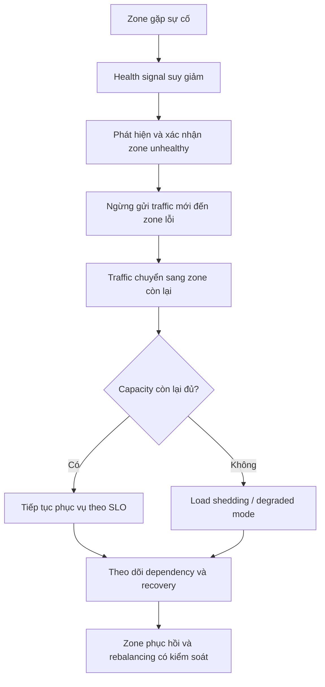

# Capacity dự phòng và hành vi khi mất một zone

Một hệ thống chạy trên nhiều Availability Zone (AZ) chỉ có tính sẵn sàng cao khi phần còn lại vẫn đủ năng lực phục vụ tải sau khi một zone ngừng hoạt động. Việc đặt VM, container hoặc node ở ba zone mới tạo ra khả năng phân tán lỗi; nó chưa chứng minh hệ thống có đủ CPU, bộ nhớ, kết nối, địa chỉ IP, database capacity hay network bandwidth để tiếp tục hoạt động khi một zone biến mất.

Trong module **CLOUD_CORE_SERVICES_COMPUTE**, capacity dự phòng cần được tính từ workload và mục tiêu dịch vụ. Đội ngũ phải biết tải đỉnh cần phục vụ, năng lực an toàn của từng instance, số zone, dependency dùng chung và thời gian cần để phát hiện rồi chuyển traffic. Bài học này tập trung vào thiết kế N-1 zone, cách phân phối tải khi mất zone, các giới hạn thường bị bỏ sót và cách kiểm chứng failover bằng thử nghiệm có kiểm soát.

## Mục tiêu học tập

Sau bài này, bạn có thể:

- Phân biệt redundancy về vị trí với capacity dự phòng thực sự.
- Giải thích N, N+1 và N-1 trong kế hoạch năng lực, đặc biệt khi mất một zone.
- Tính số instance tối thiểu trên mỗi zone để phần còn lại vẫn đáp ứng tải mục tiêu.
- Xác định headroom, capacity an toàn, failure capacity và giới hạn dependency.
- Phân tích ảnh hưởng của load balancer, routing, health check và network khi một zone lỗi.
- Thiết kế capacity cho compute, database, cache, queue, storage, NAT và subnet.
- Phân biệt zone failure, regional failure và lỗi mạng phân vùng.
- Xây dựng hành vi degraded mode, load shedding và recovery khi capacity không đủ.
- Lập kế hoạch kiểm thử N-1, diễn tập mất zone và đo kết quả bằng SLO.

## 1. Redundancy không đồng nghĩa với đủ capacity

High availability (HA) là khả năng duy trì dịch vụ ở mức đã cam kết khi một số thành phần lỗi. Fault tolerance mô tả khả năng tiếp tục hoạt động khi lỗi xảy ra, đôi khi không gián đoạn hoặc chỉ gián đoạn trong giới hạn rất nhỏ. Cả hai đều cần nhiều hơn việc tạo bản sao của instance.

Hãy phân biệt ba câu hỏi:

1. **Có bản sao ở nơi khác không?** Workload có được đặt ở nhiều zone độc lập không?
2. **Traffic có chuyển được không?** Health check, load balancer, DNS hoặc routing có loại vùng lỗi và gửi request đến vùng khỏe không?
3. **Vùng còn lại có đủ năng lực không?** CPU, RAM, network, database, IP, quota và dịch vụ phụ thuộc có đáp ứng tải sau khi chuyển không?

Một hệ thống có 3 zone, mỗi zone chạy 2 VM, nhưng tải bình thường cần cả 6 VM mới xử lý được, sẽ thiếu capacity khi mất một zone. Nó có redundancy về vị trí nhưng chưa có N-1 capacity.

### 1.1. Failure domain và Availability Zone

Failure domain là phạm vi mà một sự cố có thể ảnh hưởng đồng thời đến nhiều tài nguyên. Cloud provider thường thiết kế AZ với hạ tầng điện, làm mát và mạng độc lập ở mức nhất định. Tên gọi, phạm vi địa lý và mức độc lập cụ thể tùy nhà cung cấp và region.

Các cấp failure domain thường gặp:

- Process/container: lỗi tiến trình hoặc container.
- VM/node: lỗi máy ảo hoặc host.
- Rack/fault domain: lỗi một nhóm hạ tầng vật lý.
- Availability Zone: sự cố ảnh hưởng một vùng hạ tầng trong region.
- Region: sự cố diện rộng ảnh hưởng nhiều AZ trong một khu vực địa lý.
- Provider/control plane: lỗi dịch vụ quản lý hoặc API của nhà cung cấp.

Phân tán VM qua nhiều AZ giúp giảm nguy cơ một sự cố cục bộ làm mất toàn bộ compute. Tuy nhiên, một số dependency có thể vẫn tập trung ở một AZ hoặc một endpoint dùng chung. Cần vẽ failure domain cho cả đường request, dữ liệu và control plane.

### 1.2. Active-active và active-standby

**Active-active:** nhiều zone cùng nhận traffic trong trạng thái bình thường. Khi một zone lỗi, các zone còn lại tiếp tục nhận traffic. Capacity của mỗi zone còn lại phải đủ để hấp thụ phần tải được chuyển đến.

**Active-standby:** một hoặc nhiều zone dự phòng không nhận toàn bộ traffic bình thường, hoặc chỉ nhận tải kiểm tra/nhỏ. Khi zone chính lỗi, standby được kích hoạt. Cần tính thời gian khởi động, mở rộng, đồng bộ dữ liệu và chuyển route; standby phải có capacity thực sự sẵn sàng.

| Tiêu chí | Active-active | Active-standby |
|---|---|---|
| Sử dụng capacity bình thường | Các zone cùng xử lý tải | Một phần capacity chờ hoặc chạy tải hạn chế |
| Chuyển đổi khi lỗi | Thường là loại target lỗi và phân phối lại | Kích hoạt standby, mở rộng hoặc promote |
| RTO tiềm năng | Thấp nếu capacity và routing đã sẵn sàng | Phụ thuộc thời gian kích hoạt và scale-up |
| Chi phí | Có thể cao do duy trì nhiều replica hoạt động | Có thể tiết kiệm compute nếu standby nhỏ, nhưng cần capacity tăng nhanh |
| Độ phức tạp dữ liệu | Cần xử lý consistency khi nhiều nơi ghi | Cần replication và quy trình promote/failover |
| Rủi ro chính | Phần còn lại thiếu capacity hoặc dependency chung lỗi | Standby không đủ capacity, cấu hình lệch hoặc dữ liệu quá cũ |

Không nên gọi một zone là standby có HA nếu nó chỉ được tạo khi sự cố xảy ra và mất nhiều phút để provision. Khi đó RTO phải tính cả thời gian tạo capacity, boot, warm-up, health check và chuyển traffic.

## 2. N, N+1 và N-1 trong capacity planning

Các ký hiệu này mô tả quan hệ giữa nhu cầu cơ sở và capacity dự phòng. Cần định nghĩa rõ `N` trong từng phép tính để tránh hiểu nhầm.

- **N:** năng lực tối thiểu cần để phục vụ tải mục tiêu trong điều kiện đã định.
- **N+1:** có thêm một đơn vị capacity dự phòng ngoài nhu cầu N, ví dụ thêm một node có thể nhận tải khi node khác lỗi.
- **N-1:** thiết kế vẫn đáp ứng mục tiêu sau khi mất một đơn vị được xác định trước. Với zone resilience, đơn vị bị mất là toàn bộ một AZ.

N+1 ở cấp node không tự động có nghĩa N-1 ở cấp zone. Nếu tất cả node dự phòng nằm cùng zone với node đang hoạt động, một sự cố zone có thể làm mất cả phần dự phòng.

### 2.1. Ví dụ N+1 ở cấp instance

Giả sử workload cần 5 VM để phục vụ tải bình thường. Triển khai 6 VM, trong đó một VM là phần dự phòng. Nếu một VM bất kỳ lỗi và các VM còn lại có thể hấp thụ tải, thiết kế có thể đạt N+1 ở cấp instance.

Nhưng nếu 6 VM đều nằm trong một AZ, mất AZ sẽ làm mất toàn bộ 6 VM. Vì vậy, phải đặt capacity trên nhiều zone và tính theo kịch bản mất zone.

### 2.2. N-1 zone với active-active

Giả sử có `Z` zone và cần chịu được việc mất bất kỳ một zone. Khi một zone lỗi, còn `Z - 1` zone phục vụ tải. Nếu mỗi instance có throughput an toàn `C_safe` và mỗi zone có `n` instance, điều kiện đơn giản là:

\[
(Z - 1) \times n \times C_{safe} \ge R
\]

Trong đó:

- `Z` là số zone được tính trong thiết kế.
- `n` là số instance hoạt động trong mỗi zone trước sự cố, giả sử phân bố đều.
- `C_safe` là capacity an toàn của một instance khi vẫn đáp ứng SLO.
- `R` là tải mục tiêu cần phục vụ sau khi mất một zone.

Suy ra số instance tối thiểu mỗi zone:

\[
n \ge \left\lceil \frac{R}{(Z - 1) \times C_{safe}} \right\rceil
\]

Nếu capacity tham chiếu đo được ở mức tải cao hơn capacity an toàn, hãy đưa hệ số utilization vào `C_safe`, hoặc viết:

\[
n \ge \left\lceil \frac{R}{(Z - 1) \times C \times U} \right\rceil
\]

`U` là tỷ lệ sử dụng tối đa trong kế hoạch, nhằm giữ headroom cho biến động và tránh vận hành sát ngưỡng bão hòa.

### 2.3. Ví dụ tính N-1 cho ba zone

Một API cần phục vụ 1.000 request/giây sau khi mất một zone. Benchmark cho thấy một VM có throughput tham chiếu 100 request/giây; đội ngũ chỉ sử dụng 70% mức đó để giữ headroom, nên capacity an toàn là 70 request/giây.

Với ba zone:

```text
Z = 3
R = 1.000 req/s
C = 100 req/s mỗi VM
U = 0,70

n = ceil(1.000 / ((3 - 1) × 100 × 0,70))
  = ceil(1.000 / 140)
  = 8 VM mỗi zone
```

Thiết kế cần 24 VM khi cả ba zone hoạt động. Nếu mất một zone, còn 16 VM, capacity an toàn 16 × 70 = 1.120 request/giây, đủ phục vụ 1.000 request/giây theo giả định benchmark.

Nếu chỉ triển khai 6 VM mỗi zone, sau khi mất một zone còn 12 VM, capacity an toàn 840 request/giây. Hệ thống có thể tiếp tục phục vụ nhưng không đạt tải mục tiêu; cần xác định rõ đây là degraded mode hay thiết kế chưa đạt N-1.

### 2.4. Capacity không phân bố đều

Công thức trên giả định các zone có capacity giống nhau và traffic được phân phối đều. Nếu zone có số instance, loại máy hoặc quota khác nhau, hãy tính tổng capacity còn lại cho từng kịch bản:

\[
\sum_{i \ne j} C_{i,safe} \ge R
\]

Trong đó `j` là zone bị mất. Phải kiểm tra mọi `j` có thể xảy ra, không chỉ zone nhỏ nhất hoặc zone ít traffic nhất nếu routing thực tế không cân bằng.

## 3. Headroom và capacity an toàn

Headroom là phần năng lực chưa sử dụng để hấp thụ burst, sai số dự báo, mất instance hoặc suy giảm hiệu năng. Capacity an toàn là mức throughput đã kiểm chứng mà workload vẫn đáp ứng latency/error target.

Không nên tính headroom chỉ từ CPU trung bình. Một hệ thống có CPU trung bình 45% vẫn có thể thiếu capacity nếu một shard database đã bão hòa, connection pool đầy hoặc network path qua một zone bị giới hạn.

### 3.1. Các loại headroom

- **Compute headroom:** vCPU, memory, GPU hoặc worker concurrency còn khả dụng.
- **Network headroom:** bandwidth, packet rate, NAT ports, connection tracking và load balancer capacity.
- **Storage headroom:** IOPS, throughput, queue depth, capacity và metadata/request quota.
- **Address headroom:** địa chỉ IP còn trống trong subnet để tạo node/Pod/NIC.
- **Dependency headroom:** database connection, cache capacity, queue throughput và API quota.
- **Operational headroom:** khả năng scale, deploy, drain và khôi phục trong thời gian mục tiêu.

### 3.2. Utilization target

Utilization target là mức sử dụng được chọn để vận hành ổn định. Không có một tỷ lệ cố định đúng cho mọi workload. CPU-bound service có thể cần headroom khác với queue worker; database và storage có đặc tính saturation khác VM stateless.

Chọn target dựa trên:

- Đường cong throughput/latency khi tăng tải.
- Mức burst và tốc độ thay đổi traffic.
- Thời gian phát hiện, provision và warm-up capacity mới.
- Biến động giữa các instance và zone.
- Yêu cầu N-1 và failure scenario.
- SLO và khả năng degraded mode.

### 3.3. Không dùng capacity lý thuyết thay cho benchmark

Số vCPU, RAM hoặc băng thông công bố không tự cho biết số request/giây an toàn. Hãy benchmark bằng request mix, payload, cache state, dependency và network path gần với production. Đo p50/p95/p99, error rate, throughput và saturation.

`C_safe` nên lấy từ vùng tải trước khi latency hoặc error rate vượt ngưỡng, không lấy từ throughput tối đa trong lúc hệ thống đã quá tải. Nếu một instance phục vụ 150 req/s nhưng p99 vượt SLO, không dùng 150 làm capacity an toàn.

## 4. Điều gì xảy ra khi một zone mất?

Mất zone có thể là sự cố hoàn toàn hoặc chỉ là một phần của mạng. Instance có thể ngừng phản hồi, load balancer không truy cập được target, control plane không tạo được tài nguyên mới hoặc chỉ một số subnet/dịch vụ bị ảnh hưởng.

### 4.1. Chuỗi sự kiện điển hình



### 4.2. Thời gian phát hiện và chuyển đổi

Failover không diễn ra tức thời trong mọi trường hợp. Tổng thời gian gián đoạn có thể gồm:

- Thời gian health check phát hiện lỗi.
- Thời gian xác nhận trạng thái và cập nhật target health.
- Thời gian DNS/routing/load balancer cập nhật đường đi.
- Thời gian client retry hoặc thiết lập kết nối mới.
- Thời gian application khôi phục session hoặc reconnect dependency.
- Thời gian scale thêm capacity nếu phần còn lại chưa đủ.

RTO (Recovery Time Objective) là mục tiêu thời gian khôi phục dịch vụ. Để đáp ứng RTO, phải đo toàn bộ chuỗi này trong diễn tập; không chỉ đo thời gian API đánh dấu target unhealthy.

### 4.3. Health check và false positive

Health check quá chậm làm traffic tiếp tục gửi vào zone lỗi. Health check quá nhạy có thể loại bỏ target khỏe khi dependency chung bị chậm, khiến capacity còn lại giảm thêm và tạo sự cố dây chuyền.

Nên phân biệt:

- **Liveness:** tiến trình còn sống và có thể tiếp tục chạy không?
- **Readiness:** instance có đủ điều kiện nhận request mới không?
- **Dependency health:** database, cache hoặc API phụ thuộc có đang hoạt động không?
- **Zone health:** nhiều tín hiệu độc lập cho thấy failure domain có vấn đề không?

Không để một dependency dùng chung bị lỗi khiến mọi instance ở mọi zone đồng loạt unhealthy nếu ứng dụng vẫn có thể phục vụ một phần request hoặc cần giữ target để tránh failover loop. Thiết kế health check theo khả năng phục vụ thực tế và có ngưỡng xác nhận phù hợp.

### 4.4. Network partition và lỗi một chiều

Một zone có thể không truy cập được database hoặc load balancer nhưng vẫn truy cập một số dịch vụ khác. Khi đó các node có thể không thống nhất về trạng thái zone. Trường hợp này khó hơn mất điện hoàn toàn vì có nguy cơ split-brain, duplicate processing hoặc hai phía cùng nhận vai trò primary.

Với stateful system, cần fencing, quorum, lease hoặc cơ chế leader election an toàn. Không promote một replica chỉ vì health check ứng dụng timeout; cần đảm bảo node cũ không tiếp tục ghi dữ liệu khi mạng phục hồi.

## 5. Load balancing khi mất một zone

Load balancer cần phân phối traffic đến các target khỏe mạnh và còn capacity. Cách phân phối phụ thuộc cấu hình cross-zone, locality, target group và loại load balancer.

### 5.1. Cross-zone load balancing

Với cross-zone load balancing, một node load balancer hoặc frontend có thể phân phối request đến target ở nhiều zone. Khi một zone lỗi, target ở zone đó bị loại và traffic được gửi đến target khỏe ở zone còn lại.

Lợi ích:

- Có thể phân phối đều traffic giữa target ở các zone.
- Giảm tình trạng một zone dư capacity trong khi zone khác thiếu, nếu routing và dịch vụ hỗ trợ.
- Đơn giản hóa một số trường hợp cân bằng target count không đều.

Điểm cần cân nhắc:

- Traffic liên zone có thể tăng latency và chi phí truyền dữ liệu.
- Khi mất zone, lượng traffic dồn lên các target còn lại tăng mạnh.
- Nếu cross-zone bị tắt hoặc target được phân phối theo zone-local, mỗi zone phải đủ năng lực cho phần traffic được gửi đến nó.
- Cần hiểu chính xác hành vi của load balancer cụ thể; không giả định mọi loại LB có cùng semantics.

### 5.2. Zone-local routing

Zone-local routing ưu tiên gửi request đến target trong cùng zone với frontend/client hoặc nguồn traffic. Cách này có thể giảm cross-zone latency và chi phí, nhưng cần đủ capacity trong từng zone và logic fallback khi zone-local target không khỏe.

Nếu zone A chỉ có 2 target nhưng nhận phần lớn traffic do client locality, trong khi zone B có 8 target, tổng capacity toàn region có thể đủ nhưng zone A vẫn bão hòa. Hãy đo traffic và target capacity theo zone, không chỉ tổng region.

### 5.3. DNS và regional routing

DNS failover hoặc global traffic management có thể chuyển client giữa endpoint/region. Đây là tầng khác với cân bằng tải nội vùng. DNS TTL, cache resolver và connection reuse khiến việc chuyển traffic không nhất thiết diễn ra ngay lập tức.

Mất một AZ trong cùng region thường được xử lý bằng load balancer/regional service và target health. Mất cả region cần kế hoạch multi-region riêng, bao gồm dữ liệu, DNS, capacity, quota, replication và RTO/RPO.

### 5.4. Sticky session và connection affinity

Sticky session có thể khiến client tiếp tục gắn với target hoặc zone đã chọn. Khi zone lỗi, session có thể mất hoặc client cần reconnect. Nếu session quan trọng nằm trong RAM của một instance, chuyển traffic không khôi phục được state đó.

Ưu tiên shared session store hoặc token stateless khi phù hợp. Nếu cần affinity, kiểm tra cookie/connection timeout, hành vi failover và khả năng client thiết lập session mới.

## 6. Tính capacity theo từng lớp hệ thống

N-1 chỉ đạt khi toàn bộ đường xử lý còn đủ năng lực. Capacity của API tier không có ý nghĩa nếu database, queue hoặc NAT vẫn phụ thuộc zone đã mất.

### 6.1. Compute tier

Với VM, Pod hoặc worker, cần tính:

- Số instance và throughput an toàn trên từng zone.
- CPU, RAM, GPU, local disk và network bandwidth.
- Bootstrap, image pull, startup và readiness delay.
- Quota vCPU/instance type tại zone còn lại.
- Khả năng tạo instance mới khi provider gặp sự cố ở một AZ.
- Node pool và subnet IP capacity.

Đừng giả định autoscaler có thể tạo thêm VM ở zone còn lại ngay trong sự cố. Quota, capacity shortage hoặc API control plane có thể khiến scale-up thất bại. N-1 design tốt nhất giữ sẵn capacity cần thiết ở các zone còn lại.

### 6.2. Database và data tier

Database thường là phần khó nhất của N-1. Cần xác định:

- Primary và replica nằm ở zone nào?
- Replication là synchronous hay asynchronous?
- RPO chấp nhận được là bao nhiêu?
- Failover tự động hay cần promote thủ công?
- Connection endpoint có cập nhật khi đổi primary không?
- Replica còn lại có đủ CPU, RAM, IOPS và connection để nhận tải đọc/ghi không?
- Có nguy cơ split-brain hoặc stale read không?

Nếu database có một primary ở zone A và replica ở zone B, khi A lỗi, replica B cần đủ capacity để nhận toàn bộ tải cần thiết. Nếu chỉ đủ để phục vụ read traffic bình thường, write workload có thể bị gián đoạn hoặc chậm sau promote.

### 6.3. Cache

Cache có thể bị mất một shard, replica hoặc toàn bộ node trong zone. Cần đánh giá:

- Replication và failover topology.
- Rebuild/warm-up time và cache hit ratio sau failover.
- Hot key, memory capacity và eviction.
- Database có chịu được cache miss tăng đột biến không?
- Client có retry đồng loạt khi cache endpoint đổi không?

Cache có thể không phải nguồn dữ liệu bền vững, nhưng mất cache có thể làm database bị quá tải. Capacity database phải tính cả cache cold scenario.

### 6.4. Queue và stream

Queue/stream cần xét partition, replication, consumer ownership, ordering và backlog. Mất một zone có thể làm consumer dừng, leader đổi hoặc partition được phân phối lại.

Theo dõi:

- Message durability và replication factor.
- Partition/leader placement qua zone.
- Consumer group rebalance time.
- Queue depth và oldest message age.
- Retry, visibility timeout và duplicate delivery.
- Throughput còn lại của broker/partition sau sự cố.

Worker scale-out không giúp nếu broker hoặc partition đã đạt giới hạn. Dùng idempotency và xử lý duplicate vì failover có thể khiến message được giao lại.

### 6.5. Network, NAT và load balancer

Mất zone có thể làm outbound traffic dồn qua NAT gateway, firewall, egress proxy hoặc endpoint ở zone khác. Cần tính:

- Băng thông và packet rate trên mỗi đường đi.
- Số kết nối đồng thời và port translation capacity.
- Route table, security policy và network appliance redundancy.
- Cross-zone data transfer và latency.
- Load balancer connection/target limits.
- DNS, service discovery và private endpoint reachability.

Nếu NAT chỉ có một gateway ở zone A, các workload ở B/C có thể mất outbound connectivity khi A lỗi dù compute vẫn chạy. Network path phải có redundancy và routing fallback phù hợp.

### 6.6. Subnet và địa chỉ IP

Khi tạo thêm Pod/VM/NIC hoặc thay instance, subnet phải còn đủ địa chỉ. Một hệ thống có CPU và quota nhưng subnet hết IP sẽ không thể tạo capacity mới.

Capacity plan cần tính:

- IP cho node, Pod, interface, load balancer và endpoint.
- Địa chỉ dự phòng cho scale-out và rolling replacement.
- IP tiêu thụ bởi service/endpoint theo kiến trúc mạng.
- Phân bổ CIDR theo zone và khả năng mở rộng subnet.

Theo dõi IP utilization và đặt ngưỡng cảnh báo trước khi subnet gần cạn.

## 7. Phân bố capacity qua các zone

### 7.1. Phân bố đều

Nếu các zone có năng lực tương đương và traffic được phân phối đều, triển khai cùng số instance mỗi zone giúp tính N-1 đơn giản hơn. Tuy nhiên, phải kiểm tra quota, instance type availability, subnet size và dependency placement ở từng zone.

### 7.2. Phân bố không đều

Một số zone có thể có quota hoặc capacity khác nhau. Khi đó, lập bảng capacity từng zone và tính trường hợp loại bỏ từng zone:

| Zone | Instance | Capacity an toàn mỗi instance | Tổng capacity an toàn |
|---|---:|---:|---:|
| A | 8 | 70 req/s | 560 req/s |
| B | 8 | 70 req/s | 560 req/s |
| C | 10 | 70 req/s | 700 req/s |

Tổng capacity an toàn là 1.820 req/s. Khi mất C, A+B còn 1.120 req/s. Khi mất A hoặc B, hai zone còn lại có 1.260 req/s. Nếu tải yêu cầu 1.000 req/s, các trường hợp này đều đạt theo giả định capacity đã đo. Nếu capacity từng instance khác nhau, tính riêng từng zone thay vì nhân số lượng với một giá trị chung.

### 7.3. Placement và anti-affinity

Đặt replica trên nhiều zone giúp tránh tập trung failure domain. Với Kubernetes, topology spread constraints hoặc pod anti-affinity có thể phân phối Pod qua zone/node. Với VM, instance group có thể đặt target capacity theo nhiều AZ.

Kiểm tra:

- Replica count tối thiểu mỗi zone.
- Topology spread và scheduler behavior khi một zone không còn khả dụng.
- PodDisruptionBudget hoặc maintenance policy có làm cản trở failover/replacement không.
- Node pool có đủ capacity và instance type ở zone còn lại không.
- Stateful replica có placement phù hợp với quorum và latency không.

Không nên để scheduler cố duy trì phân bố đều đến mức không thể schedule Pod trong sự cố. Policy cần xác định ưu tiên availability và capacity trong trạng thái degraded.

## 8. Hành vi khi capacity còn lại không đủ

Không phải workload nào cũng có thể duy trì 100% chức năng khi mất zone. Thiết kế cần xác định cách giảm tải có kiểm soát thay vì để toàn hệ thống sụp đổ.

### 8.1. Graceful degradation

Graceful degradation là giảm một số chức năng hoặc chất lượng dịch vụ nhưng giữ các chức năng quan trọng hoạt động.

Ví dụ:

- Tạm dừng báo cáo hoặc export dữ liệu lớn.
- Dùng cache/stale read cho một số truy vấn không yêu cầu dữ liệu mới tuyệt đối.
- Giảm tần suất recommendation hoặc analytics.
- Giới hạn upload/thumbnail generation để ưu tiên giao dịch chính.
- Tắt tính năng không thiết yếu bằng feature flag.

Xác định trước thứ tự ưu tiên theo nghiệp vụ. Không nên đợi sự cố rồi mới quyết định chức năng nào được hy sinh.

### 8.2. Load shedding và admission control

Load shedding loại bỏ hoặc từ chối một phần tải khi capacity không đủ để bảo vệ phần còn lại. Admission control quyết định có nhận request/job mới hay không.

Biện pháp:

- Rate limit theo client/tenant/API.
- Giới hạn concurrency và queue depth.
- Ưu tiên request quan trọng hoặc traffic nội bộ cần thiết.
- Trả lỗi có thể retry sau với `Retry-After` khi phù hợp.
- Từ chối sớm thay vì nhận request rồi timeout sau thời gian dài.
- Đặt retry budget và exponential backoff với jitter.

Nếu tất cả client retry cùng lúc sau failover, retry storm có thể làm zone còn lại quá tải. Cần backoff, jitter và giới hạn retry ở client/server.

### 8.3. Queue để hấp thụ burst

Queue có thể giữ công việc không cần phản hồi ngay, giúp worker xử lý theo capacity còn lại. Nhưng queue không tạo thêm năng lực vô hạn.

Đặt giới hạn:

- Queue depth và tuổi message tối đa.
- Producer rate hoặc quota.
- Consumer concurrency theo downstream capacity.
- Retry limit, visibility timeout và dead-letter queue.
- Expiration hoặc priority cho job không còn giá trị.

Khi mất zone, nếu consumer capacity giảm một phần ba nhưng producer rate giữ nguyên, backlog tăng. Tính thời gian drain queue sau phục hồi và xác định message nào có deadline.

### 8.4. Tách critical path và best-effort workload

Tách pool compute, queue, database resource hoặc priority class cho giao dịch quan trọng và workload nền. Khi failover, có thể dành capacity còn lại cho critical path. Nếu tất cả workload dùng chung pool không có quota/priority, batch job có thể chiếm capacity cần cho API giao dịch.

## 9. RPO, RTO và consistency khi mất zone

Capacity dự phòng chỉ đảm bảo có thể xử lý request; dữ liệu vẫn phải nhất quán và sẵn sàng.

- **RTO:** thời gian tối đa để khôi phục dịch vụ sau sự cố.
- **RPO:** lượng dữ liệu tối đa có thể mất, tính theo thời gian trước sự cố.
- **Replication lag:** độ trễ dữ liệu giữa primary và replica.
- **Consistency:** quy tắc về thời điểm và thứ tự dữ liệu được nhìn thấy giữa các replica.

### 9.1. Synchronous replication

Synchronous replication thường chỉ xác nhận ghi khi điều kiện đồng bộ được đáp ứng theo cấu hình. Nó có thể giảm data loss nhưng tăng latency ghi và phụ thuộc network giữa zone. Một số cấu hình quorum cho phép tiếp tục ghi khi còn đủ thành viên; số lượng và hành vi chính xác tùy database/service.

### 9.2. Asynchronous replication

Asynchronous replication giảm độ trễ ghi nhưng replica có thể chưa nhận các giao dịch mới nhất khi zone lỗi. RPO có thể lớn hơn 0. Ứng dụng cần hiểu khả năng đọc dữ liệu cũ, giao dịch chưa replicate và cách reconcile.

### 9.3. Quorum và split-brain

Cluster có quorum cần đủ thành viên hoặc phiếu để bầu leader/commit. Khi mất một zone, topology phải giữ quorum ở các zone còn lại. Nếu chia đều số member giữa hai vùng mà mất một phía, cluster có thể không đạt quorum.

Thiết kế quorum cần xét:

- Số voting member và placement qua zone.
- Witness/arbiter nếu hệ thống hỗ trợ.
- Network partition và fencing.
- Leader election timeout và recovery.
- Hành vi khi zone cũ quay lại.

Không tự đặt số replica hoặc quorum chỉ dựa trên số zone; dùng hướng dẫn của database/consensus system và kiểm thử failover thực tế.

## 10. Capacity reservation và quota

Một rủi ro lớn là giả định sẽ tạo được VM mới ở zone còn lại trong lúc sự cố. Khi nhiều khách hàng cùng chuyển tải khỏi một zone, capacity của zone còn lại có thể khan hiếm.

### 10.1. Giữ sẵn capacity

Các cách đảm bảo capacity:

- Duy trì active capacity N-1 trong các zone đang hoạt động.
- Dùng capacity reservation hoặc cam kết tài nguyên theo dịch vụ/provider nếu phù hợp.
- Giữ warm pool hoặc node pool đã provision nhưng chưa nhận tải.
- Phân bổ quota đủ cho instance count, vCPU, IP, storage và network.
- Dùng nhiều instance family tương thích để tăng khả năng tìm được capacity, sau khi kiểm tra hiệu năng và license.

Reservation bảo đảm quyền/khả năng sử dụng theo điều khoản dịch vụ cụ thể; không mặc nhiên bảo đảm mọi dependency hoặc network resource đều còn đủ. Đọc rõ phạm vi zone, instance type, thời hạn và điều kiện áp dụng.

### 10.2. Quota headroom

Quota thường được áp dụng theo account, region, zone hoặc loại tài nguyên. Capacity plan cần có:

- Quota hiện tại và mức dùng bình thường.
- Mức cần thiết khi mất một zone.
- Phần dành cho rolling replacement và scale-out đồng thời.
- Thời gian yêu cầu tăng quota và quy trình escalation.
- Quota IP, NIC, disk, load balancer, function concurrency và API rate limit.

Không đợi đến ngày diễn tập mới yêu cầu quota. Một số thay đổi cần phê duyệt hoặc có thời gian xử lý dài.

## 11. Phát hiện và điều phối failover

Failover cần tín hiệu chính xác, routing có thể thay đổi và cơ chế tránh thao tác xung đột.

### 11.1. Health signal nhiều lớp

Kết hợp:

- Target health của load balancer.
- Instance/Pod readiness và node health.
- Network reachability giữa zone và dependency.
- Error rate, timeout và connection failure.
- Metrics từ provider về AZ/service health.
- Synthetic probe từ nhiều vị trí.

Một probe duy nhất từ một zone có thể nhầm lỗi đường mạng cục bộ thành lỗi toàn zone. Dùng nhiều điểm quan sát hoặc provider health signal khi có.

### 11.2. Failover tự động và thủ công

Failover tự động nhanh nhưng cần guardrail để tránh false positive hoặc split-brain. Failover thủ công có thể an toàn hơn cho một số database/stateful workload nhưng tăng RTO.

Quyết định tự động/thủ công dựa trên:

- Mức độ có thể xác định lỗi zone một cách tin cậy.
- Tính an toàn của promote/leader election.
- Khả năng rollback hoặc failback.
- Tác động của thao tác nhầm.
- RTO và yêu cầu vận hành.

### 11.3. Tránh failover loop

Failover loop xảy ra khi hệ thống liên tục chuyển traffic qua lại vì health signal dao động. Giảm rủi ro bằng:

- Ngưỡng xác nhận và stabilization window.
- Hysteresis giữa healthy/unhealthy.
- Giới hạn số lần chuyển đổi trong một khoảng thời gian.
- Giữ trạng thái điều phối có nguồn sự thật rõ ràng.
- Ghi audit event và cảnh báo mọi lần failover/failback.

## 12. Recovery và failback sau khi zone phục hồi

Zone trở lại không có nghĩa nên lập tức gửi toàn bộ traffic về đó. Instance có thể cần reboot, data replica có thể lag, cache có thể lạnh và network route cần ổn định.

Quy trình phục hồi:

1. Xác nhận provider/zone đã ổn định qua nhiều tín hiệu.
2. Kiểm tra network, storage, instance và dependency health.
3. Đồng bộ dữ liệu và xác nhận replication lag trong giới hạn.
4. Khởi động/recreate instance, kiểm tra readiness và warm-up cache.
5. Đăng ký target nhưng chưa chuyển toàn bộ traffic.
6. Chuyển traffic dần và theo dõi latency, errors, connection và resource.
7. Rebalance capacity/partition nếu cần.
8. Xác nhận hệ thống trở lại baseline và đóng incident sau khi đủ bằng chứng.

Failback có thể gây thêm gián đoạn nếu thực hiện quá sớm. Trong một số kiến trúc, tiếp tục chạy trên các zone còn lại đến maintenance window tiếp theo là lựa chọn an toàn hơn.

## 13. Ví dụ thiết kế: API đa zone

Giả sử một dịch vụ đơn hàng có tải đỉnh 1.000 req/s, chạy trên ba AZ. Mỗi VM có throughput tham chiếu 100 req/s; chọn mức sử dụng tối đa 70%, tương đương 70 req/s an toàn. API stateless, load balancer phân phối cross-zone và database có replica/failover đa AZ.

### 13.1. Capacity compute

Số VM tối thiểu mỗi zone để chịu mất một zone:

```text
n = ceil(1.000 / (2 × 70))
  = 8 VM mỗi zone
```

Triển khai 8 VM/zone, tổng 24 VM. Khi một zone mất, 16 VM còn lại có capacity an toàn 1.120 req/s. Headroom còn lại là 120 req/s theo mức capacity đã đo.

### 13.2. Kiểm tra dependency

Nếu mỗi VM mở tối đa 40 database connection, tổng connection tối đa ở trạng thái bình thường là 24 × 40 = 960. Khi mất một zone, 16 VM còn lại vẫn có thể mở 640 connection. Database phải có giới hạn connection và capacity xử lý tương ứng; nếu không, API tier đạt N-1 nhưng database không đạt.

Nếu database replica chỉ có capacity 500 connection, cần giảm pool mỗi VM, dùng connection proxy hoặc tăng database capacity. Không thể coi 640 connection là an toàn chỉ vì compute còn đủ.

### 13.3. Network và địa chỉ IP

Subnet của mỗi zone phải có đủ địa chỉ cho 8 VM, rolling replacement, node/interface và các endpoint liên quan. NAT/egress phải chịu được outbound connection từ 16 VM khi traffic chuyển vùng. Load balancer phải phân phối đến target khỏe và không tiếp tục gửi request vào zone lỗi.

### 13.4. Hành vi degraded mode

Nếu một sự cố làm capacity còn lại thấp hơn 1.000 req/s, hệ thống ưu tiên:

1. API đọc và ghi đơn hàng quan trọng.
2. Truy vấn trạng thái giao dịch.
3. Tác vụ nền có deadline gần.
4. Báo cáo, export và analytics có thể trì hoãn.

Rate limit và queue bảo vệ database. Client nhận response retryable có backoff khi request không thể được nhận. SLO degraded mode và cách thông báo được định nghĩa trước.

## 14. Kiểm thử N-1 và diễn tập mất zone

Thiết kế trên giấy không chứng minh được failover. Cần diễn tập có kiểm soát để kiểm tra detection, routing, capacity và recovery.

### 14.1. Các kịch bản kiểm thử

- Một VM/node lỗi trong mỗi zone.
- Một zone mất hoàn toàn.
- Network partition giữa một zone và database/load balancer.
- Một subnet hết IP hoặc zone không provision được instance mới.
- Database primary mất zone và replica được promote.
- Queue broker/partition mất một zone.
- NAT/egress endpoint trong một zone không hoạt động.
- Traffic tăng đột biến đồng thời với zone failure.
- Zone phục hồi và failback.

### 14.2. Đo gì trong diễn tập?

- Thời gian phát hiện lỗi và xác nhận zone unhealthy.
- Thời gian loại target và chuyển traffic.
- Throughput thành công trong và sau failover.
- p50/p95/p99, error rate, timeout và retry rate.
- CPU/RAM/network/IOPS/queue ở các zone còn lại.
- Database connections, replication lag, failover time và data loss.
- Quota/IP/scale-up failure và capacity reservation usage.
- Thời gian phục hồi về baseline và failback.

### 14.3. Tiêu chí pass/fail

Ví dụ tiêu chí:

- Sau khi mất một zone, dịch vụ vẫn phục vụ ít nhất tải mục tiêu đã định.
- p95/p99 không vượt ngưỡng degraded SLO trong thời gian dài hơn mức cho phép.
- Error rate và timeout không vượt error budget của kịch bản.
- Không mất giao dịch vượt RPO và không tạo duplicate side effect ngoài thiết kế.
- Dependency không bị bão hòa do traffic dồn.
- Recovery/failback hoàn tất trong RTO.

Ngưỡng cụ thể phải do owner dịch vụ định nghĩa. Chỉ ghi “dịch vụ vẫn online” là tiêu chí quá yếu nếu request không thể hoàn tất hoặc dữ liệu không nhất quán.

### 14.4. An toàn khi diễn tập

Chạy trong môi trường staging hoặc production game day có phạm vi, phê duyệt vận hành và phương án dừng rõ ràng. Bắt đầu từ một target hoặc một luồng nhỏ, xác nhận cảnh báo, sau đó mới thử failure domain lớn hơn. Không gây lỗi trên zone production nếu chưa có kế hoạch tác động, owner và rollback.

## 15. Dashboard và cảnh báo cho N-1 capacity

Dashboard cần hiển thị cả capacity tổng và capacity theo zone. Một biểu đồ tổng region có thể che giấu một zone gần hết headroom.

Các nhóm chỉ số:

**Compute theo zone**

- Desired, current, healthy và ready instance/replica.
- CPU, memory, throttling, run queue và OOM.
- Throughput/instance và utilization so với `C_safe`.
- Pending VM/Pod, startup duration và autoscaling events.

**Traffic và network**

- Request rate theo zone và target.
- Cross-zone traffic, network latency và packet loss.
- Load balancer healthy/unhealthy targets và connection count.
- NAT port/connection usage, bandwidth và egress errors.
- Subnet IP utilization.

**Dependency và dữ liệu**

- Database connection, CPU, IOPS, lock wait và replication lag.
- Cache hit ratio, memory, shard health và failover status.
- Queue depth, oldest message age, partition/consumer lag.
- Storage request rate, latency và throughput.

**SLO và điều phối**

- p50/p95/p99, error rate và timeout.
- RTO/RPO thực tế trong lần diễn tập gần nhất.
- Zone health signal và trạng thái failover/failback.
- N-1 capacity headroom còn lại theo từng kịch bản mất zone.

## 16. Những sai lầm thường gặp

| Sai lầm | Hậu quả | Cách khắc phục |
|---|---|---|
| Chỉ đặt replica ở nhiều zone | Các zone còn lại có thể không đủ tải | Tính capacity sau khi loại một zone |
| Nhầm N+1 node với N-1 zone | Phần dự phòng có thể nằm cùng failure domain | Đặt capacity theo zone và tính từng kịch bản |
| Dựa vào autoscaling để tạo toàn bộ capacity trong sự cố | Quota/capacity shortage làm scale-up thất bại hoặc quá chậm | Giữ sẵn N-1 capacity và quota headroom |
| Chỉ tính compute | Database, NAT, queue hoặc subnet trở thành bottleneck | Tính toàn bộ dependency và network path |
| Chỉ xem CPU trung bình region | Một zone hoặc shard có thể bão hòa | Dashboard và alert theo zone/target/partition |
| Health check quá nhạy | Loại target khỏe và gây cascading failure | Phân biệt liveness/readiness/dependency/zone health |
| Không tính connection draining | Request đang chạy bị cắt khi failover/scale-in | Graceful shutdown và timeout rõ ràng |
| Không kiểm tra replication lag | Promote replica làm mất hoặc đọc thiếu dữ liệu | Định nghĩa RPO, consistency và kiểm thử promote |
| DNS failover được coi là tức thời | Resolver cache và connection reuse làm chuyển đổi chậm | Đo TTL, client retry và RTO thực tế |
| Không tính subnet IP và quota | Không thể thay thế node/Pod sau sự cố | Capacity plan địa chỉ và quota theo zone |
| Failback ngay khi zone vừa phục hồi | Lỗi lặp, dữ liệu chưa đồng bộ hoặc cache lạnh | Rejoin, sync, warm-up và chuyển traffic dần |
| Không có degraded mode | Quá tải làm cả dịch vụ sụp đổ | Ưu tiên critical path, load shedding và queue |

## 17. Checklist thiết kế production

**Failure domain và mục tiêu**

- [ ] Đã xác định số zone và failure scenario cần chịu được.
- [ ] Đã phân biệt AZ failure với region failure và network partition.
- [ ] Đã xác định RTO, RPO, SLO bình thường và degraded mode.
- [ ] Đã xác định active-active hay active-standby và lý do lựa chọn.

**Capacity và placement**

- [ ] Đã benchmark `C_safe` trên workload đại diện.
- [ ] Đã tính N-1 cho từng zone có thể mất.
- [ ] Đã giữ headroom cho burst và biến động traffic.
- [ ] Đã kiểm tra quota, reservation, instance family và subnet IP.
- [ ] Đã phân bố compute qua zone và xác minh scheduler/placement.
- [ ] Đã tính capacity cho database, cache, queue, NAT, storage và load balancer.

**Failover và dữ liệu**

- [ ] Health check phân biệt liveness, readiness và dependency health.
- [ ] Routing loại target lỗi và phân phối lại traffic đúng.
- [ ] Session/state không phụ thuộc một instance/zone duy nhất nếu yêu cầu HA.
- [ ] Replication, quorum, fencing và failover data tier đã được kiểm thử.
- [ ] Retry, timeout, idempotency và load shedding được thiết kế.
- [ ] Scale-in/drain/shutdown không làm mất request hoặc job.

**Kiểm thử và vận hành**

- [ ] Đã diễn tập mất một zone và đo RTO/RPO thực tế.
- [ ] Đã kiểm tra tải đỉnh đồng thời với zone failure.
- [ ] Dashboard hiển thị capacity và saturation theo zone.
- [ ] Có alert khi N-1 headroom thấp hoặc quota không đủ.
- [ ] Có runbook failover, degraded mode, recovery và failback.
- [ ] Có owner, lịch diễn tập và review sau mỗi thay đổi kiến trúc.

## 18. Kết luận

Thiết kế đa zone chỉ đạt N-1 khi các zone còn lại đủ capacity và toàn bộ dependency tiếp tục hoạt động sau khi mất bất kỳ một zone nào trong phạm vi yêu cầu. Hãy tính năng lực an toàn từ benchmark, phân bố đều hoặc mô hình hóa từng zone, giữ headroom và kiểm tra compute, data, network, IP, quota cùng dịch vụ phụ thuộc.

Khi zone lỗi, health signal và routing phải loại đúng target, traffic phải được chuyển đến phần còn lại, và hệ thống cần có degraded mode nếu capacity không đủ. Database replication, quorum, connection, NAT, queue và cache có thể quyết định failover thành công hay thất bại. Diễn tập mất zone, đo RTO/RPO, latency, error rate và capacity còn lại là cách xác minh thiết kế trước khi sự cố thật xảy ra.

## Thuật ngữ cần nhớ

| Thuật ngữ | Ý nghĩa |
|---|---|
| Availability Zone (AZ) | Failure domain trong một region, được thiết kế để giảm tương quan lỗi với zone khác. |
| Failure domain | Phạm vi tài nguyên có thể cùng bị ảnh hưởng bởi một sự cố. |
| N capacity | Năng lực tối thiểu cần để phục vụ tải mục tiêu. |
| N+1 | Có thêm một đơn vị capacity dự phòng ngoài nhu cầu N. |
| N-1 | Vẫn đáp ứng mục tiêu sau khi mất một đơn vị/failure domain đã xác định. |
| Headroom | Năng lực dự phòng chưa sử dụng để hấp thụ burst hoặc lỗi. |
| Capacity an toàn | Throughput đã kiểm chứng trong khi vẫn đạt latency/error target. |
| Active-active | Nhiều zone cùng xử lý traffic bình thường. |
| Active-standby | Một zone/nhóm capacity chờ hoặc xử lý tải hạn chế để tiếp quản khi lỗi. |
| Cross-zone load balancing | Phân phối traffic giữa target ở nhiều zone. |
| RTO | Thời gian mục tiêu để khôi phục dịch vụ. |
| RPO | Mức dữ liệu tối đa có thể mất, tính theo thời gian. |
| Replication lag | Độ trễ dữ liệu giữa primary và replica. |
| Quorum | Số phiếu/thành viên tối thiểu để cluster thực hiện quyết định an toàn. |
| Split-brain | Tình trạng nhiều node/nhóm cùng tin mình là primary hoặc chủ sở hữu ghi dữ liệu. |
| Load shedding | Chủ động loại bỏ hoặc từ chối một phần tải để bảo vệ phần dịch vụ còn lại. |
| Graceful degradation | Giảm chức năng/chất lượng có kiểm soát khi capacity hoặc dependency suy giảm. |
| Connection draining | Ngừng nhận kết nối mới và cho kết nối đang mở hoàn tất trước khi loại target. |
