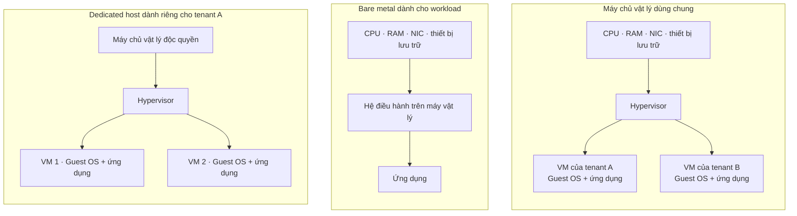

# Máy ảo, bare metal và dedicated host: mức độ kiểm soát và cô lập

Trong hạ tầng điện toán đám mây, một ứng dụng có thể chạy trên máy ảo (virtual machine – VM), trên máy chủ vật lý bare metal hoặc trên các VM được đặt trong một dedicated host. Cả ba cách triển khai đều cung cấp năng lực CPU, bộ nhớ, lưu trữ và mạng, nhưng khác nhau ở lớp ảo hóa, mức độ chia sẻ phần cứng, quyền kiểm soát và trách nhiệm vận hành.

Không có lựa chọn nào luôn tốt hơn hai lựa chọn còn lại. VM thường phù hợp khi cần cấp phát linh hoạt và mở rộng nhanh. Bare metal hữu ích khi workload cần truy cập phần cứng trực tiếp hoặc kiểm soát sâu hệ điều hành. Dedicated host phù hợp khi cần dành riêng một máy chủ vật lý cho một khách hàng, chẳng hạn để đáp ứng yêu cầu cấp phép phần mềm hoặc kiểm soát vị trí đặt VM. Muốn chọn đúng, cần phân biệt rõ **cách workload sử dụng phần cứng** với **cách nhà cung cấp phân bổ phần cứng cho khách hàng**.

## 1. Ba mô hình và điểm khác biệt cốt lõi

### Máy ảo (VM)

VM là một máy tính được mô phỏng bằng phần mềm trên một máy chủ vật lý. Một lớp hypervisor phân chia tài nguyên của máy chủ thành các máy tính logic. Mỗi VM có CPU ảo (vCPU), bộ nhớ, thiết bị lưu trữ và card mạng ảo; bên trong VM chạy hệ điều hành khách (guest OS) và ứng dụng riêng.

Trong mô hình cloud phổ biến, nhiều VM thuộc các khách hàng khác nhau có thể cùng chạy trên một máy chủ vật lý. Hypervisor chịu trách nhiệm lập lịch vCPU, ánh xạ bộ nhớ và cô lập các VM. Khách hàng thường quản lý guest OS, ứng dụng, dữ liệu, cấu hình mạng và quyền truy cập của mình; nhà cung cấp quản lý máy chủ vật lý và lớp ảo hóa.

VM tạo ra ranh giới vận hành rõ ràng: có thể tạo, nhân bản, khởi động lại, chụp snapshot hoặc xóa một máy mà không cần thao tác trực tiếp trên máy chủ vật lý. Điều này giúp tự động hóa triển khai, tạo môi trường thử nghiệm và mở rộng theo tải dễ dàng. Đổi lại, khách hàng phụ thuộc vào các loại thiết bị ảo, giới hạn cấu hình và tính năng mà nền tảng VM cung cấp.

### Bare metal

Bare metal là máy chủ vật lý mà workload sử dụng trực tiếp thông qua hệ điều hành được cài trên máy đó, không có lớp hypervisor do khách hàng sử dụng để chia máy thành các VM ở giữa ứng dụng và phần cứng. Khách hàng thường có quyền kiểm soát sâu hơn đối với kernel, driver, bộ lập lịch, cấu hình NUMA, thiết bị PCIe và một số tính năng hiệu năng của máy chủ.

Trong dịch vụ cloud bare metal, nhà cung cấp vẫn có thể quản lý nguồn điện, firmware, bộ điều khiển quản trị từ xa (BMC), mạng ngoài băng (out-of-band), quy trình cấp phát và giám sát phần cứng. Nền tảng cũng có thể dùng ảo hóa ở lớp mạng hoặc lưu trữ. Vì vậy, “bare metal” mô tả cách workload được cung cấp máy tính, chứ không có nghĩa toàn bộ hạ tầng xung quanh không dùng ảo hóa hay nhà cung cấp không còn quyền quản trị phần cứng.

Bare metal thường cấp cho một khách hàng quyền sử dụng độc quyền một máy chủ vật lý trong thời gian thuê. Nó giảm các lớp trung gian trong đường thực thi và tránh tình trạng nhiều tenant cùng tranh chấp CPU trên một host. Tuy nhiên, khách hàng phải tự chịu trách nhiệm nhiều hơn đối với hệ điều hành, bản vá, cấu hình, giám sát, dự phòng và khôi phục dịch vụ.

### Dedicated host

Dedicated host là một máy chủ vật lý được dành riêng cho một khách hàng. Khách hàng thường triển khai một hoặc nhiều VM trên host đó và có thể được cung cấp thông tin về host, số socket, số lõi vật lý hoặc vị trí đặt VM. Nhà cung cấp vẫn quản lý vòng đời phần cứng và lớp nền tảng theo hợp đồng dịch vụ.

Điểm chính của dedicated host là **quyền sử dụng riêng máy chủ vật lý**, không nhất thiết là quyền chạy ứng dụng trực tiếp trên phần cứng. Khách hàng có thể tiếp tục dùng hypervisor và VM như trước, nhưng các VM được đặt trên host dành riêng cho tenant đó. Một số nền tảng còn cho phép quản lý placement để giữ các VM liên quan trên cùng host hoặc trên các host được chỉ định.

Dedicated host thường hữu ích khi phần mềm được cấp phép theo socket, lõi vật lý hoặc máy chủ; khi cần chứng minh phần cứng không được chia sẻ với tenant khác; hoặc khi cần kiểm soát vị trí triển khai VM. Việc có dedicated host không tự động đồng nghĩa khách hàng được quyền thay firmware, truy cập BMC hay điều khiển mọi thành phần phần cứng. Những quyền này phụ thuộc dịch vụ và thỏa thuận với nhà cung cấp.

## 2. Kiến trúc triển khai

Sơ đồ sau minh họa vị trí của hệ điều hành và hypervisor trong ba mô hình. Dedicated host là thuộc tính phân bổ máy chủ vật lý; trên host đó khách hàng vẫn có thể chạy hypervisor và nhiều VM.

Sơ đồ đơn giản hóa kiến trúc để làm rõ ranh giới thực thi. Một nhà cung cấp có thể triển khai thêm lớp quản trị, mạng ảo, lưu trữ phân tán, mã hóa hoặc giám sát ở ngoài các khối trên.

Hai khái niệm thường bị nhầm lẫn cần được tách riêng:

- **VM và bare metal** nói về cách workload được cung cấp môi trường tính toán: máy logic qua hypervisor hay hệ điều hành chạy trên máy vật lý.
- **Shared host và dedicated host** nói về cách máy chủ vật lý được phân bổ giữa các khách hàng. Một VM có thể chạy trên host dùng chung hoặc dedicated host.

Do đó, VM không đồng nghĩa với shared host; VM trên dedicated host vẫn là VM. Tương tự, bare metal thường là máy vật lý dành riêng, nhưng cách nhà cung cấp định nghĩa và vận hành dịch vụ cần được kiểm tra trong tài liệu sản phẩm cụ thể.

## 3. So sánh mức độ kiểm soát và cô lập

| Tiêu chí | VM trên host dùng chung | Bare metal | VM trên dedicated host |
|---|---|---|---|
| Đơn vị được cấp phát | Máy tính logic | Máy chủ vật lý | Máy tính logic trên máy chủ vật lý dành riêng |
| Hypervisor trong đường thực thi của workload | Có | Thường không có hypervisor do khách hàng dùng để chia máy | Có |
| Chia sẻ máy chủ với tenant khác | Có thể có | Thông thường không | Không trên host được dành riêng |
| Quyền kiểm soát guest OS | Cao trong phạm vi VM | Cao đối với OS cài trực tiếp | Cao trong phạm vi VM |
| Kiểm soát phần cứng và topology | Giới hạn theo tính năng VM | Thường sâu nhất | Có thông tin và quyền placement tốt hơn VM dùng chung; quyền phần cứng vẫn tùy nhà cung cấp |
| Khả năng tạo/xóa nhanh | Thường rất tốt | Phụ thuộc thời gian cấp máy vật lý | Thường tốt với VM, nhưng phải tính đến năng lực host dành riêng |
| Trách nhiệm quản trị OS | Khách hàng quản lý guest OS | Khách hàng quản lý OS trên máy vật lý | Khách hàng quản lý guest OS; nhà cung cấp quản lý host và hypervisor theo dịch vụ |
| Chi phí khi sử dụng thấp | Thường dễ điều chỉnh theo quy mô VM | Có thể vẫn trả tiền cho toàn bộ máy | Có thể trả tiền cho toàn bộ host dù chỉ dùng một phần |

### Kiểm soát phần cứng

VM cung cấp một phần cứng ảo ổn định và dễ tự động hóa. Nhà cung cấp quyết định cách ánh xạ vCPU vào lõi vật lý, cách phân bổ bộ nhớ, loại NIC ảo và các giới hạn I/O. Một số dịch vụ cho phép chọn họ CPU, cấu hình tối ưu bộ nhớ, tăng tốc GPU, SR-IOV hoặc pinning; các tính năng này giúp VM tiến gần hơn đến hiệu năng phần cứng trực tiếp nhưng vẫn nằm trong giới hạn nền tảng.

Bare metal cho phép đội vận hành kiểm soát sâu hơn cách hệ điều hành sử dụng CPU và thiết bị. Ví dụ, ứng dụng có thể cấu hình CPU affinity, huge pages, NUMA locality, kernel module hoặc driver chuyên dụng. Mức độ kiểm soát thực tế vẫn phụ thuộc quyền truy cập được cấp: khách hàng có thể không được thay đổi BIOS, firmware hay cấu hình quản trị ngoài băng.

Dedicated host cung cấp quyền kiểm soát về vị trí đặt VM và mức độ độc quyền của host. Đây là lợi thế quan trọng khi cần biết VM đang chạy trên loại máy nào hoặc cần gắn workload với một host cụ thể. Tuy vậy, dedicated host không tự biến VM thành bare metal; ứng dụng vẫn chạy trong guest OS và đi qua lớp ảo hóa.

### Cô lập tenant và ranh giới bảo mật

VM dựa vào hypervisor để cô lập bộ nhớ, CPU ảo và thiết bị giữa các guest. Đây là mô hình cô lập phổ biến của cloud và phù hợp với phần lớn ứng dụng doanh nghiệp. Tuy nhiên, các VM trên host dùng chung vẫn có thể cùng sử dụng một số tài nguyên vật lý như cache CPU, băng thông bộ nhớ, PCIe, NIC hoặc thiết bị lưu trữ. Hypervisor và phần cứng cần được cập nhật, cấu hình và giám sát để giảm rủi ro từ lỗi phân tách hoặc lỗ hổng ở lớp nền tảng.

Dedicated host loại bỏ việc tenant khác chạy workload trên cùng máy chủ vật lý được dành riêng. Điều này giảm một nhóm rủi ro liên quan đến chia sẻ host và hỗ trợ yêu cầu kiểm soát vị trí phần cứng. Nhưng các VM trên cùng host vẫn chia sẻ tài nguyên của host và vẫn phụ thuộc vào hypervisor. Các dịch vụ mạng, DNS, lưu trữ, quản trị, sao lưu hoặc control plane của cloud cũng có thể là dịch vụ dùng chung.

Bare metal giảm sự phụ thuộc vào hypervisor trong đường thực thi và thường tránh việc tenant khác tranh chấp CPU hoặc bộ nhớ trên cùng máy chủ. Dẫu vậy, một máy bare metal vẫn có thể phụ thuộc vào mạng và lưu trữ dùng chung, hệ thống quản trị từ xa, firmware và quy trình vận hành của nhà cung cấp. Bare metal cũng không tự bảo vệ ứng dụng khỏi cấu hình sai, mã độc, lỗ hổng kernel, quyền truy cập quá rộng hoặc lỗi trong mạng.

Vì thế, cô lập vật lý chỉ giải quyết một phần của bài toán bảo mật. Khi đánh giá yêu cầu tuân thủ, cần xác định rõ đối tượng cần cô lập (CPU, bộ nhớ, host, mạng, lưu trữ hay dữ liệu), phạm vi tenant, quyền truy cập của nhân sự nhà cung cấp, cách mã hóa, lưu vết, quản lý khóa và bằng chứng kiểm toán. Không nên xem riêng nhãn “dedicated” hoặc “bare metal” là bằng chứng đầy đủ cho việc tuân thủ.

## 4. Hiệu năng và khả năng dự đoán

Không nên mặc định rằng mọi VM đều chậm hơn bare metal một tỷ lệ cố định. Hypervisor hiện đại hỗ trợ phần cứng ảo hóa nên chi phí bổ sung có thể nhỏ đối với nhiều workload. Khác biệt thường rõ hơn khi ứng dụng nhạy với độ trễ I/O, xử lý gói mạng ở tốc độ cao, truy cập thiết bị đặc thù, hoặc cần kiểm soát chính xác vị trí CPU và bộ nhớ.

Các yếu tố nên đánh giá gồm:

- **CPU:** số lõi, xung nhịp, kiến trúc CPU, SMT, mức độ tranh chấp và khả năng pinning. vCPU không nhất thiết tương đương một lõi vật lý được dành riêng liên tục.
- **Bộ nhớ:** dung lượng, băng thông, NUMA node, huge pages và hiện tượng truy cập bộ nhớ từ node xa. Với workload lớn, bố trí CPU và RAM không hợp lý có thể làm tăng độ trễ.
- **Mạng:** băng thông, packet-per-second, độ trễ, jitter, hàng đợi NIC và khả năng dùng SR-IOV hoặc thiết bị mạng chuyên dụng.
- **Lưu trữ:** IOPS, throughput, độ trễ, độ ổn định khi tải cao, cache và đường đi từ ứng dụng đến thiết bị lưu trữ.
- **Tính ổn định:** biến động hiệu năng theo thời gian, khi host bận, khi có hoạt động bảo trì hoặc khi hệ thống mở rộng.

Bare metal thường có lợi thế khi cần khai thác trực tiếp thiết bị, tối ưu kernel hoặc đạt hiệu năng ổn định trên một máy vật lý. Dedicated host cải thiện khả năng dự đoán bằng cách loại bỏ workload của tenant khác trên cùng host, nhưng hiệu năng VM vẫn chịu ảnh hưởng của hypervisor, cấu hình VM và các dịch vụ dùng chung. VM trên host dùng chung có thể đáp ứng tốt nếu chọn đúng họ máy, cấu hình và mức đảm bảo hiệu năng của nhà cung cấp.

Để so sánh có ý nghĩa, hãy chạy benchmark bằng dữ liệu và mẫu tải gần với thực tế. Đo throughput, p50/p95/p99 latency, CPU utilization, memory bandwidth, IOPS, packet loss và chi phí trên mỗi đơn vị công việc. Một phép đo CPU tổng hợp đơn lẻ không đủ để quyết định nền tảng cho cơ sở dữ liệu hoặc hệ thống mạng độ trễ thấp.

## 5. Chi phí và trách nhiệm vận hành

VM thường cho phép chọn cấu hình nhỏ, tăng giảm số lượng và tự động mở rộng theo tải. Cách tính tiền có thể theo thời gian chạy, cấu hình hoặc mức sử dụng tùy dịch vụ. Đây là lựa chọn thuận lợi khi tải biến động và có thể tận dụng cơ chế autoscaling hoặc lịch tắt máy ở môi trường phát triển.

Dedicated host thường được tính phí theo host hoặc dung lượng vật lý được đặt trước. Nếu chỉ sử dụng một phần nhỏ tài nguyên, chi phí trên mỗi workload có thể cao. Khi nhiều VM ổn định cùng sử dụng host, tỷ lệ khai thác tốt hơn có thể bù lại chi phí dành riêng. Cần đưa cả chi phí phần mềm vào phép tính: một số giấy phép thương mại tính theo socket hoặc lõi vật lý, nên khả năng xác định host và số lõi có thể làm tổng chi phí cấp phép dễ dự đoán hơn. Quy tắc cấp phép phải được xác nhận trực tiếp với nhà cung cấp phần mềm.

Bare metal thường yêu cầu trả tiền cho năng lực của máy vật lý trong thời gian cấp phát, kể cả khi tải giảm. Đội vận hành cũng cần đầu tư công sức cho cài đặt OS, cập nhật kernel và driver, giám sát phần cứng, quản lý dung lượng, sao lưu, thay máy khi hỏng và tự động hóa triển khai. Những chi phí này cần được tính vào tổng chi phí sở hữu (TCO), bên cạnh tiền thuê máy.

| Hạng mục trách nhiệm | VM | Bare metal | Dedicated host chạy VM |
|---|---|---|---|
| Máy chủ, nguồn điện, làm mát, thay phần cứng | Nhà cung cấp | Nhà cung cấp | Nhà cung cấp |
| Hypervisor và lớp quản trị host | Nhà cung cấp | Không có hypervisor khách hàng sử dụng trong đường thực thi; nền tảng quản trị vật lý vẫn do nhà cung cấp vận hành | Nhà cung cấp theo mô hình dịch vụ |
| Hệ điều hành workload | Khách hàng quản lý guest OS | Khách hàng quản lý OS cài trên máy vật lý | Khách hàng quản lý guest OS |
| Ứng dụng, dữ liệu, IAM và cấu hình bên trong workload | Khách hàng | Khách hàng | Khách hàng |
| Dự phòng ứng dụng, sao lưu và khôi phục | Khách hàng thiết kế theo dịch vụ sử dụng | Khách hàng thiết kế, phối hợp với khả năng của dịch vụ | Khách hàng thiết kế theo dịch vụ sử dụng |

Bảng trên mô tả phân chia trách nhiệm điển hình. Hợp đồng dịch vụ có thể thay đổi ranh giới, đặc biệt với dịch vụ bare metal được quản lý hoặc dịch vụ có hỗ trợ hệ điều hành. Cần đọc SLA và tài liệu trách nhiệm của nhà cung cấp trước khi đưa vào môi trường sản xuất.

## 6. Khi nào nên chọn từng mô hình?

### Chọn VM khi cần linh hoạt và mở rộng nhanh

VM là lựa chọn mặc định hợp lý cho nhiều ứng dụng web, API, dịch vụ nền, môi trường CI/CD, máy chủ phát triển và hệ thống doanh nghiệp thông thường. Mỗi thành phần có thể dùng một cấu hình phù hợp; nhóm vận hành có thể tạo image chuẩn, tự động triển khai, thay thế instance lỗi và mở rộng ngang khi lưu lượng tăng.

Ví dụ: một dịch vụ thương mại điện tử có thể chạy frontend và API trên các VM thuộc nhóm autoscaling. Khi lưu lượng tăng, hệ thống bổ sung VM; khi tải giảm, hệ thống thu hẹp nhóm máy. Cách này tránh phải duy trì một máy chủ vật lý lớn chỉ để đáp ứng giờ cao điểm.

### Chọn bare metal khi workload cần quyền kiểm soát sâu

Bare metal phù hợp với cơ sở dữ liệu hiệu năng cao cần tối ưu NUMA và I/O, workload HPC, xử lý gói mạng, thiết bị tăng tốc hoặc ứng dụng cũ phụ thuộc driver và kernel đặc thù. Nó cũng hữu ích khi cần loại bỏ lớp hypervisor khỏi đường thực thi để đo và kiểm soát hiệu năng ở mức thấp.

Ví dụ: một hệ thống xử lý gói mạng có thể cần NIC hỗ trợ tính năng phần cứng cụ thể, CPU affinity và huge pages để duy trì thông lượng cao. Nếu VM không cung cấp đủ quyền truy cập hoặc hiệu năng dự đoán, bare metal là phương án đáng thử nghiệm.

### Chọn dedicated host khi cần dành riêng máy chủ nhưng vẫn muốn dùng VM

Dedicated host phù hợp với ứng dụng có yêu cầu cấp phép theo socket/lõi, yêu cầu phần cứng không chia sẻ với tenant khác, hoặc nhu cầu kiểm soát placement của VM. Nó giữ được quy trình vận hành dựa trên VM, image, snapshot và tự động hóa hiện có, đồng thời cung cấp ranh giới phân bổ host rõ hơn.

Ví dụ: doanh nghiệp chạy phần mềm cơ sở dữ liệu thương mại có giấy phép tính theo lõi vật lý có thể đặt các VM cơ sở dữ liệu trên dedicated host. Nhóm vận hành theo dõi số lõi và vị trí host để quản lý giấy phép, trong khi vẫn triển khai và sao lưu workload ở cấp VM.

### Có thể kết hợp nhiều mô hình

Một hệ thống không cần buộc mọi thành phần chạy trên cùng một loại hạ tầng. Có thể dùng VM cho tầng web và API vì cần mở rộng nhanh; dedicated host cho phần mềm có ràng buộc cấp phép; bare metal cho một workload xử lý dữ liệu hoặc mạng có yêu cầu hiệu năng đặc biệt. Các thành phần vẫn kết nối qua mạng riêng, API, hàng đợi hoặc hệ thống lưu trữ phù hợp.

Khi kết hợp, cần tính đến độ trễ mạng giữa các tầng, phương án dự phòng, mã hóa khi truyền, giám sát xuyên môi trường và cách triển khai nhất quán. Một thành phần chạy bare metal không tự làm toàn bộ hệ thống có tính sẵn sàng cao; cần thiết kế nhiều node, sao chép dữ liệu và quy trình failover tương ứng.

## 7. Quy trình lựa chọn

Có thể dùng trình tự sau để quyết định thay vì chọn theo tên dịch vụ:

1. **Xác định ràng buộc bắt buộc.** Kiểm tra yêu cầu tuân thủ, cấp phép phần mềm, vị trí dữ liệu, loại CPU/GPU, driver, kernel và mức cô lập tenant. Nếu bắt buộc phải có host vật lý riêng, VM trên host dùng chung không đáp ứng yêu cầu đó.
2. **Đo đặc tính workload.** Thu thập CPU, RAM, IOPS, throughput mạng, packet-per-second và phân bố độ trễ. Xác định điểm nghẽn nằm ở CPU, bộ nhớ, mạng hay lưu trữ.
3. **Xác định mức kiểm soát cần thiết.** Nếu chỉ cần guest OS và tài nguyên ảo, VM có thể đủ. Nếu cần placement và host vật lý dành riêng, xem xét dedicated host. Nếu cần quyền điều khiển OS và thiết bị trực tiếp, đánh giá bare metal.
4. **Đánh giá khả năng vận hành.** Xem nhóm có thể quản lý patching, driver, monitoring, backup, thay máy, mở rộng và khôi phục ở mức vật lý hay không. Mức kiểm soát cao hơn thường đi kèm nhiều trách nhiệm hơn.
5. **Tính tổng chi phí sở hữu.** Bao gồm compute, lưu trữ, mạng, giấy phép, chi phí dự phòng, nhân lực vận hành và tài nguyên nhàn rỗi. So sánh chi phí trên mỗi giao dịch hoặc mỗi đơn vị xử lý hoàn thành.
6. **Thử nghiệm và kiểm chứng.** Chạy workload đại diện trên các phương án khả thi, đo hiệu năng ở tải bình thường và tải đỉnh, kiểm tra hành vi khi host hoặc node gặp sự cố, rồi mới chốt kiến trúc.

Một bảng quyết định sơ bộ:

| Nhu cầu chính | Phương án nên đánh giá đầu tiên | Điều cần xác minh |
|---|---|---|
| Ứng dụng phổ thông, tải biến động, cần autoscaling | VM | Giới hạn VM, loại CPU, SLA và chi phí theo tải |
| Phần mềm tính phí theo socket hoặc lõi vật lý | Dedicated host | Quy tắc cấp phép, cách đếm lõi và bằng chứng host riêng |
| Cần kiểm soát kernel, driver, NUMA hoặc NIC trực tiếp | Bare metal | Quyền truy cập phần cứng, thiết bị hỗ trợ và trách nhiệm vận hành |
| Cần tách host khỏi tenant khác nhưng muốn giữ quy trình VM | Dedicated host | Phạm vi dedicated, placement và dịch vụ dùng chung bên ngoài host |
| Cần môi trường thử nghiệm tạo/xóa thường xuyên | VM | Image chuẩn, tự động hóa và cơ chế thu hồi tài nguyên |
| Cần hiệu năng cao nhưng chưa rõ nút thắt | Benchmark VM trước, sau đó so sánh dedicated host/bare metal | Đo trên workload thật, không quyết định chỉ bằng thông số quảng cáo |

## 8. Những hiểu lầm thường gặp

- **“VM luôn chậm hơn bare metal.”** Không đúng trong mọi trường hợp. Với nhiều workload, chi phí ảo hóa nhỏ; cấu hình, I/O, mức tranh chấp và cách tối ưu mới quyết định kết quả thực tế.
- **“Dedicated host nghĩa là ứng dụng chạy trực tiếp trên máy vật lý.”** Không nhất thiết. Dedicated host thường cho phép triển khai VM trên máy chủ dành riêng.
- **“Bare metal nghĩa là không có bất kỳ lớp ảo hóa nào.”** Không chính xác. Workload có thể dùng OS trực tiếp trên máy vật lý trong khi mạng, lưu trữ hoặc control plane của cloud vẫn được ảo hóa.
- **“Host riêng bảo đảm tuân thủ.”** Host riêng chỉ giải quyết yêu cầu cô lập phần cứng ở một phạm vi nhất định. Tuân thủ còn phụ thuộc dữ liệu, danh tính, mã hóa, mạng, quy trình và bằng chứng kiểm toán.
- **“Có quyền root là kiểm soát toàn bộ phần cứng.”** Quyền quản trị OS không đồng nghĩa với quyền điều khiển firmware, BMC, switch mạng hoặc quy trình thay thế máy chủ.
- **“Bare metal luôn rẻ hơn nếu hiệu năng cao hơn.”** Cần so sánh chi phí trên mỗi đơn vị công việc và tính cả phần cứng nhàn rỗi, nhân lực, dự phòng và giấy phép.

## Kết luận

VM tối ưu sự linh hoạt và tự động hóa; bare metal tối ưu quyền kiểm soát trực tiếp đối với hệ điều hành và phần cứng; dedicated host dành riêng máy chủ vật lý cho một tenant nhưng vẫn có thể chạy VM. Khi thiết kế hạ tầng tính toán cloud, hãy xác định trước yêu cầu cô lập, hiệu năng, cấp phép và năng lực vận hành, sau đó kiểm chứng bằng benchmark và tổng chi phí sở hữu. Trong nhiều hệ thống, phối hợp cả ba mô hình cho từng workload sẽ tạo ra kiến trúc cân bằng hơn.
