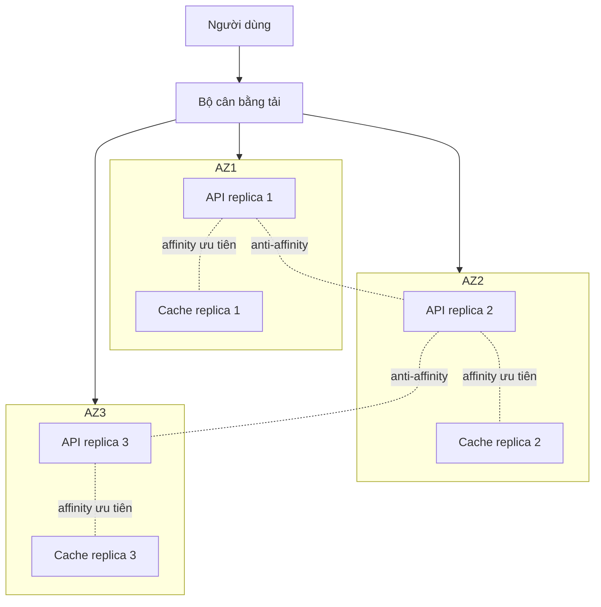

# Vị trí đặt máy, affinity và anti-affinity giữa các workload

Khi triển khai một ứng dụng trên đám mây, việc chọn số lượng máy ảo hoặc container mới chỉ giải quyết một nửa bài toán. Hệ thống còn phải quyết định **mỗi workload sẽ chạy ở đâu**: trên máy chủ vật lý nào, node nào, nhóm node nào, rack nào hoặc vùng sẵn sàng nào. Hai workload có thể chạy gần nhau để giảm độ trễ và tăng tốc trao đổi dữ liệu; ngược lại, các bản sao của cùng một dịch vụ có thể cần được đặt tách biệt để một sự cố không làm chúng ngừng hoạt động cùng lúc.

Các quy tắc mô tả quan hệ vị trí đó thường được gọi là **affinity** và **anti-affinity**. Chúng là một phần của kiến trúc hạ tầng tính toán trên đám mây, bên cạnh việc chọn mô hình máy ảo, container hay serverless, phân bổ CPU và bộ nhớ, thiết kế mạng, bảo mật, mở rộng tải, tính sẵn sàng và tối ưu chi phí. Hiểu đúng các quy tắc placement giúp hệ thống cân bằng giữa hiệu năng, khả năng chịu lỗi và hiệu quả sử dụng tài nguyên.

## 1. Placement là gì?

**Workload placement** là quá trình bộ lập lịch hoặc nền tảng hạ tầng chọn vị trí chạy cho một workload. Workload có thể là máy ảo (VM), container, Kubernetes Pod, tiến trình xử lý nền hoặc một nhóm dịch vụ phụ thuộc lẫn nhau.

Một hạ tầng đám mây thường có nhiều cấp vị trí:

| Cấp vị trí | Ý nghĩa | Ví dụ về mục tiêu thiết kế |
|---|---|---|
| Region | Khu vực địa lý của nhà cung cấp | Đáp ứng yêu cầu địa lý, độ trễ tới người dùng và khôi phục thảm họa |
| Availability Zone (AZ) | Vùng sẵn sàng độc lập tương đối trong một region | Giảm nguy cơ nhiều bản sao cùng bị ảnh hưởng bởi sự cố của một AZ |
| Zone hoặc failure domain | Phạm vi lỗi mà nền tảng dùng để phân chia tài nguyên; ý nghĩa cụ thể phụ thuộc nhà cung cấp | Phân tán workload theo miền lỗi |
| Rack hoặc nhóm máy chủ | Tập hợp máy chủ có thể dùng chung nguồn điện, mạng hoặc hạ tầng vật lý | Cô lập lỗi ở cấp rack và giảm tranh chấp tài nguyên |
| Host vật lý | Máy chủ vật lý chạy hypervisor hoặc container runtime | Đặt VM hoặc Pod trên các máy chủ khác nhau |
| Node hoặc node pool | Máy tính mà bộ lập lịch container quản lý; node pool thường gom các node có cấu hình hoặc mục đích tương tự | Chọn CPU, RAM, GPU, kiến trúc hoặc nhóm workload phù hợp |

Không phải nền tảng nào cũng cho phép người dùng nhìn thấy hoặc điều khiển mọi cấp. Nhà cung cấp có thể trừu tượng hóa rack và host, chỉ công bố AZ hoặc nhóm placement. Vì vậy, cần dùng đúng thuộc tính topology mà nền tảng cung cấp, không giả định rằng hai máy ảo có ID khác nhau chắc chắn nằm trên hai rack hoặc hai trung tâm dữ liệu khác nhau.

### Placement phải thỏa mãn nhiều điều kiện

Bộ lập lịch thường phải tìm một vị trí đồng thời đáp ứng các điều kiện sau:

- **Tài nguyên:** node có đủ CPU, bộ nhớ, dung lượng lưu trữ tạm, GPU hoặc tài nguyên chuyên dụng mà workload yêu cầu.
- **Khả năng tương thích:** hệ điều hành, kiến trúc CPU, hypervisor, thiết bị tăng tốc và runtime đáp ứng yêu cầu của workload.
- **Topology:** workload được đặt đúng hoặc tránh đúng host, node, zone hay region theo chính sách.
- **Mạng và dữ liệu:** vị trí có thể truy cập các dịch vụ phụ thuộc, volume lưu trữ và endpoint cần thiết với độ trễ phù hợp.
- **Bảo mật và tuân thủ:** workload chỉ chạy trên nhóm máy hoặc vùng được phép, chẳng hạn node chuyên dụng hoặc region đáp ứng yêu cầu lưu trữ dữ liệu.
- **Vận hành:** vị trí còn đủ năng lực khi node bảo trì, khi một AZ gặp sự cố hoặc khi hệ thống cần mở rộng.

Placement vì thế không chỉ là thao tác xếp container vào máy còn trống. Đây là quyết định kiến trúc ảnh hưởng trực tiếp đến hiệu năng, tính sẵn sàng, bảo mật và chi phí.

## 2. Affinity: đặt các workload có liên quan gần nhau

**Affinity** là quy tắc ưu tiên hoặc bắt buộc đặt một workload ở vị trí có quan hệ với một workload khác hoặc với một tập thuộc tính của hạ tầng. Mục tiêu phổ biến là giảm độ trễ, tăng tính cục bộ của dữ liệu hoặc giữ các thành phần cần phối hợp ở cùng một miền vị trí.

Ví dụ, một dịch vụ xử lý ảnh thường xuyên đọc dữ liệu từ cache cục bộ. Đặt hai workload gần nhau có thể giảm thời gian trao đổi qua mạng. Một workload cần GPU cũng có thể được ràng buộc vào node có nhãn GPU phù hợp.

Có hai nhóm quy tắc cần phân biệt:

**Node affinity** chọn node dựa trên nhãn hoặc thuộc tính của node. Ví dụ: chỉ chạy trên node có `accelerator=nvidia` hoặc `workload-tier=compute`.

**Workload affinity** chọn vị trí tương quan với workload khác. Ví dụ: đặt Pod của API cùng node với Pod cache có nhãn xác định, hoặc đặt một nhóm VM trong cùng một placement domain được nền tảng hỗ trợ.

Affinity có thể là:

- **Bắt buộc (hard constraint):** nếu không có vị trí thỏa mãn, workload không được lập lịch. Đây là lựa chọn phù hợp khi điều kiện là yêu cầu chức năng, bảo mật hoặc tương thích.
- **Ưu tiên (soft preference):** bộ lập lịch cố gắng đáp ứng nhưng vẫn có thể chọn vị trí khác nếu tài nguyên hoặc điều kiện hiện tại không cho phép. Đây thường là lựa chọn phù hợp khi mục tiêu là cải thiện hiệu năng.

Không nên dùng affinity bắt buộc chỉ vì muốn các workload ở gần nhau hơn. Khi node được ưu tiên hết tài nguyên, quy tắc cứng có thể khiến workload nằm ở trạng thái chờ dù các node khác vẫn còn khả năng chạy nó.

### Khi nào nên dùng affinity?

Affinity có ích trong những trường hợp có lợi ích vị trí rõ ràng và có thể đo lường:

1. **Giảm độ trễ giữa các thành phần giao tiếp thường xuyên.** Một worker và cache có thể được ưu tiên đặt cùng node hoặc cùng zone nếu lưu lượng trao đổi lớn.
2. **Tăng tính cục bộ của dữ liệu.** Workload xử lý dữ liệu có thể được ưu tiên chạy gần volume hoặc dịch vụ lưu trữ mà nó truy cập thường xuyên, nếu nền tảng hỗ trợ topology đó.
3. **Chọn phần cứng phù hợp.** Workload học máy có thể cần node GPU; workload tính toán hiệu năng cao có thể cần CPU hoặc kiến trúc cụ thể.
4. **Tách nhóm tài nguyên theo mục đích.** Dịch vụ nhạy cảm về độ trễ có thể được ưu tiên vào node pool hiệu năng cao, còn batch job chạy trên nhóm node tối ưu chi phí.

Affinity không tự động bảo đảm độ trễ thấp. Mạng vẫn có thể bị nghẽn, CPU và bộ nhớ vẫn có thể tranh chấp, còn topology vật lý có thể bị nền tảng che giấu. Sau khi đặt quy tắc, cần đo độ trễ thực tế và kiểm tra hành vi khi tải tăng.

## 3. Anti-affinity: tách các workload để giảm ảnh hưởng chung của sự cố

**Anti-affinity** là quy tắc yêu cầu hoặc ưu tiên đặt các workload có quan hệ ở những vị trí khác nhau. Mục tiêu quan trọng nhất là tránh để một sự cố đơn lẻ làm mất nhiều bản sao của cùng một dịch vụ.

Giả sử một API có ba bản sao. Nếu cả ba cùng chạy trên một host vật lý, sự cố nguồn điện hoặc phần cứng của host đó có thể làm cả dịch vụ ngừng hoạt động. Nếu ba bản sao được phân tán trên ba host, một lỗi host thường chỉ ảnh hưởng một bản sao. Nếu chúng tiếp tục được phân tán qua nhiều AZ, hệ thống có thể chịu được một số sự cố ở cấp AZ tốt hơn.

Anti-affinity thường được áp dụng ở nhiều cấp:

| Phạm vi tách biệt | Điều cần giảm thiểu | Điều kiện cần kiểm tra |
|---|---|---|
| Khác host hoặc node | Lỗi phần cứng, reboot hoặc bảo trì một máy | Có đủ node và dung lượng để đặt các bản sao |
| Khác rack hoặc failure domain | Lỗi nguồn điện, switch hoặc miền hạ tầng dùng chung | Nền tảng có công bố topology rack/failure domain hay không |
| Khác AZ | Sự cố diện rộng trong một vùng sẵn sàng | Ứng dụng, dữ liệu và mạng có hỗ trợ hoạt động đa AZ hay không |
| Khác region | Sự cố cấp khu vực hoặc yêu cầu khôi phục thảm họa | Cơ chế sao chép dữ liệu, định tuyến, RTO/RPO và chi phí liên vùng |

Tách biệt ở một cấp không đồng nghĩa đã tách biệt ở cấp cao hơn. Ba Pod ở ba node khác nhau nhưng cùng AZ vẫn có thể cùng chịu ảnh hưởng khi AZ đó mất kết nối. Tương tự, ba VM khác host nhưng cùng rack vẫn có thể bị ảnh hưởng bởi sự cố rack.

### Anti-affinity cứng và mềm

Anti-affinity cứng buộc các workload liên quan không được chia sẻ cùng miền topology. Cách này phù hợp khi một miền lỗi có thể làm mất toàn bộ bản sao hoặc khi yêu cầu cô lập là bắt buộc.

Anti-affinity mềm chỉ ưu tiên phân tán. Khi cụm thiếu node, bộ lập lịch vẫn có thể đặt nhiều workload cùng vị trí để giữ dịch vụ hoạt động. Cách này cải thiện khả năng được lập lịch nhưng mức cô lập sẽ giảm khi hạ tầng thiếu tài nguyên.

Một chính sách anti-affinity quá chặt có thể gây tác dụng ngược. Ví dụ, một dịch vụ có năm bản sao nhưng cụm chỉ có ba node. Nếu cấm tuyệt đối hai bản sao cùng node, hai Pod sẽ không thể được lập lịch. Cần quyết định rõ hệ thống ưu tiên duy trì số bản sao, duy trì mức cô lập hay chấp nhận giảm một trong hai khi tài nguyên thiếu.

## 4. Phân biệt affinity, anti-affinity và topology spread

Ba cơ chế này có liên quan nhưng giải quyết các bài toán khác nhau:

| Cơ chế | Câu hỏi mà quy tắc trả lời | Ví dụ |
|---|---|---|
| Node affinity | Workload được phép hoặc nên chạy trên node nào? | Chỉ chọn node có GPU |
| Pod/workload affinity | Workload nên hoặc phải ở gần workload nào? | Đặt worker gần cache |
| Pod/workload anti-affinity | Workload phải hoặc nên tránh vị trí có workload nào? | Không đặt hai bản sao API trên cùng host |
| Topology spread | Các bản sao cần được phân bố cân bằng giữa các miền topology nào? | Chia ba bản sao qua ba AZ với độ lệch tối đa là một |

Anti-affinity thường mô tả điều cần tránh, còn topology spread mô tả mức phân bố mong muốn giữa nhiều miền. Với dịch vụ có nhiều bản sao, topology spread có thể diễn đạt mục tiêu cân bằng rõ ràng hơn việc liệt kê từng cặp Pod phải tách nhau.

## 5. Ví dụ với Kubernetes

Kubernetes cung cấp `nodeSelector`, `nodeAffinity`, `podAffinity`, `podAntiAffinity` và `topologySpreadConstraints` để điều khiển vị trí Pod. Các ví dụ dưới đây minh họa những mẫu thường gặp; tên nhãn topology cần được đối chiếu với nhãn thực tế của cluster.

### 5.1. Chỉ chạy trên node có GPU

Node được quản trị viên gắn nhãn `accelerator=nvidia`. Pod có thể yêu cầu node mang nhãn này:

```yaml
apiVersion: v1
kind: Pod
metadata:
  name: image-inference
  labels:
    app: image-inference
spec:
  nodeSelector:
    accelerator: nvidia
  containers:
    - name: inference
      image: example/image-inference:1.0
      resources:
        requests:
          cpu: "2"
          memory: "4Gi"
        limits:
          nvidia.com/gpu: 1
```

`nodeSelector` là điều kiện bắt buộc đơn giản. Nếu cần biểu diễn nhiều điều kiện, toán tử hoặc mức ưu tiên, có thể dùng `nodeAffinity`. Nhãn chỉ giúp chọn node phù hợp; để cấp thiết bị GPU cho container, node cần có device plugin công bố tài nguyên mở rộng và Pod phải yêu cầu tài nguyên đó. Tên tài nguyên cụ thể phụ thuộc loại GPU và plugin. Nhãn node phải được quản lý đáng tin cậy, đồng thời quyền sửa nhãn node cần được giới hạn bằng RBAC và chính sách admission.

### 5.2. Ưu tiên đặt API gần cache

Giả sử Pod cache có nhãn `app: product-cache`. API có thể ưu tiên được lập lịch trên cùng node với cache:

```yaml
apiVersion: apps/v1
kind: Deployment
metadata:
  name: product-api
spec:
  replicas: 3
  selector:
    matchLabels:
      app: product-api
  template:
    metadata:
      labels:
        app: product-api
    spec:
      affinity:
        podAffinity:
          preferredDuringSchedulingIgnoredDuringExecution:
            - weight: 80
              podAffinityTerm:
                topologyKey: kubernetes.io/hostname
                labelSelector:
                  matchLabels:
                    app: product-cache
      containers:
        - name: api
          image: example/product-api:1.0
          resources:
            requests:
              cpu: "500m"
              memory: "512Mi"
```

Ở đây, `kubernetes.io/hostname` xác định topology theo node. Từ khóa `preferred` cho biết đây là ưu tiên; nếu node phù hợp không còn tài nguyên, Pod vẫn có thể được đặt ở node khác. Cần xác nhận cache thực sự có mặt trên các node mong muốn và đo xem việc đặt gần nhau có cải thiện độ trễ hay không.

### 5.3. Phân tán các bản sao API qua node và AZ

Với dịch vụ cần tính sẵn sàng cao, có thể vừa ưu tiên đặt các bản sao trên host khác nhau, vừa yêu cầu phân bố cân bằng giữa các AZ. Ví dụ sau dùng anti-affinity mềm theo hostname và topology spread bắt buộc theo zone:

```yaml
apiVersion: apps/v1
kind: Deployment
metadata:
  name: checkout-api
spec:
  replicas: 3
  selector:
    matchLabels:
      app: checkout-api
  template:
    metadata:
      labels:
        app: checkout-api
    spec:
      affinity:
        podAntiAffinity:
          preferredDuringSchedulingIgnoredDuringExecution:
            - weight: 100
              podAffinityTerm:
                topologyKey: kubernetes.io/hostname
                labelSelector:
                  matchLabels:
                    app: checkout-api
      topologySpreadConstraints:
        - maxSkew: 1
          topologyKey: topology.kubernetes.io/zone
          whenUnsatisfiable: DoNotSchedule
          labelSelector:
            matchLabels:
              app: checkout-api
      containers:
        - name: api
          image: example/checkout-api:1.0
          ports:
            - containerPort: 8080
          resources:
            requests:
              cpu: "500m"
              memory: "512Mi"
```

Trong ví dụ:

- `replicas: 3` yêu cầu ba Pod.
- Anti-affinity ưu tiên đặt các Pod trên những node khác nhau. Vì là `preferred`, Kubernetes vẫn có thể xếp chung node nếu cần.
- `topologyKey: topology.kubernetes.io/zone` yêu cầu bộ lập lịch xem nhãn zone là ranh giới phân bố.
- `maxSkew: 1` giới hạn chênh lệch số Pod giữa các zone đủ điều kiện ở mức một.
- `DoNotSchedule` khiến Pod không được đặt nếu việc đặt đó làm vi phạm giới hạn phân bố.

Để cấu hình này hoạt động, các node phải có nhãn zone chính xác và cluster phải có đủ tài nguyên ở các zone. Nếu một zone không có node phù hợp hoặc thiếu CPU/RAM, Pod có thể ở trạng thái `Pending`. Khi triển khai thực tế, cần kiểm tra số zone, nhãn topology, tài nguyên khả dụng và hành vi khi một zone bị mất.

Các trường `requiredDuringSchedulingIgnoredDuringExecution` và `preferredDuringSchedulingIgnoredDuringExecution` cũng cần được hiểu đúng: quy tắc được xét khi lập lịch Pod. Phần `IgnoredDuringExecution` có nghĩa thay đổi topology sau khi Pod đã chạy không tự động làm Pod bị di chuyển chỉ vì quy tắc không còn đúng.

## 6. Placement trong môi trường máy ảo và dịch vụ đám mây

Với VM, nhà cung cấp thường cung cấp một số chính sách hoặc nhóm placement. Tên gọi và khả năng cụ thể khác nhau giữa các nền tảng, nhưng thường có ba mục tiêu:

- **Cluster hoặc tập trung:** đặt các VM gần nhau về mặt hạ tầng để tối ưu độ trễ hoặc thông lượng giữa chúng. Phù hợp với workload phân tán cần trao đổi dữ liệu thường xuyên, nhưng cần đánh giá miền lỗi mà các VM cùng chia sẻ.
- **Spread hoặc phân tán:** đặt các VM trên các host hoặc miền lỗi khác nhau để tăng khả năng chịu lỗi. Phù hợp với các bản sao dịch vụ cần hoạt động độc lập.
- **Partition:** chia VM thành các nhóm phân vùng; các VM trong cùng phân vùng có thể chia sẻ miền lỗi, còn các phân vùng được tách biệt theo khả năng mà nền tảng công bố. Mẫu này hữu ích cho hệ thống phân tán có nhiều node và cần giới hạn ảnh hưởng của một sự cố.

Trước khi chọn chính sách, cần đọc giới hạn của nhà cung cấp: số VM tối đa trong nhóm, phạm vi region/AZ, loại instance được hỗ trợ, giới hạn tài nguyên và hành vi khi host bảo trì. Không nên suy luận rằng một nhóm có tên “spread” chắc chắn bảo đảm tách biệt qua nhiều AZ nếu tài liệu nền tảng chỉ cam kết tách host trong cùng AZ.

Với dịch vụ container được quản lý, quyền kiểm soát placement có thể bị giới hạn ở node pool, zone và các chính sách scheduler. Với serverless, người dùng thường không kiểm soát host hoặc node; khi đó cần thiết kế khả năng sẵn sàng thông qua số instance, cấu hình concurrency, phân vùng dữ liệu, timeout, retry và khả năng phục hồi của dịch vụ phụ thuộc.

## 7. Ví dụ thiết kế: dịch vụ thương mại điện tử nhiều bản sao

Giả sử hệ thống có API xử lý đơn hàng, cache sản phẩm và worker xử lý tác vụ nền. Một phương án placement có thể là:

| Workload | Chính sách vị trí | Lý do |
|---|---|---|
| Các bản sao API | Phân tán qua nhiều node và AZ | Một lỗi node hoặc AZ không nên làm mất toàn bộ API |
| Cache sản phẩm | Có thể chạy nhiều bản sao; ưu tiên gần API trong cùng zone nếu phép đo cho thấy có lợi | Giảm độ trễ đọc, đồng thời tránh tạo một cache duy nhất thành điểm lỗi |
| Worker nền | Chạy trên node pool riêng hoặc nhóm node ưu tiên chi phí; giới hạn tài nguyên | Tránh batch job chiếm CPU/RAM của API nhạy cảm về độ trễ |
| Cơ sở dữ liệu | Dùng cơ chế HA/replication của hệ quản trị hoặc dịch vụ dữ liệu; kiểm tra topology của primary và replica | Placement của ứng dụng không thay thế được tính sẵn sàng và nhất quán của dữ liệu |

Giả sử API có ba bản sao, phân bố trên ba AZ. Nếu một AZ gặp sự cố, hai AZ còn lại cần đủ CPU và bộ nhớ để phục vụ tải chuyển sang. Vì vậy, thiết kế phải dự trù **năng lực dự phòng**; chỉ phân tán bản sao mà không có dung lượng thay thế thì hệ thống có thể vẫn quá tải sau sự cố.

Cache có thể được đặt gần API để giảm độ trễ, nhưng các bản sao cache cũng cần được phân tán để tránh một lỗi làm mất toàn bộ cache. Nếu cache chỉ lưu dữ liệu có thể tái tạo, hệ thống có thể chấp nhận khởi tạo lại sau sự cố. Nếu cache chứa trạng thái quan trọng hoặc dữ liệu duy nhất, cần xem lại vai trò của nó và dùng cơ chế lưu trữ bền vững phù hợp.

Worker nền thường có thể chịu độ trễ cao hơn API. Đưa worker vào node pool riêng giúp giới hạn ảnh hưởng của tác vụ CPU-intensive. Tuy nhiên, node pool riêng có thể làm tăng chi phí và tạo ra tài nguyên nhàn rỗi; nên cân nhắc autoscaling, priority và giới hạn tài nguyên thay vì tách cứng mọi workload.

## 8. Tác động tới CPU, bộ nhớ, mạng, lưu trữ, bảo mật và chi phí

### CPU và bộ nhớ

Affinity có thể tập trung workload lên một nhóm node, giúp tận dụng tài nguyên và giảm trao đổi qua mạng. Nhưng tập trung quá mức dễ tạo điểm nóng CPU hoặc bộ nhớ. Anti-affinity giúp phân tán tải, song có thể làm tăng số node cần duy trì và giảm hiệu quả đóng gói workload.

Khi đánh giá placement, cần xem cả `requests` và `limits` của container, mức sử dụng thực tế, hiện tượng throttling CPU, áp lực bộ nhớ và tỷ lệ sử dụng từng node. Một node còn CPU nhưng thiếu RAM vẫn không thể nhận Pod; tổng tài nguyên còn trống của cluster không bảo đảm có một node riêng lẻ đủ điều kiện.

### Mạng

Đặt các workload giao tiếp nhiều trong cùng node hoặc zone có thể giảm một phần độ trễ và lưu lượng liên vùng. Đổi lại, tập trung chúng trong cùng miền lỗi có thể làm tăng ảnh hưởng khi node hoặc zone gặp sự cố. Cần đo latency, throughput, packet loss và chi phí truyền dữ liệu liên zone/region để xác định mức placement phù hợp.

### Lưu trữ

Volume có thể gắn với một zone hoặc có giới hạn topology. Pod sử dụng volume đó phải được lập lịch tới node có thể truy cập volume. Nếu ép Pod sang zone khác bằng anti-affinity hoặc topology spread mà storage không hỗ trợ truy cập liên zone, Pod có thể không khởi động được. Với workload stateful, hãy kiểm tra topology của PersistentVolume, StorageClass, cơ chế replication và quy trình failover trước khi đặt quy tắc.

### Bảo mật và cô lập

Node affinity, taint và toleration có thể giúp workload nhạy cảm chạy trên node pool chuyên dụng. Ví dụ, workload xử lý dữ liệu nhạy cảm chỉ được đặt trên nhóm node có kiểm soát truy cập phù hợp. Tuy nhiên, nhãn node và quy tắc scheduler chỉ là một lớp kiểm soát; vẫn cần IAM/RBAC, network policy, mã hóa, quản lý secret, vá lỗi và hardening node. Anti-affinity cũng có thể giảm rủi ro chia sẻ hạ tầng giữa các workload, nhưng không thay thế ranh giới bảo mật.

### Chi phí

Phân tán workload qua nhiều node, AZ hoặc region thường tăng khả năng chịu lỗi nhưng có thể cần thêm máy, tăng lưu lượng truyền dữ liệu và tăng chi phí lưu trữ bản sao. Tập trung workload có thể cải thiện mức sử dụng tài nguyên nhưng làm tăng rủi ro lỗi chung và tranh chấp tài nguyên. Nên chọn mức phân tán theo SLO, RTO/RPO và tác động kinh doanh của sự cố, sau đó kiểm tra chi phí ở cả trạng thái bình thường lẫn khi một miền lỗi ngừng hoạt động.

## 9. Quy trình thiết kế chính sách placement

Có thể áp dụng quy trình sau cho VM, container hoặc node pool:

1. **Xác định mục tiêu dịch vụ.** Ghi rõ SLO về độ trễ và tính sẵn sàng, RTO/RPO, mức tải đỉnh, yêu cầu tuân thủ và ngân sách.
2. **Liệt kê workload và quan hệ phụ thuộc.** Xác định thành phần nào cần giao tiếp nhanh, thành phần nào cần tách biệt, dữ liệu nào có topology cố định.
3. **Chọn miền topology phù hợp.** Quyết định cần đặt gần nhau hoặc tách nhau ở cấp node, host, rack, AZ hay region. Dùng cấp nhỏ nhất đáp ứng mục tiêu, nhưng không bỏ qua miền lỗi lớn hơn.
4. **Xác định điều kiện cứng và ưu tiên mềm.** Chỉ dùng điều kiện cứng cho yêu cầu bắt buộc. Những tối ưu về hiệu năng thường nên bắt đầu bằng ưu tiên mềm rồi đo kết quả.
5. **Kiểm tra năng lực và khả năng lập lịch.** Tính CPU, RAM, GPU, storage, số node và dung lượng dự phòng khi mất một node hoặc một AZ.
6. **Kiểm thử tình huống lỗi.** Thử drain node, mất node, mất zone, tăng tải và thiếu tài nguyên. Quan sát Pod/VM có được đặt lại đúng chính sách hay không.
7. **Theo dõi và điều chỉnh.** Giám sát phân bố workload, tài nguyên từng node, độ trễ, lỗi lập lịch, chi phí liên vùng và mức độ đáp ứng SLO. Điều chỉnh khi topology hoặc tải thay đổi.

Sơ đồ dưới đây thể hiện cách một dịch vụ có thể kết hợp hai mục tiêu: đặt gần thành phần phụ thuộc khi cần hiệu năng, đồng thời phân tán các bản sao quan trọng qua các miền lỗi.



Sơ đồ là mô hình khái niệm: việc phân tán thực tế còn phụ thuộc năng lực từng AZ, bộ lập lịch, cấu hình lưu trữ và cách ứng dụng xử lý khi một bản sao hoặc cả AZ không khả dụng.

## 10. Lỗi thiết kế thường gặp

**Chỉ tách node mà quên AZ.** Các bản sao nằm trên host khác nhau nhưng cùng AZ vẫn có thể cùng ngừng hoạt động khi AZ gặp sự cố. Hãy xác định rõ miền lỗi mà SLO yêu cầu phải chịu được.

**Đặt anti-affinity cứng nhưng không đủ node.** Pod bị `Pending` dù cluster còn tổng tài nguyên. Kiểm tra điều kiện theo từng node và số miền topology; cân nhắc ưu tiên mềm hoặc bổ sung năng lực.

**Tạo affinity quá chặt cho tối ưu nhỏ.** Một lợi ích độ trễ chưa được đo có thể khiến workload khó mở rộng hoặc khó phục hồi. Bắt đầu với preference và xác minh bằng số liệu.

**Không kiểm tra topology của volume.** Pod được yêu cầu chuyển zone nhưng volume chỉ gắn được trong zone cũ. Phải thiết kế storage và placement cùng nhau.

**Cho rằng phân tán bản sao đồng nghĩa có HA.** Ứng dụng còn cần health check, readiness, cân bằng tải, retry có giới hạn, xử lý lỗi phụ thuộc, replication dữ liệu và năng lực dự phòng.

**Dùng placement như ranh giới bảo mật duy nhất.** Vị trí chạy không thay thế xác thực, phân quyền, mã hóa, network policy hoặc hardening.

**Không thử nghiệm khi thiếu tài nguyên.** Chính sách có thể hoạt động tốt khi cluster đầy đủ nhưng thất bại lúc node bảo trì hoặc AZ mất. Hãy kiểm thử kịch bản suy giảm có kiểm soát.

## 11. Checklist trước khi đưa vào vận hành

- [ ] Đã xác định workload nào cần gần nhau và workload nào cần tách nhau.
- [ ] Đã chọn đúng cấp topology: node, host, rack, AZ hoặc region.
- [ ] Đã phân biệt điều kiện bắt buộc với ưu tiên mềm.
- [ ] Đã kiểm tra CPU, bộ nhớ, GPU, storage và số node phù hợp.
- [ ] Đã xác minh nhãn topology và thuộc tính placement do nền tảng cung cấp.
- [ ] Đã kiểm tra volume, network và dịch vụ phụ thuộc có tương thích với vị trí dự kiến.
- [ ] Đã dự trù năng lực khi mất một node hoặc một AZ.
- [ ] Đã kiểm thử drain node, mất miền lỗi và tình huống thiếu tài nguyên.
- [ ] Đã có giám sát cho lỗi lập lịch, phân bố workload, độ trễ và chi phí.
- [ ] Đã rà soát lại chính sách khi số bản sao, topology hoặc tải thay đổi.

## 12. Kết luận

Affinity giúp đặt các workload có quan hệ gần nhau để cải thiện tính cục bộ, độ trễ hoặc khả năng sử dụng phần cứng. Anti-affinity giúp phân tán các workload để giới hạn ảnh hưởng của lỗi chung. Node affinity chọn nơi workload được phép chạy; topology spread kiểm soát mức phân bố của nhiều bản sao qua các miền topology.

Không có một chính sách placement phù hợp cho mọi workload. Quyết định tốt phải bắt đầu từ SLO, quan hệ phụ thuộc và miền lỗi cần chịu được; sau đó cân bằng với CPU, bộ nhớ, mạng, lưu trữ, bảo mật và chi phí. Một cấu hình chỉ được xem là phù hợp khi nó vẫn đáp ứng mục tiêu trong điều kiện tải cao, thiếu tài nguyên và có sự cố hạ tầng.
