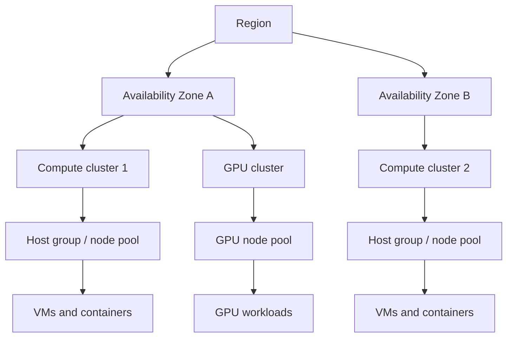
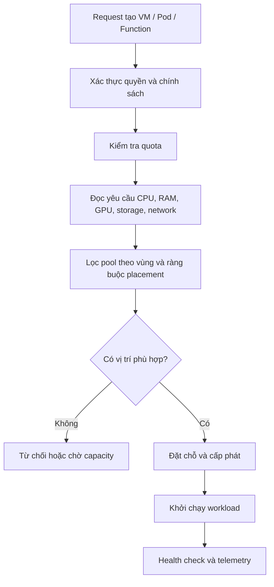

# Capacity pool, hạn mức tài nguyên và khả năng cấp phát thực tế

## Bối cảnh: có quota không có nghĩa là luôn tạo được tài nguyên

Khi triển khai máy ảo, pod hoặc hàm serverless, người dùng thường khai báo nhu cầu CPU, bộ nhớ, lưu trữ, mạng và số lượng bản sao. Nền tảng phải kiểm tra nhiều điều kiện trước khi biến yêu cầu đó thành tài nguyên đang chạy: tài khoản còn hạn mức hay không, pool có đủ năng lực hay không, có máy chủ hoặc node phù hợp hay không, và các ràng buộc về vùng, kiến trúc CPU, GPU, mạng hoặc chính sách có được đáp ứng hay không.

Ba khái niệm cần phân biệt là:

- **Capacity pool (pool năng lực tài nguyên)** là tập hợp tài nguyên được quản lý và phân bổ trong một phạm vi xác định, chẳng hạn một cụm máy chủ, node pool, vùng khả dụng hoặc nhóm máy chủ GPU.
- **Quota (hạn mức)** là giới hạn mức sử dụng mà một tài khoản, dự án, namespace hoặc nhóm người dùng được phép tiêu thụ theo từng loại tài nguyên.
- **Actual allocation (khả năng cấp phát thực tế)** là việc bộ lập lịch hoặc bộ phân bổ tìm được tài nguyên phù hợp và dành tài nguyên đó cho workload tại thời điểm yêu cầu.

Quota cho biết người dùng được phép yêu cầu tối đa bao nhiêu. Capacity cho biết nền tảng có bao nhiêu năng lực trong một phạm vi. Khả năng cấp phát thực tế phụ thuộc đồng thời vào cả hai, cùng các điều kiện placement và trạng thái tức thời của hệ thống. Một dự án còn quota vẫn có thể không tạo được VM vì pool đã hết năng lực phù hợp. Ngược lại, cụm còn nhiều CPU và RAM nhưng tài khoản đã chạm quota thì yêu cầu vẫn bị từ chối.

Trong module **CLOUD_CORE_SERVICES_COMPUTE**, hiểu đúng mối quan hệ này giúp lựa chọn mô hình compute, lập kế hoạch CPU và bộ nhớ, thiết kế node pool, mở rộng tải, bảo đảm tính sẵn sàng và kiểm soát chi phí vận hành.

## 1. Capacity pool và các lớp dung lượng

### 1.1. Capacity pool là gì?

Capacity pool gom các tài nguyên có thể được xem xét cùng nhau khi cấp phát workload. Ranh giới pool phụ thuộc vào kiến trúc của nền tảng. Một nhà cung cấp có thể tổ chức pool theo vùng khả dụng, loại máy, thế hệ CPU, cụm hypervisor hoặc nhóm máy chủ chuyên dụng. Trong Kubernetes, node pool thường gom các worker node có cấu hình và chính sách mở rộng tương tự. Một nền tảng serverless có thể quản lý các pool thực thi nội bộ mà người dùng không nhìn thấy trực tiếp.

Một pool có thể được mô tả bằng nhiều thuộc tính:

- Phạm vi địa lý và lỗi: region, availability zone, cluster hoặc rack.
- Loại năng lực: CPU phổ thông, CPU tối ưu tính toán, bộ nhớ lớn, GPU, accelerator hoặc máy có local SSD.
- Dung lượng theo từng chiều: vCPU, RAM, GPU, dung lượng đĩa, IOPS, thông lượng mạng và số slot thực thi.
- Quy tắc sử dụng: tenant được phép dùng, workload được phép đặt, mức overcommit, reservation và headroom dự phòng.
- Chính sách mở rộng: số node tối thiểu/tối đa, loại instance có thể bổ sung và thời gian để capacity mới sẵn sàng.

Không phải mọi tài nguyên đều có thể thay thế cho nhau. Một pool còn 100 vCPU nhưng không có GPU vẫn không thể đáp ứng một workload cần GPU. Hai pool có cùng số vCPU nhưng khác kiến trúc CPU, vùng triển khai, tốc độ mạng hoặc loại lưu trữ cũng có thể không tương đương đối với ứng dụng.

### 1.2. Các khái niệm dung lượng cần tách biệt

| Khái niệm | Ý nghĩa | Ví dụ |
|---|---|---|
| Installed / physical capacity | Tổng năng lực phần cứng đã được đưa vào hệ thống | Tổng số core CPU và RAM của các host |
| Platform-reserved capacity | Phần dành cho hypervisor, hệ điều hành host, daemon và dịch vụ nền tảng | CPU/RAM không đưa vào bộ lập lịch cho workload tenant |
| Allocatable capacity | Năng lực nền tảng cho phép phân bổ sau khi trừ phần dành cho hệ thống | CPU và RAM mà scheduler có thể xem xét |
| Committed / allocated capacity | Năng lực đã được workload hoặc reservation chiếm dụng theo chính sách của pool | Tài nguyên đã gán cho VM hoặc pod |
| Nominal free capacity | Phần allocatable còn lại theo phép tính tổng hợp | Allocatable trừ phần đã cam kết |
| Schedulable capacity | Phần còn lại thực sự phù hợp với yêu cầu placement cụ thể | Một node còn đủ CPU, RAM và GPU cho pod |
| Safety headroom | Phần để dành cho tăng tải, lỗi node, nâng cấp hoặc dao động nhu cầu | Dung lượng N+1 hoặc 15% dự phòng theo chính sách nội bộ |

Một công thức khái quát để tính phần dung lượng có thể xem xét cho yêu cầu mới là:

```text
nominal_free = allocatable_capacity - committed_capacity
usable_for_new_workload = nominal_free - safety_headroom
```

Trong phép tính này, `committed_capacity` cần được định nghĩa nhất quán theo chính sách pool. Nếu reservation đã được tính là một phần của committed capacity thì không trừ reservation lần thứ hai. `usable_for_new_workload` vẫn là số liệu tổng hợp; bộ lập lịch còn phải xét loại tài nguyên, vị trí và các ràng buộc của workload.

### 1.3. Pool thường được tổ chức theo nhiều cấp

Một hệ thống có thể có pool ở cấp vùng, cụm, nhóm host và node. Một yêu cầu được gửi đến vùng có thể tiếp tục được giới hạn vào một availability zone, một loại máy và một nhóm node cụ thể. Dung lượng ở pool cha không tự động có nghĩa là mọi pool con đều có chỗ trống.



Sơ đồ thể hiện một cách tổ chức khái niệm. Tên gọi và số cấp thực tế thay đổi theo nhà cung cấp hoặc nền tảng.

## 2. Quota: người dùng được phép tiêu thụ bao nhiêu?

Quota giới hạn mức sử dụng tài nguyên của một phạm vi quản trị. Phạm vi đó có thể là organization, account, project, subscription, namespace hoặc tenant. Quota giúp chia sẻ một hạ tầng chung có kiểm soát, tránh một nhóm tiêu thụ hết tài nguyên và hỗ trợ quản lý ngân sách, bảo mật cũng như kế hoạch năng lực.

Các quota thường gặp gồm:

- Tổng vCPU hoặc số lượng instance theo họ máy.
- Tổng RAM, số VM, số node hoặc số pod.
- Số GPU hoặc accelerator theo loại.
- Dung lượng volume, số volume, snapshot hoặc IOPS được phép cấu hình.
- Số địa chỉ IP, load balancer, public IP hoặc tài nguyên mạng.
- Số lần gọi, concurrency tối đa, bộ nhớ mỗi lần chạy hoặc số hàm serverless.

Quota có thể được áp dụng ở nhiều cấp. Ví dụ, tổ chức có quota tổng 500 vCPU, một dự án có quota 100 vCPU và một namespace có ResourceQuota 20 vCPU. Việc tạo workload phải tuân thủ tất cả các hạn mức áp dụng trên đường cấp phát. Một giới hạn ở cấp con có thể thấp hơn hạn mức của cấp cha.

### 2.1. Quota không phải là capacity reservation

Quota thường là **trần tiêu thụ được phép**. Nó không nhất thiết dành sẵn một lượng CPU hoặc RAM vật lý cho tài khoản. Nếu một dự án được cấp quota 100 vCPU, điều đó có nghĩa dự án có thể tiêu thụ tối đa mức đó khi các điều kiện khác cho phép; không có nghĩa 100 vCPU đang được giữ riêng trong một pool.

**Capacity reservation** là cơ chế giữ trước một phần năng lực trong một phạm vi cụ thể để tăng khả năng có tài nguyên khi cần. Reservation thường gắn với loại instance, vùng, thời gian hoặc đối tượng sử dụng. Điều kiện, thời hạn và chi phí của reservation phụ thuộc nền tảng. Có quota mà không có reservation vẫn có thể gặp thiếu capacity; có reservation nhưng hết quota cũng có thể không sử dụng được nếu quota vẫn được áp dụng.

| Cơ chế | Trả lời câu hỏi | Bảo đảm chính |
|---|---|---|
| Quota | Tài khoản được phép dùng tối đa bao nhiêu? | Giới hạn quyền tiêu thụ theo phạm vi quản trị |
| Capacity pool | Năng lực nào đang có trong phạm vi này? | Tập tài nguyên mà hệ thống có thể phân bổ |
| Reservation | Phần năng lực nào đã được giữ trước cho đối tượng cụ thể? | Mức ưu tiên hoặc quyền sử dụng capacity theo điều khoản reservation |
| Request | Workload cần tối thiểu bao nhiêu để được lập lịch? | Nhu cầu dùng cho quyết định placement hoặc cấp phát |
| Limit | Workload được phép tiêu thụ tối đa bao nhiêu? | Giới hạn thực thi hoặc giới hạn cấu hình theo cơ chế nền tảng |

### 2.2. Quota, request và limit trong container

Trong Kubernetes, `requests` của container được dùng để lập lịch pod và là cơ sở cho một số phép tính quota. `limits` đặt giới hạn tài nguyên khi container chạy, với cách thực thi tùy loại tài nguyên. CPU limit thường được thực thi bằng throttling; memory limit có thể khiến container bị OOM kill khi vượt giới hạn. `ResourceQuota` giới hạn tổng mức tiêu thụ hoặc số lượng đối tượng trong namespace.

Ví dụ quota cho namespace `payments`:

```yaml
apiVersion: v1
kind: ResourceQuota
metadata:
  name: payments-compute-budget
  namespace: payments
spec:
  hard:
    requests.cpu: "20"
    requests.memory: 40Gi
    limits.cpu: "40"
    limits.memory: 80Gi
    pods: "50"
```

Quota trên giới hạn tổng CPU request ở mức 20 core, tổng memory request ở mức 40 GiB, tổng CPU limit ở mức 40 core, tổng memory limit ở mức 80 GiB và số pod tối đa là 50 trong namespace. Nó không tạo ra 20 core CPU hoặc 40 GiB RAM vật lý riêng cho namespace. Scheduler vẫn cần tìm node có đủ năng lực phù hợp cho từng pod.

Pod cần khai báo request và limit tương ứng, ví dụ:

```yaml
apiVersion: v1
kind: Pod
metadata:
  name: invoice-worker
  namespace: payments
spec:
  containers:
    - name: worker
      image: example.invalid/invoice-worker:v1
      resources:
        requests:
          cpu: "1"
          memory: 2Gi
        limits:
          cpu: "2"
          memory: 4Gi
```

Với cấu hình này, scheduler xem pod cần 1 CPU và 2 GiB bộ nhớ khi chọn node; container có thể sử dụng tối đa theo limit nếu node và cơ chế runtime cho phép. Việc khai báo limit cao hơn request không làm scheduler dành trước toàn bộ phần chênh lệch theo cùng cách với request. Cách quota tính request và limit cần được kiểm tra theo loại quota đang bật.

## 3. Khả năng cấp phát thực tế: từ yêu cầu đến vị trí chạy

Khi người dùng gửi yêu cầu tạo VM hoặc triển khai workload, nền tảng thường thực hiện một chuỗi kiểm tra. Tên gọi và thứ tự nội bộ có thể khác nhau, nhưng các bước logic thường gồm:

1. **Xác thực và chính sách:** kiểm tra danh tính, quyền, project, vùng và chính sách bảo mật.
2. **Kiểm tra quota:** xác định mức sử dụng hiện tại và xem yêu cầu có vượt giới hạn ở cấp account, project hoặc namespace không.
3. **Xác định profile tài nguyên:** chuyển cấu hình VM flavor, pod request hoặc function setting thành nhu cầu CPU, RAM, GPU, storage, network và các thuộc tính bắt buộc.
4. **Lọc pool và vị trí:** loại các pool, host hoặc node không đáp ứng vùng, kiến trúc CPU, loại GPU, dung lượng, affinity, taint, license hoặc chính sách khác.
5. **Tính khả năng đặt workload:** kiểm tra đồng thời các chiều tài nguyên trên một host/node hoặc trên phạm vi mà loại workload cho phép.
6. **Đặt chỗ và tạo tài nguyên:** ghi nhận allocation hoặc reservation cần thiết, sau đó khởi tạo VM, container hay môi trường thực thi.
7. **Xác minh hoạt động:** kiểm tra workload đã khởi chạy, vượt health check và có thể nhận lưu lượng.



Một yêu cầu chỉ thành công khi các bước bắt buộc đều đáp ứng. API chấp nhận request có thể chỉ có nghĩa yêu cầu đã được tiếp nhận; trạng thái `pending`, `provisioning` hoặc `scheduling` có thể kéo dài cho đến khi hệ thống tìm được vị trí và hoàn tất khởi tạo.

## 4. Vì sao còn capacity tổng hợp nhưng vẫn không cấp phát được?

### 4.1. Tài nguyên có nhiều chiều

Workload thường yêu cầu nhiều loại tài nguyên cùng lúc. Một host còn CPU nhưng hết RAM không thể nhận VM cần nhiều bộ nhớ. Một node còn CPU và RAM nhưng không có GPU đúng loại không thể chạy pod cần GPU đó. Một VM có thể cần dung lượng đĩa, IOPS hoặc băng thông mạng tối thiểu mà pool hiện tại không đáp ứng.

Với các tài nguyên có thể cộng gộp, số replica tối đa về lý thuyết có thể ước lượng bằng chiều đang giới hạn nhất:

```text
N_max <= min(
  floor(free_cpu / request_cpu),
  floor(free_memory / request_memory),
  floor(free_gpu / request_gpu),
  floor(free_storage / request_storage)
)
```

Đây chỉ là giới hạn số học ban đầu. Kết quả thực tế có thể thấp hơn vì tài nguyên dành cho hệ thống, quota, headroom, yêu cầu đặt trên cùng node, giới hạn số pod, topology hoặc các ràng buộc khác. Một số tài nguyên như GPU nguyên chiếc, thiết bị PCIe hoặc địa chỉ IP phải được phân bổ theo đơn vị rời rạc, không thể luôn chia nhỏ tùy ý.

Trong công thức, chỉ tính các chiều mà workload thực sự yêu cầu với request lớn hơn 0; bỏ qua chiều không được yêu cầu để tránh phép chia cho 0. Với tài nguyên rời rạc hoặc gắn với một node cụ thể, cần kiểm tra placement thay vì chỉ dựa vào phép chia tổng hợp.

### 4.2. Phân mảnh tài nguyên (fragmentation)

Giả sử một pool có bốn host. Sau khi trừ phần hệ thống và workload hiện hữu, phần còn trống trên từng host như sau:

| Host | CPU còn trống | RAM còn trống |
|---|---:|---:|
| Host A | 6 vCPU | 8 GiB |
| Host B | 4 vCPU | 24 GiB |
| Host C | 8 vCPU | 16 GiB |
| Host D | 2 vCPU | 28 GiB |
| **Tổng** | **20 vCPU** | **76 GiB** |

Một VM yêu cầu 8 vCPU và 32 GiB RAM. Tổng pool còn 20 vCPU và 76 GiB, lớn hơn yêu cầu ở cả hai chiều. Tuy nhiên, không host nào đồng thời còn ít nhất 8 vCPU và 32 GiB RAM. Nếu VM phải chạy trên một host duy nhất, yêu cầu vẫn không thể được cấp phát. Dung lượng bị chia thành các phần không khớp với hình dạng yêu cầu; đây là phân mảnh tài nguyên.

Với container, một pod thường cũng phải được đặt trên một node đáp ứng toàn bộ request của pod. Cụm có thể còn tổng cộng nhiều CPU và RAM nhưng không node đơn lẻ nào đủ cả hai. Workload phân tán được thiết kế để chạy nhiều replica có thể tận dụng nhiều node, nhưng mỗi replica vẫn phải thỏa mãn điều kiện placement của chính nó.

### 4.3. Ràng buộc placement làm hẹp pool

Một yêu cầu có thể bị giới hạn vào một tập con nhỏ của capacity bởi:

- Availability zone hoặc region cụ thể để đáp ứng độ trễ, chủ quyền dữ liệu hoặc tính sẵn sàng.
- Kiến trúc CPU, tập lệnh, thế hệ chip hoặc loại instance cụ thể.
- GPU/accelerator đúng model, số lượng hoặc cấu hình chia sẻ thiết bị.
- Local SSD, loại volume, IOPS hoặc thông lượng mạng tối thiểu.
- Affinity/anti-affinity, topology spread, rack hoặc host group.
- Taint/toleration, license, confidential computing hoặc chính sách bảo mật.
- Giới hạn số instance, pod hoặc workload trên một host/node.

Vì vậy, không nên chỉ nhìn số CPU/RAM còn trống của toàn region rồi kết luận yêu cầu chắc chắn có thể chạy. Cần đối chiếu capacity trong đúng pool mà workload được phép sử dụng.

### 4.4. Overcommit và mức cam kết tài nguyên

Một số nền tảng cho phép tổng vCPU được gán cho VM lớn hơn số core vật lý. Cách này gọi là **CPU overcommit**. Nó tận dụng thực tế nhiều workload không dùng CPU liên tục cùng lúc. Khi nhiều VM đồng thời cần CPU, host có thể bị tranh chấp, làm tăng thời gian chờ và độ trễ.

Overcommit bộ nhớ có rủi ro khác. Hypervisor hoặc hệ điều hành có thể dùng ballooning, compression hoặc swap để quản lý áp lực, nhưng nếu nhu cầu bộ nhớ đồng thời vượt khả năng đáp ứng, hiệu năng có thể giảm mạnh hoặc workload bị lỗi. GPU và một số thiết bị chuyên dụng thường có mức chia sẻ hạn chế hơn. Chính sách overcommit và cách tính quota khác nhau giữa các nhà cung cấp; không nên giả định một tỷ lệ chung cho mọi pool.

Khi đánh giá capacity, cần biết số liệu đang thể hiện **vật lý**, **đã gán**, **đã cam kết** hay **ước lượng có thể phân bổ theo overcommit**. Một pool có thể còn vCPU theo sổ sách nhưng hiệu năng thực tế không đủ nếu tỷ lệ tranh chấp quá cao.

## 5. Ví dụ tính toán: quota còn nhưng pool không đủ

Giả sử một nhóm phát triển sử dụng một pool compute trong một availability zone. Các thông tin hiện tại:

- Pool có 4 host, mỗi host được công bố 16 vCPU và 64 GiB RAM.
- Sau khi trừ phần dành cho hệ thống, tổng allocatable là 56 vCPU và 224 GiB RAM.
- Workload hiện tại đã cam kết 40 vCPU và 160 GiB RAM.
- Nominal free theo tổng hợp là 16 vCPU và 64 GiB RAM.
- Chính sách vận hành giữ lại 4 vCPU và 16 GiB RAM làm headroom.
- Project còn quota 24 vCPU và 96 GiB RAM.

Một yêu cầu mới cần 12 vCPU và 48 GiB RAM. Quota còn đủ vì yêu cầu nhỏ hơn quota còn lại. Pool cũng có nominal free lớn hơn yêu cầu. Sau khi giữ headroom, pool còn 12 vCPU và 48 GiB RAM có thể xem xét. Nhưng nếu dung lượng đó bị phân mảnh trên các host và VM phải nằm trọn trên một host, scheduler vẫn có thể không tìm được vị trí.

Ví dụ này cho thấy cần kiểm tra ba lớp riêng biệt:

1. **Quyền tiêu thụ:** quota của project có cho phép thêm 12 vCPU và 48 GiB RAM không?
2. **Năng lực pool:** sau khi tính phần đã cam kết và headroom, pool còn đủ tài nguyên theo từng chiều không?
3. **Vị trí phù hợp:** có host/node cụ thể nào đồng thời đáp ứng toàn bộ yêu cầu và ràng buộc placement không?

Nếu một trong ba câu trả lời là không, request có thể bị từ chối hoặc chờ. Tăng quota chỉ giải quyết lớp thứ nhất. Bổ sung host hoặc mở rộng node pool có thể giải quyết lớp thứ hai, nhưng còn cần thời gian để capacity mới sẵn sàng và phải đáp ứng lớp thứ ba.

## 6. Capacity trong từng mô hình compute

### 6.1. Máy ảo

Trong hạ tầng VM, capacity thường gắn với host cluster, họ instance và vùng khả dụng. Bộ phân bổ phải tìm host có đủ CPU, RAM và các tài nguyên phụ trợ để đặt toàn bộ VM. Các ràng buộc như CPU generation, NUMA topology, local disk, network interface hoặc license có thể làm giảm số host phù hợp.

Quota VM có thể giới hạn tổng số instance, tổng vCPU, RAM, volume hoặc public IP của project. Quota đó không nhất thiết giữ host riêng. Khi cần bảo đảm năng lực cho một đợt triển khai quan trọng, cần xem xét reservation hoặc cam kết capacity của nền tảng, đồng thời xác minh reservation có đúng vùng, loại máy và thời hạn cần dùng.

### 6.2. Container và Kubernetes

Trong Kubernetes, capacity của cluster đến từ `allocatable` trên các worker node. Scheduler so sánh pod request với phần tài nguyên còn có thể nhận thêm trên từng node, cùng các ràng buộc về taint, affinity, topology và thiết bị. DaemonSet, pod hệ thống và request của các pod đã đặt ảnh hưởng đến khả năng nhận pod mới.

Node pool autoscaler có thể bổ sung node khi pod không lập lịch được vì thiếu tài nguyên, nhưng chỉ khi được cấu hình để nhận dạng yêu cầu đó và còn khả năng tạo instance mới. Autoscaler có thể bị chặn bởi quota cloud, giới hạn node pool, thiếu capacity của nhà cung cấp, subnet hết IP hoặc loại máy không còn khả dụng trong zone.

### 6.3. Serverless

Trong serverless, người dùng thường không nhìn thấy host hoặc pool thực thi. Capacity được thể hiện gián tiếp qua giới hạn concurrency, số lần gọi đồng thời, tốc độ tăng concurrency, thời gian khởi tạo môi trường, quota request và giới hạn bộ nhớ hoặc CPU của mỗi lần chạy.

Một hàm có quota concurrency cao không bảo đảm mọi yêu cầu đều chạy ngay lập tức nếu nền tảng có giới hạn scale rate, vùng đang thiếu capacity hoặc dịch vụ phụ trợ không đáp ứng. Khi xử lý tải đột biến, cần kiểm tra cả concurrency quota, giới hạn scaling, cold start, throttling và giới hạn của các dịch vụ mà hàm gọi đến.

## 7. Lập kế hoạch capacity và headroom

Lập kế hoạch capacity cần dựa trên nhu cầu ở giờ cao điểm và tình huống lỗi có thể xảy ra, thay vì chỉ lấy mức sử dụng trung bình. Một quy trình thực tế gồm:

1. **Đo nhu cầu hiện tại:** thu thập CPU, memory working set, GPU, IOPS, throughput, network, số replica và concurrency theo thời gian.
2. **Xác định đỉnh và xu hướng:** phân biệt đỉnh ngắn hạn, chu kỳ theo ngày/tuần, mùa cao điểm và tốc độ tăng trưởng.
3. **Chuyển tải thành request:** ước lượng số VM/pod/function cần thiết, request trên mỗi bản sao và giới hạn của dịch vụ phụ trợ.
4. **Chọn phạm vi pool:** quyết định region, zone, instance family, node pool và yêu cầu phần cứng.
5. **Dành headroom:** tính đến node/host hỏng, bảo trì, nâng cấp, rollout cần surge capacity và sai số dự báo.
6. **Kiểm tra quota:** bảo đảm quota ở tất cả cấp đủ cho tải mục tiêu, cả trong tình huống mở rộng hoặc thay thế tài nguyên.
7. **Kiểm chứng khả năng mở rộng:** thử scale-out, scale-in, thay thế node và phục hồi sau lỗi trong môi trường có kiểm soát.

### 7.1. Headroom và N+1

Headroom là phần năng lực được giữ lại để hấp thụ biến động tải hoặc sự cố. Mức headroom phụ thuộc đặc điểm workload, thời gian bổ sung capacity và mục tiêu sẵn sàng. Workload có tải tăng nhanh hoặc thời gian khởi động dài thường cần dự phòng lớn hơn workload có thể xếp hàng và xử lý chậm.

Thiết kế N+1 dự phòng thêm năng lực để hệ thống vẫn đáp ứng tải mục tiêu khi mất một đơn vị lỗi, chẳng hạn một host hoặc một node. Với pool gồm nhiều node không đồng nhất, không nên chỉ cộng tổng CPU/RAM; cần mô phỏng việc mất node lớn nhất hoặc một zone để xem phần còn lại có đủ capacity và placement phù hợp không.

### 7.2. Autoscaling không tạo ra capacity tức thì

Autoscaling điều chỉnh số lượng workload hoặc node theo metric và chính sách. Tuy nhiên, quy trình scale-out có độ trễ: metric phải được thu thập, bộ điều khiển ra quyết định, API cloud tạo VM, node khởi động, agent tham gia cluster, image được tải và ứng dụng vượt health check. Nếu đỉnh tải đến nhanh hơn thời gian này, hệ thống vẫn có thể thiếu năng lực trong giai đoạn đầu.

Để giảm rủi ro, có thể duy trì số replica hoặc node tối thiểu, dùng scheduled scaling cho tải có thể dự đoán, giữ reservation cho workload quan trọng, tối ưu thời gian khởi động và đặt giới hạn scale phù hợp với quota. Cần thử nghiệm với tải thực tế để xác định thời gian từ lúc phát hiện thiếu capacity đến khi bản sao mới sẵn sàng.

## 8. Theo dõi và chẩn đoán lỗi cấp phát

Khi yêu cầu tạo tài nguyên thất bại, hãy đọc mã lỗi và sự kiện của đúng lớp thay vì tăng quota hoặc tăng node một cách mù quáng.

| Triệu chứng | Nguyên nhân có thể | Nơi kiểm tra |
|---|---|---|
| `QuotaExceeded` hoặc thông báo vượt hạn mức | Đã chạm quota account/project/namespace hoặc quota của loại tài nguyên | Mức sử dụng quota, phạm vi áp dụng, request pending và quota cấp cha |
| `InsufficientCapacity` hoặc không còn instance phù hợp | Pool hoặc zone không còn capacity theo loại máy yêu cầu | Capacity theo zone, instance family, reservation và trạng thái nhà cung cấp |
| Pod ở trạng thái `Pending`, sự kiện `Insufficient cpu` | Không node nào còn đủ CPU allocatable cho request | Pod request, node allocatable, request đã đặt, daemon và node pool |
| Pod `Pending`, sự kiện `Insufficient memory` | Thiếu RAM phù hợp trên từng node | Memory request, allocatable, working set và phân mảnh |
| Pod không lập lịch dù cluster còn tài nguyên | Taint, affinity, topology, giới hạn pod hoặc thiết bị không phù hợp | Scheduler events, node labels, taints, topology và device plugin |
| Autoscaler không thêm node | Chạm max node, quota cloud, thiếu capacity, hết IP hoặc cấu hình autoscaler | Autoscaler events, cloud quota, subnet IP, node pool và capacity theo zone |
| Serverless bị throttling | Vượt concurrency, request rate hoặc giới hạn scale | Metrics concurrency, quota, scaling policy và thời gian khởi tạo |

Một quy trình xử lý sự cố nên đi theo thứ tự:

1. Lưu lại thông báo lỗi, request ID, thời điểm, vùng và loại tài nguyên.
2. Kiểm tra quota tại mọi cấp và mức sử dụng đang tính vào quota.
3. Kiểm tra pool đúng vùng, loại instance, cấu hình CPU/RAM/GPU và reservation.
4. Xem scheduler event hoặc lý do placement để xác định chiều tài nguyên đang thiếu.
5. Đánh giá ràng buộc có thể nới lỏng an toàn, ví dụ zone, affinity hoặc instance family.
6. Nếu capacity thực sự thiếu, cân nhắc mở rộng pool, dùng pool khác, đặt reservation hoặc điều chỉnh thời điểm triển khai.
7. Sau khi cấp phát, xác minh workload hoạt động và theo dõi hiệu năng, không chỉ dựa vào trạng thái tạo tài nguyên.

Không nên nới lỏng ràng buộc vùng, bảo mật hoặc loại phần cứng nếu chúng tồn tại vì yêu cầu tuân thủ hay hiệu năng. Mọi thay đổi cần được đánh giá theo mục tiêu ứng dụng.

## 9. Tối ưu hiệu quả sử dụng và chi phí

Capacity dư thừa làm tăng chi phí, nhưng pool chạy sát giới hạn có thể làm tăng thời gian chờ cấp phát và giảm khả năng chịu lỗi. Mục tiêu là cân bằng mức sử dụng, headroom và thời gian đáp ứng.

Một số biện pháp thường dùng:

- **Right-sizing:** điều chỉnh CPU và RAM theo metric thực tế, đồng thời giữ đủ biên cho đỉnh tải.
- **Tách pool theo đặc tính:** workload cần GPU, RAM lớn hoặc local SSD nên dùng pool phù hợp để tránh giữ tài nguyên đắt tiền cho workload phổ thông.
- **Giảm phân mảnh:** chuẩn hóa một số profile tài nguyên, dùng node phù hợp với hình dạng workload và phân phối workload qua nhiều node khi kiến trúc cho phép.
- **Dùng autoscaling có kiểm soát:** đặt min/max, scale-up threshold, stabilization window và chính sách scale-in phù hợp.
- **Thu hồi tài nguyên nhàn rỗi:** dọn VM, volume, IP, node và môi trường thử nghiệm không còn sử dụng.
- **Đặt quota theo nhu cầu và trách nhiệm:** quota quá thấp gây gián đoạn; quota quá cao có thể che giấu nhu cầu capacity và làm giảm khả năng chia sẻ công bằng.
- **Theo dõi chi phí reservation:** chỉ giữ capacity chuyên dụng khi giá trị của tính sẵn sàng hoặc khả năng dự báo cao hơn chi phí duy trì.

Khi đánh giá hiệu quả, nên theo dõi đồng thời utilization, allocation, quota usage, pending time, tỷ lệ cấp phát thành công, số lần throttling và chi phí trên một đơn vị công việc. CPU utilization thấp không nhất thiết có nghĩa pool đang lãng phí nếu RAM, GPU hoặc yêu cầu dự phòng mới là yếu tố giới hạn.

## 10. Những nhầm lẫn thường gặp

**Quota còn nghĩa là chắc chắn tạo được VM.** Quota chỉ cho biết còn quyền tiêu thụ. Pool có thể thiếu capacity hoặc không có host phù hợp.

**Tổng CPU và RAM còn trống đủ lớn nghĩa là mọi yêu cầu đều cấp phát được.** Scheduler cần một vị trí đáp ứng đồng thời các chiều tài nguyên và ràng buộc placement. Phân mảnh có thể khiến yêu cầu lớn thất bại.

**Quota chính là reservation.** Quota là giới hạn tiêu thụ. Reservation giữ trước năng lực theo một phạm vi và điều khoản cụ thể.

**CPU vCPU được gán tương đương core vật lý rảnh.** Overcommit và tranh chấp có thể làm hiệu năng thực tế khác với số liệu vCPU đã gán.

**Autoscaling giải quyết mọi tình huống thiếu capacity.** Autoscaler vẫn bị giới hạn bởi quota, max node, capacity nhà cung cấp, IP subnet, thời gian khởi động và ràng buộc placement.

**Chỉ cần theo dõi CPU utilization.** Bộ nhớ, GPU, IOPS, băng thông, số pod, concurrency và topology có thể là nút thắt thực sự.

## Kết luận

Capacity pool mô tả nơi và loại năng lực có thể được phân bổ; quota đặt giới hạn mức tiêu thụ của một phạm vi quản trị; khả năng cấp phát thực tế phụ thuộc vào quota, capacity còn lại, reservation, headroom và điều kiện placement tại thời điểm yêu cầu. Khi thiết kế hoặc vận hành dịch vụ compute, hãy đánh giá riêng quyền sử dụng, dung lượng tổng hợp và vị trí có thể chạy workload. Kết hợp số liệu theo từng chiều tài nguyên với kế hoạch dự phòng, autoscaling và kiểm tra lỗi cấp phát sẽ giúp hệ thống mở rộng ổn định và sử dụng ngân sách hiệu quả.
