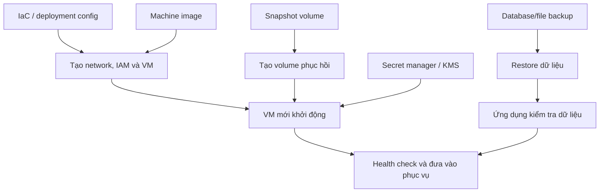

# Phân biệt snapshot, image, backup dữ liệu và cấu hình triển khai

## Mục tiêu học tập

Sau bài học, bạn có thể:

- Giải thích mục đích và phạm vi của snapshot, machine image, backup dữ liệu và cấu hình triển khai.
- Phân biệt dữ liệu được bảo vệ, cách khôi phục và giới hạn của từng loại artifact.
- Chọn phương pháp nhất quán phù hợp cho VM, filesystem, database và ứng dụng đang hoạt động.
- Kết hợp image, snapshot, backup và Infrastructure as Code (IaC) để phục hồi một workload hoàn chỉnh.
- Thiết kế chính sách retention, mã hóa, quyền truy cập và bản sao độc lập.
- Xác định RPO, RTO và kiểm thử restore định kỳ.
- Lập kế hoạch di chuyển VM hoặc workload giữa zone, region hay cloud provider mà vẫn giữ tính nhất quán dữ liệu.

## 1. Vì sao cần phân biệt các loại bản sao?

Khi một VM gặp sự cố, việc có một tệp hoặc một bản sao ổ đĩa chưa chắc đủ để khôi phục dịch vụ. Một hệ thống hoàn chỉnh thường bao gồm:

- Hệ điều hành, bootloader, driver và phần mềm đã cài.
- Dữ liệu ứng dụng, database, file upload và log cần lưu giữ.
- Cấu hình hạ tầng như network, subnet, firewall, load balancer, disk và IAM.
- Secret, chứng thư, khóa mã hóa và danh tính workload.
- Quan hệ phụ thuộc giữa các thành phần, chẳng hạn API, database, queue và object storage.

Các loại artifact bảo vệ những phần khác nhau. Snapshot thường ghi lại trạng thái block của volume tại một thời điểm. Machine image đóng gói mẫu máy để tạo VM mới. Backup dữ liệu bảo vệ nội dung nghiệp vụ theo chính sách phục hồi. Cấu hình triển khai mô tả cách tạo lại hạ tầng và thiết lập ứng dụng.

Nếu nhầm lẫn các loại này, tổ chức có thể gặp những tình huống như:

- Có snapshot nhưng không biết cách tạo lại VM, network hoặc identity.
- Có image mới nhưng database bên ngoài image đã mất dữ liệu.
- Có backup database nhưng không còn cấu hình, secret hoặc phiên bản ứng dụng tương thích.
- Có IaC nhưng không có dữ liệu để phục hồi.
- Có bản sao lưu nhưng khóa mã hóa đã bị xóa nên không thể đọc.
- Có artifact nhưng chưa từng thử restore, đến lúc sự cố mới phát hiện thiếu quyền hoặc sai thứ tự khôi phục.

Một chiến lược phục hồi đáng tin cậy cần xác định rõ từng loại artifact, quan hệ giữa chúng và cách kiểm chứng kết quả.

## 2. Snapshot là gì?

**Snapshot** là bản ghi trạng thái của một volume hoặc thiết bị lưu trữ tại một thời điểm. Trong cloud, snapshot thường được tạo ở lớp block storage. Dịch vụ ghi nhận nội dung block tại thời điểm chụp và cho phép tạo volume mới hoặc khôi phục dữ liệu từ trạng thái đó.

Snapshot thường hữu ích để:

- Tạo điểm khôi phục trước khi patch OS hoặc thay đổi cấu hình.
- Khôi phục volume sau lỗi filesystem hoặc thao tác xóa nhầm.
- Sao chép volume sang môi trường thử nghiệm.
- Tạo nền cho image hoặc bản sao volume theo khả năng nền tảng.
- Hỗ trợ phục hồi dữ liệu ở mức block.

### 2.1. Snapshot ghi lại điều gì?

Snapshot của một volume thường đại diện cho trạng thái các block được dịch vụ lưu trữ quản lý tại thời điểm tạo. Nó không tự hiểu ý nghĩa của dữ liệu bên trong.

Ví dụ, snapshot của volume database có thể ghi lại:

- Các block chứa data file.
- Các block chứa transaction log hoặc write-ahead log.
- Metadata filesystem.
- Những thay đổi đã được ghi xuống volume tại thời điểm snapshot.

Snapshot không tự biết transaction nào đã commit, file nào đang được ứng dụng cập nhật hay database có đang ở trạng thái nhất quán về logic hay không. Vì vậy, cần phân biệt tính nhất quán của snapshot.

### 2.2. Crash-consistent snapshot

Crash-consistent snapshot tương tự trạng thái lưu trữ sau khi một máy bị mất điện hoặc reset đột ngột. Các block đã được ghi xuống storage được giữ lại theo cơ chế của dịch vụ; dữ liệu còn trong RAM hoặc cache chưa flush có thể không xuất hiện.

Hệ điều hành và ứng dụng có thể cần chạy recovery khi khởi động lại:

- Filesystem replay journal.
- Database chạy crash recovery từ transaction log.
- Ứng dụng kiểm tra và xử lý file ghi dở.
- Một số transaction chưa commit được rollback.

Crash consistency thường đủ cho một số workload có cơ chế journal và recovery tốt, nhưng không bảo đảm ứng dụng ở trạng thái logic hoàn chỉnh. Nếu snapshot nhiều volume riêng lẻ mà không có cơ chế nhóm nhất quán, thời điểm ghi nhận của các volume có thể khác nhau.

### 2.3. Filesystem-consistent và application-consistent snapshot

**Filesystem-consistent snapshot** cố gắng đưa filesystem về trạng thái có thể phục hồi nhất quán trước khi chụp, ví dụ flush dữ liệu và metadata, tạm dừng ghi hoặc freeze filesystem trong thời gian ngắn.

**Application-consistent snapshot** phối hợp với ứng dụng để bảo đảm dữ liệu ở trạng thái phù hợp cho phục hồi. Cách làm có thể gồm:

- Database checkpoint hoặc backup hook.
- Tạm dừng ghi trong thời gian ngắn.
- Flush transaction log.
- Dùng Volume Shadow Copy Service (VSS) trên Windows khi ứng dụng và writer hỗ trợ.
- Dùng cơ chế snapshot nhóm volume có hỗ trợ application consistency.

Không phải snapshot service nào cũng tự tạo application-consistent snapshot. Cần xác minh agent, guest integration, application hook và giới hạn của dịch vụ. Nếu hook thất bại, snapshot có thể chỉ đạt mức crash-consistent.

### 2.4. Snapshot đơn và snapshot nhiều volume

Một VM có thể dùng nhiều volume:

- Boot volume chứa OS.
- Data volume chứa file nghiệp vụ.
- Log volume chứa transaction log.
- Volume riêng cho database hoặc cache.

Nếu chụp từng volume ở các thời điểm khác nhau, dữ liệu có thể không khớp. Ví dụ, database ghi transaction log trên volume A và data file trên volume B. Snapshot A lúc 10:00:00 và B lúc 10:00:15 có thể không phản ánh cùng một điểm giao dịch.

Nếu nền tảng hỗ trợ group snapshot hoặc coordinated snapshot, hãy dùng cơ chế đó cho các volume cần nhất quán. Nếu không, cần phối hợp ứng dụng, dừng ghi hoặc dùng công cụ backup native để bảo đảm dữ liệu có thể phục hồi.

### 2.5. Snapshot thường là incremental

Nhiều dịch vụ block storage lưu snapshot theo cách incremental: snapshot đầu tiên ghi nhận dữ liệu nền, các snapshot sau chỉ cần lưu block thay đổi theo cơ chế dịch vụ.

Lợi ích:

- Giảm lượng dữ liệu phải ghi cho mỗi lần snapshot.
- Có thể tiết kiệm dung lượng và thời gian.
- Hỗ trợ tạo nhiều điểm khôi phục theo lịch.

Tuy nhiên, cách tính dung lượng, quan hệ phụ thuộc và hành vi xóa snapshot khác nhau giữa nhà cung cấp. Một snapshot hiển thị là incremental không có nghĩa người dùng phải tự ghép các tệp snapshot để restore. Dịch vụ thường quản lý chuỗi và metadata. Hãy đọc tài liệu của nền tảng trước khi xóa snapshot cũ hoặc thay đổi retention.

### 2.6. Giới hạn của snapshot

Snapshot thường không thay thế backup dữ liệu hoặc kế hoạch DR vì:

- Có thể nằm cùng tài khoản, cùng quyền quản trị hoặc cùng miền lỗi với volume gốc.
- Có thể phụ thuộc vào khóa mã hóa hoặc quyền KMS.
- Không nhất thiết chứa cấu hình network, IAM, load balancer hoặc secret.
- Có thể không bao gồm local/ephemeral disk.
- Không tự bảo đảm application consistency.
- Có thể bị xóa nhầm hoặc bị kẻ tấn công có quyền cao xóa cùng dữ liệu gốc.
- Có thể chỉ phục hồi được trong phạm vi region hoặc dịch vụ hỗ trợ.

Snapshot là một công cụ khôi phục ở lớp block. Cần đặt nó trong chiến lược backup rộng hơn.

## 3. Machine image là gì?

**Machine image** là mẫu được dùng để tạo VM mới. Tùy nền tảng, image có thể chứa boot disk, một hoặc nhiều data disk, metadata khởi động và cấu hình hệ điều hành cần thiết.

Image thường được dùng để:

- Chuẩn hóa OS và phần mềm nền.
- Tạo VM mới nhanh và nhất quán.
- Triển khai cùng một phiên bản ứng dụng trên nhiều instance.
- Phục hồi máy từ một mẫu đã được kiểm thử.
- Tạo golden image theo quy trình patching và hardening.

Ví dụ tên gọi theo nền tảng có thể gồm Amazon Machine Image (AMI), Azure VM image hoặc Compute Engine machine image. Phạm vi và cách đóng gói của từng dịch vụ không hoàn toàn giống nhau.

### 3.1. Image thường chứa gì?

Một image có thể bao gồm:

- Hệ điều hành và boot configuration.
- Kernel, driver, package và runtime.
- Agent giám sát, bảo mật và quản lý cấu hình.
- Phần mềm ứng dụng hoặc artifact đã cài.
- Cấu hình mặc định không nhạy cảm.
- Tham chiếu tới snapshot hoặc disk image theo cơ chế nhà cung cấp.

Image không nhất thiết chứa toàn bộ dữ liệu nghiệp vụ. Database đang chạy, file upload, object storage và dữ liệu bên ngoài VM thường cần backup riêng.

### 3.2. Golden image

Golden image là image chuẩn đã qua kiểm thử và được phê duyệt để sử dụng trong môi trường cụ thể.

Quy trình tạo image thường gồm:

1. Chọn OS và phiên bản được hỗ trợ.
2. Cập nhật bản vá bảo mật.
3. Cài runtime, agent và package cần thiết.
4. Áp dụng hardening và cấu hình mặc định.
5. Xóa secret, credential, machine-specific identity và dữ liệu thử nghiệm.
6. Chuẩn hóa cloud-init, startup script hoặc cơ chế bootstrap.
7. Quét lỗ hổng và kiểm tra artifact.
8. Khởi động VM thử nghiệm từ image.
9. Kiểm tra network, storage, identity, monitoring và ứng dụng.
10. Đánh version, lưu metadata và phát hành image.

Image cần có version rõ ràng, ví dụ **api-linux-2026.11.3**. Tránh thay đổi nội dung image đã phát hành mà không đổi version vì deployment khó tái lập.

### 3.3. Không đóng gói secret dài hạn vào image

Một image có thể được sao chép sang nhiều VM, project hoặc region. Nếu chứa access key, mật khẩu, private key hay token dài hạn, mọi bản VM tạo từ image có nguy cơ dùng chung bí mật.

Thay vào đó:

- Dùng workload identity để VM xác thực.
- Lấy secret từ secret manager khi runtime cần.
- Cấp certificate hoặc credential riêng cho từng instance nếu kiến trúc yêu cầu.
- Xóa lịch sử shell, file tạm và dữ liệu build nhạy cảm trước khi tạo image.
- Xác minh image không chứa token trong log, environment hoặc cache.

### 3.4. Image không phải backup dữ liệu

Image giúp tạo lại môi trường máy, nhưng không bảo đảm phục hồi dữ liệu phát sinh sau thời điểm image được tạo. Nếu image tháng trước chứa phiên bản ứng dụng đúng nhưng database hôm nay đã thay đổi, image không thể khôi phục những transaction mới.

Cũng không nên coi một image có snapshot của disk là bản backup ứng dụng hoàn chỉnh. Cần xác định image bao gồm disk nào, dữ liệu nào, consistency ở mức nào và có thể restore trong region/tài khoản khác hay không.

## 4. Backup dữ liệu là gì?

**Backup dữ liệu** là bản sao được tạo để phục hồi nội dung dữ liệu hoặc trạng thái ứng dụng theo một mục tiêu phục hồi đã xác định. Backup có thể ở cấp file, filesystem, database, object storage, volume hoặc ứng dụng.

Backup thường tập trung vào câu hỏi: *Nếu dữ liệu bị xóa, hỏng, mã hóa bởi ransomware hoặc thay đổi sai, chúng ta có thể phục hồi dữ liệu về thời điểm nào và trong bao lâu?*

Các loại backup phổ biến:

- **File-level backup:** sao chép file/thư mục được chọn.
- **Filesystem/volume backup:** sao lưu dữ liệu ở mức filesystem hoặc block.
- **Database-native backup:** dùng cơ chế của database để bảo vệ data file, transaction log và metadata.
- **Object backup/versioning:** giữ phiên bản object hoặc bản sao độc lập.
- **Application-aware backup:** phối hợp với ứng dụng để tạo bản sao nhất quán.
- **Configuration/state backup:** lưu trạng thái cấu hình hoặc metadata nghiệp vụ cần thiết để khôi phục.

### 4.1. Full, incremental và differential backup

| Loại | Cách hoạt động | Ưu điểm | Điều cần lưu ý |
|---|---|---|---|
| Full backup | Sao chép toàn bộ dữ liệu trong phạm vi chọn | Restore đơn giản hơn | Tốn thời gian, dung lượng và băng thông |
| Incremental backup | Sao chép thay đổi kể từ lần backup gần nhất | Giảm lượng dữ liệu mỗi lần | Restore có thể cần full và chuỗi incremental |
| Differential backup | Sao chép thay đổi kể từ lần full gần nhất | Restore cần full và differential mới nhất | Bản differential thường lớn dần tới lần full kế tiếp |

Không phải mọi dịch vụ backup dùng đúng ba kiểu này; một số dùng forever-incremental, synthetic full hoặc cơ chế deduplication. Hãy kiểm tra cách dịch vụ tạo recovery point và quy trình restore.

### 4.2. Database backup và point-in-time recovery

Database cần cách backup phù hợp với engine. Một bản sao file dữ liệu được chụp khi database đang ghi có thể không đủ để khôi phục nếu không có transaction log hoặc cơ chế recovery tương ứng.

Các cơ chế thường gặp:

- Full database backup.
- Differential hoặc incremental backup tùy engine.
- Transaction log backup.
- Write-ahead log (WAL) archive.
- Binary log hoặc change log.
- Point-in-time recovery (PITR) dựa trên full backup và chuỗi log.

PITR cho phép phục hồi tới một thời điểm trong khoảng retention nếu có đủ base backup và log liên tục. Nếu thiếu một đoạn log hoặc backup nền bị hỏng, phạm vi phục hồi có thể bị giới hạn.

Ví dụ, backup database lúc 02:00 và giữ transaction log tới 14:00 có thể cho phép phục hồi gần thời điểm 13:42, nếu engine, log chain và dịch vụ hỗ trợ. Không thể mặc định PITR luôn chính xác tới từng giây; cần xem độ trễ log, granularity và giới hạn của nền tảng.

### 4.3. Backup nhất quán với ứng dụng

Với ứng dụng nhiều thành phần, backup cần phối hợp:

- Database.
- Object storage hoặc file upload.
- Queue và message state.
- Configuration và schema.
- Khóa mã hóa hoặc tham chiếu tới key.
- Trạng thái session hoặc job nếu cần.

Một bản database backup và một bản object backup chụp ở hai thời điểm khác nhau có thể tạo tham chiếu không hợp lệ. Ví dụ database có record trỏ tới object chưa xuất hiện trong bản backup. Cần chọn một trong các cách:

- Tạm dừng ghi trong thời gian tạo recovery point.
- Dùng versioning và timestamp/cursor để ghép các nguồn dữ liệu.
- Dùng application checkpoint hoặc snapshot orchestration.
- Thiết kế dữ liệu để có thể phục hồi và đối soát sau đó.

## 5. Cấu hình triển khai là gì?

**Cấu hình triển khai** mô tả cách tạo và cấu hình hạ tầng, hệ điều hành và ứng dụng để workload có thể chạy lại một cách nhất quán.

Nó có thể gồm:

- Infrastructure as Code (IaC): Terraform, Bicep, CloudFormation hoặc công cụ tương tự.
- Template/manifest cho VM, instance group, load balancer và disk.
- Network: VPC/VNet, subnet, route, firewall/security group, DNS.
- IAM: role, service account, managed identity và policy.
- Bootstrap: cloud-init, startup script, extension hoặc configuration management.
- Ứng dụng: deployment manifest, package version, container image digest.
- Monitoring: agent, alert, dashboard và log routing.
- Backup policy, retention và lịch chạy.
- Tham chiếu secret/certificate và key ID.

Cấu hình triển khai giúp tạo lại môi trường. Nó không chứa dữ liệu nghiệp vụ đã phát sinh trong quá trình chạy, trừ khi dữ liệu đó được quản lý như một artifact riêng.

### 5.1. IaC và cấu hình runtime

Cần phân biệt:

- **IaC:** mô tả tài nguyên hạ tầng cần tồn tại.
- **Configuration management:** cài đặt và cấu hình OS, package, service.
- **Application deployment:** phát hành phiên bản ứng dụng và cấu hình runtime.
- **Secret management:** lưu trữ và phân phối secret.
- **Data backup:** bảo vệ dữ liệu được tạo ra khi hệ thống hoạt động.

Các phần này liên quan nhưng có vòng đời và quyền truy cập khác nhau. Một repository IaC có thể mô tả database instance, nhưng không thay thế backup dữ liệu bên trong database.

### 5.2. Lưu cấu hình và secret an toàn

Có thể đưa cấu hình không nhạy cảm vào version control, ví dụ instance type, subnet reference, replica count và package version. Secret nên lưu trong secret manager hoặc hệ thống được kiểm soát quyền, còn IaC chỉ giữ tham chiếu.

Không commit private key, password, token hoặc credential dài hạn vào repository. Nếu secret từng xuất hiện trong Git history, xóa file ở commit mới chưa đủ; cần đánh giá phạm vi lộ, thu hồi/xoay vòng secret và xử lý lịch sử theo quy trình.

## 6. So sánh snapshot, image, backup và cấu hình triển khai

| Tiêu chí | Snapshot | Machine image | Backup dữ liệu | Cấu hình triển khai |
|---|---|---|---|---|
| Mục tiêu | Ghi lại trạng thái volume tại một thời điểm | Tạo VM mới từ mẫu máy | Khôi phục dữ liệu nghiệp vụ hoặc ứng dụng | Tạo lại hạ tầng và cấu hình |
| Phạm vi | Block của volume hoặc nhóm volume | OS, boot disk, phần mềm và metadata theo dịch vụ | File, database, object, volume hoặc application state | Network, IAM, VM, load balancer, policy, bootstrap |
| Có thể boot VM? | Thường cần tạo volume và gắn vào VM hoặc dùng để tạo image | Thường có, tùy loại image | Không nhất thiết | Không trực tiếp |
| Nhất quán ứng dụng | Có thể crash-consistent; cần phối hợp để đạt application-consistent | Phụ thuộc cách tạo image và trạng thái disk | Có thể application-aware hoặc database-native | Không phải bản sao dữ liệu runtime |
| Tần suất | Trước thay đổi hoặc theo lịch | Khi phát hành phiên bản nền tảng | Theo RPO và retention | Theo thay đổi cấu hình và version control |
| Khôi phục | Tạo volume từ snapshot | Tạo VM mới từ image | Restore file/database/object tới recovery point | Apply IaC và bootstrap |
| Rủi ro chính | Sai consistency, phụ thuộc key/region, xóa cùng tài khoản | Image lỗi thời, chứa secret hoặc thiếu dữ liệu runtime | Backup hỏng, thiếu log, không restore được | Drift, thiếu secret reference hoặc phụ thuộc ngoài |
| Phù hợp nhất | Khôi phục block/volume nhanh | Chuẩn hóa và thay thế VM | Bảo vệ dữ liệu và PITR | Tái tạo môi trường có thể lặp lại |

Không có loại artifact nào tự thay thế được ba loại còn lại. Một hệ thống phục hồi VM thường cần kết hợp image hoặc snapshot với cấu hình triển khai và backup dữ liệu.

## 7. Kết hợp các artifact để phục hồi một workload

Hãy xem một API có các thành phần:

- Nhóm VM chạy API.
- Database trên VM hoặc dịch vụ database riêng.
- Object storage chứa tệp khách hàng.
- Load balancer và network.
- Secret manager và KMS.
- Monitoring và alert.

Khi một VM API bị hỏng, có thể tạo VM mới từ image đã phê duyệt, áp dụng IaC để gắn network và identity, sau đó cho ứng dụng lấy secret từ secret manager. Nếu VM chứa dữ liệu cục bộ cần giữ, restore volume từ snapshot hoặc backup. Nếu database bị hỏng, dùng database backup và transaction log để phục hồi. Object storage cần versioning hoặc backup độc lập.

Sơ đồ khái niệm:

Không phải mọi kịch bản đều cần snapshot. Nếu VM stateless và dữ liệu đã nằm trong database/object storage, có thể tạo VM mới từ image và cấu hình. Với database VM, cần phục hồi dữ liệu bằng phương pháp nhất quán và kiểm tra transaction log trước khi đưa traffic vào.

### 7.1. Trình tự phục hồi tham khảo

1. Xác định phạm vi sự cố và mục tiêu phục hồi.
2. Chọn recovery point phù hợp với RPO.
3. Xác minh snapshot, image, backup và cấu hình có thể truy cập.
4. Kiểm tra khóa mã hóa, IAM và quyền restore.
5. Tạo network và tài nguyên phụ thuộc theo IaC.
6. Tạo VM từ image hoặc khôi phục volume từ snapshot.
7. Restore database/file/object theo thứ tự phụ thuộc.
8. Cấu hình identity, secret và certificate.
9. Chạy kiểm tra filesystem, database integrity và application health.
10. Chuyển traffic sau khi readiness và kiểm thử nghiệp vụ đạt.
11. Theo dõi lỗi, độ trễ và tính toàn vẹn sau phục hồi.
12. Ghi nhận RPO/RTO thực tế và cập nhật runbook.

## 8. RPO, RTO và chính sách backup

Hai chỉ số quan trọng khi thiết kế backup:

- **RPO (Recovery Point Objective):** lượng dữ liệu tối đa tổ chức chấp nhận mất, tính theo khoảng thời gian. RPO 15 phút nghĩa là tổ chức đặt mục tiêu có thể phục hồi dữ liệu với điểm khôi phục không cũ hơn khoảng 15 phút so với thời điểm sự cố, theo khả năng hệ thống.
- **RTO (Recovery Time Objective):** thời gian mục tiêu để khôi phục dịch vụ về mức có thể sử dụng sau sự cố.

Ví dụ:

| Workload | RPO mục tiêu | RTO mục tiêu | Cách bảo vệ gợi ý |
|---|---:|---:|---|
| API stateless | Có thể tái tạo request; dữ liệu nằm ngoài VM | 30 phút | Image chuẩn, IaC, deployment pipeline |
| Database giao dịch | 5 phút | 1 giờ | Full backup, log backup/PITR, replica và restore drill |
| Kho file nội bộ | 24 giờ | 8 giờ | Backup file/object theo lịch, versioning |
| Worker batch | Theo checkpoint/job | 2 giờ | Queue bền vững, checkpoint, image và IaC |

Đây là ví dụ mục tiêu, không phải mức mặc định. RPO/RTO cần được chủ sở hữu dữ liệu, nghiệp vụ và đội vận hành thống nhất.

### 8.1. Tần suất backup và RPO

Nếu chỉ tạo backup mỗi 24 giờ, RPO lý thuyết có thể lên tới gần 24 giờ nếu sự cố xảy ra ngay trước lần backup kế tiếp. Với database cần RPO thấp, cần log backup hoặc replication thường xuyên hơn.

Cần phân biệt:

- Backup schedule là tần suất tạo recovery point.
- Backup completion time là thời điểm bản sao thực sự hoàn tất.
- Replication lag là độ trễ giữa dữ liệu nguồn và bản sao.
- Recovery point là thời điểm dữ liệu có thể phục hồi.
- RPO thực tế là mức mất dữ liệu đã đo được trong thử nghiệm hoặc sự cố.

Không nên tuyên bố đạt RPO chỉ dựa vào lịch chạy backup. Phải xác minh bản sao hoàn tất, log liên tục và restore được.

### 8.2. RTO và thời gian phục hồi

RTO bao gồm nhiều bước:

- Phát hiện và phân loại sự cố.
- Phê duyệt hoặc kích hoạt DR.
- Truy cập artifact và khóa.
- Tạo hạ tầng, VM và volume.
- Restore dữ liệu.
- Kiểm tra integrity và ứng dụng.
- Chuyển traffic và xác nhận người dùng.

Nếu restore 2 TiB dữ liệu mất 4 giờ, việc tạo VM trong 5 phút không giúp RTO đạt 30 phút. Cần benchmark restore, chuẩn bị network/IAM, image và capacity trước.

## 9. Retention, bản sao độc lập và chống xóa phá hoại

Backup có giá trị khi còn tồn tại, có thể truy cập và có thể giải mã. Chính sách cần bao gồm:

- **Retention:** giữ recovery point trong bao lâu.
- **Versioning:** giữ nhiều phiên bản của object hoặc artifact.
- **Immutability/WORM:** ngăn thay đổi hoặc xóa trong thời gian khóa theo cơ chế dịch vụ.
- **Cross-account/project copy:** bản sao ở ranh giới quản trị khác.
- **Cross-region copy:** bản sao ở vùng địa lý khác để phục hồi khi region gặp sự cố.
- **Offline/isolated copy:** bản sao tách khỏi môi trường vận hành khi cần chống ransomware.
- **Encryption:** mã hóa dữ liệu backup và quản lý khóa độc lập, có thể khôi phục.
- **Access control:** tách quyền tạo, đọc, restore và xóa backup.

Một nguyên tắc tham khảo là 3-2-1: có ít nhất ba bản sao dữ liệu, trên hai loại phương tiện hoặc miền lưu trữ khác nhau, với một bản sao ở vị trí khác. Một số tổ chức mở rộng thành 3-2-1-1-0, thêm một bản sao offline/immutable và yêu cầu không có lỗi sau kiểm thử restore. Đây là hướng dẫn thiết kế, cần điều chỉnh theo rủi ro và chi phí.

Không để cùng một tài khoản quản trị có thể xóa đồng thời VM, snapshot, backup và khóa mã hóa mà không có kiểm soát. Dùng tài khoản backup riêng, quyền xóa tách biệt, MFA, approval và audit log nếu nền tảng hỗ trợ.

## 10. Mã hóa và quyền truy cập artifact

Snapshot, image và backup có thể chứa dữ liệu nhạy cảm. Cần xác định:

- Artifact có được mã hóa mặc định không?
- Dùng provider-managed key hay customer-managed key?
- Khi copy sang region/account khác có cần key đích không?
- Dịch vụ restore cần principal hoặc grant nào?
- Người có quyền đọc snapshot có thể tạo volume hoặc image từ nó không?
- Ai được chia sẻ image, snapshot hoặc backup?
- Khóa cũ có còn cần cho recovery point dài hạn không?

Nếu dùng CMK, bản backup có thể không restore được khi key bị disable, xóa hoặc policy bị thu hồi. Hãy giữ key và quyền cần thiết trong toàn bộ retention period. Kiểm thử restore bằng identity dự kiến dùng trong sự cố, không chỉ bằng tài khoản quản trị có quyền rộng.

Không đưa secret vào image hoặc backup ngoài phạm vi cần thiết. Nếu backup chứa secret, áp dụng cùng hoặc cao hơn mức bảo vệ dữ liệu gốc.

## 11. Khác biệt theo nhà cung cấp cloud

Các nhà cung cấp đều có khái niệm snapshot, image và backup nhưng cách đóng gói, tính nhất quán, quyền truy cập và tính năng restore khác nhau.

| Khái niệm | AWS (ví dụ) | Azure (ví dụ) | Google Cloud (ví dụ) |
|---|---|---|---|
| Snapshot | EBS snapshot | Managed disk snapshot | Persistent Disk snapshot |
| Machine image | AMI | Azure VM image | Compute Engine machine image |
| Backup service | AWS Backup và dịch vụ backup theo workload | Azure Backup | Backup and DR hoặc cơ chế backup dịch vụ tương ứng |
| IaC | CloudFormation, Terraform | Bicep, ARM, Terraform | Terraform và công cụ IaC hiện hành |
| Application consistency | Agent/hook và tích hợp workload tùy dịch vụ | VSS và application-aware backup tùy workload | Agent/hook và tích hợp dịch vụ tùy workload |

Tên sản phẩm và phạm vi tính năng có thể thay đổi theo thời gian. Bảng chỉ giúp nhận diện nhóm dịch vụ, không khẳng định các tính năng tương đương hoàn toàn.

### 11.1. Điều cần kiểm tra khi chọn dịch vụ

- Snapshot có hỗ trợ nhóm nhiều disk nhất quán không?
- Có thể copy snapshot giữa region hoặc account không?
- Image có chứa tất cả disk cần thiết hay chỉ boot disk?
- Có hỗ trợ application-consistent backup cho OS/database đang dùng không?
- Có PITR và retention lock không?
- Có thể restore vào subscription/project/account khác không?
- Có cần cùng loại encryption key hoặc key tại region đích không?
- Quota, tốc độ restore và chi phí phục hồi là bao nhiêu?

Không chọn dịch vụ chỉ dựa vào tên "backup". Hãy kiểm tra recovery point, phạm vi dữ liệu, khả năng restore và giới hạn vận hành.

## 12. Kiểm thử restore và xác minh dữ liệu

Một backup job báo thành công chỉ chứng minh quá trình tạo bản sao đã hoàn tất theo tiêu chí của dịch vụ. Nó không chứng minh ứng dụng có thể chạy từ bản sao đó.

### 12.1. Restore drill

Một buổi diễn tập nên gồm:

1. Chọn recovery point theo kịch bản.
2. Dùng identity restore riêng để truy cập artifact.
3. Tạo network cô lập để tránh xung đột IP hoặc gửi traffic thật.
4. Restore VM/volume/database/object vào môi trường kiểm thử.
5. Kiểm tra checksum hoặc công cụ integrity của ứng dụng.
6. Khởi động ứng dụng và kiểm tra dependency.
7. Chạy synthetic transaction hoặc truy vấn nghiệp vụ.
8. Đo thời gian từng bước và tổng RTO.
9. Xác định điểm dữ liệu gần nhất và tính RPO thực tế.
10. Ghi lại lỗi, quyền thiếu và cập nhật runbook.

### 12.2. Xác minh tính toàn vẹn

Tùy loại dữ liệu, có thể dùng:

- Checksum/hash của file.
- Database consistency check hoặc native validation.
- So sánh số lượng record, tổng tiền hoặc invariant nghiệp vụ.
- Kiểm tra object version và metadata.
- Kiểm tra chuỗi transaction log/WAL.
- Kiểm tra ứng dụng đọc được dữ liệu và thực hiện giao dịch thử.

Không chỉ xác nhận VM boot được. Một VM có thể khởi động nhưng database chưa phục hồi đúng, certificate hết hạn hoặc ứng dụng không kết nối được dependency.

### 12.3. Kiểm thử nhiều kịch bản

- Xóa nhầm một file hoặc object.
- Hỏng filesystem hoặc volume.
- Database corruption hoặc thao tác ghi sai.
- Mất một VM.
- Mất một zone hoặc region.
- Tài khoản vận hành bị xâm nhập và artifact nguồn bị xóa.
- Khóa mã hóa bị disable hoặc policy thay đổi.
- Image mới lỗi và cần rollback về image trước.
- Cấu hình IaC bị thay đổi ngoài quy trình (configuration drift).

## 13. Di chuyển VM và workload

Di chuyển workload có thể là chuyển VM sang host/zone khác, region khác, project/account khác hoặc cloud provider khác. Artifact phục vụ migration có thể là image, snapshot, backup dữ liệu và cấu hình triển khai.

### 13.1. Phân biệt các cách di chuyển

- **Rehost:** chuyển máy hoặc workload gần như nguyên trạng sang hạ tầng mới.
- **Rebuild:** tạo VM mới từ image chuẩn và triển khai ứng dụng lại.
- **Backup/restore migration:** backup dữ liệu ở nguồn rồi restore tại đích.
- **Replication migration:** đồng bộ thay đổi liên tục hoặc định kỳ, sau đó cutover.
- **Refactor:** thay đổi kiến trúc ứng dụng trong quá trình chuyển đổi.

Snapshot có thể giúp sao chép block dữ liệu, nhưng không tự chuyển toàn bộ network, IAM, DNS, quota hoặc dịch vụ phụ thuộc. Image có thể cần chuyển đổi định dạng, driver hoặc cấu hình boot. IaC cần được điều chỉnh theo resource model của nền tảng đích.

### 13.2. Quy trình migration tham khảo

1. Kiểm kê VM, disk, network, identity, secret, database và dependency.
2. Xác định mục tiêu RPO/RTO và cửa sổ cutover.
3. Chọn rehost, rebuild, backup/restore hoặc replication.
4. Kiểm tra tương thích CPU architecture, firmware, boot mode, driver và OS license.
5. Chuẩn bị network, IAM, KMS, quota và capacity tại đích.
6. Tạo image hoặc snapshot/backup phù hợp.
7. Đồng bộ dữ liệu ban đầu và thay đổi phát sinh.
8. Kiểm thử ứng dụng tại đích trong mạng cô lập.
9. Tạm dừng ghi hoặc chuyển sang chế độ read-only khi cutover.
10. Đồng bộ delta cuối cùng và xác minh consistency.
11. Chuyển DNS/load balancer/traffic sang đích.
12. Theo dõi error rate, latency, dữ liệu và dependency.
13. Giữ nguồn trong thời gian rollback đã thống nhất, sau đó mới retire theo chính sách.

### 13.3. Rollback

Kế hoạch migration phải xác định điều kiện quay lại nguồn. Nếu hệ thống đã nhận ghi mới ở đích, rollback không đơn giản là đổi DNS về nguồn vì dữ liệu hai bên có thể lệch.

Cần quy định:

- Thời điểm đóng ghi ở nguồn.
- Cách đồng bộ dữ liệu cuối.
- Thời điểm bắt đầu nhận ghi ở đích.
- Cách đối soát dữ liệu sau cutover.
- Cách xử lý giao dịch phát sinh nếu phải rollback.
- Người có quyền quyết định rollback.
- Thời hạn giữ tài nguyên nguồn.

Nếu không thể đồng bộ dữ liệu ngược an toàn, cần có điểm quyết định trước khi mở ghi ở đích hoặc chấp nhận quy trình reconciliation rõ ràng.

## 14. Ví dụ thực tế: khôi phục API và database sau sự cố

Một hệ thống thương mại điện tử có API VM, database VM và object storage chứa ảnh sản phẩm. Đội vận hành cần khôi phục sau khi database volume bị hỏng.

Các artifact hiện có:

- Golden image cho API và database OS.
- Snapshot định kỳ cho volume database.
- Database-native full backup mỗi đêm.
- Transaction log backup mỗi 5 phút.
- Versioning cho object storage.
- IaC mô tả network, security group, load balancer và VM.
- Secret manager lưu credential và certificate.
- CMK dùng mã hóa volume và backup.

Quy trình khôi phục:

1. Xác định database volume bị hỏng và thời điểm sự cố.
2. Chọn full backup gần nhất cùng chuỗi transaction log hợp lệ để đạt RPO.
3. Tạo network cô lập bằng IaC.
4. Tạo database VM từ golden image.
5. Tạo volume phục hồi từ snapshot nếu cần điều tra hoặc dùng làm nguồn restore.
6. Restore database-native backup và replay transaction log tới recovery point đã chọn.
7. Kiểm tra database consistency và đối soát record quan trọng.
8. Gắn workload identity, lấy secret từ secret manager và xác nhận quyền KMS.
9. Khởi động API từ image đã phê duyệt.
10. Kết nối tới database phục hồi và object storage version phù hợp.
11. Chạy synthetic checkout trong môi trường cô lập.
12. Chuyển traffic sau khi readiness và kiểm thử nghiệp vụ đạt.
13. Ghi nhận RPO/RTO thực tế và cập nhật runbook.

Trong ví dụ này, snapshot giúp phục hồi block/volume hoặc điều tra, database backup và transaction log khôi phục dữ liệu nhất quán, image tạo lại VM, còn IaC tái tạo network và tài nguyên. Không một artifact riêng lẻ nào đủ để phục hồi toàn bộ dịch vụ.

## 15. Những nhầm lẫn thường gặp

- **Snapshot chính là backup hoàn chỉnh.** Snapshot chủ yếu ghi trạng thái volume; cần xét consistency, isolation, retention và khả năng restore.
- **Image chứa dữ liệu mới nhất.** Image thường phản ánh trạng thái tại lúc tạo; dữ liệu runtime thay đổi sau đó cần backup riêng.
- **Có image là có thể phục hồi toàn bộ VM.** Có thể còn thiếu data disk, network, IAM, secret, license hoặc dependency.
- **Backup database chỉ cần sao chép file data.** Database có thể cần native backup, transaction log và quy trình recovery.
- **Incremental backup không thể restore nếu thiếu các bản trước.** Dịch vụ có thể quản lý chuỗi tự động; cần hiểu semantics của nhà cung cấp thay vì tự ghép file.
- **Snapshot nhiều volume cùng một thời điểm là application-consistent.** Đồng thời về thời gian không tự bảo đảm transaction consistency.
- **Backup thành công nghĩa là restore được.** Cần diễn tập restore và xác minh dữ liệu.
- **IaC có thể thay thế backup.** IaC tái tạo tài nguyên, không phục hồi dữ liệu nghiệp vụ.
- **Cùng region là đủ để chống thảm họa.** Sự cố region hoặc tài khoản có thể ảnh hưởng cả nguồn và bản sao; cần bản sao độc lập phù hợp.
- **Xóa khóa cũ không ảnh hưởng backup.** Recovery point mã hóa bằng khóa cũ có thể không đọc được nếu key bị xóa.
- **Migration xong chỉ cần đổi DNS.** Cần đồng bộ dữ liệu, kiểm tra dependency, cutover và rollback.
- **Restore VM boot được nghĩa là ứng dụng đã phục hồi.** Cần kiểm tra database, secret, network, health check và giao dịch nghiệp vụ.

## 16. Checklist thiết kế backup và recovery

### Phân loại artifact

- [ ] Liệt kê snapshot cho từng volume và nhóm volume.
- [ ] Xác định image nào được phê duyệt và version còn hỗ trợ.
- [ ] Xác định backup file/database/object/application.
- [ ] Lưu IaC, bootstrap, manifest và cấu hình runtime trong version control.
- [ ] Tách secret khỏi image và repository; lưu tham chiếu tới secret manager.
- [ ] Ghi nhận artifact nào chứa dữ liệu nhạy cảm và khóa mã hóa tương ứng.

### Chính sách bảo vệ

- [ ] Xác định RPO/RTO theo workload và chủ sở hữu dữ liệu.
- [ ] Chọn tần suất backup và retention theo RPO.
- [ ] Bật versioning/immutability hoặc bản sao độc lập khi phù hợp.
- [ ] Sao chép sang account/project hoặc region khác nếu cần.
- [ ] Tách quyền tạo, restore và xóa backup.
- [ ] Bảo đảm khóa KMS còn khả dụng trong suốt retention.
- [ ] Theo dõi backup job, log và cảnh báo khi thất bại.

### Khả năng phục hồi

- [ ] Kiểm thử restore snapshot thành volume.
- [ ] Tạo VM từ image trong môi trường thử nghiệm.
- [ ] Restore database và replay log tới recovery point.
- [ ] Restore object/file và xác minh checksum.
- [ ] Apply IaC trong môi trường cô lập.
- [ ] Xác minh identity, secret, certificate và network.
- [ ] Đo RPO/RTO thực tế.
- [ ] Diễn tập migration cutover và rollback.
- [ ] Cập nhật runbook sau mỗi lần diễn tập.

## 17. Tự kiểm tra

**Tình huống 1:** Một VM database có hai volume, một volume chứa data file và một volume chứa transaction log. Có nên tạo hai snapshot riêng ở hai thời điểm khác nhau rồi coi đó là một recovery point nhất quán không?

**Gợi ý:** Không nên mặc định như vậy. Hãy dùng coordinated/group snapshot nếu nền tảng hỗ trợ, hoặc phối hợp database checkpoint/quiesce. Với database quan trọng, ưu tiên native backup và transaction log theo hướng dẫn của engine.

**Tình huống 2:** Golden image được tạo cách đây một tháng. Database và file upload đã thay đổi nhiều kể từ đó. Có thể dùng image để phục hồi dữ liệu mới nhất không?

**Gợi ý:** Không. Image tạo lại môi trường máy theo thời điểm phát hành; database và file upload cần backup hoặc replication riêng.

**Tình huống 3:** Backup job báo Success nhưng chưa từng restore. Có thể kết luận tổ chức đạt RPO/RTO không?

**Gợi ý:** Chưa. Cần restore drill, kiểm tra chuỗi log, quyền KMS, integrity và thời gian thực tế để xác minh.

**Tình huống 4:** IaC có thể tạo lại VM, subnet và load balancer. Vì sao vẫn cần backup database?

**Gợi ý:** IaC chỉ mô tả tài nguyên và cấu hình. Nó không chứa transaction hoặc dữ liệu nghiệp vụ được tạo sau khi hệ thống chạy.

**Tình huống 5:** Một snapshot được mã hóa bằng CMK. Trước khi xóa CMK cũ, cần kiểm tra gì?

**Gợi ý:** Liệt kê volume, snapshot, image, backup và bản sao region/account còn phụ thuộc key; kiểm tra khả năng re-wrap/re-encrypt và restore. Không xóa key khi recovery point còn cần nó.

**Tình huống 6:** Sau migration, ứng dụng ở đích hoạt động nhưng database đã nhận một số giao dịch mới. Đội vận hành muốn rollback về nguồn. Rủi ro là gì?

**Gợi ý:** Dữ liệu ở nguồn và đích có thể lệch. Cần quy trình đồng bộ ngược hoặc reconciliation, xác định thời điểm đóng ghi và điều kiện rollback trước khi chuyển traffic.

## Kết luận

Snapshot, machine image, backup dữ liệu và cấu hình triển khai phục vụ các lớp phục hồi khác nhau. Snapshot giúp khôi phục trạng thái block của volume; image tạo lại VM từ mẫu máy; backup bảo vệ dữ liệu nghiệp vụ theo recovery point; IaC và cấu hình triển khai tái tạo hạ tầng cùng thiết lập ứng dụng. Một kế hoạch đáng tin cậy cần kết hợp chúng với RPO/RTO, consistency, retention, mã hóa, quyền truy cập và bản sao độc lập. Hãy kiểm thử restore và migration định kỳ, xác minh dữ liệu sau phục hồi và ghi nhận thời gian thực tế để bảo đảm hệ thống có thể hoạt động lại khi sự cố xảy ra.
