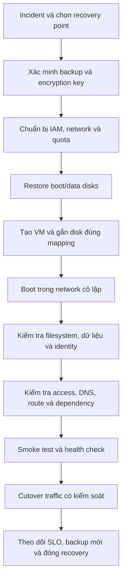

# Khôi phục máy cùng đĩa, quyền truy cập và kết nối mạng

## 1. Khôi phục một máy là khôi phục cả hệ thống phụ thuộc

Khi một VM bị lỗi, bị xóa nhầm, hỏng hệ điều hành hoặc cần chuyển sang vùng cloud khác, tạo lại một máy có cùng CPU và RAM chưa đủ để dịch vụ hoạt động. Máy còn cần boot disk đúng phiên bản, data disk đúng dữ liệu, khóa mã hóa có thể sử dụng, danh tính workload, quyền truy cập, network interface, subnet, route, firewall và DNS. Thiếu một thành phần có thể khiến máy không boot, không mount được dữ liệu, không lấy được secret hoặc không thể kết nối đến dependency.

Khôi phục máy vì vậy là một quy trình phối hợp giữa compute, storage, identity và networking. Cần xác định trạng thái cần phục hồi, chọn đúng điểm backup, dựng lại tài nguyên theo thứ tự, kiểm tra an toàn dữ liệu và chỉ đưa máy trở lại phục vụ sau khi xác minh đầy đủ.

Trong module **CLOUD_CORE_SERVICES_COMPUTE**, nội dung này gắn với triển khai và vận hành VM, cấu hình CPU/bộ nhớ/mạng, bảo mật, tính sẵn sàng và tối ưu chi phí. Bài học tập trung vào tình huống khôi phục máy cùng các đĩa, quyền truy cập và kết nối mạng của nó.

Sau bài học, người học có thể:

- Phân biệt khôi phục từ snapshot, backup, image, replica và dựng lại từ cấu hình chuẩn.
- Lập bản đồ boot disk, data disk, encryption key và mount point trước khi restore.
- Khôi phục danh tính máy, IAM role/service account, tài khoản quản trị và secret an toàn.
- Tái tạo NIC, subnet, route, firewall, IP, DNS và load balancer membership.
- Thực hiện recovery theo thứ tự, kiểm tra dữ liệu và dịch vụ trước khi cutover.
- Lập phương án rollback, xác minh RTO/RPO và diễn tập quy trình.

## 2. Xác định mục tiêu và phạm vi khôi phục

### 2.1. Các tình huống thường gặp

Khôi phục máy có thể được kích hoạt bởi nhiều tình huống:

- Boot disk hỏng hoặc hệ điều hành không thể khởi động.
- VM bị xóa nhầm hoặc cấu hình compute bị lỗi.
- Data disk bị mất kết nối, hỏng filesystem hoặc cần khôi phục về thời điểm trước.
- Sự cố ở zone/region khiến cần dựng máy ở vùng khác.
- Di chuyển workload sang instance type, subnet hoặc account mới.
- Nhiễm mã độc hoặc nghi ngờ máy bị xâm nhập, cần dựng lại từ image sạch và phục hồi dữ liệu đã kiểm tra.
- Cần kiểm thử DR hoặc diễn tập phục hồi định kỳ.

Mỗi tình huống có yêu cầu khác nhau. Nếu chỉ VM bị lỗi nhưng data disk còn tốt, có thể tạo VM mới rồi gắn lại volume. Nếu boot disk bị hỏng do mã độc, không nên khởi động lại nguyên trạng snapshot chưa được kiểm tra. Nếu toàn bộ region gặp sự cố, cần cả network, identity, key và dependency ở vùng đích.

### 2.2. Xác định RTO và RPO

**Recovery Time Objective (RTO)** là thời gian tối đa chấp nhận để khôi phục dịch vụ. **Recovery Point Objective (RPO)** là mức dữ liệu có thể mất, thường biểu diễn bằng khoảng thời gian giữa điểm dữ liệu cuối cùng có thể phục hồi và thời điểm sự cố.

Ví dụ, RPO 15 phút nghĩa là tổ chức chấp nhận khôi phục dữ liệu về một điểm không cũ hơn khoảng 15 phút so với thời điểm sự cố, nếu cơ chế backup/replication đáp ứng được. RTO 2 giờ nghĩa là cần khôi phục chức năng trong vòng 2 giờ theo cách đo đã thống nhất.

RTO/RPO phải áp dụng cho dịch vụ hoặc luồng dữ liệu, không chỉ cho một VM. Máy có thể boot trong 10 phút nhưng dịch vụ vẫn chưa phục hồi nếu database, key, DNS hoặc quyền truy cập cần thêm một giờ.

### 2.3. Phân biệt các loại bản sao

| Cơ chế | Phục hồi được gì? | Điểm cần lưu ý |
|---|---|---|
| VM image / machine image | Cấu hình máy và thường gồm boot disk, có thể gồm data disk tùy cách tạo | Không mặc định chứa mọi volume, NIC, IAM hay dependency bên ngoài |
| Disk snapshot | Trạng thái một volume tại một thời điểm | Có thể chỉ crash-consistent nếu không quiesce ứng dụng |
| Application-consistent backup | Dữ liệu được chuẩn bị ở trạng thái nhất quán theo ứng dụng | Cần agent/hook và kiểm tra thành công của quy trình backup |
| File/database backup | Tệp hoặc dữ liệu logic có thể phục hồi | Cần hệ điều hành, engine và môi trường tương thích để restore |
| Replica / standby | Bản sao cập nhật liên tục hoặc gần liên tục | Có thể sao chép cả lỗi hoặc thao tác xóa; cần quy trình promote/failover |
| Infrastructure as Code | Mô tả tài nguyên để tái tạo | Không thay thế backup dữ liệu và secret |

Không coi image là bản sao hoàn chỉnh của toàn bộ môi trường. Cần xác minh image bao gồm những disk nào, cấu hình nào được giữ và tài nguyên nào phải tái tạo riêng.

### 2.4. Chọn điểm phục hồi

Chọn điểm backup dựa trên thời điểm sự cố bắt đầu, thời điểm dữ liệu bị hỏng và yêu cầu RPO. Điểm mới nhất chưa chắc là điểm tốt nhất nếu backup được tạo sau khi dữ liệu đã bị mã hóa hoặc xóa nhầm.

Kiểm tra:

- Thời điểm bắt đầu và kết thúc backup.
- Trạng thái job và tính toàn vẹn của backup.
- Ứng dụng/database có được quiesce hoặc flush dữ liệu không.
- Quan hệ giữa các volume được snapshot.
- Khóa mã hóa và quyền giải mã còn sử dụng được không.
- Retention, immutable policy và bản sao ở account/region khác.
- Kết quả restore test gần nhất.

Nếu không xác định được điểm sạch, cô lập bản phục hồi để kiểm tra trước khi cho phép kết nối với hệ thống production.

## 3. Lập bản đồ tài nguyên trước khi khôi phục

### 3.1. Hồ sơ của một VM

Trước sự cố, mỗi workload nên có hồ sơ tài nguyên tối thiểu:

| Nhóm | Thông tin cần lưu |
|---|---|
| Compute | Instance family/size, kiến trúc CPU, firmware/boot mode, placement, zone |
| Boot disk | Volume ID, size, type, encryption key, snapshot/image, boot order |
| Data disk | Volume ID, size, type, mount point, filesystem, UUID, encryption key |
| Identity | Instance profile/role, service account/managed identity, machine identity, certificate |
| Access | SSH/RDP method, local admin, break-glass, bastion/session manager |
| Network | VPC/VNet, subnet, NIC, private/public IP, route, security policy, DNS |
| Dependencies | Database, storage, secret manager, KMS, monitoring, load balancer |
| Operations | Backup policy, RTO/RPO, owner, runbook, monitoring, maintenance window |

Thông tin này nên được lưu trong inventory hoặc CMDB có kiểm soát truy cập. Không lưu password, private key hay secret dạng rõ trong hồ sơ.

### 3.2. Boot disk và data disk

**Boot disk** chứa bootloader, kernel, hệ điều hành, agent và có thể cả ứng dụng. **Data disk** chứa dữ liệu ứng dụng, database, log hoặc file người dùng. Một máy có thể có nhiều data disk với thứ tự gắn và mount point riêng.

Khi restore, cần xác định disk nào phải được khôi phục từ snapshot, disk nào được giữ nguyên và disk nào có thể tái tạo. Không gắn nhầm snapshot của boot disk vào vị trí data disk hoặc ngược lại.

### 3.3. Nhất quán giữa nhiều volume

Ứng dụng có thể lưu một phần dữ liệu trên volume A và phần còn lại trên volume B. Nếu snapshot hai volume ở hai thời điểm khác nhau, dữ liệu có thể không nhất quán. Với database, cần backup theo cơ chế của engine hoặc snapshot nhóm volume được phối hợp nhất quán.

Trước khi restore nhiều volume, xác định:

- Volume nào chứa data, log, WAL/transaction log và metadata.
- Thứ tự hoặc nhóm snapshot có chung điểm thời gian không.
- Ứng dụng có cần dừng/quiesce trước khi tạo backup không.
- Cách replay transaction log hoặc journal sau restore.
- Cách xác minh consistency sau khi mount.

### 3.4. Mapping thiết bị và mount point

Tên thiết bị block có thể thay đổi giữa các loại instance, hypervisor hoặc lần khởi động. Không nên dựa vào giả định `/dev/sdf` luôn là volume dữ liệu cụ thể. Trên Linux, dùng UUID hoặc label filesystem trong `/etc/fstab` khi phù hợp; xác minh bằng `lsblk`, `blkid` và `findmnt`.

Ví dụ `/etc/fstab` tham khảo:

```fstab
UUID=1111-2222  /srv/app-data  ext4  defaults,nofail  0  2
```

UUID ở đây chỉ là giá trị minh họa. Trước khi dùng, phải xác minh UUID thật của volume đã restore. Tùy workload, `nofail` có thể giúp máy boot khi data disk tạm thời không gắn được, nhưng cũng có thể khiến ứng dụng khởi động mà không có dữ liệu. Với dữ liệu bắt buộc, cần cấu hình dependency để ứng dụng không chạy khi mount point chưa sẵn sàng.

### 3.5. Kích thước và hiệu năng volume

Khôi phục volume cùng dung lượng không bảo đảm hiệu năng giống trước. Loại volume, IOPS, throughput, burst balance, queue depth, encryption và giới hạn của instance có thể khác ở vùng hoặc loại máy mới.

Sau restore, xác minh:

- Dung lượng, filesystem và mount point.
- IOPS/throughput provisioned và giới hạn instance.
- Encryption key và trạng thái volume.
- Latency đọc/ghi và queue depth dưới tải đại diện.
- Chính sách snapshot/backup mới sau khi chuyển đổi.

## 4. Chuẩn bị danh tính và quyền truy cập

### 4.1. Phân biệt danh tính người dùng và danh tính máy

Người vận hành dùng danh tính cá nhân để truy cập và quản trị. Máy hoặc workload dùng danh tính riêng để gọi cloud API, lấy secret, đọc object storage hoặc kết nối dịch vụ khác. Hai loại danh tính cần được quản lý riêng.

Khi tạo VM thay thế, không mặc định mọi quyền của máy cũ tự động được chuyển sang. Cần gắn đúng instance role, service account hoặc managed identity theo nền tảng. Cấp quyền tối thiểu cần thiết, giới hạn theo resource và môi trường.

### 4.2. IAM role, service account và managed identity

Danh tính workload thường được gắn vào VM qua instance profile, service account, managed identity hoặc cơ chế tương đương. Khi khôi phục:

1. Xác định danh tính máy cũ và quyền thực sự cần dùng.
2. Kiểm tra danh tính đó có tồn tại và được phép sử dụng ở account/project/region đích không.
3. Gắn role hoặc identity mới theo chính sách least privilege.
4. Xác minh trust policy, audience, token endpoint và quyền truy cập tài nguyên.
5. Kiểm tra log truy cập và lỗi `AccessDenied`/`PermissionDenied`.

Không nhúng access key dài hạn vào image, user-data, startup script hoặc file cấu hình. Ưu tiên credential ngắn hạn do nền tảng cấp và tự xoay vòng.

### 4.3. Quyền giải mã dữ liệu

Volume snapshot hoặc backup được mã hóa cần khóa KMS/Key Vault/Cloud KMS phù hợp. Có thể phải cấp quyền cho identity của dịch vụ compute hoặc người thực hiện restore để tạo volume từ snapshot và gắn volume vào máy.

Kiểm tra key còn enabled, không bị scheduled deletion, policy cho phép decrypt/re-encrypt và key có sẵn ở account/region đích. Một snapshot được sao chép sang region khác có thể cần re-encrypt bằng key tại vùng đích. Không chia sẻ quyền quản trị key rộng hơn nhu cầu khôi phục.

### 4.4. Tài khoản quản trị và truy cập khẩn cấp

Khôi phục quyền SSH/RDP cần cân nhắc:

- Tài khoản cá nhân hoặc tài khoản quản trị được quản lý tập trung.
- MFA, bastion hoặc session manager.
- SSH key/certificate và vòng đời credential.
- Windows domain membership, local administrator và chính sách RDP.
- Break-glass access có phê duyệt, cảnh báo và hậu kiểm.

Không bật SSH/RDP công khai chỉ để khôi phục nhanh nếu có thể dùng đường quản trị riêng. Nếu cần mở tạm thời, giới hạn nguồn, thời gian và ticket; đóng lại ngay sau khi xác minh truy cập.

### 4.5. Machine identity, host key và certificate

Khi clone boot disk, một số định danh hệ điều hành có thể được sao chép, ví dụ machine ID, SSH host key, agent ID hoặc certificate. Nếu chạy đồng thời cả máy cũ và máy clone với cùng danh tính, log, trust relationship hoặc hệ thống quản lý cấu hình có thể nhầm lẫn hai máy.

Quyết định giữ hay tạo lại machine identity phụ thuộc mục tiêu:

- **Thay thế cùng một máy:** có thể cần giữ một số định danh logic để tiếp tục đăng ký dịch vụ, nhưng phải bảo đảm máy cũ đã được dừng hoặc fencing trước khi máy mới hoạt động.
- **Tạo máy mới song song:** cần tạo định danh duy nhất, host key và certificate mới theo quy trình chuẩn.
- **Khôi phục máy nghi bị xâm nhập:** không tin cậy credential hoặc host key cũ; dựng từ image sạch, rotate secret/certificate và kiểm tra persistence.

Không tự ý xóa hoặc tái tạo mọi file identity trên hệ điều hành mà không hiểu cloud agent, domain join và công cụ quản lý cấu hình đang phụ thuộc vào chúng.

## 5. Chuẩn bị kết nối mạng

### 5.1. Tái tạo network context

VM mới cần được đặt vào đúng network context:

- VPC/VNet hoặc network project.
- Subnet và availability zone/zone.
- Network interface và private IP.
- Public IP hoặc NAT path nếu thật sự cần.
- Route table, gateway và peering/transit connection.
- Security group, firewall rule và network ACL.
- DNS private/public, resolver và service discovery.
- Load balancer target group, health check và backend port.
- VPC endpoint/private endpoint cho secret, storage, KMS và quản trị.

Không giả định network interface, MAC address, IP hoặc NIC identifier có thể chuyển nguyên trạng giữa mọi loại instance hoặc zone. Một số nền tảng giới hạn việc gắn NIC theo zone, loại máy hoặc trạng thái instance.

### 5.2. Private IP và public IP

Nếu dịch vụ hoặc hệ thống khác phụ thuộc vào private IP cố định, cần kiểm tra địa chỉ đó còn được giải phóng và có thể gán cho máy mới không. Không khởi động hai máy cùng dùng một IP trong cùng subnet.

Public IP có thể là tài nguyên tách biệt hoặc gắn vào NIC/instance theo cách riêng của cloud provider. Kiểm tra xem cần gán lại địa chỉ cũ, tạo địa chỉ mới hay cập nhật DNS. Nếu đổi IP, xác minh allowlist của đối tác, firewall và client cache.

### 5.3. Route và firewall

Kiểm tra cả chiều đi và chiều về. Một route đúng chiều outbound nhưng thiếu route return có thể tạo timeout. Security group/firewall phải cho phép:

- Traffic quản trị từ bastion/VPN/session manager.
- Traffic ứng dụng từ load balancer hoặc service mesh.
- Kết nối đến database, cache, queue và dependency cần thiết.
- DNS, NTP, repository, telemetry và endpoint quản trị.
- Egress cần thiết, theo nguyên tắc tối thiểu.

Tránh mở `0.0.0.0/0` hoặc `::/0` đến cổng quản trị để xử lý tạm. Với network ACL stateless, cần tính cả ephemeral port và traffic phản hồi.

### 5.4. DNS và service discovery

DNS có thể ánh xạ tên máy, tên dịch vụ hoặc endpoint của load balancer. Sau restore, xác minh record cũ có còn trỏ đúng địa chỉ không, TTL và cache có ảnh hưởng không, private zone có được liên kết với VPC/VNet đích không.

Nếu thay đổi IP, cập nhật record theo quy trình có kiểm soát. Không xóa record cũ trước khi xác nhận máy mới healthy và các client đã có thể phân giải tên mới. Với DNS failover, kiểm tra health check, TTL và chính sách failback.

### 5.5. Load balancer và traffic cutover

Máy khôi phục nên được kiểm tra trước trong target group riêng hoặc ở trạng thái không nhận traffic người dùng. Khi sẵn sàng, thêm target, chờ health check ổn định, chạy smoke test rồi chuyển traffic theo từng bước.

Với backend stateful, bảo đảm máy cũ không còn nhận ghi trước khi máy mới được promote. Nếu cả hai máy cùng chạy và ghi vào cùng dữ liệu, có nguy cơ split-brain hoặc corruption. Dùng fencing, lock hoặc cơ chế leader election phù hợp.

## 6. Thứ tự khôi phục đề xuất

Thứ tự thực hiện cần điều chỉnh theo kiến trúc, nhưng một luồng phổ biến là:



### 6.1. Bước 1 – Mở recovery record

Ghi incident/change ID, owner, mục tiêu RTO/RPO, máy nguồn, region/zone nguồn, region/zone đích, recovery point dự kiến và người phê duyệt. Xác định máy cũ còn hoạt động hay đã được dừng.

Nếu máy cũ có thể tiếp tục ghi dữ liệu, quyết định rõ thời điểm freeze hoặc fencing để tránh hai bản cùng hoạt động. Với database, cần quy trình failover riêng.

### 6.2. Bước 2 – Xác minh backup và khóa

Kiểm tra backup thành công, thời điểm, danh sách volume, consistency group và key. Xác nhận identity dùng để restore có quyền đọc snapshot, giải mã và tạo volume. Nếu thiếu key hoặc quyền, dừng trước khi tạo máy để tránh tạo tài nguyên không thể sử dụng.

### 6.3. Bước 3 – Chuẩn bị network và IAM

Tạo hoặc xác minh subnet, route, security policy, DNS, endpoint và role. Chỉ mở các kết nối cần thiết cho giai đoạn bootstrap và quản trị. Nếu khôi phục trong môi trường cô lập, tạo đường truy cập kiểm soát để kiểm tra mà không cho traffic production đi vào.

### 6.4. Bước 4 – Restore volume

Tạo boot disk từ image/snapshot phù hợp và data disk từ các recovery point đã chọn. Đặt đúng size, type, encryption và zone. Ghi lại mapping volume ID với mount point dự kiến. Với volume nhiều đĩa, giữ đúng consistency group và thứ tự phục hồi.

### 6.5. Bước 5 – Tạo VM và gắn đĩa

Chọn instance type tương thích với kiến trúc CPU, boot mode, driver, network interface và workload. Gắn boot disk đúng vị trí; gắn data disk theo mapping đã ghi. Gán identity workload tối thiểu và NIC thuộc subnet đích.

Nếu nền tảng không cho gắn volume ở trạng thái hiện tại, thực hiện theo yêu cầu attach/detach của provider. Không force detach volume đang được máy cũ sử dụng nếu chưa xác định filesystem và trạng thái ghi.

### 6.6. Bước 6 – Boot trong chế độ kiểm soát

Khởi động máy trong subnet recovery hoặc với security policy hạn chế. Kiểm tra console output, boot log, cloud-init, agent, driver, filesystem và mount point. Không đưa máy vào load balancer ở bước này.

Nếu máy không boot, kiểm tra boot mode, architecture, driver, initramfs, bootloader, disk mapping và quyền giải mã. Giữ bản snapshot gốc để có thể thử phương án khác.

### 6.7. Bước 7 – Xác minh dữ liệu và danh tính

Kiểm tra filesystem read-only trước nếu nghi ngờ corruption. Xác minh UUID, mount point, owner/permission, dữ liệu mẫu và log ứng dụng. Kiểm tra machine identity, host key, certificate, cloud agent và workload role.

Không cho ứng dụng ghi dữ liệu production trước khi xác nhận đúng volume và recovery point. Nếu khôi phục database, chạy công cụ recovery/check consistency của engine và xác minh replication/log replay theo hướng dẫn.

### 6.8. Bước 8 – Kiểm tra network và dependency

Kiểm tra địa chỉ IP, route, DNS, firewall, NAT/endpoint và kết nối đến dependency. Kiểm tra cả ingress từ load balancer lẫn egress đến database, cache, secret manager, KMS và telemetry.

Đăng nhập bằng đường quản trị được phê duyệt, xác minh IAM role và quyền của ứng dụng. Không cấp quyền rộng chỉ để vượt qua lỗi truy cập; tìm đúng policy hoặc endpoint còn thiếu.

### 6.9. Bước 9 – Smoke test và cutover

Chạy smoke test chỉ đọc hoặc giao dịch thử an toàn. Xác minh health check, log, metric, latency, quyền truy cập và chức năng nghiệp vụ. Khi đạt điều kiện, thêm máy vào target group hoặc cập nhật DNS/route theo từng bước.

Nếu dữ liệu có ghi, bảo đảm chỉ một máy có quyền ghi tại thời điểm cutover. Theo dõi error rate, queue, database consistency và các client đang dùng địa chỉ cũ.

### 6.10. Bước 10 – Hoàn tất và thiết lập bảo vệ mới

Sau khi ổn định, tạo backup mới từ máy đã khôi phục, xác nhận monitoring/alert, cập nhật inventory và runbook. Thu hồi quyền tạm, đóng rule tạm, dọn tài nguyên thử nghiệm theo phê duyệt và ghi thời gian thực tế so với RTO/RPO.

## 7. Kiểm tra sau khi gắn đĩa

### 7.1. Xác minh thiết bị block

Trên Linux, các lệnh chỉ đọc thường dùng:

```bash
lsblk -o NAME,SIZE,TYPE,FSTYPE,UUID,MOUNTPOINTS
blkid
findmnt
df -hT
df -i
```

Đối chiếu kết quả với hồ sơ mapping. Tên device có thể khác máy nguồn; UUID và filesystem giúp nhận diện volume, nhưng vẫn cần xác minh dữ liệu thực tế trước khi mount read-write.

### 7.2. Mount và filesystem

Nếu filesystem sạch và volume đúng, mount vào mount point dự kiến theo runbook. Nếu nghi corruption, không mount read-write ngay; tạo bản sao làm việc và dùng công cụ kiểm tra/repair theo filesystem. Một số công cụ repair có thể thay đổi metadata và làm mất dữ liệu nếu dùng sai.

Kiểm tra `/etc/fstab` để tránh mount nhầm UUID. Với volume bắt buộc cho ứng dụng, cấu hình service dependency để ứng dụng chỉ khởi động sau khi mount thành công. Với volume tùy chọn, xác định rõ hành vi khi mount thất bại.

### 7.3. Quyền file và ownership

Sau khi restore, UID/GID, ACL, SELinux context hoặc Windows ACL có thể không khớp nếu máy đích dùng image hoặc domain khác. Kiểm tra quyền trên thư mục dữ liệu và tài khoản service. Tránh chạy `chmod -R 777` hoặc thay owner hàng loạt để xử lý nhanh; điều đó có thể mở quyền quá rộng và phá cấu hình bảo mật.

### 7.4. Windows volume

Với Windows, xác minh disk trong Disk Management hoặc PowerShell, trạng thái Online/Offline, drive letter, volume label, filesystem và ACL. Không initialize hoặc format một disk vừa restore nếu hệ thống báo chưa nhận diện; thao tác đó có thể ghi metadata mới lên volume chứa dữ liệu.

Nếu drive letter thay đổi, cập nhật cấu hình ứng dụng, service và scheduled task theo quy trình. Với domain-joined VM, xác minh secure channel và chính sách domain trước khi cho ứng dụng chạy.

## 8. Khôi phục quyền truy cập và xác thực

### 8.1. Truy cập quản trị

Kiểm tra lần lượt:

1. Máy có nhận đúng NIC và địa chỉ IP không?
2. Route và firewall có cho phép nguồn quản trị không?
3. Bastion/VPN/session manager có nhìn thấy máy mới không?
4. SSH/RDP service có chạy và lắng nghe đúng interface/port không?
5. User, group, certificate hoặc domain policy có đúng không?
6. MFA và audit log có hoạt động không?

Nếu dùng SSH, kiểm tra host key fingerprint khi IP hoặc DNS được tái sử dụng. Client có thể cảnh báo host key thay đổi; xác minh thay đổi qua kênh tin cậy trước khi cập nhật `known_hosts`. Không tắt kiểm tra host key để vượt qua cảnh báo.

### 8.2. Workload identity

Kiểm tra ứng dụng có lấy được token ngắn hạn từ metadata/identity endpoint không. Xác minh role có quyền đọc secret, giải mã dữ liệu, ghi log hoặc gọi API đúng phạm vi. Kiểm tra clock skew vì token có thời hạn có thể bị từ chối nếu đồng hồ sai.

### 8.3. Secret và certificate

Không phục hồi secret từ bản sao hệ thống cũ nếu có nghi ngờ compromise. Rotate credential có rủi ro, cập nhật certificate và kiểm tra trust chain. Nếu certificate gắn với hostname/IP cũ, cần phát hành hoặc cấu hình lại theo danh tính mới.

### 8.4. Kiểm tra quyền theo nguyên tắc least privilege

Máy phục hồi chỉ nên có quyền cần thiết cho workload. Không gắn role quản trị toàn account/project để sửa lỗi access. Kiểm tra log `AccessDenied`, resource policy, key policy, trust relationship, network endpoint policy và scope của token.

## 9. Khôi phục kết nối mạng chi tiết

### 9.1. Kiểm tra địa chỉ và interface

```bash
ip -br address
ip route
ip neigh
ss -lntup
```

Các lệnh này giúp xem địa chỉ, route, neighbor và socket đang lắng nghe. Với Windows, dùng `Get-NetIPConfiguration`, `Get-NetRoute` và `Get-NetTCPConnection` theo quyền phù hợp.

### 9.2. Kiểm tra đường đi đến dependency

Kiểm tra DNS trước, sau đó kiểm tra kết nối TCP/TLS và cuối cùng là xác thực ứng dụng. Ví dụ:

```bash
getent hosts db.internal.example
nc -vz db.internal.example 5432
curl -v --connect-timeout 3 https://secrets.internal.example/health
```

Tên miền và port ở đây là ví dụ. `nc` hoặc `curl -v` chỉ kiểm tra một phần đường đi; kết nối thành công không chứng minh ứng dụng có đủ quyền hoặc dữ liệu nhất quán. Che token/header nhạy cảm trước khi lưu output.

### 9.3. Route, NAT và private endpoint

Máy mới có thể nằm trong subnet khác nên route đến database hoặc dịch vụ quản trị không giống máy cũ. Kiểm tra route table, peering, transit gateway, VPN/Direct Connect/ExpressRoute hoặc kết nối hybrid tương ứng.

Nếu máy cần truy cập cloud API qua private endpoint, endpoint phải được liên kết với network đích và DNS private zone phải phân giải đúng. Nếu dùng NAT, xác minh egress policy, port capacity và allowlist của đối tác.

### 9.4. Security policy và segmentation

Giữ nguyên phân đoạn mạng theo môi trường. Máy phục hồi production không nên được đặt tạm vào subnet dev có quyền rộng. Nếu cần mạng recovery riêng, chỉ mở các luồng cần cho quản trị, KMS, backup, logging và dependency trong giai đoạn kiểm tra.

Sau cutover, rà soát rule tạm và thu hồi chúng. Kiểm tra cả IPv4 lẫn IPv6 nếu workload sử dụng cả hai; một policy chỉ giới hạn IPv4 có thể để lộ cổng qua IPv6.

## 10. Di chuyển máy sang zone, region hoặc account khác

### 10.1. Khác biệt giữa restore và migration

Restore thường đưa tài nguyên về trạng thái trước đó trong cùng môi trường hoặc môi trường tương đương. Migration chuyển workload sang vị trí hoặc nền tảng mới, có thể phải đổi instance type, network, identity, key và địa chỉ.

Không phải mọi resource ID đều có thể giữ nguyên. NIC, subnet, security group, role, key và IP thường thuộc phạm vi account/region hoặc zone. Cần tạo mapping từ tài nguyên nguồn sang tài nguyên đích thay vì giả định có thể sao chép nguyên trạng.

### 10.2. Khả năng tương thích compute

Kiểm tra kiến trúc CPU (x86_64/Arm), boot mode (BIOS/UEFI), driver, device passthrough, GPU model, virtualization type, license và yêu cầu instance family. Image tạo trên một loại máy có thể không boot hoặc hoạt động đúng trên loại khác nếu driver/initramfs không tương thích.

### 10.3. Di chuyển disk và encryption

Snapshot có thể cần copy sang region/account đích, chia sẻ quyền hoặc re-encrypt bằng key mới. Kiểm tra key policy và quyền của dịch vụ copy/restore. Dung lượng và loại volume đích phải đáp ứng cả performance lẫn quota.

### 10.4. Di chuyển network

Tạo subnet, route, security policy, endpoint, DNS và kết nối hybrid tại vùng đích. Xác định IP mới, cập nhật allowlist và TTL. Nếu cần giữ IP, xác minh cơ chế chuyển địa chỉ của nền tảng và phạm vi hỗ trợ.

### 10.5. Di chuyển identity

Tạo hoặc ánh xạ workload identity ở account/project đích. Không sao chép credential dài hạn. Kiểm tra trust policy, resource policy, secret access, key decrypt và audit. Với máy clone, đảm bảo machine identity duy nhất nếu chạy song song.

### 10.6. Cutover và rollback

Có thể dùng blue/green: dựng máy ở vùng đích, đồng bộ dữ liệu, kiểm tra, chuyển traffic từng phần rồi chuyển hoàn toàn. Với dữ liệu ghi, cần xác định thời điểm freeze, replication lag và điểm chuyển quyền ghi. Rollback phải biết cách đưa traffic về nguồn và đồng bộ dữ liệu phát sinh sau cutover; nếu không, quay lại có thể làm mất giao dịch.

## 11. Bảo mật và tính toàn vẹn trong quá trình recovery

### 11.1. Cô lập bản phục hồi đáng ngờ

Nếu sự cố liên quan mã độc hoặc xâm nhập, restore snapshot cũ vào mạng production có thể đưa persistence hoặc credential bị lộ trở lại. Dựng máy trong subnet cô lập, chặn egress không cần thiết, quét image/disk và xác minh nguồn gốc backup trước khi kết nối dữ liệu hoặc người dùng.

### 11.2. Bảo vệ backup và key

Backup cần mã hóa, quyền truy cập tối thiểu, retention và bản sao chống sửa/xóa theo chính sách. Tách quyền tạo backup, xóa backup và restore nếu phù hợp. Kiểm tra khả năng khôi phục key cùng với dữ liệu; backup mã hóa nhưng key mất có thể không sử dụng được.

### 11.3. Ngăn split-brain

Không để máy nguồn và máy phục hồi cùng nhận traffic ghi vào một tập dữ liệu nếu ứng dụng không hỗ trợ multi-writer. Dùng fencing, lease, quorum hoặc thao tác promote có kiểm soát. Trước khi bật máy mới, xác nhận máy cũ đã dừng, bị cô lập hoặc mất quyền ghi.

### 11.4. Audit và bằng chứng

Ghi lại ai yêu cầu restore, ai phê duyệt, backup ID, snapshot ID, key, volume mapping, role, NIC, IP, security rule và thời điểm cutover. Lưu log ở hệ thống tập trung, bảo vệ khỏi sửa/xóa và tránh đưa secret vào incident record.

## 12. Xác minh sau khôi phục

### 12.1. Kiểm tra compute và boot

- VM ở trạng thái running và không có sự kiện host bất thường.
- Boot log không có lỗi kernel, driver hoặc filesystem.
- Cloud agent, monitoring agent và security agent hoạt động.
- CPU/RAM/network phù hợp với workload và instance type.
- Clock đồng bộ và certificate/token chưa hết hạn.

### 12.2. Kiểm tra storage và dữ liệu

- Boot/data disk đúng volume và encryption key.
- Filesystem, UUID, mount point, owner và ACL đúng.
- Dữ liệu nằm trong RPO và có consistency theo ứng dụng.
- Database recovery/replay hoàn tất và không có split-brain.
- IOPS, throughput và latency đáp ứng nhu cầu.

### 12.3. Kiểm tra identity và access

- Workload identity đúng account/project và role.
- Ứng dụng lấy được secret/token theo cơ chế an toàn.
- Người vận hành truy cập qua bastion/VPN/session manager.
- SSH/RDP, domain, certificate và audit log hoạt động.
- Không còn credential hoặc quyền tạm không cần thiết.

### 12.4. Kiểm tra network và ứng dụng

- NIC, subnet, IP, route và firewall đúng.
- DNS phân giải đúng và load balancer health check thành công.
- Kết nối dependency hoạt động theo cả hai chiều.
- Smoke test và synthetic test đạt.
- Error rate, latency, throughput, queue và metric nghiệp vụ ổn định.

### 12.5. Kiểm tra backup mới

Sau khi phục hồi, xác nhận lịch backup được kích hoạt trên máy mới, volume mới và region đích. Kiểm tra retention, encryption, destination và alert khi backup thất bại. Một máy vừa phục hồi nhưng chưa được đưa lại vào chính sách backup sẽ tạo khoảng trống bảo vệ mới.

## 13. Ví dụ thực tế

### Ví dụ 1: Boot disk hỏng, data disk còn nguyên

Một VM Linux chạy ứng dụng nội bộ không boot được sau lỗi filesystem ở boot disk. Data disk chứa dữ liệu ứng dụng vẫn ở trạng thái tốt.

**Phương án:** xác minh backup boot disk và trạng thái data disk; tạo boot disk mới từ image sạch hoặc snapshot đã xác minh; tạo VM thay thế cùng kiến trúc tương thích; gắn data disk hiện có theo mapping; khởi động trong subnet recovery.

**Kiểm tra:** xác minh UUID/mount point, quyền thư mục, service config, workload identity và route đến database. Chạy smoke test trước khi thêm vào load balancer. Nếu máy cũ còn hoạt động, phải tắt hoặc fencing trước khi cho máy mới ghi dữ liệu.

### Ví dụ 2: Khôi phục VM mã hóa sang region khác

Một VM cần được khôi phục ở region dự phòng sau sự cố vùng chính. Boot và data disk đều được mã hóa bằng key của region nguồn.

**Phương án:** chọn recovery point sạch; copy snapshot theo cơ chế hỗ trợ; re-encrypt bằng key ở region đích; xác minh key policy và quyền restore; tạo volume trong zone đích; dựng VM với instance type tương thích.

**Kiểm tra:** tạo role workload tại account/region đích, cấu hình subnet/route/firewall/private endpoint, cập nhật DNS và allowlist. Thử truy cập quản trị, secret manager, database và logging trước cutover. Đo RTO thực tế và kiểm tra dữ liệu theo RPO.

### Ví dụ 3: Máy phục hồi không truy cập được database

VM đã boot, data disk mount đúng và ứng dụng active, nhưng request trả timeout khi gọi database.

**Phân tích:** so sánh subnet nguồn và đích, kiểm tra route, security group/firewall, DNS private zone, database allowlist và network endpoint. Xác minh role/secret nếu TCP connect thành công nhưng authentication thất bại.

**Khắc phục:** sửa đúng rule hoặc route theo least privilege, kiểm tra kết nối và truy vấn nhẹ, sau đó chạy smoke test. Không mở database ra Internet hoặc cấp role quản trị rộng để vượt lỗi.

### Ví dụ 4: Clone máy tạo trùng machine identity

Một VM được clone từ snapshot để chạy song song với máy cũ. Hai máy có cùng machine ID hoặc SSH host key, khiến hệ thống quản lý và người dùng nhầm lẫn.

**Phương án:** cô lập máy clone, xác định định danh nào phải duy trì và định danh nào phải tạo mới. Dùng quy trình image/cloud-init để tạo machine identity và host key duy nhất, đăng ký lại agent/certificate và cập nhật inventory.

**Kiểm tra:** xác minh log phân biệt được hai máy, SSH host key fingerprint đúng, workload identity không bị trùng và máy cũ không còn quyền ghi nếu mục tiêu là thay thế.

## 14. Mẫu recovery checklist và record

### 14.1. Recovery record

```yaml
recovery:
  incident_id: INC-0000
  service: compute-workload
  owner: platform-team
  source:
    account: source-account
    region: source-region
    instance_id: source-instance
  target:
    account: target-account
    region: target-region
    zone: target-zone
  objectives:
    rto_minutes: 120
    rpo_minutes: 15
  recovery_point:
    backup_id: backup-0000
    timestamp_utc: "2026-11-22T02:00:00Z"
    consistency: application-consistent
  disks:
    - role: boot
      snapshot_id: snap-boot
      target_size_gib: 80
      encrypted: true
    - role: data
      snapshot_id: snap-data
      target_size_gib: 500
      mount_point: /srv/app-data
      encrypted: true
  identity:
    workload_role: app-recovery-role
    admin_access: session-manager
  network:
    vpc_or_vnet: recovery-network
    subnet: private-app-subnet
    security_policy: app-recovery-policy
    dns_name: app.internal.example
  validation:
    - boot_ok
    - disks_mounted
    - identity_verified
    - dependencies_reachable
    - application_smoke_test
```

Đây là cấu trúc tham khảo, không phải schema dùng trực tiếp cho một cloud provider. Không lưu secret, private key hoặc token trong recovery record.

### 14.2. Checklist trước restore

- [ ] Đã mở incident/change record và xác định owner, người phê duyệt.
- [ ] Đã xác định RTO, RPO và phạm vi dữ liệu cần phục hồi.
- [ ] Đã chọn recovery point sạch và xác minh trạng thái backup.
- [ ] Đã lập mapping boot disk/data disk, UUID, mount point và encryption key.
- [ ] Đã xác minh compute compatibility, quota, region và zone.
- [ ] Đã chuẩn bị IAM/workload identity và quyền giải mã tối thiểu.
- [ ] Đã chuẩn bị subnet, NIC, route, firewall, DNS và đường quản trị.
- [ ] Đã quyết định cách fencing/dừng máy cũ để tránh split-brain.

### 14.3. Checklist sau restore

- [ ] VM boot thành công, agent và driver hoạt động.
- [ ] Đĩa đúng volume, filesystem và mount point.
- [ ] Dữ liệu nhất quán và đáp ứng RPO.
- [ ] Encryption/key policy và quyền truy cập hoạt động.
- [ ] Machine identity, host key và certificate không gây trùng lặp.
- [ ] NIC, IP, route, firewall, DNS và endpoint đúng.
- [ ] Người vận hành và workload truy cập qua IAM đúng quyền.
- [ ] Dependency, health check và smoke test thành công.
- [ ] Cutover chỉ diễn ra khi máy mới đạt điều kiện và máy cũ được fencing.
- [ ] SLO ổn định, backup mới được kích hoạt và tài nguyên tạm được thu hồi.
- [ ] RTO/RPO thực tế, bằng chứng và action item được ghi lại.

## 15. Những sai lầm thường gặp

- **Chỉ restore boot disk:** quên data disk, mount point hoặc volume chứa transaction log.
- **Giả định image gồm mọi tài nguyên:** image thường không mang theo NIC, IAM, DNS và dependency.
- **Chọn backup mới nhất mà không kiểm tra:** backup có thể chứa dữ liệu đã hỏng hoặc bị mã hóa.
- **Snapshot nhiều volume ở thời điểm khác nhau:** dữ liệu liên quan có thể không nhất quán.
- **Quên encryption key:** volume đã restore nhưng không thể decrypt hoặc attach.
- **Dựa vào tên thiết bị cố định:** device name có thể thay đổi sau khi tạo VM mới.
- **Mount nhầm filesystem:** có thể ghi lên volume không đúng hoặc làm hỏng dữ liệu.
- **Clone cả machine identity:** host key, agent ID hoặc certificate bị trùng khi chạy song song.
- **Sao chép credential dài hạn:** tăng nguy cơ lộ secret và khó thu hồi.
- **Chỉ cấu hình ingress:** quên route/egress đến database, KMS, DNS hoặc logging.
- **Đưa máy vào load balancer quá sớm:** request có thể đến trước khi dữ liệu và dependency sẵn sàng.
- **Cho hai máy cùng ghi:** gây split-brain hoặc corruption.
- **Không cập nhật backup policy sau recovery:** máy mới không được bảo vệ trong chu kỳ tiếp theo.
- **Không diễn tập:** quy trình có thể vượt RTO dù các bước riêng lẻ có vẻ đúng.

## 16. Kết luận

Khôi phục máy compute cần phục hồi đúng trạng thái của compute, boot/data disk, encryption key, workload identity, quyền quản trị và network path. Hãy bắt đầu bằng hồ sơ tài nguyên và recovery point; xác minh tính nhất quán của backup; chuẩn bị IAM và network; restore/attach volume đúng mapping; boot trong môi trường kiểm soát; sau đó kiểm tra dữ liệu, quyền truy cập, route, DNS và dependency.

Chỉ cutover khi máy mới đạt health check và smoke test, dữ liệu đáp ứng RPO, quyền truy cập đúng phạm vi và máy cũ đã được fencing nếu có nguy cơ ghi trùng. Sau phục hồi, thiết lập lại backup, monitoring, inventory và runbook. Diễn tập định kỳ giúp xác nhận quy trình đáp ứng RTO/RPO trong điều kiện thực tế.
