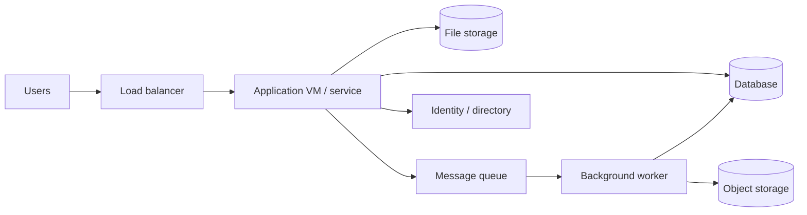

# Di chuyển workload theo rehost, replatform hoặc refactor

Di chuyển workload lên cloud là quá trình chuyển ứng dụng, máy chủ, dữ liệu và các dependency từ môi trường hiện tại sang môi trường đích. Có nhiều cách thực hiện, từ chuyển nguyên trạng máy ảo sang hạ tầng mới đến thay đổi nền tảng chạy hoặc thiết kế lại ứng dụng. Ba chiến lược thường gặp là **rehost**, **replatform** và **refactor**.

Lựa chọn chiến lược ảnh hưởng đến thời gian dự án, chi phí, mức thay đổi ứng dụng, rủi ro cutover và lợi ích cloud có thể đạt được. Rehost thường giúp di chuyển nhanh với ít thay đổi; replatform điều chỉnh một số thành phần để tận dụng dịch vụ được quản lý; refactor thay đổi kiến trúc hoặc mã nguồn sâu hơn để cải thiện khả năng mở rộng, độ tin cậy và tốc độ phát triển.

Không có một chiến lược phù hợp cho mọi workload. Quyết định cần dựa trên mục tiêu kinh doanh, trạng thái ứng dụng, dependency, yêu cầu dữ liệu, kỹ năng đội ngũ, thời hạn, ngân sách và mức downtime có thể chấp nhận.

## 1. Ba chiến lược di chuyển chính

| Chiến lược | Cách thực hiện | Mức thay đổi | Mục tiêu thường gặp |
|---|---|---|---|
| Rehost | Chuyển máy ảo hoặc ứng dụng gần như nguyên trạng sang hạ tầng cloud | Thấp | Rời data center nhanh, giảm phụ thuộc phần cứng cũ |
| Replatform | Chuyển workload và đồng thời điều chỉnh một số thành phần nền tảng | Trung bình | Giảm công vận hành, tận dụng dịch vụ cloud mà không viết lại toàn bộ ứng dụng |
| Refactor | Thiết kế lại hoặc sửa đổi đáng kể mã nguồn, dữ liệu và kiến trúc | Cao | Đạt khả năng mở rộng, tự động hóa, resilience hoặc tốc độ thay đổi tốt hơn |

### Rehost: chuyển nguyên trạng

Rehost thường được gọi là lift-and-shift. Máy ảo hoặc ứng dụng được chuyển sang VM tương đương trong cloud, giữ phần lớn hệ điều hành, runtime, middleware và cấu hình ứng dụng. Việc chuyển có thể dùng image import/export, replication ở mức block, công cụ migration hoặc cài lại cùng cấu hình trên máy đích.

Ưu điểm:

- Có thể thực hiện nhanh hơn khi cần rời data center hoặc phần cứng sắp hết vòng đời.
- Ít thay đổi mã nguồn nên giảm phạm vi kiểm thử ứng dụng.
- Giữ được nhiều quy trình vận hành và công cụ quen thuộc trong giai đoạn đầu.
- Tạo nền tảng để hiện đại hóa theo từng bước sau khi workload đã chạy ổn định trên cloud.

Hạn chế:

- Có thể mang theo cấu hình cũ, hệ điều hành lỗi thời, dependency khó nâng cấp và nợ kỹ thuật.
- Chưa tự động tận dụng autoscaling, managed database, object storage hoặc các dịch vụ cloud-native.
- Máy được sizing theo môi trường cũ có thể quá lớn hoặc không phù hợp với mô hình tính phí cloud.
- Network, identity, backup, monitoring và bảo mật vẫn cần thiết kế lại cho môi trường mới.

Rehost phù hợp khi ứng dụng khó thay đổi, thời hạn di chuyển ngắn, vendor không hỗ trợ refactor hoặc tổ chức cần giảm rủi ro thay đổi trong đợt đầu. Sau rehost, cần lập kế hoạch tối ưu và loại bỏ các cấu hình không còn cần thiết.

### Replatform: điều chỉnh nền tảng có kiểm soát

Replatform giữ phần lớn logic nghiệp vụ nhưng thay đổi một số thành phần nền tảng để giảm công vận hành hoặc cải thiện hiệu năng. Ví dụ:

- Chuyển database tự quản lý trên VM sang dịch vụ database được quản lý.
- Chuyển ứng dụng từ VM sang container nhưng giữ nguyên cấu trúc service và phần lớn mã nguồn.
- Chuyển file dùng chung sang dịch vụ lưu trữ phù hợp và cập nhật cách mount hoặc truy cập.
- Thay load balancer tự quản lý bằng dịch vụ load balancing của cloud.
- Chuyển backup, logging hoặc secrets sang dịch vụ quản lý tập trung.
- Nâng phiên bản hệ điều hành hoặc runtime trong khi giữ nguyên giao diện ứng dụng.

Ưu điểm:

- Có thể giảm công vá lỗi, backup, nâng cấp và vận hành các thành phần được quản lý.
- Tận dụng được một phần khả năng cloud mà không cần viết lại toàn bộ ứng dụng.
- Tạo cơ hội chuẩn hóa identity, monitoring, deployment và bảo mật.

Hạn chế:

- Cần kiểm tra tương thích API, driver, extension, phiên bản giao thức và giới hạn dịch vụ đích.
- Dữ liệu có thể cần chuyển đổi hoặc đồng bộ trong thời gian dài.
- Một số tính năng của hệ thống cũ không có bản tương đương trên dịch vụ managed.
- Chi phí dịch vụ mới và phí truyền dữ liệu có thể khác dự tính ban đầu.

Replatform phù hợp khi có thể giữ kiến trúc ứng dụng nhưng một vài thành phần nền tảng đang tốn nhiều công vận hành hoặc không đáp ứng mục tiêu cloud.

### Refactor: thiết kế lại hoặc tái cấu trúc

Refactor thay đổi đáng kể cách ứng dụng được xây dựng, triển khai hoặc mở rộng. Công việc có thể gồm tách monolith thành service, chuyển state ra dịch vụ dùng chung, thiết kế API/event, thay đổi mô hình dữ liệu, đưa workload vào container orchestration hoặc chuyển một phần xử lý sang serverless.

Ví dụ:

- Tách xử lý báo cáo dài thành worker bất đồng bộ sử dụng queue.
- Chuyển session trong RAM sang token stateless hoặc session store dùng chung.
- Tách module có tải khác nhau để scale độc lập.
- Thay chia sẻ file đồng bộ bằng object storage và event-driven processing.
- Thiết kế lại database access, cache và retry để chịu lỗi dependency tốt hơn.
- Chuyển batch job sang mô hình container/job hoặc dịch vụ serverless phù hợp.

Ưu điểm:

- Có thể cải thiện khả năng scale, deploy độc lập và resilience.
- Giảm phụ thuộc vào hệ điều hành hoặc middleware cũ.
- Tạo cơ hội tự động hóa CI/CD, kiểm thử và quan sát hệ thống.
- Có thể tối ưu chi phí theo tải thực tế thay vì giữ máy luôn chạy.

Hạn chế:

- Phạm vi thay đổi lớn, thời gian dài và cần nhiều kiểm thử hơn.
- Có thể phát sinh thay đổi dữ liệu, API, quy trình nghiệp vụ và kỹ năng đội ngũ.
- Rủi ro migration tăng nếu vừa đổi kiến trúc vừa chuyển dữ liệu và môi trường cùng lúc.
- Lợi ích chỉ xuất hiện khi thiết kế, vận hành và năng lực đội ngũ theo kịp mô hình mới.

Refactor phù hợp khi giới hạn của kiến trúc hiện tại đang cản trở mục tiêu kinh doanh hoặc lợi ích dài hạn đủ lớn để bù chi phí chuyển đổi.

## 2. So sánh để chọn chiến lược

| Tiêu chí | Rehost | Replatform | Refactor |
|---|---|---|---|
| Thời gian ban đầu | Thường ngắn | Trung bình | Thường dài |
| Thay đổi code | Ít hoặc không | Ít đến vừa | Vừa đến nhiều |
| Thay đổi nền tảng | Thấp | Có chọn lọc | Có thể sâu rộng |
| Rủi ro thay đổi ứng dụng | Thấp hơn | Trung bình | Cao hơn nếu không chia giai đoạn |
| Lợi ích cloud-native | Hạn chế lúc đầu | Một phần | Có thể cao |
| Nhu cầu kiểm thử | Hồi quy và tương thích môi trường | Hồi quy, tương thích dịch vụ và dữ liệu | Kiểm thử chức năng, tích hợp, tải, resilience và dữ liệu |
| Kỹ năng cần có | Hạ tầng, OS, network, migration | Hạ tầng và dịch vụ managed | Thiết kế ứng dụng, dữ liệu, platform và automation |

Không nên chọn chiến lược chỉ theo mức độ hiện đại của công nghệ. Một ứng dụng ít thay đổi, sắp ngừng sử dụng có thể không đáng để refactor. Một hệ thống quan trọng có nợ kiến trúc lớn có thể cần refactor theo từng miền thay vì chuyển nguyên trạng rồi tiếp tục gánh chi phí vận hành.

## 3. Đánh giá workload trước khi quyết định

Trước khi chọn rehost, replatform hoặc refactor, cần lập hồ sơ workload. Dữ liệu đánh giá nên có:

- Chủ sở hữu nghiệp vụ và kỹ thuật, người dùng, mức độ quan trọng.
- Hệ điều hành, phiên bản runtime, middleware, package và license.
- CPU, RAM, disk IOPS/throughput, network throughput và peak concurrency.
- Dung lượng dữ liệu, tốc độ tăng, thời gian backup và yêu cầu restore.
- Dependency tới database, queue, file share, DNS, LDAP/identity, API và hệ thống bên ngoài.
- Giao thức, port, firewall, certificate, DNS name và IP allowlist.
- Yêu cầu availability, RTO, RPO, latency và maintenance window.
- Quy định bảo mật, dữ liệu cá nhân, data residency và yêu cầu audit.
- Chi phí hiện tại và chi phí cloud dự kiến, gồm compute, storage, network, license và vận hành.
- Hạn chế vendor, hợp đồng, thời điểm hết hỗ trợ và lộ trình thay thế.

Phân biệt số liệu trung bình với peak. Một VM có CPU trung bình 15% nhưng tăng lên 90% trong đợt batch có thể cần thiết kế capacity khác với ứng dụng luôn chạy đều. Đo qua một chu kỳ nghiệp vụ đủ dài để thấy batch, cuối tháng, mùa cao điểm và thời gian backup.

### Lập bản đồ dependency

Một workload hiếm khi đứng độc lập. Trước khi di chuyển, lập bản đồ luồng giao tiếp giữa ứng dụng và các thành phần khác. Ví dụ, web tier gọi API nội bộ, API truy vấn database, đọc file share, gửi message và xác thực qua directory service.

Sơ đồ dependency giúp xác định thứ tự migration, firewall, DNS, data movement và cách kiểm thử. Nếu chuyển application trước nhưng database vẫn ở data center, cần thiết kế network connectivity, latency, encryption và chi phí truyền dữ liệu trong giai đoạn hybrid.

## 4. Ma trận quyết định thực tế

Có thể dùng các câu hỏi sau để định hướng:

| Câu hỏi | Nghiêng về rehost | Nghiêng về replatform | Nghiêng về refactor |
|---|---|---|---|
| Có thời hạn rời data center gấp? | Có | Có thể | Ít phù hợp cho toàn bộ hệ thống |
| Ứng dụng khó sửa hoặc vendor không hỗ trợ? | Phù hợp | Nếu nền tảng đích tương thích | Rủi ro cao |
| Thành phần vận hành tốn công nhưng có managed equivalent? | Chưa tận dụng nhiều | Phù hợp | Có thể cần nếu API/logic phải đổi sâu |
| Kiến trúc hiện tại cản trở scale hoặc deploy? | Chỉ giải quyết vị trí chạy | Giải quyết một phần | Phù hợp |
| Cần thay đổi mô hình dữ liệu hoặc giao tiếp? | Không phù hợp | Có giới hạn | Phù hợp |
| Đội ngũ có thời gian và kỹ năng hiện đại hóa? | Không bắt buộc nhiều | Cần kỹ năng nền tảng | Cần năng lực thiết kế và vận hành cao hơn |

Một cách làm thực tế là chấm điểm từng workload theo business value, migration urgency, technical complexity, data sensitivity, dependency complexity và expected cloud benefit. Điểm số chỉ hỗ trợ thảo luận; cần ghi rõ giả định và người chịu trách nhiệm quyết định.

## 5. Các bước chung của một dự án migration

Dù chọn chiến lược nào, dự án thường đi qua các bước sau:

1. **Discover:** kiểm kê ứng dụng, máy chủ, dữ liệu, dependency, hiệu năng và chi phí.
2. **Assess:** xác định mức sẵn sàng, tương thích, rủi ro, chiến lược migration và business case.
3. **Design:** thiết kế landing zone, network, identity, security, compute, storage, backup và monitoring.
4. **Plan waves:** nhóm workload theo dependency, độ quan trọng, mức rủi ro và thời gian cutover.
5. **Prepare:** tạo môi trường đích, quota, image, automation, công cụ migration và runbook.
6. **Migrate:** sao chép máy/dữ liệu, triển khai cấu hình hoặc chuyển đổi ứng dụng.
7. **Validate:** kiểm thử chức năng, dữ liệu, bảo mật, hiệu năng, vận hành và recovery.
8. **Cut over:** chuyển traffic hoặc người dùng sang môi trường đích theo kế hoạch.
9. **Stabilize:** theo dõi lỗi, latency, chi phí, capacity và hỗ trợ người dùng.
10. **Optimize/decommission:** tối ưu sizing, hoàn tất tài liệu và ngừng tài nguyên nguồn khi đủ điều kiện.

Không nên gom tất cả workload vào một đợt lớn nếu dependency và mức độ quan trọng khác nhau. Migration waves nhỏ giúp học từ đợt trước, giảm blast radius và cải thiện runbook.

## 6. Thiết kế landing zone trước khi di chuyển

Landing zone là môi trường cloud nền đã được chuẩn bị để tiếp nhận workload. Tối thiểu cần xác định:

- Account/subscription/project và cách phân tách production, non-production, shared services.
- VPC/VNet, subnet, route, VPN/private connectivity, DNS và IP plan.
- IAM/role, federated identity, MFA, service identity và quyền break-glass.
- Security group/NSG, firewall, vulnerability management và baseline OS.
- Image được phê duyệt, patching, secret management và certificate lifecycle.
- Logging, metrics, tracing, audit trail và cảnh báo.
- Backup policy, encryption key, retention và quy trình restore.
- Tagging, budget, cost allocation và quota.
- IaC, CI/CD, configuration management và quyền triển khai.

Nếu chuyển VM trước khi landing zone sẵn sàng, đội dự án có thể phải sửa lại network, IAM, logging và backup sau cutover. Những thay đổi hậu migration dễ tạo drift và rủi ro bảo mật.

## 7. Quy trình rehost máy ảo

Rehost có thể dùng image-based migration, block replication hoặc cài đặt lại ứng dụng trên VM đích. Quy trình khái quát:

1. Chọn instance type theo số liệu CPU, RAM, disk và network hiện tại; tránh sao chép nguyên sizing nếu máy nguồn bị overprovision.
2. Xác định hệ điều hành và phiên bản có hỗ trợ trên cloud hoặc cần nâng cấp trước.
3. Kiểm tra BIOS/UEFI, boot mode, driver, kernel module, guest agent và kiến trúc CPU.
4. Chuẩn bị subnet, security group, route, DNS, IAM và storage đích.
5. Cài agent migration hoặc cấu hình replication; đo băng thông và thời gian đồng bộ ban đầu.
6. Thử khởi động bản sao trong mạng cô lập để kiểm tra boot, driver, service, license và ứng dụng.
7. Chọn cửa sổ cutover; dừng ghi hoặc quiesce ứng dụng theo kế hoạch.
8. Đồng bộ delta cuối, xác nhận replication hoàn tất và chuyển endpoint/traffic.
9. Kiểm tra chức năng, dữ liệu, monitoring, backup và kết nối dependency.
10. Giữ máy nguồn theo thời hạn rollback đã thống nhất, sau đó decommission có kiểm soát.

### Rủi ro kỹ thuật của rehost

- NIC và tên interface có thể thay đổi, làm cấu hình IP tĩnh hoặc firewall trong guest không còn đúng.
- MAC address, machine identity, host key hoặc agent ID có thể bị trùng nếu clone image không đúng cách.
- License gắn với hardware fingerprint có thể cần kích hoạt lại.
- Clock, DNS, route, MTU và firewall có thể khác môi trường cũ.
- Disk mapping, boot partition, filesystem và driver có thể không tương thích.
- Ứng dụng có thể phụ thuộc IP cũ, share path hoặc service name chưa được chuyển.

Vì vậy, bản sao VM boot thành công chưa đủ để kết luận migration hoàn tất. Phải kiểm tra đường đi của request và hành vi ứng dụng end-to-end.

## 8. Quy trình replatform

Replatform thay một hoặc vài thành phần nhưng giữ phần lớn chức năng và contract của ứng dụng. Ví dụ chuyển database từ VM tự quản lý sang managed database.

Quy trình nên gồm:

1. Chọn thành phần cần thay thế và xác định lợi ích mong đợi: giảm patching, tăng HA, giảm backup toil hoặc cải thiện hiệu năng.
2. So sánh phiên bản, extension, collation, encoding, stored procedure, driver và giới hạn dịch vụ đích.
3. Kiểm tra network path, private endpoint, DNS, TLS, authentication và quyền database.
4. Thiết kế data migration: dump/restore, native replication, change data capture hoặc công cụ migration được hỗ trợ.
5. Chạy thử trên bản sao dữ liệu đại diện; so sánh row count, checksum, schema và query behavior.
6. Kiểm tra connection pool, timeout, retry, transaction và giới hạn connection của dịch vụ mới.
7. Thực hiện cutover theo cửa sổ đã định; khóa hoặc giảm ghi nếu cần để đồng bộ dữ liệu cuối.
8. Cập nhật connection string/secret/DNS và xác nhận ứng dụng kết nối tới endpoint mới.
9. Theo dõi latency, error, replication lag, storage, backup và failover của dịch vụ đích.
10. Giữ phương án rollback khả thi cho đến khi dữ liệu và vận hành được xác nhận.

Khi thay database bằng managed service, một số quyền quản trị cấp hệ điều hành hoặc extension có thể không còn. Kiểm tra những tác vụ cũ như cron backup, log rotation, replication script và monitoring agent có được thay bằng chức năng managed hay cần giữ ở ứng dụng.

## 9. Quy trình refactor theo từng bước

Refactor không nhất thiết là viết lại toàn bộ ứng dụng trong một lần. Có thể áp dụng cách tiếp cận incremental để giảm rủi ro:

- Chọn một capability hoặc bounded context có ranh giới tương đối rõ.
- Tách giao diện qua API hoặc message contract ổn định.
- Chuyển dữ liệu hoặc quyền sở hữu dữ liệu theo từng phần.
- Chạy phiên bản mới song song với phiên bản cũ trong phạm vi kiểm soát.
- Dùng canary, shadow traffic hoặc feature flag để xác minh.
- Chuyển dần traffic và quan sát SLO.
- Gỡ thành phần cũ khi đã xác nhận không còn consumer hoặc dữ liệu cần thiết.

Một số pattern hữu ích:

- **Strangler pattern:** đặt facade/gateway trước hệ thống cũ, từng bước chuyển route hoặc capability sang service mới.
- **Anti-corruption layer:** chuyển đổi model/giao thức giữa hệ thống mới và legacy để tránh kéo theo khái niệm cũ.
- **Outbox pattern:** ghi business change và event trong cùng transaction cục bộ, sau đó phát event để giảm nguy cơ mất đồng bộ giữa database và message broker.
- **Expand-and-contract:** mở rộng schema/API để cả phiên bản cũ và mới cùng hoạt động, chuyển consumer, rồi mới loại bỏ trường hoặc contract cũ.
- **Branch by abstraction:** tạo abstraction ổn định để thay implementation từng bước.

Refactor cần kiểm thử contract, data consistency, idempotency, ordering, retry và observability. Khi tách service, cần xác định rõ ownership dữ liệu; nếu hai service cùng ghi một bảng hoặc cùng sở hữu một trạng thái mà không có quy tắc, độ phức tạp có thể tăng thay vì giảm.

## 10. Di chuyển dữ liệu và kiểm soát tính nhất quán

Dữ liệu thường là phần khó nhất của migration. Cần phân biệt dữ liệu có thể tái tạo, dữ liệu có thể đồng bộ, dữ liệu phải dừng ghi và dữ liệu cần giữ lại theo quy định.

Các cách di chuyển thường gặp:

- **Offline copy:** dừng ghi, copy toàn bộ dữ liệu, xác minh rồi mở hệ thống đích. Dễ hiểu nhưng downtime phụ thuộc dung lượng và tốc độ truyền.
- **Snapshot plus delta:** tạo snapshot ban đầu, sao chép nền rồi đồng bộ phần thay đổi phát sinh.
- **Continuous replication/CDC:** đồng bộ thay đổi liên tục để giảm thời gian dừng ghi; cần theo dõi replication lag và thứ tự transaction.
- **Application-level migration:** ứng dụng ghi vào hệ thống mới hoặc đồng thời vào hai hệ thống theo một protocol có kiểm soát.

Double-write có thể tạo trạng thái lệch nếu một lần ghi thành công ở hệ thống này nhưng thất bại ở hệ thống kia. Nếu dùng, cần idempotency, reconciliation và cách xử lý partial failure rõ ràng. Không coi việc gửi cùng một request tới hai database là cơ chế migration an toàn tự thân.

### Kiểm tra dữ liệu

Trước và sau migration, nên kiểm tra:

- Số lượng record/object và dung lượng theo bảng, partition hoặc bucket.
- Checksum hoặc hash theo batch/partition khi phù hợp.
- Schema, index, constraint, collation và encoding.
- Transaction cuối cùng đã commit và replication lag.
- Sequence, identity, offset, checkpoint và timestamp.
- Quyền truy cập, encryption, retention và audit.
- Truy vấn nghiệp vụ đại diện và báo cáo đối soát.

Một checksum tổng trên toàn bộ database có thể tốn thời gian hoặc không phù hợp khi dữ liệu tiếp tục thay đổi. Chọn cách so sánh theo partition, watermark hoặc snapshot nhất quán. Ghi nhận sai lệch và xử lý trước khi chuyển toàn bộ traffic.

## 11. Lập kế hoạch downtime và cutover

Cutover là thời điểm workload hoặc traffic chính chuyển từ môi trường nguồn sang môi trường đích. Kế hoạch cần xác định rõ điều kiện bắt đầu, các bước, thời lượng, người chịu trách nhiệm, tiêu chí thành công và điều kiện dừng.

Một checklist cutover cơ bản:

1. Xác nhận môi trường đích đã qua smoke test và security check.
2. Thông báo maintenance window và tạm dừng thay đổi không liên quan.
3. Giảm TTL DNS trước nếu chuyển endpoint bằng DNS và có thể làm việc đó an toàn.
4. Đưa ứng dụng nguồn vào maintenance/read-only hoặc dừng ghi theo thiết kế.
5. Chờ transaction đang chạy hoàn tất và đồng bộ dữ liệu cuối.
6. Xác minh watermark/replication lag đạt điều kiện.
7. Chuyển DNS, route, load balancer hoặc connection string.
8. Chạy smoke test, kiểm tra dữ liệu và xác nhận request mới tới môi trường đích.
9. Theo dõi error rate, latency, queue, database và business transaction.
10. Ghi nhận quyết định tiếp tục hoặc rollback theo ngưỡng đã thống nhất.

DNS TTL thấp không bảo đảm mọi client chuyển ngay; resolver, connection pool và kết nối keep-alive có thể giữ endpoint cũ. Nếu dùng IP allowlist, certificate hoặc callback URL, cần cập nhật đồng bộ.

## 12. Thiết kế rollback và điều kiện quay lại

Rollback phải được thiết kế trước cutover. Với rehost, quay lại máy nguồn có thể tương đối đơn giản nếu máy nguồn vẫn được giữ nguyên và chưa nhận dữ liệu ghi mới. Với database hoặc refactor, rollback phức tạp hơn vì dữ liệu có thể đã thay đổi trên hệ thống đích.

Xác định trước:

- Ngưỡng lỗi, latency, data mismatch hoặc business failure khiến phải dừng cutover.
- Ai có quyền quyết định rollback và trong thời gian nào.
- Máy nguồn, database cũ và endpoint cũ được giữ tới khi nào.
- Có reverse replication hoặc cách đồng bộ dữ liệu ngược không.
- Làm thế nào tránh hai hệ thống cùng nhận ghi trong lúc quay lại.
- Cách xử lý transaction phát sinh sau thời điểm cutover.
- Điều kiện đóng rollback window và chuyển sang vận hành chính thức.

Nếu hệ thống đích đã nhận ghi, không thể chỉ đổi DNS về hệ thống nguồn rồi cho rằng dữ liệu sẽ đúng. Cần reverse replication, export delta hoặc quy trình reconciliation đã thử nghiệm. Nếu không có phương án đồng bộ ngược an toàn, có thể cần giữ hệ thống đích là nguồn dữ liệu chính và khắc phục forward thay vì rollback mù quáng.

## 13. Kiểm thử sau migration

Kiểm thử phải xác minh cả ứng dụng lẫn nền tảng cloud:

| Nhóm kiểm thử | Nội dung |
|---|---|
| Functional | Luồng đăng nhập, tạo/cập nhật dữ liệu, báo cáo và tích hợp nghiệp vụ |
| Data integrity | Record count, checksum, transaction, schema, file và object |
| Performance | Throughput, p95/p99 latency, CPU, RAM, disk, network và connection pool |
| Resilience | Restart VM, mất một backend, dependency timeout, failover và recovery |
| Security | IAM, network policy, encryption, secret, patch, audit và vulnerability scan |
| Operations | Monitoring, alert, log, backup, restore, access và runbook |
| Cost | Instance sizing, storage, license, data transfer và managed service charge |

Không chỉ kiểm thử khi tải thấp. Chạy tải đại diện, peak và soak test đủ dài để phát hiện leak, queue tăng, cache warm-up hoặc giới hạn connection. Nếu migration thay đổi loại instance, CPU architecture hoặc storage, benchmark cần dùng workload tương đương trước và sau.

## 14. Bảo mật trong quá trình migration

Trong giai đoạn migration, dữ liệu có thể đi qua agent, staging storage, network tunnel và tài khoản tạm. Đây là thời điểm cần kiểm soát chặt:

- Mã hóa dữ liệu khi truyền và khi lưu; xác minh certificate và endpoint.
- Dùng identity riêng cho migration tool, giới hạn quyền đọc/ghi và thu hồi sau dự án.
- Không nhúng credential trong script, image, log hoặc file cấu hình không mã hóa.
- Giới hạn nguồn mạng được phép kết nối giữa source, staging và target.
- Ghi audit cho snapshot, export, copy, import và thay đổi quyền.
- Bảo vệ dữ liệu staging và bản dump với retention phù hợp; xóa an toàn khi hết mục đích.
- Xác minh encryption key, key policy và quyền giải mã ở môi trường đích.
- Quét image, package và artifact trước khi đưa vào production.
- Xử lý certificate, SSH host key, machine identity và agent identity để tránh clone trùng.

Nếu dữ liệu có yêu cầu residency hoặc quy định riêng, xác nhận region, nơi lưu snapshot/backup, vị trí log và tuyến truyền dữ liệu trước khi chạy migration.

## 15. Ước lượng chi phí và lợi ích

So sánh chi phí trước/sau không nên chỉ lấy giá VM cloud so với chi phí máy chủ cũ. Tính tổng chi phí sở hữu (TCO) gồm:

- Compute: VM, container platform, serverless execution và capacity dự phòng.
- Storage: block, file, object, snapshot, backup và IOPS/throughput.
- Network: data transfer, cross-zone, VPN, NAT, private connectivity và egress.
- Managed services: database, cache, queue, monitoring và support tier.
- License: OS, database, middleware và phần mềm thương mại.
- Migration: công cụ, staging capacity, data transfer và nhân lực.
- Vận hành: patching, backup, incident response, on-call và platform engineering.
- Chi phí tạm thời khi chạy song song source và target.

Rehost có thể giảm thời gian dự án nhưng không nhất thiết giảm chi phí vận hành nếu VM giữ quá lớn hoặc chạy liên tục. Replatform có thể tăng phí managed service nhưng giảm nhân lực bảo trì. Refactor có thể cần đầu tư lớn ban đầu nhưng giảm chi phí thay đổi hoặc cho phép scale theo tải. Cần so sánh theo thời hạn đủ dài và tính cả rủi ro downtime.

## 16. Tổ chức migration theo waves

Không nên chỉ nhóm workload theo phòng ban. Nên nhóm theo dependency và khả năng chuyển đổi. Một wave có thể gồm các ứng dụng ít phụ thuộc, cùng maintenance window và cùng mức độ rủi ro.

Ví dụ cách sắp xếp:

| Wave | Loại workload | Mục tiêu |
|---|---|---|
| Pilot | Dev/test hoặc ứng dụng nội bộ ít quan trọng | Kiểm chứng landing zone, tool và runbook |
| Wave 1 | Stateless web/API ít dependency | Xác nhận network, image, load balancing và monitoring |
| Wave 2 | Worker và dịch vụ tích hợp | Kiểm tra queue, retry, secret và data flow |
| Wave 3 | Database hoặc workload stateful | Di chuyển dữ liệu, replication, RPO/RTO và failover |
| Wave 4 | Hệ thống legacy phức tạp | Dùng chiến lược riêng, replatform/refactor hoặc giữ lại tạm thời |

Thứ tự cụ thể phụ thuộc dependency. Ví dụ, nếu database là nền tảng dùng chung cho nhiều API, cần chuẩn bị connectivity và kế hoạch database trước khi chuyển các API phụ thuộc. Một pilot nên đủ đại diện để phát hiện vấn đề, nhưng không nên là hệ thống trọng yếu nhất.

## 17. Ví dụ: chọn chiến lược cho ba workload

Giả sử tổ chức có ba workload:

| Workload | Hiện trạng | Chiến lược phù hợp ban đầu | Lý do |
|---|---|---|---|
| Ứng dụng ERP vendor-managed | Chạy trên VM, vendor chỉ hỗ trợ cấu hình OS/database cụ thể | Rehost | Giữ tương thích và giảm thay đổi ngoài phạm vi hỗ trợ |
| API nội bộ và database tự quản lý | API stateless, database có managed equivalent tương thích | Replatform | Chuyển API sang VM cloud và database sang managed service để giảm công vận hành |
| Hệ thống xử lý đơn hàng monolith | Scale khó, deploy chậm, xử lý batch đồng bộ | Refactor từng phần | Tách worker bất đồng bộ và capability có tải độc lập theo lộ trình |

Một kế hoạch có thể rehost ERP trước để hoàn tất việc rời data center, replatform API/database sau khi thử tương thích, rồi refactor monolith theo các capability có giá trị cao. Các chiến lược có thể cùng tồn tại trong một chương trình migration; một workload cũng có thể rehost trước rồi replatform hoặc refactor ở giai đoạn sau.

## 18. Những sai lầm thường gặp

- **Chọn rehost cho mọi ứng dụng:** chuyển nguyên trạng cả nợ kỹ thuật và chi phí không cần thiết. Đánh giá từng workload.
- **Refactor tất cả trước khi rời data center:** làm tăng thời gian và phạm vi dự án. Có thể chia thành migration rồi modernization theo lộ trình.
- **Coi replatform là thay endpoint đơn giản:** dịch vụ managed có giới hạn, extension và semantics riêng. Kiểm tra tương thích và dữ liệu.
- **Không lập dependency map:** chuyển một thành phần làm hệ thống khác mất kết nối. Xác định luồng và thứ tự migration.
- **Sizing theo cấu hình cũ:** giữ nguyên máy overprovision hoặc thiếu capacity. Dùng metric và benchmark.
- **Không thử bản sao trước cutover:** lỗi driver, boot, license hoặc network chỉ lộ ra trong maintenance window. Chạy rehearsal.
- **Bỏ qua đồng bộ dữ liệu cuối:** dữ liệu source và target lệch. Theo dõi watermark/lag và có bước freeze ghi.
- **Rollback bằng cách đổi DNS:** dữ liệu ghi sau cutover không tự quay về source. Thiết kế reverse sync hoặc forward recovery.
- **Không kiểm tra security/backup sau migration:** workload chạy được nhưng không có khả năng vận hành an toàn. Kiểm tra IAM, log, encryption và restore.
- **Decommission source quá sớm:** mất phương án đối chiếu hoặc rollback. Chỉ ngừng khi có sign-off và retention rõ ràng.

## 19. Checklist trước, trong và sau migration

**Trước migration**

- [ ] Có owner nghiệp vụ/kỹ thuật và mục tiêu migration rõ ràng.
- [ ] Đã kiểm kê OS, runtime, license, dependency, dữ liệu và tải peak.
- [ ] Đã chọn rehost, replatform hoặc refactor cùng giả định và lý do.
- [ ] Landing zone, network, IAM, security, image, logging và backup đã sẵn sàng.
- [ ] Có kế hoạch data movement, downtime, cutover và rollback.
- [ ] Đã xác nhận quota, capacity, chi phí và yêu cầu region/residency.
- [ ] Đã diễn tập migration trên môi trường đại diện.

**Trong cutover**

- [ ] Có người điều phối, checklist và kênh liên lạc.
- [ ] Thay đổi ngoài kế hoạch được kiểm soát.
- [ ] Source được freeze/quiesce theo phương án.
- [ ] Delta replication và tính nhất quán dữ liệu được xác nhận.
- [ ] DNS/route/load balancer/secret được chuyển đúng.
- [ ] Smoke test và business validation đạt trước khi mở toàn bộ traffic.
- [ ] Có quyết định tiếp tục hoặc rollback theo ngưỡng đã định.

**Sau migration**

- [ ] Theo dõi error rate, latency, capacity, log và dependency.
- [ ] Backup mới đã chạy và restore test đạt.
- [ ] IAM, firewall, encryption, audit và vulnerability scan được xác nhận.
- [ ] Chi phí thực tế được so với business case và sizing được tối ưu.
- [ ] Tài liệu, sơ đồ, runbook và ownership được cập nhật.
- [ ] Source chỉ được decommission sau sign-off, retention và rollback window.

## 20. Kết luận lựa chọn

Rehost giúp chuyển workload nhanh với ít thay đổi, replatform điều chỉnh nền tảng để tận dụng dịch vụ cloud, còn refactor thay đổi sâu kiến trúc hoặc mã nguồn để giải quyết giới hạn dài hạn. Một chương trình migration tốt thường phối hợp cả ba chiến lược theo đặc điểm từng workload và có thể thực hiện theo nhiều giai đoạn.

Thành công không chỉ là máy ảo khởi động ở cloud. Workload phải giữ được tính đúng đắn của dữ liệu, kết nối đúng dependency, đáp ứng SLO, có backup/restore, bảo mật, quan sát được và có chi phí vận hành phù hợp. Đánh giá kỹ trước migration, rehearsal, cutover có tiêu chí và rollback khả thi giúp giảm rủi ro trong toàn bộ quá trình.
