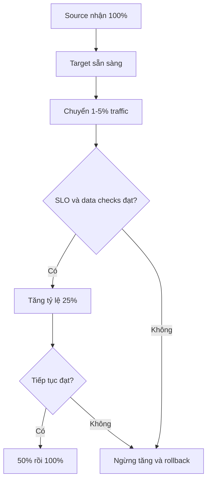
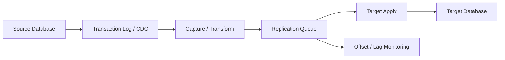

# Lập kế hoạch cutover, đồng bộ dữ liệu và rollback

Di chuyển workload sang VM mới, container platform, region khác hoặc dịch vụ managed thường không khó ở bước tạo hạ tầng đích. Rủi ro lớn nằm ở thời điểm chuyển hệ thống đang phục vụ người dùng sang môi trường mới: dữ liệu có thể chưa đồng bộ, request đang chạy có thể ghi vào hai nơi, DNS/load balancer có thể chuyển không đồng đều và rollback có thể làm mất các giao dịch đã phát sinh ở đích.

Trong module **CLOUD_CORE_SERVICES_COMPUTE**, kế hoạch cutover cần kết nối compute, network, storage, identity, database, backup và observability thành một quy trình có thể kiểm soát. Một lần migration an toàn phải xác định nguồn dữ liệu chuẩn, cách đồng bộ, tiêu chí xác nhận target sẵn sàng, thời điểm chuyển traffic, giới hạn chấp nhận được và cách quay lại nếu có lỗi. Bài học này hướng dẫn xây dựng kế hoạch đó từ khâu chuẩn bị đến cutover, xác minh và đóng migration.

## Mục tiêu học tập

Sau bài này, bạn có thể:

- Phân biệt migration, replication, synchronization, cutover, rollback và failback.
- Chọn chiến lược cutover phù hợp với downtime, RTO, RPO và khả năng tương thích của workload.
- Chuẩn bị source/target, dependency, network, identity, DNS và kế hoạch chuyển traffic.
- Kết hợp full data copy với incremental sync hoặc Change Data Capture (CDC).
- Đánh giá consistency, replication lag, ordering, duplicate event và data reconciliation.
- Thiết kế schema/application compatibility để source và target cùng tồn tại trong giai đoạn chuyển đổi.
- Xây dựng runbook cutover có checkpoint, owner, điều kiện Go/No-Go và rollback trigger.
- Phân biệt rollback trước khi target nhận ghi mới với rollback sau khi dữ liệu đã phân kỳ.
- Kiểm thử migration, đo kết quả và lưu bằng chứng hoàn tất.

## 1. Các khái niệm trong một lần migration

Migration là quá trình chuyển workload, dữ liệu hoặc cả hai từ môi trường nguồn (source) sang môi trường đích (target). Cutover là thời điểm hoặc chuỗi bước chuyển quyền phục vụ chính từ source sang target. Rollback là đưa dịch vụ về trạng thái vận hành trước đó khi điều kiện sau cutover không đạt. Data synchronization là quá trình đưa dữ liệu giữa source và target về cùng trạng thái theo một quy tắc nhất định.

| Thuật ngữ | Ý nghĩa | Ví dụ |
|---|---|---|
| Source | Hệ thống đang vận hành và thường là nguồn dữ liệu chuẩn ban đầu | VM/database hiện tại |
| Target | Môi trường sẽ tiếp nhận workload hoặc dữ liệu | Cluster mới hoặc database managed |
| Replication | Sao chép thay đổi từ một hệ thống sang hệ thống khác | Database log replication |
| CDC | Ghi nhận thay đổi dữ liệu từ transaction log hoặc change stream | Insert/update/delete được chuyển liên tục |
| Initial load/full copy | Sao chép ảnh chụp dữ liệu ban đầu | Export/import database hoặc copy object |
| Incremental sync | Đồng bộ phần thay đổi sau lần copy ban đầu | Đồng bộ delta theo watermark |
| Cutover | Chuyển traffic hoặc quyền ghi chính sang target | Đổi backend của load balancer |
| Rollback | Quay lại source hoặc trạng thái an toàn trước đó | Chuyển traffic về source sau khi xác minh dữ liệu |
| Reconciliation | Đối chiếu hai hệ thống để tìm sai lệch | So số lượng bản ghi và checksum |
| Write freeze | Tạm ngừng ghi để tạo điểm đồng bộ cuối cùng | Chặn transaction mới trong thời gian cutover |
| Reverse replication | Đồng bộ thay đổi từ target về source | Chuẩn bị rollback sau khi target đã nhận ghi |

### 1.1. Phân biệt rollback và failback

Rollback thường là hành động quay lại source hoặc phiên bản trước trong cùng một migration/incident. Failback thường chỉ việc chuyển hoạt động về môi trường chính sau khi một môi trường dự phòng đã phục vụ trong thời gian sự cố. Hai quy trình có thể dùng kỹ thuật tương tự nhưng mục tiêu, điều kiện dữ liệu và phê duyệt khác nhau.

Không được coi đổi DNS về source là rollback hoàn chỉnh. Nếu target đã nhận giao dịch mới, source có thể thiếu dữ liệu. Cần có kế hoạch đồng bộ ngược, reconcile hoặc chấp nhận mất dữ liệu trong giới hạn RPO đã phê duyệt.

### 1.2. Xác định phạm vi migration

Trước khi chọn công cụ, ghi rõ:

- Workload nào được chuyển: API, worker, database, cache, file/object, batch job hay toàn bộ stack.
- Source và target nằm ở đâu: cùng VM platform, khác AZ, khác region, container platform hoặc managed service.
- Dữ liệu nào cần chuyển và mức độ quan trọng.
- Các kết nối, DNS, certificate, secret, IAM role, firewall và endpoint cần thay đổi.
- Downtime tối đa, RTO, RPO và SLO trong giai đoạn chuyển đổi.
- Phạm vi rollback và thời hạn giữ source ở trạng thái có thể khôi phục.
- Owner kỹ thuật, owner nghiệp vụ, người ra quyết định Go/No-Go và kênh liên lạc sự cố.

## 2. Chọn chiến lược cutover

Không có một cách cutover phù hợp cho mọi workload. Lựa chọn phụ thuộc vào khả năng chạy song song, dữ liệu có thể đồng bộ liên tục hay không, thời gian downtime cho phép và độ phức tạp khi quay lại.

### 2.1. Big-bang cutover

Big-bang cutover chuyển toàn bộ traffic trong một cửa sổ bảo trì:

1. Ngừng nhận ghi mới ở source.
2. Hoàn tất các request/job đang chạy.
3. Đồng bộ dữ liệu cuối cùng.
4. Xác minh target.
5. Chuyển traffic và mở ghi ở target.

Ưu điểm là luồng điều khiển đơn giản, không cần vận hành lâu hai môi trường. Nhược điểm là downtime tập trung, áp lực cao trong cửa sổ cutover và rollback khó nếu target đã nhận ghi mới.

Phù hợp với workload có downtime được chấp nhận, dữ liệu không quá lớn hoặc có cơ chế đồng bộ cuối nhanh và đã diễn tập.

### 2.2. Blue-green cutover

Blue-green duy trì hai môi trường tương tự: blue là source đang phục vụ; green là target đã được triển khai và kiểm tra. Traffic được chuyển từ blue sang green qua load balancer, router hoặc DNS.

```mermaid
flowchart LR
    U[Users] --> R[Traffic Router]
    R -->|Before cutover| B[Blue: Source]
    R -.->|Target prepared| G[Green: Target]
    B --> D[(Authoritative Data)]
    G --> D
    R -->|After cutover| G
```



Blue-green giúp kiểm tra target trước khi chuyển traffic và có thể chuyển routing nhanh. Nhưng nếu cả hai môi trường cùng ghi vào một database hoặc hai database độc lập, cần thiết kế data ownership rõ. Không cho blue và green cùng ghi một dữ liệu mà không có cơ chế conflict resolution.

### 2.3. Canary hoặc traffic shifting theo tỷ lệ

Canary chuyển một phần nhỏ traffic sang target, quan sát rồi tăng dần tỷ lệ:



Canary giảm phạm vi ảnh hưởng khi lỗi, nhưng đòi hỏi phân nhóm traffic, telemetry theo phiên bản và khả năng rollback nhanh. Tỷ lệ traffic không nhất thiết phản ánh tỷ lệ ghi dữ liệu; cần xem request mix và tenant distribution.

### 2.4. Shadow traffic

Shadow traffic gửi bản sao request đến target để quan sát mà không dùng response của target cho người dùng. Cách này hữu ích để so hiệu năng hoặc kết quả đọc, nhưng phải tránh tạo side effect kép.

Chỉ shadow các request an toàn hoặc dùng target read-only/sandbox. Không phát lại lệnh thanh toán, gửi email, tạo đơn hàng hoặc thao tác ghi thật nếu chưa có cơ chế loại bỏ side effect.

### 2.5. Chọn chiến lược theo điều kiện

| Điều kiện | Chiến lược thường phù hợp | Rủi ro cần xử lý |
|---|---|---|
| Downtime chấp nhận được, dữ liệu ít | Big-bang | Cửa sổ bảo trì và final sync |
| Target có thể chạy song song, traffic đổi nhanh | Blue-green | Data ownership, session và reverse path |
| Cần giảm rủi ro bằng cách tăng traffic dần | Canary/traffic shifting | Metric theo phiên bản và rollback từng bước |
| Muốn kiểm tra logic target mà không ảnh hưởng người dùng | Shadow | Side effect, dữ liệu nhạy cảm và tải phụ |
| Database lớn, downtime rất thấp | Full copy + CDC + cutover ngắn | Replication lag, consistency và write freeze |

## 3. Lập kế hoạch source và target

Cutover chỉ an toàn khi target tương thích với ứng dụng, dữ liệu và dependency. Một target khởi động thành công chưa chắc đã sẵn sàng phục vụ production.

### 3.1. Inventory thành phần

Lập danh sách:

- VM/instance, container image, runtime, OS, kernel và CPU architecture.
- Database engine/version, schema, extension, collation, timezone và encoding.
- Volume, filesystem, object storage, file permission và encryption key.
- DNS record, IP, load balancer, route, firewall, NAT và private endpoint.
- IAM role, service account, secret, certificate và KMS key.
- Queue, stream, cache, scheduler, cron job và background worker.
- Monitoring, log, alert, tracing, backup và restore policy.
- License, quota, capacity reservation và dịch vụ bên thứ ba.

### 3.2. Kiểm tra tương thích

Các khác biệt có thể làm migration lỗi:

- CPU architecture hoặc instruction set khác nhau.
- OS/runtime/library không tương thích.
- Database version hoặc extension không hỗ trợ schema hiện tại.
- Filesystem semantics, case sensitivity, file ownership hoặc permission khác.
- Timestamp/timezone, collation hoặc character encoding khác.
- Network MTU, DNS resolution, TLS policy hoặc certificate chain khác.
- IAM permission và identity mapping khác.
- Storage performance, IOPS hoặc throughput thấp hơn source.

Thực hiện compatibility test với dữ liệu đại diện. Không dựa vào việc image/container chạy được để kết luận workload đã tương thích.

### 3.3. Capacity target

Target phải có đủ capacity cho tải trong cutover và sau khi chuyển. Tính CPU, memory, network, storage, database connections, queue consumers và headroom. Nếu dùng canary, target vẫn cần capacity cho traffic tăng theo từng bước; nếu dùng blue-green, có thể phải trả chi phí duy trì hai môi trường trong một khoảng thời gian.

### 3.4. Network và identity readiness

Trước cutover:

- Kiểm tra source/target resolve đúng DNS và truy cập dependency cần thiết.
- Xác minh firewall/security group, route và network policy.
- Kiểm tra TLS certificate, hostname verification và mTLS nếu có.
- Xác minh service account/role có đúng quyền và không dùng credential dài hạn cũ.
- Kiểm tra secret được đồng bộ an toàn và có rotation plan.
- Xác minh outbound egress, NAT và private endpoint.

Không mở firewall rộng chỉ để làm migration chạy được. Dùng rule theo nguồn, đích, port và thời hạn; thu hồi rule tạm sau cutover.

## 4. Đồng bộ dữ liệu: full copy và incremental sync

Đối với database hoặc object lớn, sao chép toàn bộ dữ liệu ngay trước cutover có thể mất nhiều giờ. Một mô hình phổ biến là copy ban đầu rồi đồng bộ các thay đổi phát sinh trong lúc copy.

### 4.1. Full copy / initial load

Full copy tạo bản dữ liệu ban đầu trên target:

- Database: snapshot, backup/restore, dump/load hoặc native migration service.
- Object storage: bulk copy, replication rule hoặc batch transfer.
- File system: snapshot, block replication hoặc file-level copy.
- VM: image/snapshot, disk replication hoặc rehost.

Ghi nhận thời điểm snapshot, watermark, transaction ID hoặc log position để biết dữ liệu target đại diện cho thời điểm nào. Nếu không có mốc rõ ràng, rất khó xác định phần thay đổi nào cần copy tiếp.

### 4.2. Incremental sync

Incremental sync chuyển phần thay đổi sau full copy. Có thể dựa trên:

- Database transaction log/binlog/WAL hoặc CDC stream.
- Change feed từ managed database.
- Object versioning/event notification.
- File modification metadata hoặc block-level replication.
- Queue/event log có offset và retention đủ dài.

Mỗi cơ chế có semantics riêng về ordering, duplicate, deletion và checkpoint. Phải hiểu cách xử lý update/delete, transaction nhiều bảng và thay đổi schema.

### 4.3. Change Data Capture (CDC)

CDC đọc thay đổi từ transaction log hoặc change stream rồi áp dụng lên target. Luồng điển hình:



Khi triển khai CDC, cần kiểm tra:

- Capture bắt đầu từ log position nào?
- Có giữ transaction boundary và commit order không?
- Target apply có idempotent không?
- Xử lý duplicate/retry thế nào?
- Schema change được truyền và áp dụng theo thứ tự nào?
- Log retention ở source có đủ lâu nếu target chậm không?
- Làm gì khi CDC connector restart hoặc offset bị mất?

### 4.4. Replication lag và watermark

Replication lag là độ trễ giữa thay đổi tại source và thời điểm target áp dụng xong. Có thể đo bằng thời gian, byte/log position hoặc số event còn pending.

Không chỉ theo dõi lag trung bình. Cần xem:

- Lag hiện tại và xu hướng tăng/giảm.
- Oldest unapplied change hoặc oldest event age.
- Source log retention còn bao lâu.
- Apply throughput so với change generation rate.
- Lỗi transform, retry, dead-letter và checkpoint.

Watermark là mốc xác định dữ liệu đã đồng bộ đến đâu, ví dụ transaction log position, sequence number hoặc timestamp có semantics rõ. Timestamp đơn thuần có thể không đủ nếu clock lệch hoặc nhiều transaction cùng timestamp.

### 4.5. Đồng bộ object và file

Object/file migration cần xử lý:

- Object mới, object bị overwrite và object bị xóa.
- Versioning, metadata, ACL/permission và encryption key.
- Multipart upload đang dở và file đang được ghi.
- Symbolic link, ownership, timestamp và file mode nếu là filesystem.
- Checksum nội dung, kích thước và số object.
- Object lifecycle/retention policy và legal hold.

Một bản copy thành công không chứng minh object giống nhau. Dùng checksum phù hợp, version ID hoặc manifest để đối chiếu. Nếu source tiếp tục ghi, cần incremental copy hoặc freeze trước lần kiểm tra cuối.

## 5. Tính nhất quán và đối soát dữ liệu

Data sync phải có tiêu chí chứng minh target tương đương source tại một mốc xác định. Chỉ nhìn số bản ghi tổng thể có thể bỏ sót một số partition hoặc bản ghi bị sai nội dung.

### 5.1. Các mức kiểm tra

| Kiểm tra | Phát hiện | Giới hạn |
|---|---|---|
| Row/object count | Thiếu hoặc thừa số lượng | Không phát hiện nội dung sai nếu số lượng bằng nhau |
| Checksum/hash | Nội dung khác nhau | Cần chọn thuật toán và canonical representation đúng |
| Aggregate theo partition/key range | Sai lệch cục bộ | Cần partition phù hợp và có thể tốn tài nguyên |
| Referential integrity | Foreign key hoặc quan hệ không hợp lệ | Không thay thế kiểm tra nghiệp vụ |
| Business invariant | Sai trạng thái hoặc tổng tiền/tồn kho | Cần định nghĩa rule nghiệp vụ chính xác |
| Sample read comparison | Khác biệt trên một số bản ghi | Sampling không chứng minh toàn bộ dữ liệu |

### 5.2. Canonicalization trước khi hash

Hash chỉ hữu ích khi cùng một dữ liệu được biểu diễn nhất quán. Trước khi so sánh, cần chuẩn hóa:

- Thứ tự field/column.
- Encoding và normalization của chuỗi.
- Timezone và độ chính xác timestamp.
- Decimal precision và cách biểu diễn NULL.
- Compression/container metadata nếu so sánh object.
- Thứ tự record khi tạo checksum theo batch.

Không dùng hash của dump có thứ tự ngẫu nhiên hoặc format khác nhau rồi kết luận dữ liệu bị sai. Hãy tạo manifest/partition checksum có quy tắc ổn định.

### 5.3. Reconciliation theo partition

Với dataset lớn, chia theo tenant, ngày, shard hoặc key range. Mỗi partition có:

- Source count và target count.
- Checksum hoặc aggregate.
- Watermark cuối cùng.
- Trạng thái pass/fail và số bản ghi chênh lệch.
- Người xử lý và thời điểm kiểm tra.

Nếu một partition lệch, khoanh vùng và đồng bộ lại partition đó. Không ghi đè toàn bộ target khi chỉ một nhóm dữ liệu có sai lệch.

### 5.4. Business validation

Ngoài checksum kỹ thuật, kiểm tra các invariant nghiệp vụ:

- Tổng số đơn theo trạng thái.
- Tổng tiền theo currency và ngày giao dịch.
- Tồn kho không âm và không có giao dịch trùng.
- Quan hệ customer/order/payment hợp lệ.
- Số message đã xử lý và đang pending.
- Tệp tham chiếu có thể mở và đúng owner/permission.

Business validation cần chạy trên snapshot hoặc watermark tương ứng ở cả source và target. So sánh dữ liệu ở hai thời điểm khác nhau có thể tạo sai lệch giả.

## 6. Chuẩn bị ứng dụng tương thích trong giai đoạn chuyển đổi

Trong migration có thể tồn tại đồng thời phiên bản ứng dụng cũ và mới. Nếu schema, event hoặc API thay đổi không tương thích, source và target có thể không đọc được dữ liệu của nhau.

### 6.1. Expand-contract schema migration

Với thay đổi schema, dùng chiến lược expand-contract:

1. **Expand:** thêm cột/bảng/index mới theo cách tương thích với phiên bản cũ.
2. **Deploy compatible code:** phiên bản ứng dụng có thể đọc/ghi theo schema cũ và mới trong giai đoạn chuyển tiếp.
3. **Backfill:** điền dữ liệu cũ vào cấu trúc mới và đối soát.
4. **Switch reads/writes:** chuyển logic sang cấu trúc mới sau khi dữ liệu đầy đủ.
5. **Contract:** chỉ xóa cột/bảng cũ khi không còn phiên bản nào sử dụng và rollback window đã đóng.

Không xóa hoặc đổi kiểu cột đang được source sử dụng trước khi xác nhận source không còn cần nó. Nếu rollback code về phiên bản cũ, schema đã contract có thể khiến ứng dụng cũ không chạy được.

### 6.2. API và event compatibility

Nếu source và target dùng chung queue hoặc event bus:

- Giữ schema tương thích trong thời gian chuyển tiếp.
- Thêm version/schema registry nếu phù hợp.
- Consumer cũ cần bỏ qua field mới hoặc xử lý default an toàn.
- Producer mới không được phát event mà consumer cũ không thể đọc nếu hai bên còn cùng hoạt động.
- Định nghĩa ownership của consumer group/partition để tránh xử lý trùng.

### 6.3. Dual-write và dual-read

Dual-write ghi cùng một thao tác vào source và target. Cách này có thể giảm thời gian cutover nhưng khó bảo đảm atomicity giữa hai hệ thống độc lập. Một lần ghi thành công ở source nhưng thất bại ở target tạo divergence; retry có thể tạo duplicate.

Chỉ dùng dual-write khi có cơ chế rõ ràng như transactional outbox, idempotency key, reconciliation và xử lý lỗi từng phía. Tránh viết đồng thời hai database như một giải pháp tạm thời mà không có nguồn dữ liệu chuẩn.

Dual-read đọc từ hai nơi để so sánh hoặc fallback. Cần kiểm soát side effect, consistency và chi phí. Nếu dữ liệu ở hai nơi chưa cùng watermark, kết quả khác nhau chưa chắc là lỗi.

## 7. Cutover runbook theo giai đoạn

Runbook phải có trình tự, owner, thời gian dự kiến, lệnh/console action, checkpoint và điều kiện dừng. Mỗi bước quan trọng cần có bằng chứng xác nhận.

### 7.1. Giai đoạn chuẩn bị (T- ngày/giờ)

- Xác nhận source/target, phạm vi dữ liệu và dependency.
- Tạo backup/snapshot có thể restore và xác minh khả năng khôi phục.
- Provision target và kiểm tra capacity, network, IAM, secret, certificate.
- Triển khai ứng dụng target nhưng chưa nhận traffic production.
- Thực hiện full copy và bật incremental sync/CDC.
- Kiểm tra replication lag, error rate và data reconciliation.
- Diễn tập cutover/rollback trong staging hoặc rehearsal environment.
- Chuẩn bị dashboard, alert, runbook, contact list và quyền truy cập khẩn cấp.
- Thông báo maintenance window và đóng băng thay đổi không liên quan.

### 7.2. Giai đoạn pre-cutover

Ngay trước cửa sổ:

1. Kiểm tra tất cả owner và người ra quyết định có mặt.
2. Xác nhận target healthy và đủ capacity.
3. Xác nhận source backup/snapshot hợp lệ.
4. Kiểm tra CDC đang chạy, lag trong giới hạn và log retention đủ.
5. Xác nhận DNS/load balancer có thể chuyển và có cách quay lại.
6. Xác nhận client timeout/retry phù hợp với thời gian chuyển đổi.
7. Chụp baseline SLO, throughput, error rate và dữ liệu nghiệp vụ.

Nếu bất kỳ điều kiện quan trọng nào không đạt, dừng cutover và chuyển sang No-Go. Không ép tiến độ bằng cách bỏ qua kiểm tra dữ liệu hoặc rollback.

### 7.3. Giai đoạn write freeze và final sync

Để có điểm dữ liệu nhất quán:

1. Dừng hoặc giới hạn producer ghi mới.
2. Chờ request/transaction đang chạy hoàn tất.
3. Tạm dừng worker/consumer hoặc drain queue theo quy trình.
4. Xác nhận source không còn transaction chưa hoàn tất.
5. Ghi lại final log position/watermark.
6. Chờ CDC/incremental sync áp dụng đến watermark đó trên target.
7. Chạy count/checksum/business validation cần thiết.
8. Ghi nhận kết quả và người phê duyệt.

Nếu không thể freeze toàn bộ hệ thống, cần một giao thức consistency cụ thể: transaction boundary, fencing token, write ownership hoặc event barrier. Chỉ chờ replication lag về gần 0 không đủ nếu vẫn có ghi mới liên tục.

### 7.4. Giai đoạn chuyển traffic

Sau khi target được xác nhận:

- Chuyển backend/load balancer hoặc DNS theo chiến lược đã chọn.
- Nếu canary, tăng tỷ lệ theo checkpoint và giữ đủ thời gian quan sát.
- Theo dõi p50/p95/p99, error rate, saturation, connection và dependency.
- Xác minh request thực sự đến target qua release/cluster/region tag.
- Giữ source ở trạng thái không nhận ghi hoặc read-only theo kế hoạch.
- Chỉ mở ghi ở target khi quyền ghi chính và data ownership đã rõ.

### 7.5. Giai đoạn xác minh sau cutover

- Kiểm tra smoke test và synthetic transaction.
- Kiểm tra login, đọc/ghi, upload/download, queue và background job.
- Đối chiếu số giao dịch, trạng thái và aggregate quan trọng.
- Kiểm tra alert, log, trace và audit event.
- Theo dõi replication/reverse sync nếu cần giữ rollback path.
- Xác nhận không có client hoặc worker cũ tiếp tục ghi source.
- Ghi lại thời điểm target trở thành nguồn ghi chính.

### 7.6. Giai đoạn kết thúc

Chỉ đóng migration khi:

- SLO ổn định trong khoảng quan sát đã định.
- Data validation pass và không còn sync backlog quan trọng.
- Các route, identity và dependency đã được chuyển đúng.
- Backup/restore policy của target đã hoạt động.
- Monitoring và alert đã gắn owner.
- Rollback window được đóng bởi người có thẩm quyền.
- Source được giữ, hạ cấp hoặc decommission theo quyết định đã phê duyệt.

## 8. Go/No-Go và tiêu chí cutover

Quyết định Go/No-Go cần dựa trên điều kiện đo được, không chỉ dựa vào cảm giác “mọi thứ có vẻ ổn”.

| Nhóm | Điều kiện Go ví dụ | Điều kiện No-Go |
|---|---|---|
| Target health | Tất cả critical health/readiness check pass | Target restart, unhealthy hoặc thiếu dependency |
| Capacity | Có headroom theo tải mục tiêu và burst | CPU/RAM/connection/network gần saturation |
| Data sync | Lag dưới ngưỡng, watermark đạt, validation pass | Lag tăng, CDC error hoặc checksum/business mismatch |
| Network | DNS, TLS, route, firewall và egress đã test | Client không tới được target hoặc cert sai |
| Identity | Role/secret đủ quyền và audit được | Thiếu quyền hoặc dùng credential không kiểm soát |
| Observability | Dashboard/alert và release tag hoạt động | Không phân biệt được source/target hoặc thiếu alert |
| Rollback | Runbook, owner và data path đã diễn tập | Không có cách xử lý dữ liệu mới ở target |
| Business | Owner xác nhận smoke test/nghiệp vụ | Giao dịch hoặc quy trình critical không đạt |

Đặt ngưỡng cụ thể cho lag, error rate, latency, data mismatch và thời gian quan sát theo workload. Ngưỡng trong bảng là cấu trúc mẫu, không phải giá trị production chung.

## 9. Thiết kế rollback trước và sau khi target nhận ghi

Rollback dễ nhất khi target chưa trở thành nguồn ghi chính. Sau khi target nhận giao dịch mới, dữ liệu có thể phân kỳ và quay lại source cần đồng bộ ngược hoặc reconcile.

### 9.1. Rollback trước khi mở ghi ở target

Nếu target chưa nhận ghi production:

1. Dừng traffic mới đến target.
2. Chuyển routing về source.
3. Xác nhận source vẫn giữ dữ liệu mới nhất và có thể nhận ghi.
4. Khôi phục worker/producer và queue theo thứ tự.
5. Kiểm tra SLO và đối chiếu request trong cửa sổ chuyển đổi.
6. Giữ target để điều tra, không xóa log/telemetry.

Đây thường là đường rollback đơn giản vì source vẫn là nguồn dữ liệu chuẩn.

### 9.2. Rollback sau khi target đã nhận ghi

Khi target đã nhận giao dịch mới, không thể chỉ đổi traffic về source. Cần chọn một trong các chiến lược đã chuẩn bị:

- **Reverse replication:** đồng bộ thay đổi từ target về source rồi chuyển quyền ghi.
- **Forward fix:** giữ target và sửa lỗi nếu rollback có rủi ro dữ liệu cao hơn.
- **Restore/replay:** khôi phục source từ backup/snapshot rồi replay log/event đã ghi sau mốc đó.
- **Reconciliation/manual recovery:** đối chiếu và xử lý dữ liệu phân kỳ theo quy trình nghiệp vụ.

Mỗi cách có thời gian, RPO và rủi ro khác nhau. Reverse replication cần tương thích schema và hướng replication; không phải công cụ nào cũng hỗ trợ đảo chiều an toàn.

### 9.3. Tránh split-brain dữ liệu

Không cho source và target cùng nhận ghi độc lập nếu chưa có kiến trúc multi-writer hỗ trợ conflict resolution. Khi rollback:

1. Fencing hoặc vô hiệu hóa quyền ghi ở hệ thống không còn là primary.
2. Xác định một nguồn dữ liệu chuẩn tại thời điểm chuyển đổi.
3. Chờ đồng bộ ngược hoặc replay hoàn tất.
4. Đối soát dữ liệu và xử lý conflict.
5. Chuyển routing và mở ghi ở hệ thống được chọn.
6. Giám sát duplicate, missing transaction và ordering.

Nếu không thể đồng bộ ngược an toàn, giữ target làm nguồn chính và thực hiện forward fix có thể ít rủi ro hơn rollback.

### 9.4. Rollback trigger

Ví dụ các trigger cần định nghĩa trước:

- Error rate vượt ngưỡng trong nhiều cửa sổ liên tiếp.
- p95/p99 vượt SLO trong thời gian đã định.
- CDC/replication lag vượt ngưỡng hoặc xuất hiện data mismatch.
- Database connection, CPU, memory hoặc queue bão hòa.
- Giao dịch nghiệp vụ sai, duplicate hoặc mất dữ liệu.
- Một dependency critical không hoạt động.
- RTO/RPO có nguy cơ vượt mục tiêu.

Trigger cần phân biệt lỗi có thể sửa nhanh tại target với lỗi buộc rollback. Đặt thời gian quan sát, owner và quyền ra quyết định; tránh nhiều người cùng chuyển traffic theo các hướng khác nhau.

## 10. DNS, load balancer và connection trong cutover

Chuyển DNS hoặc backend không đồng nghĩa mọi client đổi ngay. Resolver cache, connection pooling, keep-alive, mobile client và proxy có thể tiếp tục dùng địa chỉ cũ.

### 10.1. DNS cutover

Trước migration:

- Kiểm tra record hiện tại, TTL và authoritative DNS.
- Giảm TTL trước cutover nếu cần và có thời gian để cache cũ hết hạn.
- Kiểm tra split-horizon/private DNS và resolver nội bộ.
- Chuẩn bị record rollback và xác nhận quyền cập nhật.
- Đo propagation thực tế từ nhiều mạng/client.

TTL thấp không đảm bảo mọi client cập nhật đúng thời điểm. Một số resolver hoặc ứng dụng có thể cache lâu hơn; kết nối TCP hiện tại cũng không bị đóng chỉ vì DNS đổi.

### 10.2. Load balancer cutover

Chuyển backend qua load balancer thường kiểm soát được tỷ lệ traffic tốt hơn DNS. Cần kiểm tra:

- Target health/readiness.
- Connection draining và idle timeout.
- Sticky session và cookie domain.
- WebSocket/gRPC/long-lived connection.
- Header forwarded, client IP và TLS termination.
- Retry policy và timeout của load balancer.

Với canary, gắn release/target label vào log/metric/trace để phân biệt request đến source hay target.

### 10.3. Client retry và idempotency

Trong cửa sổ chuyển đổi, client có thể timeout rồi retry dù server đã xử lý request. Dùng idempotency key cho thao tác ghi, thiết kế retry với exponential backoff/jitter và bảo đảm request được deduplicate giữa source/target nếu có thể.

Không retry vô hạn hoặc retry mọi lỗi. Một request đã commit ở source nhưng response bị mất có thể được gửi lại target; nếu không có idempotency, hệ thống có thể tạo giao dịch trùng.

## 11. Cutover cho các mô hình compute

### 11.1. VM sang VM hoặc instance type khác

Các bước chính:

- Tạo target VM từ image/configuration đã kiểm tra.
- Đồng bộ volume/file/database theo phương pháp phù hợp.
- Cài agent, identity, certificate, secret và monitoring.
- Kiểm tra network, firewall, DNS và storage performance.
- Chạy smoke/load test và kiểm tra startup behavior.
- Chuyển target group hoặc IP/route theo kế hoạch.
- Giữ source để rollback đến khi data/operations ổn định.

Nếu dùng disk snapshot, xác định application consistency. Snapshot khi database đang ghi có thể chỉ crash-consistent; cần database-aware backup hoặc quiesce/write freeze khi yêu cầu nhất quán cao.

### 11.2. VM sang container/Kubernetes

Ngoài dữ liệu, cần chuyển:

- Environment variable/configuration và secret.
- Persistent volume và storage class.
- Service discovery, ingress, network policy và identity.
- CPU/memory requests/limits, readiness/liveness probe.
- CronJob, worker, queue consumer và graceful shutdown.
- Logging, metrics, tracing và autoscaling policy.

Có thể chạy VM source và Pod target song song trong giai đoạn canary, nhưng phải xác định nơi ghi dữ liệu và tránh hai consumer cùng xử lý một queue nếu không có ownership/partition rõ ràng.

### 11.3. Di chuyển giữa region

Region migration có thêm các yếu tố:

- Data transfer time/cost và bandwidth.
- Replication lag liên vùng và consistency.
- DNS/global traffic management và client locality.
- KMS key, secret, certificate và identity federation.
- Quota, instance capacity và dịch vụ không có ở region đích.
- Data residency, compliance và yêu cầu lưu trữ.
- Backup/restore location và khả năng phục hồi độc lập.

Thực hiện rehearsal với dữ liệu đại diện và đo thời gian copy thực tế. Không giả định băng thông danh nghĩa sẽ đạt được trong migration window.

### 11.4. Di chuyển database engine hoặc version

Database migration có thể thay đổi type, collation, query plan, transaction semantics, isolation, index và extension. Cần:

- Schema compatibility assessment.
- Query/application compatibility test.
- Full load và CDC rehearsal.
- Sequence/identity, trigger, stored procedure và permission validation.
- Transaction boundary, isolation và replication semantics.
- Data reconciliation và performance benchmark.

Nếu target database không thể nhận CDC từ source, có thể cần downtime dài hơn hoặc một công cụ chuyển đổi riêng. Đừng chọn phương pháp đồng bộ chỉ vì nó hỗ trợ engine phổ biến; xác minh phiên bản và feature thực tế.

## 12. Kiểm thử và diễn tập migration

Một migration rehearsal phải sử dụng cùng quy trình, công cụ và cấu hình dự kiến production. Có thể dùng dataset đã ẩn danh hoặc dữ liệu tổng hợp nhưng cần giữ phân phối và kích thước gần thực tế.

### 12.1. Các bài kiểm thử

- Full copy duration và throughput.
- CDC start position, lag, retry và recovery sau connector restart.
- Schema change trong khi replication đang chạy.
- Duplicate/out-of-order event và idempotency.
- Write freeze, final sync và validation duration.
- DNS/load balancer propagation và client connection reuse.
- Rollback trước khi target mở ghi.
- Rollback sau khi target nhận một số giao dịch thử.
- Restore/replay hoặc reverse replication.
- Load test và soak test trên target.

### 12.2. Đo và lưu bằng chứng

Ghi lại:

- Tổng dung lượng và số record/object.
- Thời gian full copy, incremental sync và final sync.
- Replication lag theo thời gian và watermark cuối.
- Count/checksum/business validation result.
- Cutover start/end, traffic percentage và DNS/LB change.
- Error rate, p50/p95/p99, throughput và saturation.
- Số transaction mới ở target và trạng thái rollback path.
- RTO/RPO thực tế và các bước thủ công.

Bằng chứng cần có timestamp, môi trường, phiên bản tool, người thực hiện và kết quả. Không chỉ chụp một dashboard sau khi migration xong.

## 13. Ví dụ thực hành: chuyển dịch vụ đơn hàng sang target mới

Một dịch vụ đơn hàng đang chạy trên VM và database source. Target là container platform và database managed trong cùng region. Mục tiêu là downtime ngắn, không mất giao dịch đã commit và có thể rollback nếu target không đạt SLO.

### 13.1. Chiến lược

- Deploy API/worker trên target trước, chưa nhận traffic production.
- Copy dữ liệu database ban đầu.
- Bật CDC từ source sang target.
- Chạy shadow read và đối chiếu kết quả.
- Trong cutover, tạm dừng ghi, drain queue, chờ CDC tới final watermark.
- Xác minh business invariants rồi chuyển traffic.
- Mở ghi trên target và giữ source read-only trong rollback window.

### 13.2. Checkpoint cutover

| Checkpoint | Điều kiện | Owner |
|---|---|---|
| C1 – Target ready | API/worker healthy, network/identity/secret pass | Platform team |
| C2 – Data sync ready | CDC running, lag dưới ngưỡng, initial load pass | Database team |
| C3 – Freeze | Producer dừng ghi, active transaction hoàn tất | Application team |
| C4 – Final sync | Watermark source đã apply xong trên target | Database team |
| C5 – Validation | Count/checksum và business invariant pass | Data/business owner |
| C6 – Traffic switch | Load balancer/DNS chuyển theo kế hoạch | Network/platform team |
| C7 – Service validation | Smoke test, SLO và error rate đạt | Service owner |
| C8 – Close/rollback decision | Hết observation window và owner phê duyệt | Incident/change lead |

### 13.3. Rollback plan

Nếu C7 không đạt trước khi mở ghi ở target, chuyển traffic về source vì source vẫn là nguồn ghi chuẩn. Nếu lỗi xảy ra sau khi target đã nhận ghi mới, dừng ghi, xác định watermark cuối và dùng reverse replication hoặc replay theo quy trình đã diễn tập. Chỉ mở ghi lại ở source sau khi xác minh dữ liệu và fencing target.

Nếu reverse replication không khả dụng hoặc target schema đã thay đổi không tương thích, cân nhắc forward fix trên target thay vì rollback mù. Quyết định dựa trên RPO, mức độ lỗi và khả năng bảo toàn giao dịch.

## 14. Runbook mẫu

Runbook nên được lưu trong hệ thống quản lý thay đổi của tổ chức và có thể điều chỉnh theo công cụ. Bản rút gọn:

```text
MIGRATION: orders-api-v2
SOURCE: vm-api + source-db
TARGET: k8s-api + managed-db
CHANGE WINDOW: <approved-window>
OWNER: <service-owner>
DECISION MAKER: <change-lead>

PRE-CHECK
[ ] Backup/restore verified
[ ] Target health and capacity verified
[ ] Network, IAM, secrets and certificates verified
[ ] Full load completed
[ ] CDC healthy and lag below agreed threshold
[ ] Rehearsal and rollback tested

CUTOVER
[ ] Announce maintenance / start change window
[ ] Stop writes and drain active requests/jobs
[ ] Record final source watermark
[ ] Wait for target apply to watermark
[ ] Run reconciliation and business validation
[ ] Switch traffic using approved routing plan
[ ] Enable target writes and run smoke tests

DECISION
[ ] GO: SLO, errors and data validation meet criteria
[ ] NO-GO: stop traffic increase and execute rollback/forward-fix decision

ROLLBACK
[ ] Fence non-authoritative writer
[ ] Determine whether target accepted new writes
[ ] Reverse-sync/replay/reconcile if required
[ ] Verify data and open writes on selected primary
[ ] Restore traffic and monitor SLO

CLOSE
[ ] Confirm backup and monitoring on target
[ ] Record evidence and actual RTO/RPO
[ ] Close rollback window with approval
[ ] Decommission source only after retention/approval
```

Các placeholder phải được thay bằng thời gian, owner, lệnh cụ thể và ngưỡng đã rehearsal trước khi dùng trong production.

## 15. Những sai lầm thường gặp

| Sai lầm | Hậu quả | Cách khắc phục |
|---|---|---|
| Chỉ copy full data rồi đổi traffic | Thay đổi phát sinh trong lúc copy bị thiếu | Dùng incremental sync/CDC hoặc write freeze |
| Không ghi watermark | Không biết target đồng bộ đến thời điểm nào | Ghi log position/sequence và final watermark |
| Chỉ kiểm tra row count | Nội dung hoặc quan hệ nghiệp vụ vẫn có thể sai | Checksum theo partition và business invariant |
| Để source và target cùng ghi độc lập | Data divergence, duplicate và split-brain | Một write owner, fencing và reverse sync có kiểm soát |
| Đổi DNS và cho rằng mọi client chuyển ngay | Resolver/connection cache vẫn dùng source | Đo TTL, connection draining và traffic thực tế |
| Không rehearsal rollback sau khi target ghi | Không biết cách bảo toàn giao dịch mới | Thử reverse replication/replay và reconciliation |
| Schema contract quá sớm | Source/old code không tương thích khi rollback | Expand-contract và giữ schema cũ trong rollback window |
| Chỉ test API health | Worker, queue, file và batch job có thể lỗi | Smoke test toàn bộ critical workflow |
| Không tính capacity target | Cutover thành công nhưng target quá tải | Benchmark và load test trước chuyển đổi |
| Không kiểm tra secret/certificate/identity | Ứng dụng chạy nhưng không gọi được dependency | Preflight quyền, TLS, egress và audit |
| Retry không idempotent | Tạo giao dịch trùng trong cửa sổ timeout | Idempotency key, deduplication và retry budget |
| Xóa source ngay sau cutover | Mất đường rollback và bằng chứng điều tra | Giữ source theo rollback/retention policy |

## 16. Checklist production

**Phạm vi và chiến lược**

- [ ] Đã xác định source, target, workload, data owner và dependency.
- [ ] Đã chọn big-bang, blue-green, canary hoặc chiến lược phù hợp khác.
- [ ] Đã định nghĩa downtime, RTO, RPO, SLO và rollback window.
- [ ] Đã có owner, change lead và người ra quyết định Go/No-Go.

**Target readiness**

- [ ] Compute/storage/network capacity đạt mục tiêu.
- [ ] IAM, secret, certificate, DNS, firewall và endpoint đã xác minh.
- [ ] Runtime, image, schema, OS và dependency tương thích.
- [ ] Monitoring, alert, log và trace phân biệt được source/target.

**Data synchronization**

- [ ] Full copy có timestamp/snapshot/watermark rõ ràng.
- [ ] Incremental sync/CDC hoạt động và có lag monitoring.
- [ ] Update/delete/order/duplicate/schema change được xử lý.
- [ ] Có count, checksum, partition reconciliation và business validation.
- [ ] Write freeze/final sync đã rehearsal.

**Cutover và rollback**

- [ ] Có runbook theo bước, owner, checkpoint và Go/No-Go.
- [ ] Có cách chuyển traffic và xác minh traffic thực sự đến target.
- [ ] Client retry/idempotency và connection draining đã kiểm tra.
- [ ] Đã thử rollback trước khi target nhận ghi.
- [ ] Đã thử reverse sync/replay/reconciliation sau khi target nhận ghi.
- [ ] Có fencing để chỉ một hệ thống là nguồn ghi chính.
- [ ] Source được giữ trong rollback window và chưa decommission sớm.

**Đóng migration**

- [ ] SLO và business validation đạt trong observation window.
- [ ] Backup/restore target được xác minh.
- [ ] RTO/RPO và thời gian cutover thực tế được ghi lại.
- [ ] Bằng chứng, log thay đổi và quyết định được lưu.
- [ ] Rollback window được đóng có phê duyệt.
- [ ] Source được decommission theo retention và change policy.

## 17. Kết luận

Cutover là một quy trình chuyển quyền phục vụ và quyền sở hữu dữ liệu, không chỉ là đổi DNS hoặc cập nhật load balancer. Hãy chuẩn bị target, sao chép dữ liệu ban đầu, đồng bộ thay đổi bằng CDC/incremental sync, theo dõi watermark và đối soát trước khi chuyển traffic. Schema, identity, network, queue, worker và dependency đều phải tương thích trong giai đoạn hai môi trường cùng tồn tại.

Rollback cần được thiết kế trước khi migration bắt đầu. Trước khi target nhận ghi mới, việc quay về source thường đơn giản hơn. Sau khi target đã nhận ghi, phải xử lý dữ liệu phân kỳ bằng reverse replication, replay hoặc reconciliation và bảo đảm chỉ một hệ thống được quyền ghi. Rehearsal, Go/No-Go rõ ràng, runbook có owner và bằng chứng kiểm tra giúp cutover có thể kiểm soát, lặp lại và phục hồi an toàn.

## Thuật ngữ cần nhớ

| Thuật ngữ | Ý nghĩa |
|---|---|
| Migration | Chuyển workload, dữ liệu hoặc dịch vụ sang môi trường đích. |
| Cutover | Chuyển quyền phục vụ/traffic hoặc nguồn ghi chính sang target. |
| Rollback | Quay lại môi trường/trạng thái trước theo một quy trình bảo toàn dữ liệu. |
| Full copy / initial load | Sao chép toàn bộ dữ liệu ban đầu. |
| Incremental sync | Đồng bộ các thay đổi phát sinh sau lần copy đầu. |
| CDC | Change Data Capture; ghi nhận và chuyển thay đổi từ log/change stream. |
| Watermark | Mốc xác định dữ liệu đã được đồng bộ đến đâu. |
| Replication lag | Độ trễ giữa thay đổi ở source và khi target áp dụng. |
| Reconciliation | Đối soát hai hệ thống để phát hiện và xử lý sai lệch. |
| Write freeze | Tạm ngừng ghi để tạo điểm đồng bộ cuối nhất quán. |
| Blue-green deployment | Duy trì hai môi trường và chuyển traffic giữa chúng. |
| Canary release | Chuyển một phần traffic sang target rồi tăng dần theo kết quả. |
| Shadow traffic | Gửi bản sao request đến target để kiểm tra mà không dùng response cho người dùng. |
| Dual-write | Ghi cùng một thao tác vào hai hệ thống; cần xử lý atomicity và divergence. |
| Reverse replication | Đồng bộ thay đổi từ target trở lại source. |
| Fencing | Ngăn hệ thống/node không còn quyền primary tiếp tục ghi. |
| Expand-contract | Thay đổi schema qua giai đoạn tương thích trước khi xóa cấu trúc cũ. |
| Go/No-Go | Quyết định tiếp tục hay dừng cutover dựa trên điều kiện đã định nghĩa. |
